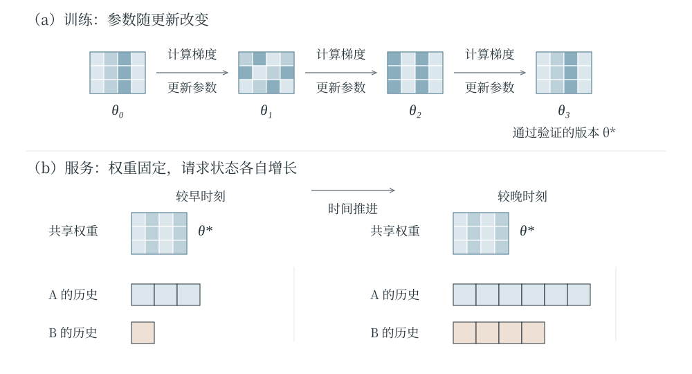
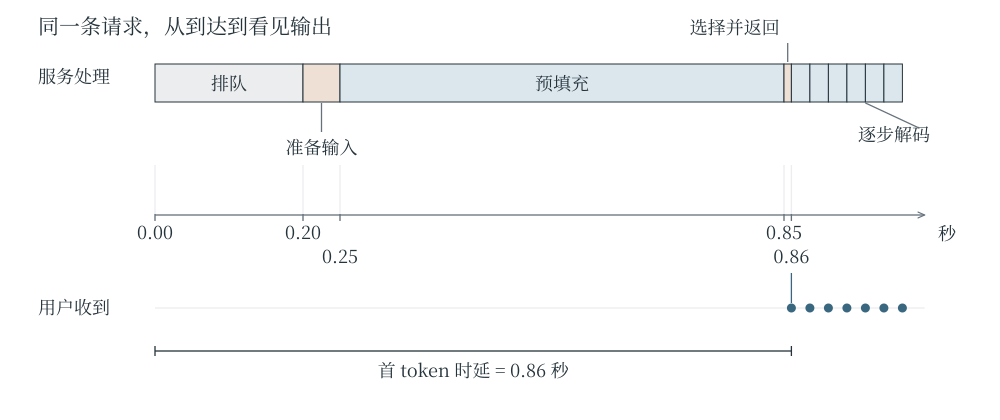
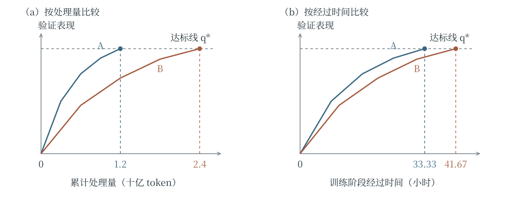
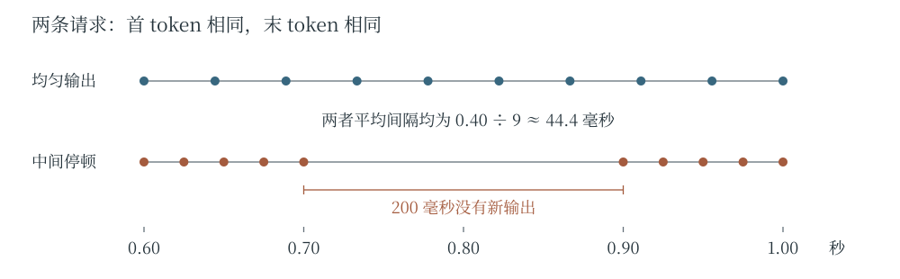
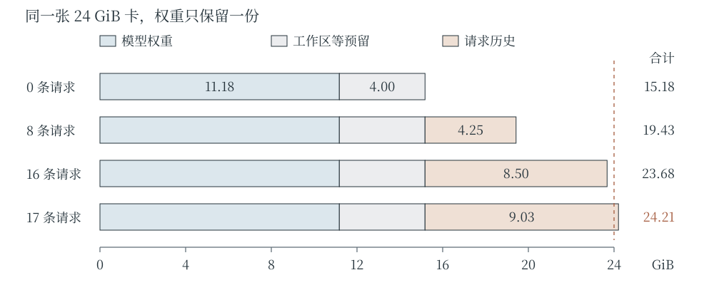
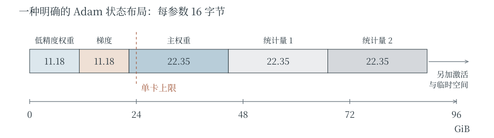
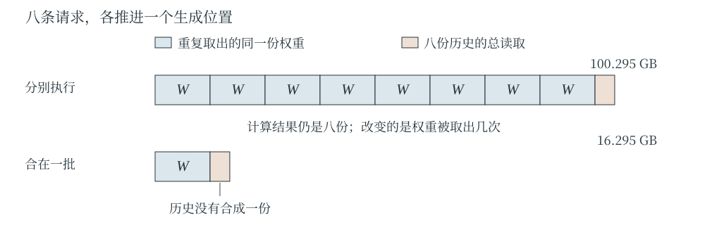
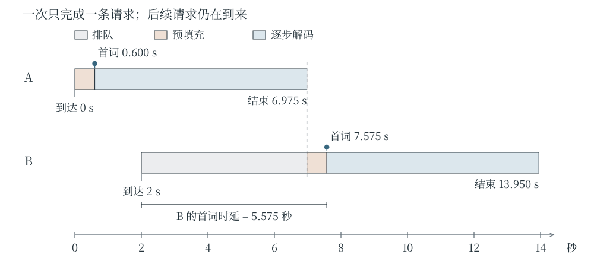

# 第 1 章　AI 基础设施的任务与性能目标

下载模型权重、启动程序、输入一句话，屏幕上便出现了回答。模型能回答问题，只是把它用于实际服务的第一步。接下来还需要考虑请求同时到达、用户等待、设备容量和运行成本。

当第二位用户提交一篇很长的文档时，第一位用户还在接收回答，两人的输出都变慢了。再增加几位用户，程序便报告显存不足。换一张算力更强的卡，速度却没有按规格表上的比例提高。团队决定用自己的数据继续训练，结果同一份权重在推理时可以加载，训练时却连第一步都走不完。

要向团队解释这两次失败，可以先问一句：每来一个人，机器究竟要多存什么、多算什么？一份已经学好的权重可以给许多人共用。每个人刚读到哪里、接下来要用到哪些历史，却得分别保存。训练还得记住前面怎么算的，才能回头修改权重。把这些东西分清楚，才知道显存该留给谁。

**AI Infra 是组织计算设备、存储、网络及其软件，让模型训练和推理能够有效运行的基础设施。** 理解 AI Infra 需要认识各个部件，也需要了解模型产生的计算任务及其数据依赖、数据的存储和传输，以及并发任务如何竞争资源。

判断这套基础设施是否有效，需要把“完成了什么”与“花了多少资源”放在一起看。训练多处理了一倍词元，却没有更早达到验证标准，不能仅凭吞吐量宣布方案更好；推理每秒生成更多词元，却让长请求频繁超时，也没有完成同一项服务承诺。后面会逐层计算运算量、访存量和通信量，用它们解释时间花在哪里；最终仍要回到质量要求、用户负载和资源预算，检查优化是否改善了交付结果。

本章考察两项任务。第一项是训练：在两天内，用领域数据继续训练一个已有的模型，达到事先约定的验证标准。第二项是在线服务：把通过验证的模型交给用户，既及时开始回答，也尽量平稳地输出后续内容。二者使用同一种模型结构，但它们对系统的要求并不一样。

为了把讨论落到数字上，我们约定这是一个包含 **60 亿个参数的稠密语言模型**。这里的“稠密”暂时只表示：主要的矩阵计算会使用这一层的全部权重，而不是只挑少数专家参与。推理服务器有一张可供本进程使用的 **24 GiB 显存**的加速卡。训练服务器该怎样配置，留给后面的预算来判断。

本章的容量、带宽、运行记录和质量曲线都是为说明原理而设定的教学数据，不对应某个具体产品或真实模型的测试成绩。我们会始终区分三种数字：从配置算出的存储量、根据硬件能力估计的时间下限，以及假定已由运行记录获得的实际耗时。混淆它们，往往比某一次乘法算错更容易导致错误的系统设计。

## 1.1　模型训练与权重

### 从一个可调的函数开始

先把神经网络看成一个带有许多可调数值的函数：

```math
y=f_\theta(x).
```

$`x`$ 是输入，$`y`$ 是模型产生的输出，$`\theta`$ 表示所有可调参数。对一个最简单的线性模型，可以写成 $`y=wx+b`$，参数只有 $`w`$ 和 $`b`$；对语言模型，参数通常被排成许多矩阵和向量，分布在不同层中。层的连接方式和各次运算构成模型结构，参数的具体取值则保存在权重文件里。

因此，同样的结构可以有不同的权重。修改权重文件不会自动修改模型结构；只有文件而没有能够解释这些矩阵的程序，也不能完成一次推理。

训练时，模型根据样本计算输出，再与训练目标比较，得到一个衡量偏差的数值，称为损失。训练程序计算每个参数发生微小变化时损失的变化率，这些变化率组成梯度。优化器根据梯度和更新规则，计算下一组参数。

例如，只有一个参数的模型 $`y=wx`$，遇到样本 $`x=2`$、目标值 $`6`$，当前 $`w=1`$，输出就是 $`2`$。若用平方损失

```math
L(w)=\frac{1}{2}(2w-6)^2,
```

那么 $`L'(w)=2(2w-6)`$，在 $`w=1`$ 时等于 $`-8`$。用学习率 $`0.1`$ 做一次最简单的梯度下降，得到

```math
w_{\mathrm{new}}=1-0.1\times(-8)=1.8.
```

新输出是 $`3.6`$，损失从 $`8`$ 降为 $`2.88`$。这个例子很小，但已经出现了训练系统必须承担的几类工作：读样本、计算输出、计算梯度、修改参数。真实语言模型还需要保存大量中间计算结果，才能把梯度沿多层网络传回去。第三章会详细介绍这一过程。

推理时则不同。我们通常固定一组参数，让它处理许多新输入。输入变了，计算过程中产生的中间数据也会变，但服务不会因为刚刚回答了一位用户，就自动修改模型权重。若应用把先前的对话再次放入输入，模型可以利用这些信息；这仍然不同于通过训练改变参数。

### 训练与推理中的参数和状态

图 1-1 把同一组权重的经历画在一条时间线上。训练期间，参数随着更新逐步变化；通过验证后，选定的版本进入服务。服务中的两条请求可以共用权重，却不能随意共用各自的输入和计算状态。



*图 1-1　权重的变化与复用。上半图中每次更新产生新版本，标在两次更新之间的箭头表示参数变化，不表示把所有版本同时保存在显存。下半图把时间上的两个时刻展开：服务权重保持不变，请求 A 和 B 的历史状态却分别增长。矩形面积不代表实际容量。*

这幅图里有一个容易忽略的区别。权重回答的是“模型学会了怎样变换输入”，请求状态回答的是“这一次计算已经进行到了哪里”。参数相同，不意味着两个请求的历史相同。

语言模型往往把先前输入经过部分计算得到的结果保存下来，以便生成下一个词时复用。我们把这类逐位置保存的历史称为 **KV 缓存**。它属于一次具体上下文，通常随上下文变长而增大，并在后续生成过程中被读取。第四章会结合注意力计算解释 K、V 的含义和缓存的复用条件。

于是，磁盘上的权重文件大小，只回答了“这一组参数保存下来有多大”。它没有计入训练中的梯度、优化器状态，也没有计入服务中每位用户的缓存。开头那个“能推理却不能训练”的现象，已经有了线索。

训练结束后，还不能把最后一次更新的权重直接视为合格产品。训练损失变低，可能只是更好地拟合了见过的样本。我们需要用未参与参数更新的验证数据，检查约定任务的效果，必要时还要确认原有能力没有明显退化。把这一检查通过的参数版本交给服务，训练和推理才在这里接上。

## 1.2　一次推理请求的执行过程

### 文本输入与词元

计算设备处理的不是屏幕上的汉字本身。程序首先把文字转换成一串编号，每个编号对应一个 **token，亦称词元**。一个 token 可以是一个字、一个词的一部分，也可能覆盖多个字符，取决于采用的分词器。因此，输入有多少字和模型要处理多少个 token，是两个不同的问题。

本文用 $`n`$ 表示输入 token 数，用 $`m`$ 表示实际返回的输出 token 数。除非明确说明，讨论输出速度时都按 token 计数，而不是按汉字计数。同一句文本换一种分词方式，token 数可能改变；不同模型的 token/s 不能不看这一差异就直接等同于用户的阅读速度。

一条请求进入服务后，程序需要把文字转换成编号，安排它何时执行，把输入放到设备可访问的位置。模型随后处理整段提示词，形成用于预测下一个 token 的输出，同时建立后续生成需要的历史状态。这一阶段通常称为 **prefill，预填充**。

语言模型输出的往往是一组候选 token 的分数。程序将这些分数转成概率，再根据规则选择一个 token；选择可以是取最大概率，也可以是按照概率采样。这个 token 返回给用户后，还要作为新的输入参与下一步计算，模型才能继续产生后续 token。这个逐步推进的阶段称为 **decode，逐步解码**。

这里“逐步”有实际的数据依赖：没有选定前一个 token，通常就还不知道下一次该输入什么。同一条自回归生成不能像处理一堆彼此独立的图片那样，任意把所有未来步骤同时开始。系统可以寻找更好的执行和验证方法，但必须解释它怎样满足或改写了这项依赖。

### 请求延迟的组成

图 1-2 给出一条教学请求的记录。我们把客户端发出请求的时刻记为零；为了单独观察服务内部，先忽略请求上传时间，把它与服务接收时刻视为相同。



*图 1-2　同一条请求的不同时间。横轴为秒，纵向对齐表示同一时刻。请求前 0.20 秒在等执行机会，0.20–0.25 秒准备输入，0.25–0.85 秒执行预填充；选择并返回第一个 token 再花 0.01 秒。下方圆点是用户可见的返回事件，不能把它们误认为整个模型只在这些瞬间计算。*

从用户角度看，第一次看到输出是在 $`0.86`$ 秒。若只给预填充的设备运算计时，会得到 $`0.60`$ 秒。两个数字都可以正确，但它们回答的不是同一个问题。用户不能跳过前面的排队和准备，也不能在 token 还没有返回时看到它。

首个 token 返回以后，后续步骤继续计算，并不断扩大这条请求的历史状态。按图中的设定，相邻输出间隔是 $`0.025`$ 秒，即 $`25`$ 毫秒。如果请求一共输出 $`256`$ 个 token，首个 token 之后还有 $`255`$ 个间隔，最后一个 token 的到达时刻是

```math
T_{\mathrm{end}}=0.86+(256-1)\times0.025
=7.235\ \mathrm{s}.
```

减去的这个 $`1`$ 很重要。预填充结束后的选择已经给出了第一个输出，并不是还需要再做 $`256`$ 次逐步解码才得到 $`256`$ 个输出。以后估计解码工作量和缓存长度时，我们还会遇到同样的边界。

现在把另一条请求放到同一台服务器上。它可能在当前请求计算时到达，但到达并不等于立刻开始。服务程序要决定：让它等当前请求完全结束，还是把两条请求组织到同一次设备执行中？如果新请求的提示词特别长，先处理它会不会推迟已有用户的下一个 token？这些都是调度问题。模型结构本身并没有替我们作出这些决定。

### 应用、模型与硬件的分工

从这条时间线往下追，就能看见 AI Infra 各层的分工。

应用组织输入并决定何时返回结果。服务系统接收请求，管理队列、运行中的请求及其状态。模型程序规定需要执行的矩阵乘法、归一化等运算；框架和运行时将这些运算提交给设备。设备从存储中读取数据，执行计算，并写回结果，供后续运算使用。如果计算分布在多台机器上，还需要通过互联网络传输数据。

这些分工之间存在可以改变的接口。例如，相邻的两次运算可以由两个独立程序完成，中间结果写回显存；也可以组合成一个设备程序，让结果在靠近计算单元的位置直接使用。又例如，两位用户可以分别执行模型，也可以一起执行，让同一块刚读入的权重同时服务两组输入。选择变了，数学结果未必改变，数据移动的次数却可能大不相同。

训练作业也要经过这些层，其运行由训练循环推动。数据读取程序准备下一批样本；设备完成前向和反向；多设备之间可能交换梯度；优化器更新参数，然后开始下一步。样本没准备好、梯度没汇齐或更新还没完成，都会阻止后面的工作。要缩短训练时间，首先要找到下一步迟迟无法开始的原因。

因此，AI Infra 的工作范围不能只用“GPU 优化”或“部署框架”概括。它研究的是这些部件怎样配合完成任务。后文每进入一层，都会沿着具体数据和依赖走下去，而不是把层名当作已经解释过的原理。

## 1.3　训练与推理的性能目标

训练和服务共用模型，却有不同的完成条件。训练需要得到一份通过验证的权重，中间快的一步只有在能够持续推进训练时才有价值。服务需要对每条请求作出响应，同一秒处理的总量和某个用户等待的时间也可能朝不同方向变化。下面先为这两项工作分别选定评价指标。

这也是工业基准设计里很实际的选择。Peter Mattson 等人设计 MLPerf Training 时，为训练任务指定要达到的质量门槛，再比较到达门槛的用时。把它用到这里：一种配置即使每步更慢，只要用更少的步数达到同一验证标准，仍可能更早交付模型。服务端则要记录请求何时到、何时得到回答，训练的这只时钟到这里就不够用了。[MLPerf Training Benchmark](https://proceedings.mlsys.org/paper_files/paper/2020/hash/411e39b117e885341f25efb8912945f7-Abstract.html)

### 训练：尽早得到一份达到要求的权重

训练团队最容易获得的数字，是一步用了多久，或者每秒处理了多少 token。这些指标有助于诊断问题，却不能直接说明训练任务能否在两天内完成。

设达到约定验证标准之前，总共处理了 $`D`$ 个有效训练 token，训练阶段平均每秒处理 $`r`$ 个，则这一部分耗时近似为

```math
T_{\mathrm{train}}=\frac{D}{r}.
```

这里的“有效”排除了仅用于补齐形状、没有计入训练目标的填充位置。如果训练反复遍历同一批数据，$`D`$ 计算的是实际参加训练的 token 次数，不是磁盘上去重后的数据大小。

提高 $`r`$ 固然有帮助，但 $`D`$ 不一定保持不变。一次使用更多样本进行更新，可能让设备更有效率，也会改变参数更新的频率和优化过程。不能只根据每秒处理量，就认定达到同等质量的日期一定提前。

假设对同一个模型做两组训练试验，使用相同的验证任务和达标规则，获得表 1-1。方案 B 增大了每次更新使用的全局批量；表中的达标 token 数是假定由完整试验观察到的结果，不是根据批量大小推算出来的规律。

| 配置 | 训练阶段吞吐 | 达到相同验证标准的 token 数 | 训练阶段耗时 |
|---|---:|---:|---:|
| A | 10,000 token/s | 12 亿 | 120,000 s，即 33 小时 20 分 |
| B | 16,000 token/s | 24 亿 | 150,000 s，即 41 小时 40 分 |

*表 1-1　吞吐提高而达标更晚的一种可能情形。数字用于教学；增大批量不一定产生这种结果，是否发生要由质量曲线验证。*

方案 B 的吞吐高了 $`60\%`$，但达标所需处理量翻倍，最终训练阶段反而多用了 8 小时 20 分。图 1-3 的左图按处理过的数据量比较，右图按经过的时间比较。同一组质量曲线换了横轴，才回答了系统交付问题。



*图 1-3　把质量曲线换算到时间轴。左图的横轴是处理过的 token 数，右图除以各配置的吞吐，换算成小时；纵轴是同一个约定的验证指标。曲线形状为示意，达标点对应表 1-1。它说明需要同时测量质量进展和执行速度，不说明大批量必然更慢。*

真实的交付时间还包含排队获得训练资源、验证、保存检查点以及故障恢复。检查点是供以后恢复训练的状态快照；除了权重，通常还需要优化器状态及训练进度等信息。如果作业中断后只能从很早的快照继续，一段已经花过的钱和时间就要再花一次。

这里也不能简单把所有计时器相加。验证如果独占同一组设备，确实可能暂停训练；保存若部分与计算重叠，只应计算它真正推迟完成时刻的部分。最终应在一条从开始到达标的时间线上，计入那些延长交付的等待。

训练任务的优化目标由此明确了：在质量标准成立的前提下，缩短交付时间、减少所需资源。若某项改动使吞吐变好却改变了训练质量，就必须连同质量一起评价。

### 服务：让到来的请求按时完成

服务没有一个所有用户共同等待的训练终点。请求会不断到来，评价时需要分别记录每条请求的到达和完成时刻。

对一条输出了 $`m`$ 个 token 的请求，记发出时刻为 $`t_0`$，各输出到达客户端的时刻为 $`t_1,t_2,\ldots,t_m`$。三个直观的量是：

```math
T_{\mathrm{first}}=t_1-t_0,
\qquad
\Delta_i=t_i-t_{i-1}\quad(i=2,\ldots,m),
\qquad
T_{\mathrm{all}}=t_m-t_0.
```

它们分别是**首 token 时延**、每一步的**输出间隔**和完整请求时延。首 token 时延常写为 TTFT。输出间隔反映用户是否觉得回答卡顿；完整请求时延则关乎等待完整答案后才能开始的后续工作。

还可以把首 token 后的全部时间平均到其余输出上：

```math
\overline{\Delta}=\frac{t_m-t_1}{m-1},\qquad m\gt 1.
```

这个平均值常称为 TPOT，即平均每个后续输出 token 的耗时。不同工具对 ITL、TPOT 的命名和聚合方式并不完全一致，读报告时应检查定义；本文始终把单个间隔与它们的平均值分开。若只输出一个 token，这个平均值没有定义，不应填成零。

图 1-4 给出两个各返回十个 token 的短片段。两者首 token 都在 $`0.60`$ 秒到达，随后总共都花 $`0.40`$ 秒，平均输出间隔同为约 $`44.4`$ 毫秒。上面一条平稳输出；下面一条有八个 $`25`$ 毫秒间隔，中间却停顿了 $`200`$ 毫秒。



*图 1-4　平均值没有展示出来的停顿。圆点是十个可见输出事件，横向距离按实际时间绘制。下行八个短间隔共 200 毫秒，加上一个 200 毫秒长间隔，与上行的总时长相同。只保留首末时刻，会丢掉中间这次停顿。*

在真实接口中，一个返回的数据块还可能包含多个 token。若测量工具只能观察块到达时刻，就不能把同一块内所有 token 都解释成设备同时算出的结果；客户端缓冲和网络传输也会改变可见间隔。因此，“用户看见的时间”和“设备完成计算的时间”都值得测，但不能混用。有关首词、整体时延和吞吐的常见测量口径，可对照 [NVIDIA 的推理基准说明](https://developer.nvidia.com/blog/llm-benchmarking-fundamental-concepts/)。

服务吞吐则是对一段时间内所有请求计数：每秒完成多少条请求，或返回多少个输出 token。假如一台机器每秒返回 1,000 个 token，可能是二十位用户各得到 50 个，也可能是一百位各得到 10 个。总量相同，个体体验可能完全不同。

### 负载与服务目标

现在为在线服务设定具体要求。假设目标负载平均每秒到来 $`0.5`$ 条请求，典型输入为 $`4,096`$ 个 token，典型输出为 $`256`$ 个。我们希望至少 $`95\%`$ 的请求能在一秒内返回首个 token，并对持续输出的停顿另设约束。这些约束称为服务等级目标，常缩写为 SLO。

“平均每秒 $`0.5`$ 条”还没有描述完整负载。每两秒均匀来一条，与每二十秒同时来十条，平均到达率相同，排队却不同。真实压测还要保留输入长度、输出长度、突发程度和请求之间的间隔。按要求本来该到来的请求，不能因为测试程序正在等上一条完成就悄悄推迟，否则系统产生的等待会被隐藏。

说“95% 的请求首词不超过一秒”，也不能只报平均首词时延。应把每条请求的首词时延从小到大排列，查看相应分位位置。失败和超时请求同样需要计入约定口径，不能删除后只统计成功者，再宣布系统满足目标。

对逐步输出的约束也要交代聚合方式。例如，“95% 的请求没有出现超过 200 毫秒的停顿”，与“汇总全部输出间隔，其中 95% 不超过 200 毫秒”不是同一要求。后一种口径会让长回答贡献更多样本。本章的容量推算不依赖某一种具体选择，但做方案比较前必须固定它。

因此，服务系统需要在明确的输入分布、质量和时延要求下，确定能够持续处理多少请求。只看 token/s 的峰值，可能忽略排队对用户等待时间的影响。

### 用户延迟与优化空间

设用户从发出问题到拿到首词花了 200 ms。按一条不重叠的时间线量得，等队列 80 ms，准备输入 20 ms，设备计算 100 ms。若把设备计算加速四倍，新的首词时间是 $`80+20+25=125`$ ms，用户看到的加速为 1.6 倍。即使计算瞬间完成，上限也只有两倍。这是 Amdahl 定律在一条请求上的写法，先找出能改变的那段，再算它占整条路径多少。

不过，若许多请求排在同一设备前面，服务变快也可能让后来的请求少等。这时直接把每次排队固定为 80 ms 会低估收益。可以做两次对照，先让设备空闲、一次只送一条，确定省下的执行时间；随后按相同到达时刻重放一组请求，把队列长度一起量出来。前一次测量设备执行时间，后一次测量排队变化对用户的影响。在第三十五章做容量决策时，我们还会用到这两个口径。

## 1.4　单卡推理与训练的资源预算

确定交付标准后，才能判断一套配置是否够用。我们先估计它能存下多少状态，再估计每一步至少要做多少计算和数据传输。这些数字可以帮助排除明显不可行的方案；具体速度仍要通过运行测量。

现在回到那份 60 亿参数的权重。先做一个最简单的实现：模型常驻一张卡，收到一条请求后完成它的全部输出，再处理下一条。缓存按完整历史保存，权重使用每个数值占 2 字节的格式；我们暂不引入压缩、跨卡切分或复杂调度。

这个基线不一定适合上线，但容易说明白，也容易查出错误。优化之前，先弄清它在哪里受到限制。

### 模型权重与缓存占用

记参数量为 $`N`$，每个参数的存储字节数为 $`b`$，权重占用是

```math
M_{\mathrm{weights}}=Nb.
```

本例 $`N=6\times10^9`$、$`b=2`$，因此权重占 $`12\times10^9`$ 字节，即 $`12`$ GB。但本章给定的显存用 GiB 表示，必须先统一单位：

```math
1\ \mathrm{GB}=10^9\ \mathrm{bytes},\qquad
1\ \mathrm{GiB}=2^{30}\ \mathrm{bytes},
```

```math
M_{\mathrm{weights}}=\frac{12\times10^9}{2^{30}}
\approx11.18\ \mathrm{GiB}.
```

不是名称相近的单位都能直接相减。通信链路还常使用 bit/s，8 bit 才组成 1 byte；后面涉及网络时，我们会继续明确这些换算。

加载权重后，24 GiB 中还剩约 12.82 GiB。它不能全给用户缓存：程序自身、运算所需的临时空间、其他中间数据及余量也占显存。为把第一次预算算得清楚，先给这些用途统一保留 4 GiB，并假定它在本例讨论的批量范围内足够。这只是待后续测量验证的预算假设，真实临时空间会随形状和实现变化。

于是，能分给所有请求历史的预算为

```math
M_{\mathrm{history}}=24-11.1759-4
\approx8.8241\ \mathrm{GiB}.
```

再给模型一个明确的状态参数：**全模型每保存一个历史 token，需要 128 KiB**。这是本章设定的模型属性，不由“60 亿参数”自动推出。第四章会根据层数、头数和向量维度计算它。参数量接近的两个模型，历史状态完全可能不同。

一条输入长为 $`4,096`$ 的请求，仅输入部分的历史就占

```math
4,096\times128\ \mathrm{KiB}
=512\ \mathrm{MiB}=0.5\ \mathrm{GiB}.
```

但回答还会继续增长。如果要为最多 $`256`$ 个输出 token 留足空间，按 $`4,096+256=4,352`$ 个位置作保守预留，每条请求占

```math
4,352\times128\ \mathrm{KiB}
=544\ \mathrm{MiB}=0.53125\ \mathrm{GiB}.
```

在标准逐步生成中，刚返回的最后一个输出可能还没有再次送入模型，因此还未写入缓存；在仅生成这 256 个输出的边界，实际位置数可为 4,351。本例多留一个位置以简化容量预算，并明确这不是对实际写入时刻的描述。

用历史预算除以每条请求预留量，得到最多同时容纳

```math
C_{\mathrm{memory}}=
\left\lfloor\frac{8.8241}{0.53125}\right\rfloor
=16
```

条这样的请求。向下取整是因为第十七条的状态不会只保存一个零头。



*图 1-5　同一份权重，加上不同数量的请求状态。各段长度按 GiB 比例绘制，虚线为 24 GiB 容量。16 条请求共需约 23.68 GiB，17 条需约 24.21 GiB。这里给出的是假定工作区足够时的容量限制，不是服务吞吐，也不是可直接上线的并发配置。*

图 1-5 的每一行只放一份权重。没有必要因为同时处理十六位用户，就在同一进程中复制十六份参数；但在没有可复用前缀的假设下，十六份请求历史确实要分别保留。

如果输入从 4,096 增到 8,192 个 token，输出上限不变，每条预留状态变为 $`1.03125`$ GiB，可容纳数量降为 8。模型权重一个字节都没有增加，系统的并发容量却几乎减半。这说明负载形状是容量预算的一部分，单看模型参数量不够。

另一方面，缓存放得下也不代表能及时回答。十六条请求可以一起占着显存等待，用户依然可能很不满意。容量和速度需要分别核算。

### 训练所需的额外显存

假设继续训练时要更新全部 60 亿个参数，采用一种常见的混合精度 Adam 存储布局：低精度权重每参数 2 字节，梯度每参数 2 字节，高精度主权重每参数 4 字节，优化器还为每个参数保存两个各 4 字节的统计量。

保留高精度主权重，是为了让微小更新更可靠地累计；两个优化器统计量分别跟踪梯度的一阶和二阶信息，用来组织后续更新。此处不需要记住 Adam 的公式，但需要知道：它的更新规则本身会产生跨训练步保留的数据。

| 常驻状态 | 每参数字节数 | 60 亿参数对应容量 |
|---|---:|---:|
| 参与低精度计算的权重 | 2 | 12 GB |
| 梯度 | 2 | 12 GB |
| 高精度主权重 | 4 | 24 GB |
| 第一份优化器统计量 | 4 | 24 GB |
| 第二份优化器统计量 | 4 | 24 GB |
| 合计 | 16 | 96 GB，约 89.41 GiB |

*表 1-2　一种明确的训练状态布局。不同优化器、精度与实现可能采用不同存储方式，梯度转换还可能产生临时峰值；16 字节不是所有训练程序的固定常数。*



*图 1-6　训练状态和推理权重不能按同一个文件大小估计。横轴仍为 GiB，五段合计约 89.41 GiB，竖虚线标出一张卡的 24 GiB。右侧箭头表示还需要加入随输入与批量变化的激活和临时空间，没有给它们虚构一个固定数值。*

还没算前向中间结果，这些状态就已远超单卡容量。这里的限制不能靠“让计算再快一点”解决：需要同时存在的数据没有地方放。

增加到八张同样的卡，总显存达到 192 GiB，程序也不一定能运行。如果采用最直接的数据并行方式，每张卡仍需保存一整份 89.41 GiB 状态，单卡容量依然不足。要利用全部显存，需要明确状态如何分片、何时读取，以及更新后的数据保存在哪些设备上。后续章节将讨论这些分片方式及其通信开销。[DeepSpeed 的内存估算文档](https://deepspeed.readthedocs.io/en/stable/memory.html)也分别计算模型状态、分片及实现相关的峰值，实际套用时应采用所用配置的口径。

### 生成时间的理论下界

存储容量回答“能否同时放下”，接着要问“运行时必须做多少工作”。

先看稠密层中的矩阵与向量相乘。若权重矩阵有 $`a\times b`$ 个元素，把一个长度为 $`b`$ 的向量变换成长度为 $`a`$ 的输出，需要计算 $`a`$ 个内积。每个内积做约 $`b`$ 次乘法和 $`b`$ 次加法，因此共约 $`2ab`$ 次浮点运算。我们按乘法一次、加法一次计数，一次乘加算两次 FLOPs。

将模型主要线性层的权重数量合计为近似的 $`N`$，处理一个新 token 的线性计算量约为 $`2N`$。这是一个用于第一轮估算的近似：它没有精确计入词嵌入查表、注意力中的位置交互及各种逐元素运算，也不声称所有参数在每一步都以完全相同的方式读取。对本例，先把主要矩阵权重近似为全部 60 亿个参数，得到每一步约 $`12`$ GFLOPs。

设教学设备对我们采用的数值格式和稠密计算，峰值算力为 $`120`$ TFLOP/s，显存数据接口的带宽上限为 $`1`$ TB/s。两者都是十进制单位，其中算力每秒可完成 $`120\times10^{12}`$ 次浮点运算，带宽每秒最多传输 $`10^{12}`$ 字节。

如果单看计算，理想耗时只有

```math
T_{\mathrm{compute}}=
\frac{12\times10^9}{120\times10^{12}}
=0.0001\ \mathrm{s}=0.1\ \mathrm{ms}.
```

可是，这些乘法的操作数从哪里来？设权重远大于片上缓存，逐个请求执行时，一步需要从显存读取近似整份 $`12`$ GB 权重；暂且假定每份权重只读一次，没有额外重复读取，那么仅搬权重就至少需要

```math
T_{\mathrm{weights}}=
\frac{12\times10^9}{10^{12}}
=12\ \mathrm{ms}.
```

计算单元即使有能力在 $`0.1`$ 毫秒完成那些乘加，也要等操作数抵达。把算力翻倍，只把前一个数降到 $`0.05`$ 毫秒，没有改变这 $`12`$ 毫秒的数据供给约束。

再考虑本例 4,096 个历史位置的 KV 缓存，它占 $`512`$ MiB，即 $`536,870,912`$ 字节。对采用完整历史注意力的这个基线，粗略按每步至少读取全部历史一次计，权重和历史合计读取时间约为

```math
T_{\mathrm{read}}=
\frac{12\times10^9+536,870,912}{10^{12}}
\approx12.537\ \mathrm{ms}.
```

这是特定实现假设下的理想读带宽限制，还没有计入全部写回、临时张量、其他运算和启动开销。若缓存命中、表示方式或访问算法改变，就要重新计算读量；不能把它当成所有语言模型的物理常数。

通常应把两种限制先写成

```math
T\ \geq\ \max\left(\frac{F}{P},\frac{V}{B}\right),
```

其中 $`F`$ 是操作次数，$`P`$ 是对应精度和运算类型下的计算能力，$`V`$ 是经过所考察接口的数据量，$`B`$ 是该接口带宽。把多种精度的运算一概除以某个最高峰值，或把片上读取误计成显存读取，都会破坏这个估计。

这里取最大值而不是直接相加，是因为计算和搬运可能重叠：一块数据正在计算，另一块已经开始读取。取最大值表达“无论重叠做得多好，也不能短于更慢的那一项”。它不保证两项能完全重叠，更不保证程序会达到该时间。若实际数据依赖迫使两段串行，时间还会增加。

### 批处理中的权重复用

现在同时考虑八条独立请求，每条都处于历史长为 4,096 的解码阶段。最简单的方法是分别做八次模型计算。按刚才的读取假设，权重读八遍，历史各读一遍，总读量约为

```math
V_{\mathrm{separate}}=8\times(12+0.53687)
\approx100.295\ \mathrm{GB}.
```

另一种方法是把八个输入向量并成一小块矩阵。读取一块权重后，先用它与八条请求对应的输入计算，再读取下一块权重。假如实现能做到这些权重在这一批中只从显存读取一次，则总读量成为

```math
V_{\mathrm{batch}}=12+8\times0.53687
\approx16.295\ \mathrm{GB}.
```



*图 1-7　批处理可以减少权重的重复读取。上方八段等长的蓝灰色块表示分别处理八个请求时的权重读取量，下方表示合批后读取一次。暖色段表示八份请求历史的总读取量。条长按 GB 比例绘制；图中仅比较这两类读取，其他流量和执行开销未列出。*

八条请求仍然各自计算了应有的结果，主要线性乘加总量仍约为 $`8\times12=96`$ GFLOPs；变化的是同一份数据的使用次数与从显存取出的次数之间的关系。这就是批处理能够提高效率的一个根本原因。

在假定带宽下，两种读量分别对应约 $`100.295`$ 毫秒和 $`16.295`$ 毫秒的理想传输时间。两数之比约为 $`6.15`$，是这部分读量减少的比例，不是我们已经测出的端到端加速比。实际矩阵布局、缓存、执行效率与其他开销还会改变结果。

同时，批中一次执行的理想读时间 $`16.295`$ 毫秒，比只算一条请求时的 $`12.537`$ 毫秒更长。系统在同一批中推进了更多请求，但不能据此断言每个用户的输出间隔都更短。如果为了凑齐八条而让第一条久等，首词时延还可能恶化。吞吐与个体时延的区别，在这个很小的算例中已经出现。

把视角换回预填充，也就容易理解两阶段为何不同。4,096 个提示位置让主要线性层有机会一次处理许多输入，其计算量粗估为 $`4,096\times12`$ GFLOPs，即 $`49.152`$ TFLOPs。即使线性计算达到上述峰值，仅这一部分也需要约 $`0.4096`$ 秒，此外还有注意力等工作。预填充可以在多个位置之间复用权重，因此不能机械地把单 token 解码耗时乘以 4,096 来预测它的耗时；也不能从一条解码请求受带宽限制，就推出所有预填充都一定受算力限制。需要重算计算量、数据量和依赖。

### 并发请求与排队延迟

预算最后要回到“请求不断到来”。先假设基线的单请求记录是：预填充连同首 token 产生共 $`0.60`$ 秒，之后 $`255`$ 次解码各 $`25`$ 毫秒。为突出排队，这里暂时忽略第 1.2 节单列的输入准备、返回和网络时间。总服务时间为

```math
S=0.60+255\times0.025=6.975\ \mathrm{s}.
```

这是算例另外给定的运行记录，量级上与先前估算的理论下限相容。

一条请求独占服务器时，$`0.60`$ 秒就看到首词，符合一秒目标。但我们的基线要把当前请求完整做完，才开始下一条。因此它每秒最多完成约

```math
\mu=\frac{1}{6.975}\approx0.143
```

条这样的请求。目标到达率却是 $`0.5`$ 条每秒，超过它能持续处理的速度。



*图 1-8　单请求测得快，不能推出持续服务合格。横轴是同一台服务器上的时间。A 在 0 秒到达，6.975 秒结束；B 在 2 秒到达，等到 6.975 秒才能开始，7.575 秒才产生首词。B 的首词时延是 7.575−2=5.575 秒，其中 4.975 秒纯粹在排队。图中只画两条请求，后续请求没有消失，而是继续积在队列里。*

在图 1-8 中，第二条请求进入设备后的计算一点没有变慢。它失败在开始之前。若请求继续每两秒来一条，第 $`j`$ 条的开始时刻是 $`(j-1)S`$，到达时刻是 $`2(j-1)`$，等待时间便是

```math
W_j=(j-1)(S-2).
```

因为 $`S\gt 2`$，等待随请求序号持续增长。这个结论不需要复杂的排队论，就足以否决当前上线方案。

若把平均到达率写作 $`\lambda`$，对这种每次只处理一条、服务时间固定的简单系统，至少要满足 $`\lambda S\lt 1`$，才留有稳定服务的余地。本例 $`\lambda S=3.4875`$，显然超过能力。即便满足这一条件，突发到达也可能造成很长的等待，所以它只是基本容量检查，不是尾时延保证。对能动态合批、服务时间随并发改变的系统，则应重新建立模型，不能拿单请求的 $`S`$ 原样套用。

基线明确了接下来要检验的问题。可以尝试合并多个请求，测量持续处理能力、首词时间和输出间隔。如果一台设备仍不足，再考虑增加服务副本并调整请求分配。

先试一个不用猜测排队时长的改法。仍然每两秒来一单，把请求依次分给四个独立副本。第一个副本在第 0 秒接单，第 6.975 秒完成，下次轮到它已是第 8 秒。同样的规律适用于另外三台，于是在这串规则到达的请求中，每个人都能在 0.60 秒看到首词。换成三个副本，每台每 6 秒就轮到一次，上一个请求还差 0.975 秒才能结束，等待会越积越多。

四个副本能否据此承诺“一秒出首词”？把到达方式改为每 16 秒同时来八单，长期平均仍是每两秒一单。前四单立即开工，后四单只能等到第 6.975 秒，首词时延变成 7.575 秒。没有一台设备变慢，达标的请求却从全部变成一半。决定该配几个副本时，重放原有的到达时刻，才能保留这种差别。

### 确定计时范围

我们已经使用了三个不同的“时间”：硬件给出的理想下限、设备完成一段工作的执行时间、用户从发出请求到收到输出的等待时间。实际实验应让它们能够相互对照。

设备执行往往是异步的。CPU 提交一项 GPU 工作之后可以先返回，GPU 还在队列中等待或执行。如果只在提交函数前后读取 CPU 时钟，可能只量到提交的时间。测量一段独立设备工作时，需要采用设备侧事件并等待其完成，或者在正确的边界同步；[PyTorch 的 CUDA 语义文档](https://docs.pytorch.org/docs/stable/notes/cuda.html#asynchronous-execution)明确说明了这个问题。

但这不意味着在真实服务的每一步都插入全局同步。过多同步会拆掉原来存在的并发，使被测程序本身变慢。检查设备工作量和记录用户时延，是两种相互补充的测量：前者帮助解释时间去了哪里，后者确认用户最终得到了什么。

同样，第一次运行可能需要加载权重、分配空间或编译程序。若要研究稳定运行，就应说明预热过程；若要研究扩容后的首批请求，这些开销又必须包含在内。不能一面排除冷启动，一面用所得数字承诺新实例立刻提供同等能力。

两个任务还有不少细节需要解决，但主要限制已经清楚。训练状态放不进单卡，增加设备时就要安排状态怎样分担。服务能够加载权重、单条请求首词时间合格，也仍需验证目标到达率下的表现。评价方案时，模型、负载、资源和指标都需要写明。

第一篇接下来就用这两项任务读模型。第二章先试一次几乎不要额外空间的矩阵转置，看它会不会让下一次读取变慢。第三章让权重学起来，算一份中间结果该留下还是重算。第四章用同一套权重分别训练、生成，找出哪些工作能够并行、哪些历史值得保存。到了第五章，我们才有依据改变模型本身：每个位置少存几组键值，还是让下一次查询少看一些位置？前者节约容量，后者还能少做一些乘法，两者都要回到原任务检查回答质量。

## 练习与解答

本章保留三道题。它们分别改变容量、速度和交付条件，检验的是判断能否跟着条件一起改变。

### 1. 输入翻倍以后

沿用本章 24 GiB 显存、12 GB 权重、4 GiB 其他预留、每 token 128 KiB 历史状态。若输入变成 8,192 个 token，输出仍最多 256 个，按保守预留最多可容纳多少条？如果把输出上限再改成 2,048 个，结果如何？这些数字能否直接作为服务并发配置？

**解答。** 历史预算仍为约 $`8.8241`$ GiB。第一种情况每条占 $`(8,192+256)\times128\ \mathrm{KiB}=1.03125`$ GiB，向下取整得到 8 条。第二种情况每条占 $`(8,192+2,048)\times128\ \mathrm{KiB}=1.25`$ GiB，只能容纳 7 条。二者只是当前预留假设下的容量界限。要用于上线，还需验证工作区峰值、分配开销与安全余量，并测试该并发下的首词、输出间隔和持续处理能力。容量允许 8 条，不代表第八条能按时得到回答。

### 2. 换一张算力翻倍的卡

对本章单请求的一步解码，只比较 12 GFLOPs 线性计算和 12 GB 权重读取。原卡是 120 TFLOP/s、1 TB/s。方案 A 只把算力翻倍；方案 B 只把显存带宽翻倍。各自的理想下限是多少？若原程序实际每步 25 毫秒，能否据此断言方案 B 会变成 12.5 毫秒？

**解答。** 原来的两项时间为 0.1 和 12 毫秒，下限取两者较大值，即 12 毫秒。A 把计算时间降为 0.05 毫秒，较大项仍是 12 毫秒。B 保持计算时间 0.1 毫秒，读取时间降为 6 毫秒，下限变为 6 毫秒。不能断言实测耗时减半：题目尚未计入 KV 读取、其他算子、调度和同步等工作，其中有的受带宽影响，有的不受影响。下限变化给出了试验方向，没有替代测量。

### 3. 步速更快，什么时候值得？

表 1-1 中 B 采用更大的全局批量，吞吐为每秒 16,000 token。若先不计其他开销，它达到相同质量所需的 token 数必须小于多少，才会比 A 更早完成？如果 A、B 分别使用 4 张和 8 张相同的卡，仅比较原表中的训练阶段 GPU 时，哪个更省？

**解答。** A 的训练阶段耗时为 120,000 秒。因此 B 要更早，必须满足 $`D_B/16,000\lt 120,000`$，即 $`D_B\lt 19.2`$ 亿 token。等于 19.2 亿时两者同时完成，原表中的 24 亿则超出了这个界限。按原表耗时，A 消耗 $`4\times(33+20/60)\approx133.33`$ GPU·小时，B 消耗 $`8\times(41+40/60)\approx333.33`$ GPU·小时，A 更省。GPU·小时还不是完整货币成本，真实比较也需计入设备价格、网络、存储和其他资源；这道题已经足以说明“每秒更多 token”与“更早、更省地得到模型”不是同一判断。

## 资料说明

本章的小模型梯度计算、容量预算、训练比较和请求时间线均为独立教学算例。为便于核查，算例条件集中保存在 [本章数据文件](../../experiments/ch01/cases.json)，复算程序见 [本章复算脚本](../../experiments/ch01/verify.py)。脚本只检验算术和教学假设之间是否一致，不声称在 GPU 上复现了上述运行时间。

正文中引用的官方资料分别用于核对测量口径、训练内存布局和异步计时。关于多请求共享权重、历史状态管理与推理吞吐的系统联系，还可参见 [PagedAttention 原始论文](https://arxiv.org/abs/2309.06180)；分页机制留到推理章节推导，本章的容量数字不依赖读者提前理解该论文。

[全书目录](../../README.md) · [下一章 · 张量表示与程序执行](ch02.md)
