# 第 2 章　张量表示与程序执行

第一章计算过模型的参数量、状态大小和执行时间。要理解这些估算，还需要回答一个问题：当我们写下“两个向量做内积”时，计算机究竟做了什么？

在纸上，向量已经在那里，加号和乘号给出了关系，写下等号就可以继续推导。机器则必须知道每个数保存在哪里，按什么顺序读它们，把哪两个数送去相乘，以及中间结果写到什么地方。读者熟悉的线性代数决定了应当得到的结果，但它没有唯一规定这些执行细节。

举个选择：矩阵转置以后，下一步要读它的行。可以只改行列的解释，也可以真把这些数按新顺序抄一遍。前者几乎立刻完成，读一行时却可能要在内存里跳很远。若下一步只读一次，和它要反复读八次，答案会一样吗？本章先弄清两份程序各会读到什么，末尾用同一批数计时，把复用几次才值得复制算出来。

本章用一个小算例说明公式怎样落实为计算步骤。令

```math
\begin{aligned}
A&=\begin{bmatrix}1&2&3\\4&5&6\end{bmatrix},\\[4pt]
x&=\begin{bmatrix}2\\-1\\1\end{bmatrix},\qquad
b=\begin{bmatrix}-4\\1\end{bmatrix}.
\end{aligned}
```

先计算 $`z=Ax`$，再加上 $`b`$，最后把负数变成零：

```math
\begin{aligned}
z&=Ax=\begin{bmatrix}3\\9\end{bmatrix},\\[4pt]
u&=z+b=\begin{bmatrix}-1\\10\end{bmatrix},\\[4pt]
y&=\max(u,0)=\begin{bmatrix}0\\10\end{bmatrix}.
\end{aligned}
```

这里的最大值运算逐元素进行。后面会把它叫作 ReLU 激活函数；现在把它当作“遇到负数就输出零，否则保留原值”即可。这段计算已经包含神经网络中常见的线性变换、偏置和非线性操作，不过我们暂时固定 $`A`$ 和 $`b`$，只研究怎样执行它。第三章将介绍这些参数如何通过训练得到。

本章的程序很短，即使从未写过代码，也可以对照表格逐步执行。读的时候留意两件事：公式中的对象对应内存里的哪些数值，公式中的依赖又对执行顺序提出什么要求。

## 2.1　一个求和号怎样变成一段程序

### 计算一个输出元素

$`A`$ 的第一行与 $`x`$ 做内积，结果是

```math
z_0=1\times2+2\times(-1)+3\times1=3.
```

从本章开始，程序中的下标采用从零开始的约定：第一项编号为 0，第二项编号为 1。于是 $`A_{0,2}`$ 表示第一行第三列，值为 3。这只是编号习惯，并没有修改矩阵运算。

下面是一段可以直接运行的 Python 程序。Python 是一种用文本描述计算步骤的编程语言；此处只用到列表、变量和重复执行。

```python
a = [1, 2, 3]
x = [2, -1, 1]
s = 0
for j in range(3):
    s = s + a[j] * x[j]
```

方括号中的三个数组成一个有序序列。`a[0]` 取第一个数，`a[1]` 取第二个数。`range(3)` 依次给出 0、1、2；`for` 让缩进的那一行对这三个编号分别执行一次。`*` 表示乘法。

最值得停下来理解的是 `s = s + ...`。它不是要求解数学方程 $`s=s+c`$。程序中的等号在这里表示**赋值**：先用当前数值算出右边，再让左边的变量保存新结果。因此，`s` 在不同执行时刻可以代表不同的数。

若想用纯数学方式消除这个歧义，可以给每个时刻的累加结果加上编号：

```math
s_0=0,\qquad s_{j+1}=s_j+a_jx_j,
\quad j=0,1,2.
```

程序只用了一个名字 `s`，其实依次表示这里的 $`s_0,s_1,s_2,s_3`$。图 2-1 把每一次更新展开了。

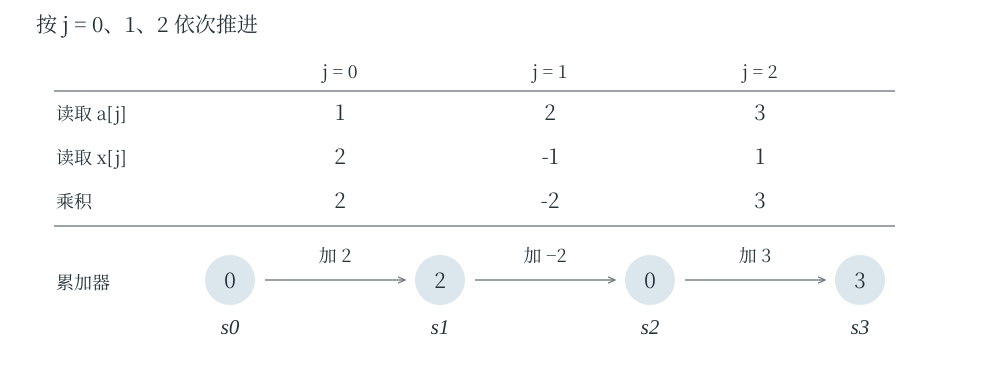

*图 2-1　从求和式到状态变化。每一列代表一次循环，先读该位置的两个数，再更新累加值。下行的四个数是同一个变量在不同时刻的值，不是程序必须同时保存四份累加器。*

现在把 `s = 0` 移到循环内部，会怎样？每次累加前都把先前结果清掉，最后只剩 $`3\times1=3`$。这个输入恰好掩盖了错误：前两项互相抵消，正确结果也等于 3。但若把 $`x`$ 的第二项从 $`-1`$ 改成 $`0`$，正确答案就应为 5，而错误程序仍返回 3。

这个小细节说明，只检查一个输入上的答案还不够。一段程序的正确性，是它在约定的输入范围内是否实现了数学定义。碰巧通过一个算例，不等于循环的状态更新写对了。

### 从一行扩展到整个矩阵

矩阵乘向量只需对每一行重复同样的工作。下面把这段工作装进一个函数。

```python
def matvec(A, x):
    result = []
    for i in range(len(A)):
        s = 0
        for j in range(len(x)):
            s = s + A[i][j] * x[j]
        result.append(s)
    return result

A = [[1, 2, 3], [4, 5, 6]]
b = [-4, 1]
z = matvec(A, x)
```

`def` 定义一段可以调用的程序，括号中的 `A` 和 `x` 是它接收的输入。`len` 取得序列长度；`result` 从空序列开始，`append` 把一行的计算结果添到末尾；`return` 把最终结果交给调用者。最后一行调用函数，得到 `z = [3, 9]`。

缩进决定重复范围。每进入一行，先把累加器清零，再累加这一行的三个乘积。`append` 在内层循环外，因此每行只保存一个最终内积，而不是把每一步的部分和都当作输出。

这段代码默认输入尺寸相容。对一般的 $`A\in\mathbb{R}^{m\times n}`$ 和 $`x\in\mathbb{R}^n`$，输出长度为 $`m`$。若一行有三个元素，输入却只有两个，缺失第三项就无法计算原来定义的运算。正式接口应检查形状和其他约定。

函数提供的是复用程序的方法。调用两次 `matvec`，通常就执行两次计算，并不会因为函数名字相同而自动复用上次答案。库则把许多这类可调用实现组织起来；框架可以选择调用哪个库，也可以改变几次调用的组织方式。后面研究算子库和编译器时，我们会再次回到这些调用。

### 计算需要多少次运算

长度为 $`n`$ 的内积需要 $`n`$ 次乘法，把它们相加至少需要 $`n-1`$ 次加法。上面的写法从零开始累加，额外包含一次与零相加；编译器可能消除这项工作。在数量级估算中，常把一个内积记作约 $`2n`$ 次浮点运算，把矩阵乘向量记作约 $`2mn`$ 次。

对本例，直接相加三个乘积，每行是三次乘法、两次加法；再加偏置，是一次加法。两行一共十二次这样的算术操作，此外还有两次与零比较。比较也需要执行，但不能因为它消耗时间，就在 FLOPs 统计里一律把它算成浮点乘加。

数清运算次数之后，还没有回答它们需要多久。程序还要取得输入和保存结果，而且并非所有运算可以同时开始。下一步先看输入究竟放在哪里。

### 同一个样本放在行还是列

在方格纸上写两个人的两次测量，甲为 (1, 2)，乙为 (3, 4)。若让每人占一列，两行依次是 (1, 3) 和 (2, 4)。若让每人占一行，两行便是 (1, 2) 和 (3, 4)。用系数 (2, 1) 去求每个人的分数，答案在两种写法下都是 4 和 10。按列排时要从左边乘一行系数，按行排时要从右边乘一列系数。第三章把样本排成列，第四章把词元排成行。遇到一个新公式，先在纸上圈出同一条样本的两个数，通常就能定下乘法方向。

## 2.2　矩阵在内存中的表示

### 内存地址与元素排列

可以先把内存理解为许多按地址编号的字节位置。程序需要保存一个数时，为它安排若干连续字节；读取时，用地址找到这些字节，并按照约定的数值格式解释它们。

一个字节包含八个比特，每个比特取 0 或 1。比特组合本身不会声明“我是整数”或“我是浮点数”；同一组比特按不同规则解释，可能得到不同含义。**数据类型**说明采用什么表示规则，也决定一个元素占多少字节。类型名 FP32 通常表示 32 位浮点格式，即每个元素占四字节。

本章把矩阵元素按四字节浮点数存放。数值都是小整数，能够在这种格式里精确表示；这不意味着它们只能用整数类型保存。第十一章会详细讨论不能精确表示的数值和舍入问题。

Python 的普通列表实际还包含对象引用等组织开销，不能直接当作紧密排列的 FP32 数组。上一节用列表是为了让循环容易阅读。下面研究的是数值库和 AI 框架中常见的、按明确元素类型组织的连续存储，两种表示不要混为一谈。

设 $`A`$ 的存储从示意地址 1000 开始，按第一行、第二行的顺序排列。六个元素占 $`6\times4=24`$ 字节：

```math
\underbrace{1,2,3}_{\text{第一行}},\quad
\underbrace{4,5,6}_{\text{第二行}}.
```

图 2-2 将纸面上的矩阵与内存中的顺序对齐。这里的地址是用于推导的字节编号，不是某台机器上真实分配的地址，更没有指定物理内存芯片的位置。

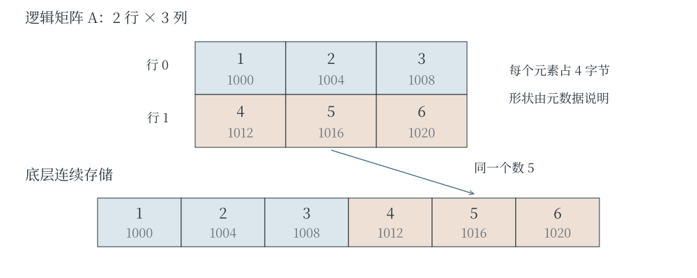

*图 2-2　逻辑位置与字节地址。上方每个格子标出元素及其起始地址，下方将同一组格子按存储顺序展开。一个数占四字节，例如元素 5 占用 1016—1019；图中只标起始地址。行的边界来自程序对形状的解释。*

为什么地址每次增加 4，而不是 1？因为横跨的是一个完整元素，不是一个字节。若同样六个数改用每个两字节的格式，元素起始地址之间的距离会改变；矩阵的形状却仍然是 $`2\times3`$。

### 用步长把下标换成地址

对于这种按行连续存储的矩阵，从 $`(i,j)`$ 移到 $`(i,j+1)`$，跨过一个元素；从 $`(i,j)`$ 移到 $`(i+1,j)`$，跨过三个元素。这两个移动距离称为两个维度的**步长**，本章记为 $`(3,1)`$，单位为元素。

因此，元素 $`A_{i,j}`$ 的地址是

```math
\mathrm{addr}(A_{i,j})
=1000+4(3i+j).
```

代入 $`i=1,j=1`$，得到 $`1000+4(3+1)=1016`$，正好指向值为 5 的元素。形状限制哪些下标合法：这里 $`i`$ 只能取 0、1，$`j`$ 只能取 0、1、2。越过这个范围，地址即使可以被算出来，也不是这个矩阵定义中的元素。

一般地，若一个 $`d`$ 维数组的下标为 $`(i_0,\ldots,i_{d-1})`$，按元素计的步长为 $`(s_0,\ldots,s_{d-1})`$，元素字节数为 $`q`$，在底层存储中的起始偏移为 $`o`$，则

```math
\mathrm{addr}(i_0,\ldots,i_{d-1})
=p+q\left(o+\sum_{k=0}^{d-1}i_ks_k\right).
```

$`p`$ 是底层存储的起始字节地址。括号内先算出元素偏移，再乘 $`q`$ 转成字节，因而不会把字节和元素混加。对本例，$`d=2`$、$`o=0`$、$`s=(3,1)`$、$`q=4`$。

这看似只是一个地址公式，却会贯穿后面的 GPU 访存、转置、分块与算子布局。如果不清楚相邻线程实际读了哪些地址，就无法仅凭“它们在读一个矩阵”判断访问是否连续。

不同接口对 stride 的单位约定不同。例如 NumPy 的 `strides` 以字节计，上例会写成 $`(12,4)`$；PyTorch 常用的 stride 接口按元素计，写成 $`(3,1)`$。使用 API 前必须检查单位，不能看到两个数字不一样就认定布局不同。[NumPy 的步长定义](https://numpy.org/doc/stable/reference/generated/numpy.ndarray.strides.html)给出了相应的地址解释。

### 张量的形状与步长

在 AI 程序里，多维数值数组通常称为**张量**。本书使用这个工程含义，不要求读者先掌握微分几何中的张量变换理论。

要把一片存储解释成可计算的张量，至少需要知道以下信息。

| 信息 | 本例中的值 | 它回答的问题 |
|---|---|---|
| 底层存储 | 六个数所在的存储区 | 数值实际放在哪里 |
| 形状 | $`(2,3)`$ | 有几个维度，每维多长 |
| 步长 | $`(3,1)`$ 个元素 | 每个下标增加 1，地址移动多少 |
| 起始偏移 | 0 个元素 | 第一个逻辑元素从底层存储哪里开始 |
| 数据类型 | 四字节浮点数 | 每个数怎样解释，占多少字节 |
| 设备 | 例如 CPU | 哪个设备能够按什么方式使用这份数据 |

这些用于解释数据的信息称为元数据。一个张量对象可以持有这些信息，而底层数值保存在另一片存储中。多个张量对象也可能描述同一片存储的不同部分。

设备这一项尤其不能省略。CPU 和 GPU 使用的地址即使数值相同，也不一定指向同一份可直接访问的数据；是否共享地址空间、是否允许远程访问、是否需要迁移，要看具体系统。因此，描述数据时需要同时注明存储位置和可以直接访问它的设备。第六章会沿一层投影追踪这些数在主机、显存和芯片内部的存放位置。

## 2.3　张量视图与数据复制

现在矩阵有了明确的存储位置。接下来考虑一个常见操作：把同一组数改按另一种行列顺序使用。若每次都复制数据，程序会多花时间和空间；若只修改访问方式，又必须弄清新旧对象是否仍指向同一份数据。

### 视图与底层存储

把 $`A`$ 转置，数学上得到

```math
T=A^\mathsf{T}
=\begin{bmatrix}1&4\\2&5\\3&6\end{bmatrix}.
```

我们可以真的创建一片新存储，依次写入 $`1,4,2,5,3,6`$。不过，地址公式还提供了另一种方法：保留原来的六个数不动，只把形状改成 $`(3,2)`$、步长改成 $`(1,3)`$。

此时

```math
\mathrm{addr}(T_{i,j})=1000+4(i+3j).
```

例如 $`T_{0,1}`$ 的地址是 1012，读取原来的数 4；$`T_{1,0}`$ 的地址是 1004，读取原来的数 2。逻辑上已经得到了转置矩阵，底层排列仍然是 $`1,2,3,4,5,6`$。

这种共享底层数值、主要改变解释方式的张量称为**视图**。图 2-3 的左边是转置视图，右边则是把原数组重新解释为三行两列。

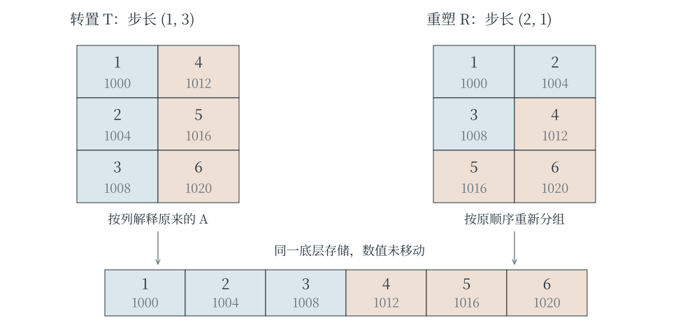

*图 2-3　转置与重新分组不是同一件事。两边都可共享原始连续存储，但步长不同：转置是 $`(1,3)`$，按原顺序重排形状是 $`(2,1)`$。格子下方的地址说明每个逻辑位置究竟指向哪个数。相同的输出形状 $`(3,2)`$，不能决定元素的对应关系。*

右侧的操作通常称为 reshape，即重塑形状。它保持这里约定的按行遍历元素的顺序，再按新形状分组：

```math
R=\begin{bmatrix}1&2\\3&4\\5&6\end{bmatrix}.
```

因此，`transpose` 和 `reshape` 不能仅凭结果形状相同就互换。一个交换维度的意义，另一个改变同一顺序下的分组方式。

而且 reshape 也不保证总能只修改元数据。如果现在想把转置后的 $`T`$ 按其逻辑行顺序展平成一个长度为 6 的向量，所需顺序是 $`1,4,2,5,3,6`$。这些数在原存储中的起始地址依次为

```math
1000,\ 1012,\ 1004,\ 1016,\ 1008,\ 1020.
```

相邻地址差交替变化，不能用这个简单一维步长模型中的一个固定 stride 表达。若要求返回普通的连续一维数组，就需要重新排列并复制。实际框架中，有的接口会在必要时复制，有的只允许满足条件的视图而在不满足时报告错误。[PyTorch 的张量视图说明](https://docs.pytorch.org/docs/stable/tensor_view.html)明确区分了共享存储、连续性与可能发生复制的操作。

### 切片与连续存储

从 $`A`$ 中取最后两列，得到

```math
S=\begin{bmatrix}2&3\\5&6\end{bmatrix}.
```

只需把起始偏移改成 1，形状改成 $`(2,2)`$，步长仍保留 $`(3,1)`$，就能构造这个切片视图。其地址为

```math
\mathrm{addr}(S_{i,j})=1000+4(1+3i+j).
```

第一行的两个数在 1004、1008，第二行在 1016、1020。中间的地址 1012 存着原数组的数 4，它并不属于切片。纸面上 $`S`$ 是一个整齐的 $`2\times2`$ 方阵，按行读它时，内存中的两行却隔着一个不需要的元素。

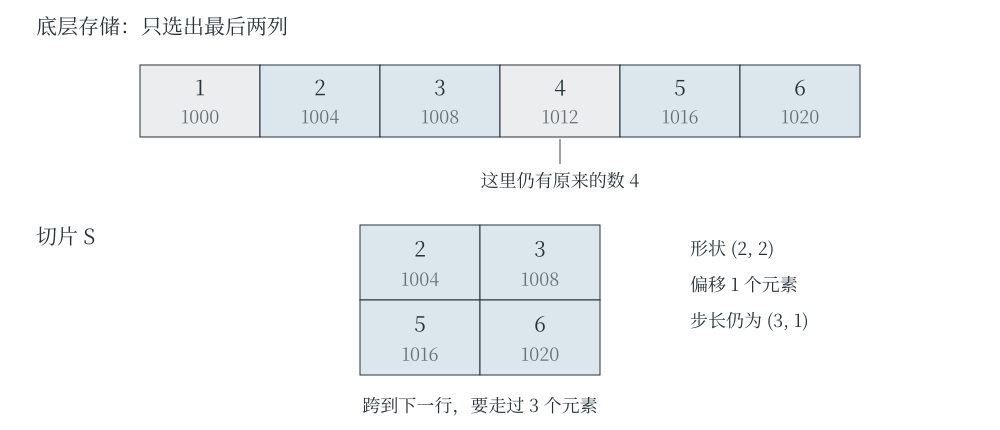

*图 2-4　切片保留原来的行步长。选中的四个元素以色块表示，其他位置仍属于原存储。若把它复制成一个新的连续 $`2\times2`$ 数组，行步长才会变成 2；创建视图本身没有做这次复制。*

这就是**连续性**要解决的问题：相邻逻辑元素是否按所要求的遍历顺序紧密排列。连续性与具体维度顺序有关。有的算子可以直接接受一般步长，有的实现只适合一种紧凑布局，框架也可能先做布局转换，再调用后者。

于是，一次转置视图本身几乎不搬数据，并不代表它后面的计算也没有成本。后继算子可能因此采用不利的访问顺序，也可能额外生成一份连续副本。观察程序速度时，应沿着后续使用追踪，而不只给视图创建那一行计时。

以 $`4096\times4096`$ 的四字节矩阵为例，数值存储为 64 MiB。创建一个转置视图可以不复制这 64 MiB；若确实要把转置顺序写进新的连续存储，理想情况下也至少要读 64 MiB、写 64 MiB。必要传输量是 128 MiB，而不是 64 MiB。算法公式没有新增矩阵乘法，这次布局变换却已经产生了实在的工作。

### 广播与数据复用

现在让同一个矩阵同时处理三组输入。把输入列向量并成一个矩阵 $`X\in\mathbb{R}^{3\times3}`$，得到 $`Z=AX\in\mathbb{R}^{2\times3}`$。每一列都需要加上原来同一个偏置 $`b=(-4,1)^\mathsf{T}`$。

在纸上可以写出

```math
B=\begin{bmatrix}-4&-4&-4\\1&1&1\end{bmatrix},
\qquad U=Z+B.
```

但是没有必要为了三个输入复制三份偏置。只需让逻辑上同一行的三个位置都读取同一个存储元素。若偏置存储从 3000 开始，广播视图形状为 $`(2,3)`$、步长为 $`(1,0)`$，则

```math
\mathrm{addr}(B_{i,j})=3000+4(i+0j).
```

无论 $`j`$ 为多少，第一行读的都是 3000，第二行读的都是 3004。第二维步长为零，就是这里“扩展了形状但没有复制数值”的具体实现方法。

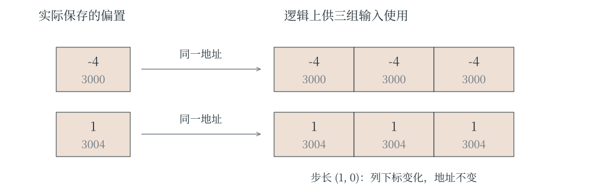

*图 2-5　广播中的共享。右边六个位置并不是六份独立存储，连到同一个左侧格子的逻辑位置具有相同地址。不同框架可以用不同内部方式实现广播，图中给出的是便于理解的一种步长表示。*

广播也受形状约束。对本例，偏置应解释为 $`(2,1)`$，再沿第二维扩展到 $`(2,3)`$。若接口采用尾维对齐规则，直接传入形状为 $`(2,)`$ 的向量时，长度 2 会与最后一维的长度 3 对齐，因而无法匹配。要得到预期结果，需要明确指定偏置所在的维度。[NumPy 的广播规则](https://numpy.org/doc/stable/user/basics.broadcasting.html)采用从尾维对齐、各维相等或其中一方为 1 的条件。

广播省掉的是偏置的重复存储，并没有让输出 $`U`$ 的六个结果自动只占两个位置。如果后续要求保留全部输出，仍要安排对应空间。而且共享的广播位置不能被当作彼此独立的可写单元：若给第一行三个位置分别写不同的数，它们会争用同一个底层元素。许多框架会限制这类写入，或者要求先生成独立副本。

### 重叠视图的读写限制

长度为 4 的向量 $`(2,3,5,7)`$ 可以提供三个长度为 2 的窗口。把窗口编号记为 $`i`$，窗口内位置记为 $`j`$，读地址就是 $`i+j`$。从这个二维视图看到的是三行 $`(2,3),(3,5),(5,7)`$。六个逻辑格只占四个物理位置，两条轴的步长都是 1。若只求每个窗口的和，可以依次得到 5、8、12，完全不必先复制六项。

现在要求各窗口第二格加 10，第一格清零。视图的第 $`(0,1)`$ 格要求把原来的 3 改成 13，第 $`(1,0)`$ 格却要求把同一个位置改成 0。即使只有一个线程，写入顺序也会影响结果。需要六个彼此独立的输出时，就另分配六格；若本意是给每个原位置累加所有窗口的贡献，就显式规定求和。第二十九章把图像窗口展开成矩阵时，还会遇到这一层区别。

## 2.4　计算依赖与内存复用

视图使多个对象可能共享存储。于是，仅知道某个计算在数学上已经有了结果，还不足以决定能否覆盖它：其他计算可能仍要读取旧值。先确定读取与写入之间的依赖，再讨论并行，才能在加速时保住原有结果。

### 把数学依赖展开

回到单个输入，计算 $`y=\max(Ax+b,0)`$。假设输入已经就绪，第一行的三个乘积 $`2,-2,3`$ 互不依赖，可以分别计算；但加法必须等它的输入乘积产生。加偏置要等内积，取最大值又要等加偏置的结果。

第二行有同样的依赖结构，但它不需要先取得第一行的输出。因此，两行之间存在并行机会。

把操作画成节点，把“后者需要前者的结果”画成有向边，就得到**计算图**。它描述的是值的依赖，不是说每个节点必须变成一次独立函数调用，也不规定每条边都要搬运一整份数据。图 2-6 为了便于逐步检查，展开了第一行的每次运算。

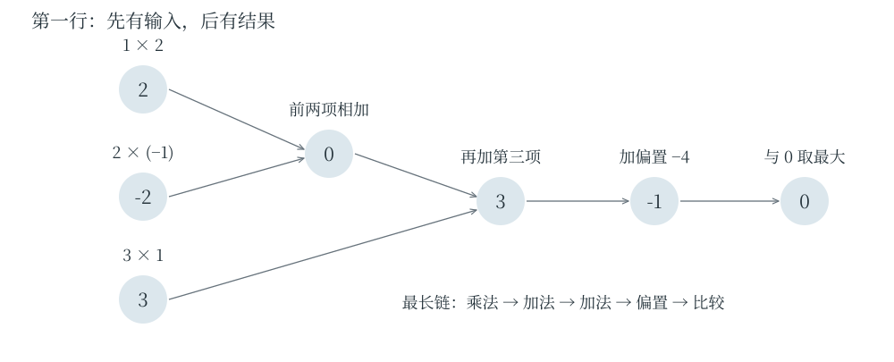

*图 2-6　一次输出中的依赖。乘法节点产生 2、−2、3，两次求和得到内积 3，加偏置 −4 后为 −1，最后输出 0。路径长度按节点数计算，最深的一条经过五个动作。第二行的结构相同，最后输出 10。箭头表示必须先获得哪个数，不表示固定的物理传输线路。*

任何执行顺序都必须满足图中的依赖。依赖已经满足的两个节点，原则上可以交换先后；一个节点不能因为设备空闲，就在输入还不存在时使用它。

从这个角度看，源程序的书写顺序只是众多合法顺序中的一种。有时编译器能够重新安排执行，让可独立进行的工作同时发生；但它必须知道中间对象是否互相影响。稍后会看到，共享存储会增加仅凭公式看不出的约束。

### 工作量与最长依赖链

为了看清并行限制，先采用一个极简时间模型：每次乘法、加法或比较都花一个时间单位，输入读取免费，没有提交和同步开销。这不是任何 CPU 或 GPU 的实测性能模型，只用于观察依赖。

每行有三次乘法、两次求和、一次加偏置和一次比较，共七个动作；两行共十四个动作。一位执行者逐个做，花十四个单位。两位执行者分别负责一行，可以用图 2-7 的安排在七个单位内完成。

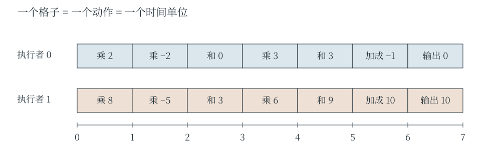

*图 2-7　两个执行者的一种合法安排。每格代表一个动作，单位时长相同；格内直接标注产生的数值。部分乘法稍后才执行，并不破坏依赖。两条轨迹同时结束于第七个单位，不能把图中的单位当作微秒。*

把可用执行者数量记为 $`p`$，总工作量记为 $`W`$，最长依赖链的时间记为 $`L`$，在这个理想模型中，完成时间至少满足

```math
T\geq\max\left(\frac{W}{p},L\right).
```

第一项来自总工作量：$`p`$ 位执行者每个单位最多做 $`p`$ 个动作。第二项来自依赖：一条链上的动作不能通过增加执行者全部同时完成。

本例 $`W=14`$、$`L=5`$。两位执行者时，$`T\geq\max(7,5)=7`$，图中的安排恰好达到这个下界。即使有十四位执行者，也不能在一个单位内完成；链上仍有五个阶段要依次通过。若只增加算力，不改变这条依赖，额外执行者就可能空闲。

这个下界也不是任意任务都能达到的排程。任务分布、资源种类和数据到达会进一步限制执行。第六章研究硬件时，要把“图上允许并行”和“设备上能够并行”区分开来。

### 浮点求和顺序

在实数代数中，加法满足结合律，$`(a+b)+c=a+(b+c)`$。这使求和可以组织为链，也可以组织成树。然而，机器保存的浮点数是有限精度的，每一步都可能舍入。代数上相等的两种安排，不保证逐位相同。

例如，在采用就近舍入、平局取偶数的 32 位二进制浮点运算中，令

```math
\begin{aligned}
a&=33,554,432,\\[0pt]
b&=-33,554,432,\\[0pt]
c&=1.
\end{aligned}
```

先算 $`a+b`$，两者抵消为零，再加 1，得到 1。若先算 $`b+c`$，精确结果 $`-33,554,431`$ 不能在这种格式中精确保存。这一位置的两个相邻可表示值是 $`-33,554,432`$ 和 $`-33,554,430`$，间距为 2，精确结果恰好落在中点。所谓“平局取偶数”，比较的是保留精度下的末位有效二进制位，并非这两个十进制整数的奇偶：前者的末位为 0，后者为 1，因此选择前者。随后与 $`a`$ 相加，得到 0。

这并不意味着并行归约不能用，而是要求我们明确正确性标准：要求逐位一致，还是在指定误差范围内保持结果和模型质量？最初的 $`2\times3`$ 矩阵算例中，中间整数都足够小，可以精确表示；这里新增的大整数反例已经不再满足这一条件。后面的大规模归约必须考虑舍入差异，第十一章会把浮点表示、累加精度和误差界完整展开。

### 内存何时可以复用

计算图还告诉我们何时可以不再保存某个结果。对于单链 $`z\rightarrow u\rightarrow y`$，如果 $`z`$ 除了生成 $`u`$ 没有别的用途，$`u`$ 已经算完后，原来的 $`z`$ 就不再需要。于是，某些实现可以把 $`u`$ 写回 $`z`$ 原来的位置，接着把 $`y`$ 写在同一片空间。

但现在给程序增加一个输出：还要报告原始线性结果的平方和

```math
E=z_0^2+z_1^2=3^2+9^2=90.
```

$`z`$ 多了一位使用者。若生成 $`u`$ 后就覆盖它，而 $`E`$ 这一分支还没有读完原始 $`z`$，保存的就不再是后者需要的数了。

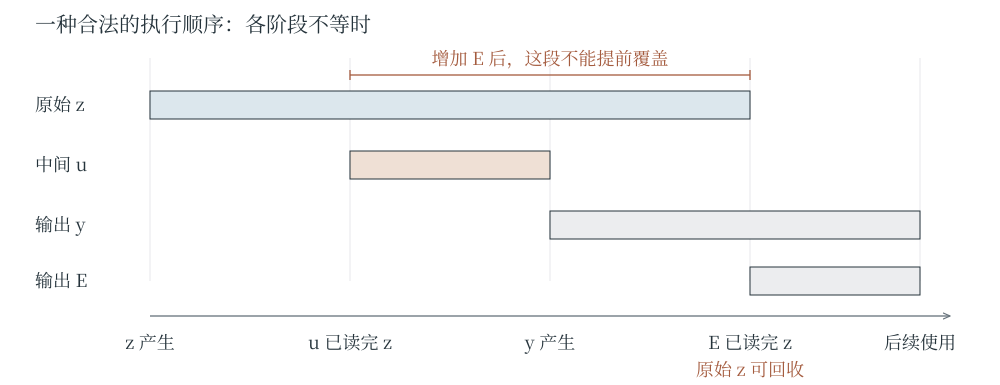

*图 2-8　存储生命周期由所有使用者共同决定。时间线按事件先后排列，不表示各阶段等时。只有两条分支都完成对原始 z 的读取后，原始值才不再需要；若某个读操作仍在异步执行，发出了调用也不能当作已经读完。*

这里的关键是**最后一次使用**，而不是“源代码已经写到下一行”。引用、别名、异步任务或反向传播都可能延长一个值的生命周期。内存规划需要确认所有依赖原值的操作已完成，才能重用其空间。

### 别名与原地操作

一种常见错误是以为给对象换个名字，就复制了它。下面使用上一节的 Python 列表来复现。代码中的 `u = z` 让两个变量引用同一个列表，并没有复制两个元素。

```python
z = matvec(A, x)
u = z
u[0] = max(u[0] + b[0], 0)
u[1] = max(u[1] + b[1], 0)
bad_energy = z[0] ** 2 + z[1] ** 2
```

`** 2` 表示平方。程序本来想用 `u` 保存最终输出，用 `z` 保留原始线性结果。实际写入后，二者都看到了 `[0, 10]`，`bad_energy` 变成 100，而不是 90。

这种“两个访问入口指向同一片存储”的关系叫作**别名**。转置和切片视图也会产生别名：如果通过 $`T`$ 改写 $`T_{0,1}`$，原矩阵的 $`A_{1,0}`$ 也随之改变，因为地址相同。

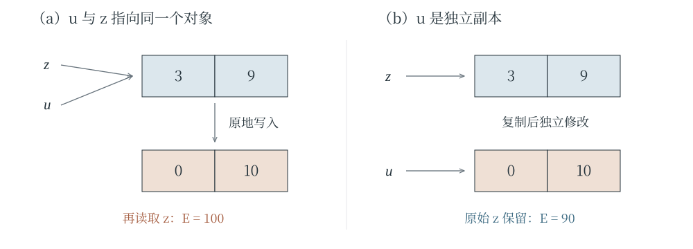

*图 2-9　别名与独立副本。左边两个名称连到同一份数值，写入后原始结果消失；右边多分配一份存储，让输出和原始线性结果分别存在。箭头表示引用关系，两个名称不代表两份内存。*

最直观的修正是创建一个独立副本：

```python
z = matvec(A, x)
u = z.copy()
u[0] = max(u[0] + b[0], 0)
u[1] = max(u[1] + b[1], 0)
good_energy = z[0] ** 2 + z[1] ** 2
```

此时 `u` 为 `[0, 10]`，`z` 仍为 `[3, 9]`，`good_energy` 为 90。这里列表元素都是不可变的数值，浅复制足以让两份列表的元素槽位独立；如果复制的是嵌套容器，就不能假定所有内部对象也被深复制。对张量应使用所选框架中保证生成独立副本的接口。

还有另一种合法修正：先用原始 $`z`$ 算完 $`E`$，再原地改写 $`z`$。这减少一份副本，却改变了允许的执行顺序。两种方案都能正确完成任务，各自有不同的空间与并行机会。**少分配一点内存，有时要用减少并行来交换。**

第三章会看到，训练中的反向传播也需要使用前向产生的一些值。如果在反向开始前偷偷把它们改掉，算出的可能不是原函数的梯度。很多框架会记录修改或直接阻止某些操作；理解原因比记住某条报错更有用。

## 2.5　程序的并发与异步执行

前面画出的依赖说明哪些操作可以同时进行，机器还需要实际安排执行。程序、进程和线程是描述这件事的不同对象。先分清它们各自保存什么、共享什么，后面讨论 CPU 提交工作和 GPU 异步执行才不会混淆。

### 程序、进程与线程

保存下来的程序文本，描述的是一套操作规则。启动它之后，系统还要为这次运行准备输入、内存、打开的文件等资源。这个有独立运行上下文的实例，通常称为**进程**。同一份程序可以启动多个进程，处理不同输入。

进程中的**线程**表示一条正在推进的执行序列：当前执行到哪里，接下来读哪个值、做哪个操作。一个进程可以有多条线程，它们通常共享进程里的许多内存对象，各自保留执行位置和局部状态。线程不等于物理 CPU 核心；操作系统会把可运行线程安排到可用执行资源上，线程也可能被暂停后再继续。

例如，可以让一个线程读取下一批输入，另一个线程处理已经准备好的数据。但二者共享缓冲区时，必须明确哪个缓冲区已经填好、哪个仍在使用。创建第二条线程本身不会解决同步问题。

并发和并行也应区分。两件工作交替推进，即使某一时刻只有一个执行资源，也可以是并发；只有它们实际同时执行，才存在这段时间上的并行。第一章讨论的许多同时在途请求，不意味着每个请求都正在占用一个独立计算单元。

GPU 中也使用“线程”一词，但它的组织和调度方式与 CPU 操作系统线程不同。现在不需要把两者强行一一对应。先记住：应用程序提供工作，运行系统和设备决定具体如何安排；第六章会打开 GPU 的执行结构。

### 异步调用与设备同步

有些函数在工作完成后才返回结果；另一些函数提交工作后便立即返回一个标记，供调用者跟踪完成情况。后一种方式称为**异步执行**。

设 CPU 向设备提交本章的矩阵计算。提交花了 0.1 毫秒，设备到 0.4 毫秒才有机会开始，计算结束于 1.4 毫秒，结果复制到 CPU 可读的位置又花 0.2 毫秒。图 2-10 在同一时间轴上标出这些时刻。

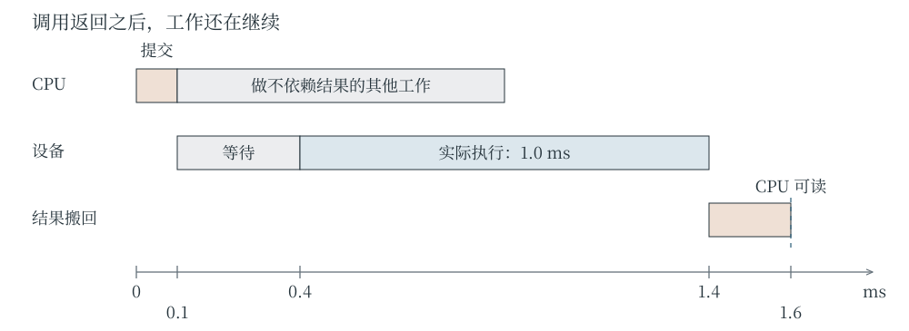

*图 2-10　提交、执行与结果可用。单位为毫秒，数据为教学设定。CPU 提交后可以做不依赖该结果的其他工作；GPU 执行和结果搬回分别占据后续阶段。图中专门选择了需要复制回 CPU 的情形，不代表所有任务都必须搬回结果。*

若只在提交函数前后计时，会得到 0.1 毫秒；若研究设备计算，会得到 1.0 毫秒；若问 CPU 从发起到能读取结果要等多久，则是 1.6 毫秒。数字不同，首先要检查测量边界，而不是立刻判断哪一个测错了。

一个抽象接口可以写成下面的顺序。它只说明语义，不对应某个现成库的 API：

```text
标记 = 提交计算(A, x, b)
完成与此结果无关的其他工作
等待这个标记所代表的结果可用
读取结果
```

“等待”要等待到什么程度，必须由接口约定。有的事件只表示设备内运算结束；如果之后还有复制，CPU 侧读取还需要等待那次复制完成。某些高层框架会在读取时自动同步，因此用户未必需要手写等待，但不能据此假定底层所有调用都同步。[PyTorch 的 CUDA 语义文档](https://docs.pytorch.org/docs/stable/notes/cuda.html#asynchronous-execution)解释了异步执行与计时之间的关系。

需要输入的一方不应早于输入可用时刻开始。与此同时，过早等待也会浪费可并行时间：CPU 原本可以在设备计算期间准备下一份数据，如果提交后立即阻塞，就可能失去这段重叠。正确的同步既不能漏，也不应无条件加在所有位置。

### 并发更新与数据竞争

第 2.4 节已经说明三个乘积可以独立计算。于是，我们可能尝试让不同执行者算乘积后，都执行“把自己的乘积加到共享的 `s`”。看起来每个人只加一个数，最终应该一样。

问题在于，普通的 `s = s + p` 可以拆成读旧值、做加法、写新值三个动作。如果两个执行者都先读到了旧值零，再分别写回自己的结果，后写入者就可能覆盖前者的更新。

图 2-11 规定了一种明确的读写交错。第一位要加 2，第二位要加 −2；它们都先读到 0。第一位写回 2，第二位随后写回 −2，第一项更新丢失。最后再加第三个乘积 3，得到 1，而正确内积是 3。

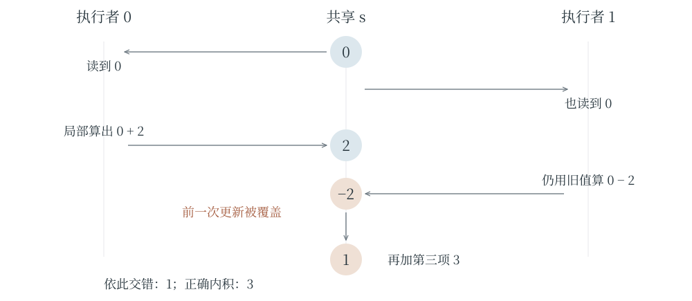

*图 2-11　一次被明确规定的交错执行。中列是共享存储的值，左右两列是各执行者已经读入的局部值。后者不会因为共享存储变化而自动更新。真实语言和设备对无同步冲突访问还有各自规则，不能把图中的 1 当作所有错误程序必然产生的结果。*

这类结果取决于并发访问次序的问题，属于数据竞争需要处理的范畴。解决方法之一，是先让每个执行者写自己的独立结果，再按明确次序归约。另一种是用接口提供的原子更新，使一次读—改—写在其他参与者看来不可被冲突更新插入；或者使用锁，把相关访问组织为受保护的区域。

这些方法仍有代价。独立结果需要临时存储与后续归约；共享原子更新可能形成竞争。原子加法还能防止更新丢失，但对浮点数而言，如果多个加数的顺序仍不固定，并不自动保证每次逐位一致。

因此，并行化的判断至少要问两件事：操作的输入是否都已准备好，以及不同操作是否会读写互相重叠的存储。只看数学公式里有多少个乘号，还不足以决定安全的执行方式。

## 2.6　算子融合与中间结果

现在回到最初只需要输出 $`y`$ 的任务，不再额外计算 $`E`$。我们已经知道怎样逐项算对，也知道什么时候可以覆盖旧值。可以问一个具体的优化问题：是否有必要把 $`z`$ 和 $`u`$ 都完整写成两个独立数组？

### 是否保存完整中间结果

最直接的组织方式是先执行矩阵乘向量，产生并保存 $`z`$；再逐元素加偏置，产生并保存 $`u`$；最后逐元素取最大值，保存 $`y`$。这样的接口清楚，容易单独检查每一步，但多了中间数组的写入和重读。

另一种组织方式，是算完一行内积后，马上给这一个结果加偏置、取最大值，再写出最终输出：

```python
def fused_layer(A, x, b):
    result = []
    for i in range(len(A)):
        s = 0
        for j in range(len(x)):
            s = s + A[i][j] * x[j]
        value = max(s + b[i], 0)
        result.append(value)
    return result

fused_output = fused_layer(A, x, b)
```

这段程序仍然需要累加器 `s`，仍然做了乘法、求和、偏置和比较。它省掉的是完整的中间数组，而不是使中间数值从计算中消失。在底层设备实现中，希望尽可能把这种短暂使用的值保留在寄存器等靠近计算的位置；Python 示例表达的是组织方式，本身不是高性能 GPU 程序。

把相邻操作组合起来执行，常称为**融合**。融合是否能做，要看下一项操作需要哪些输入，以及是否有其他使用者需要保留原始中间结果。第 2.4 节添加的 $`E`$ 就会改变这一判断。

即使需要 $`E`$，也不代表必然要写出整个 $`z`$。例如，每行内积算出后，可以先把它的平方加到 $`E`$ 的累加器，再产生该行最终输出。这样又得到一种合法组织，但 $`E`$ 的跨行归约和并行安排需要重新处理。选择实现方式时，需要考虑这些数据依赖及其并行开销。

### 中间数组的读写开销

为了只比较中间数组的影响，我们指定同一条被观察的存储接口，并作以下理想化假设：$`A`$ 的六个元素只读一次，$`x`$ 的三个元素读入后能被两行共用，$`b`$ 读一次，每个元素四字节；被单独保存的中间数组要经过该接口写出，并由下一阶段读回。不计元数据和缓存行等额外开销。

在分开执行的方案中：

| 阶段 | 经过该接口的数据 | 字节数 |
|---|---|---:|
| $`z=Ax`$ | 读 $`A`$ 的 6 个元素，读 $`x`$ 的 3 个元素，写 $`z`$ 的 2 个元素 | 44 |
| $`u=z+b`$ | 读 $`z`$ 的 2 个元素，读 $`b`$ 的 2 个元素，写 $`u`$ 的 2 个元素 | 24 |
| $`y=\max(u,0)`$ | 读 $`u`$ 的 2 个元素，写 $`y`$ 的 2 个元素 | 16 |
| 总计 | | 84 |

融合后，经过接口的只有输入和最终输出：

```math
V_{\mathrm{fused}}=(6+3+2+2)\times4=52\ \mathrm{bytes}.
```

省下的 $`84-52=32`$ 字节，正好是 $`z`$ 和 $`u`$ 各自的一次写出与重读。两个中间数组，每个两个元素，每个元素四字节，分别经过写出和读回两次传输：

```math
2\times2\times4\times2=32\ \mathrm{bytes}.
```

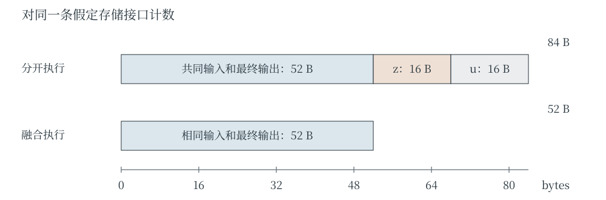

*图 2-12　省下的流量恰好对应被取消的中间存储。横轴按字节比例绘制，所有段都相对于同一条假定接口计数。真实小数组可能留在缓存中，因此这张图不是在宣称实际 HBM 流量一定为 84 或 52 字节，更不是实测加速比。*

对六个元素的小例子，实际运行时间往往被函数调用、解释执行等开销主导，不能期待测出与字节比例一致的提速。它的价值是让每一个被节省的字节都能找到出处。以后把这套推导扩展到很大的激活矩阵，并明确是哪一级存储接口，才可能得到有用的性能解释。

融合也可能让一个设备程序同时需要更多寄存器，减少可并行驻留的工作，或者失去一个更合适的专用实现。最终是否更快，需要结合第六、六章的执行与存储约束。现在已经足以确认：**计算量相同，不意味着数据流量和执行时间相同；数学结果正确，也不意味着所有重排都安全。**

### 布局转换的收益与成本

设下一层需要沿归约维连续读取权重，而现有的转置视图使相邻两个归约项在内存中相隔一整行。一种实现按照步长读取，另一种先将数据复制成所需布局，后续计算读取新副本。两者的数学运算相同。选择时需要考虑，在权重下次更新之前，这份副本能够复用多少次。

用一组假设的设备计时来算。复制与重排一次用 0.80 ms，按原步长投影每次用 0.32 ms，准备好连续权重后每次投影用 0.20 ms。用 $`r`$ 次，两个方案分别花 $`0.32r`$ 和 $`0.80+0.20r`$ 毫秒。每次投影节省 0.12 ms，前六次共节省 0.72 ms，仍小于最初重排花费的 0.80 ms。到第七次，直接读取共需 2.24 ms，先重排再计算共需 2.20 ms，总时间才开始减少。若训练更新了源权重，就需要重新生成副本，并重新计算这次重排之后还能复用多少次。

在自己的机器上做这个对照时，先验证两种投影的输出，再分别测量准备阶段和连续调用阶段。计时结束前应确保工作已经完成，并记录是否预热以及额外副本的大小。若底层矩阵库已经能把这个转置当作参数处理，重排后的每次投影甚至可能没有变快。这一结果本身就解释了为何只看数组名称或“连续”标志还不足以决定是否复制。

也可以在 CPU 上亲手量一遍。取一个有 1024 行、4096 列的 FP32 数组，每行只选第 0、8、16 列这样间隔八列的元素。选出的 524,288 个数逻辑上占 2 MiB，原地遍历时相邻两项却隔着 32 字节。现在要反复求这批数的和，比较直接读视图和先复制一份连续数组。两种求和都用双精度累加；程序先逐项核对两份数据，再验证和相等。

在一台 Ryzen 7 255 的 CPU 上用 NumPy 2.5.1 运行随书程序，单独计时的中位数为复制 0.867 ms、按原步长求和 0.541 ms、按连续布局求和 0.240 ms。每次可省约 0.301 ms，按这组数估算，复用三次开始有机会收回复制成本。再把复制与求和放在同一段时间内实测：只求一次，直接读用 0.601 ms，先复制用 1.279 ms；连求八次，两种方式分别用 5.287 ms 和 2.933 ms。前一种用法值得省下这次复制，后一种值得多留 2 MiB。两段测量的缓存和分配器状态可以有差别，因此实际交点要量整段程序。在项目根目录运行 `python experiments/ch02/layout_compaction.py`，就能用自己机器上的数字作决定。[布局与复用实测程序](../../experiments/ch02/layout_compaction.py)

### 从线性层到神经网络

本章始终计算同一层，却需要同时观察三个不同对象。

首先是数学定义，即输入 $`A,x,b`$ 应当产生什么结果。其次是数据表示，包括数值的存储位置，以及形状、步长和别名。最后是执行安排，需要确定操作之间的依赖、执行位置，以及何时可以改写或释放状态。

把其中一个对象误当成另一个，错误就会出现。形状正确不保证元素顺序正确；创建了新名称不保证分配了新存储；函数已经返回不保证设备工作结束；图上没有数值依赖，也不保证两个写操作没有存储冲突。

而把三者连接起来，第一章的资源预算就有了程序层面的依据。权重和请求状态为什么需要单独计数，中间数组为何可以减少，某段操作为什么必须等待，都可以沿着明确的数据和依赖找到原因。

下一章继续使用小网络，但允许参数变化。除了算出输出，程序还要知道每个参数怎样影响损失。我们将从熟悉的微分开始，解释梯度怎样沿计算图返回，以及为什么训练需要保留某些在推理中已经可以释放的值。

## 练习与解答

### 1. 同一形状，是否就是同一批元素？

对本章的 $`A`$，令 $`S`$ 为最后两列的切片视图。写出它的形状、起始偏移和步长，计算 $`S_{1,0}`$ 的地址。若通过 $`S`$ 把这个元素改成 50，原矩阵变成什么？如果先把 $`S`$ 复制到独立存储，再修改副本，原矩阵是否变化？

**解答。** $`S`$ 的形状为 $`(2,2)`$，起始偏移为 1 个元素，步长为 $`(3,1)`$ 个元素。地址是 $`1000+4(1+1\times3+0)=1016`$，对应 $`A_{1,1}=5`$。通过视图改写后，原矩阵第二行变为 $`(4,50,6)`$，第一行不变。如果使用真正独立的副本，写入发生在新存储中，原矩阵保持不变。关键是地址是否共享，不是两个变量的名称是否不同。

### 2. 转置只改元数据，为什么还会耗时间？

一个 $`4096\times4096`$ 的 FP32 矩阵，已有按行连续存储。后继接口明确要求转置结果也是按行连续的独立存储。至少要经过多少字节的读写？如果唯一限制是该接口总带宽 1 TB/s，理想传输时间下限是多少？为什么不能用“转置视图没有复制”回答它没有代价？

**解答。** 数组包含 $`4096^2`$ 个元素，大小为 $`4096^2\times4=67,108,864`$ 字节，即 64 MiB。读源数据、写目标数据，各一次，总计 $`134,217,728`$ 字节，即 128 MiB。在明确给定的同一接口总带宽下，下限为 $`134,217,728/10^{12}`$ 秒，约 $`0.1342`$ 毫秒。这个下限没有包含额外寻址、非理想访问与启动等开销。创建视图可以只修改描述方式，但题目要求新的紧凑存储顺序，必须完成数据重排。若硬件读写有独立通道，则需按那个体系重新建模，不能直接沿用本题的总带宽假设。

### 3. 增加执行者，能否再快一倍？

在本章每个动作一个单位的理想模型里，两行一共十四个动作，最长依赖链为五个单位。两位执行者已经用七个单位完成。若增加到四位，能否在 3.5 个单位完成？如果单独输出平方和 $`E=90`$，能否在 $`E`$ 尚未读取原始 $`z`$ 时原地生成 $`y`$？

**解答。** 四位执行者的下限为 $`\max(14/4,5)=5`$，因此不可能在 3.5 个单位完成。这个下限确实能够达到：第一个单位计算两行各自的前两个乘积，共四次乘法；第二个单位计算每行的第三个乘积，并把每行已经得到的前两个乘积相加，共四个动作；第三个单位得到两个内积 $`z_0,z_1`$；第四个单位分别加偏置；第五个单位分别与零比较，得到两个输出。每一步都没有超过四位执行者，也没有提前使用尚未得到的结果。后面三个单位各有两位执行者空闲，原因正是等待依赖链向前推进。

新增 $`E`$ 后，不能在它尚未使用原始 $`z`$ 时覆盖这些元素。可以保留副本，或改变顺序先计算 $`E`$，或重新组织融合，让每个原始元素在被覆盖前完成全部必要用途。每一种都要重新检查依赖与资源。

### 4. 能否用原子加法解决全部并行问题？

图 2-11 中共享累加器出现更新丢失。若改成正确的原子加法，是否必然消除这个问题？是否也必然保证浮点结果与固定顺序的串行程序逐位相同？

**解答。** 在参与者均遵守接口规定、使用兼容的原子操作且初始化与最终读取正确同步的前提下，原子加法能够避免图中的读—改—写更新丢失。但不同参与者的加法仍可能以不同顺序发生，有限精度加法又不满足精确结合律，所以它不自动保证与某个固定串行顺序逐位一致。若需要这种可重复性，必须控制归约顺序或采用符合目标的数值方法，并检查相应代价。读者应同时区分并发访问正确性和数值误差标准。

## 算例与资料说明

本章的矩阵、地址、任务图、访问交错与传输预算为独立教学设计。时间线中的毫秒和单位时长都不是硬件实测。原始条件在 [本章数据文件](../../experiments/ch02/cases.json) 中；[复算程序](../../experiments/ch02/verify.py) 仅依赖 Python 标准库，核对矩阵结果、地址、任务顺序、别名、副本、浮点结合次序以及正文中的五段 Python 示例。

正文引用官方文档，是为了核对不同接口的步长、视图、广播和异步语义。概念不依赖某一版本的函数名称；真正编程时，仍应使用所选框架对独立存储、同步与可写性的明确约定。

[全书目录](../../README.md) · [上一章 · AI 基础设施的任务与性能目标](ch01.md) · [下一章 · 神经网络训练与梯度传播](ch03.md)
