# 第 3 章　神经网络怎样学会一项任务

第二章把数学表达写成了程序。给定矩阵、输入和偏置，程序便能读取数值、执行乘加并产生输出。不过，例子中的矩阵由我们预先指定。在需要学习的任务中，这些参数通常要从数据中求得。

设我们收集了一些样本。每条样本有两项数值特征，以及一个已经确认的类别：属于目标类别，记为 1；不属于，记为 0。特征可以来自测量或预处理；本章只研究它们已经变成两个数之后的计算。我们希望程序看到没有遇到过的新样本时，也能作出有依据的预测。

“学会”不能只解释成把训练样本的答案保存下来。我们要选择一类可调整的函数，用已知样本确定其中的参数，再检查这套参数对新样本是否仍然有用。函数能表达什么、样本提供了什么信息、参数怎样被调整，是三个相互关联的问题。

本章用一个只有九个参数的小网络，完整计算一次训练：从输入得到预测，计算损失，将梯度传回参数，再观察更新后的预测。接下来以同一个网络为例，讨论批训练、参数共享、深层网络和优化器，也解释训练为什么需要保存更多中间结果。

## 3.1　从线性模型到神经网络

### 参数描述函数，样本约束参数

最简单的学习模型，可以从熟悉的直线拟合开始：

$$
\hat y=wx+b.
$$

输入是 $x$，预测是 $\hat y$，可以调整的是斜率 $w$ 和截距 $b$。给定多个观测点，我们可以用最小二乘法选择参数，使预测与观测之间的平方误差尽量小。这里已经有学习的基本结构：并非改变“乘法怎么计算”，而是改变函数中的数值。

输入扩展为向量后，$w^\mathsf{T}x+b$ 描述一个仿射函数。日常讨论中常把这类层简称为线性层，但有偏置时，严格说是仿射变换。它只能表达一种固定的线性组合。

把这样的层多接几层，会自动变得更有表达能力吗？如果层之间没有非线性，那么

$$
\begin{aligned}
&W_2(W_1x+b_1)+b_2\\
&\quad=(W_2W_1)x+(W_2b_1+b_2).
\end{aligned}
$$

右边仍是一个仿射函数。中间层增加了参数和计算步骤，却没有让最后的函数超出这个函数族。想描述随输入区域而改变的关系，需要在层之间加入非线性。

第二章已经使用过 ReLU：

$$
\operatorname{ReLU}(a)=\max(a,0).
$$

它在正半轴保留输入，在负半轴输出零。这个折点使不同输入区域可以采用不同的有效线性关系。若一个单元计算 $\max(w^\mathsf{T}x+b,0)$，那么 $w^\mathsf{T}x+b=0$ 就是它切换状态的边界。参数变化，也会改变这条边界的位置和方向。

### 本章始终使用的九个参数

我们的输入是一个两维列向量。先计算两个隐藏单元，再把它们组合成一个标量分数：

$$
\begin{aligned}
a&=Wx+b,\\
h&=\operatorname{ReLU}(a),\\
z&=v^\mathsf{T}h+c.
\end{aligned}
$$

$W$ 为 $2\times2$ 矩阵，$b$ 和 $v$ 各有两个元素，$c$ 是一个数，总共有 $4+2+2+1=9$ 个可调整参数。将它们合起来记为 $\theta$。$a$ 是激活前的值，$h$ 是激活后的值，$z$ 是最后的分数。所谓隐藏层，是说样本没有直接给出 $h$ 应当取什么值；这些中间表示要通过最终任务的要求学习出来。

为了手算清楚，我们从以下参数开始：

$$
\begin{aligned}
W&=\begin{bmatrix}1&0\\0&1\end{bmatrix},
&b&=\begin{bmatrix}0\\0\end{bmatrix},\\[4pt]
v&=\begin{bmatrix}1\\-1\end{bmatrix},
&c&=1.
\end{aligned}
$$

这组初值用于教学，不是实际训练时推荐的初始化方案。采用它时，分数函数为

$$
z=\max(x_0,0)-\max(x_1,0)+1.
$$

若暂以 $z=0$ 为分类边界，那么边界满足 $x_1=1+\max(x_0,0)$：左侧是一段水平线，右侧是一段斜线。图 3-1 给出了这个具体函数的弯折，而不只是一个“神经元连线图”。

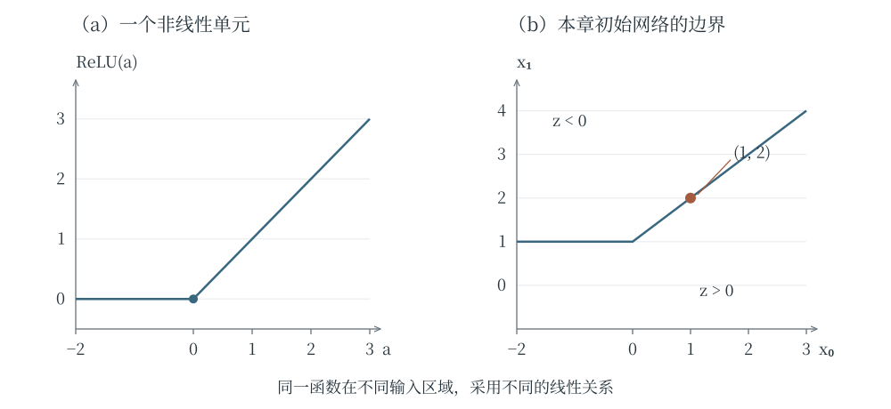

*图 3-1　非线性带来的具体变化。右图的横纵坐标分别是输入 $x_0,x_1$，分界线由本章初始参数直接算出。标出的样本 $(1,2)$ 恰好落在边界上。弯折说明网络能采用不同区域的线性关系，不代表初始边界已经符合数据。*

增加隐藏单元，能够产生更多划分；叠加多个带非线性的层，能够组合这些划分。但“能表达”并不等于“能从有限数据中学出来”，更不等于“对没见过的输入都正确”。参数规模、训练数据和优化方法缺一不可。

## 3.2　前向计算与损失函数

### 先完整算出预测

取一条训练样本

$$
x=\begin{bmatrix}1\\2\end{bmatrix},\qquad y=1.
$$

本章用 $y$ 表示已知标签，用 $p$ 表示模型预测的正类概率。下标继续从零开始，因此第一项是 $x_0=1$，第二项是 $x_1=2$。

代入初始参数：

$$
\begin{aligned}
a&=Wx+b=\begin{bmatrix}1\\2\end{bmatrix},\\[4pt]
h&=\operatorname{ReLU}(a)=\begin{bmatrix}1\\2\end{bmatrix},\\[4pt]
z&=1\times1+(-1)\times2+1=0.
\end{aligned}
$$

$z$ 可以取任意实数，不能直接当作概率。我们通过 sigmoid 函数把它映射到 0 与 1 之间：

$$
p=\sigma(z)=\frac{1}{1+e^{-z}}.
$$

当 $z=0$ 时，$p=1/2$；$z$ 越大，$p$ 越接近 1；$z$ 越小，$p$ 越接近 0。反过来，$z=\ln[p/(1-p)]$，因此 $z$ 也叫 logit，可以理解为正类与负类概率之比的对数。这个数学关系解释了分数与概率之间的对应。

此时模型给正类和负类各分配一半概率，而样本标签是正类。我们需要一个数，衡量这种预测与已知标签的吻合程度。

### 为什么损失里出现了对数

对标签 $y\in\{0,1\}$，模型赋予实际观测标签的概率是

$$
P_\theta(y\mid x)=p^y(1-p)^{1-y}.
$$

若 $y=1$，这个式子就是 $p$；若 $y=0$，就是 $1-p$。它把两个分支写进同一个表达式。

希望模型为观测到的标签分配更高概率，可以转化为最小化负对数概率：

$$
\ell(p,y)=-y\ln p-(1-y)\ln(1-p).
$$

这就是二分类交叉熵。所有对数均使用自然对数。对本条正类样本，损失简化为 $-\ln p$，因此

$$
\ell=-\ln(1/2)=\ln2\approx0.693147.
$$

为什么选择对数？在给定输入与参数、将样本标签的条件似然相乘的建模方式下，多条样本的联合似然是多个概率的乘积。取对数后，乘积变成各条样本对数似然之和，便于计算、求导和按批累加。最大化似然与最小化负对数似然给出同一优化目标。

它还有直观含义。真实标签为 1 时，预测 $p=0.9$ 的损失约为 0.105，$p=0.5$ 的损失约为 0.693，$p=0.1$ 的损失约为 2.303。非常确信地预测错了，会受到更大的惩罚。准确率则只看离散类别是否正确，不能细致反映这些概率差别。

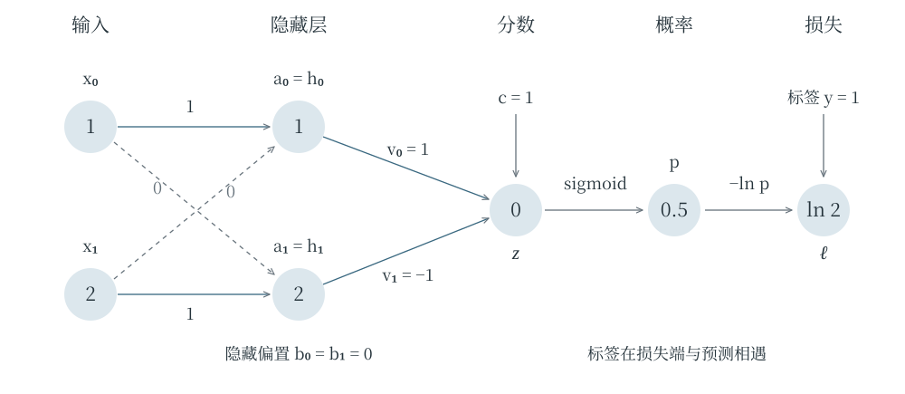

*图 3-2　一条样本的完整前向计算。连线上的数是权重，节点内是本次计算产生的值；零权重用浅色虚线表示。偏置分别是两个隐藏单元的零和输出端的 1。标签只进入损失计算，不作为网络预测时的输入。*

概率也不能被误读成“模型知道自己有百分之多少把握”。它首先是模型定义的输出；这种数值与真实发生频率是否匹配，还需要用独立数据检查校准情况。损失给出了训练信号，不替我们完成全部质量评价。

### 损失计算的数值稳定性

如果先算 $p$，再算 $\ln p$，极端分数可能造成数值问题。例如很大的正数会让有限精度中的 $p$ 舍入为 1，此时再计算 $\ln(1-p)$ 就会遇到零的对数。

把 sigmoid 代入损失，可以直接用分数表示：

$$
\ell(z,y)=\ln(1+e^z)-yz.
$$

但直接算 $e^z$ 仍可能溢出。把较大的指数项提出后，得到更适合实现的形式：

$$
\ell(z,y)=\max(z,0)-yz
+\ln(1+e^{-|z|}).
$$

现在指数的输入不大于零，不会因为 $z$ 很大而计算一个巨大的指数。程序还可以用 `log1p(t)` 计算 $\ln(1+t)$，减少 $t$ 很小时直接相加带来的精度损失。这里改变的是计算组织，数学目标保持相同。实际框架中的 [BCEWithLogitsLoss](https://docs.pytorch.org/docs/stable/generated/torch.nn.BCEWithLogitsLoss.html) 就把分数到损失的计算合在一起，以改善数值稳定性。

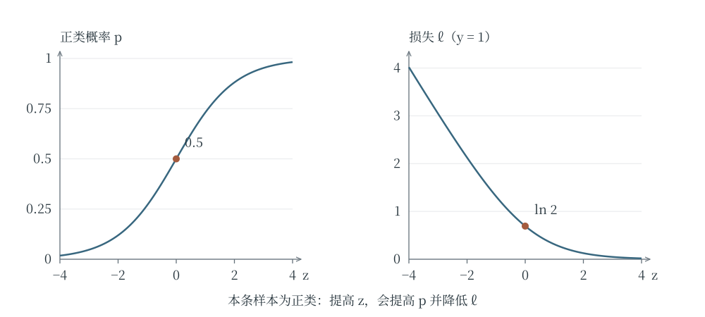

*图 3-3　同一个分数的两种观察方式。横轴均为 $z$，右图固定标签 $y=1$。提高分数会提高正类概率、降低这条样本的损失；若标签换成 0，损失随分数变化的方向也会改变。*

若任务有 $K$ 个互斥类别，网络可以输出 $K$ 个分数，用 softmax 形成概率：

$$
p_k=\frac{e^{z_k}}{\sum_j e^{z_j}},\qquad
\ell=-\ln p_y.
$$

这里的 $y$ 变为正确类别的编号。令 $m=\max_jz_j$，同时从每个分数中减去 $m$，概率不变，却能够避免对最大分数计算过大的指数。下一章预测词元时会使用这一结构。当前二分类算例已经足以看清损失怎样把任务要求变成一个可求导的量。

## 3.3　反向传播与参数更新

现在有了一个衡量预测的标量，但我们需要调整九个参数。逐个猜测参数该增大还是减小没有利用网络内部的结构。链式法则提供了一种办法：先看损失随分数如何变化，再逐层计算分数随中间值和参数如何变化。

### 梯度的含义

损失为 0.693，并不会直接告诉我们九个参数应该改成多少。真正需要的是局部变化率。例如，$\partial\ell/\partial W_{0,1}$ 表示其他独立参数固定时，$W_{0,1}$ 增加一个很小的量，会使损失产生怎样的一阶变化。

这个导数是负数，说明向增大的方向稍微移动会降低损失；是正数，说明应当考虑反方向。梯度大小不等于参数的重要性，也不能说明沿这个方向任意增大步长都能降低损失。导数描述的是当前参数附近的局部关系。

先从离损失最近的量开始。对概率求导：

$$
\frac{\partial\ell}{\partial p}
=-\frac{y}{p}+\frac{1-y}{1-p}.
$$

sigmoid 的导数为

$$
\frac{\partial p}{\partial z}=p(1-p).
$$

沿链式法则相乘并整理：

$$
\frac{\partial\ell}{\partial z}
=\left(-\frac{y}{p}+\frac{1-y}{1-p}\right)p(1-p)
=p-y.
$$

这是一个值得亲自化简的结果。正类样本当前只有一半概率，因此

$$
\delta\equiv\frac{\partial\ell}{\partial z}
=0.5-1=-0.5.
$$

也可以分两步核对：损失对概率的导数为 $-2$，概率对分数的导数为 $1/4$，两者相乘得到 $-1/2$。这个负号说明，提高当前分数有助于降低损失。

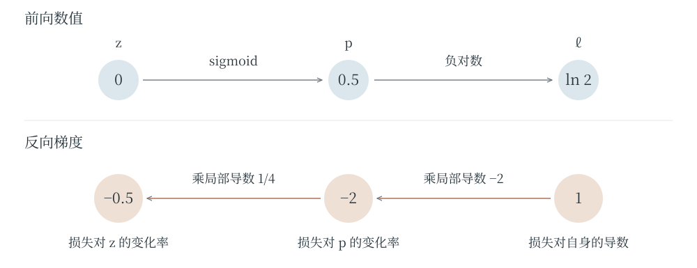

*图 3-4　反向传播首先是一遍链式法则。正向传的是当前数值，反向传的是最终损失对相应数值的变化率。图中 $\bar q$ 表示 $\partial\ell/\partial q$；下方的乘法不是把前向数值倒着运算。*

对 softmax 与多分类交叉熵，同样可以得到 $\partial\ell/\partial z_k=p_k-\mathbf{1}_{k=y}$。它与二分类的 $p-y$ 有相同的结构：把当前概率与目标分配之间的差异，传给产生分数的网络。这里 $\mathbf{1}_{k=y}$ 在正确类别处为 1，其他位置为 0。

### 先经过输出层，再经过隐藏层

为避免重复书写很长的偏导数，后面记 $\bar q=\partial\ell/\partial q$。对于向量，$\bar q$ 收集损失对它各分量的偏导；它的形状与 $q$ 相同。

输出分数为 $z=v_0h_0+v_1h_1+c$。只改变 $v_i$，分数的变化率是 $h_i$；只改变 $h_i$，变化率是 $v_i$。因此

$$
\bar v=\delta h,\qquad
\bar c=\delta,\qquad
\bar h=\delta v.
$$

代入本例：

$$
\begin{aligned}
\bar v&=\begin{bmatrix}-0.5\\-1\end{bmatrix},\qquad \bar c=-0.5,\\[4pt]
\bar h&=\begin{bmatrix}-0.5\\0.5\end{bmatrix}.
\end{aligned}
$$

两个隐藏单元收到的梯度符号不同，是因为第二个单元的输出权重为 $-1$。提高 $h_1$ 会降低分数，从而增加这条正类样本的损失。反向传播必须把这种作用方向一并传回去。

接着经过 ReLU。只要 $a_i>0$，$h_i=a_i$，局部导数为 1；若 $a_i<0$，附近一小段范围内输出保持为零，局部导数为 0。因此

$$
\bar a_i=\bar h_i\mathbf{1}_{a_i>0}.
$$

本例 $a=(1,2)^\mathsf{T}$，两个单元都在正半轴，于是 $\bar a=(-0.5,0.5)^\mathsf{T}$。在 $a_i=0$ 的折点，普通导数不存在；本章程序约定返回零。这个约定要与具体实现一致，不能把折点处的数值差分当作普通光滑函数的导数检查。

### 矩阵参数的梯度

隐藏层的第 $i$ 个分量是

$$
a_i=\sum_jW_{i,j}x_j+b_i.
$$

仅改变 $W_{i,j}$，只有 $a_i$ 直接变化，变化率为 $x_j$。所以

$$
\bar W_{i,j}=\bar a_i x_j,\qquad
\bar b_i=\bar a_i.
$$

第一行梯度为 $(-0.5)\times(1,2)=(-0.5,-1)$；第二行为 $0.5\times(1,2)=(0.5,1)$。整理成矩阵：

$$
\bar W=\bar a x^\mathsf{T}
=\begin{bmatrix}-0.5&-1\\0.5&1\end{bmatrix},
\qquad
\bar b=\begin{bmatrix}-0.5\\0.5\end{bmatrix}.
$$

这里是一个列向量与一个行向量的外积，结果为 $2\times2$，恰好与 $W$ 同形。形状相同不只是方便存储：每个位置都对应“这个具体参数变化时，损失怎样变化”。

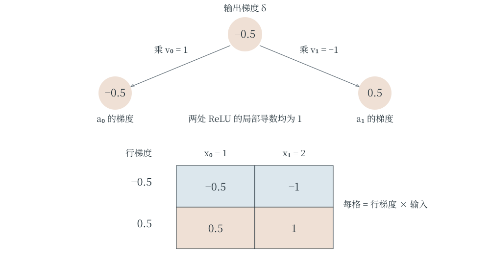

*图 3-5　梯度的符号与大小都有出处。上半图解释两个隐藏梯度为什么方向相反；下半图逐格展开外积。每格由行上的 $\bar a_i$ 与列上的 $x_j$ 相乘，不能遗漏输入因子。*

如果还要继续向更前面的层传播，就需要输入梯度。一个输入 $x_j$ 同时影响两个隐藏单元，所以各条路径的贡献相加：

$$
\bar x_j=\sum_iW_{i,j}\bar a_i,
\qquad \bar x=W^\mathsf{T}\bar a.
$$

本例 $W$ 为单位矩阵，得到 $\bar x=(-0.5,0.5)^\mathsf{T}$。输入样本通常不是这里要更新的参数，所以可以不据此修改 $x$；但当 $x$ 是前一层的输出时，这个梯度正是前一层继续学习所需要的信息。

至此，九个参数的梯度都已求出。反向传播从一个标量损失出发，依次经过局部运算，并复用共同的中间结果，因此无需为每个参数单独运行一遍网络。

### 完成一次更新，然后重新计算

最简单的梯度下降更新是

$$
\theta^{\mathrm{new}}=\theta-\eta\nabla_\theta\ell.
$$

$\eta$ 叫学习率，决定沿这个方向走多远。本次取 $\eta=0.1$，所有梯度均由刚才那一组旧参数计算。得到

$$
\begin{aligned}
W^{\mathrm{new}}&=\begin{bmatrix}1.05&0.10\\-0.05&0.90\end{bmatrix},\\[4pt]
b^{\mathrm{new}}&=\begin{bmatrix}0.05\\-0.05\end{bmatrix},\\[4pt]
v^{\mathrm{new}}&=\begin{bmatrix}1.05\\-0.90\end{bmatrix},
\qquad c^{\mathrm{new}}=1.05.
\end{aligned}
$$

不能在算出 $\bar v$ 后就更新 $v$，再用更新后的 $v$ 计算本次的 $\bar h$。那样拼接的导数既不对应完整的旧网络，也不对应完整的新网络。**一次更新所使用的梯度，必须对应它宣称求导的那次前向计算。**

用新参数重新运行同一条样本：

$$
\begin{aligned}
a^{\mathrm{new}}&=h^{\mathrm{new}}
=\begin{bmatrix}1.3\\1.7\end{bmatrix},\\[4pt]
z^{\mathrm{new}}&=1.05\times1.3-0.90\times1.7+1.05\\
&=0.885,\\
p^{\mathrm{new}}&\approx0.707857,\\
\ell^{\mathrm{new}}&\approx0.345513.
\end{aligned}
$$

损失从约 0.693 降到了约 0.346。这个结果是重新前向算出来的，不是把梯度的大小直接当成损失下降量。泰勒展开中的 $\Delta\ell\approx\nabla\ell^\mathsf{T}\Delta\theta$ 只是一阶近似，步子变大后，高阶项就不能忽略。

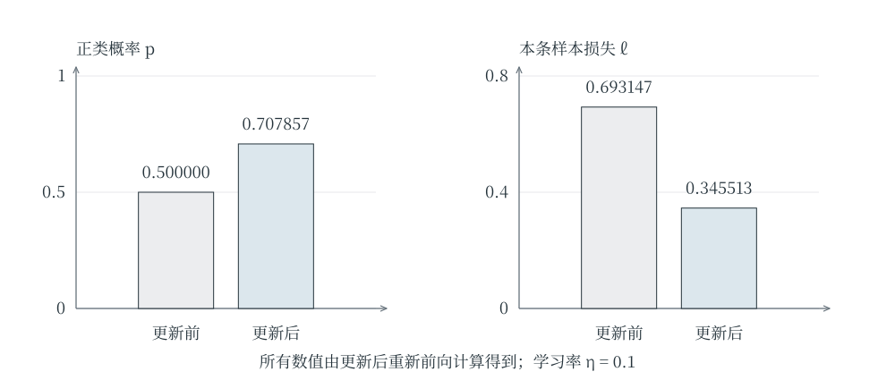

*图 3-6　一次完整训练更新的结果。左图比较概率，右图比较损失，纵轴含义不同。所有数值来自更新后重新执行网络；这只能证明本条样本在这一步有所改善，还不能证明整个任务已经学会。*

### 用新参数预测一条没参加更新的样本

刚才调高了输入 $(1,2)$ 的正类概率。现在把第二个数从 2 改成 3，得到一条标签为 0 的样本。先把它留在训练之外：只用它观察网络怎样预测，不用它计算更新。旧参数给出的隐藏向量是 $(1,3)$，分数为 $1-3+1=-1$。网络给正类的概率约为 $0.269$，因此给正确的负类留下了约 $0.731$ 的概率。

换成刚刚更新的参数，同一个输入经过两层计算得到

$$
\begin{aligned}
h_0 &= \max(0,1.05+0.10\times3+0.05)=1.4,\\
h_1 &= \max(0,-0.05+0.90\times3-0.05)=2.6,\\
z &= 1.05\times1.4-0.90\times2.6+1.05=0.18.
\end{aligned}
$$

正类概率随之升到约 $0.545$。若以 $0.5$ 为分类阈值，这条负类样本原来判对了，现在却判错了。按同一个损失函数计算，负类的损失也从 $-\ln(0.731)\approx0.313$ 升到 $-\ln(0.455)\approx0.787$。原因就在刚才那次更新里：两个输入共用同一组权重，而求梯度时只用到了前一条正类样本。要判断这一步对整个任务有没有帮助，还需要看更多留出的样本。

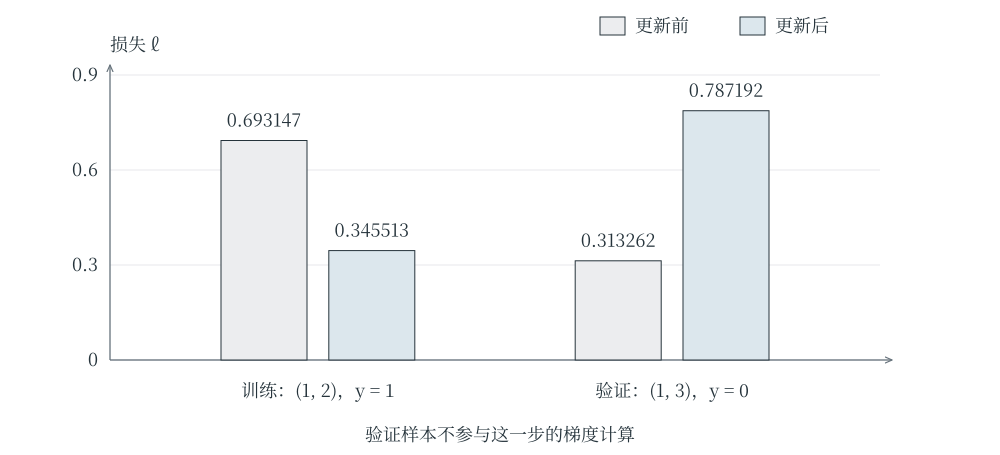

*图 3-7　每根柱子的高度都可以用正确类别的概率算出来，概率越接近 1，交叉熵越低。用第一个样本算出的更新，恰好让第二个样本更难判对。*

### 用程序复现手算过程

下面的程序按刚才的顺序计算前向。`exp` 是指数函数，`log1p` 用来稳定计算 $\ln(1+t)$。函数一次返回五项结果，调用者用五个变量按顺序接收。循环的含义与第二章相同。

```python
from math import exp, log1p

def forward(W, b, v, c, x, y):
    a = [0.0, 0.0]
    h = [0.0, 0.0]
    for i in range(2):
        a[i] = b[i]
        for j in range(2):
            a[i] += W[i][j] * x[j]
        h[i] = max(a[i], 0.0)
    z = v[0] * h[0] + v[1] * h[1] + c
    if z >= 0:
        p = 1 / (1 + exp(-z))
    else:
        p = exp(z) / (1 + exp(z))
    loss = max(z, 0) - y * z
    loss += log1p(exp(-abs(z)))
    return a, h, z, p, loss

W = [[1.0, 0.0], [0.0, 1.0]]
b, v, c = [0.0, 0.0], [1.0, -1.0], 1.0
x, y = [1.0, 2.0], 1.0
a, h, z, p, loss = forward(W, b, v, c, x, y)
```

其中 `+=` 是“用原值加上右边，再保存”的简写。接下来的反向代码逐项使用已经推导出的局部导数：

```python
delta = p - y
grad_v = [delta * h[0], delta * h[1]]
grad_c = delta
grad_b = [0.0, 0.0]
grad_W = [[0.0, 0.0], [0.0, 0.0]]
for i in range(2):
    grad_h = delta * v[i]
    if a[i] > 0:
        grad_b[i] = grad_h
    for j in range(2):
        grad_W[i][j] = grad_b[i] * x[j]
```

变量前缀 `grad_` 只是提醒读者：这里保存的是损失对相应参数的梯度。所有梯度准备好之后，再生成新参数。下面方括号里的 `for` 叫列表推导式，它逐项产生一个新列表；外层套一层，就逐行产生一个新矩阵。

```python
eta = 0.1
new_W = [[W[i][j] - eta * grad_W[i][j]
          for j in range(2)] for i in range(2)]
new_b = [b[i] - eta * grad_b[i] for i in range(2)]
new_v = [v[i] - eta * grad_v[i] for i in range(2)]
new_c = c - eta * grad_c
_, _, _, new_p, new_loss = forward(
    new_W, new_b, new_v, new_c, x, y)
```

最后的 `_` 表示这里不打算继续使用相应返回值。程序得到的 `new_p` 与 `new_loss` 分别约为 0.707857 和 0.345513，与手算一致。这里使用的是便于检查的 Python 数值运算；现代框架会自动组织反向计算，但应当实现相同的数学关系。

## 3.4　链式法则与自动微分

### 从标量链式法则到向量的局部变化

刚才的网络很小，写出每一项偏导并不困难。如果一层有几千个输入、几千个输出，难道需要把所有偏导组成的大表完整写出来，再相乘吗？

设一个局部运算是 $a=f(x)$，输入 $x\in\mathbb{R}^n$，输出 $a\in\mathbb{R}^m$。在当前输入附近，微小变化满足

$$
\mathrm{d}a=J_f\,\mathrm{d}x,
\qquad (J_f)_{i,j}=\frac{\partial a_i}{\partial x_j}.
$$

$J_f$ 是 $m\times n$ 的雅可比矩阵。它把输入的局部变化映射到输出的局部变化。假设后面的计算已经告诉我们 $\bar a=\nabla_a\ell$，那么损失的微小变化为

$$
\begin{aligned}
\mathrm{d}\ell
&=\bar a^\mathsf{T}\mathrm{d}a\\
&=\bar a^\mathsf{T}J_f\,\mathrm{d}x\\
&=(J_f^\mathsf{T}\bar a)^\mathsf{T}\mathrm{d}x.
\end{aligned}
$$

比较输入变化前面的系数，得到

$$
\bar x=J_f^\mathsf{T}\bar a.
$$

这正是反向传播在一个局部运算上要做的事情。若把梯度写成行向量，它是 $\bar a^\mathsf{T}J_f$，通常称为**向量—雅可比积**，简称 VJP。本书使用列向量，所以写成其转置形式。名称和排版不同，传递的导数相同。

重要的是：我们只需要这个乘积，不必一定构造完整的 $J_f$。对 $a=Wx+b$，输入的雅可比就是 $W$，直接计算 $W^\mathsf{T}\bar a$ 即可。对逐元素 ReLU，雅可比是由零和一构成的对角矩阵，直接按位置乘掩码即可；没有理由分配一张巨大对角表。

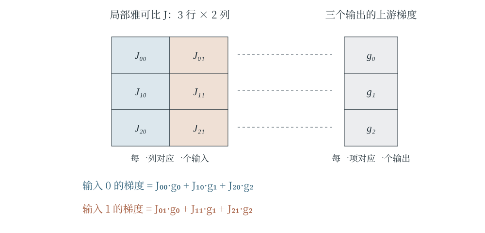

*图 3-8　VJP 的含义。为使输入和输出尺寸容易区分，图中把局部层推广为两输入、三输出。每个输入梯度汇总它对所有输出的影响；它不是沿一条任选的路径返回。实际算子可以直接实现这些加权与求和，而不显式保存图中的雅可比。*

权重梯度也能用同样的微分观点得到。对 $a=Wx+b$，同时允许三类输入变化，有

$$
\mathrm{d}a=(\mathrm{d}W)x+W\mathrm{d}x+\mathrm{d}b.
$$

把它代入 $\mathrm{d}\ell=\bar a^\mathsf{T}\mathrm{d}a$，分别收集每个 $\mathrm{d}W_{i,j}$、$\mathrm{d}x_j$、$\mathrm{d}b_i$ 前面的系数，便重新得到

$$
\bar W=\bar a x^\mathsf{T},\qquad
\bar x=W^\mathsf{T}\bar a,\qquad
\bar b=\bar a.
$$

这套方法把“一串看起来要背的公式”变成了可以检查的局部推导。只要前向定义和形状清楚，反向公式就能从损失的微小变化中推出来。

也可以从输入端发起一次求导。把层缩成 $f(u,v)=(uv,u+v)$，在 $(2,3)$ 处，问“把 $u$ 略增一份、同时把 $v$ 略减一份，会发生什么？”给两个输入各附一个方向分量 $(1,-1)$。经过乘法时同时传播乘积法则，得到 $3\times1+2\times(-1)=1$；经过加法得到 $1-1=0$。前向模式让程序沿原来的执行顺序既算出值 $(6,5)$，也算出切向量 $(1,0)$。这就是 $J(1,-1)^\mathsf{T}$。沿该方向实际走一小步 $\epsilon$，乘积变为 $(2+\epsilon)(3-\epsilon)=6+\epsilon-\epsilon^2$，线性项恰为 1。

再考虑反向求导。设损失对两个输出的偏导数分别为 2 和 4，我们要求的是损失对两个输入的偏导数。沿反向走，乘法贡献 $(6,4)$，加法贡献 $(4,4)$，相加得 $(10,8)$。上面那次微调让损失的一阶改变量既可从输出端算成 $2\times1+4\times0=2$，也可从输入端算成 $10-8=2$。这种内积核对能检验自定义算子的前后向是否相容。需要雅可比的所有列时，一般可逐个输入基方向做前向传播；需要所有行时，可以逐个输出基方向做反向传播。训练常有数以百万计的参数而最后只汇成一个损失，一次反向就能给出所有参数的梯度。若只想试一个扰动方向，无须先保存整套反向中间量。[PyTorch 函数变换与雅可比乘积](https://docs.pytorch.org/tutorials/intermediate/jacobians_hessians.html)

### 共享参数的梯度累加

第二章强调，两个名字可能指向同一份存储。学习中还有一种更强的约定：**同一个可训练参数，在函数的不同位置反复使用。** 这时要对同一个变量求导，不能把不同使用位置当作彼此独立的变量。

仍用当前小网络，但增加一个约束：让 $W_{0,0}$ 与 $v_0$ 共享同一个标量 $w$，它们当前都为 1。其他参数保持初值。对当前样本，第一隐藏单元为 $h_0=w$，最后分数为

$$
z=w h_0-2+1=w^2-1.
$$

$w$ 有两条影响损失的路径。一条改变输出层乘数 $v_0$，另一条改变隐藏层的 $h_0$。在 $w=1$ 时，这两条贡献分别为 $-0.5$，相加得到

$$
\frac{\mathrm{d}\ell}{\mathrm{d}w}
=\delta(h_0+w x_0)=-1.
$$

直接对 $z=w^2-1$ 求导，再乘 $\delta=-0.5$，也得到 $-1$。如果反向程序每次都用赋值覆盖原梯度，最后可能只留下其中一条路径。这就是梯度通常需要“累加”的数学原因之一。

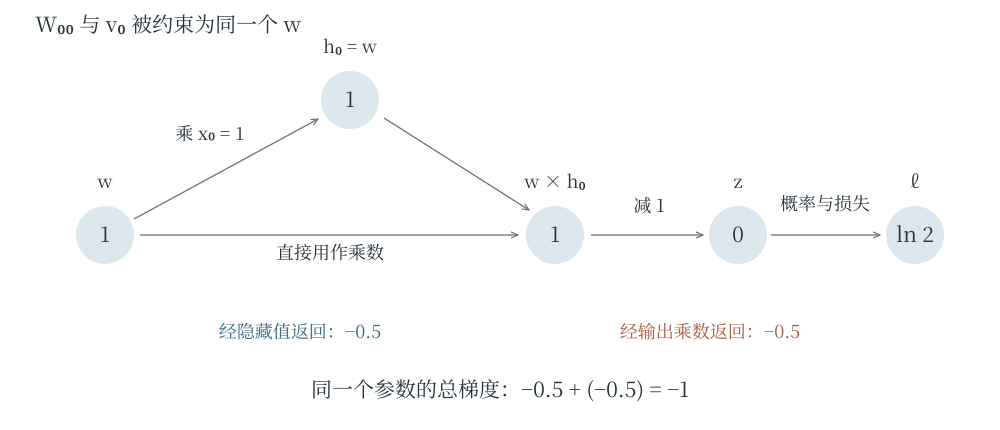

*图 3-9　共享参数的两条贡献。图中的两个使用位置引用同一个 $w$，因此只有一次参数更新。本例加上共享约束后只有八个独立参数；它是用来解释共享的变体，后续批量训练继续使用原来的九参数网络。*

同理，一个中间值被两条后续分支使用时，返回到该值的梯度也要相加。反向传播不是简单地把正向箭头反过来画：还要保证所有使用者的贡献都被合并，并且没有重复累计。

### 自动微分的计算过程

自动微分把程序拆成具有已知局部导数的基本运算，记录或恢复反向需要的信息，再按依赖关系执行局部 VJP。它不需要把整个网络先化简成一个巨大的符号表达式，也不是靠给每个参数加一点扰动来近似导数。关于这些方法的区别，可以参照[自动微分综述](https://www.jmlr.org/papers/v18/17-468.html)。

对常见神经网络算子，反向工作量通常与前向处于相同数量级，但常数、内存需求和通信模式各不相同。第十二章将讨论框架为反向传播保留哪些对象，以及何时可以释放它们占用的存储。

### 用有限差分找出一处遗漏

尽管不适合作为大模型的常规求导方法，有限差分很适合检查我们自己写的反向。对一个标量参数 $w$，中心差分为

$$
g_{\mathrm{num}}
=\frac{\ell(w+\varepsilon)-\ell(w-\varepsilon)}{2\varepsilon}.
$$

仍在初始参数处，检查 $W_{0,1}$。解析梯度为 $\bar a_0x_1=(-0.5)\times2=-1$。把 $W_{0,1}$ 分别改成 $10^{-5}$ 和 $-10^{-5}$，其他参数固定，各运行一次完整前向，得到的中心差分约为 $-1$。

```python
eps = 1e-5
W_plus = [row.copy() for row in W]
W_minus = [row.copy() for row in W]
W_plus[0][1] += eps
W_minus[0][1] -= eps
loss_plus = forward(W_plus, b, v, c, x, y)[4]
loss_minus = forward(W_minus, b, v, c, x, y)[4]
numeric_gradient = (loss_plus - loss_minus) / (2 * eps)
```

这里复制了每一行，避免第二章讨论过的嵌套共享存储问题。`[4]` 取前向返回的第五项，也就是损失。前面的更新使用了 `new_W` 等新名字，所以此处的 `W,b,v,c` 仍是初始参数。

若反向中漏乘 $x_1$，错误答案会变成 $-0.5$，这个检查就能发现它。若检查共享参数，则必须同时扰动它的所有使用位置；只改一个位置，检查的是另一个函数。

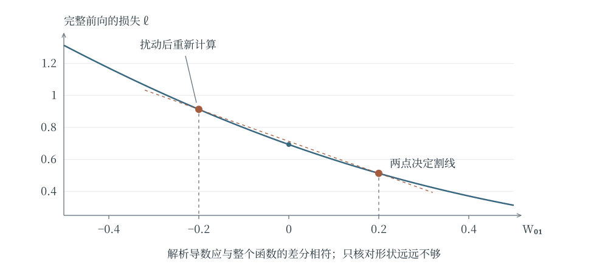

*图 3-10　有限差分检查的是整个函数。图为便于观察使用较大的取点间距，程序核验使用 $\varepsilon=10^{-5}$。这里其他参数均固定在初值。靠近 ReLU 折点、发生随机变化或使用低精度时，必须重新检查差分的适用条件。*

差分步长并非越小越好。太大时，高阶项可能影响近似；太小时，两个接近的浮点数相减会放大舍入误差。核验通常使用较高精度、固定输入和随机状态，避开不光滑点，并尝试几个步长。本章复算程序在初值与更新后两个位置检查全部九个参数，最大绝对误差小于 $10^{-8}$。这种核验能发现实现错误，但有限个测试点仍不是对所有输入的形式化证明。

## 3.5　小批量训练

单条样本告诉我们如何计算一次更新，却不能代表任务中的全部情况。同一个参数可能受到不同样本的相反影响。把样本损失按约定合并，再求共同参数的梯度，才能明确一批数据究竟推动模型向哪里更新。

### 批次损失与梯度

一个任务由很多样本约束。设训练集有 $N$ 条样本，经验平均损失为

$$
L_{\mathrm{train}}(\theta)
=\frac{1}{N}\sum_{n=0}^{N-1}
\ell(f_\theta(x^{(n)}),y^{(n)}).
$$

上标 $(n)$ 表示样本编号，不是乘方。由于求导对加法满足线性关系，平均损失的梯度，就是每条样本梯度的平均。

现在回到原来的九个独立参数，并恢复初值。除了第一条样本 $(1,2)^\mathsf{T},y=1$，再加入第二条训练样本 $(2,3)^\mathsf{T},y=0$。两条样本的分数都恰好为零，但标签相反，所以输出梯度分别为 $-0.5$ 和 $0.5$。

第二条样本经过同样的反向，得到

$$
\begin{aligned}
\bar W^{(1)}&=\begin{bmatrix}1&1.5\\-1&-1.5\end{bmatrix},\\[4pt]
\bar b^{(1)}&=\begin{bmatrix}0.5\\-0.5\end{bmatrix},\\[4pt]
\bar v^{(1)}&=\begin{bmatrix}1\\1.5\end{bmatrix},\qquad
\bar c^{(1)}=0.5.
\end{aligned}
$$

把它与第一条样本的梯度相加、除以 2：

$$
\begin{aligned}
\nabla_W L&=\begin{bmatrix}0.25&0.25\\-0.25&-0.25\end{bmatrix},\\[4pt]
\nabla_b L&=\begin{bmatrix}0\\0\end{bmatrix},\\[4pt]
\nabla_v L&=\begin{bmatrix}0.25\\0.25\end{bmatrix},\qquad
\nabla_c L=0.
\end{aligned}
$$

输出偏置的梯度抵消了，权重的梯度却没有全部抵消，因为输入和隐藏值不同。两条样本不只是投票决定“增加还是减小一个总分数”，还在要求模型改变输入特征与分数之间的关系。

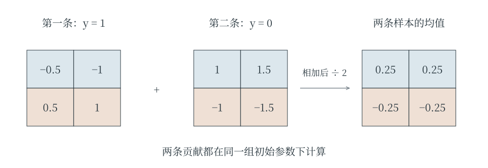

*图 3-11　批量梯度是同一参数版本下的逐样本贡献之和或均值。图中两份梯度均由初始参数产生。若处理第一条样本后就更新参数，第二条梯度便来自另一个位置，不再是这里定义的两样本平均梯度。*

实际训练通常不在每次更新前遍历整个训练集，而是选取一个较小的批次，称为 mini-batch。它的平均梯度用于更新参数，这就是常见的小批量随机梯度下降。若样本从训练集均匀抽取，这个平均可以作为全训练集梯度的估计；在独立抽样等假设下，平均能减小抽样噪声。

但噪声较小不自动意味着达到同等质量的总时间更短。更大的批次需要处理更多样本，更新次数、学习率安排和硬件利用率也会改变。我们要比较的是完成任务所需的整体训练过程，而不只是某一步是否更平稳。

### 批量计算与矩阵运算

把 $B$ 条样本作为列组成 $X\in\mathbb{R}^{n\times B}$，一层可以统一写成

$$
A=WX+b\mathbf{1}^\mathsf{T}.
$$

$\mathbf{1}$ 是长度为 $B$ 的全一向量，偏置因此被广播给每一列。若上游已经给出最终平均损失对 $A$ 的梯度 $G=\nabla_A L$，则

$$
\begin{aligned}
\nabla_W L&=GX^\mathsf{T},\\
\nabla_X L&=W^\mathsf{T}G,\\
\nabla_b L&=G\mathbf{1}.
\end{aligned}
$$

$G$ 的形状是 $m\times B$，因此 $GX^\mathsf{T}$ 的形状是 $m\times n$。其中每一项都是跨样本的乘积求和。前面逐条算出的权重梯度平均，在批量程序里可以变成一次矩阵乘法。

要注意平均因子的位置：这里 $G$ 已经是平均损失的梯度，包含了 $1/B$，不能在矩阵乘法后再除一次。若传入的是每条样本未经平均的梯度，则应在约定的位置除以 $B$。许多训练结果不对，并非反向公式错了，而是不同层对“求和还是求平均”的约定没有对齐。

一大批数据也可以拆成几个小批，先累积梯度，最后更新一次，称为梯度累积。若各小批返回自己的平均梯度，样本数不同时，应按各自样本数加权，而不是把几个均值简单平均。等价性还要求参数保持同一版本，损失能按相应样本项相加；随机操作、跨样本归一化以及不同的归约顺序，都可能带来额外差异。

因此，梯度缓冲区通常在这一轮累积开始前清零，每个小批将贡献加进去，全部完成后再更新。每个小批都清零会丢掉先前贡献，跨越不相关更新一直不清零又会混入旧梯度。这个生命周期与第二章的存储和依赖问题直接相连。

### 把这些步骤组成训练循环

现在可以看清“不断训练”实际重复的是什么。最简单、不使用梯度累积的过程如下：

```text
初始化参数与优化器状态
重复若干轮：
    按约定顺序将训练样本组成批次
    对每个批次：
        清空本次参数梯度
        前向计算预测与批次损失
        反向计算并汇总参数梯度
        用优化器更新参数与历史状态
    在验证集上评估当前参数
```

遍历一遍训练集通常称为一个 epoch；执行一次优化器更新通常称为一个 step。一个批次包含多少样本、是否进行梯度累积，会改变一轮中更新步数与数据读取次数的关系。数据流不一定能够自然分成有限的轮次，但“看过多少数据”和“更新了多少次参数”仍是两个不同的计数。

上面重复执行的是同一套计算规则，逐步改变的是参数和优化器状态。验证阶段不据其损失做本次反向更新；是否继续训练、怎样选择一个版本，则依据预先约定的评价方式。一个训练损失不再明显下降的状态，也不必然是全局最优，更不直接说明它已经满足任务要求。

### 怎样判断该在哪一步停止训练

第 3.3 节里，一次更新让正类样本的损失下降，却把一个原本判对的负类样本判错了。一次只看一条留出的样本，结论很容易受偶然因素影响。实际训练时，可以每隔一段时间固定当前参数，对同一批留出的样本做前向计算，观察它们的平均损失。若训练损失还在下降，而验证损失持续升高，值得回头比较较早保存的模型。

实际工作会把数据分为训练、验证和测试等用途。训练集参与参数更新；验证集帮助选择模型、超参数和停止时机；测试集用于最终评估，尽量避免在反复选择过程中泄漏信息。若输入的均值、方差等预处理统计量由数据估计，也应在允许的训练范围内拟合，再应用到验证和测试数据。

当模型逐渐利用了训练数据中特有的噪声或偶然关系，而这些关系不适用于新数据，就可能发生过拟合。增加有代表性的数据、限制不必要的模型复杂度、正则化和根据验证表现停止训练，都可能帮助控制这一问题。没有一种措施能替代对数据来源和目标分布的检查。

损失函数本身也是一种选择。当前二分类似然不包含业务上不同错误的代价；标签质量和样本选择也会影响学到的函数。AI Infra 需要维持数值与执行的正确性，同时保持对这些上层约定的认识：把一个有偏差的目标算得更快，并不会自动得到更合适的任务结果。

### 两种看似相同的“小批平均”

若损失的单位是一个有效词元，分批时就要让每个有效词元在更新中占同样的份额。设短句只有 1 个参与损失的词元，某参数的梯度是 6；长句有 3 个，梯度各为 2。拼在一起再取平均，梯度为 $(6+3\times2)/4=3$。分别对每句求均值，再对两个均值取一半，梯度却是 $(6+2)/2=4$。学习率相同时，这一步移动的距离相差三分之一。

两种计算都可以对应合理的学习目标。若每份标注是一句且要求每句等权，4 就是所选目标的梯度。若目标按词元定义，想用两次小批等价地执行一次大批，应累加损失之和或梯度之和，同时累加有效项数，最后除一次。填充位不进入分子、分母；若整批有效项数为零，要跳过这次归一化和相应的更新。到第十六章，数据分到不同机器后，这个分母也得跨机器传递。

### 不同训练阶段的目标

下一章会将分类任务扩展到语言模型：根据已有词元预测下一个词元。为先说明训练目标的区别，假设词表只有两个候选，三个预测位置都可以使用本章的二分类损失。接下来三个正确词的预测概率依次为 $1/2,1/4,1/2$。若把整段都当作语言材料，平均负对数概率为 $4\ln2/3$。若前两个位置属于用户的问题，第三个位置才是要模仿的回答，训练配置可只对回答计损失，此时平均是 $\ln2$。前两个位置仍然要走前向，为回答提供上下文；沿回答位置反传的梯度仍可经过它们的表示。变化的是哪些预测直接收到监督，以及分母计了多少个有效位置。

预训练通常从大语料的预测任务起步。**继续预训练**从已有权重接着做语言建模，可以提高某领域或某种长度材料的采样比重；有些训练方案把通用预训练与指令微调之间的这段叫作中期训练。若把三份通用样本和一份领域样本，从按样本均匀抽取改为各域等概率，再在域内均匀抽取，每份领域样本被抽中的机会从 $1/4$ 升到 $1/2$。数据、上下文长度和学习率可以换，反向传播依然是刚刚推过的同一条链。监督微调则常把提示与示范回答成对组织，按任务约定决定监督哪些位置。衡量两次更新时宜同时记录实际处理的词元数、进入损失的词元数，以及通用域和目标域各自的验证误差。样本长度、掩码或域的配比一变，原来那一条总损失曲线就可能失去可比性。

## 3.6　深层网络的梯度与训练稳定性

### 反复相乘会改变信号的尺度

两层网络的链式法则并不复杂，但很多层连接之后，局部变化率要沿路径反复相乘。考虑最简单的标量链 $h_{l+1}=\alpha h_l$。经过 $L$ 层，输出对最初输入的导数为 $\alpha^L$。

若每层局部导数为 0.5，十层后只剩 $0.5^{10}\approx0.000977$；若为 1.5，十层后变成 $1.5^{10}\approx57.665$。前者使早期层收到的变化率很小，后者可能使微小变化被大幅放大。深层网络中的梯度消失与爆炸，具有这样的基本来源。

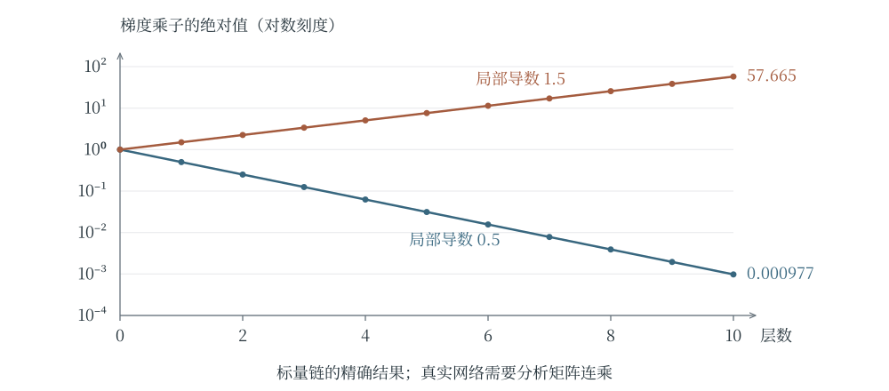

*图 3-12　梯度尺度随深度积累。纵轴采用对数刻度，表示梯度乘子绝对值，零层处均为 1。真实网络对应雅可比矩阵的连乘，不是把某个平均数简单乘十次；方向、奇异值和各层的相关性都会影响结果。*

sigmoid 的局部导数不超过 $1/4$，在两端饱和时还会更小。但也不能据此断言“包含 sigmoid 的网络就必然训练不了”：输出层与交叉熵组合后已经出现了 $p-y$ 的简化，完整梯度还要结合所有路径与权重分析。

ReLU 在正半轴的导数为 1，避免了这一位置的持续压缩；负半轴则阻断该样本经过这个单元的局部梯度。如果一个单元对所有训练输入长期处于负半轴，就可能难以通过常规梯度重新激活。某一条样本上的零梯度，仍不意味着参数永远不会变化：其他样本、其他使用路径或优化器中的历史状态都可能影响后续更新。

### 初始化既要打破对称，也要控制尺度

如果同一层的两个隐藏单元具有相同的输入权重、偏置和对称的输出连接，它们在同样的训练规则下可能一直收到相同的更新。两个单元就不能自然分工成不同的特征。随机初始化的一个作用，是打破这种对称性，而不是简单地“给训练加一点噪声”。

随机数的尺度同样重要。设一个单元有 $n$ 个输入，计算 $a=\sum_{j=1}^{n}w_jh_j$。在权重零均值、相互独立并与输入近似独立等初始化假设下，若权重方差为 $\sigma_w^2$，各输入二阶矩相近，则

$$
\mathbb{E}[a^2]\approx n\sigma_w^2\mathbb{E}[h_j^2].
$$

若 $a$ 的分布关于零对称，ReLU 丢掉负半轴后有

$$
\mathbb{E}[\operatorname{ReLU}(a)^2]
=\frac12\mathbb{E}[a^2].
$$

因此，选择 $\sigma_w^2\approx2/n$，可以在这组假设下保持前向信号的二阶矩尺度。这是 [He 初始化](https://arxiv.org/abs/1502.01852) 的基本出发点之一。

这里有两个容易被省略的细节。第一，ReLU 输出通常有正均值，所以这里控制的是二阶矩，不能不加说明地把它等同于方差。第二，这是一种初始化时的统计近似，不是训练全过程中的稳定性保证；激活函数、残差结构、宽度和权重相关性改变时，需要重新分析。

初值的尺度如果导致激活或梯度过大，有限精度中的溢出风险也会增加。算法稳定性与数值格式因此不是两件完全分开的事。第十一章讨论低精度时，会继续使用这些尺度判断。

### 归一化怎样改变一个向量

即便初值合适，训练中的中间表示仍会变化。以 LayerNorm 为例，它对一条表示向量内部的 $d$ 个分量计算均值和方差：

$$
\mu=\frac1d\sum_i a_i,\qquad
\sigma^2=\frac1d\sum_i(a_i-\mu)^2.
$$

再计算

$$
\hat a_i=\frac{a_i-\mu}{\sqrt{\sigma^2+\epsilon}},
\qquad r_i=\gamma_i\hat a_i+\beta_i.
$$

$\epsilon$ 是防止分母过小的稳定项；$\gamma$ 和 $\beta$ 是可学习的缩放与平移，使网络能够进一步选择合适的表示。与输入数据的预处理不同，这些统计量是在网络内部、对当前表示计算的。[Layer Normalization 原论文](https://arxiv.org/abs/1607.06450)说明了这种按单个样本的特征维度统计的组织方式。

为了直观看到变换，把向量宽度暂时扩为 3，取 $a=(1,3,5)^\mathsf{T}$。其均值为 3，方差为 $8/3$。只在这个非零方差的手算例子中令 $\epsilon=0$，并取 $\gamma_i=1,\beta_i=0$，得到

$$
\hat a=
\begin{bmatrix}-\sqrt{3/2}\\0\\\sqrt{3/2}\end{bmatrix}
\approx\begin{bmatrix}-1.224745\\0\\1.224745\end{bmatrix}.
$$

三个数相对于均值的位置被保留，整体平移和尺度则被重新组织。若 $\epsilon>0$，归一化结果的经验方差为 $\sigma^2/(\sigma^2+\epsilon)$，并非严格等于 1；再经过 $\gamma,\beta$ 后，更不能要求输出必然零均值、单位方差。

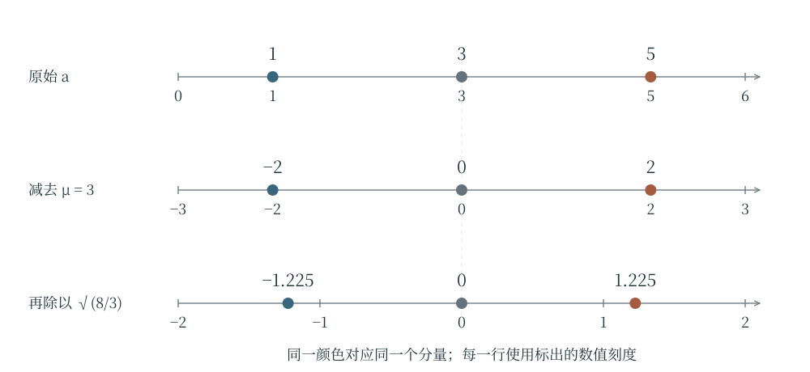

*图 3-13　归一化怎样重新确定中心与尺度。三个阶段分别使用各自标明的数值坐标，点的对应关系保持不变。本例标准差为 $\sqrt{8/3}$，暂不加入稳定项和可学习仿射变换。*

归一化也会改变反向依赖。一个 $a_i$ 不只影响自己的分子，还影响所有位置共同使用的均值和方差。若把它们当作常数，简单地把上游梯度除以标准差，得到的反向就是错的。

可以沿刚才的微分方法检查。记 $s=\sqrt{\sigma^2+\epsilon}$，并令 $q_i=\partial\ell/\partial\hat a_i$；若有仿射变换，先将其上游梯度逐项乘以 $\gamma_i$，即可得到 $q_i$。对于输入扰动，

$$
\begin{aligned}
\mathrm{d}\mu&=\frac1d\sum_j\mathrm{d}a_j,\\[4pt]
\mathrm{d}s&=\frac{1}{ds}\sum_j(a_j-\mu)\mathrm{d}a_j.
\end{aligned}
$$

第二式利用了 $\sum_j(a_j-\mu)=0$。将这两个变化代入 $\mathrm{d}\hat a_i$，再把 $\sum_iq_i\mathrm{d}\hat a_i$ 中每个 $\mathrm{d}a_j$ 的系数收集起来，得到

$$
\bar a_i=\frac1s
\left(q_i-\operatorname{mean}(q)
-\hat a_i\operatorname{mean}(q\hat a)\right).
$$

其中 $q\hat a$ 表示逐元素乘积。式中的两个均值，分别体现了共同中心与共同尺度带来的耦合。它也解释了为什么归一化的反向需要归约，而不只是一次逐元素乘法。章末练习会用三个数把这个式子算完。

加入归一化会改变模型的计算。统计维度尤其重要：跨一个样本的特征统计和跨批次统计，会产生不同的数据依赖。批大小、分布式切分、训练与推理阶段的统计约定，都必须与模型定义一致。

### 残差连接为何提供另一条梯度路径

另一种深层结构是让一层学习对输入的改变量：

$$
r=h+F(h).
$$

若后面返回梯度 $\bar r$，链式法则给出

$$
\bar h=\bar r+J_F^\mathsf{T}\bar r.
$$

其中第一项来自直接相加的恒等路径，第二项来自变换分支。网络可以在保留输入的基础上学习修正，而不必每一层都重新实现完整映射。这是[残差学习](https://arxiv.org/abs/1512.03385)的重要结构思想。

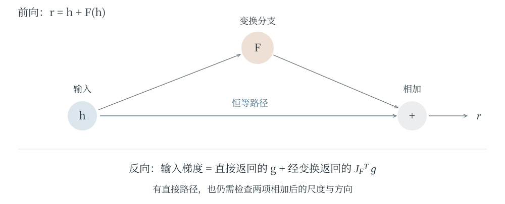

*图 3-14　残差的前向与反向都存在两条路径。反向相加来自链式法则，与第 3.4 节的分支汇合一致。若维度不同，直接相加需要改为带投影等约定的结构，不能沿用未经调整的恒等路径。*

但有恒等路径，不等于梯度永远不会消失或爆炸。例如若局部 $J_F=-I$，两条贡献仍可能抵消。残差、初始化、归一化和学习率要共同作用；它们分别改变表示、尺度和更新过程，不能彼此替代。

这也给基础设施实现提出了明确要求。残差的两条分支要正确合并，归一化要沿正确维度归约，初始化与参数装载要保留约定的数值尺度。只要其中一处语义发生变化，即使代码能够运行、张量形状也对得上，训练过程仍可能走向另一个模型。

## 3.7　优化器与训练状态

### 学习率决定局部信息怎样被使用

梯度给出局部方向，学习率决定步长。对一个可微损失，在足够小的移动范围内，

$$
L(\theta-\eta g)
\approx L(\theta)-\eta\|g\|^2,
\qquad g=\nabla_\theta L.
$$

这个近似解释了为什么通常沿负梯度移动，但并不保证任意大的 $\eta$ 都能下降。一个简单的反例是 $L(w)=w^2/2$，其更新为 $w^{\mathrm{new}}=(1-\eta)w$。只有 $0<\eta<2$ 时，非零 $w$ 的损失才会严格降低；若 $\eta=3$，$w$ 的绝对值翻倍，损失反而变成四倍。

神经网络的不同方向具有不同曲率，且批次梯度还带有抽样噪声。实际训练可能采用逐渐增加学习率的预热、后期降低学习率的调度，以及限制梯度范数的裁剪。它们都在控制更新过程，但不存在一个不看模型、批次和目标就通用的设置。

例如全局范数裁剪将非零梯度 $g$ 改为 $g\min(1,\tau/\|g\|)$，当范数超过正阈值 $\tau$ 时整体缩小这一梯度向量；零梯度直接保持为零。它与分别截断每个坐标不同，也不能修复错误梯度、错误标签或已经产生的非有限数值。改变更新规则时，需要知道自己限制的到底是哪一个对象。

可以用本章的小网络检查裁剪发生的时刻。先固定其他八个参数，只更新 $W_{0,0}$。在 3.5 节那两条样本上，这个坐标的梯度分别为 $-0.5$ 和 $1$。设阈值为 $0.5$。整批取平均得到 $0.25$，落在阈值内。用学习率 $0.1$ 从初值 1 更新，权重会变成 $0.975$。若分别裁剪两条样本，第二条的梯度会先变成 $0.5$，再取平均恰好为零，权重仍为 1。这已经给出了一个调试办法：用相同数据，比对完整批与两个微批更新后的参数。若只有打开裁剪时两者才出现上述分歧，去找训练循环中裁剪与累积的先后次序。

再把一个梯度向量的两个坐标分开存放。假设更新前的梯度为 $(3,4)$，阈值为 $2.5$。第一台机器可以先算出本地平方和 9，第二台得到 16。合起来再开方，全局范数是 5，两台都乘 $2.5/5$，更新器收到 $(1.5,2)$。若每台都拿阈值裁自己保存的那一份，拼回来的向量为 $(2.5,2.5)$，范数约 3.54，方向也变了。若两台各自持有完整的同一梯度，则两个 25 再相加又会把每个坐标数两次。到了第十六章，判断要不要为这次开方发起通信，就要先问每张卡持有不同坐标、不同样本的贡献，还是已经同步的副本。PyTorch 的分片接口因此专门提供了跨进程计算梯度范数的入口。[FSDP 的梯度裁剪](https://docs.pytorch.org/docs/stable/fsdp.html#torch.distributed.fsdp.FullyShardedDataParallel.clip_grad_norm_)

### 增大批次，究竟减少了什么

3.5 节用样本梯度的平均值完成一次更新。现在把批量与学习率一起考虑：同一个平均梯度，既决定参数往哪里走，也决定这一步要等多少样本算完。增加样本是否值得，要看它减少了多少更新的不确定性。

可以把抽样噪声放进一个能算到底的例子。暂时只训练一个数 $\theta$，真实目标为 $L(\theta)=(\theta-\theta_*)^2/2$。记它与最优值的距离为 $d=\theta-\theta_*$，真实梯度就是 $d$。单条样本给出的梯度围绕 $d$ 波动，设误差均值为零、方差为 $\sigma^2$。独立抽取 $B$ 条再平均，批次梯度为

$$
g_B=d+\varepsilon_B,\qquad
E[\varepsilon_B]=0,\qquad
\operatorname{Var}(\varepsilon_B)=\frac{\sigma^2}{B}.
$$

这里的方差相加后还要除以 $B^2$，所以最终是 $1/B$，而标准差只按 $1/\sqrt B$ 缩小。按学习率 $\eta$ 更新后，距离变成 $(1-\eta)d-\eta\varepsilon_B$。把它平方并取期望，交叉项因噪声均值为零而消失，得到

$$
E[L(\theta-\eta g_B)]
=\frac12\left[(1-\eta)^2d^2+\eta^2\frac{\sigma^2}{B}\right].
$$

第一项是仍未走完的距离，第二项是抽样给本次移动增加的不确定性。取 $d=1,\sigma^2=4,\eta=1/2$，更新前损失为 $0.5$。当 $B$ 依次为 1、4、16 时，更新后的期望损失分别为 $0.625,0.25,0.15625$。第一种甚至平均变差：方向估计的波动使这个步长过大。后两种都下降，但增加同样的样本数不再带来同样的改善。

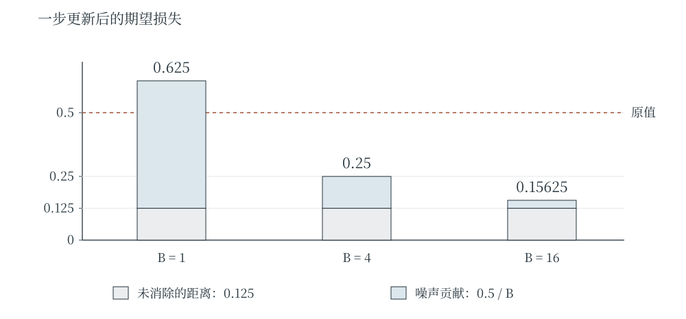

*图 3-15　柱子的总高度是更新后的期望损失，虚线为更新前的 0.5。灰色部分始终为 0.125；本例增大批次不能消除这一部分，改变学习率才会同时改变两项。*

对上式关于 $\eta$ 求导，可得到这个局部模型下使下一步期望损失最小的

$$
\eta_* = \frac{d^2}{d^2+\sigma^2/B}.
$$

因此批量大小和学习率需要一起考虑。靠近最优点、$d$ 变小时，同样的噪声会更显著。真实网络有许多方向、不同曲率和不断变化的数据分布，这个一维结论不能直接变成通用学习率公式。梯度噪声尺度研究的意义，是尝试估计哪些训练阶段仍值得增加批量，而不是给所有模型指定一个固定的最大批次。[大批量训练的噪声尺度分析](https://arxiv.org/abs/1812.06162)

独立性也值得检查。若每条梯度误差的方差都是 $\sigma^2$，任意两条之间相关系数都是 $\rho$，平均误差方差就变为 $\sigma^2[1+(B-1)\rho]/B$。$B=4,\sigma^2=4,\rho=1/2$ 时结果为 2.5，明显高于独立情况下的 1。重复相同样本不能换来四份独立信息；第十八章的数据去重因此也影响训练效率。

再给上述数学比较补上时间。假设一次实测中，批量 128 的方案需要 2000 次更新达到约定质量，每步 4 ms；批量 1024 的方案需要 700 次更新，每步 15 ms。前者每秒处理 32000 条样本，8 秒达到目标；后者每秒约 68267 条，却要 10.5 秒。这组教学数据说明，样本吞吐翻倍与训练完成更快是两项不同的结论。比较时还应固定验证方法，并把数据准备、验证与恢复计入完整时间。梯度累积可以用多个微批形成一个大批次，但在同一组参数上累积完再更新，与每个微批后立即更新，并非同一个算法。

### 从当前梯度，到保留历史的更新

最简单的 SGD 只用当前批次梯度。动量方法则保留一个随时间更新的历史量。例如采用

$$
\begin{aligned}
m_t&=\beta m_{t-1}+(1-\beta)g_t,\\
\theta_{t+1}&=\theta_t-\eta m_t.
\end{aligned}
$$

这里 $t$ 表示更新步，$m_0=0$，$\beta$ 决定历史衰减速度。不同实现也可能使用不含 $1-\beta$ 的动量定义，因此相同数字的学习率不能脱离公式比较。持续同向的梯度会逐渐积累；方向短暂反转时，历史不会立刻完全消失。

[Adam](https://arxiv.org/abs/1412.6980) 在此基础上，为每个参数维护一阶矩和平方梯度的二阶矩估计。本章用 $s_t$ 表示第二个状态，避免与输出权重 $v$ 混淆：

$$
\begin{aligned}
m_t&=\beta_1m_{t-1}+(1-\beta_1)g_t,\\
s_t&=\beta_2s_{t-1}+(1-\beta_2)g_t^2.
\end{aligned}
$$

平方、除法和开方均按参数坐标逐项进行。因为状态从零开始，初期估计会受零初值影响，使用

$$
\hat m_t=\frac{m_t}{1-\beta_1^t},\qquad
\hat s_t=\frac{s_t}{1-\beta_2^t}
$$

进行偏差校正，再更新

$$
\theta_{t+1}
=\theta_t-\eta\frac{\hat m_t}{\sqrt{\hat s_t}+\epsilon}.
$$

$s_t$ 是未中心化的二阶矩估计，不是已经减去均值平方的方差；分母也不是精确的 Hessian 或曲率。它根据近期梯度尺度调整各坐标的更新幅度，同时仍受到学习率、历史方向和稳定项影响。

用本章初始 $W_{0,0}=1$ 的梯度 $g_1=-0.5$ 演示第一步。取 $\beta_1=0.9,\beta_2=0.999$，有

$$
\begin{aligned}
m_1&=-0.05,&s_1&=0.00025,\\
\hat m_1&=-0.5,&\hat s_1&=0.25.
\end{aligned}
$$

当 $\eta=0.1$、$\epsilon$ 很小时，Adam 使该参数增加约 0.1，而前面的 SGD 使它增加 0.05。两者都使用同一梯度，但更新并不相同。若想比较训练结果，必须固定其他条件并明确优化器规则，不能只说“学习率都是 0.1”。

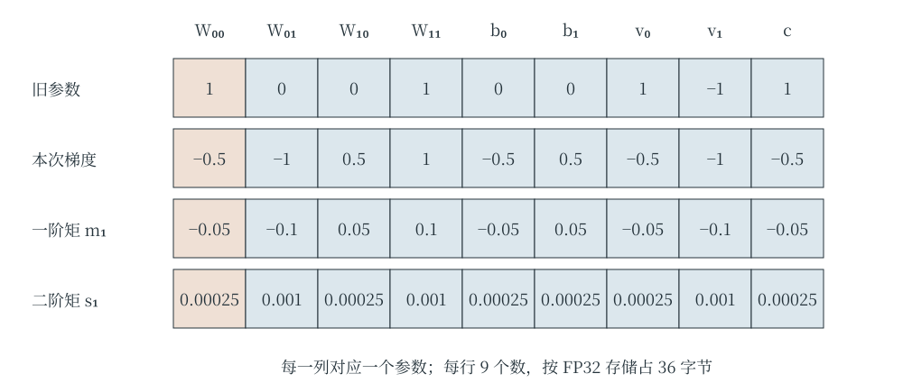

*图 3-16　优化器状态与参数逐坐标对应。以第一列的 $W_{0,0}$ 为例，第一步的两个历史状态分别为 $-0.05$ 与 $0.00025$，经过校正后参与更新。图中参数行仍是更新前的值；下一步需要继续读取历史状态，因此只保存参数不能完整恢复同一训练过程。*

为了限制参数规模，可以把 $\lambda\|\theta\|^2/2$ 加到目标中，使梯度增加 $\lambda\theta$。对普通 SGD，这与一次相应的参数收缩存在直接对应；对 Adam，把这项混入梯度，会同时改变一阶与二阶矩状态，因此通常不等同于独立收缩参数。[AdamW](https://arxiv.org/abs/1711.05101) 的基本做法是把权重衰减与自适应梯度更新分开。采用哪种规则、哪些参数参与衰减，都属于训练配置的一部分。

### 矩阵参数能否采用不同的更新方向

Adam 为各坐标分别调整尺度，但一层权重本来就是一个矩阵。矩阵的一整行或一整列共同表示一个变换方向，逐坐标缩放未必能表达这种结构。Muon 采用的思路是：先保留梯度的动量，再用近似矩阵正交化改变这份更新。为了看清它做了什么，暂时省略动量、衰减和额外的尺度系数，直接看一份 $2\times2$ 梯度

$$
G=\begin{bmatrix}3&0\\0&1\end{bmatrix}.
$$

除以它的 Frobenius 范数 $\sqrt{10}$，两个方向的强弱比仍是 $3:1$。若只保留非零奇异值对应的列，将矩阵写成 $G=U\Sigma V^\top$，再把这些正的奇异值变为 1，就得到方向因子 $Q=UV^\top$。这里的 $U,V$ 都只包含上述列；这个约定使零奇异值对应的方向仍为零。本例 $Q$ 是单位阵，两个方向的更新幅度相同。这不是把原梯度乘以一个标量：优化器改变了各个奇异方向之间的相对尺度。对于非满秩矩阵，零奇异值方向还要按实现约定处理，不能凭空补出梯度没有提供的方向。

完整分解的代价不小。一个用于理解近似过程的经典 Newton–Schulz 迭代为

$$
X_{k+1}=\frac12 X_k(3I-X_k^\top X_k).
$$

先把非零奇异值缩放到适当的收敛区间。例如 $X_0=G/3=\operatorname{diag}(1,1/3)$，一次迭代后得到 $\operatorname{diag}(1,13/27)$。第二个值从约 0.333 增至约 0.481，逐渐接近 1；每次迭代用的是矩阵乘法。在奇异值为 $x$ 的方向，上式相当于 $x\mapsto(3x-x^3)/2$，读者可以直接检查 $x=1$ 为不动点。有限步只给近似结果，而且缩放与数值精度会影响稳定性。

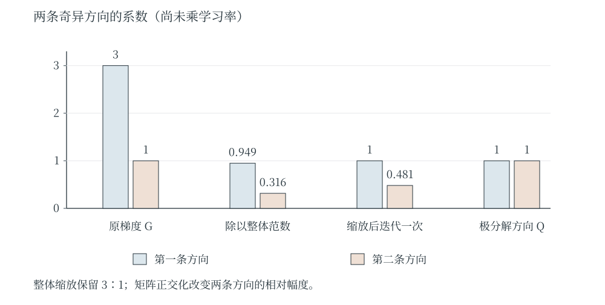

*图 3-17　纵轴为该方向的更新系数，尚未乘学习率。前两组仅缩放整体，后两组改变方向之间的相对幅度。这里的三次迭代多项式只用于解释原理，不是生产实现的逐行复刻。*

实际 Muon 还涉及动量形式、经过设计的迭代多项式、矩阵形状对应的更新尺度，以及哪些参数继续采用 AdamW。不能把所有向量、归一化参数和嵌入表任意拼成一张大矩阵，再声称实现了同一优化器。它增加了更新阶段的矩阵运算；参数分片后，还要决定在哪里取得完成这种运算所需的信息。是否值得，需要比较达到同等验证质量的时间与设备小时。某篇论文在特定模型上的 FLOPs 收益，不能直接当作另一套集群上的墙钟收益。[Muon 的原始实现说明](https://kellerjordan.github.io/posts/muon/) · [大规模语言模型中的 Muon](https://arxiv.org/abs/2502.16982)

### 能够恢复训练，需要保存什么

假如训练在某一步停止，只保存了 $W,b,v,c$，再次启动后把 Adam 状态全部清零，接下来即使读到同样的样本，也未必走出相同的一步。因为动量、平方梯度历史和步数都改变了。

因此，可恢复的训练检查点通常还需要优化器状态、更新步数和学习率调度状态；若追求更完整的继续执行，还要考虑随机数状态、数据读取位置及分布式一致性。参数文件足以执行很多推理任务，却不一定足以接续原来的训练轨迹。

精确复现还受数值精度、归约顺序和运行环境影响。这里先建立状态层面的区别，第十八章再讨论检查点怎样一致地写出、如何处理故障，以及恢复成本怎样影响完成一次训练的总时间。

[复算批量噪声、矩阵更新与分词计分的例子](../../experiments/ch03/learning_efficiency.py)

## 3.8　训练的计算量与内存占用

更新规则已经确定后，还要让程序有能力执行它。前向计算得到预测，反向计算需要用到部分前向结果，优化器又可能保存跨步的历史。下面分别检查这些对象需要保存多久、占用多少内存，解释训练与只做一次预测为何需要不同的内存。

### 前向激活与反向重算

回看本章的反向公式。输出权重梯度 $\bar v=\delta h$ 需要前向的 $h$；ReLU 反向需要知道 $a$ 哪些位置大于零；隐藏权重梯度 $\bar W=\bar a x^\mathsf{T}$ 需要输入 $x$。如果前向一结束就把这些信息覆盖，后面的反向不能凭空恢复相应导数。

同时，也不必机械地把每个中间值都保存一份。对 ReLU，可能保存掩码，也可能利用足以判断状态的输出；有些信息可以重算。具体保存什么，要由反向所需信息和实现方式决定。自动微分并不意味着所有中间张量都必须长期原样保存。

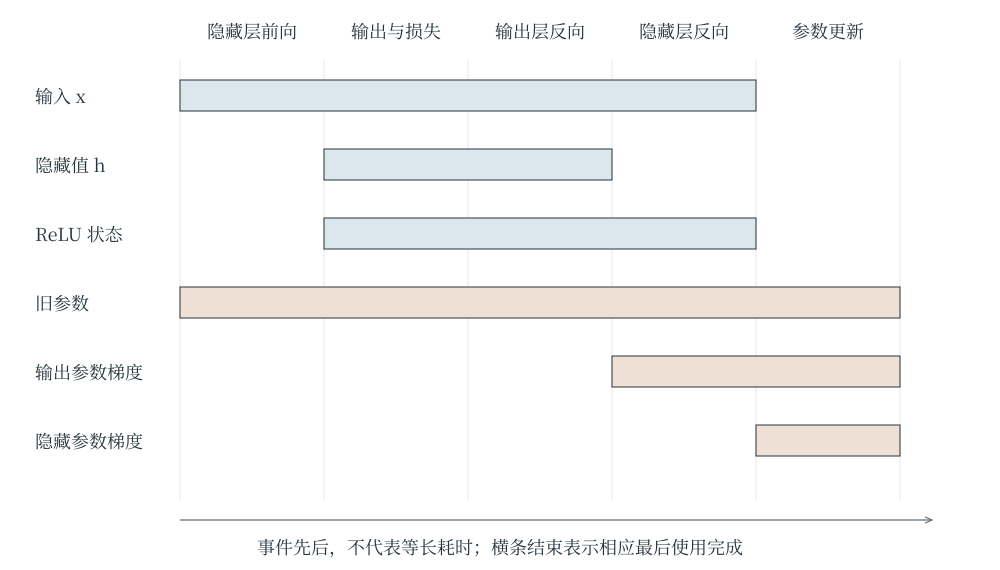

*图 3-18　训练数据的寿命由反向使用决定。横轴只表示合法执行次序，不表示各阶段等时。旧参数要与本次求导保持一致；输入和激活在相应的最后使用之后才可复用。图示采用保存信息的方式，重计算会形成另一种时间与空间安排。*

这正是激活检查点等方法能够成立的原因：前向少保存一些值，反向需要时重新计算，拿额外计算交换存储。它不是改变链式法则，也不是让反向不再需要那些信息。数据和随机操作能否按要求重建，还需要单独保证。

把“需要时重算”具体到八个首尾相接的层。第 $i$ 层将 $x_{i-1}$ 映为 $x_i$。为看清存取顺序，假定八层激活等大，每层反向除上游梯度和参数外只需该层输入。先只数为反向留存的输入，最终输出、梯度、运算时的临时空间另记。直接保存会留下 $x_0,\ldots,x_7$，共八份。若每份 16 MiB，这一项就是 128 MiB。

现在只把 $x_0$ 和 $x_4$ 留作分段的起点。损失给出 $x_8$ 的上游梯度以后，从 $x_4$ 重走三步得到 $x_5,x_6,x_7$。此时需要保留 $x_0,x_4,x_5,x_6,x_7$，五份共 80 MiB。从第八层倒推到第五层，每用完一份就释放一份。拿到 $x_4$ 的梯度以后，它的值也可以释放。再从 $x_0$ 重走三步，构造前半段需要的输入。这样峰值少了 48 MiB，代价是多做六次单层前向计算。优化器状态和已有梯度从头到尾都在原处，因此整张卡的峰值不会按 $5/8$ 等比缩小。

推广到 $n$ 个等宽、代价相近的链状层，每隔 $k$ 层保存一份，长期占着的起点约有 $n/k$ 个，同时恢复的一段约要 $k$ 份，二者之和在 $k$ 接近 $\sqrt n$ 时最小。这是早期亚线性内存训练工作的一个能手算的特例。真实残差支路可能跨越分段，昂贵算子与廉价算子的重算代价也相差很远，实际切点要从依赖和时间重新选。[Training Deep Nets with Sublinear Memory Cost](https://arxiv.org/abs/1604.06174)

还有一个比时间更要紧的条件。若重算区间里有随机丢弃，某个输入在第一次前向刚好被遮掉，重跑时却刚好保留，那么反向会沿另一条路径传回梯度。复现实验可固定权重、输入和随机数状态，把两种保存策略所得的**每个参数梯度**逐项比对，再记录峰值与一步耗时。框架如何保存和恢复随机数状态、跨设备有哪些限制，也属于这次比较的条件。[PyTorch 激活检查点](https://docs.pytorch.org/docs/stable/checkpoint.html) [八层链的存活计数与梯度检验](../../experiments/ch03/checkpoint_chain.py)

### 反向中的矩阵乘法从哪里来

对一个批量线性层 $A=WX+b\mathbf{1}^\mathsf{T}$，前向主项是一次矩阵乘法，约有 $2Bmn$ 次浮点运算。若反向既需要权重梯度又需要输入梯度，$GX^\mathsf{T}$ 与 $W^\mathsf{T}G$ 各自也约为 $2Bmn$ 次。因此这三个矩阵乘法的总量约为

$$
2Bmn+2Bmn+2Bmn=6Bmn.
$$

例如 $B=32,n=1024,m=2048$，前向主项为 134,217,728 FLOPs，三次乘法合计 402,653,184 FLOPs。这就是“训练某些层的主计算约为前向的三倍”这一估算的来源，而不是适用于所有模型的固定倍数。

如果第一层不需要输入梯度，可以省去相应乘法；冻结参数也可能省掉部分参数梯度；激活、归一化、注意力、重计算和优化器又有自己的开销。实际执行时间还受形状、数据布局、存储与通信约束影响，不能把 FLOPs 比例直接当作耗时比例。

### 训练状态的内存占用

本章小网络有九个参数。假设参数、梯度、Adam 的两个矩状态均使用 FP32，各占 $9\times4=36$ 字节，四类数值存储合计 144 字节。

| 对象 | 本例数值存储 | 为什么存在 |
|---|---:|---|
| 参数 | 36 字节 | 定义当前预测函数 |
| 参数梯度 | 36 字节 | 汇总本次更新的变化率 |
| Adam 一阶矩 | 36 字节 | 保存梯度方向的历史 |
| Adam 二阶矩 | 36 字节 | 保存平方梯度的历史 |

这还没有计入输入、激活、临时工作区和程序对象开销，也没有假定混合精度中存在或不存在额外主权重。16 字节每参数只是这里明确配置下四类数值的合计，不能不检查实际训练方案就当作通用显存公式。

激活则随批次、层宽和序列长度等变化。刚才的大线性层输出有 $32\times2048$ 个 FP32 数，即 262,144 字节，也就是 256 KiB。层数增加后，多个仍需用于反向的激活可能同时存在。参数量相同的模型，输入形状和保存策略不同，也可能有完全不同的训练内存需求。

### 规模、数据与计算预算需要一起选择

更多参数扩大了可表达函数的范围，也增加了更新与存储成本；更多有用数据提供更多约束，也要求花计算处理它们。若固定总计算预算，把大部分预算用在一个过大的模型上，可能留下很少训练步数；把预算全部用于反复学习有限数据，又未必持续改善新样本表现。

[计算最优语言模型训练研究](https://arxiv.org/abs/2203.15556)把模型规模与训练数据量放在同一计算预算下比较，展示了这种联合选择的重要性。具体比例是特定数据、模型和实验范围中的经验结果，不是所有任务都必须遵守的常数。数据质量、重复使用、部署成本和模型架构改变时，需要重新评估。

从一条样本开始，现在已经可以算出训练一步的开销。前向计算决定这次预测和损失，反向计算决定哪些中间值需要保留或重算，优化器决定哪些状态要一直留到下一步。改变网络结构，上面三笔开销也会跟着变。

## 3.9　多路残差的稳定性与存储代价

回到第 3.6 节的残差层 $y=x+F(x)$。相邻两层之间传的是一个向量。若希望它们之间能同时传递两组表示，一种设计是让两条残差流都穿过层边界，再从两路中取出一部分信息给层内的变换使用。这与多存一份相同的 $x$ 有什么区别？关键在于下一层可以接收两路的不同组合。一旦允许混合，两条路反复相加会不会把数值越推越大？

先把每条残差流缩成一个数，写成列向量 $x=(3,1)^{\mathsf T}$。只观察层与层之间的直通项，暂时关掉非线性分支。给两条路各写一行混合系数，得到下一层的状态 $Mx$。若 $M$ 是对角元为 1.2、非对角元为 0 的矩阵，两层后就变成 $(4.32,1.44)$。这么叠十层，连原本想保留的共同信号也会放大约 6.19 倍。

换一组系数。让每条路留下自己的四分之三、接收邻居的四分之一，即 $M=\left(\begin{smallmatrix}3/4&1/4\\1/4&3/4\end{smallmatrix}\right)$。第一层得到 $(2.5,1.5)$，第二层得到 $(2.25,1.75)$。两路之和一直为 4，差值却从 2 变成 1、再变成 0.5。为什么这两个量走向不同？把输入拆成共同方向 $(2,2)$ 和差异方向 $(1,-1)$。这个矩阵在共同方向的倍率是 1，在差异方向的倍率是 0.5。这一混合虽然没有放大共同分量，却会让两条支路的表示逐渐趋同。

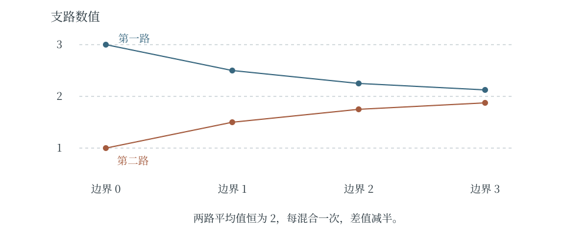

*图 3-19　每个圆点代表一条支路在层边界上的标量。沿中线看共同分量，沿上下点之间的距离看差异分量。图中没有加入层内新计算。*

这就是 mHC（manifold-constrained hyper-connections）约束残差混合矩阵的一个切入口。元素非负且每行和为 1，使每个新值是原有值的加权平均，无法跑出它们的范围；若每列和也为 1，把所有新值加起来，每个旧值的总贡献又恰好各占一份。这类矩阵称为**双随机矩阵**。一层接一层相乘仍满足这两种约束。论文用有限轮行列交替归一化近似实现所需约束；有限轮以后究竟差多少，可以直接量最大行和、列和偏差。即便直通项满足约束，完整网络还有输入、输出映射和非线性分支，整层的梯度未必保持长度。[mHC 原论文及实现设计](https://arxiv.org/abs/2512.24880)

额外的路也要存储。若一个位置的隐藏向量有 4096 个两字节数，一个常驻残差向量是 8 KiB，两路是 16 KiB；4096 个位置的这一个层边界多出 32 MiB。混合若单独写成“读两路、写两路”，至少有四个向量的逻辑读写。实现可以融合操作，降低中间值的搬运。核对训练收益时，应把新增残差状态、实际显存流量和能否用同一批量训练一起量出来。

下一章把这个两层小网络换成 Transformer，输入也从两个数变成一串词元。维数会增大，注意力会引入位置之间的交互，但本章建立的前向、损失、反向和状态规则仍然适用。理解这些规则后，模型结构图中的每一条边，都可以继续追问它传递的是什么、反向需要什么，以及执行它要花多少代价。

## 练习与解答

### 1. 一个隐藏单元关闭后，哪些梯度为零？

使用九参数网络的初始参数，把样本换成 $x=(1,-2)^\mathsf{T},y=0$。计算 $h,z,p$，然后写出所有参数梯度。第二个隐藏单元对这条样本没有激活，是否意味着它的参数从此都不会变化？

**解答。** $a=(1,-2)^\mathsf{T}$，所以 $h=(1,0)^\mathsf{T}$；$z=1+1=2$，$p=\sigma(2)\approx0.880797$。记 $q=p-y=p$，有

$$
\begin{aligned}
\bar W&=\begin{bmatrix}q&-2q\\0&0\end{bmatrix},\\[4pt]
\bar b&=\begin{bmatrix}q\\0\end{bmatrix},\qquad
\bar v=\begin{bmatrix}q\\0\end{bmatrix},\qquad\bar c=q.
\end{aligned}
$$

第二个隐藏单元虽然从输出层收到 $\bar h_1=-q$，但经过 ReLU 的零导数后，$\bar a_1=0$；它对隐藏参数的本条样本贡献因此为零。$\bar v_1=0$ 则来自 $h_1=0$，两种零值的直接原因不同。其他样本可能激活该单元，优化器历史或衰减也可能继续影响参数，因此不能据此断言参数以后不变。

### 2. 反向途中更新参数，会产生什么错误？

在最初的正类样本上，若先将输出权重更新成 $(1.05,-0.90)^\mathsf{T}$，随后仍拿旧前向的 $\delta=-0.5$ 和 ReLU 状态计算隐藏权重梯度，会得到什么矩阵？它是否等于旧网络或完整新网络的梯度？

**解答。** 错误程序先得到隐藏梯度 $(-0.525,0.45)^\mathsf{T}$，再与 $x^\mathsf{T}=(1,2)$ 做外积：

$$
\bar W_{\mathrm{wrong}}
=\begin{bmatrix}-0.525&-1.05\\0.45&0.90\end{bmatrix}.
$$

旧网络的正确梯度是 $[(-0.5,-1);(0.5,1)]$。完整新网络的分数为 0.885，输出梯度约为 $0.707857-1=-0.292143$，也不再是 $-0.5$。因此错误矩阵不对应这两次完整前向中的任何一次。应先按一致的参数版本求完所需梯度，再执行更新；用有限差分检查时也必须扰动同一版本的完整函数。

### 3. 不同大小的小批，梯度均值怎样合并？

三条样本分成两个小批，第一个有两条，其某参数的平均梯度为 1；第二个有一条，平均梯度为 4。三样本平均损失的正确梯度是多少？若将两个均值相加后除以二，错在何处？

**解答。** 第一个小批的梯度和为 2，第二个为 4，因此全部样本的平均梯度为 $(2+4)/3=2$。简单平均两份均值得到 2.5，相当于给两个小批相同权重，却给其中每条样本不同权重。一般地，应计算 $\sum_k B_k g_k/\sum_kB_k$。这些贡献必须在同一参数版本上获得；如果目标按有效词元而非样本平均，权重也应改为相应的有效词元数。

### 4. Adam 的历史在梯度变号后怎样起作用？

为单独研究更新规则，给一个初值为 1 的标量参数预先指定两步梯度 $g_1=-0.5,g_2=0.5$。这不是小网络重新运行产生的真实两步梯度。取 $\beta_1=0.9,\beta_2=0.999,\eta=0.1$，初始状态为零，手算时忽略很小的 $\epsilon$。求两步后的状态和参数。

**解答。** 第一步 $m_1=-0.05,s_1=0.00025$，校正后为 $\hat m_1=-0.5,\hat s_1=0.25$，参数变为 1.1。第二步

$$
\begin{aligned}
m_2&=0.9(-0.05)+0.1(0.5)=0.005,\\
s_2&=0.999(0.00025)+0.001(0.25)\\
&=0.00049975.
\end{aligned}
$$

于是 $\hat m_2=0.005/0.19=1/38$，$\hat s_2=0.00049975/0.001999=0.25$。第二次更新使参数减少 $0.1(1/38)/0.5\approx0.005263$，得到约 1.094737。当前梯度已经变号，但前一步的负向历史仍使一阶矩较小。若只用同一组指定梯度做 SGD，两步的改变量会正负抵消；这再次说明优化器状态参与了更新定义。

### 5. 归一化的梯度为什么不能逐项除以标准差？

使用 $a=(1,3,5)^\mathsf{T}$，令 $\epsilon=0,\gamma_i=1,\beta_i=0$，上游梯度为 $q=(1,2,0)^\mathsf{T}$。计算 $\bar a$，并检查三个输入梯度之和为何为零。

**解答。** 令 $s=\sqrt{8/3}$，$r=\sqrt{3/2}$，则 $\hat a=(-r,0,r)^\mathsf{T}$。有 $\operatorname{mean}(q)=1$，$\operatorname{mean}(q\hat a)=-r/3$。代入正文公式，得到

$$
\bar a=\frac1s
\begin{bmatrix}-1/2\\1\\-1/2\end{bmatrix}
\approx\begin{bmatrix}-0.306186\\0.612372\\-0.306186\end{bmatrix}.
$$

三项之和为零，因为给所有输入同时加上同一个小常数，会被均值相减消去，归一化输出不变；损失在这个共同平移方向上的导数应为零。若错误地将 $q$ 直接除以 $s$，三项之和为 $3/s$，违背了这个性质。这个例子把不变量检查和数值差分结合起来，比只核对梯度形状更有辨别力。

## 算例与资料说明

本章小网络、参数、样本、图示与练习均为独立教学设计。初始网络、一次更新、两样本梯度、独立验证样本和归一化反向均可复算，不使用示意曲线冒充训练实测。图中的梯度深度曲线来自明确给定的标量链，时间线只表示依赖次序。

[原始数据](../../experiments/ch03/cases.json)给出全部算例条件；[复算程序](../../experiments/ch03/verify.py)仅依赖 Python 标准库，执行正文四段代码，对初始与更新后的九个参数做中心差分检查，并核对共享参数、归一化反向、Adam 状态和练习答案。初始参数与更新结果分开保存，避免验证时混用不同版本。

文中的论文与官方文档用于明确算法来源及实现约定。完整自动微分框架、低精度训练、激活重计算和分布式一致性会在后续相应章节展开；本章建立的是理解这些系统设计所必需的计算与学习语义。

[全书目录](../../README.md) · [上一章 · 数学表达怎样变成程序](ch02.md) · [下一章 · 一个 Transformer 的两种运行方式](ch04.md)
