# 第 4 章　一个 Transformer 的两种运行方式

第三章已经说明，一个网络怎样把输入变成预测，又怎样根据损失调整参数。现在把输入从两个数换成一段文字。除了每个位置自己的变换，模型还需要回答一个新问题：当前这个位置应该从前面的哪些位置取得信息？

假设我们用“我爱你”这句话训练模型。读到“我爱”时，模型该预测哪个字？我们手里有完整的句子，知道答案是“你”。模型做这道题时只能看到前两个字。等它读到“你”，下一步要预测的就是这句话的结束标记。到了生成时，给模型的可能只有“我爱”两个字，接下来写什么，要由它自己选。

本章使用同一段三个词元的输入，完整算出一层带有 RMSNorm、旋转位置编码、残差和门控前馈网络的 Transformer。随后让它分别执行训练与生成。我们会看到：数学定义可以保持相同，但已知输入、可并行的位置以及值得保留的状态，发生了很大变化。

本章选择的是**仅解码器、自回归语言模型**：每个位置只使用当前位置及之前的信息，预测下一个词元。Transformer 并不都必须如此。[原始 Transformer 论文](https://arxiv.org/abs/1706.03762)还包含编码器与编码器—解码器注意力；双向编码模型也有不同的可见性约定。先把这里的一种结构算清楚，才能知道哪些结论能够推广，哪些依赖于因果约束。

## 4.1　从一段文字到下一词分布

### 词元编号不是数值特征

分词器先把文本变成词元编号。词元可能覆盖一个字、多个字符或一个词的一部分，具体由分词规则决定。本章为了手算，只设定四项词表，不把它当作真实中文分词器：

| 编号 | 词元 | 本章的作用 |
|---|---|---|
| 0 | 我 | 输入中的第一个词元 |
| 1 | 爱 | 输入中的第二个词元 |
| 2 | 你 | 输入中的第三个词元 |
| 3 | `<eos>` | 表示序列结束的特殊词元 |

“你”的编号是 2，意思是去嵌入表中取编号为 2 的那一行。模型用一个可学习的嵌入矩阵 $`E`$，把每个编号映射为一个向量。我们的矩阵为

```math
E=\begin{bmatrix}
1&1\\[0pt]
1&-1\\[0pt]
-1&1\\[0pt]
-1&-1
\end{bmatrix}.
```

四行分别对应四个词元，两列分别存放向量的两个分量。输入“我、爱、你”查出前三行，得到

```math
X=\begin{bmatrix}1&1\\1&-1\\-1&1\end{bmatrix}.
```

从本章起，批量公式统一约定**每行是一个位置，每列是一个特征**。若序列长度为 $`T`$、表示宽度为 $`d`$，则 $`X`$ 的形状为 $`T\times d`$。这与第三章把样本按列排放的写法不同，只是为了让注意力的行、列分别对应“读取位置”和“被读取位置”；转置约定改变后，矩阵乘法的方向也要一起改变。

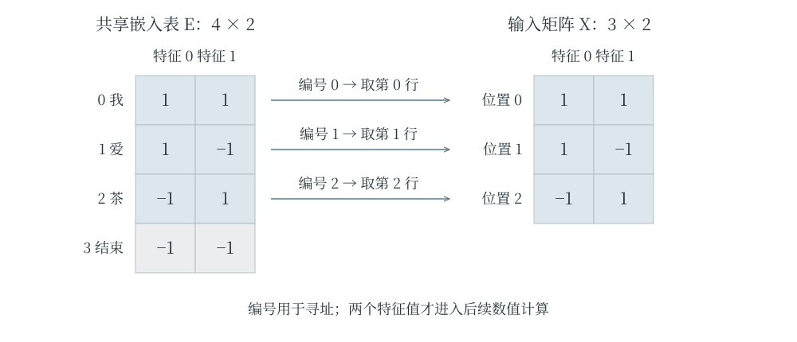

*图 4-1　嵌入是按编号取行。图中两列没有被人为命名为某种语言属性；这些数值只是本章的教学参数。不同位置使用同一张嵌入表，同一个编号会先取出相同的向量，后续上下文计算再使其表示发生变化。*

这些参数是为了方便验证而人工选定的，并不是训练好的中文模型。即使后面的几个预测碰巧符合这句话，也不能据此认为它已经掌握了语言。

图 4-1 从编号开始。编号本身怎样来？设一台分词器以单个字母为起点，训练语料是三个 abc 和两个 ab，每个词单独计数。相邻的 a、b 出现五次，b、c 只出现三次。先把 a 与 b 合成新符号 ab，再数相邻对，ab 与 c 出现三次，于是第二条规则可以把它们合成 abc。这是字节对编码（BPE）学习合并次序的一个小例子。实际系统还要指定起始符号、文本规范化、预切分和特殊符号。这里先固定这些条件，只看合并带来的长度变化。[BPE 子词模型的原始论文](https://aclanthology.org/P16-1162/)

现在输入一段未参与计数的 abcab，把它作为一段连续字符。先做第一条合并，得到 ab、c、ab，再做第二条，得到 abc、ab，共两个词元。如果词表只学了第一条规则，同一段文本就有三个词元。短词元表可以表示这段文字，却要多走一个模型位置。在这个例子里，完整因果注意力允许的位置对从 3 对增加到 6 对，若逐位置保存 KV，缓存行数从 2 增到 3。反过来，扩大词表又会增加嵌入表和输出头的行数。比较两套模型的每秒词元数时，用同一批原始文本再报一次每秒完成的请求和字符数，才能知道用户到底等了多久。同理，想让两个请求共用一段 KV，首先就要核对它们实际送入模型的编号序列。

### 一个位置的输出，监督的是下一个位置

我们以“我”为已知开头，希望学习接下来的“爱、你、结束”。训练输入和目标分别是

```math
\begin{aligned}
\text{输入}&=[\text{我},\text{爱},\text{你}],\\[0pt]
\text{目标}&=[\text{爱},\text{你},\langle\mathrm{eos}\rangle].
\end{aligned}
```

输入位置 0 的输出用来预测“爱”，位置 1 的输出用来预测“你”，位置 2 的输出用来预测结束。不能在同一位置直接以已经输入的那个词元作为这里的预测目标，否则就换了任务。

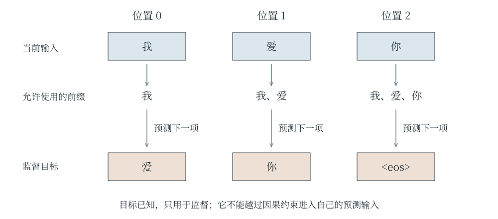

*图 4-2　下一词预测的错位。第一列允许看到“我”，第二列允许看到“我、爱”，第三列允许看到“我、爱、你”。目标虽然在训练数据中已经给出，却不能通过同一列的注意力读取路径泄漏进去。*

这个模型描述的条件概率分解为

```math
\begin{aligned}
&P(\text{爱},\text{你},\text{结束}\mid\text{我})\\[0pt]
&=P(\text{爱}\mid\text{我})\,
P(\text{你}\mid\text{我},\text{爱})\\[0pt]
&\quad\times P(\text{结束}\mid\text{我},\text{爱},\text{你}).
\end{aligned}
```

每个条件分布由同一个网络、同一组参数产生。如果还要学习整段的第一个词元，通常要引入相应的起始上下文或起始符号。本章已经把“我”作为给定条件，因此不额外计算它的概率。

接下来的关键是：怎样让每个位置取得它允许使用的上下文，又让三个位置能够放进同一次计算？

## 4.2　一个词元怎样成为查询、键和值

词元嵌入为每个位置提供了起始表示，但单独读取一行嵌入还不能利用其他位置的内容。注意力通过查询、键和值建立位置之间的数据通路：先决定从哪里读取，再组合读到的信息。下面从投影矩阵开始，把这条通路中的数一项项算出来。

### 三种投影承担三种计算角色

注意力可以理解为一次依赖当前输入的加权读取。当前位置先提出一个数值上的查询，历史位置提供用来匹配的键，以及实际参与加权求和的值。它们分别记为 Q、K、V。

这三个名字不是对语言成分的预先分类。“查询”不必对应问句，“键”也不必对应名词。它们是不同的可学习投影，各自承担比较或传递内容的角色。

设进入注意力的表示为 $`N`$，单个头的投影为

```math
Q=NW_Q,\qquad K=NW_K,\qquad V=NW_V.
```

若 $`N`$ 为 $`T\times d`$，$`W_Q,W_K`$ 为 $`d\times d_h`$，那么 $`Q,K`$ 都有 $`T`$ 行，每行 $`d_h`$ 个分量。本章令值的宽度也为 $`d_h`$，因此 $`W_V`$ 具有相同形状。查询与键的内积形成匹配分数，值则用于产生输出；只计算相似度还没有完成一次注意力。

注意这三个投影作用于同一份输入，但矩阵参数可以分别学习。设一个查询和两个键的分数都是 0，softmax 会给两个位置各一半权重；若对应的值分别是 2 和 6，读出的标量就是 4。这个小例子里，分数决定比例，值决定被组合的内容。后面的位置编码可能改变分数，本章的值则不做这种旋转。

在本章的预归一化结构中，$`N`$ 先由 $`X`$ 经过 RMSNorm 得到。对一行 $`x`$，其定义为

```math
\mathrm{RMSNorm}(x)_j
=\gamma_j\frac{x_j}
{\sqrt{\frac1d\sum_kx_k^2+\epsilon}}.
```

它按该位置的特征维度计算均方根，不先减去均值；这与第三章的 LayerNorm 不同。$`\gamma`$ 是可学习的逐维缩放。RMSNorm 的统计量来自当前这一行，不需要为了处理一个位置而重新统计其他位置。[RMSNorm 原论文](https://arxiv.org/abs/1910.07467)给出了这种归一化方式。

本章各处 $`\gamma=(1,1)`$。为了得到简洁的手算数值，在所有被归一化向量均非零的这个例子中暂取 $`\epsilon=0`$；真实实现需要约定适当的稳定项。三个输入向量的均方根都是 1，因此第一次归一化后 $`N=X`$。

取

```math
\begin{aligned}
W_Q&=cI,\qquad c=\frac{\ln2}{\sqrt2},\\[0pt]
W_K&=I,\qquad W_V=I.
\end{aligned}
```

$`I`$ 是二维单位矩阵。这些矩阵当前数值相同或成比例，不表示它们共享可训练参数。暂不考虑位置时，查询是输入的 $`c`$ 倍，键和值都等于输入。选择这个常数，是为了让后面的 softmax 得到简单分数，并不代表通常应当这样初始化模型。

### 位置信息与注意力

只有内容投影时，相同向量会得到相同的 Q、K、V。如果既没有位置信息也没有结构掩码，把一组输入位置一起重排，普通自注意力只会随之重排输出。因果掩码会引入“哪些位置在前”的结构，但它并不等于给出了丰富的相对距离信息。

一种方法是把位置向量加进输入；另一种方法是直接改变查询与键的比较方式。本章采用后者中的 RoPE，即旋转位置编码。它把查询和键的分量两两配对，按所在位置旋转。[RoFormer 论文](https://arxiv.org/abs/2104.09864)提出了这一构造。

先看一对分量。把它临时写为列向量，则旋转角度 $`\phi`$ 后是

```math
\begin{bmatrix}u'_0\\u'_1\end{bmatrix}
=\begin{bmatrix}
\cos\phi&-\sin\phi\\[0pt]
\sin\phi&\cos\phi
\end{bmatrix}
\begin{bmatrix}u_0\\u_1\end{bmatrix}.
```

位置 $`i`$ 使用角度 $`i\omega`$。本章取 $`\omega=\pi/2`$，于是三个位置分别旋转 $`0^\circ,90^\circ,180^\circ`$。这是方便手算的频率，不是某个真实模型的默认配置。高维 RoPE 对不同分量对使用不同频率，例如按模型配置取 $`\omega_r=b^{-2r/d_h}`$，使不同分量对具有不同变化尺度。

我们只旋转 Q 和 K，不对本例的 V 作这一旋转。按行存储时，旋转后的行可写为 $`\tilde q_i=q_iR(i\omega)^\mathsf{T}`$。于是两个位置的分数包含

```math
\begin{aligned}
\tilde q_i\tilde k_j^\mathsf{T}
&=q_iR(i\omega)^\mathsf{T}R(j\omega)k_j^\mathsf{T}\\[0pt]
&=q_iR((j-i)\omega)k_j^\mathsf{T}.
\end{aligned}
```

两个绝对位置的旋转，在内积里变成了与相对位移 $`j-i`$ 有关的旋转。这解释了位置信息怎样进入匹配分数。它并不保证模型能够无代价地外推到任意长度；频率、训练长度与后续扩展方法还会影响实际表现。

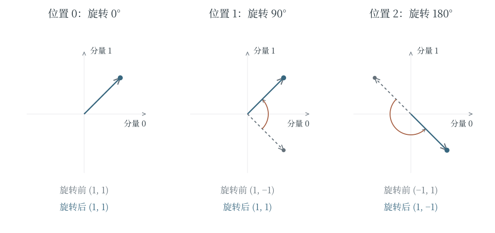

*图 4-3　RoPE 是实际作用在分量上的旋转。虚线为原向量，实线为旋转后向量；位置 0 两者重合。Q 按相同规则旋转，但数值再乘以 $`c`$；V 在这个例子中保持原值。旋转保持向量长度，却改变不同位置之间的内积。*

完整列出投影和旋转后的结果：

| 位置与词元 | $`\tilde q_i`$ | $`\tilde k_i`$ | $`v_i`$ |
|---|---|---|---|
| 0，我 | $`(c,c)`$ | $`(1,1)`$ | $`(1,1)`$ |
| 1，爱 | $`(c,c)`$ | $`(1,1)`$ | $`(1,-1)`$ |
| 2，你 | $`(c,-c)`$ | $`(1,-1)`$ | $`(-1,1)`$ |

注意前两个位置的键在这个刻意选取的算例中恰好相同，值却不同。匹配到怎样的权重，与按这些权重读出怎样的内容，是两件事。

下面的短程序可以核对第二个位置的旋转。位置编号从零开始。

```python
from math import cos, sin, pi

def rotate_pair(vector, position):
    angle = position * pi / 2
    a, b = vector
    return [a * cos(angle) - b * sin(angle),
            a * sin(angle) + b * cos(angle)]

rotated_key = rotate_pair([1.0, -1.0], 1)
```

得到的两个分量都约为 1。计算机用浮点数计算三角函数时，结果可能带有很小的舍入差异；正文使用的是相应的精确数学值。

## 4.3　注意力计算

### 查询与键的分数矩阵

查询位置 $`i`$ 与键位置 $`j`$ 的分数为

```math
S_{i,j}=\frac{\tilde q_i\tilde k_j^\mathsf{T}}{\sqrt{d_h}}.
```

每一行对应一个查询位置，每一列对应一个被比较的位置。把全部行写在一起，得到 $`S=\tilde Q\tilde K^\mathsf{T}/\sqrt{d_h}`$，形状为 $`T\times T`$，表示序列中各位置之间的分数。

为什么除以 $`\sqrt{d_h}`$？在查询与键的各分量近似独立、零均值、单位方差等假设下，$`d_h`$ 项乘积的和具有约 $`d_h`$ 的方差，宽度增加会放大分数尺度，使 softmax 更容易集中到很少的位置。这个缩放在该模型下把分数尺度稳定到相近量级。训练后的实际分布不必满足这些假设，因此应把它理解为有依据的尺度选择，而不是任意数据都具有方差 1 的恒等式。

本例 $`d_h=2`$。例如位置 1 与位置 0 的内积为 $`2c`$，除以 $`\sqrt2`$ 得到 $`\ln2`$；位置 2 与位置 0 的内积为 $`c-c=0`$。所以未加掩码的分数矩阵为

```math
S=\ln2\begin{bmatrix}1&1&0\\1&1&0\\0&0&1\end{bmatrix}.
```

这个内积不是自动等于余弦相似度，也不是人类可直接解释的“语义相关性百分数”。它是模型用来形成读取权重的可学习数值。

### 因果掩码

位置 0 要预测“爱”，不能在做出预测前就读到输入位置 1 的“爱”。位置 1 要预测“你”，同样不能读到位置 2。允许读取当前位置，是因为当前位置的输入已经给出，而要预测的是下一个词元。

因此定义加性掩码

```math
M_{i,j}=\begin{cases}
0,&j\le i,\\[0pt]
-\infty,&j\gt i.
\end{cases}
```

对 $`S+M`$ 的每行做 softmax：

```math
A_{i,j}=\frac{\exp(S_{i,j}+M_{i,j})}
{\sum_k\exp(S_{i,k}+M_{i,k})}.
```

这里的 $`-\infty`$ 表示被禁止的位置不参与分母，其权重严格为零。不是把它的原始分数改成零：零分数的指数是 1，仍会参与读取。实现中也不能在 softmax 后随便把几个概率清零、却忘记重新归一化，否则允许位置的权重和将不再为 1。

逐行计算就很简单了。位置 0 只有自己一个候选，权重为 1。位置 1 的两个允许分数都是 $`\ln2`$，指数都为 2，归一化得到 $`1/2,1/2`$。位置 2 的三个分数为 $`0,0,\ln2`$，指数为 $`1,1,2`$，得到 $`1/4,1/4,1/2`$。

```math
A=\begin{bmatrix}
1&0&0\\[0pt]
1/2&1/2&0\\[0pt]
1/4&1/4&1/2
\end{bmatrix}.
```

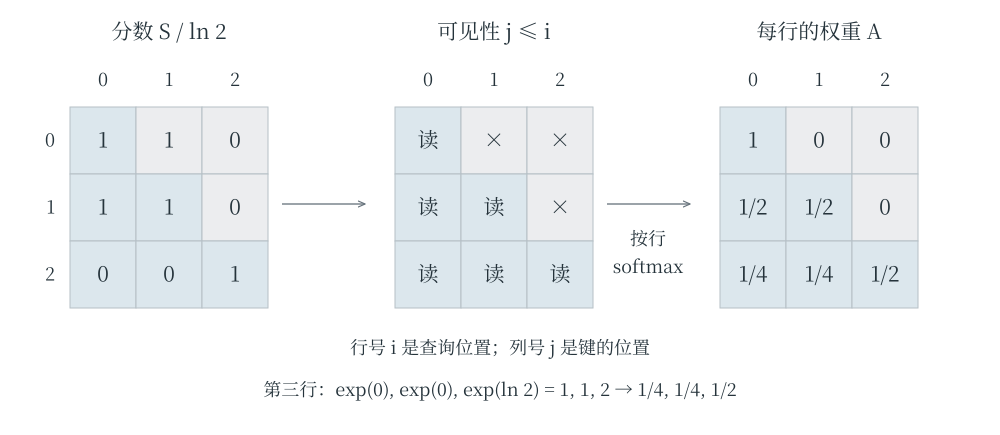

*图 4-4　分数、可见性与权重是三个不同对象。左图用 $`\ln2`$ 为单位表示分数；中图叉号表示禁止读取，不表示零分数；右图每个有效行的概率和为 1。分母只汇总该行允许的位置。*

稳定实现同样需要先减去该行允许分数的最大值，再计算指数。对于没有任何允许位置的行，softmax 没有正常的归一化分母，需要由具体接口处理；本章有效词元至少允许读自己，不会遇到这种空行。

### 从注意力权重得到输出

注意力输出为

```math
O=AV.
```

我们把三行都算出来：

```math
\begin{aligned}
o_0&=(1,1),\\[0pt]
o_1&=\tfrac12(1,1)+\tfrac12(1,-1)=(1,0),\\[0pt]
o_2&=\tfrac14(1,1)+\tfrac14(1,-1)+\tfrac12(-1,1)\\[0pt]
&=(0,1/2).
\end{aligned}
```

注意最后一行：权重都是正数，但值向量有正有负，第一分量恰好抵消为零。不能把注意力权重理解为直接输出，也不能认为“权重更大”必然使所有输出分量都增大。

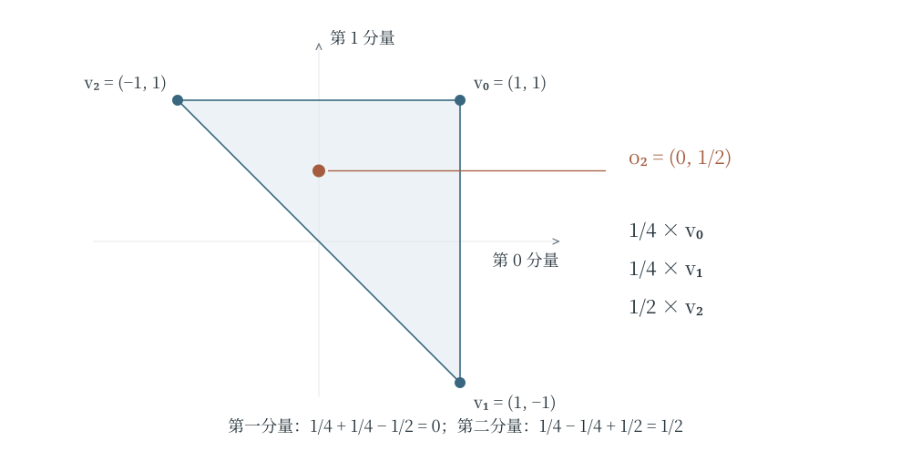

*图 4-5　加权读取的几何含义。一个头在 softmax 后、未做其他变换或丢弃操作时，输出是这些值向量的凸组合。图中三个点与内部结果都使用真实坐标；后续输出投影和残差相加不再受这个三角形范围限制。*

用下面几行代码可以独立核对最后一行。`zip` 将同一位置的权重和值配成一对，两个特征分别求和。

```python
from math import exp, log, sqrt

def softmax(scores):
    largest = max(scores)
    terms = [exp(s - largest) for s in scores]
    total = sum(terms)
    return [t / total for t in terms]

weights = softmax([0.0, 0.0, log(2)])
values = [[1.0, 1.0], [1.0, -1.0], [-1.0, 1.0]]
weighted_value = [
    sum(w * v[j] for w, v in zip(weights, values))
    for j in range(2)
]
```

这里没有调用任何注意力库。矩阵写法与逐行循环计算的是同一个函数；矩阵形式使这些相似操作可以使用适合批量计算的实现。

### 多头注意力

真实模型通常不只使用一个头。每个头有自己的查询、键和值投影，在各自空间中形成权重，再把各头输出沿特征维度拼接，用 $`W_O`$ 投影回模型宽度：

```math
Y=\mathrm{Concat}(O^{(0)},\ldots,O^{(H-1)})W_O.
```

当每头宽度为 $`d_h`$、$`Hd_h=d`$ 时，各头合起来仍是每个位置 $`d`$ 个分量。不是让每个头都产生一份宽度为 $`d`$ 的完整输出，再无条件增加 $`H`$ 倍。

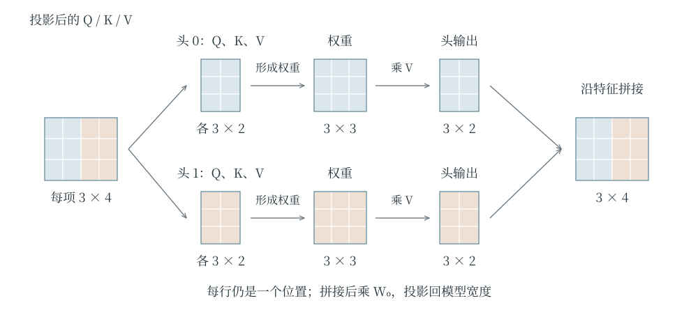

*图 4-6　多头中的形状变化。为区分头与特征，图中将宽度推广为 4、头数取 2，每头宽度为 2；数值主算例仍使用单头。按头拆分、改变维度顺序和最后拼接，必须与投影权重的布局一致。*

多头使模型能够用不同子空间组织读取，但不会预先保证“某头负责语法、某头负责事实”。不同头也可能学到相近的功能。其收益需要由任务表现检验，系统侧则必须准确记录每头的维度和状态。

至此，我们算完了注意力：由输入产生 Q、K、V，加上位置信息，计算分数和可见位置，再归一化、读取值并做输出投影。一个 Transformer 层还有其他部分。

## 4.4　Transformer 层的完整计算

注意力已经让每个位置读取了允许范围内的信息。若只算到这里，还没有完成本章定义的 Transformer 层：读取结果需要与原有表示相加，前馈网络也要继续对每个位置做变换。接下来把这两部分接起来，得到可供下一层使用的输出。

### 残差流保留当前位置自己的表示

本章采用预归一化结构，先归一化，再计算子层，最后与原表示相加。注意力子层的结果为

```math
R=X+OW_O.
```

本例 $`W_O=I`$，所以

```math
R=\begin{bmatrix}
2&2\\[0pt]
2&-1\\[0pt]
-1&3/2
\end{bmatrix}.
```

例如“你”所在位置原来是 $`(-1,1)`$，从上下文读出的增量为 $`(0,1/2)`$，相加得到 $`(-1,3/2)`$。注意力输出没有替换掉全部原信息，而是向残差流加入了一次变换结果。

前置归一化使用的是残差流的一个变换分支；直接相加的另一条路径仍是原来的 $`X`$。如果把相加对象也误换成归一化后的表示，就已经改变了网络。

### 前馈网络在每个位置独立改变特征

接下来再次对 $`R`$ 的每行做独立的 RMSNorm，记为 $`F`$，然后进入前馈网络。普通前馈层可以写成两次线性变换中间加激活函数。本章采用带门控的 SwiGLU：

```math
\begin{aligned}
G&=FW_g,\qquad U=FW_u,\\[0pt]
B&=\mathrm{SiLU}(G)\odot U,\\[0pt]
\mathrm{FFN}(F)&=BW_d,\\[0pt]
H&=R+\mathrm{FFN}(F).
\end{aligned}
```

这里 $`\odot`$ 表示逐元素乘法，$`\mathrm{SiLU}(g)=g\sigma(g)`$。两个投影分支的结果逐项相乘，因而一个分支可以随输入改变另一个分支的贡献。这与在不同位置之间做 softmax 加权不同，也不要求门控值位于 0 到 1 之间。[GLU 变体论文](https://arxiv.org/abs/2002.05202)讨论了包括 SwiGLU 在内的这种组织方式。

若前馈内部宽度为 $`m`$，则 $`W_g,W_u`$ 为 $`d\times m`$，$`W_d`$ 为 $`m\times d`$。真实模型经常取 $`m\gt d`$，先形成更宽的中间特征再投影回来。本章为手算取 $`m=d=2`$，并令

```math
W_g=I,\qquad W_u=I,\qquad W_d=\tfrac12I.
```

这些权重仍是三个独立参数矩阵。两次输入投影当前恰好相同，不等于训练时只能一起变化。

仍以位置 2 为例，$`R`$ 的该行为 $`(-1,3/2)`$，均方根为 $`\sqrt{13/8}`$，因此

```math
\begin{aligned}
F_2&=\left(-\sqrt{8/13},\;3\sqrt{2/13}\right)\\[0pt]
&\approx(-0.784465,1.176697).
\end{aligned}
```

两个分支都得到这个向量。逐项计算 $`\mathrm{SiLU}(f_j)f_j=f_j^2\sigma(f_j)`$，再乘以 $`1/2`$，得到

```math
\mathrm{FFN}(F_2)
\approx(0.096418,0.529168).
```

第二次残差相加给出

```math
H_2\approx(-0.903582,2.029168).
```

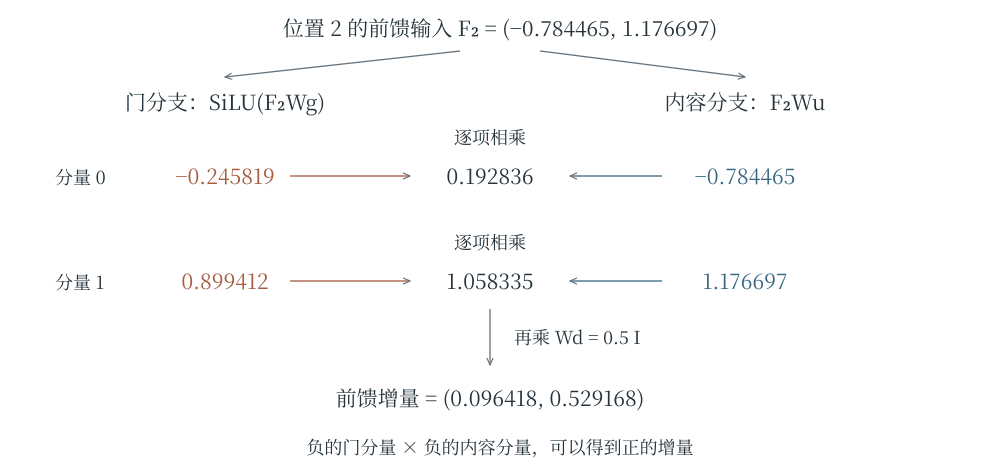

*图 4-7　一个位置内部的门控计算。所有数值来自“你”所在位置。第一个门控分量与内容分量均为负，乘积反而为正；不能把门控机械地解释成只会在零与一之间开关的概率。*

把三个位置的结果列在一起，可以核对整个前馈阶段。数值保留六位小数，后续复算使用未舍入值。

| 位置 | 第二次归一化后的 $`F_i`$ | 前馈增量 | 层输出 $`H_i`$ |
|---|---|---|---|
| 0 | $`(1,1)`$ | $`(0.365529,0.365529)`$ | $`(2.365529,2.365529)`$ |
| 1 | $`(1.264911,-0.632456)`$ | $`(0.623896,0.069391)`$ | $`(2.623896,-0.930609)`$ |
| 2 | $`(-0.784465,1.176697)`$ | $`(0.096418,0.529168)`$ | $`(-0.903582,2.029168)`$ |

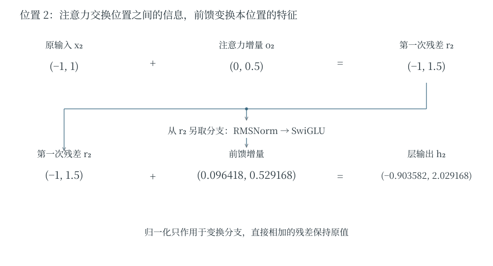

*图 4-8　“你”所在位置的两次残差相加。注意力通过其他位置取得信息，前馈网络在本位置内变换特征。两次增量都回到同一宽度的残差流，不能遗漏其中一条直接相加路径。*

本章一个完整块因此为

```math
\begin{aligned}
R&=X+\mathrm{Attention}(\mathcal N_1(X)),\\[0pt]
H&=R+\mathrm{FFN}(\mathcal N_2(R)).
\end{aligned}
```

这里 Attention 已经包含位置处理和输出投影。堆叠多个块时，上一块的 $`H`$ 成为下一块的 $`X`$，每块通常拥有自己的权重。更高层同一位置的 K、V 已经来自吸收过上下文的表示，不再只是最初词元嵌入的简单变换。

### 层输出还不是词表概率

最后一个块输出后，本章再做一次 RMSNorm，得到 $`Z`$。然后用词表投影 $`W_{\mathrm{vocab}}`$ 产生四个候选分数：

```math
\begin{aligned}
W_{\mathrm{vocab}}
&=\begin{bmatrix}-1&1&1&-1\\-1&1&-1&1\end{bmatrix},\\[0pt]
C&=ZW_{\mathrm{vocab}}.
\end{aligned}
```

四列仍按“我、爱、你、结束”的顺序排列。这里的输出矩阵没有与输入嵌入共享参数。有的模型会将二者绑定以减少参数量；那需要同时改变参数计数和共享梯度的处理。

例如位置 0 的层输出两分量相等，最终归一化为 $`(1,1)`$，词表分数为 $`(-2,2,0,0)`$。对四个分数做 softmax，预测“爱”的概率约为 0.775803。

另外两个位置最终归一化后的向量分别约为 $`(1.332866,-0.472724)`$、$`(-0.575286,1.291916)`$。以位置 2 为例，乘第一列 $`(-1,-1)`$ 得到约 $`-0.716630`$，乘第四列 $`(-1,1)`$ 得到约 $`1.867202`$。这与前面每一次投影一样，仍是向量与权重列的内积。把各位置的结果列在一起：

| 位置 | 四个词表分数，依词表顺序 | 正确下一词元的概率 |
|---|---|---:|
| 0 | $`(-2,2,0,0)`$ | 爱：0.775803 |
| 1 | $`(-0.860143,0.860143,1.805590,-1.805590)`$ | 你：0.673367 |
| 2 | $`(-0.716630,0.716630,-1.867202,1.867202)`$ | 结束：0.706301 |

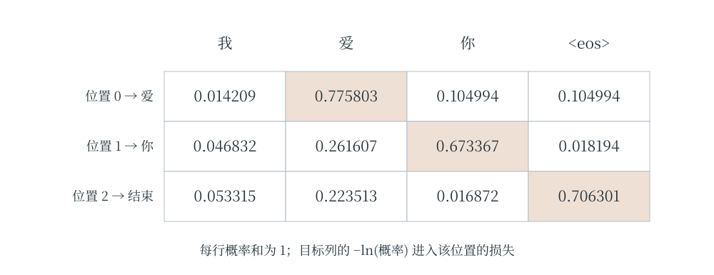

*图 4-9　输出概率的列是词表项，注意力权重的列则是输入位置，两者不能混为一谈。每行四个词表概率之和为 1；高亮的是该输入位置的下一词元目标。图中模型仅有人工选择的教学参数。*

至此，这个层没有留下未解释的“大盒子”：嵌入、三种投影、位置、因果注意力、输出投影、两条残差、两次块内归一化、门控前馈、最终归一化和词表输出，都已经具体算过。主例不包含随机丢弃操作，也不包含投影偏置；这些是本章明确选定的结构，而不是对所有 Transformer 的要求。

## 4.5　训练：让所有已知位置一起学习

### 训练中的位置并行

训练样本中的“我、爱、你、结束”已经给出。三个输入位置可以一次组成 $`X`$，同一层的 Q、K、V 可以通过批量矩阵乘法一起产生。每行的可见范围由因果掩码限制，不需要真的等位置 0 先选出“爱”，才知道位置 1 的输入是什么。

这种用真实前缀预测下一项的训练方式通常称为 teacher forcing。它并没有让模型从未来位置读取答案：虽然设备里同时保存着所有输入，模型定义中的读取关系仍然受到掩码限制。一个数据已经存在于内存，与一个计算被允许使用它，是不同的事情。

层与层之间仍有依赖。第二层要使用第一层输出，不能因为所有词元已知就无条件跳过这项依赖。“训练可以并行处理位置”，不等于整个模型所有操作都能同时完成。

与之相对，生成时未来词元尚未选定。在普通的逐词元自回归方式中，必须先得到当前分布并选择下一个词元，才能知道下一步输入。训练时沿位置维度的大矩阵计算，在生成时会变成较短的新增输入和不断增长的历史读取。

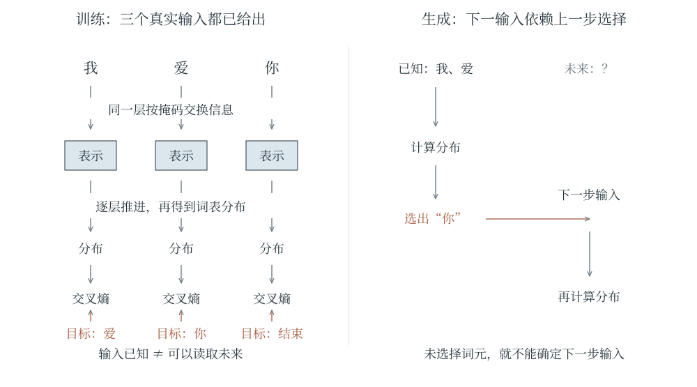

*图 4-10　两种运行方式的可用数据不同。每一行代表一个层级或一次选择，图只表达依赖，不表达耗时比例。训练中的同时处理始终受因果掩码约束；生成侧未来输入并非简单地从已知矩阵中取下一行。*

### 逐位置损失与平均

本章三个目标位置都参与训练。其平均交叉熵为

```math
L=-\frac13\sum_{i=0}^{2}\ln P_{i,y_i}.
```

$`P`$ 是词表概率矩阵，$`y_i`$ 是该位置的目标编号。三个损失约为

```math
\begin{gathered}
(0.253856,\;0.395465,\;0.347714),\\[0pt]
L\approx0.332345.
\end{gathered}
```

如果直接对词表分数 $`C`$ 求导，那么

```math
\bar C_{i,k}=\frac13
\left(P_{i,k}-\mathbf 1_{k=y_i}\right).
```

这与第三章的 softmax 交叉熵完全一致，只是现在有多个位置共用同一组参数。各位置对投影矩阵、嵌入与其他权重的贡献需要合并，不能在算完一个位置后就提前更新权重，再拿它计算另一个位置的本次梯度。

本章小模型有 50 个独立参数：嵌入 8 个，Q/K/V/O 四个投影合计 16 个，三个前馈矩阵合计 12 个，三处 RMSNorm 的缩放合计 6 个，词表投影 8 个。虽然某些矩阵当前取了相同数值，仍按独立参数计数。

复算程序对这 50 个参数逐一核对完整损失的导数。用学习率 0.1 做一次普通梯度下降，损失从约 0.332345 变为约 0.309575。这里的改进同样需要重新前向计算才能确认，并不因为这是 Transformer 就改变了第三章的训练逻辑。

### 注意力的反向传播

注意力也可以逐个局部运算求导。先看 $`O=AV`$，若后面已经返回 $`\bar O`$，矩阵微分给出

```math
\bar V=A^\mathsf{T}\bar O,
\qquad \bar A=\bar O V^\mathsf{T}.
```

对于 softmax 的第 $`i`$ 行，记它的输入为掩码后的有效分数。该行梯度为

```math
\bar S_{i,j}=A_{i,j}
\left(\bar A_{i,j}-\sum_k A_{i,k}\bar A_{i,k}\right).
```

这个式子值得与第三章的归一化反向对照：一个候选概率变化，会通过共同分母影响同一行的其他候选，因此不是每个位置独立乘一个导数就结束。被掩码禁止的分数没有参与这个函数，梯度为零。

为看清数值，暂时给第三行输出一个**测试用上游梯度** $`\bar o_2=(1,0)`$。这只用于检查局部算子，不是假定完整语言模型的损失恰好返回这个梯度。它关心输出的第一分量，因此对三个权重的梯度为三个值的第一分量：

```math
\bar a=(1,1,-1).
```

按权重 $`(1/4,1/4,1/2)`$ 加权，其均值为零，所以分数梯度是

```math
\bar s=(1/4,1/4,-1/2).
```

三项之和为零，可以独立检查：给同一行所有有效分数加一个常数，softmax 不变，该共同平移方向上的导数也应为零。

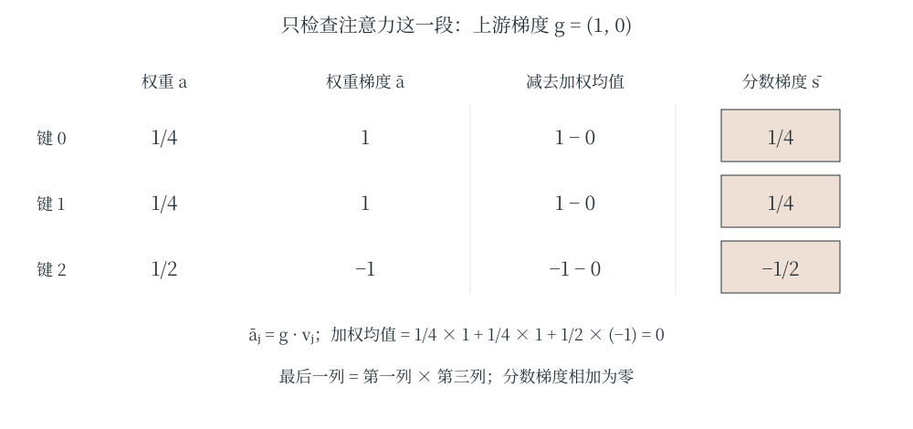

*图 4-11　一个注意力行的反向。图中使用的是局部测试梯度，完整训练会由后续层自动给出实际 $`\bar O`$。分数梯度先减去共同的加权均值，再乘对应权重；这个共同项体现了同一行各候选之间的耦合。*

继续回到缩放内积，有

```math
\begin{aligned}
\overline{\tilde Q}&=\bar S\tilde K/\sqrt{d_h},\\[0pt]
\overline{\tilde K}&=\bar S^\mathsf{T}\tilde Q/\sqrt{d_h}.
\end{aligned}
```

再经过旋转的转置映射，梯度回到未旋转的查询、键，随后回到相应投影矩阵和输入表示。旋转角度在本章是固定配置；若模型定义包含可学习的位置参数，还需要对那些参数求导。

这些式子说明，反向需要前向中的哪些信息。例如值梯度涉及注意力权重，查询梯度涉及键，权重投影梯度涉及其输入。并不因此推断必须把完整 $`T\times T`$ 权重矩阵一直保存：可以通过重计算或其他等价组织恢复需要的信息。第十章讨论 FlashAttention 时，会从这个需要出发推导怎样减少存取。

### 注意力掩码与损失掩码不能混用

若一个批次中有不同长度的序列，常需补齐形状；填充位置不能被当成正常上下文读取。将多个独立样本拼接到一段张量中时，也不能仅使用一个覆盖全部位置的下三角掩码，否则后一条样本会读取前一条样本的信息。它们需要符合任务边界的可见性约定。

损失掩码回答的是另一个问题：哪些位置参与目标。设 $`m_i\in\{0,1\}`$ 表示是否监督该位置，则

```math
L=-\frac{\sum_i m_i\ln P_{i,y_i}}{\sum_i m_i},
```

其中分母需要非零。对只监督回答部分的样本，提示词位置可以不计算直接的预测损失，但仍然被回答位置读取。它们的表示与相关参数，也可能通过这些读取路径收到梯度。

因此，“这个位置没有损失”不等于“这个位置不参加计算”，也不等于“可以切断它的梯度”。跨设备或跨小批合并梯度时，应按约定的有效目标数加权，不能把不同长度的均值不加区分地再平均一次。

### 多文档拼接与掩码

设这次要训练两篇独立短文，A 有三个词元，B 有两个。把它们紧挨着摆成五行，可以省去矩形批里的填充。第三行和第四行在内存里紧挨着，语义上却隔着一篇文章。假设训练目标要求两个文档独立，每个查询可读的键必须同时满足“在同一文档内”和“不在未来”。下表逐格画出这个约定。

| 查询所在行 | 键 A₁ | 键 A₂ | 键 A₃ | 键 B₁ | 键 B₂ |
|---|---|---|---|---|---|
| A₁ | 可见 | — | — | — | — |
| A₂ | 可见 | 可见 | — | — | — |
| A₃ | 可见 | 可见 | 可见 | — | — |
| B₁ | — | — | — | 可见 | — |
| B₂ | — | — | — | 可见 | 可见 |

让所有查询和键都为零，值依次取 $`2,4,6,10,20`$。所有可见分数相同，所以每行输出就是可见值的平均。B 的两行应得到 $`10`$ 和 $`15`$。若只画一个覆盖五行的大因果三角，B 的第一行变成 $`(2+4+6+10)/4=5.5`$，第二行变成 $`42/5=8.4`$。即使程序把 A 的末位置损失设为零，B 仍读到了 A，前向已经改变。反过来，只隔开注意力，同时用整段平移后的词元创建标签，又会误让 A 的末位置预测 B 的首词。两处边界要分别检查。若课程特意训练跨文档连续预测，则应另行规定这一目标。

五行的大三角有 15 个允许的位置对，两个小三角只需 $`3\times4/2+2\times3/2=9`$ 对。若底层仍按整张稠密矩阵计算，改掩码只保证结果正确。变长注意力接口可以接收各段的累积边界 $`[0,3,5]`$，据此在每段内部安排工作。实际设备还按块对齐，节约的时间要实测。测试这类路径时，分别单算 A、B，再把两份输出与拼在一起的五行逐项对齐，比检查矩阵尺寸更容易抓出一次越界读取。[FlashAttention 变长接口](https://github.com/Dao-AILab/flash-attention/blob/main/flash_attn/flash_attn_interface.py) [逐位置复算程序](../../experiments/ch05/trace_attention.py)

有些训练目标还要求从当前位置预测后面几个词元，给每个预测头规定可见的输入和相应标签。这些头能提供额外监督，也可以在推理时提议候选。一次生成是否能真正交付多个词，还要经过验证，第二十四章会算一次完整的接受与回退。

## 4.6　生成：从预填充走到逐步解码

训练时整段样本已经给定，因此可以在因果约束下同时处理多个位置。生成时，未来选择的词元尚不存在，下一步依赖当前输出。即使模型参数相同，两种运行方式可用的输入和执行形状也不同。

### 预填充与首个生成词元

现在固定同一组参数，只把“我、爱”作为提示词。模型先处理这两个已知输入位置，这一步称为预填充。由于因果约束，前两个位置的计算与之前三词元前向中的前两行一致；删去未来的“你”，不会改变它们能够读取的前缀。

我们需要的是最后一个提示位置，也就是“爱”所在位置给出的下一词分布。它预测“你”的概率约为 0.673367，是四个候选中最大的。因此采用贪心选择时，预填充结束后的分布已经可以选出“你”。

这时不需要为了得到第一个输出，再执行一次相同意义的解码前向。预填充的最后一行已经完成了这次预测。实现也可以只把最后一行送入词表输出头，而不为提示词的所有位置保留完整词表概率。

如果要继续生成，刚选出的“你”才作为新输入进入下一步。它现在位于位置 2，使用“我、爱、你”的上下文，产生下一个分布。这个分布应与完整三词元前向的最后一行一致，本例最大概率项为结束，约为 0.706301。

结束词元通常不作为普通文字显示给用户。若它触发停止，就不会再把它送入下一次模型前向。本例的生成过程因此包含一次两词元预填充、一次新增词元的解码前向，以及两次词元选择。

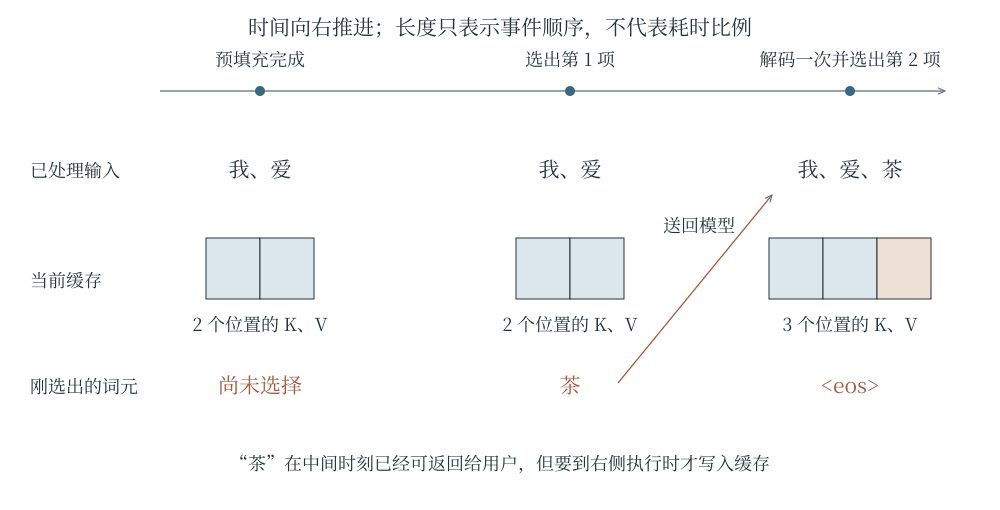

*图 4-12　被选出的词元与已被模型处理的词元，存在一个步骤的边界。刚选出“你”时，它还没有自己的 K、V；送入下一次前向后才产生它们。横轴按事件排列，不代表等长耗时。结束符计入选择次数，但不显示为普通文字。*

一般地，若提示有 $`n`$ 个词元，之后恰好选出 $`M`$ 个词元并停止，最后一个不再送回模型，那么通常执行一次预填充、$`M-1`$ 次新增词元前向。若系统报告的输出计数不包含结束符，还要单独对齐这个统计边界，不能把用户看见的字数直接代进模型调用次数。

### 选择规则也会影响后面的输入

贪心选择取当前最大分数的词元。采样则按照一个约定的分布抽取结果。常见温度变换将分数改为 $`C_k/\tau`$ 后再归一化；$`\tau\gt 0`$ 时不会改变最大分数的顺序，却会改变采样分布的集中程度。

贪心选择不保证整段序列的联合概率最大，更不保证输出满足实际任务要求。选出的不同词元会进入下一步，改变后续上下文。第二十四章再讨论更完整的生成策略及额外计算的作用；当前需要先分清模型前向、词元选择和下一步输入三个事件。

比较训练前向与生成前向时，也要固定条件。两者在同一参数、同一前缀、同一位置与掩码约定下，可以实现同一个确定性函数；若训练中启用了随机丢弃等操作，逐次输出就不必相同。关闭训练中的随机行为，与关闭梯度记录又是两项不同的运行设置。

### 逐步生成中的重复计算

一种最直接的生成实现，是每得到一个新词元，就把完整前缀重新送入模型。处理“我、爱”后生成“你”，下一次再处理“我、爱、你”。这样当然能够得到正确结果，但前两个位置的多层计算被重做了。

在因果模型中，这些旧位置看不到新加入的未来位置。既然它们的输入前缀没有改变，为什么还要重新计算它们的表示、投影和前馈结果？KV Cache 正是从这个问题产生的。

## 4.7　KV Cache 保存什么，为什么能够复用

朴素生成会在每一步重新处理整个前缀，其中许多旧位置已经计算过。我们需要先证明旧结果在追加词元后是否改变，才能决定哪些数据可以缓存。这个证明依赖因果可见性和确定的模型状态，不能直接推广到所有注意力结构。

### 旧位置的计算结果为何可以复用

先假设参数固定，采用本章的确定性因果结构，归一化和前馈都只在各位置内部计算，位置配置保持一致。

在最底层，旧位置的词元嵌入没有改变。假设某层输入中所有旧位置已经保持不变，那么这些位置的 Q、K、V 也不变；每个旧查询仍只读取不晚于自己的键和值，新增的未来位置被掩码禁止，因此该位置的注意力输出也不变。后续残差、逐位置归一化和前馈结果随之不变。

逐层使用这个推理，可以得到：**追加未来词元，不会改变各层旧位置的表示，也不会改变由这些表示产生的 K、V。** 这不是仅凭“模型权重没变”就得出的结论；因果可见性和其他运算的依赖范围同样重要。双向注意力等结构就不能不加检查地照搬这个证明。

新位置的查询却需要读取历史 K、V。于是我们为每一层保留历史键和值；下一步只计算新位置在这一层的 Q、K、V，把新的 K、V 接到历史后面，再执行新查询的读取。

旧 Q 通常没有必要继续保存在这种生成缓存中，因为以后要计算的是新位置的输出，不再重做旧查询的输出。它不表示当前 Q 可以不算，也不表示训练反向永远不需要 Q。

### KV Cache 的内容

本章选择缓存**已经应用 RoPE 的键**，以及没有应用该旋转的值。预填充“我、爱”之后，唯一一层的缓存为

```math
K_{\mathrm{past}}=\begin{bmatrix}1&1\\1&1\end{bmatrix},
\qquad
V_{\mathrm{past}}=\begin{bmatrix}1&1\\1&-1\end{bmatrix}.
```

接下来将“你”送入位置 2。新查询为 $`(c,-c)`$，新键为 $`(1,-1)`$，新值为 $`(-1,1)`$。把后两项追加后，新查询得到的三个分数仍为 $`0,0,\ln2`$，权重仍为 $`1/4,1/4,1/2`$，输出仍为 $`(0,1/2)`$。

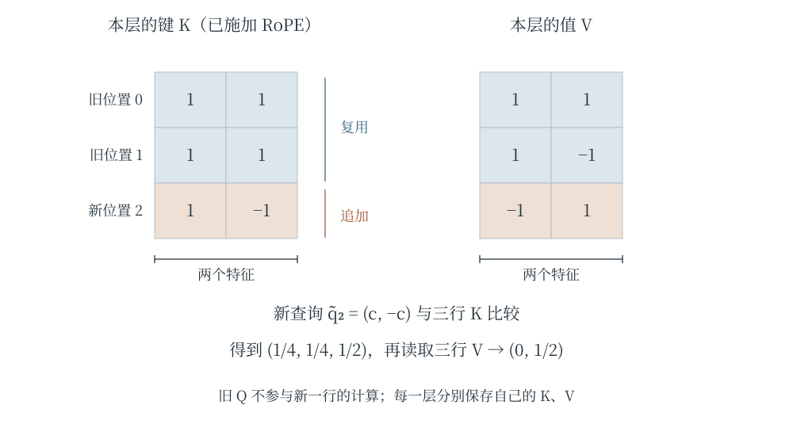

*图 4-13　缓存复用的是旧行，新查询仍要读历史。图中 K 的前两行相同，V 的前两行不同，因此只保存其中一类无法完成同一个函数。高亮的第三行在“你”实际进入模型后才产生。*

对应的短程序如下。它沿用前面定义的 `softmax`，直接展示本层追加一行后的读取；完整模型的逐层版本在本章复算程序中。

```python
keys = [[1.0, 1.0], [1.0, 1.0]]
values = [[1.0, 1.0], [1.0, -1.0]]
c = log(2) / sqrt(2)
query = [c, -c]
keys.append([1.0, -1.0])
values.append([-1.0, 1.0])
scores = [
    sum(q * k for q, k in zip(query, key)) / sqrt(2)
    for key in keys
]
new_weights = softmax(scores)
new_output = [
    sum(w * v[j] for w, v in zip(new_weights, values))
    for j in range(2)
]
```

这里的 `append` 表达增加一个逻辑位置，不规定生产实现必须重新拼接或复制整片存储。实际缓存如何预分配、分页、复用和回收，会在推理引擎章节继续讨论。

多层模型需要每层自己的缓存。新词元先在第一层计算，得到当前新位置的层输出，再进入第二层；第二层的新查询读取第二层历史缓存。不能拿第一层的 K、V 去替代第二层的缓存，也不能认为“同一个词元”在所有层都对应同样的状态。

### 只有一行查询时，掩码仍要使用正确的位置

预填充三个位置时，注意力矩阵是 $`3\times3`$。已有两个缓存位置，再送入一个新词元时，查询长度只有 1，键长度却是 3。这个查询的全局位置为 2，应该允许读取列 0、1、2。

如果不看位置偏移，只对一个 $`1\times3`$ 数组机械地取普通下三角，就可能只留下第一列。这不是性能差异，而是在计算另一个函数。

一般地，已有 $`P`$ 个历史位置，本次输入 $`C`$ 个新位置，新查询的局部行号为 $`i`$，则它的全局位置为 $`P+i`$。当缓存列按原顺序排列时，允许条件是

```math
j\le P+i.
```

例如 $`P=2,C=2`$，四列包含两个历史位置和两个新增位置，正确的允许矩阵为

```math
\begin{bmatrix}
1&1&1&0\\[0pt]
1&1&1&1
\end{bmatrix}.
```

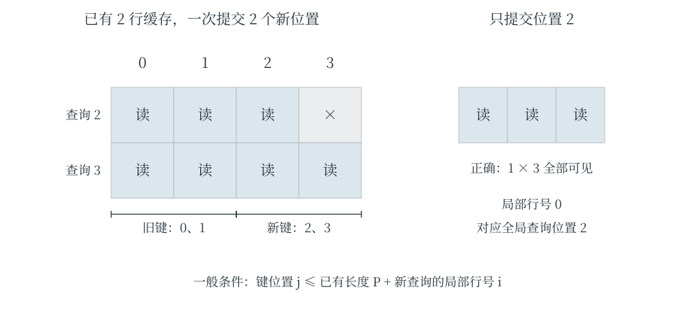

*图 4-14　矩形注意力的对角边界由全局位置决定。图中“读”对应允许项 1，叉号对应禁止项 0；这是数学上的可见性约定。具体 API 的布尔值是表示“保留”还是“屏蔽”，需要另按接口约定转换。*

RoPE 也必须使用相应位置，不能因为一次调用只输入一行，就每次重新从位置 0 开始旋转。存在填充、分块处理或缓存重排时，还要分清存储槽位、有效序列位置和模型的位置编号。它们在简单例子里相同，不代表所有运行方式都相同。

### 复用条件与不能省掉的读取

完整前缀重算和缓存执行应该在同一条件下产生等价结果。本章程序逐前缀进行比较，还检查了两层网络、非零归一化稳定项，以及改变未来词元不影响较早输出等情况。实际硬件上的浮点归约顺序可能不同，因此通常还要约定数值容差；不能把一次逐位相等当作所有后端的承诺。

怎样看出一次缓存改动悄悄算错了？随书小网络提供了一个容易漏过的失误。依次送入编号 0 和 1 的两个词元。第二项应使用位置 1；若它在增量执行时误用位置 0，四个词表分数会从约 $`(−0.860,0.860,1.806,−1.806)`$ 变成 $`(−0.649,0.649,1.892,−1.892)`$。最高分的都是编号 2，只检查生成的下一个词会以为两边完全一致。调试时，把相同的已知词元依次送给完整前缀和缓存两条路径，在每一步比较整行词表分数。第一次出现偏差的位置就能用来检查当步的旋转、掩码和对应层的缓存；若让两条路径各自采样，一处早期分歧会连后续输入也一起改变。[逐位置缓存核对程序](../../experiments/ch04/verify.py)

不同请求若要共享前缀缓存，需要模型及相关配置相同、已处理前缀相同、位置与可见性语义一致，或者存在已经验证的等价变换。只是最后一个词元相同远远不够，因为高层 K、V 包含前面的上下文。权重或适配器发生变化后，也不能直接把旧缓存当成新模型的状态。

训练中的前向激活与生成中的 KV Cache 都属于中间数据，却具有不同的使用目的。生成缓存用来避免重复前向；训练要保留求导需要的依赖。若把历史 K、V 脱离计算图后用于普通训练，历史分支上的梯度就可能被切断。专门设计的训练分块或截断方法需要自己的数学约定，不能仅把推理缓存开关打开就认为训练仍然等价。

缓存节省了旧位置的重复投影和层内计算，但新的查询仍需与历史键比较，并读取相应值。对完整历史注意力，一个新增位置的读取工作仍随历史长度增长。KV Cache 没有把长上下文变成常数成本，只是把“重新执行整个前缀”改成了“计算新位置并读取已保存的历史”。

### 缓存容量怎样从结构算出来

设模型有 $`L`$ 层，每层保存 $`H_{kv}`$ 组键和值，每组宽度为 $`d_h`$，每元素占 $`b`$ 字节，当前缓存有 $`T`$ 个位置。当 K、V 维度与格式相同时，一个请求的逻辑数值存储为

```math
M_{KV}=2LTH_{kv}d_hb.
```

开头的 2 分别对应 K 和 V，$`L`$ 表示每层都有自己的状态。这个公式计算的是数值本身，不包含分页空洞、预留容量、对齐、元数据等开销，也不自动适用于采用其他压缩状态表示的架构。

普通多头注意力中，查询头数与 KV 头数相同。有些模型让多个查询头共用一组 K、V，即分组查询注意力 GQA。例如 32 个查询头共用 8 组 K、V，每组服务 4 个查询头。每个查询头仍形成自己的权重，但保存的键和值只有 8 组。下一章会进一步讨论这种共享为什么可行、改变了什么，以及它与其他历史表示方法的区别。

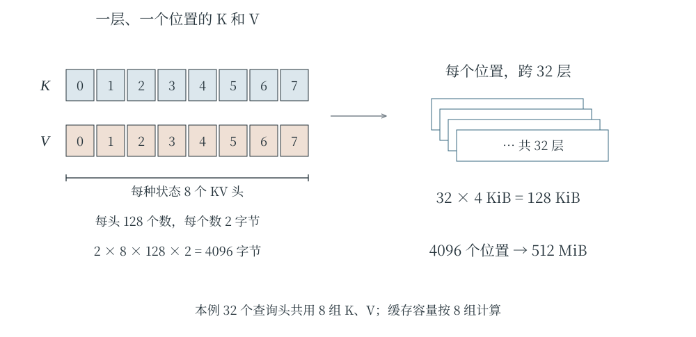

*图 4-15　缓存公式中的每个因子都有对象。这里使用的 32 层、8 组 KV、128 维和 2 字节，将每词元状态展开为 128 KiB。查询头数影响计算方式，但不能不加区分地替换缓存公式中的 KV 头数。*

用图中的配置，单个位置占

```math
\begin{aligned}
&2\times32\times8\times128\times2\\[0pt]
&=131{,}072\ \mathrm{bytes}=128\ \mathrm{KiB}.
\end{aligned}
```

4096 个位置因此占 512 MiB。这正是第一章曾独立给出的每词元状态预算的一种具体结构来源。模型有多少参数，并不能单独决定这个数。

如果提示长度为 4096，之后选出 256 个词元便停止，最后一个不再送回模型，那么结束时已经处理的位置数为 $`4096+255=4351`$，缓存约为 543.875 MiB。这里再次需要区分“已经选出的输出”与“已经生成了 K、V 的输入位置”。

## 4.8　模型规模与资源开销

前面逐项计算了一个位置经过的操作。接下来扩大模型和序列，估算一次请求需要多少计算、保存多少状态，以及训练和生成的资源需求有何不同。

### 参数来自哪些矩阵

考虑一个结构上延续本章、采用分组查询注意力的示例模型。以下数字用于说明计算方法，并非某个产品的实测配置：

| 结构量 | 符号 | 数值 |
|---|---|---:|
| 层数 | $`L`$ | 32 |
| 每个位置的表示宽度 | $`d`$ | 4096 |
| 查询头数 | $`H_q`$ | 32 |
| KV 头数 | $`H_{kv}`$ | 8 |
| 每个头的宽度 | $`d_h`$ | 128 |
| 门控前馈网络的中间宽度 | $`m`$ | 11008 |
| 词表大小 | $`V`$ | 32000 |

这里 $`H_qd_h=d`$，但 $`H_{kv}d_h=1024`$。因此，Q 投影和输出投影各有 $`d^2`$ 个参数，K、V 投影各有 $`d\times1024`$ 个参数。令 $`d_{kv}=H_{kv}d_h`$，一层中注意力投影的参数数目为

```math
P_{\mathrm{attn}}=2d^2+2dd_{kv}
=41{,}943{,}040.
```

SwiGLU 的两个向上投影分别为 $`d\times m`$，向下投影为 $`m\times d`$，所以

```math
P_{\mathrm{ffn}}=3dm=135{,}266{,}304.
```

记一层这些线性变换的参数总数为 $`P_b`$，则

```math
P_b=P_{\mathrm{attn}}+P_{\mathrm{ffn}}
=177{,}209{,}344.
```

每层两个 RMSNorm 再提供 $`2d`$ 个缩放参数。采用独立的输入嵌入与输出词表矩阵，加上最后一次 RMSNorm，总参数量为

```math
\begin{aligned}
P&=L(P_b+2d)+2Vd+d\\[0pt]
 &=5{,}933{,}109{,}248.
\end{aligned}
```

这是一个约 59.3 亿参数的示例，接近第一章为了建立预算而采用的约 60 亿参数模型。第一章的预算仍是近似预算；这里展示的是一种能够同时解释参数规模与每词元 128 KiB 缓存的具体结构。若输入输出共享词表矩阵，或引入偏置、其他归一化、专家分支，参数公式也要相应改变。

把本章小模型的 $`L=1,d=2,d_{kv}=2,m=2,V=4`$ 代回同一个式子，得到 50。小模型与大模型的计数逻辑没有变化，变化的是矩阵尺寸。

### 预填充的计算量

第二章约定，一次乘法和一次加法分别算一次浮点运算，因此计算一个长为 $`k`$ 的内积通常近似计为 $`2k`$ FLOPs。按此约定，把一个位置送过一层所有线性变换，约需 $`2P_b`$ FLOPs。长度为 $`T`$ 的输入，经过全部层需要

```math
C_{\mathrm{linear}}\approx2TLP_b.
```

它随 $`T`$ 线性增长。每个位置都要做自己的投影与前馈计算，但该位置的线性变换不因前面多了多少位置而变宽。

注意力读取不同。完整因果注意力里，第 0 行读 1 个位置，第 1 行读 2 个，最后一行读 $`T`$ 个，有效的查询—键配对数为

```math
1+2+\cdots+T=\frac{T(T+1)}{2}.
```

每个配对、每个查询头要计算一次宽度为 $`d_h`$ 的分数内积，并为值的加权求和贡献约同样多的运算。忽略 softmax 等额外操作，全部层的有效工作为

```math
\begin{aligned}
C_{\mathrm{causal\ attention}}
&\approx4LH_qd_h\frac{T(T+1)}{2}\\[0pt]
&=2LdT(T+1).
\end{aligned}
```

这里仍然出现查询头数，而不是 KV 头数：每个查询头都形成自己的分数与输出，共享 K、V 并没有让这几组查询变成同一个查询。

如果实现先计算整个方阵，再遮掉上三角，那么这部分的计算量约为 $`4LdT^2`$。这是**完整方阵的计算量**；前面的公式是**有效因果配对的计算量**。实际算子按块跳过多少无效区域，决定执行量更接近哪一个。不能拿一种口径的估算与另一种口径的测量直接比较。

在 $`T=4096`$ 时，32 层线性变换合计约需 46.454 TFLOPs，有效因果注意力约需 4.399 TFLOPs；若算整个注意力方阵，则约为 8.796 TFLOPs。这里的 TFLOPs 表示万亿次运算，是工作量；TFLOP/s 才是每秒吞吐率。

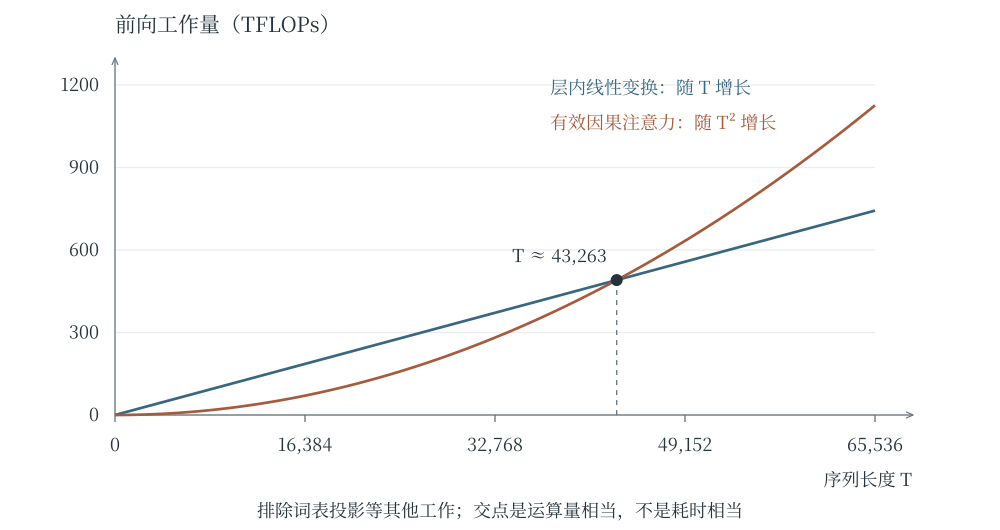

*图 4-16　短序列中占比小的工作，可能在长序列中成为主要工作。曲线只比较示例结构的理论运算量，不是性能测试，也不表示该模型已经训练到或支持这些上下文长度。*

把两个公式相等，可得这部分注意力工作与层内线性工作相当的位置：

```math
T+1\approx\frac{P_b}{d},\qquad T\approx43{,}263.
```

这个交点不等于实际耗时的交点。两类算子的并行性、数据复用、内存访问和实现效率不同，设备可能早在运算量相当之前就暴露出其他瓶颈。第二篇会建立判断这些差异所需要的硬件知识。

### 解码的计算量与历史读取

有了 KV Cache，一次普通逐词元解码只为新位置执行层内线性变换，其工作量约为 $`2LP_b`$。本例约为 11.341 GFLOPs，不再乘整个前缀长度。

但新查询仍要读取历史。若把刚追加的新位置计入后，共有 $`T`$ 个键，那么注意力工作约为

```math
C_{\mathrm{decode\ attention}}\approx4LdT.
```

在 $`T=4096`$ 时，它约为 2.147 GFLOPs。这里的 $`T`$ 每生成并处理一个位置就增长一次。因此，不能把“只执行一行”误读为“每一步都只接触一行数据”。

还要加上输出词表投影。本例每个被要求产生分布的位置需要 $`2dV`$，约 0.262 GFLOPs。普通生成的预填充只需最后一行的下一词分布，输出词表投影通常可以只做这一行；训练需要每个有效监督位置的分布。输入嵌入则是按编号取行，不是对整张嵌入矩阵做一次稠密乘法。因此，精确估算时不能总对全部参数统一套用 $`2P`$。

以上数字主要计矩阵乘法，尚未把归一化、旋转、激活、softmax、采样和数据搬运都折为时间。它们的作用是帮助定位需要继续调查的工作，而不是直接预测延迟。

### 分别计算参数、激活和缓存

参数由模型结构决定；激活是执行某段计算时产生的数据；KV Cache 是为了后续位置读取而延长寿命的一部分状态。相同的字节数，可能具有完全不同的产生时机和保存期限。

例如在 $`T=4096`$、每元素 2 字节时：

| 单个对象 | 元素形状 | 数值本身的容量 |
|---|---|---:|
| 一层的一份残差表示 | $`T\times d`$ | 32 MiB |
| 一层的一份前馈展开结果 | $`T\times m`$ | 86 MiB |
| 一层的一份完整注意力方阵 | $`H_q\times T\times T`$ | 1024 MiB |
| 所有层的 K、V 缓存 | $`2L\times T\times H_{kv}d_h`$ | 512 MiB |

前馈的门分支、上投影分支、逐元素乘积不一定同时存在，也不一定都必须保存。类似地，训练的峰值内存还取决于哪些层的激活留给反向、哪些会重算，不能把表中几项机械相加就称为完整训练显存。

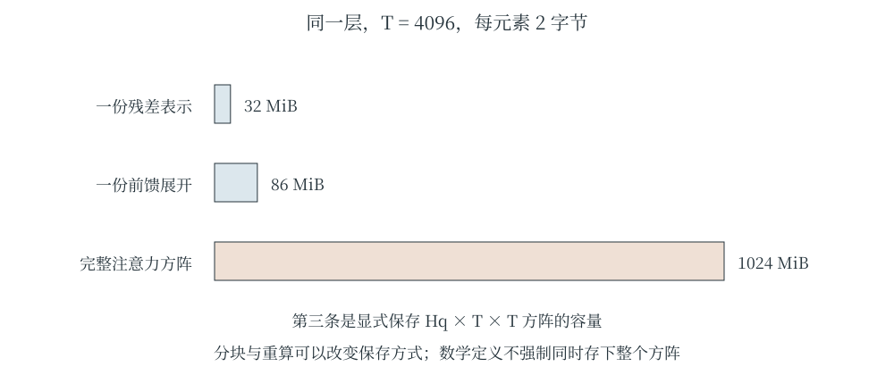

*图 4-17　同在一层内，中间对象也可能相差几十倍。第三条假定把所有头的完整注意力方阵显式保存下来；它展示了一种执行方式的存储代价。*

数学上定义了 $`A`$，并不意味着程序一定要把整个 $`A`$ 同时写入内存。可以分块计算分数、维护归一化统计量、逐步累计输出，在保持结果的条件下改变中间量的保存方式。第十章讲的 FlashAttention 正是从这里切入。它减少的是一种执行方式的中间存储与访问，不能因此把完整注意力的配对数从平方改成线性。

### 分词器改变之后，损失和吞吐还可比吗

上面的计算量与缓存量都按词元位置计算，4.5 节的交叉熵也按有效预测位置求平均。要比较两个模型，这个共同的计数单位需要先核对。这在固定分词器、固定计分范围时很清楚；换了分词器，分母本身也变了。设完全相同的 100 字节 UTF-8 文本，在方案甲中被编码为 10 个计分词元，总负对数似然为 40；在方案乙中被编码为 25 个词元，总负对数似然为 50。这里两个总量都用自然对数，并采用相同的条件上下文及文本范围。

平均每词元损失分别为 4 和 2。困惑度是这个平均值的指数，因而分别约为 54.60 和 7.39。仅看这一列会觉得乙好得多，但乙实际上把同一段文本拆成了更多预测事件。若将规范编码序列的总负对数似然换算到每个原始字节，得到

```math
\text{bits per byte}=\frac{-\sum_i\ln p(x_i\mid x_{\lt i})}{N_{\rm byte}\ln2}.
```

本例甲为 0.577，乙为 0.721，排序反过来了。这个换算消除了计分词元个数不同造成的一种混淆，但不能代替任务正确率：需固定原始文本、规范化方式、计分掩码、上下文窗口和边界符号；规范编码序列的概率也不等于把所有可能解码成同一文本的词元序列概率全部求和。若采用滑窗，应避免重叠窗口重复计分，也应说明每个预测位置实际看见多长的历史。[固定上下文模型的困惑度计算](https://huggingface.co/docs/transformers/perplexity)

系统比较也会受到同一变化影响。假设甲每秒输出 100 个词元、平均每词元对应 4 字节，乙每秒输出 160 个词元、平均对应 2 字节，分别只相当于每秒 400 与 320 字节。这还没有计入文本内容及质量差异。分词更细既改变吞吐单位，也增加注意力位置、KV 容量与逐步解码次数。对同一应用，应该同时保留原始输入输出、计分质量、词元数和实际完成时间，才能分辨模型改变与系统提速各贡献了多少。

[复算同一文本的两种计分单位](../../experiments/ch03/learning_efficiency.py)

## 4.9　计算规则与模型结构的取舍

前面保持模型定义不变，通过缓存减少了重复计算。如果进一步改变注意力的约束、层的参数共享方式或训练目标，会出现哪些新的收益和代价？下面分别讨论这三种改动，并区分数学等价的重写与模型本身的变化。

### softmax 权重的优化解释

注意力为各历史位置分配权重。这个分配还可以写成一个优化问题。取两个允许读取的位置，得分分别为 $`\ln 3`$ 和 0。给第一个位置分配 $`p`$，第二个便剩 $`1-p`$，加权得到的分数是 $`p\ln 3`$。只追求分数会把所有权重压在第一个位置。给分布再计入熵 $`H(p)=-p\ln p-(1-p)\ln(1-p)`$，它在两项一样多时最大。把两种倾向放进同一目标 $`J(p)=p\ln 3+T H(p)`$，正数 $`T`$ 表示我们给分散程度多大权重。这里约定 $`0\ln0=0`$。

对 $`0\lt p\lt 1`$，令导数为零，得到 $`\ln 3+T\ln((1-p)/p)=0`$，也就是 $`p/(1-p)=3^{1/T}`$。二阶导数为 $`-T/[p(1-p)]\lt 0`$，所以该点是唯一最大值。$`T=1`$ 时得到 $`(3/4,1/4)`$，恰好就是温度为 1 的 softmax；把 $`T`$ 加到 2，首项降到 $`\sqrt3/(1+\sqrt3)\approx0.634`$。推广到多个位置，给“概率和为 1”添一个乘子，各项一阶条件给出 $`p_j\propto\exp(s_j/T)`$。这个推导说明固定一行分数时，分数差与熵怎样共同决定读取比例。

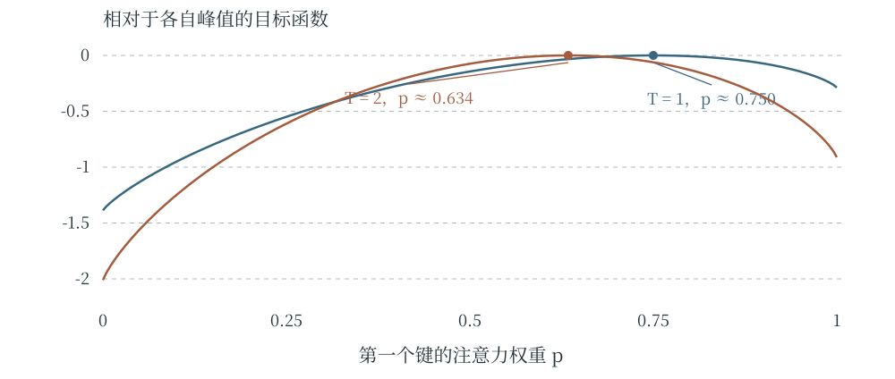

*图 4-18　横轴是第一个键对应的注意力权重。两条曲线分别减去各自的最大值，因此峰都在零线；比较峰的横坐标，就能读出温度升高后权重怎样移向二分之一。*

这也给更宏观的解释划出一条可检验的边界。假设两个查询都面对上述两个得分，每行概率都是 $`(0.75,0.25)`$，列和就成了 1.5 与 0.5。逐行 softmax 只要求每一行的权重之和为 1；如果再要求每一列的权重之和也为 1，上述矩阵就不满足条件。带有行、列两边指定边际的熵正则最优传输求解的是另一个约束问题，实践中可交替缩放行列来逼近所需边际。这里的“质量”是最优传输中的数学用语，指待分配的非负权重。增加列约束会改变注意力的定义，是否采用它需要由任务效果来判断。[熵正则最优传输与矩阵缩放](https://arxiv.org/abs/1306.0895)

类似地，把两个层看作可复合的映射，能提醒我们检查前一个输出的空间能否作为后一个输入。若把隐藏空间换一套正交坐标，同时变换查询和键，$`qR(kR)^{\mathsf T}=qRR^{\mathsf T}k^{\mathsf T}=qk^{\mathsf T}`$，所以本层的这些分数不变。这是可逐项验证的几何对称性。若后面有按坐标施加的 ReLU，一般没有 $`\mathrm{ReLU}(xR)=\mathrm{ReLU}(x)R`$，取一维 $`x=1,R=-1`$，两边就是 0 与 −1。沿网络复合这些映射时，必须逐层检验对称性。因此，即使一种变换保持了查询与键的内积，也不能直接推断整个网络输出不变。还要逐层检查后续运算；这个一维反例就足以说明 ReLU 会破坏一般的正交变换等价性。

### 参数共享与缓存复用

一种增加计算深度的办法，是让同一层程序和权重对隐藏状态连续作用两遍。先把层简化成标量函数 $`f(x)=2x+1`$。输入 3，第一次得到 7，第二次得到 15。内存里可以只有一份系数 2 和偏置 1，但从 3 到 15 仍有两次串行依赖。若每遍都要延迟一拍，输出最早在第二拍之后产生。在时间线上，相同颜色的两个块可以表示复用同一份权重，长度还得分别计入。[共享深度参数的 Universal Transformer](https://arxiv.org/abs/1807.03819)

回到自回归注意力。设某个旧位置第一次进入共享层的表示为 3，第二次为 7，键投影为了手算取恒等映射。对下一词元的第一遍，旧位置的键是 3；对第二遍，旧位置的键是 7。即使给两个查询都暂取 2，对应未缩放内积也分别是 6 和 14。把第一遍的键当作第二遍的键会改变权重。朴素的精确实现可以按“位置、循环深度”保留两份 KV，也可以从兼容的边界状态重算。两遍每遍需 8 MiB 历史时，前者共需 16 MiB。若模型明确定义共享同一份历史、或该投影对两次输入确实相同，预算才会不同。读一个循环深度方案时，把共享的参数名和每次调用产生的激活画成不同对象，就能看清究竟省掉了什么。

还可以让路由器为词元决定要走几遍。设同一句话的四个位置依次走 1、2、1、3 遍共享块，第一遍做四行，第二遍做第 2、4 行，第三遍只剩第 4 行，共七次行计算。假设每个深度只允许活跃位置之间做因果注意力，三个深度的可见位置对分别有 $`4\times5/2=10`$、3 和 1，共 14 对。若四行一律走三遍，就是 12 次行计算、30 对。节省多少取决于路由语义。若深层的第 4 行仍要读四个旧位置，就不能直接用第三遍的一对来估算。Mixture-of-Recursions 的研究区分了按递归深度缓存活跃位置与复用首遍 KV 的设计；它们让深层查询读到的内容也不同。[MoR 的动态递归与缓存策略](https://arxiv.org/abs/2507.10524)

设备上的代价可以用最后一遍看清：若矩阵核以四行为最小块并填满尾部，三遍的实际行槽都可能仍是四个。要把七次有效行计算变成时间收益，需要把稀疏活跃行压紧，保存原位置和逆映射，或者把同深度、互相隔离的多个请求一起执行。路由本身、跨请求等待和额外索引会消耗这部分收益。参数共享、算术量降低和用户等待缩短，各自需要不同的证据。

### 多路残差的稳定性与存储代价

回到第 3.6 节的残差层 $`y=x+F(x)`$。相邻两层之间传的是一个向量。若希望它们之间能同时传递两组表示，一种设计是让两条残差流都穿过层边界，再从两路中取出一部分信息给层内的变换使用。这与多存一份相同的 $`x`$ 有什么区别？关键在于下一层可以接收两路的不同组合。一旦允许混合，两条路反复相加会不会把数值越推越大？

先把每条残差流缩成一个数，写成列向量 $`x=(3,1)^{\mathsf T}`$。只观察层与层之间的直通项，暂时关掉非线性分支。给两条路各写一行混合系数，得到下一层的状态 $`Mx`$。若 $`M`$ 是对角元为 1.2、非对角元为 0 的矩阵，两层后就变成 $`(4.32,1.44)`$。这么叠十层，连原本想保留的共同信号也会放大约 6.19 倍。

换一组系数。让每条路留下自己的四分之三、接收邻居的四分之一。对应的混合矩阵为

```math
M=\begin{pmatrix}3/4&1/4\\1/4&3/4\end{pmatrix}.
```

第一层得到 $`(2.5,1.5)`$，第二层得到 $`(2.25,1.75)`$。两路之和一直为 4，差值却从 2 变成 1、再变成 0.5。为什么这两个量走向不同？把输入拆成共同方向 $`(2,2)`$ 和差异方向 $`(1,-1)`$。这个矩阵在共同方向的倍率是 1，在差异方向的倍率是 0.5。这一混合虽然没有放大共同分量，却会让两条支路的表示逐渐趋同。

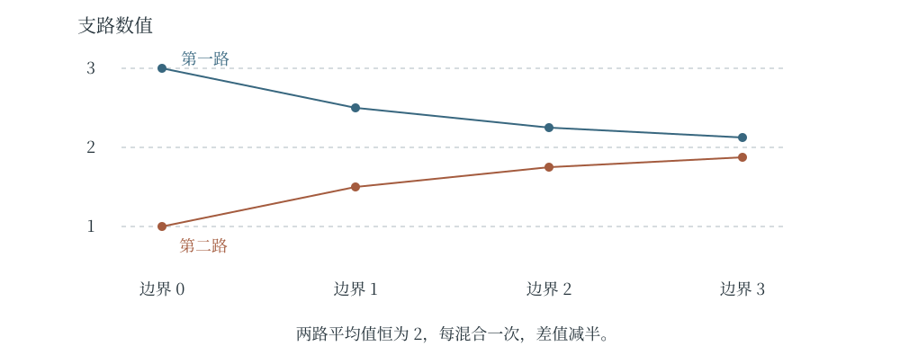

*图 4-19　每个圆点代表一条支路在层边界上的标量。沿中线看共同分量，沿上下点之间的距离看差异分量。图中没有加入层内新计算。*

这就是 mHC（manifold-constrained hyper-connections）约束残差混合矩阵的一个切入口。元素非负且每行和为 1，使每个新值是原有值的加权平均，无法跑出它们的范围；若每列和也为 1，把所有新值加起来，每个旧值的总贡献又恰好各占一份。这类矩阵称为**双随机矩阵**。一层接一层相乘仍满足这两种约束。论文用有限轮行列交替归一化近似实现所需约束；有限轮以后究竟差多少，可以直接量最大行和、列和偏差。即便直通项满足约束，完整网络还有输入、输出映射和非线性分支，整层的梯度未必保持长度。[mHC 原论文及实现设计](https://arxiv.org/abs/2512.24880)

额外的路也要存储。若一个位置的隐藏向量有 4096 个两字节数，一个常驻残差向量是 8 KiB，两路是 16 KiB；4096 个位置的这一个层边界多出 32 MiB。混合若单独写成“读两路、写两路”，至少有四个向量的逻辑读写。实现可以融合操作，降低中间值的搬运。核对训练收益时，应把新增残差状态、实际显存流量和能否用同一批量训练一起量出来。

回到解码时的那一行查询。额外的残差流增加了层与层之间的存储，每增加一个历史位置还会给各层留下新的 K、V。能否在下一步生成时少保存一些历史，或少读其中一部分？下一章从这个问题出发，讨论不同模型怎样表示、筛选和压缩过去。

## 练习与解答

下面五题沿用本章的参数与符号。它们分别检查注意力的归一化、缓存位置、容量估计、训练监督和反向传播；每题都可以独立核对。

### 1. 遮住未来以后，剩下的权重还对吗

位置 1 对三个键的原始分数为 $`[\ln2,\ln2,0]`$，三个值依次为 $`[1,1]`$、$`[1,-1]`$、$`[-1,1]`$。请分别计算：先正确施加因果掩码再做 softmax 的输出；先对三项做 softmax，再把未来位置的权重清零的输出。为什么两者不同？

**解答。** 正确做法把第三项分数设为负无穷，权重为 $`[1/2,1/2,0]`$，输出是 $`[1,0]`$。先做三项 softmax 得到 $`[2/5,2/5,1/5]`$，清零后变成 $`[2/5,2/5,0]`$，输出是 $`[4/5,0]`$。后者的权重和只有 $`4/5`$，因为归一化分母仍包含未来那一项。若再次对保留权重做正确归一化，数学上能够恢复本题结果，但直接在分数端屏蔽禁止项，更明确地表达了允许参与归一化的集合。

### 2. 一个新查询应该从第几列开始可见

缓存已经包含位置 0、1，现在一次提交位置 2、3。写出这两行查询对四个键的可见性矩阵。如果只提交位置 2，那么 $`1\times3`$ 的局部矩阵应当是什么？旋转位置编码应使用局部行号 0，还是序列位置 2？

**解答。** 两行查询的全局位置是 2、3，因此可见性为

```math
\begin{bmatrix}1&1&1&0\\1&1&1&1\end{bmatrix}.
```

只提交位置 2 时，正确形状是 $`[1,1,1]`$；它允许读取两个历史位置和自己。如果对这个局部矩阵不加偏移地使用下三角，会错误地得到 $`[1,0,0]`$。RoPE 也要使用与完整前缀一致的位置 2，不能因为当前提交只有一行就重新编号为 0。实际系统可以采用其他位置约定，但完整执行和缓存执行必须遵守同一约定。

### 3. 专门留给缓存的 4 GiB 可以容纳多少请求

沿用 32 层、8 个 KV 头、每头 128 维、每元素 2 字节。只考虑数值本身，若每个请求已经处理 4096 个位置，4 GiB 缓存空间最多容纳多少个同长度请求？上下文长度翻倍后呢？能否因此直接宣布这台设备的服务并发数？

**解答。** 每位置缓存为 128 KiB，每请求为 512 MiB，所以理论上限为 $`4096/512=8`$ 个。长度变为 8192 后，每请求为 1 GiB，上限变为 4 个。这里的 4 GiB 已明确是专门留给缓存的空间；若把整个设备容量代入，还必须先扣除权重、工作区和其他对象。分页、对齐、长度变化、未来增长预留会进一步影响可用量，吞吐和延迟约束也未被考虑。因此它是这个简化容量模型的上限，不能直接作为服务并发承诺。查询头虽然有 32 个，缓存公式中仍应使用 8 个 KV 头。

### 4. 不计算某个位置的损失，它就不参与学习了吗

本章三处目标的损失分别约为 0.253856、0.395465、0.347714。现在只监督后两处，第一处的损失权重为 0。求新的平均损失，并说明第一处输出分数的直接梯度，以及第一个输入词元的嵌入是否必然得到零梯度。

**解答。** 平均时应除以两个有效监督位置，而不是仍除以 3，因此

```math
\mathcal L=\frac{0.395465+0.347714}{2}
\approx0.371589.
```

第一处输出分数不再直接进入损失，其直接梯度为零；后两处的分数梯度分别为 $`\tfrac12(p-y)`$。但第一个输入的表示仍会生成 K、V，被后两个位置读取。损失可以沿这些路径反向传播到第一个输入的嵌入，因此它的总梯度不必为零。损失掩码屏蔽了一个监督项，并没有自动切断这个输入与其他预测的关系。

### 5. 换一个上游方向，重算注意力反向

对位置 2，沿用 $`a=[1/4,1/4,1/2]`$ 与本章的三个值，但把注意力输出的上游梯度改为 $`g=[0,1]`$。求各注意力权重的梯度、分数梯度，以及三个值向量的梯度。

**解答。** 每个权重的梯度是 $`g`$ 与对应值的内积，所以

```math
\bar a=[1,-1,1].
```

其按 $`a`$ 加权的均值为 $`1/4-1/4+1/2=1/2`$。利用 softmax 的反向公式，得到

```math
\begin{aligned}
\bar s
&=a\odot(\bar a-1/2)\\[0pt]
&=[1/8,-3/8,1/4].
\end{aligned}
```

三个分数梯度之和为零，可以用作检查。值向量的梯度则分别为

```math
\begin{aligned}
\bar v_0&=[0,1/4],\\[0pt]
\bar v_1&=[0,1/4],\\[0pt]
\bar v_2&=[0,1/2].
\end{aligned}
```

注意力权重的梯度与值向量的梯度不是同一对象：前者回答“多取一点这个位置会怎样”，后者回答“这个位置提供的内容变一点会怎样”。二者再分别沿 Q/K 和 V 的投影路径继续传回。

## 复算与延伸阅读

本章的[参数与配置](../../experiments/ch04/cases.json)、[完整复算程序](../../experiments/ch04/verify.py)使用同一份数据。程序只依赖 Python 标准库，包含完整前向、一个小型自动微分实现、50 个参数的有限差分检查、一次参数更新，以及预填充和缓存逐步执行的对照。运行 `python experiments/ch04/verify.py`，还会执行正文三段代码，核对掩码与练习中的数值。

图中小数按显示需要舍入，后续计算始终使用未舍入值。所有性能规模图都是按给定结构计算的工作量或容量，不是硬件测量结果。

若希望沿原始资料继续阅读，可从 [Transformer](https://arxiv.org/abs/1706.03762)、[RMSNorm](https://arxiv.org/abs/1910.07467)、[RoPE](https://arxiv.org/abs/2104.09864) 与 [GLU 变体](https://arxiv.org/abs/2002.05202)的论文了解各部分的提出背景；[LLaMA 论文](https://arxiv.org/abs/2302.13971)展示了预归一化、RoPE 和 SwiGLU 组合成语言模型的一种实践。缓存实现与位置管理也可对照 [Transformers 官方缓存说明](https://huggingface.co/docs/transformers/v5.3.0/en/cache_explanation)。本章的二维参数和计算过程是独立构造的教学算例，不是这些模型的缩小训练结果。

[全书目录](../../README.md) · [上一章 · 神经网络怎样学会一项任务](ch03.md) · [下一章 · 长上下文与模型记忆](ch05.md)
