# 第 5 章　长上下文：模型怎样记住过去

第四章末尾，我们已经能够把“我、爱、茶”放进一个完整的 Transformer，也能够解释：为什么新词元只需计算自己这一行，却仍然要读取历史 K、V。现在把三个词元换成一份长合同、一个代码仓库，或者持续许多轮的工作记录。公式中的矩阵乘法没有变，历史的长度却让原先不起眼的状态成为系统中的大对象。

最容易产生的误解，是把“已经缓存”理解成“以后不用再花成本”。缓存只是避免旧位置的重复前向。每当模型提出一个新查询，它仍需要找到与查询有关的信息，并把信息取出来。保存了多少、读取了多少、读出的信息够不够，是三个需要分别回答的问题。

本章沿这三个问题展开。先让多个查询共享历史，再让每个位置用更短的表示保存历史；随后讨论能否少读一些位置，最后尝试不再逐位置保存，而把历史写入一个不断更新的状态。每一步都用小例子检查：究竟省掉了哪个对象，哪个运算还在，原来能够区分的信息是否仍然能够区分。

本章继续把单个向量写成行向量。矩阵的行通常对应位置，列对应特征；进入递归状态时，我们会重新说明状态的两条轴。下面的算例只打开注意力与状态部分，归一化、前馈、残差及词表输出仍按第四章的方式接在外围。

## 5.1　KV Cache 的容量与读取量

### 缓存容量与读取流量

沿用第四章的示例：32 层、8 个 KV 头、每头 128 维，K、V 每个元素都占 2 字节。一个位置跨全部层的缓存为

```math
\begin{aligned}
m_{\mathrm{token}}
&=2\times32\times8\times128\times2\\[0pt]
&=128\ \mathrm{KiB}.
\end{aligned}
```

式子中的第一个 2 表示每个位置都要保存键和值；32 是层数，8 是每层的 KV 头数，128 是每个头的分量数，最后一个 2 是每个分量占用的字节。先把一个位置的各项乘起来，再乘以序列位置数，就得到该请求的逻辑缓存大小。这里没有包含分页尾部浪费或其他运行时开销。

长度为 4096 时，一条请求的缓存是 512 MiB。把长度增加到 131072，也就是这里所说的 128K，缓存变为 16 GiB。后一个数字不是权重，也不是训练用的梯度，而仅仅是一条请求已经处理过的历史状态。

如果再处理一个词元，逻辑上只新增 128 KiB。但为了完成完整历史注意力，新查询要读取已有位置的键和值。在一个理想化的读取预算中，假定各查询头充分复用共享的 K、V，每个历史元素从显存读取一次，则这一步接触的历史数据约为 16 GiB。

新增量与读取量相差约十三万倍。这就是长上下文生成容易受数据移动限制的原因之一：每一步写得不多，却要反复看前面留下的大量内容。

这里的“读取一次”是明确的执行假设，不是所有实现的实际流量。片上驻留、重复加载、分页、量化、批处理以及跨层共享都可能改变显存流量。若这些数据确实需要从显存搬出，且假设可用带宽为每秒 $`3\times10^{12}`$ 字节，那么仅这 16 GiB 的搬运时间尺度为

```math
\frac{16\times2^{30}}{3\times10^{12}}
\approx5.73\ \mathrm{ms}.
```

这是按假定带宽计算的结果，并非某块 GPU 的实测延迟。它还没有加入权重读取、计算、同步和输出选择。后面的硬件章节会解释，为什么实际可用带宽也不能直接等同于标称带宽。

### 生成过程的累计读取量

假设提示长度为 $`T`$，预填充后选出第一个新词元，最终一共选出 $`M`$ 个词元便停止。按照第四章的边界，之后执行 $`M-1`$ 次新增词元前向；最后一个选出的词元不再送回模型。

令 $`n=M-1`$。若第 $`j`$ 次解码处理后共有 $`T+j`$ 个位置，并按上面的完整扫描预算读取 K、V，那么这些解码步骤的总读取量为

```math
\begin{aligned}
B_{\mathrm{read}}
&\approx m_{\mathrm{token}}\sum_{j=1}^{n}(T+j)\\[0pt]
&=m_{\mathrm{token}}
\left(nT+\frac{n(n+1)}2\right).
\end{aligned}
```

式中的 $`nT`$ 表示每一步都要访问原始提示的 $`T`$ 个位置；后面的 $`n(n+1)/2`$ 来自逐步增加的生成位置，也就是 $`1+2+\cdots+n`$。只统计结束时保存的缓存会漏掉前面多次读取。这里沿用每步完整扫描一次、最后一个选出的词元不再送回模型的约定。

以 128K 提示、256 次词元选择为例，255 次解码的累计读取量约为 3.99 TiB。结束时的缓存却只有约 16.03 GiB。缓存是某个时刻占住的空间，读取量是许多步骤搬运数据的累积，二者不能混用。

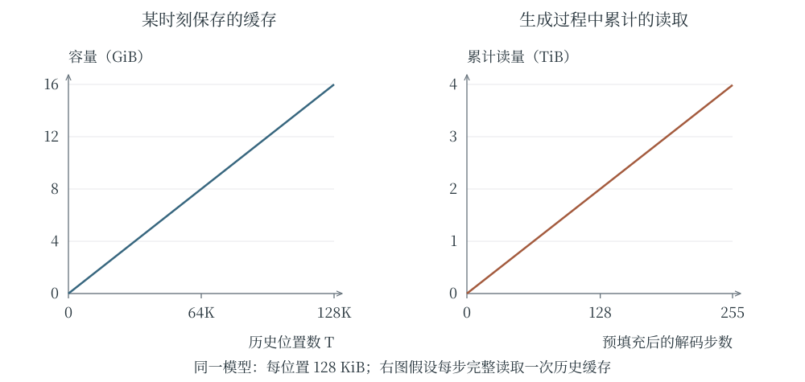

*图 5-1　历史状态占用的容量与反复读取它产生的流量需要分别计算。右图按每步完整读取一次逻辑缓存估算，不包含预填充、模型权重或硬件缓存带来的流量变化。*

预填充也需要读取历史，但它拥有许多已知查询，可以把数据组织成矩阵块并复用。因此，不能把刚才逐步解码的显存扫描公式直接套给预填充。完整因果注意力的有效配对数依然是 $`T(T+1)/2`$，可实际搬运量还取决于分块方式。把 4096 个位置增加到 128K，缓存增长 32 倍，配对数则约增长 1024 倍。

训练还要沿这些读取关系反向传播，并管理激活、梯度与优化器状态。某种方法降低了生成缓存，不表示它把训练的所有中间量也按同样比例降低了。

### 三条历史记录，四种读法

先试一次很小的读取。历史中只有三个位置。每个位置有一个键供查询比较，还有一个值供查询取回。图 5-2 顶部的三列列出了键和值。取查询 $`q=(\sqrt{2}\ln 2,0)`$。它只看键的第一维：跟第一个键 $`(1,0)`$ 点乘，再除以 $`\sqrt{2}`$，分数恰好是 $`\ln 2`$。同样算下去，三个位置的分数依次为 $`\ln 2,0,\ln 2`$。取指数就得到 $`2,1,2`$。三个数加起来是 5，所以完整读取的结果是 $`[2(2,0)+(0,4)+2(2,4)]/5=(8/5,12/5)`$。接下来每种方法都面对这三条记录。省下哪一步，读到的东西又有什么变化？

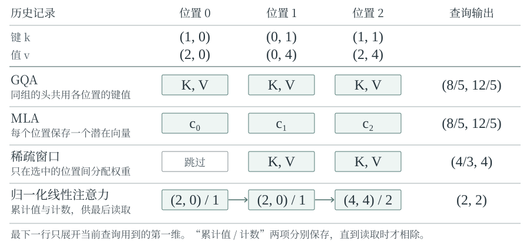

*图 5-2　每列对应一个历史位置。前三行保留位置的先后，最后一行沿箭头更新同一份状态。右列是同一个查询的二维输出。MLA 只画本例的内容分支，稀疏读取采用宽度为 2 的窗口，线性读取采用本例的非负内积。*

先看图的前两行。GQA 让多个查询头共用一份键和值；当前这个头仍然能给三个位置逐一打分。MLA 在每个位置保存一个较短的向量，用它生成各个头的键和值。这组数有一个好用的规律：若键是 $`(a,b)`$，值一定是 $`(2a,4b)`$。于是只存 $`(a,b)`$ 两个数，就能为这个头还原原先四个数，连最后的加权和都一样。真实模型用训练学出这两个映射；换一组参数，两种模型的答案就可能不同。

第三行只看最近两个位置。把位置 0 去掉，归一化的分母也从 5 变成 3，输出变为 $`[(0,4)+2(2,4)]/3=(4/3,4)`$。假如问题恰好要回查第一条，靠这一次窗口读取就无法直接取到它。第四行换了一种相似度。本例中查询只看键的第一维，三个键在这一维上分别是 1、0、1。因此可以在写入时就累加相应的值，读时取平均，得到 $`[(2,0)+(2,4)]/2=(2,2)`$。一般的查询还会用到别的维度，第 5.5 节会算出保留这些信息需要多大的状态。

这样就能区分三笔开销：每个位置有多少数要存，一次查询有多少位置要读，以及读完之后是否还保留可按位置回查的记录。先从第一笔算起。

## 5.2　GQA：分组查询与 KV 共享

上一节发现，每一步都要访问历史；历史里的键和值又按头保存。因此可以先从每个位置保存多少组 K、V 入手。减少组数会改变各头可使用的表示方式，实施后既要验证模型质量，也要检查实现能否实际复用共享数据。

### 查询头与 KV 头的分组

在普通多头注意力 MHA 中，假设有 $`H_q`$ 个查询头，每个头分别产生自己的 K、V。一个位置需要缓存 $`2H_qd_h`$ 个元素。不同头的历史表示允许不同，代价是每个头都留下了一份。

多查询注意力 MQA 保留多组查询，但所有查询头共用一组 K、V。分组查询注意力 GQA 则取中间方案：有 $`H_{kv}`$ 组 K、V，每组服务若干查询头。若各组大小相等，每组有 $`H_q/H_{kv}`$ 个查询头。GQA 的提出及从多头模型继续训练得到分组模型的方法，可参看 [GQA 原论文](https://arxiv.org/abs/2305.13245)。

定义 $`g(h)`$ 为查询头 $`h`$ 所属的 KV 组，则该头的读取为

```math
\begin{aligned}
a_{t,j}^{(h)}
&=\mathrm{softmax}_{j}
\left(\frac{q_t^{(h)}(k_j^{(g(h))})^{\mathsf T}}
{\sqrt{d_h}}\right),\\[0pt]
o_t^{(h)}&=\sum_{j\le t}a_{t,j}^{(h)}v_j^{(g(h))}.
\end{aligned}
```

式中 $`t`$ 是当前查询的位置，$`j`$ 是能够读取的历史位置，$`h`$ 是查询头。$`g(h)`$ 先把查询头映射到所属的 KV 组，再取该组在位置 $`j`$ 的键和值。softmax 在所有允许的 $`j`$ 上归一化，接着按得到的权重求和值。

共享的是用于比较的键和被读取的值，查询及权重仍按头区分。不能把 GQA 想成“几组输出都变成同一个输出”。

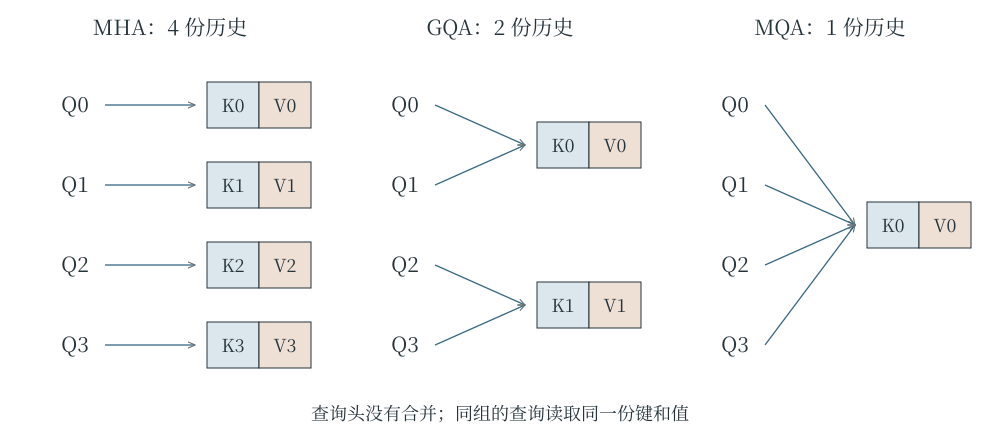

*图 5-3　保持四个查询头，改变历史有多少份。图中的每个 KV 条目代表一组键和值，不表示整个组只存一个数。共享不改变因果可见性。*

### 共享 KV 下的多个查询头

把图 5-2 的三个键按位置排成矩阵 $`K`$，把对应的三个值排成矩阵 $`V`$：

```math
K=\begin{bmatrix}1&0\\0&1\\1&1\end{bmatrix},
\qquad
V=\begin{bmatrix}2&0\\0&4\\2&4\end{bmatrix}.
```

两个查询头共用它们。令 $`a=\sqrt2\ln2`$，查询分别为

```math
q^{(0)}=(a,0),\qquad q^{(1)}=(0,a).
```

本例仍除以 $`\sqrt2`$。第一个头的分数为 $`(\ln2,0,\ln2)`$，指数为 $`(2,1,2)`$，权重为 $`(2/5,1/5,2/5)`$。第二个头的分数为 $`(0,\ln2,\ln2)`$，权重为 $`(1/5,2/5,2/5)`$。

分别读取同一个 V，得到

```math
\begin{aligned}
o^{(0)}&=\tfrac25(2,0)+\tfrac15(0,4)+\tfrac25(2,4)\\[0pt]
&=(8/5,12/5),\\[0pt]
o^{(1)}&=\tfrac15(2,0)+\tfrac25(0,4)+\tfrac25(2,4)\\[0pt]
&=(6/5,16/5).
\end{aligned}
```

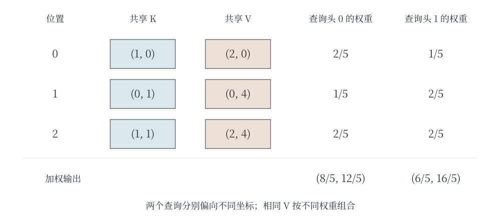

*图 5-4　共享历史不等于共享读取结果。第一个查询更看重第 0 个位置，第二个更看重第 1 个位置；两个头都可以使用第 2 个位置。*

这里没有要求两个头在一切任务上表达相同内容。限制在于：它们必须通过同一组键来比较同一组值。原本两个 MHA 头如果需要完全不同的键值表示，直接把它们强行合并，通常会改变函数。

因此，把一个现成 MHA 模型的 K、V 简单平均，不是无损的缓存优化。模型需要以相应结构训练，或经过合适的转换与继续训练，并重新验证质量。精确的部分是：对一个已经定义好的 GQA 模型，共享的数值只保存一份，就能够计算它本来定义的结果。

### 缓存节省与计算开销

回到 32 层、32 个查询头、每头 128 维、每元素 2 字节的预算，只改变 KV 头数：

| 组织方式 | KV 头数 | 每位置跨全部层 | 128K 历史 |
|---|---:|---:|---:|
| MHA | 32 | 512 KiB | 64 GiB |
| GQA | 8 | 128 KiB | 16 GiB |
| MQA | 1 | 16 KiB | 2 GiB |

以上只比较状态数量，不声称三种模型在相同训练条件下具有相同质量。

查询仍有 32 个头。完整历史的每个头都要算自己的分数和加权输出，所以这部分工作仍近似为 $`4LH_qd_hT`$，不会仅因 KV 头数降到四分之一，就整体变成四分之一。本例在 128K 历史下约为 68.72 GFLOPs，还没有计入 Q/K/V 投影与其他子层。

另一方面，共享确实为数据复用创造了机会：一组 K、V 被取到计算单元附近后，可以服务多个查询头。但若实现先把共享 K、V 复制成许多份，或者不同头反复从显存独立加载，实际显存读取量就可能没有随缓存容量同比减少。模型结构提供了复用条件，算子还需要安排好读取和计算顺序。

## 5.3　MLA：压缩 KV 表示

### 联合低维表示是什么

GQA 的共享方式很直接：一组头读取同样的 K、V。另一条路线是允许各头有不同的 K、V，但要求它们能够由一个较短的共同向量生成。这个共同向量称为潜在表示，记为 $`c_j`$。它仍然对应某一个具体历史位置，不是整段历史的摘要。

设进入注意力的表示为 $`x_j`$，宽度为 $`d`$。先用一个学习到的矩阵降到宽度 $`r`$：

```math
c_j=x_jW_D,\qquad W_D\in\mathbb R^{d\times r}.
```

再为各头生成键和值：

```math
k_j^{(h)}=c_jU_K^{(h)},\qquad
v_j^{(h)}=c_jU_V^{(h)}.
```

其中 $`U_K^{(h)}`$ 的形状为 $`r\times d_k`$，$`U_V^{(h)}`$ 为 $`r\times d_v`$。所有头、所有键和值合起来，仍由同一行 $`c_j`$ 决定。若 $`r`$ 远小于展开后的总宽度，保存 $`c_j`$ 就比保存全部展开结果短得多。这是 [DeepSeek-V2 中 MLA 的核心构造](https://arxiv.org/html/2405.04434v5#S2.SS1)。

“低秩”在这里有具体含义。把所有上投影矩阵沿列拼起来，总映射为 $`W_D[U_K^{(0)},U_V^{(0)},\ldots]`$，它的秩至多为 $`r`$。各头的展开向量可以不同，但不是彼此完全无约束的任意向量。

这也划清了一个边界：MLA 不是找到一个通用算法，能把任意训练好的完整 K、V 无损塞进更少的数。模型本身采用了共同低维表示。对这个模型而言，保存潜在表示、推迟线性展开，可以是精确的执行变换；与另一个没有低秩约束的模型相比，则已经改变了结构。

### 从低维表示还原多头键值

让三条历史的潜在表示仍为

```math
C=\begin{bmatrix}1&0\\0&1\\1&1\end{bmatrix}.
```

设置两个头。第 0 头沿用上一节的键和值；第 1 头使用不同的上投影：

```math
\begin{aligned}
U_K^{(0)}&=I,&U_V^{(0)}&=\begin{bmatrix}2&0\\0&4\end{bmatrix},\\[0pt]
U_K^{(1)}&=\begin{bmatrix}1&1\\0&1\end{bmatrix},&
U_V^{(1)}&=\begin{bmatrix}1&-1\\2&1\end{bmatrix}.
\end{aligned}
```

例如位置 2 的 $`c_2=(1,1)`$，在第 0 头生成 $`k_2^{(0)}=(1,1)`$、$`v_2^{(0)}=(2,4)`$；在第 1 头生成 $`k_2^{(1)}=(1,2)`$、$`v_2^{(1)}=(3,0)`$。缓存中的两个数，对应展开后的八个数。

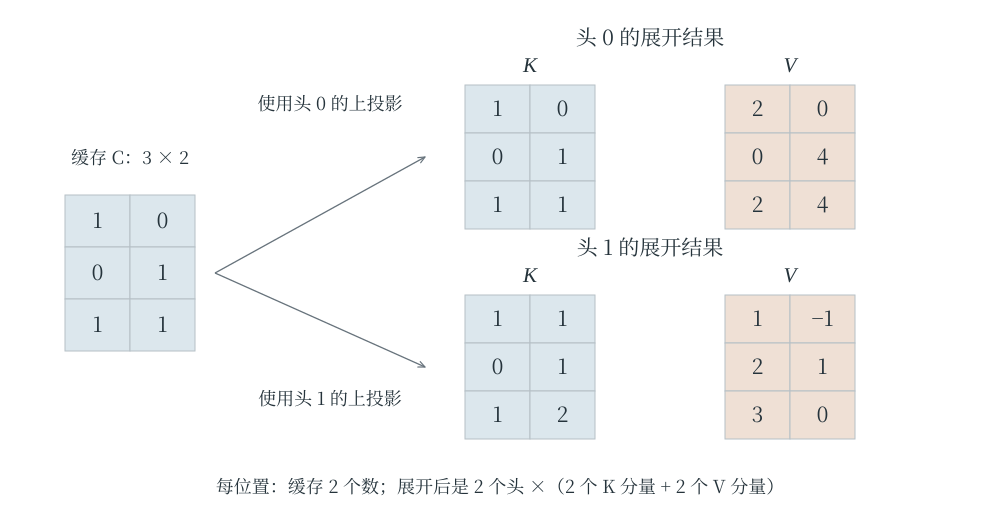

*图 5-5　MLA 的共享比 GQA 更间接。各头不必拥有相同 K、V，但它们来自同一份位置表示。图中只画内容分支；稍后加入的位置分支也要计入缓存。*

与逐步读取相配合，缓存增长时只需追加新的 $`c_j`$。问题是：如果每来一个新查询，都把全部历史重新展开一次，是否又制造了大量计算和临时数据？

### 改变乘法次序，避免把全部历史展开

先看一个头。忽略位置项，分数的内积为

```math
\begin{aligned}
q_t(k_j)^{\mathsf T}
&=q_t(c_jU_K)^{\mathsf T}\\[0pt]
&=(q_tU_K^{\mathsf T})c_j^{\mathsf T}.
\end{aligned}
```

可以先把新查询变成宽度为 $`r`$ 的 $`\hat q_t=q_tU_K^{\mathsf T}`$，再直接与历史 $`c_j`$ 比较。这个变换只对新查询做一次，不随历史位置逐个展开键。

再看值的加权和。注意力权重为 $`a_{t,j}`$，则

```math
\begin{aligned}
o_t&=\sum_j a_{t,j}(c_jU_V)\\[0pt]
&=\left(\sum_j a_{t,j}c_j\right)U_V.
\end{aligned}
```

可以先在潜在空间里读出 $`r_t=\sum_j a_{t,j}c_j`$，最后只对这个结果做一次值上投影。若后面还有线性的输出投影，其相应部分也可以与 $`U_V`$ 合并。每个头的权重仍不同，因此各头的潜在加权结果仍须分别计算；不能先把所有头平均掉。

这两次变形使用矩阵乘法的结合律，以及固定线性变换能够移到求和外面。若在被移动的两个矩阵之间插入了不满足这些条件的操作，就不能照搬。

把第 0 头查询取为上一节的 $`(a,0)`$，权重仍是 $`(2/5,1/5,2/5)`$。潜在空间中先得到

```math
\begin{aligned}
r^{(0)}&=\tfrac25(1,0)+\tfrac15(0,1)+\tfrac25(1,1)\\[0pt]
&=(4/5,3/5).
\end{aligned}
```

再乘 $`U_V^{(0)}`$，得到 $`(8/5,12/5)`$，与先展开 V 再加权完全相同。

第 1 头查询为 $`(0,a)`$。由于 $`U_K^{(1)}`$ 不同，吸收后的查询为 $`(a,a)`$，分数变成 $`(\ln2,\ln2,2\ln2)`$，权重为 $`(1/4,1/4,1/2)`$。于是

```math
\begin{aligned}
r^{(1)}&=(3/4,3/4),\\[0pt]
o^{(1)}&=(3/4,3/4)U_V^{(1)}=(9/4,0).
\end{aligned}
```

若本例的输出投影把两个头逐分量相加，最终就是 $`(77/20,12/5)`$。完整复算程序同时执行展开与吸收两条路径，比较分数、权重和输出。

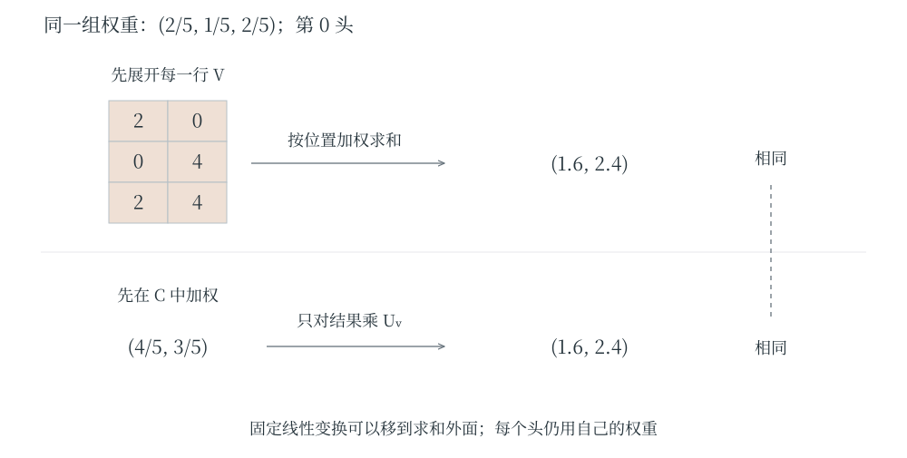

*图 5-6　节省存储不必意味着每步重新展开全部历史。图中比较的是同一个 MLA 头的两种等价执行方式；它没有证明任意 MHA 与 MLA 等价。*

下面的短程序核对第 0 头的潜在读取。`latent_result` 是最终二维输出。

```python
from math import exp, log

latent_rows = [[1.0, 0.0], [0.0, 1.0], [1.0, 1.0]]
scores = [log(2), 0.0, log(2)]
terms = [exp(s - max(scores)) for s in scores]
weights = [t / sum(terms) for t in terms]
pooled = [sum(w * row[j] for w, row in zip(weights, latent_rows))
          for j in range(2)]
latent_result = [2 * pooled[0], 4 * pooled[1]]
```

### 位置编码对矩阵吸收的影响

第四章的 RoPE 会根据位置旋转查询与键。设 $`R_i`$ 为位置 $`i`$ 的旋转矩阵。如果先把内容键展开，再旋转，那么行向量约定下的内积为

```math
\begin{aligned}
&(q_iR_i^{\mathsf T})
(c_jU_KR_j^{\mathsf T})^{\mathsf T}\\[0pt]
&=q_iR_i^{\mathsf T}R_jU_K^{\mathsf T}c_j^{\mathsf T}.
\end{aligned}
```

这里的 $`R_j`$ 随历史位置变化。原来只依赖当前查询的变换，现在夹进了一个与 $`j`$ 有关的矩阵，通常无法一次性吸收到当前查询中。矩阵乘法一般不可交换；把旋转随意挪到另一个空间，会改变函数。

MLA 的一种解决办法是把内容比较与位置比较分开。内容部分继续使用可吸收的低维构造，另外保留较窄的旋转位置键。若内容宽度为 $`d_c`$、位置分支宽度为 $`d_R`$，分数为

```math
s_{i,j}^{(h)}=
\frac{
q_i^{C,(h)}(k_j^{C,(h)})^{\mathsf T}
+q_i^{R,(h)}(k_j^R)^{\mathsf T}
}{\sqrt{d_c+d_R}}.
```

这里 $`d_c`$ 是展开后的单头内容键宽度，不是潜在宽度 $`r`$；二者必须区分。$`q^R,k^R`$ 已经施加对应位置的旋转。位置键可由各头共享，仍需缓存；内容键则通过吸收直接在潜在空间中比较。

再算一个含位置项的例子。取内容查询 $`(2\ln2,0)`$，三个内容键仍为 C 的三行。另设位置键依次为 $`(1,0),(0,1),(-1,0)`$，这是同一个向量按位置旋转 $`0^\circ,90^\circ,180^\circ`$ 的结果。位置 2 的已旋转查询为 $`(-2\ln2,0)`$。

内容项与位置项相加，再除以 $`\sqrt{2+2}=2`$，三个分数分别为

```math
(0,0,2\ln2).
```

权重因此为 $`(1/6,1/6,4/6)`$，潜在加权结果为 $`(5/6,5/6)`$，经第 0 头的值投影得到 $`(5/3,10/3)`$。位置关系实际改变了读取权重，同时内容分支仍可以采用吸收路径。

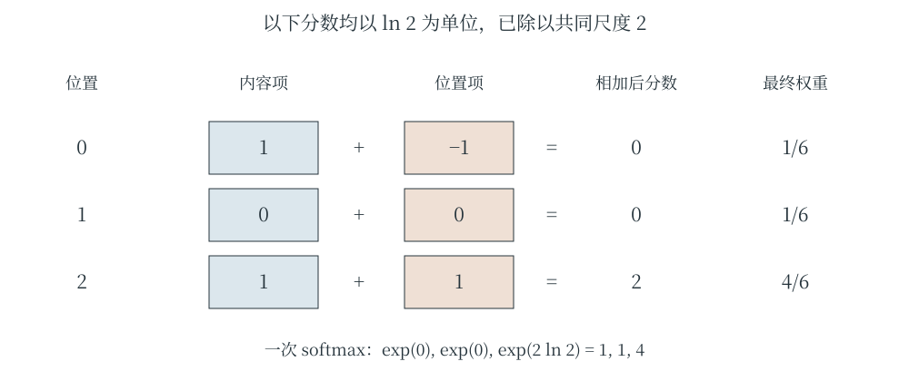

*图 5-7　位置分支不是一个可以漏算的附注。图中两类分数都已经除以共同的尺度 2，再相加；最终按同一行做一次 softmax。不能分别对两类分数归一化后相加。*

### 压缩缓存的读取开销

若每层每位置缓存一份宽度 $`r`$ 的联合潜在表示，以及宽度 $`d_R`$ 的位置键，元素字节数同为 $`b`$，则

```math
M_{\mathrm{MLA}}=LT(r+d_R)b.
```

这里没有额外乘 2，因为 $`c_j`$ 同时服务于内容 K 与 V。若选用 $`r=512,d_R=64`$，仍按 32 层、每元素 2 字节计，每位置为 36 KiB，128K 历史为 4.5 GiB。它小于前面的 8 组 GQA 的 16 GiB，却大于单组 MQA 的 2 GiB。缓存大小本身不能排出模型质量的高低。

MLA 也没有消除历史位置这个维度。完整读取时，潜在序列仍有 $`T`$ 行，每个查询头仍需建立对这些行的权重。吸收后比较的宽度可能从单头内容宽度变为潜在宽度 $`r`$；若 $`r`$ 较大，计算量可能增加，值聚合也转到这个空间。再加上共享数据怎样被算子复用，预填充与单词元解码可能适合不同的执行路径。

因此，MLA 的设计与执行要分两层看：结构规定可以保存什么，执行规定在哪个空间比较与聚合。只看到缓存缩小，就宣布所有阶段同比加速，会漏掉这笔交换。

## 5.4　稀疏注意力：选择历史位置

GQA 和 MLA 主要减少每个位置需要保存的内容。序列继续增长时，逐位置扫描仍会增加工作量。另一种选择是保留历史，却只读取其中一部分；这时新问题是如何挑选位置，以及被跳过的信息是否会影响答案。

### 稀疏掩码与可见位置

GQA 和 MLA 都可以保留对全部历史位置的读取。稀疏注意力进一步问：一个查询是否需要把所有位置都放进本次归一化？

记本次允许读取的集合为 $`\mathcal S_i`$，它必须服从因果约束。稀疏读取定义为

```math
\begin{aligned}
a_{i,j}&=\frac{\exp(s_{i,j})}
{\sum_{k\in\mathcal S_i}\exp(s_{i,k})},
\quad j\in\mathcal S_i,\\[0pt]
o_i&=\sum_{j\in\mathcal S_i}a_{i,j}v_j.
\end{aligned}
```

集合外的位置不参与这次分母。与第四章的因果掩码一样，它不是先对全体做 softmax 再随意清零；只不过这里除了“未来不能看”，还主动限制了部分历史。

最简单的集合是最近 $`w`$ 个位置。滑动窗口注意力每行只访问一个邻近区域，访问规则容易预测，也容易连续搬运。另一种方法按块选择：先把历史分成连续区间，再为查询选择若干块。动态选择则让读取集合随当前内容变化，可能选中很远、很零散的位置。

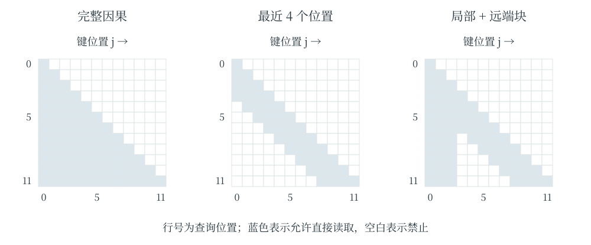

*图 5-8　不同稀疏模式改变哪些位置能够直接交换信息。色块代表允许的查询—键配对，不代表这些配对最终具有相同权重。所有模式都屏蔽未来。*

多层局部注意力可以间接传递较远信息。若每层窗口包含当前位置及前面 $`w-1`$ 个位置，经过 $`L`$ 层，沿计算图可能到达的最远范围约为 $`1+L(w-1)`$ 个位置。但“存在信息传递路径”不等于某个遥远细节已经被完整保存。中间表示仍有有限宽度，也受训练影响。

### 局部窗口的信息遗漏

延长我们的历史读取任务到八个位置。为把注意力本身看清，暂取标量值，并直接列出当前查询的分数指数 $`e^{s_j}`$：

| 位置 $`j`$ | 0 | 1 | 2 | 3 | 4 | 5 | 6 | 7 |
|---|---:|---:|---:|---:|---:|---:|---:|---:|
| $`e^{s_j}`$ | 1 | 8 | 1 | 1 | 1 | 1 | 2 | 2 |
| 值 $`v_j`$ | 0 | 10 | 0 | 0 | 0 | 0 | 1 | 1 |

例如分数依次为 $`0,\ln8,0,0,0,0,\ln2,\ln2`$，就会产生这一行指数。位置 1 是一条较早、与当前查询高度匹配的记录。

完整读取的分母为 17，输出为

```math
\begin{aligned}
o_{\mathrm{full}}&=\frac{8\times10+2\times1+2\times1}{17}\\[0pt]
&=\frac{84}{17}\approx4.9412.
\end{aligned}
```

若只读最近三个位置 $`\{5,6,7\}`$，分母为 5，输出变成 $`4/5=0.8`$。节省读取的同时，模型已经失去对那条远端记录的直接访问。

如果一个理想选择器找到了分数最大的三个位置 $`\{1,6,7\}`$，输出则是 $`84/12=7`$。这也不等于完整输出。虽然保留了最大的几项，删除其他项仍改变了分母，因此所有保留位置的权重都会重新分配。

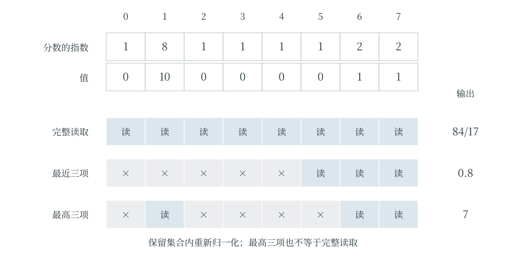

*图 5-9　读得少与算得相同是两回事。理想选择器只用来检查数学效果；若为了选择它们已经算过所有完整分数，就还没有解决选择成本。*

这并不表示稀疏输出“必然更差”。完整模型和稀疏模型可以通过训练形成不同表示，最后比较的是任务效果。这里做的是受控实验：固定同一行分数和值，只改变读取集合，观察函数在哪里发生变化。

下面直接计算不同集合，避免掩码与分母在实现时脱节：

```python
score_exp = [1, 8, 1, 1, 1, 1, 2, 2]
history_values = [0, 10, 0, 0, 0, 0, 1, 1]

def selected_read(indices):
    denominator = sum(score_exp[j] for j in indices)
    return sum(score_exp[j] * history_values[j] for j in indices) / denominator

window_result = selected_read([5, 6, 7])
```

### 被忽略位置对输出的影响

设完整注意力在保留集合上的概率质量为 $`1-\delta`$，遗漏集合上的质量为 $`\delta`$。分别在两个集合内重新归一化，得到 $`o_{\mathrm{keep}}`$ 与 $`o_{\mathrm{drop}}`$，则

```math
\begin{aligned}
o_{\mathrm{full}}
&=(1-\delta)o_{\mathrm{keep}}+\delta o_{\mathrm{drop}},\\[0pt]
o_{\mathrm{keep}}-o_{\mathrm{full}}
&=\delta(o_{\mathrm{keep}}-o_{\mathrm{drop}}).
\end{aligned}
```

这给出一个直观判断：若遗漏概率很小，而且遗漏值与保留值相近，输出变化可能很小；若遗漏的位置提供了不同内容，变化就可能明显。

当所有值向量的范数不超过 $`B`$ 时，可以得到

```math
\|o_{\mathrm{keep}}-o_{\mathrm{full}}\|\le2B\delta.
```

本例的值是 0 到 10 之间的标量，因此两个集合的平均值之差最多为 10，可以使用更紧的 $`10\delta`$ 上界。最近三项漏掉的质量为 $`12/17`$；最大三项漏掉的质量为 $`5/17`$。两种方法实际输出误差分别约为 4.1412 和 2.0588，都落在各自的上界以内。

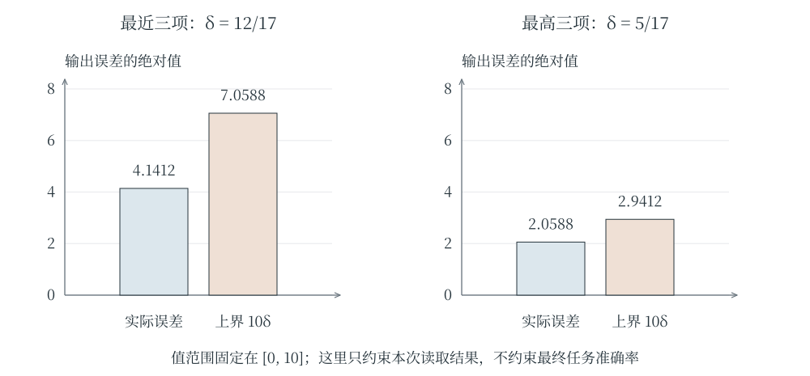

*图 5-10　这是固定分数和值下的单层输出误差界。它不是整段语言模型准确率的界；后续层、值的尺度以及训练适应都会影响最终表现。*

还有一个容易忽略的条件：选择器通常不知道完整注意力的真实概率质量，否则可能已经完成了想要省掉的大部分工作。它是在用较便宜的信号预测哪些位置值得读。因此应当分别检查选择器的遗漏，以及在选中集合内计算注意力的误差。

### 索引与位置选择的成本

一种动态方案为历史维护较短的索引键。新查询先在索引空间评分，选出候选，再读取完整 K、V 或潜在表示。索引维度可以比主体注意力小，头数可以更少，数值格式也可以更紧凑，但它仍然需要计算、存储和搬运。

如果索引阶段扫描全部 $`T`$ 个位置，解码中的选择成本仍随 $`T`$ 增长；对全部查询进行训练或预填充时，索引的配对数甚至仍可能随 $`T^2`$ 增长，只是每次配对更便宜。主体注意力每行只读固定 $`k`$ 项，不能据此宣布整个算法的时间已经与历史长度无关。

下面估算一个教学例子的存储和读取量。在每层为每个位置额外保存 64 个、每个 2 字节的索引数。128K 历史的索引是 16 MiB。如果主体注意力采用前面的 GQA，每位置每层是 4096 字节，选出 2048 个位置后，主体数据约需读 8 MiB。

这一层完整读取原本约为 512 MiB；加入索引后，本次扫描预算约为 $`16+8=24`$ MiB，还不包括选取最大项、索引写回、寻址与重复加载。主体读取减少了 64 倍，总扫描却只减少约 21.3 倍。这个例子是教学假设。比较方案的流量时，需要一并计算选择器的开销。

按块读取还有另一种交换。假设希望取位置 $`\{0,4,7\}`$，底层按两个位置一块搬运，就可能实际取回 $`\{0,1,4,5,6,7\}`$，搬了六个位置。额外数据可能换来更规整的地址、更少的索引和更高效的矩阵运算；也可能浪费带宽，取决于模式与实现。

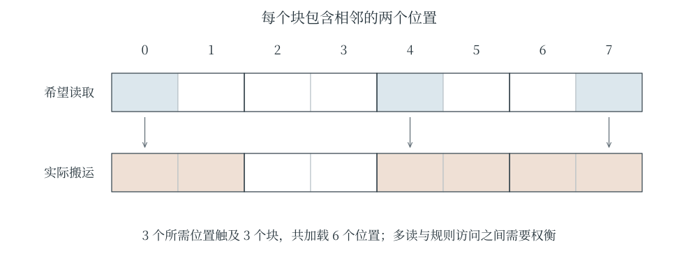

*图 5-11　逻辑上选择三个位置，不保证物理上只搬三个位置。块大小是一项模型与算子共同承担的设计选择。*

已有研究提供了不同的组合。[Native Sparse Attention](https://arxiv.org/html/2502.11089v1)把压缩概览、重要块选择和局部窗口组织成不同分支；[DeepSeek-V3.2 的 DSA](https://arxiv.org/html/2512.02556v1#S2.SS1)使用轻量索引器选出词元，再在选中集合上执行主体注意力，并通过相应训练让选择与主体模型适应彼此。这两种机制不能仅因为都叫“稀疏”就视为同一个算法。

### 稀疏读取与缓存保留

纯滑动窗口有一个很有用的性质：若后续每一层、每一步都只需要自己的固定窗口，且没有其他使用者，那么离开窗口的旧缓存可以回收。其缓存长度因此可以有固定上限。

动态选择不同。位置 1 这次没有选中，下一个查询可能突然需要它。如果要支持未来任意查询对历史的重新选择，就仍需保留相关内容或一种足够的替代表示。稀疏读取减少本次访问集合，不自动减少全部历史的保留容量。

主动淘汰缓存、压缩旧块、把冷数据移到其他存储层，都需要额外策略。删除可能损失信息，迁移可能增加访问时延，压缩可能增加恢复成本。只有把这些代价写出来，才能判断方案是否真正解决了原来的瓶颈。

### 用页摘要筛选键

想找高分的位置，通常要先读键；如果筛选者也读遍所有键，省掉的究竟是哪一趟访存？一种办法是写入缓存时，为一小页键按坐标记录最小值和最大值。设当前查询 $`q=(2,-1)`$，暂不缩放，给键 $`k=(x,y)`$ 的分数就是 $`2x-y`$。已知一页内最大的 $`x`$ 和最小的 $`y`$，任何真实键的分数都不会超过 $`2x_{\max}-y_{\min}`$。查询分量的符号决定取哪一端；翻转查询，不能照抄原来的排序。[Quest 论文](https://arxiv.org/abs/2406.10774)

页甲有 $`(3,5),(0,0)`$，页乙有 $`(2,1),(1,1)`$。两页的上界分别为 6 和 3，只按上界挑一页会选甲。但逐键算一次：甲的最高分为 1，乙的最高分反而为 3。原因是甲的最大 $`x`$ 与最小 $`y`$ 属于两个不同的键，因而不存在能得 6 分的键。上界可用于**有证明的剪枝**：若要找最大分且已有一个实得 7 分的候选，甲就不用读；只预算读取一页而直接取上界最大的页，是另一种带误差的策略。即使保证找到了最大分，也不等于找齐了 softmax 输出需要的概率质量。

划算与否也能先算。假设一页有 64 个键，键宽 128，每个分量 2 B。一页完整键是 16 KiB，逐维上下界共 512 B。64 页的摘要占 32 KiB；若本步选中 4 页，先扫摘要再读这四页的键，共 96 KiB，全部键则占 1 MiB。这里还没有计入值向量、选择器计算、缓存更新和随机访问页产生的事务。若页里只有两个键，上下界已经与两个键一样大：此时用刚才的正确推导，得到的工程选择却可能完全相反。

## 5.5　线性注意力与递归状态

如果不想让读取量随历史长度逐步增长，可以考虑把过去的信息汇总成固定大小的状态。改变保存方式也改变了可检索的信息，因此先从公式推导可行的重排，再检查哪些内容在汇总时丢失。

### softmax 与计算次序

先从一个简化的矩阵乘法开始，看看如何用历史的统计量得到输出。

若没有 softmax，一个矩阵乘法表达式存在熟悉的结合律：

```math
(QK^{\mathsf T})V=Q(K^{\mathsf T}V).
```

左侧先形成位置之间的关系，右侧先形成特征之间的统计量。如果 K 有 $`T`$ 行、$`f`$ 列，V 有 $`T`$ 行、$`d_v`$ 列，$`K^{\mathsf T}V`$ 只有 $`f\times d_v`$ 个数，不随 $`T`$ 增加尺寸。

但第四章计算的是 $`\mathrm{softmax}(QK^{\mathsf T}/\sqrt{d_h})V`$。指数与逐行分母插在乘法中间，不能直接删去 softmax 再使用上式。这样做会得到另一个函数。

一种线性注意力明确换用可分解的相似度：

```math
\kappa(q,k)=\phi(q)\phi(k)^{\mathsf T}.
```

$`\phi`$ 把查询与键映射为宽度 $`f`$ 的特征。若希望得到非负加权平均，就需要确保这些相似度非负，并且参与读取的分母为正。特征映射可以是固定的非线性函数，也可以在模型中学习；不同选择对应不同的相似度。相关的因果状态形式见 [Linear Transformer 原论文](https://proceedings.mlr.press/v119/katharopoulos20a.html)。

定义归一化读取为

```math
o_t=
\frac{\sum_{j\le t}\kappa(q_t,k_j)v_j}
{\sum_{j\le t}\kappa(q_t,k_j)}.
```

把公共的 $`\phi(q_t)`$ 提到求和外面：

```math
\begin{aligned}
S_t&=\sum_{j\le t}\phi(k_j)^{\mathsf T}v_j,\\[0pt]
z_t&=\sum_{j\le t}\phi(k_j),\\[0pt]
o_t&=\frac{\phi(q_t)S_t}{\phi(q_t)z_t^{\mathsf T}}.
\end{aligned}
```

尺寸也说明了节省发生在哪里。若 $`f=64`$、$`d_v=128`$，状态 $`S_t`$ 始终有 $`64\times128=8192`$ 个元素，额外的 $`z_t`$ 有 64 个元素；序列增加一个位置时只更新这些状态，状态的形状不随位置数增长。这种固定大小来自更换后的可分解相似度，模型能否用它保留任务所需的信息，还需要用后面的例子检查。

现在 S 的行是键特征，列是值特征；它不再按历史位置分行。$`z_t`$ 保存归一化所需的特征和。这里的向量除以一个标量，表示每个输出分量都除以同一个分母。

### 外积状态与增量更新

当新位置到来，无需重新求和全部历史：

```math
\begin{aligned}
S_t&=S_{t-1}+\phi(k_t)^{\mathsf T}v_t,\\[0pt]
z_t&=z_{t-1}+\phi(k_t).
\end{aligned}
```

外积 $`\phi(k_t)^{\mathsf T}v_t`$ 把“怎样的键特征对应怎样的值”写进一个矩阵。这与前几章权重梯度的外积在形状上相似，但这里更新的是当前序列的状态，不是模型的全局权重。

继续使用三行 $`K=[(1,0),(0,1),(1,1)]`$ 和 $`V=[(2,0),(0,4),(2,4)]`$。只在这个非负教学例子中取 $`\phi`$ 为恒等映射，从全零状态开始。

第一条记录产生

```math
S_0=\begin{bmatrix}2&0\\0&0\end{bmatrix},\qquad z_0=(1,0).
```

第二条记录只写入第二行，得到

```math
S_1=\begin{bmatrix}2&0\\0&4\end{bmatrix},\qquad z_1=(1,1).
```

第三条的外积为

```math
\begin{bmatrix}1\\1\end{bmatrix}
\begin{bmatrix}2&4\end{bmatrix}
=\begin{bmatrix}2&4\\2&4\end{bmatrix}.
```

因此最终状态为

```math
S_2=\begin{bmatrix}4&4\\2&8\end{bmatrix},\qquad z_2=(2,2).
```

查询 $`\phi(q)=(1,0)`$ 取出 S 的第一行，分母为 2，输出 $`(2,2)`$；查询 $`(0,1)`$ 则得到 $`(1,4)`$。

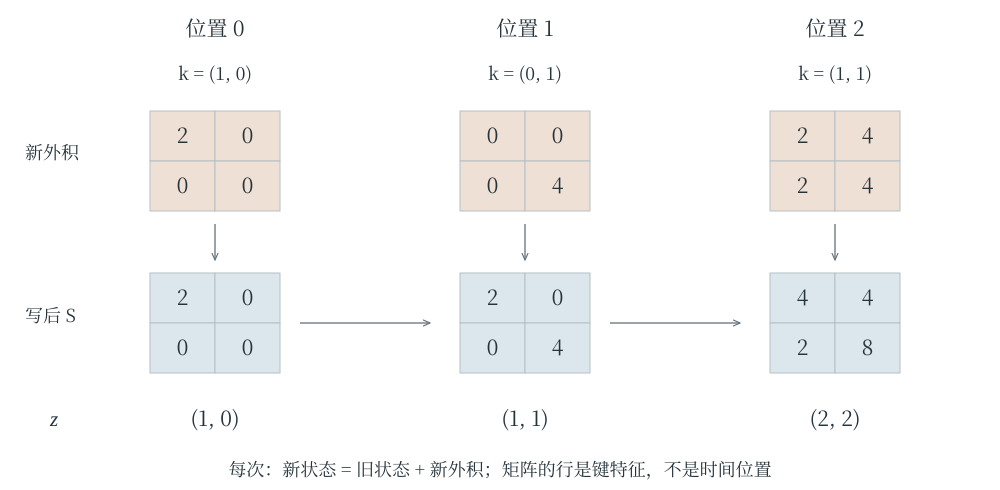

*图 5-12　状态中的一行对应一个键特征方向，不对应某个历史词元。一个新位置可以同时改写多行，因此以后不能通过“第几行”找回那个位置。*

直接按新相似度逐位置读取，也会得到相同答案。以查询 $`(1,0)`$ 为例，三个相似度为 $`(1,0,1)`$，归一化后是 $`(1/2,0,1/2)`$，输出恰为 $`(2,2)`$。

前面 GQA 的第 0 头则使用指数相似度，权重为 $`(2/5,1/5,2/5)`$，输出 $`(8/5,12/5)`$。两个查询方向相同，输出仍然不同，原因正是相似度定义不同。对恒等线性核把查询乘以一个正标量，分子分母会抵消；对 softmax 缩放分数，却会改变分布的集中程度。

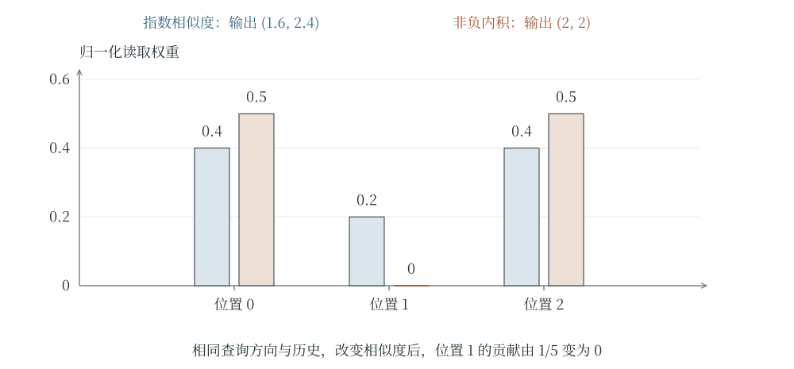

*图 5-13　线性状态计算可以精确实现它自己的核，但不自动精确实现 softmax。高效的结合律成立之前，需要先说清楚换成了哪个函数。*

某些方法选择特征映射来近似指数内积核。此时近似误差与特征维度、输入分布和数值条件有关。有限维特征矩阵的秩受 $`f`$ 限制，不能把固定宽度状态当成对任意长、任意输入的 softmax 注意力的通用精确表示。

下面按状态更新复算，无需构造位置之间的完整矩阵：

```python
keys = [[1, 0], [0, 1], [1, 1]]
values = [[2, 0], [0, 4], [2, 4]]
state = [[0.0, 0.0], [0.0, 0.0]]
normalizer = [0.0, 0.0]
for key, value in zip(keys, values):
    for i in range(2):
        normalizer[i] += key[i]
        for j in range(2):
            state[i][j] += key[i] * value[j]
linear_result = [x / normalizer[0] for x in state[0]]
```

### 固定状态的信息容量

如果尺寸固定，一次写入、读取的主要工作约为 $`O(fd_v)`$，一条长度为 T 的序列合计为 $`O(Tfd_v)`$。这就是此处“线性”的含义：固定模型宽度后，工作量随序列长度线性增长。它不是说整个网络都是线性函数。

归一化状态需要 $`fd_v+f`$ 个数。它可以在生成时覆盖更新，不必随着位置数增长。但状态宽度本身可能很大，而且累加状态常采用比缓存更高的精度。常数大小不保证短序列时占用更少，后面会实际算一次。

更深的问题是信息是否仍然可区分。保留相同的三行 K，构造两段可能的值历史，只用第一分量表示一个数：

```math
V_A=\begin{bmatrix}2&0\\4&0\\6&0\end{bmatrix},\qquad
V_B=\begin{bmatrix}3&0\\5&0\\5&0\end{bmatrix}.
```

它们都得到

```math
S=\begin{bmatrix}8&0\\10&0\end{bmatrix},\qquad z=(2,2).
```

只看这个状态，以后任何合法查询都会给两段历史相同的结果。第一分量的变化量为 $`(1,1,-1)`$，它在 K 的两个特征方向上恰好相互抵消，状态没有留下可供区分的痕迹。

而若仍保留逐位置的 V，用前面 softmax 的权重 $`(2/5,1/5,2/5)`$ 读取，A 的输出为 $`(4,0)`$，B 为 $`(4.2,0)`$。同一组键之下，这两段历史的区别确实可能被另一个读取函数使用。

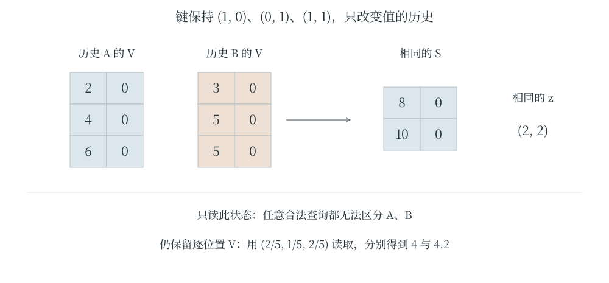

*图 5-14　两个不同输入历史落入同一个状态，称为这里的状态碰撞。这个反例针对给定特征映射和汇总规则，不能据此推断所有递归模型在所有任务上表现相同。*

增加状态宽度、学习更合适的特征、引入门控，都可以改善任务所需信息的保存，但不能从“可以持续接收输入”推出“能够精确记住无限多独立细节”。对实际有限精度的固定状态，能够区分的状态数也是有限的。长序列学习始终要决定哪些信息值得占据这份有限容量。

## 5.6　DeltaNet 与 KDA 的状态更新

前面的状态把新信息直接累加进去。相同键多次对应不同的值时，旧内容可能干扰新内容。下面先算出这种干扰，再讨论如何根据当前预测和新值的差异修正状态。

### 重复键与状态更新

上一节的状态把键值关联不断相加。如果任务是在算所有记录的平均，这可能正合适；如果任务是“查询最新价格”，旧值和新值平均起来就不是想要的答案。

设两个正交键 $`(1,0)`$、$`(0,1)`$ 分别表示两类项目。先写入值 2、4，状态为

```math
S=\begin{bmatrix}2\\4\end{bmatrix}.
```

现在第一类项目更新为 6。若直接加入 $`k^{\mathsf T}v`$，状态变为 $`(8,4)^{\mathsf T}`$；若再按出现次数归一化，第一类的读取结果是 4。这两种读取都没有表达“用 6 替代 2”。

另一种思路是用新信息纠正状态中已有的关联。当前状态对该键的预测为 $`kS`$，新值为 $`v`$，差值是 $`v-kS`$。沿该键的方向写入差值：

```math
S_{\mathrm{new}}=S+\beta k^{\mathsf T}(v-kS).
```

这就是这里讨论的 delta 更新。$`\beta`$ 决定纠正多少。在当前例子中取 $`k=(1,0),v=6,\beta=1`$，旧预测为 2，纠错量为 4，于是新状态为 $`(6,4)^{\mathsf T}`$。第二个正交方向保持不变。

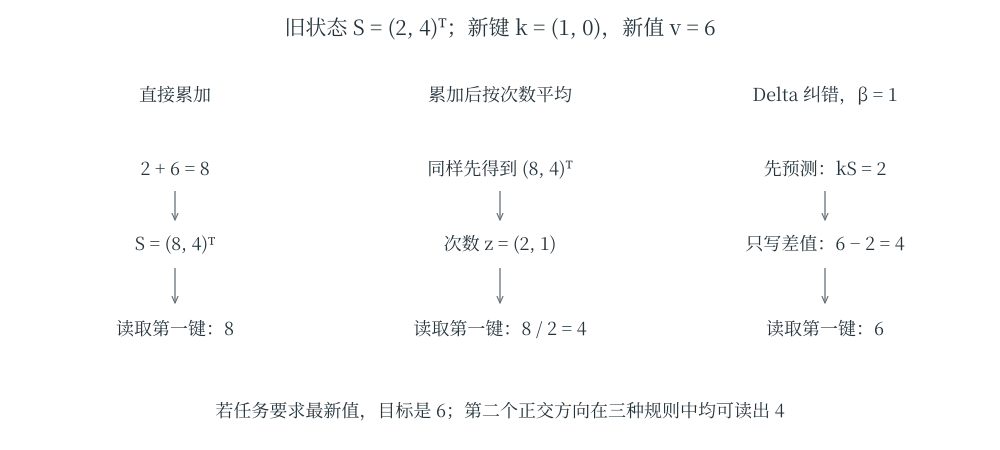

*图 5-15　更新规则应当与任务的记忆要求相配。图中目标是最新值，所以保留均值不是正确目标；若问题改为历史平均，判断也会改变。*

代码也可以直接写成先读取、再纠正：

```python
state = [2.0, 4.0]  # 两个键特征、一个值特征
key = [1.0, 0.0]
new_value = 6.0
beta = 1.0
prediction = sum(k * s for k, s in zip(key, state))
delta_result = [s + beta * k * (new_value - prediction)
                for k, s in zip(key, state)]
```

这段计算已不再使用上一节的 $`z`$ 做概率归一化。它定义的是可纠错的关联状态，输出可写为 $`o=qS`$。它不要求读出的结果是历史值的凸组合；不能因为都被称为线性注意力，就把不同变体的分母、门控和输出规则混在一起。

### 从损失函数推导更新规则

把状态看成临时的键值映射，希望新键的读取结果接近新值。定义重建损失

```math
\ell(S)=\frac12\|kS-v\|^2.
```

按第三章的矩阵求导，梯度为

```math
\nabla_S\ell=k^{\mathsf T}(kS-v).
```

做一步步长为 $`\beta`$ 的下降，就得到刚才的 delta 更新。这个推导给“纠错”一个精确定义：本次写入针对的是当前关联的预测残差。

此处的 S 是每条请求的快速状态；模型的投影矩阵与产生 $`\beta`$ 的参数，在一次普通推理中仍然固定。这个状态更新可以直接实现为乘加，不要求服务时调用自动微分或对语言模型权重重新训练。训练整个网络时，则仍需沿状态更新求导，学习怎样产生有用的键、值和门控。

若 $`\|k\|=1`$，左乘 k 可得

```math
kS_{\mathrm{new}}=(1-\beta)kS+\beta v.
```

在本章选用的 $`0\le\beta\le1`$ 范围内，它恰好在旧预测与新值之间插值；$`\beta=1`$ 时精确写入新值。若 k 未归一化，上式中的有效步长变成 $`\beta\|k\|^2`$，就不能再不加检查地说“步长 1 一定覆盖正确”。沿键方向的误差乘子为 $`1-\beta\|k\|^2`$，其绝对值是否小于 1，直接影响这个局部纠错是否收敛。

### 状态更新中的干扰

对另一个查询 q，这次更新造成的变化为

```math
\Delta o=\beta(qk^{\mathsf T})(v-kS).
```

当 q 与 k 正交时，变化为零；不正交时，新关联会影响它的读取。这说明 delta 更新并没有创造无穷多个独立槽位，它只把更新方向组织得更有目的。

例如仍从 $`S=(2,4)^{\mathsf T}`$ 开始，但新键换成 $`k=(1,1)/\sqrt2`$，目标值为 6、$`\beta=1`$。旧预测为 $`3\sqrt2`$，两行各增加 $`3\sqrt2-3`$，新状态为

```math
S_{\mathrm{new}}=
\begin{bmatrix}3\sqrt2-1\\3\sqrt2+1\end{bmatrix}
\approx\begin{bmatrix}3.2426\\5.2426\end{bmatrix}.
```

新的归一化键能够读出 6，但原来两个坐标方向读出的 2、4 都发生了变化。任务若需要同时保持这些关联，模型就必须学习更合适的表示，使用更多状态容量，或借助其他历史读取路径。

即使第一种正交例子成功覆盖成 6，“第一条旧记录曾经是多少”也不再能仅凭这个覆盖后的状态恢复。纠错规则解决的是如何管理有限记忆，不是无损历史归档。

### 按方向调整遗忘程度

还可以在写入前先衰减旧状态。[Gated DeltaNet](https://arxiv.org/abs/2412.06464)把遗忘与 delta 更新结合起来。先用一个标量 $`\alpha_t`$ 缩放旧状态，再计算针对新关联的纠错，就得到一种头内统一衰减：

```math
\begin{aligned}
\bar S_{t-1}&=\alpha_tS_{t-1},\\[0pt]
S_t&=\bar S_{t-1}
+\beta_tk_t^{\mathsf T}(v_t-k_t\bar S_{t-1}).
\end{aligned}
```

但同一个头中，有些特征方向可能需要保留更久，另一些应该更快清除。Kimi Delta Attention，也就是 KDA，将这里的衰减推广为按键特征方向变化的对角矩阵 $`D_t`$。按本章的行向量约定，其核心状态更新为

```math
\begin{aligned}
D_t&=\mathrm{diag}(\alpha_{t,1},\ldots,\alpha_{t,f}),\\[0pt]
\bar S_{t-1}&=D_tS_{t-1},\\[0pt]
S_t&=\bar S_{t-1}
+\beta_tk_t^{\mathsf T}(v_t-k_t\bar S_{t-1}).
\end{aligned}
```

等价地，

```math
S_t=(I-\beta_tk_t^{\mathsf T}k_t)D_tS_{t-1}
+\beta_tk_t^{\mathsf T}v_t.
```

这与 [Kimi Linear 报告中的 KDA 更新](https://arxiv.org/html/2510.26692v1#S3)一致，只是将单个向量写为行。D 左乘 S，因此衰减的是状态的键特征行；把它随意换成右乘，会改变被衰减的轴。先衰减再依据衰减后的状态纠错，也不能任意交换次序。

用一组两行一列的数看区别。旧状态为 $`(4,8)^{\mathsf T}`$，新键为 $`(1,0)`$，新值为 6，$`\beta=1/2`$。

- 统一衰减取 $`\alpha=1/2`$，先得到 $`(2,4)^{\mathsf T}`$，再纠错为 $`(4,4)^{\mathsf T}`$。
- 按方向衰减取 $`D=\mathrm{diag}(1,1/4)`$，先得到 $`(4,2)^{\mathsf T}`$，再纠错为 $`(5,2)^{\mathsf T}`$。

后一种规则能够保留第一方向的较多旧状态，同时更快衰减第二方向。实际门值可以由输入经学习到的变换产生，而不是由程序员为每句话手工指定。

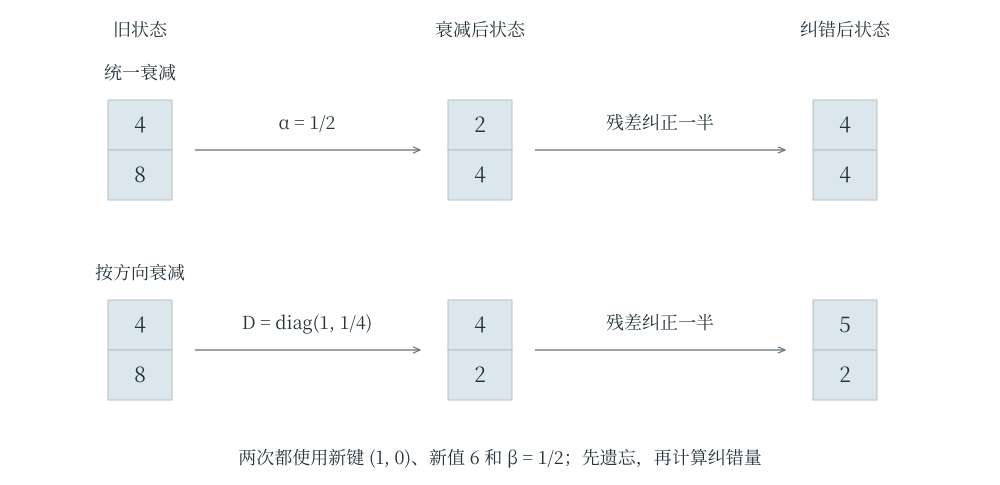

*图 5-16　更细的门控增加了选择记忆寿命的能力。特征方向仍是学出来的数值方向，不能预先把某一行解释成“事实槽位”或“语法槽位”。*

遗忘与纠错会改善很多任务中的状态利用方式，却仍不能逆转所有信息丢失。连续小衰减可能使长期信息逐渐消失，重复非正交写入可能造成干扰；状态精度、键归一化、门的参数化和实现中的舍入也会影响稳定性。

状态空间模型提供了另一种理解递归记忆的语言。把状态展平成向量，可以写成 $`s_t=A_ts_{t-1}+b_t`$，再从状态读取输出。不同模型约束 A 的结构，并决定哪些量依赖当前输入。[Mamba](https://arxiv.org/abs/2312.00752)强调依赖输入的选择性状态更新。它与这里的方法都在管理有限状态，但具体的状态结构、参数化和输出函数不同，不能仅凭“都是递归”就认定算法等价。

## 5.7　递归状态的训练与混合结构

### 状态按时间递推，不等于训练必须逐词元串行

生成时，新增词元按时间到来，逐步维护状态很自然。训练和预填充时，一段输入已经全部已知，可以重新组织运算，只要保持每个位置正确的前缀状态。

先回到最容易推导的加法状态。把一段输入分成长度为 C 的块。在一个块内，记已经映射到核特征的查询、键为 Q、K，值为 V，块开始前的状态为 $`S_{\mathrm{in}}`$、$`z_{\mathrm{in}}`$。令 M 为包含对角线的下三角掩码，则块内所有位置的分子可以写成

```math
N=QS_{\mathrm{in}}
+\bigl((QK^{\mathsf T})\odot M\bigr)V.
```

第一项读取以前各块留下的状态；第二项只读取本块中不晚于自己的位置。分母向量为

```math
d=Qz_{\mathrm{in}}^{\mathsf T}
+\bigl((QK^{\mathsf T})\odot M\bigr)\mathbf1.
```

每一行用自己的 $`d_i`$ 除 N 的对应行。块结束时再更新

```math
\begin{aligned}
S_{\mathrm{out}}&=S_{\mathrm{in}}+K^{\mathsf T}V,\\[0pt]
z_{\mathrm{out}}&=z_{\mathrm{in}}+\sum_{j\in\mathrm{block}}k_j.
\end{aligned}
```

因此，一部分逐位置工作被组织为块内矩阵乘法。C 是执行时的块长，不是承诺只记住 C 个位置；以前的块已经通过状态参与了读取。

在三条历史的例子中，把前两项分为第一块，第三项为第二块。第二块开始时 $`S_{\mathrm{in}}=\mathrm{diag}(2,4)`$、$`z_{\mathrm{in}}=(1,1)`$。查询 $`(1,0)`$ 从历史状态得到分子 $`(2,0)`$，从本块新增项得到 $`(2,4)`$；总分子 $`(4,4)`$，总分母 2，输出仍为 $`(2,2)`$。

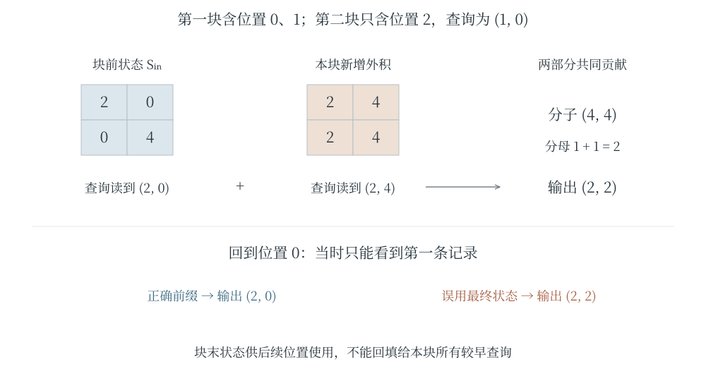

*图 5-17　并行化保留的是前缀语义。若给第 0 个位置直接使用三条记录汇总后的最终状态，就把未来信息漏进了早期输出。*

对 delta 或 KDA，不能直接用一个 $`K^{\mathsf T}V`$ 代替所有写入，因为每一步还依赖写入前的预测。不过，它们的状态转移可以表示为

```math
S_t=A_tS_{t-1}+B_t.
```

两步转移可以组合：

```math
\begin{aligned}
S_2&=A_2(A_1S_0+B_1)+B_2\\[0pt]
&=(A_2A_1)S_0+(A_2B_1+B_2).
\end{aligned}
```

组合满足结合律，因此允许先计算局部块的转移摘要，再按正确顺序组合。它通常不满足交换律：把两次写入前后交换，状态可能不同。KDA 等方法进一步利用对角与低秩结构组织分块运算，避免把所有转移都当作普通稠密矩阵相乘。

结合律提供了并行化的数学入口，却不自动保证最快的实现。块长、状态宽度、临时矩阵、数值稳定性和设备的矩阵乘法效率都参与取舍。这也解释了为什么相同的递归公式，逐步解码与预填充常需要不同算子。

### 训练与推理的状态开销

在普通生成中，维护一个当前状态便足以继续前向；旧状态可以覆盖。但反向传播要知道中间依赖。训练可以保存部分状态与激活，也可以在反向时重算；选择保存块边界还是每个位置，会改变存储与计算的交换。

即便一层递归状态尺寸与 T 无关，整段训练的激活、块内工作区和损失相关数据仍可能随 T 增长。模型还可能包含短卷积所需的尾部状态，以及其他辅助张量。不能把“单请求的持久推理状态”当成“整个训练过程的峰值显存”。

长链状态更新也有自己的数值问题。简单累加可能让状态与分母不断变大，较小的新贡献可能因舍入而无法保留；带遗忘的长期乘积可能变得很小。使用较高精度状态、稳定的分块公式或重算，都会影响成本，且必须验证输出与梯度。

把上面的仿射更新缩到一个连续的状态，可以看清选择性从哪里来。设状态追随输入 $`x`$ 的规律是 $`\mathrm{d}s/\mathrm{d}t=-s+x`$。在长为 $`\Delta`$ 的一步里把 $`x`$ 保持不变，直接积分得到 $`s_{\rm new}=a s_{\rm old}+(1-a)x`$，其中 $`a=e^{-\Delta}`$。输入决定步长时，较短的一步让旧状态保留得多，较长的一步更接近当前输入。以 $`s_0=0`$ 开始，先读 $`x=8`$、取 $`\Delta=\ln2`$，得到 4。下一项为 0，若取 $`\Delta=\ln 2`$，旧值只剩 2；若取 $`\Delta=\ln(4/3)`$，旧值还剩 3。这里的时长是模型内部学到的更新尺度，与用户等待的毫秒数无关。

Mamba 的选择性状态空间层允许输入影响离散步长以及写入、读出状态的系数。上式是一个标量的零阶保持例，只演示连续衰减怎样走成一次离散乘加。工程上可把每步整理成一对系数 $`(a,b)`$，前后两步合成为 $`(a_2a_1,a_2b_1+b_2)`$。这个运算满足结合律，刚好能接上前面的并行前缀扫描。训练时若把每个位置、每个通道的全部内部状态都写到显存，再读回来执行下一步，就丢掉了很大一部分收益。因此论文把离散化、扫描和输出组织在一起，并在反向重算部分中间值。稠密注意力随序列增长的历史可以换成固定宽度的状态，但训练的每个位置仍需得到自己的输出，状态能保留哪些信息也由更新规律和训练任务决定。[Mamba 的选择性状态与硬件感知扫描](https://arxiv.org/abs/2312.00752)

### 递归状态与注意力的混合

逐位置缓存适合保留可供重新查询的细节，递归状态适合以固定尺寸持续汇总。一个模型可以在不同层采用不同机制，让两类信息经残差表示相互作用。[Kimi Linear](https://arxiv.org/abs/2510.26692)就将 KDA 与 MLA 层组合起来。这里不把这种组合视为对所有任务都成立的固定配方。

沿用 32 层的教学预算，假设其中 24 层换成递归层，另 8 层保留前述 GQA。为单独算清状态，设每个递归层有 32 个头，每头状态为 $`128\times128`$，每元素用 4 字节，采用不含归一化向量 z 的 delta 类状态。

一层的状态为

```math
32\times128\times128\times4=2\ \mathrm{MiB},
```

24 层共 48 MiB。注意这里状态用 4 字节，GQA 缓存仍用 2 字节，不能只比较元素数。

在 4096 个位置时，8 层 GQA 的缓存为 128 MiB，合计 176 MiB；在 128K 时，8 层缓存为 4 GiB，合计 4144 MiB，约 4.05 GiB。后者明显低于 32 层 GQA 的 16 GiB，却仍随长度增长，因为模型仍保留 8 层逐位置历史。

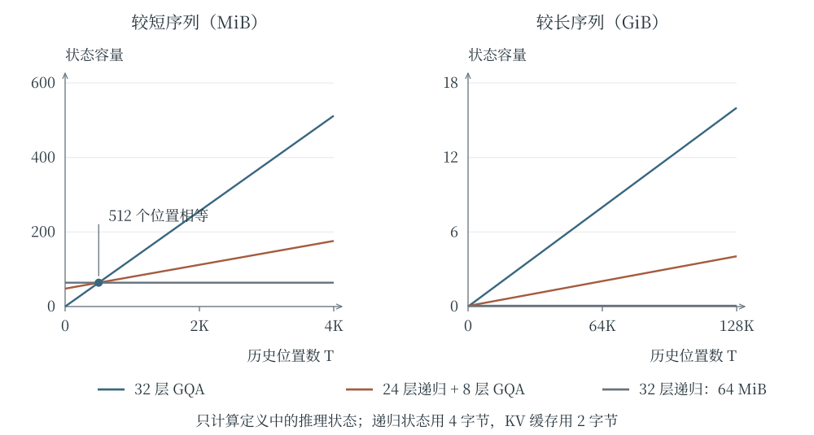

*图 5-18　混合模型的容量是各类状态之和，不是给模型贴一个“线性”标签后就整体变成常数。曲线只比较所定义的推理状态，不表示这些结构质量相同，也不对应 Kimi Linear 的实际尺寸。*

这个例子还有一个反直觉的短序列结果：每层 GQA 每位置为 4 KiB，要到 512 个位置才等于递归层的 2 MiB。更短的序列里，固定递归状态可能反而更大。归一化线性注意力若还保存 z，或实现需要其他状态，也应继续加上。

运行系统同时面对两种寿命：KV 按位置追加，递归状态通常覆盖更新。请求分叉时，可以共享只读的历史页，但两个分支后续修改的递归状态需要分别维护；若要撤回多个生成步骤，也不能假定递归状态一定可逆。保留检查点、复制或重新执行，是实现可能采用的不同办法。

## 5.8　历史表示的组合与评估

前一节让递归状态与逐位置缓存共同工作。沿着这个思路，还可以让不同层共用历史、把经常出现的特征放进参数表，或让多个生成分支共用前缀。先分别追踪它们保存和读取的数据，再用同一组检索任务检查信息是否还够用。

### 跨层共享缓存与索引

回到第四章那句“每层保存自己的键和值”。它来自当时的计算定义。DeepSeek-V4.1-Flash 的 CSA2 在训练时就给部分层换了约定。Full 层写自己的全局主缓存，从中投影出索引用的键，并为当前查询打分选位置。Reindex 层沿用这份主缓存和索引键，用自己的索引查询重新选位置。Reuse 层连位置名单也沿用。三种层仍然各算自己的注意力查询和局部滑窗 KV，所以即使读同一份远处历史，输出也可以不同。[技术报告 §2.3 与图 4、5](https://arxiv.org/html/2609.19969v1#S2.SS3)

拿一个新查询试一遍。只看远处的八条全局记录，编号从 1 到 8，每两条分成一块。设第一层对八条记录的分数依次是 $`1,9,2,3,8,0,4,5`$。这一层自己读取分数最高的 2、5 号记录。为了让后面的层还有选择余地，再取每块内部的最高分 $`9,3,8,5`$，留下最高的第一、三块。后面能重新选择的是 $`1,2,5,6`$ 这四个位置。候选池比本层读出的名单多了两个位置。

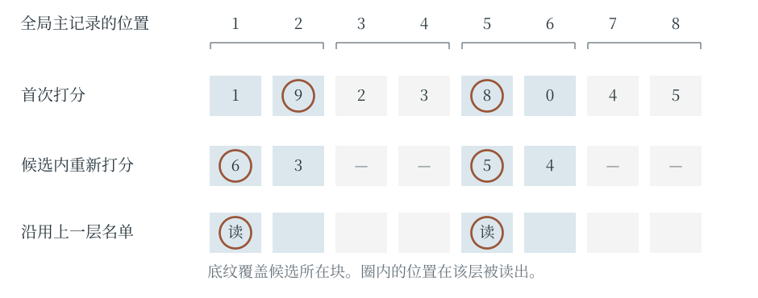

*图 5-19　格子里是索引打分。青色底纹标出传给下一层的候选范围，红圈标出本层读的两条主缓存。第二行的短横线表示这个位置根本没有打分。第三行沿用圈出的位置。*

假定第二层若能看全八条，会给出 $`6,3,10,1,5,4,0,2`$。在四个允许位置中，它实际选的是 1、5 号。倘若能全范围搜索，它会选 3、1 号。3 号早已随整个块被排除，第二层再强也无法在候选内将它找回。第三层直接拿 1、5 号做注意力，连第二次排序也省下。这里一共做 $`8+4+0=12`$ 次索引打分。若三层各自扫八条，会做 24 次。两种安排仍各有三次注意力，每次读两条选中的主记录。同一份缓存省的是常驻空间，再次计算候选花的是索引时间，而遗漏高分项的风险源自选块。

论文在解码器中让第一个 Full 层建立候选池。其示例从 2,048 个块、每块 8 个位置组成最多 16,384 个候选，后续重新索引的层可在这个范围内选 Top-512。第一层仍需扫描可见范围。候选限制也进入训练，让模型有机会学会在限制内检索。在自己的长文任务上验证时，可以分别测新查询给全局历史打分的次数、缓存高水位、长距离证据的命中率，再检查最终答案是否正确。图 5-19 的整数刻意构造了一次漏选，未使用该模型的参数或实测输出。 [逐位置复算程序](../../experiments/ch05/trace_attention.py)

### 压缩历史的可见范围

共享整份缓存之外，还可以压缩较远的历史、保留最近的原始记录。两路数据何时可见，需要先在时间轴上说清。设一种教学压缩器每 4 个位置做完才发布一条摘要，另有包含当前输入的最近 3 个位置可直接读取。位置从 0 开始，处理完位置 9 时，已发布的只有 [0,3] 和 [4,7] 两块，当前窗口是 [7,9]。8、9 仍属未完成块，不能让位置 9 提前读到包含 10、11 的摘要。位置 7 同时出现在原始窗口和一条摘要的覆盖区；若设计要求两路不重复计权，应规定是过滤重叠的块、屏蔽重叠位置，还是在模型训练时就使用这种重叠。三种定义可能给出不同输出。计算 KV 容量时应同时列出已发布的压缩历史、当前窗口和生成下一摘要所需的临时状态，只有明确共享同一份数据时才能扣除重叠的存储。

### 参数表与请求上下文

文本中有些词元组合反复出现。模型可以每次通过多层计算提取这些组合的特征，也可以根据最近几个词元的编号查询一张可训练的表，再将查到的向量与当前隐藏状态结合。Engram 属于后一种设计。词组合决定去哪里读，隐藏状态可以影响读到的内容怎样参与这一层。表随训练而改变，冻结模型提供服务时，本次请求里的新事实不会自动写入这张参数表。[Engram 条件记忆论文](https://arxiv.org/abs/2601.07372)

画一张只有五行的小表。把相邻两个编号 $`u,v`$ 映到 $`h=(2u+v)\bmod5`$。词元 1、3、2、1 产生三个相邻对，它们依次读第 0、3、0 行。最后一个组合 $`(2,1)`$ 和第一个 $`(1,3)`$ 撞到了同一行。如果它们该产生不同的意思，单靠这个地址无法判别。实际设计可用多组哈希、多个阶数和上下文门控增加区分能力。这个四词元例只保留一次查表，方便读者追踪字节。

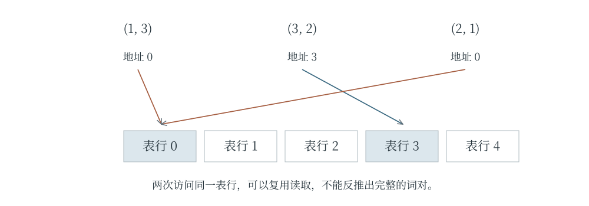

*图 5-20　沿地址 0 读两次。训练学得的同一行可供任意请求查找，而这一行无法表明两个组合中的哪一个刚在当前请求里出现。*

若表有 $`2^{24}`$ 行，每行 128 个 BF16 分量，参数载荷为 4 GiB。三个词对共请求 $`3\times256=768`$ B；若首行在第三次读取时还留在近端，远端只需提供两个不同的行，即 512 B 有用载荷。映射表、传输粒度和缓存行填充另计。由于地址依赖输入编号，可以在含有该词元的前序层开始执行时预取。假设查一行从发起到可用需 18 µs，消费者之前有 12 µs 可重叠的计算，孤立一次命中远端的额外等待仍至少有 6 µs；并发请求挤满传输队列时，还要加排队。生成的下一个词尚未选出之前，它所决定的地址也还未知。

若问题要求指出“这条记录在本次对话中首次出现的位置”，就必须保存本次请求的信息。常见词组合的参数表不会随请求写入，无法独立回答；逐位置注意力能回查当时的键与值，递归状态则要在读过那句话时把线索编码进有限个分量。三种机制可以同层或跨层并用。部署混合模型时，分别列出跨请求共享的参数表、随请求长度增长的缓存、随请求数增长的递归状态，才能决定究竟该扩哪一层存储。

### 分叉生成与前缀共享

两个回答共享已经处理的 100 个位置，各自又写入 4 个。若每个位置的 KV 占 2 KiB，简单复制整段历史要 $`2\times104\times2=416`$ KiB；允许按位置共享不可变的前缀，只需 $`(100+4+4)\times2=216`$ KiB。这里按有效位置计算；实际按整页分配时还会有页尾空位。每个分支可用自己的后缀查旧的键和值，共享缓存必须保留到最后一个使用它的分支也不再需要它为止。

把历史换成一张会被更新的递归状态，分叉的代价变了。设一维状态当前为 3，两个候选各要求“旧状态乘 2，再加 1 或 4”。它们各自应得到 7 和 10。若两条路径原地共用唯一的状态，后者可能算出 $`2\times7+4=18`$。分叉时可以留住旧状态并各自写新值，也可以保存一个检查点、以后重放其中一路。前者多占状态空间，后者多算若干步。第十九章对共享页做引用计数，第二十章对落选草稿撤销状态，处理的是这个分叉在不同运行时中的后果。

### 用检索任务检验有限状态

把长文检索缩成一道小题。先让模型依次读取三个编号各自对应的二进制值，读完后再指定一个编号，要求返回对应的值。若要求对任何赋值、任何查询编号都能精确回答，有 $`2^3=8`$ 种历史需要区分。假设读完后唯一留下的是两位状态，它只有 4 种取值。至少两段不同历史会落在同一状态；选择它们取值不同的那个编号再查询，模型面对同一状态和同一问题，只能给出同一个答案，至少错一次。这项论证不依赖用什么公式更新状态。

也可以手算一种具体的失败。令状态只保留“前两位异或、第三位”，则 001 和 111 都留下 01。问第三位时它两次都答对，问第一位就无法兼顾。这解释了为什么只做一种检索测试容易高估记忆能力。推广到 $`n`$ 枚独立比特，要求所有位置零错误时，保留状态至少要能区分 $`2^n`$ 种可能。实际用有限精度存储；若另有外部 KV 或索引，外部状态也要计入；若数据有关联或任务允许错误，则这个最坏情况不直接给出平均效果。

把这道题做成完整的测试集，还能数出表面上看不见的偏差。八种三位历史各问三个编号，恰好 24 道题。如果只问第三位，保留“前两位异或、第三位”的方案会八题全对。改问第一位，对每个两位状态，都有两个可能的历史，其第一位恰好相反；每个状态最多答对一次，总共只能答对四题。第二位同理。于是模型在均匀测试集上的最优成绩是 $`(4+4+8)/24=2/3`$，而只测第三位却会报出满分。这里量的是这套编码在指定查询分布下的能力。做长文检索实验时，把证据分散到不同位置并分开报分，才能看出这种偏向。

稀疏读取提供的是另一种交换。把三枚比特保存在原处，查询告诉我们该读哪一项，一次就够；若查询只给语义线索，定位到正确记录本身就有成本。递归状态可能把两段历史写成同一个状态，稀疏读取可能仍留着答案却没选到。可以用同一组反事实输入做诊断：只翻转某一个位置，依次观察递归终态是否可区分、索引候选是否包含该位置、强制读入正确块后答案能否恢复。这三个观察对应写入、寻找、使用三处不同的失败。

### 在同一任务上比较历史表示

某个服务允许提交 128K 个词元，只能说明输入格式与资源限制允许这个长度。要判断模型是否利用了远端内容，还要看位置表示、训练分布以及任务本身。

例如 RoPE 在更大位置处仍能算出三角函数，但这不保证模型学会了相应距离上的匹配关系。改变位置尺度可以让角度变化更慢，同时也会改变近距离分辨方式。模型需要相应训练与验证，不能仅修改一个最大长度配置，就认定长期检索能力随之得到保证。

类似地，把窗口调宽可能改善远端直接访问，但增加成本；把递归状态做宽可能减少某些碰撞，但增加每步工作；增加候选数量可能提高稀疏选择覆盖率，却使它逐渐接近完整读取。每个调整都应回到同一任务与同一资源口径上比较。

本章的手算历史已经提供了几种不同测试：

| 任务要求 | 需要检查的问题 |
|---|---|
| 找到很久以前的一条记录 | 它还被保存吗，当前选择器能找到吗，位置关系是否可辨认？ |
| 读出同一项目的最新值 | 新旧记录是否被区分，更新会不会只是把它们平均？ |
| 回答旧值后来改了几次 | 覆盖式状态是否保留了修改过程？ |
| 同时结合多处证据 | 候选预算是否容得下多条相关记录，汇总是否保留它们之间的区别？ |
| 在许多相似键中精确检索 | 低维表示或有限状态中是否发生了干扰与碰撞？ |

因此，只做一条记录的简单检索，还不足以证明模型掌握了全部长上下文能力。应改变记录位置、干扰数量、相似程度、修改次数和需要同时读取的条目数。在实际应用里，还要检查回答是否引用了正确证据，而不仅仅是生成了看起来合理的文字。

性能比较也要匹配输入长度、输出长度、并发、精度与质量要求。一次长提示后只生成几个词，与长提示后持续生成几千个词，可能偏好不同设计；输入侧的分块效率与输出侧反复读取的收益，权重并不一样。

表中的要求还需要落实到模型的最终输出上。线上回答变了，怎样查清变化来自“没找到要读的记录”，还是“读到了，后面的决策仍然变了”？沿用 5.4 节的八条历史，假定阅读器将注意力输出 $`o`$ 交给二分类头，两个分数取 $`o-c`$ 和 0。前一项较大就选甲，后一项较大就选乙。令 $`c=6`$，完整读取给出 $`84/17-6=-18/17`$，选乙。改用三个分数最高的位置以后，阅读器仍然看见最重要的远端记录，分差却变成 $`7-6=1`$，改选甲。仅检查“证据有没有进入候选”会让这次回归漏过去。同一组输出若用于 $`c=8`$ 的决策，二者都会选乙。此时完整读出的分差绝对值为 $`52/17`$，比读出向量的实际变化 $`35/17`$ 更大。

这个比较可以推广到一个线性输出头。令两候选的分差为 $`m=w^\mathsf{T}o+b`$。读出若变化 $`e`$，分差只移动 $`w^\mathsf{T}e`$。因此当 $`|m|\gt \|w\|_2\|e\|_2`$ 时，决策一定保留。靠近分界的请求更容易因同样的数值扰动改答。多层网络还会经过其他层，实际诊断时可在一批固定提示上做三次前向：先用完整读取留下基准，再给受测层强制送入基准打分最高的若干位置，最后改用服务自己的索引挑出同样多的位置。每次从相同权重、输入和历史起步，记录候选编号、遗漏的概率质量、最终两个答案的分差，并分别记下索引与主体读取的用时。第一次到第二次观察截断对答案的影响，第二次到第三次观察选择器额外引入的变化。完整读取与基准排名在这项离线诊断里也要花算力。通过比较三份记录，可以判断扩大候选范围、改进索引或增加后续网络计算是否值得。

还要单独排除位置表示的影响。即使保留所有候选，扩展位置范围本身也可能改变注意力分数。沿用第四章的旋转定义，只看一对分量，令查询和键在旋转前都是 $`(1,0)`$，频率为每位置 $`\pi/2`$。相距 $`\delta`$ 的两个位置，其旋转后内积就是 $`\cos(\delta\pi/2)`$。若训练用过位置 0 到 3，而现在想处理位置 0 到 6，一种位置插值办法是把新位置 $`p`$ 送成 $`p/2`$。两端的距离在旋转坐标里又落回 3，邻居之间的距离也同时变成 $`1/2`$。原来相邻两项的内积为 0，现在为 $`\cos(\pi/4)\approx0.707`$。同一对权重面对相邻词时就会产生不同的分数。一个频率还会周期性重合，真实模型使用多组频率，不能从这一个数判断整网是否合用。

把词元位置压回旧范围是一个模型改动，可以用较长样本继续训练适应它。验证时可固定总长度，把同一条证据依次放在开头、中间和末尾，再把干扰项从远处移到证据旁边。远端找回、近邻分辨和短提示质量应分别记分。内存方面，仍按实际的 7 个位置写缓存，不会因为送给旋转函数的最大坐标只有 3 就只存四行。若历史键已经按旧的旋转配置缓存，切换配置后也要使键与新查询使用相容的位置表示。[位置插值论文](https://arxiv.org/abs/2306.15595)

第一篇讨论了模型的学习和执行：训练调整参数，计算产生激活，连续请求还需要维护状态。历史的表示方式决定了计算、数据搬运和存储的需求。下一章从这些工作出发，讨论 CPU 与 GPU 的执行方式和并行条件。

## 练习与解答

### 1. 缓存减半了，注意力计算也减半了吗

沿用 32 层、32 查询头、每头 128 维、每元素 2 字节的例子，把 KV 头数由 8 改为 4。求每位置缓存及 128K 历史的总容量。若仍做完整历史注意力，查询与历史配对的主要计算是否减半？

**解答。** 每位置为 $`2\times32\times4\times128\times2=65536`$ 字节，即 64 KiB；128K 历史为 8 GiB。缓存减半，K/V 投影规模也减小，但查询头仍有 32 个，每个头仍计算自己的权重和输出。因此这部分约为 $`4LH_qd_hT`$ 的工作不会仅因 KV 头数减半而减半。真实流量还取决于共享 K、V 是否被充分复用。

### 2. MLA 追加一个位置以后，还能用吸收路径吗

对第 0 头，在三条潜在表示后追加 $`c_3=(2,0)`$。查询、上投影与分数尺度都保持本章设定。求四个权重、潜在加权结果与最终输出。

**解答。** 四个分数为 $`(\ln2,0,\ln2,2\ln2)`$，指数为 $`(2,1,2,4)`$，权重为 $`(2/9,1/9,2/9,4/9)`$。潜在加权结果为

```math
\begin{aligned}
r&=\tfrac29(1,0)+\tfrac19(0,1)\\[0pt]
&\quad+\tfrac29(1,1)+\tfrac49(2,0)\\[0pt]
&=(4/3,1/3).
\end{aligned}
```

乘 $`U_V^{(0)}=\mathrm{diag}(2,4)`$ 得到 $`(8/3,4/3)`$。若先展开第四个值为 $`(4,0)`$ 再做加权，得到相同结果。新位置只增加一行潜在缓存，没有破坏固定线性变换的结合律。

### 3. 保留最高三项，为什么还会改变结果

使用八位置稀疏例子。保留 $`\{1,6,7\}`$ 时，求遗漏质量、实际输出误差及利用值范围得到的误差上界。若一次读入位置 $`\{0,1,6,7\}`$，输出是多少？

**解答。** 保留质量为 $`12/17`$，遗漏质量为 $`5/17`$。稀疏输出为 7，完整输出为 $`84/17`$，误差为 $`35/17\approx2.0588`$。值在 0 到 10 之间，故误差上界为 $`50/17\approx2.9412`$。多读位置 0 后，分子仍为 84，分母变为 13，输出为 $`84/13\approx6.4615`$。即使新增位置的值是零，也会通过分母改变输出。

### 4. 找到一次无法恢复的状态碰撞

保留本章三行 K，比较 $`V_A=[(2,0),(4,0),(6,0)]`$ 与 $`V_B=[(3,0),(5,0),(5,0)]`$。证明两者形成相同的归一化线性状态，并说明只依赖该状态的后续查询能否区分它们。

**解答。** 第一状态行分别为 $`(2+6,0)`$、$`(3+5,0)`$，都等于 $`(8,0)`$；第二行分别为 $`(4+6,0)`$、$`(5+5,0)`$，都等于 $`(10,0)`$。归一化向量都为 $`(2,2)`$。对任意分母为正的 q，$`qS/(qz^{\mathsf T})`$ 完全相同，因此任何只使用该状态的读取都无法区分。需要区分时，必须改变状态表示、保存额外信息或保留逐位置访问路径；换一个查询向量本身不能把已经丢失的区别找回来。

### 5. 纠正四分之一，究竟改变了哪些方向

旧状态 $`S=(2,4)^{\mathsf T}`$，键 $`k=(1,0)`$，新值为 6，取 $`\beta=1/4`$、无衰减。求新状态，以及两个坐标查询的读取结果。如果以后问第一类项目的最初值，仅凭新状态是否足够？

**解答。** 旧预测为 2，残差为 4，实际写入为 $`(1,0)^{\mathsf T}`$，所以新状态是 $`(3,4)^{\mathsf T}`$。两个坐标查询分别读出 3、4。第一个结果是向新值移动四分之一，并不是旧值或新值的完整记录。一般不能仅凭这个状态恢复最初值，因为不同旧值、更新目标与更新序列可能产生同一状态；若额外保存完整更新信息，那已经引入了题目之外的历史。

### 6. 固定状态一定更省吗，分块时又能否直接用最终状态

在本章容量设定下，比较 32 层全 GQA、32 层全递归、24 层递归加 8 层 GQA，在 512 和 4096 个位置时的状态容量。再解释：能否为了并行，直接用完整三条记录的最终线性状态，计算第 0 个位置的输出？

**解答。** 每个递归层为 2 MiB，32 层为 64 MiB。每个 GQA 层每位置为 4 KiB，因此在 512 个位置时每层也是 2 MiB，三种组织都是 64 MiB。在 4096 个位置时，全 GQA 为 512 MiB，全递归为 64 MiB，混合为 $`24\times2+8\times16=176`$ MiB。这只是所定义的状态容量，不代表质量或运行时间相同。

不能让早期位置直接读取最终状态。本章第 0 个位置若查询 $`(1,0)`$，正确前缀状态只包含第一条记录，应输出 $`(2,0)`$；三条记录汇总后的状态却输出 $`(2,2)`$，其中第二分量来自未来记录。分块执行必须保留块内因果掩码，并区分块前状态与块后状态。

## 复算与延伸阅读

在项目根目录运行 `python experiments/ch05/verify.py`，可用 Python 标准库复算章中的四段代码和六道题。[程序](../../experiments/ch05/verify.py)还会更换输入形状，将逐位置、逐步和分块三种结果相互对照，并用有限差分检查状态更新的梯度。[算例数据](../../experiments/ch05/cases.json)

进一步阅读可按机制选取 [GQA](https://arxiv.org/abs/2305.13245)、[MLA](https://arxiv.org/abs/2405.04434)、[NSA](https://arxiv.org/abs/2502.11089)、[DSA](https://arxiv.org/abs/2512.02556)、[Linear Transformer](https://proceedings.mlr.press/v119/katharopoulos20a.html)、[Gated DeltaNet](https://arxiv.org/abs/2412.06464)、[KDA](https://arxiv.org/abs/2510.26692)和 [Mamba](https://arxiv.org/abs/2312.00752)的原始资料。组合案例核验至 2026 年 11 月 12 日，采用 [DeepSeek-V4.1-Flash 报告 v1](https://arxiv.org/html/2609.19969v1)讨论机制，不把其中特定实验的收益推广为所有负载的结论。

[全书目录](../../README.md) · [上一章 · 一个 Transformer 的两种运行方式](ch04.md) · [下一章 · 从 CPU 到 GPU：怎样让许多计算同时进行](ch06.md)
