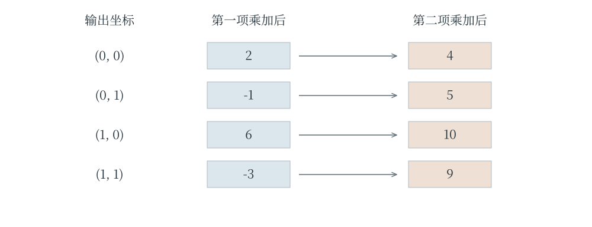
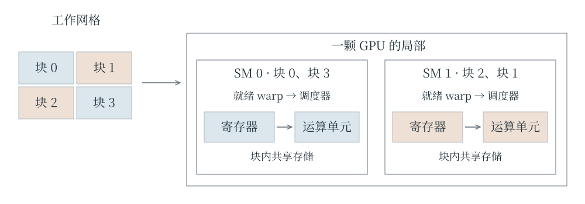
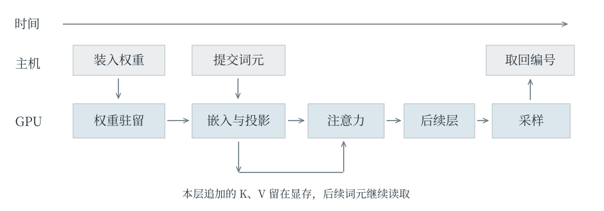
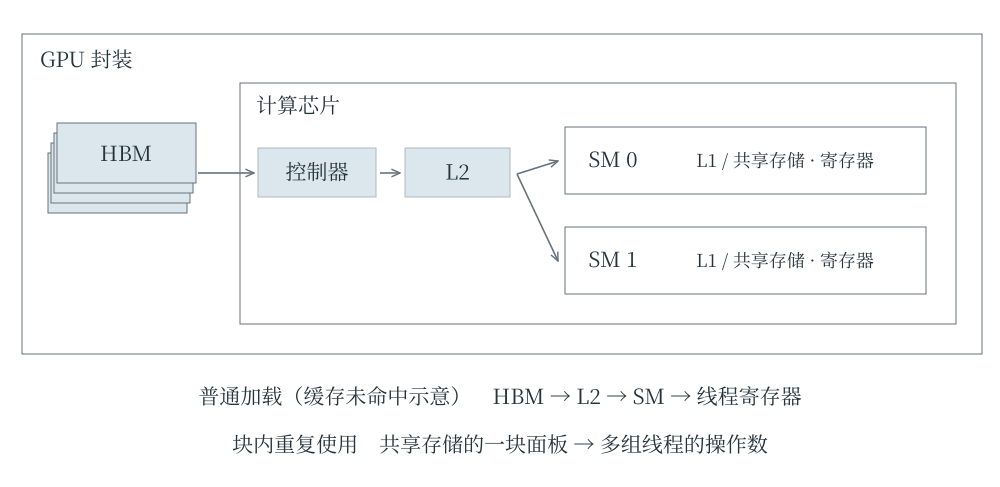
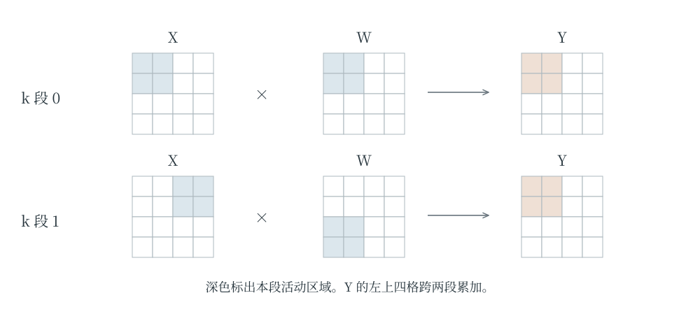

# 第 6 章　GPU 体系结构与一次前向计算

模型已经装进显存。用户多输入一个词，程序要把这个词的表示乘上一张权重矩阵。CPU 可以用两层循环挑出每个输出，再用一层循环算内积。换成 GPU，模型还是同一个模型，权重里的每个数也一样。究竟是哪一部分工作可以同时做？同一个权重用第二次时，机器还要再去显存取吗？沿一次投影走一遍，就能把这两个问题分开看清楚。

## 6.1　从四个输出找到并行的工作

设输入有两个词元，每个词元用两个特征表示。第一行是 $`(1,2)`$，第二行是 $`(3,4)`$。权重的两列分别是 $`(2,1)`$ 和 $`(-1,3)`$。算第一行的第一个输出，先取 $`1\times2=2`$，再加 $`2\times1`$，结果是 4。同一行的第二个输出用同一对输入，先得 $`1\times(-1)=-1`$，再加 $`2\times3`$，结果是 5。

```math
XW=
\begin{bmatrix}1&2\\3&4\end{bmatrix}
\begin{bmatrix}2&-1\\1&3\end{bmatrix}
=\begin{bmatrix}4&5\\10&9\end{bmatrix}.
```

每个输出内部的第二次累加要等第一次的部分和。四个输出之间却没有先后关系。只要各自有地方保存部分和，就可以同时求第一项，再同时求第二项。图 6-1 里有四条独立的计算路径。把矩阵放大到几千行、几千列，同一种乘加就有了足够多的同伴。GPU 把很大一部分芯片面积交给成组的运算单元，让它们同时处理这些数据。若程序要根据刚读出的地址才能找到下一项，例如沿着一条单链表查找，同样的硬件也很难凭空找出几千个可以一起做的步骤。



*图 6-1　横着读一行，能看到相依的两步。竖着读同一列，四个位置可以分别计算。相邻两行反复出现的输入，稍后还可以共用。*

## 6.2　把工作交给 SM

CPU 负责准备输入、选择算子，并把一段要在 GPU 上执行的程序提交给设备。这样的一段程序叫**内核**（kernel）。一次启动可以产生很多线程（thread）。可以先把线程理解成“带着自己编号执行这段程序的一份工作”。让线程按编号取得输出的行列，它就知道该算哪一格。编号决定它负责的数据，硬件决定什么时候轮到它执行。

在 NVIDIA 的执行模型中，程序把一批线程组成**线程块**（block），同一次启动的所有块组成网格（grid）。一个普通线程块在一个**流式多处理器**（SM）上执行。只要寄存器、共享内存和线程位置够用，一个 SM 可以同时接纳几个块。一个块里的线程再按连续编号每 32 个组成一组，叫 **warp**。SM 的调度器从已经就绪的 warp 中选出可发射的指令。一次发射让这组中参与的线程各用自己的操作数执行该指令。如果一个 warp 的下一条指令需要尚未从显存返回的数据，调度器可以先选另一个就绪的 warp。[CUDA 执行模型与硬件多线程](https://docs.nvidia.com/cuda/cuda-programming-guide/03-advanced/advanced-kernel-programming.html)



*图 6-2　沿箭头把一个块放进一个 SM，再在 SM 里找它的 warp。图示画了一种可能的分配。应用可以依靠同一块内的协作关系，块分给哪个 SM 则由设备安排。*

用一个边界例子检查这几层分工。70 个数都要加 1，每个块开 64 个线程，启动两个块。第一个块的两个 warp 各算满 32 个数。第二个块的第一个 warp 只有 6 个编号落在数组内，另一个 warp 全部越界。程序用一次范围判断保护访问。若一组内的线程走两个不同的条件分支，硬件要为各条路径安排指令，只让相应的通道生效。程序有 128 个线程位置，并不等于每条指令都有 128 个有效结果。

让更多 warp 随时可运行还要付出存储代价。例如教学 SM 有 65,536 个 32 位寄存器，一个块有 256 个线程，每线程用 64 个寄存器，一个块就占 16,384 个，单看这一项可容纳四块。若每线程改用 65 个，单块需 16,640 个，按这个简单预算只够三块。真实芯片还按硬件粒度分配寄存器，并有线程、块数和共享内存等上限。程序有时值得多用几个寄存器，把重复使用的数留在手边。要观察的是少掉的取数时间能否补回可运行 warp 减少的损失。

## 6.3　一层 Transformer 的数据放在哪里

先把时间拉长。服务启动时，主机通常把一层层权重装进设备显存。请求到来以后，CPU 提交词元编号等输入，GPU 查嵌入表得到隐藏向量。接着做归一化、Q/K/V 投影、注意力和输出投影，再经过残差连接与前馈网络。一次前向可能启动许多内核。相邻内核在同一设备流中按依赖执行，上一项留在显存的输出可由下一项直接接着读。到了最后，若在设备上完成采样，主机只需取回选中的词元编号。若调用者要求完整的词表分数，回传量会截然不同。



*图 6-3　上行是主机，下行是 GPU。装模型时跨接口的是权重；处理这一条请求时，投影结果和历史 KV 可以留在设备端。图中一次箭头可代表多个内核，具体实现还可以融合相邻运算。*

现在把目光缩到做投影的一个 SM。**HBM**（高带宽内存）是封装中靠近计算芯片的一组堆叠 DRAM，容量足以保存许多层权重，也是多个内核可以共同访问的设备全局存储的常见后备。**L2 缓存**由多个 SM 共享，保存近期访问的数据。靠近每个 SM 的 **L1 缓存**服务一部分局部访问，哪些加载可以经过它取决于架构和指令。L1、L2 里的副本由硬件依访问情况保留和替换。

**共享内存**（shared memory）同样在片上，但由程序为线程块预留空间，指定哪一块数据要放进去、什么时候重用。即使一些芯片让 L1 和共享内存共用片上资源，这两种使用方式仍然不同。**寄存器**保存正在执行的线程所需的操作数、地址和部分和，通常只在内核的这次执行中有效。寄存器放不下的值可能被编译器写入有设备内存作为后备的局部地址空间，重新带来加载和存储。[CUDA 存储层次与数据访问](https://docs.nvidia.com/cuda/archive/12.6.3/cuda-c-programming-guide/index.html#memory-hierarchy)

同一块权重因此可以同时有几个身份。它的长期副本在 HBM，一个刚被相邻块读过的片段可能还在 L2，当前块明确要共用的片段可以驻留共享内存，正在相乘的几个数则已经到了运算单元附近。下面画的是一条典型取数路径。普通加载可以把数据直接送给线程，程序也可以显式把一块面板搬到共享内存，并非每个字都必须走过图上的全部层次。



*图 6-4　沿 HBM 到 SM 追一次冷读取，再从共享内存动身追第二次使用。两次乘加可以拿到同一个数，而 HBM 接口只见到其中一次取数。*

## 6.4　矩阵单元怎样用好取来的一块数据

把前面的小题放大成两个 $`4\times4`$ 的 FP32 矩阵相乘，每个数占 4 字节。16 个输出各做 4 次乘加，共 64 次。我们在输入进入可复用存储以及最终输出写回时数有效字节。假设输入起初都在边界外，不计缓存命中和传输凑整。每格自己去取 4 对数，就读了 $`16\times8=128`$ 个输入字，再写 16 个输出字，共 **576 字节**。

换个分工。让一个块负责相邻的 $`2\times2`$ 个输出，沿内积每次推进两项。图 6-5 第一行只需取 $`X`$ 的左上角 4 个字和 $`W`$ 的左上角 4 个字。四个输出都能从这两片数据取到自己要的数。第二行再各取 4 个，接着累加。每个输出块共读 16 字，四个块合计读 64 字，最后仍写 16 字，共 **320 字节**。若两张完整输入都能留到最后一次使用，只需读 $`16+16`$ 字、写 16 字，共 **192 字节**。三种分工做了相同的 64 次乘加。省下的是同一个值多次越过所选边界的传输。



*图 6-5　只看输出左上角那四格。上、下两行取不同的输入面板，四个部分和一直留下。换到相邻的输出块，有些输入还会重复使用。*

搬得少，还要搬得顺。假设一个 warp 的 32 个线程各读一个连续且对齐的 4 字节数，按 32 字节区段计，要访问 4 段。若每个线程改为隔 8 个数取一个，同样的 128 字节有效载荷就分散在 32 段。一次加载要服务更多区段，缓存命中还会影响其中多少流量最终到达 HBM。进了共享内存也有同类问题。以 32 个存储体（bank）、连续 32 位字轮流分配的模型为例，行长 32 字的矩阵按列读，不同地址会同时挤到同一 bank。若给每行末尾补一个字，再沿原来那一列读，从一行走到下一行，地址就前进 33 个字，对应的 bank 编号也前进一位。这样的填充占用更多空间，却能让这些读取并行完成。读同一地址时硬件可能广播，和争用同一 bank 的不同地址要分开。[CUDA 合并访问与共享内存](https://docs.nvidia.com/cuda/cuda-c-best-practices-guide/index.html#memory-optimizations)

数据到齐以后，有两类工作可做。通用运算通道能分别执行乘法、比较、索引等指令。**Tensor Core** 则专门把小矩阵的乘积累加到另一块矩阵，数学上是 $`D=AB+C`$。仍看 6.1 节的例子，先把 $`X`$ 的第一列与 $`W`$ 的第一行相乘，一次得到四个输出的第一项。保持这四个部分和，再换第二列与第二行求和。图 6-6 解释的是为什么一组输入可同时更新一块输出。实际指令一次处理的形状、数据分布和协作线程数要由具体架构决定。例如 Ampere 上一类由 warp 协作的 `mma.sync` 指令，其 `m16n8k16` 表示更新 16 行、8 列输出，内积前进 16 项。单条指令表达 2,048 次标量乘加，发射到结果可用还要经过硬件流水。[PTX 矩阵乘加与操作数片段](https://docs.nvidia.com/cuda/parallel-thread-execution/index.html#warp-level-matrix-instructions-mma)


*图 6-6　面板里的一个输入能供多个乘法使用，累加器又能把多项合成一次写回。两种复用发生在乘法的两侧。*

## 6.5　什么时候还得向 CPU 要数据

权重可以跨请求留在显存。注意力的键和值则是每条请求自己的历史，要留到后续生成步骤用完。第五章的算例中，这段 KV Cache 占 16 GiB。若一次生成必须把它全部读一遍，按 3 TB/s 的有效 HBM 带宽，读取本身约需 5.73 毫秒。若为给其他请求腾空间，把历史放到主机，下次计算前再整份拷回，按 32 GB/s 的单向有效链路带宽，仅拷回这一步就多出约 537 毫秒。若算法这次只用连续的六十四分之一，传 256 MiB 约需 8.39 毫秒。离散地挑同样数目的词元，可能触及更多传输页。这里把实际要过接口的字节除以带宽，才得到需要付的时间。

主机和 GPU 可以使用统一虚拟地址，但指针不告诉人数据靠近哪一端。地址翻译缓存（TLB）没找到映射时，设备可能查完页表就读到本地显存；若物理页仍在主机，还要看系统支持远程访问还是迁移。显式复制常使用页锁定的主机缓冲，让设备的 DMA 引擎直接搬运。异步提交返回后，还要等完成事件再覆盖这块输入。跨处理器共享可见的数据也需要正确的交接顺序。例如先写结果，再用覆盖双方的 release 操作发布标志，读方以 acquire 读到这次发布后才去取结果。缓存一致性支持与程序的同步各管其中一件事。[CUDA 统一内存](https://docs.nvidia.com/cuda/cuda-programming-guide/04-special-topics/unified-memory.html) [CUDA 主机与设备传输](https://docs.nvidia.com/cuda/cuda-c-best-practices-guide/index.html#data-transfer-between-host-and-device)

至此，一次前向有了具体的样子。GPU 能同时算许多格输出，片上的局部存储又让这些格共用输入。矩阵单元越快，按时把下一块输入送到它面前就越困难。下一章从最早的统一处理器走到今天的 GPU 机柜，看看这件事怎样一次次改变硬件本身。

## 练习与解答

### 1. 同一行的两个输出能共用哪些数

仍做 6.4 节的 FP32 矩阵乘法。一个块只负责同一行上相邻的两个输出，整个内积期间只让这两格共用左矩阵的那一行。按相同计数边界，共传多少字节？

**解答。** 每对输出读左侧一行的 4 个字、右侧两列的 8 个字，写 2 个字。全题有 8 对，共 $`8\times(4+8+2)\times4=448`$ 字节。相对 576 字节少的 128 字节，是每对输出少读一次左行的 4 个字。

### 2. 哪项资源限制在途的工作

一个教学 SM 有 65,536 个寄存器和 64 KiB 共享内存。每块 256 个线程，每线程 64 个寄存器，每块用 24 KiB 共享内存，忽略其他限制。把每线程寄存器减半，能多放一块吗？

**解答。** 寄存器最初允许 4 块，共享内存只允许 2 块，实际最多 2 块。寄存器减半后仍受共享内存限制。若能在不增加其他开销的条件下把每块共享内存改为 16 KiB，原寄存器配置也已经足够放 4 块。

### 3. 十二毫秒能取回多少历史

链路的有效带宽为 32 GB/s，一次生成步骤给传输留了 12 毫秒，每页 64 KiB，只能整页搬运。6,000 个不同的远端页赶得上吗？

**解答。** 预算是 384,000,000 字节，最多 5,859 个完整页。6,000 页共 393,216,000 字节，需要 12.288 毫秒，尚未计其他等待。若多次访问落在同一页，决定搬运量的是要取回的不同页数。

[本篇算例的 Python 复算程序](../../experiments/part02/verify.py)

[全书目录](../../README.md) · [上一章 · 长上下文与模型记忆](ch05.md) · [下一章 · GPU 硬件演进与系统互联](ch07.md)
