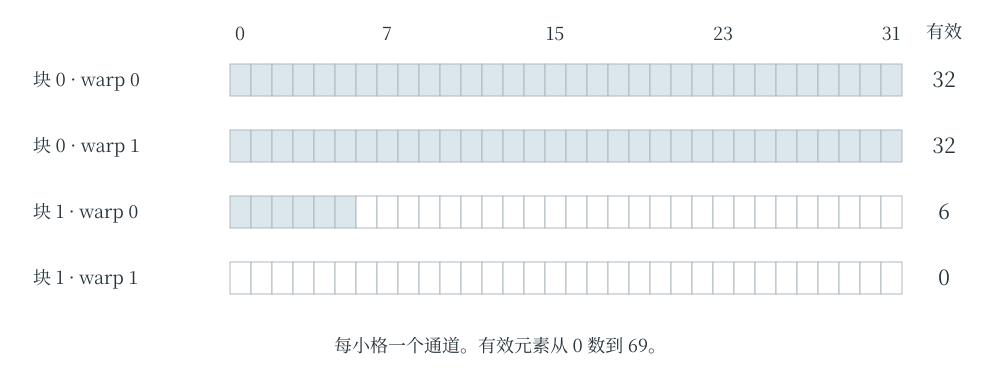
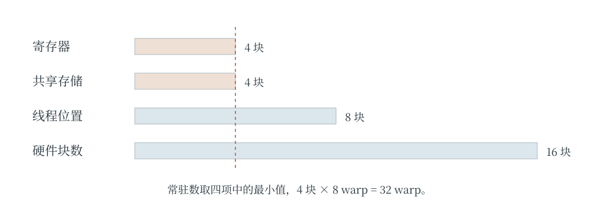
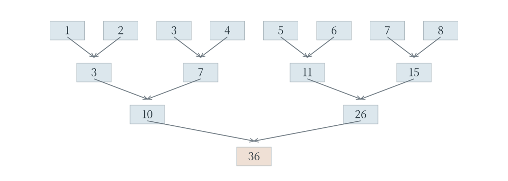
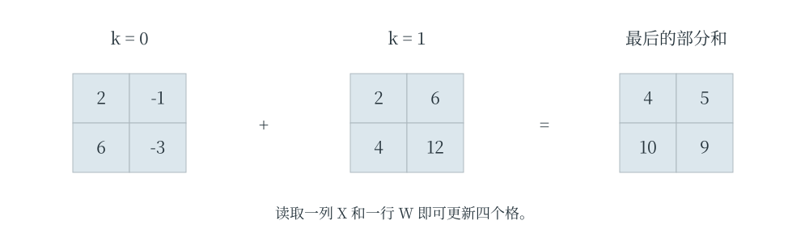

# 第 6 章　GPU 的由来与执行结构

输入“我爱”，屏幕上接着出现了“你”。第四章把这个过程写成了一串矩阵运算。现在看机器：开始计算前，模型权重已经放在设备可访问的内存里。主机上的程序把文字切成词元，准备好编号，请设备执行模型。设备按编号取出嵌入向量。经过各层的投影、注意力和前馈网络，最后一个位置的向量被变换为一列词表分数。按选定的规则挑出编号，把它还原成文字，用户才看到“你”。生成如果继续，新编号和各层已经保存的键、值一起参与下一步。实际系统可以在设备端挑词，只把选中的编号传回主机。

假定分词器像第四章那样让“我”和“爱”各占一个位置。预填充时，这两个位置能同时做投影，每一层都会留下两行键和值；因果掩码保证第一行看不到第二行。取最后一行的词表分数选出“你”时，缓存里还是两行。等“你”进入下一次前向，查询投影只接到一个新位置，各层要写入第三行键、值，并用新查询读取可见的历史。权重仍驻留在设备上。每次都要用权重，不等于每次都要从主机重新发送它；接下来要追的是芯片从设备内存取它的那段路。

先看第五章读取历史键、值之前的那次查询投影。一行输入是一个词元的表示；一列权重告诉模型，怎样把这一行的特征组合成一个新数。训练时，同一批里的许多词元各占一行，几行可以共用这一列权重，同时算出各自的内积。把各行对各列的结果排起来，就得到了矩阵乘法的输出。工程文档常写 **GEMM**，指通用矩阵乘法，其完整形式允许把乘积乘上系数，再加上另一张带系数的矩阵。这里取最简单的情形。

把输入记作 $`X`$，权重记作 $`W`$，输出为 $`Y=XW`$。缩小到纸面上，三章都使用下面这组数。

```math
X=\begin{bmatrix}1&2\\3&4\end{bmatrix},
\qquad
W=\begin{bmatrix}2&-1\\1&3\end{bmatrix}.
```

第一行可以看成一个词元的两项特征。权重第一列要求把第一项乘 2、第二项乘 1，再求和。第二列的系数为 −1 和 3，因此用第二项的三倍减去第一项。于是第一个词元得到 $`(4,5)`$，第二个得到 $`(10,9)`$。真实模型中下标会大得多，数据依赖仍可在这四个数上看清。

## 6.1　从一个内积看处理器

一次乘法需要两个数。从内存取数、把它们送入运算电路、接住结果，这些动作都占时间。处理器按时钟推进工作，下文的“一拍”就是一个时钟周期。能在每一拍接下一道题的电路，仍可能要好几拍才能交出第一道题的答案。能否找到几道互不依赖的题，决定了电路中途要不要停。

先只算左上角。假设数据已经存好，核心要完成的事情包括取得数的地址、从地址读出数、做乘加、保存结果。一条**指令**约定机器应执行的操作以及从哪里取得操作数。**寄存器**是核心里能被指令直接命名的一小组存储位置。将地址处的数装入寄存器叫加载，将结果从寄存器写到一个地址叫存储。下面用一段简化指令说明这个过程，可以逐步手算检查；两个下标均从 0 开始。

```python
x = [[1, 2], [3, 4]]
w = [[2, -1], [1, 3]]
y = [[0, 0], [0, 0]]
for i in range(2):
    for j in range(2):
        acc = 0
        for k in range(2):
            acc += x[i][k] * w[k][j]
        y[i][j] = acc
assert y == [[4, 5], [10, 9]]
```

执行第一个 `acc += ...`。两个输入只要都准备好，就可以送到乘加单元，计算 $`a\times b+c`$。左上格先从 0 变为 2，再从 2 变为 4。两条乘加若共用这个累加器，第二条必须取得第一条的结果。右上格用自己的累加器，可以同时从 0 变为 $`-1`$。这份独立性在公式里本来就有，写成嵌套循环只规定了一种求值顺序。

把每条乘加当作一个结点，把“后一条要用前一条的结果”画成边。图 6-1 中每行沿水平方向读，竖着看则有四个独立输出。让输入事先就绪，以乘加结果依赖为唯一限制，图里共有八个单位工作，最长依赖链只有两个单位长。若机器每拍能完成两个单位工作，至少需要四拍。若有八个位置可安排工作，仍要等第二层依赖。一般地，若总工作为 $`F`$ 个同价任务，最长依赖链为 $`D`$ 个时隙，每个时隙至多完成 $`p`$ 个任务，完成时间满足

```math
T\geq\max\left(D,\left\lceil F/p\right\rceil\right).
```


*图 6-1　同一行的箭头代表真实的数据依赖。沿着一列能找到四条可同时推进的链，行内的数字是每次乘加后的累加器值。*

### 指令延迟与并行执行

一台现代 CPU 的一个核心内部也有许多个电路可以同时工作。取指与译码把程序变成后端可以处理的操作。加载单元向存储系统发出请求，算术单元处理已经就绪的输入。**流水线**把一项工作拆成连续的阶段，后一项可以在前一项离开某个阶段后进入该阶段。

假设有一条每拍能接收一项乘加、结果在发射后第 4 拍可用的教学流水线。时钟从 0 开始。如果一条链上有八项，最早发射时刻为 $`0,4,\ldots,28`$，最后结果在时刻 32 可用。换成图 6-1 的四条链，每条两项，就能在时刻 0 至 3 依次发射四条链的第一项，再在 4 至 7 发射第二项，最后结果在 11 可用。前后都执行八项，各项的延迟都是四拍，完成时间却差了近三倍。


*图 6-2　格子表示能否开始一条指令。末次发射以后仍要等待结果产生。最后一个格子的位置与最后一个结果可用的时刻之间相差流水线延迟。*

如果只有两条链，每条四项，最早的发射拍号是 $`0,1,4,5,8,9,12,13`$，最后一个结果在第 17 拍就绪。由这三个例子可以反推需要多少独立工作：一条链每四拍才给出一项能发射的指令，若一直有 $`C`$ 条互不依赖的长链，单拍平均可供发射的指令至多为 $`C/4`$。流水线又最多每拍接收一项，所以稳态发射率至多为 $`\min(1,C/4)`$。在这个模型里，四条等长链交错正好能达到每拍一项；链再多也越不过发射端口。八项这样的小任务仍有最后四拍等结果的一段时间，不能用稳态速率直接推断它的完成时间。

一个**乱序执行**核心会检查一小段已进入核心的指令。当前一条由于输入未到而受阻，后面的独立指令有机会先执行。寄存器重命名给独立的临时结果分配不同的物理位置，避免短小的指令编码反复使用同一个名字而平添依赖。最终提交程序可观察的结果时，核心仍遵守其体系结构规定的顺序和内存语义。如果后一条加载的地址本身就来自前一次加载的结果，重命名也推不出地址。数据结构的组织能直接决定核心能看到多少独立工作。

程序还经常要根据输入跳到不同位置。**分支预测**让前端在条件计算完之前沿预测路径取指。预测成功，执行窗口里提前摆好了下一批工作。预测失败，错误路径上的推测结果要被撤销，重新取指花掉的时间进入单次请求延迟。反复取相邻数据则可能让加载命中近处的缓存。CPU 为分支、短依赖链和局部访问花的这些资源，在词元切分、构造请求和不规则索引里都可能用上。[Intel 处理器优化参考资料](https://www.intel.com/content/www/us/en/developer/articles/technical/intel64-and-ia32-architectures-optimization.html)

## 6.2　从画一个像素到计算一个输出元素

早期图形管线把工作分给不同电路：一段处理三角形顶点，另一段为覆盖到的像素计算颜色。两类工作的比例会随画面变化。同样大小的画面，少量大三角形可以覆盖很多像素；许多细小三角形又会给顶点阶段留下大量工作。即使两段都允许程序指定算法，各自固定的一组执行单元仍可能一边排队，另一边空闲。

2006 年推出的 G80 所代表的 Tesla 架构把这些可编程工作交给统一的处理单元。同一批单元可以随负载接不同阶段的线程。图形所需的光栅化等专用电路仍在；被抽出来共用的是可以由指令描述的计算。这个选择也给通用计算留下了入口。把“同一段着色程序作用于不同像素”换成“同一段乘加程序作用于不同输出格”，就能借用这批并行电路。CUDA 让程序员直接描述这些工作项、它们的编号及协作范围。[Tesla 架构设计论文](https://research.nvidia.com/publication/2008-04_nvidia-tesla-unified-graphics-and-computing-architecture)


*图 6-3　每小格表示一个可编程工作项的执行位置。假定每项等长且两类工作都已就绪，固定分区每拍最多服务同类两项。图只比较资源分配，省略真实图形管线的阶段依赖。*

### 一条指令怎样作用于多个输出

对我们的输出按 $`(0,0),(0,1),(1,0),(1,1)`$ 排列，四个累加器在 $`k=0`$ 时分别需要四对数。可以把它们放进有四个位置的向量寄存器，执行一次逐位置乘加。每个位置叫一个通道（lane）。第一步的左操作数为 $`(1,1,3,3)`$，右操作数为 $`(2,-1,2,-1)`$，得到 $`(2,-1,6,-3)`$。第二步改用 $`(2,2,4,4)`$ 和 $`(1,3,1,3)`$，四个通道的结果正好回到 $`(4,5,10,9)`$。

这就是 SIMD 的编程视角，一条指令显式地操作一组元素。上例还暗含了工作。输入中的 1 要送给两个通道，权重中的 2 也要送给两个通道。实现可用广播、重排或合适的内存布局，并要为这些操作支付相应的指令和搬运成本。若数已经按照所需顺序排好，整段读取会更容易。下一章会把这一步按地址计数。

GPU 常见的接口允许写另一种程序，只描述“编号为 $`i,j`$ 的我，怎样算出自己的那一格”。每个执行实例叫一个**线程**，拥有自己的编号、寄存器值和控制状态。大量线程执行相同的程序时，硬件把可共同发射相同指令的线程组织起来，这个执行组织称为 SIMT。程序员在一个线程里可以写标量算式，底层多个通道仍在共同执行工作。矩阵的索引怎样分给线程，决定哪些数会在同一条指令里一起出现。

在 CUDA 的模型中，主机可以启动一次设备函数，这样的一次计算通常称为一个 kernel。一次启动建立一个 grid，其中有许多 **block**。同一 block 内的线程可以用块内共享存储交换数据，并在一个约定的屏障处会合。在常规执行模型下，一个 block 会放在一个流式多处理器（**SM**）上，SM 可以同时容纳多个 block。NVIDIA 将 block 内连续编号的线程以 32 个为一组，称为一个 **warp**。文中的数字 32 专指这里的 warp 宽度。一个 SM 能有多个调度器，每拍能发射的指令又取决于指令种类和架构。[CUDA 编程模型](https://docs.nvidia.com/cuda/cuda-programming-guide/01-introduction/programming-model.html)

### 尾部元素与掩码

为了看清编号，先把输出扩为一条 70 项的向量，每项独立做一次相同的运算。设一个 block 启动 64 个线程，第 $`b`$ 块内编号 $`t`$ 的线程负责全局编号 $`64b+t`$。第一块的两个 warp 处理 0 至 63。第二块里，负责 64 至 69 的六个线程有有效输出，其余线程在边界判断后退出。若只数真正执行该条算术指令的 warp，共三条 warp 指令，有用通道占 $`70/(3\times32)=72.9\%`$。若数整次启动分配的线程，则有 128 个，只有 70 个有输出。两个分母回答不同的工程问题。



*图 6-4　按从左到右的线程编号读。蓝格要写一个有效元素，白格对应越过数组边界的线程。最后一组仍包含在块的线程配置中。*

同一 warp 内部也可能因数据而走向不同路径。设其中 8 个线程要执行昂贵路径上的三条算术指令，另 24 个只执行便宜路径上的一条。在两条路径各自发射、用活跃掩码挑选相应通道的模型中，四次发射提供了 $`4\times32`$ 个通道位置，实际工作为 $`8\times3+24\times1=48`$，利用比例为 37.5%。如果按输入类型把大量元素预先分组，同一 warp 有机会只走一种路径。分组本身要读类别、排列索引、再把结果放回原位置。只有分支节省的时间超过这些附加工作，重排才值得做。

实际短分支有时会被编译成带谓词的指令，只有满足谓词的通道提交结果。较新的 NVIDIA GPU 还维护更细的线程执行状态。对于交换数据的代码，应使用规定的同步原语表达参与者和可见性。靠猜测“邻居应该刚好执行到了这里”会使结果依赖具体调度。[CUDA 并行线程执行规范](https://docs.nvidia.com/cuda/parallel-thread-execution/)

少见的分支也可能占掉许多发射机会。例如平均每 32 个输入只有一个要走慢路。若这些输入独立散落，某个 warp 的 32 个通道全都避开慢路的概率只有 $`(31/32)^{32}\approx0.362`$，所以大约 64% 的 warp 至少要发一次慢路指令。若相邻 32 个输入总是同类，而总数中仍有 $`1/32`$ 属于慢类，只有约 3.1% 的 warp 走那条路。两种负载需完成的有用算术一样，索引的排列却能改变发射指令的数量。要在服务里验证这种差别，可以对同一批输入先随机打散，再按类分组，在返回端恢复原序，同时比较算子本身与包含重排在内的总时长。

## 6.3　从线程编号找到执行它的硬件

把整个输出平面划成若干矩形，每个矩形分给一个线程块（block），这些块组成一次启动的网格（grid）。线程编号描述要做哪份工作；流式多处理器 **SM** 是芯片上实际接活的部件。普通线程块在某个有余量的 SM 上驻留，块内线程按每 32 个一组组成 warp。一个 SM 可驻留多个块，调度器从已经驻留且下一条指令可以执行的 warp 中选取工作。程序不能依赖相邻块分到相邻 SM，也不能假定先编号的块先完成。


*图 6-5　左侧是软件切出的工作，右侧是物理资源。同块的线程可以经共享内存交接数据；两块即使碰巧驻留在同一 SM，也各有自己的块级共享存储。图中只画一个时刻。*

向量指令让多个通道一起执行，但单组线程仍可能等待数据或前一次计算。把多组彼此独立的工作放到同一个计算单元，能给调度器更多选择；这些工作同时占用寄存器和共享存储，因此驻留数量也有上限。

把一个 block 放进 SM 时，要先给它留出本地工作空间。每个线程要用的寄存器、整个 block 要用的共享存储和线程位置，在 block 结束前都占用资源。已经得到位置的 warp 叫**驻留**。驻留的 warp 中，有些在等地址返回，有些在等先前的乘加，有些已经具备执行下一条指令的条件。调度器从已就绪且当前能发射的 warp 里选择工作。多养几组独立的 warp，意味着当一组等待时可能还有另一组可选。

让我们为一台教学 SM 配置 65536 个 32 位寄存器、64 KiB 共享存储、2048 个线程位置和最多 16 个常驻 block。设块大小为 256 个线程，每线程用 64 个寄存器，每块用 16 KiB 共享存储。从寄存器看最多能容下 $`65536/(256\times64)=4`$ 块。从共享存储看能容下 4 块，从线程位置看能容下 8 块。各限制必须同时满足，故最多驻留 4 块，即 32 个 warp。如果该 SM 的 warp 上限为 64，这个配置的理论占用率为 50%。



*图 6-6　每条横线的长度是单独考虑该项资源时的块数上限。工作块需要整块分配，所有上限取最小值。图示模型忽略硬件资源分配的取整粒度。*

现在把寄存器用量增加到每线程 65 个。一块需要 16640 个，四块合计 66560，超出了寄存器文件。只多一个寄存器，驻留却降到 3 块、24 个 warp，即 37.5%。现实芯片还会按粒度分配，并可能把 SM 划为若干子分区，实际阶梯要用目标机器的占用率工具核对。手算的意义在于看见阶梯产生的原因。[CUDA 占用率与资源限制](https://docs.nvidia.com/cuda/cuda-c-best-practices-guide/index.html#occupancy)

为什么工程师有时仍愿意多用寄存器？回想图 6-2，让一个线程同时维护数个独立的累加器可以覆盖乘加延迟，权重和输入也有机会复用。若寄存器刚好容得下四个结果，一轮加载能产生更多有用工作。反过来，为了容纳更多 warp 而强迫编译器少用寄存器，部分中间值可能被写到内存、随后又读回来。到底哪种安排好，要看多出的就绪指令与增加的访存。

### 用多个 warp 隐藏延迟

仍用一台每拍只发射一条 warp 指令的教学调度器。一组 warp 在时刻 $`t`$ 发出加载，依赖它的计算到 $`t+6`$ 才能发射。若只有两个 warp，依次在 0、1 加载，2 至 5 四个槽找不到这两组的后继工作。若有六个独立 warp，可以在 0 至 5 先发六条加载，从 6 开始依次计算。这样改善的是一段时间内完成的总工作，第一组的加载仍要等到时刻 6。

如果六组都在同一个缺失的数据到来以后才能继续，或者六组都想占用一个已饱和的单元，光看“驻留六组”就会高估可用并行度。在性能分析器里应沿三个问题向下找。一共驻留多少 warp？每个调度器平均有多少 warp 符合发射条件？有机会发射时，目标管线是否已经繁忙？看到占用率偏低，可以尝试减少资源占用。看到占用率高且就绪组很少，应优先看依赖和访问延迟。看到发射充足但完成得慢，则去检查每条指令到底做了多少有效工作。[Nsight Compute 调度与 warp 状态指标](https://docs.nvidia.com/nsight-compute/ProfilingGuide/index.html)

### 用线程编号确定分工

现在把章首的两列权重放大，考虑按行存放的 $`M\times K`$ 和 $`K\times N`$ 两张表。下面是一种直接的 CUDA C++ 写法。`__global__` 表示这个函数可由主机启动到设备，`threadIdx` 给出线程在块内的坐标，`blockIdx` 给出块在 grid 中的坐标。这里让坐标 $`x`$ 沿输出的列增长。启动时配置二维线程块，每个有效线程最终写一个独享的地址。

```cpp
__global__ void project(const float* x, const float* w, float* y,
                        int rows, int inner, int cols) {
    int col = blockIdx.x * blockDim.x + threadIdx.x;
    int row = blockIdx.y * blockDim.y + threadIdx.y;
    if (row >= rows || col >= cols) return;
    float acc = 0.0f;
    for (int k = 0; k < inner; ++k) {
        acc = fmaf(x[row * inner + k], w[k * cols + col], acc);
    }
    y[row * cols + col] = acc;
}
```

用 $`2\times2`$ 的块在纸上执行一次。块 $`(0,0)`$ 内的线程 $`(1,0)`$ 算第 0 行、第 1 列，输入地址的元素下标依次是 0、1，权重下标是 1、3，输出下标是 1。它算出 $`1\times(-1)+2\times3=5`$。紧邻的线程 $`(0,0)`$ 在同一次循环读相同的 $`x`$ 下标，却读相邻的 $`w`$ 下标 0、2。每个线程显式写出同一段标量代码，合起来就形成图 6-1 的四条链。矩阵放大时，主机沿两个输出方向分别做向上取整，获得所需的块数。只要输出空间足够且输入分配独立，块以任意顺序到达不同 SM 都会得到相同结果。

也可以提议按 $`k`$ 再切一层，把每个输出格的前半段和后半段交给不同块。若把两段都改成对同一输出地址普通地“读旧值、加上本段、写回”，两个块可能都先读到 0，再分别写回自己的半段，最后一份写覆盖另一份。数学上的加法具有交换律，程序里的三个动作却可能被穿插。让每块先写自己的部分和再归约，可以消除写者之间的竞态。另一种做法是用硬件提供的原子加，将对同一地址的读改写纳入其原子性保证。大量块争用同一个地址时，仍会付出争用代价，浮点相加的先后次序也要另行考虑。

### 常驻资源与可用并行度

即使一个 SM 有足够的就绪 warp，整颗芯片仍可能闲着。设有 6 个 SM，每个能同时放两块，各块一旦开始都运行 10 个时间单位。12 块恰好铺满第一批，可以在 10 个单位结束。13 块时第一批仍要花 10，最后一块单独再花 10，完成时间接近翻倍。用全部 12 个位置的可用时间作分母，13 块的占用比例只有 $`130/(12\times20)=54.2\%`$。把任务增至 24 块却仍只需这两批时间。这里按相同块时长建立理想模型，真实调度在某块提前结束后就可补入下一块。


*图 6-7　每行对应一个可以常驻块的位置，格宽为一个块的执行时间。第十三块延长的是整次调用的尾部，和单个 SM 的理论占用率用了不同分母。*

工程上可尝试把输出切细，产生足够多的块来平衡尾部。但每块越小，可在其中共享的数据和局部计算可能越少。另一条路线是把独立的小问题打成一批，保留原块形状，同时给调度器更多块可分。如果用户分别等待各自的结果，就要连同等待成批的时间一起核算。到这里，从寄存器、warp 一路数到整颗设备，已经出现了三个截然不同的问题：这个输出有几条独立的链，一个 SM 能容纳几组链，整台设备有没有足够多的块去占那些位置。

## 6.4　内积的并行切分

到目前为止，每个输出格由一个线程负责。当只有一个格而内积很长时，也可以沿内积的 $`k`$ 方向切分。设一个查询与键的逐元素乘积恰好是 $`(1,2,3,4,5,6,7,8)`$。要得到分数 36，可以先算相邻两项的和 $`(3,7,11,15)`$，再算 $`(10,26)`$，最后得 36。这种把许多值合成一个值的过程叫**归约**。共有七次加法，沿最长路径只经过三次加法。若按书写顺序让一个累加器逐项接收八个数，除去把第一项当初值的赋值，则七次加法都在同一条链上。



*图 6-8　一次相加需要同一条边两端的数据会合。横跨线程划分之后，图上的每条边都要求有传递数据的办法。*

这样可以把依赖深度从七降到三，但原本可由一个寄存器保存的中间和也被分散到不同线程，需要额外合并。同一 warp 内可以按指令规定在通道之间交换寄存器值，再进行相加。跨 warp 时，通常将各组小计写入共享内存，在线程同步后继续求和。跨 block 的一种实现是先将各块小计写入全局内存，再启动第二个 kernel 完成最终求和。这些方法需要额外传输数据，还要为边界位置提供加法的单位元 0。如果已有大量彼此独立的输出元素，继续沿 $`k`$ 切分会为每个元素增加合并开销。

实数加法的结合律允许重新括号化，浮点加法每一步都有舍入。用只有几位有效数字的十进制机器，把 $`10^8`$、$`-10^8`$ 和 1 按不同顺序相加，先抵消前两项得到 1，先把后两项相加则可能丢掉 1，最后得到 0。实际程序验证并行归约时，应确认累加精度、绝对误差与相对误差的容限，以及是否要求逐位可重复。第三篇还会讨论计算精度。

### 让一组线程执行两个分支

把一个 warp 先缩成八个通道。偶数通道需要算两条加法，奇数通道需要算一条乘法，各自的结果最后都要写回。假设机器对同一组只能一次发出一种算术指令，条件通过掩码生效。执行两个加法时各有四个位置做有效工作，执行乘法时也只有四个。三次共提供 24 个通道位置，真正执行有用算术的共 12 个。分歧的损失取决于每条路径的长度和同一组里的分布，即使每个输入最终只选一条路径也会出现。

如果能把八个偶数任务放一组、八个奇数任务放另一组，同量的 16 个输入在此模型中只需三次满宽发射，原先两组混合需六次。重排要读写索引，短任务未必值得搬。还有一个更重要的边界，遇到需要同组线程交换数据的步骤，即使大家稍后执行同一行代码，也得按指令约定明确哪些通道参与、何时同步。第七章将进一步讨论不同架构的同步要求。

## 6.5　Tensor Core 与矩阵乘法

前面的划分主要决定由哪些线程计算输出。矩阵乘还有另一种可利用的结构：同一个输入元素会参与多个输出的乘加。如果硬件能在一条矩阵运算中重复使用这些数据，就有机会减少反复取数和标量指令的开销。

在这个例子里，$`X`$ 的第一行要与 $`W`$ 的所有列相乘，$`W`$ 的第一列也会被所有输入行使用。若指令直接接受两小块矩阵以及一个累加块，硬件就有机会以规则的数据路径在片上重复使用这些值。这样的指令语义常写为

```math
D=A B+C.
```

$`A`$ 有 $`m`$ 行 $`k`$ 列，$`B`$ 有 $`k`$ 行 $`n`$ 列，$`C,D`$ 都有 $`m`$ 行 $`n`$ 列。它代表 $`mnk`$ 次乘加。按每次乘加计两个浮点运算，共 $`2mnk`$ FLOPs。在我们的两行例子中，可以从全零 $`C`$ 出发，先让 $`k=0`$ 的列和行形成外积，再加上 $`k=1`$ 的外积。

```math
\begin{aligned}
Y &=
\begin{bmatrix}2&-1\\6&-3\end{bmatrix}
+\begin{bmatrix}2&6\\4&12\end{bmatrix}\\[0pt]
&=\begin{bmatrix}4&5\\10&9\end{bmatrix}.
\end{aligned}
```



*图 6-9　用两层截面读矩阵乘法。沿着任一格追踪，看到的是一个内积。一次观察整块，则同一输入分量可影响多个输出。*

GPU 中的 Tensor Core 提供矩阵乘加能力。一种具体的 warp 级 PTX 指令形状是 `mma.sync.aligned.m16n8k16`，还需指定布局和操作数类型。在支持相应变体的目标上，整个 warp 协作计算一个 $`16\times8`$ 输出块的一段长度 16 的归约，因此这一条 warp 级操作覆盖 2048 次乘加。**矩阵片段**（fragment）表示一个参与线程持有的那部分输入或累加数据。读入时要把数据放到约定的位置，组内线程必须按指令的参与要求执行。新版架构还有采用不同参与范围及异步完成协议的矩阵指令，具体参与范围应随指令一起读。[PTX 矩阵片段与矩阵乘加指令](https://docs.nvidia.com/cuda/parallel-thread-execution/#warp-level-matrix-instructions-mma)

一段正确的实现先把某个 $`K`$ 区间对应的两块输入备齐，执行矩阵乘加，将部分和保留下来，然后转入下一个 $`K`$ 区间。最后再将累加值变为输出格式并存储。例如可用半精度输入和单精度累加，降低取数成本，同时给许多项相加留出更多有效位。实际允许哪些组合、遇到次正规数和中间舍入怎样处理，要按目标指令规范选择。上面的整数算例可以精确相加，真实模型还需用参考精度对比结果。

在较新的矩阵引擎上，部分和的存储位置也会影响实现方式。以 Blackwell 的 SM100 教学内核为例，第五代 Tensor Core 的矩阵乘加把累加结果写入专用片上存储 Tensor Memory（TMEM）。一个 128 行、128 列的 FP32 累加块，仅数值就占 64 KiB。沿归约维更新时，部分和可以持续保存在这块专用空间。最后需要缩放并与旧输出相加时，示例将累加结果从 TMEM 读入线程寄存器，完成处理后写到全局输出。这样，通用寄存器无需在整个归约期间保存这 64 KiB 的部分和，额外开销包括 TMEM 分配、异步矩阵运算的完成等待和尾段读取。比较不同代际的内核时，可以追踪部分和的存储位置及最终读取方式。[NVIDIA CUTLASS 的 SM100 矩阵乘示例](https://github.com/NVIDIA/cutlass/blob/main/examples/cute/tutorial/blackwell/01_mma_sm100.cu)

设输入只有一行，却把实现固定为上述 $`m=16`$ 的形状，其他十五行全部填零。在 $`n,k`$ 整除时，仅 $`1/16`$ 的输出行服务了真实词元。将 16 条拥有相同权重的输入行合在一起，可能填满这个维度，但各请求要能在同一时刻准备就绪，且读写自己的状态。也可以选用另一种适合窄矩阵的计算路径。第五章的单词元解码与许多位置一起做预填充，在这里第一次变成硬件可以看见的形状差异。

## 6.6　从通用指令到专用矩阵指令

### Fermi 到 Pascal：让分散的线程取得和交换操作数

G80 已经能把许多独立输出铺开。难处在于程序访问内存的次序未必整齐，线程还可能需要彼此的结果。Fermi 为这类通用负载引入了片上 L1 和各 SM 共用的 L2。若同一小块权重很快会再用到，第一次访问带进来的副本就有机会服务后续计算。若权重表只顺序扫描一遍又远大于缓存，增加缓存解决不了这次扫描的总字节数。[Fermi 架构白皮书](https://www.nvidia.com/content/pdf/fermi_white_papers/nvidia_fermi_compute_architecture_whitepaper.pdf)

Kepler 面对的一个具体问题出现在刚算过的归约里。32 个线程各自拿着一个部分和，若每轮都把数写到共享内存，让邻居再读回来，还要为这种交接安排同步。shuffle 指令允许一个 warp 内的线程取得指定通道的寄存器值。按 16、8、4、2、1 的距离依次配对，五轮就可把和归到一个通道里。跨 warp 的两组和还得另找交接位置。Maxwell 的改动可以从另一类冲突理解：一组线程同时给直方图的同一格加一，必须让每次更新都生效。它为共享内存中的部分整数原子操作提供了硬件支持，减少软件锁的开销。同一个计数器上的更新依然有先后依赖。[Kepler 的归约实例](https://developer.nvidia.com/blog/faster-parallel-reductions-kepler/) · [各代原子操作与 SM 的比较](https://developer.nvidia.com/blog/inside-pascal/)

Pascal 的数据中心芯片 GP100 把 HBM2 放在 GPU 旁，以大量短并行连接增加本地显存带宽，并提供 NVLink 连接其他处理器。两处改动解决不同等待。算一个块时反复等本地权重，要看 HBM 和片上复用；两颗 GPU 各算一半再交换结果，要看设备之间的连接。哪怕两条接口的规格都用 GB/s，也不能用一条的数字抵扣另一条的流量。[Pascal GP100 架构](https://developer.nvidia.com/blog/inside-pascal/)

### Volta 与 Turing：矩阵乘法值得占用多少芯片面积

回看刚才的四个累加器。如果软件逐项发乘加，许多指令其实在反复说明同一件事：对下一个内积位置，把这一列和这一行配起来。Volta 的 V100 增加了 Tensor Core，提供以矩阵小块为单位的乘加路径。典型混合精度路径用 FP16 乘数和 FP32 累加器；一组线程协作提供矩阵片段，一条程序级矩阵操作在硬件上可以展开为多步。较短的乘数能节省空间，较宽的累加器能降低反复求和的舍入误差；变成 FP16 时已经丢掉的输入精度则无法靠累加找回。[Volta 架构](https://developer.nvidia.com/blog/inside-volta/)

Turing 把可用的矩阵类型延伸到 INT8、INT4 等推理路径。权重若从每项两字节改成一字节，同样多的权重理论上只需一半载荷。交换条件是要决定浮点值怎样缩放到有限整数范围，处理越界值，再验证模型质量。芯片能做整数矩阵乘，只回答了计算路径是否存在。若该层形状选不到合适内核，或者量化和还原多花的时间超过省下的时间，这次改动对用户就没有收益。[Turing 矩阵单元](https://developer.nvidia.com/blog/nvidia-turing-architecture-in-depth/)

沿时间读这条数据中心路线，可以把 Fermi、Kepler、Maxwell、Pascal 看作 2010 至 2016 年间几次不同的取舍，随后是 Volta（2017）、Turing（2018）、Ampere（2020）、Hopper（2022）和 Blackwell（2024）。年份只能帮我们定位。真正决定一个内核可怎么写的是具体型号支持的指令。例如 A100 的 Tensor Core 加入 BF16 和 TF32 路径，H100 的 Transformer Engine 支持在合适的矩阵运算中用带缩放的 FP8；越短的格式能提高矩阵吞吐并减少操作数载荷，却要为数值范围、缩放和累加精度留出预算。Ada 等面向图形的产品有自己的演进分支。比较两块卡，应同时记下型号、数据类型以及是否使用稀疏路径。[Ampere 支持的数值格式](https://developer.nvidia.com/blog/nvidia-ampere-architecture-in-depth/) · [Hopper Transformer Engine](https://developer.nvidia.com/blog/nvidia-hopper-architecture-in-depth/)

矩阵单元越快，就越容易看到取数跟不上。Ampere、Hopper 和 Blackwell 怎样把搬运与计算拆开，第七章会沿同一个块逐代画出。先看一次内核计时：芯片做乘法的这段时间，在用户等待里究竟占多少？

## 6.7　从一次调用辨认空闲和等待

设备的并行能力只有在工作足够多、数据及时就绪时才容易发挥。面对一次实际调用，还要考虑启动、传输和等待。先看任务的依赖链和可并行规模，才能判断 CPU 或 GPU 哪种执行方式更合适。

设有两项工作。一项是给大量已到齐的词元做同一张权重表的投影，另一项是在一条记录中按“下一项编号”连走四次才得到结果。第一项可以把许多行的乘加摆进执行窗口，第二项的下一次访问地址必须等上一次返回。如果同时来了很多独立记录，仍能沿记录数并行。如果只处理一条小记录，而数据已经在 CPU 缓存里，主机直接完成可能更快。

可以把这个问题量化。假设同一组短向量已同时备在两台设备各自所需的位置，CPU 批量处理需要每项 80 ns，GPU 需要先花固定的 8 µs 提交和启动，随后有效处理成本为每项 5 ns，两侧完成时间都量到结果可用。忽略离散块和排队，$`N`$ 项的时间分别为 $`80N`$ ns 和 $`8000+5N`$ ns。第一个使后者严格更小的整数是 107。若结果必须回主机、每批再增加 4 µs，边界就移到 161 项。两条直线的截距和斜率都来自这个教学设定。换机器、算子或输入位置，应重测两项而非沿用边界数值。

真实 GPU 调用通常允许主机只把工作放入队列就返回。若只计调用前后两次主机时钟，读到的可能只是提交耗时。测单次依赖延迟时，先执行预热，在同一条设备执行流两端记录事件，等终点事件完成后读取间隔。测一次业务请求时，在主机侧从输入可用量到输出真的可用，包括必要的传输与同步。测连续吞吐时，可以将多项工作排队，等整批完成，用工作量除以总时间。反复在每一小步强制全设备等待，会改变原本可重叠的执行方式。

### 从调度指标分析等待

把图 6-2 的问题带到机器上，先区分三个时刻。一组 warp 已分到调度器，称为 active。它的下一条指令操作数已就绪、可以争取发射，称为 eligible。调度器实际选中它执行，才是 issued。设一个教学调度器每拍最多选一组，六拍中始终驻留四组。逐拍数可发射的组数，得到 $`0,0,0,2,2,2`$。前三拍四组都在等待输入，后三拍有两个候选，各能选一组。平均每拍恰有一组就绪，但只有三拍真正发射。空槽比例为 $`3/6`$。平均就绪组数相同的另一段时间线若是 $`1,1,1,1,1,1`$，六拍都能利用。候选集中到同一拍出现，无法补上之前已经过去的空拍。

在一台已装 Nsight Compute 的 NVIDIA 机器上，可以对自己已有的单算子程序运行下面的命令。将程序路径换成实际可执行文件，令它重复同一形状，先在普通运行中确认输出。报告中的 Scheduler Statistics 用来区分驻留、就绪和实际发射的数量，Memory Workload Analysis 用来判断发射不足是否伴随显存接口繁忙。[Nsight Compute 指标定义](https://docs.nvidia.com/nsight-compute/ProfilingGuide/index.html#sections-and-rules)

```sh
ncu --section SchedulerStats --section MemoryWorkloadAnalysis ./projection
```

若常有空发射槽，HBM 字节率又低，可将一个长内积拆成两个独立部分和，只改这一件事。若就绪组增加、空槽减少且设备时间下降，结果支持原先受依赖链限制。若寄存器用量上升、驻留组反而变少，独立累加的收益可能被抵消。若发射几乎从未停顿，但各 warp 只用几个通道，则应回头查看输出块尾部与掩码。收集多组性能指标时分析器可能重放 kernel，业务耗时应另用普通执行测量。

### SM 分区与资源争用

前面的调度分析还可以用于多个任务共用一张卡的情形。已有请求正在逐词元生成，此时又到来一条长提示；两者都需要计算资源。为了减少长提示对输出间隔的影响，可以考虑为解码任务保留一部分 SM。CUDA Green Context 提供一种空间分配方法。程序查询设备能划分的 SM 资源，按设备支持的粒度拆成集合，生成资源描述符，创建相应的上下文，再让各自的流提交工作。应读取实际得到的集合大小；产品支持的最小分区和对齐要求会改变请求的分法。[CUDA Driver API 对资源划分与并发边界的说明](https://docs.nvidia.com/cuda/cuda-driver-api/cuda_driver_api/group__CUDA__GREEN__CONTEXTS.html)

在一台假想的 16 SM 设备上，设划成 12 与 4 两组是合法的。每个工作块恰好独占一个 SM，每块执行 2 微秒，先忽略访存与调度开销。长任务和会话各有 48 与 8 个块。串行独占全卡时，先来的长任务用三轮即 6 微秒，会话再用一轮，8 微秒才完成。两组同时开工时长任务四轮、会话两轮，会话在第 4 微秒就能交付，长任务推迟到第 8 微秒。这次分区直接改变了两个任务各自能同时驻留的工作块数。

再换一组输入，让两个任务各须从 HBM 读取 12 MB。当共享接口持续带宽只有 1 TB/s，即使任何 SM 都没等到过另一组的块，两项读取合计也至少需要 24 微秒。相同芯片上的 L2 命中与 DRAM 排队还会随工作集改变。指定 SM 子集本身没有给会话预订链路带宽，也不能凭它推导百分位延迟。可以依次测独占、只划分 SM、划分后让干扰者连续读取大数组三组情况，同时记录块就绪时间、内存读量及会话的最慢间隔。从第六章数工作块，到第七章数实际越过存储层级的字节，两个预算缺一不可。

回看整个投影，算子速度慢可能有多种原因。块数太少时，有些 SM 分不到工作；独立累加器太少时，已有工作也可能因数据依赖而停顿；分支和尾部过多时，连续发射的指令仍可能只有少数通道在处理有效数据。为任务分配 SM 可以调整计算资源，却不能消除共享存储带宽上的竞争。下一章进一步讨论数据地址和存储访问如何限制执行速度。

## 练习与解答

### 1. 只有两条独立链时要等多久

沿用延迟 4 拍、每拍至多发射一项的单流水线。八项乘加分成两条等长依赖链，最早何时拿到全部结果？

**解答。** 两条链分别在 0、4、8、12 和 1、5、9、13 发射，两项末结果在 16、17 就绪。第二条链最早只能从时刻 1 开始，在它的四项之间必须间隔四拍，所以 17 同时也是这个排法能达到的下界。

### 2. 细数一次分支的通道

一个完整 warp 中 12 个线程走两条算术指令，20 个线程走另一条路径上的五条。各路径按活跃掩码各自发射，忽略控制指令。有用通道比例是多少？把两个分支的语句交换书写顺序会改变这个比例吗？

**解答。** 共 $`12\times2+20\times5=124`$ 个有效通道操作，七次发射提供 224 个位置，比例为 $`124/224\approx55.36\%`$。两组成员和每条路径的指令数都相同，更换书写顺序不会改变这个结果。让更多使用同一路径的元素进入同一 warp，才可能改变掩码的分布。

### 3. 该先减哪一项资源

在本章教学 SM 上，每块 256 线程，每线程 64 个寄存器，每块共享存储改为 24 KiB。先把寄存器用量减半，再比较把共享存储降到 16 KiB 的情况。

**解答。** 初始上限为 $`\min(4,2,8,16)=2`$ 块，即 16 个 warp、25% 占用率。只减寄存器，上限变为 $`\min(8,2,8,16)=2`$。若两个改动都做，则上限为 $`\min(8,4,8,16)=4`$ 块、50%。只把共享存储降到 16 KiB 也能达到 4 块，此时寄存器与共享存储同时限制驻留。实际要再检查节约共享空间是否增加加载或降低数据复用。

### 4. 为八个输出选择分工

一次投影有八个输出，各需要一个八项内积。如果给每个输出分配一个线程，和给每个输出分配八个线程，有哪些依赖和交换？后一种必定更快吗？

**解答。** 第一种用八个线程，各自维护一个本地累加器，八个输出互不交换部分和。第二种先让 64 个线程各算一个乘积，再为每个输出做图 6-8 的三层归约，每个输出有七次合并。它缩短了每个内积的累加路径，也带来跨线程通信、参与通道和同步要求。对少量长内积，这种切分可能提供稀缺的并行工作。已有大量输出或内积很短时，本地累加可能更便宜。两种方案都能算出同一实数结果。

### 5. 能把一次启动摊给多少项

把固定启动改为 12 µs，CPU 和 GPU 仍分别是 80 和 5 ns/项，数据就地可用。在 160 和 200 项时，各用多久？如果每项的下一项都依赖刚产生且必须回主机的结果，还能用同一个模型吗？

**解答。** 160 项时两者都是 12.8 µs。200 项时 CPU 为 16 µs，GPU 为 13 µs。原式假定所有项目一次提交并摊销启动。若每项有主机参与的串行依赖，就要画出多轮提交、传输和等待，逐段计入关键路径。把依赖放到设备上的同一个程序里可以减少往返，仍要保留计算本身的先后顺序。

### 6. 一个总有空位的图形处理器

一拍有三个就绪的像素任务和一个就绪的顶点任务，每项各用一个位置一拍。固定架构有两个顶点位置、两个像素位置；统一架构有四个位置可做任一类任务。只有这一批任务，两种设计分别需要几拍？如果第二个像素任务要等第一个完成，统一架构还需要几拍？

**解答。** 固定架构要两拍，第一拍完成一个顶点和两个像素，剩下一个像素等第二拍。统一架构在各项互不依赖时只用一拍。加入依赖后，即使第一拍有空位，第二个像素也要等到第二拍。共用执行资源能调节负载不均，数据依赖仍然决定最早完成时间。

本章的时间线、通道数、驻留限制和矩阵算例可以在普通电脑上复算。[第二篇复算程序](../../experiments/part02/verify.py)

[全书目录](../../README.md) · [上一章 · 长上下文：模型怎样记住过去](ch05.md) · [下一章 · GPU 存储层次与矩阵乘法的数据流](ch07.md)
