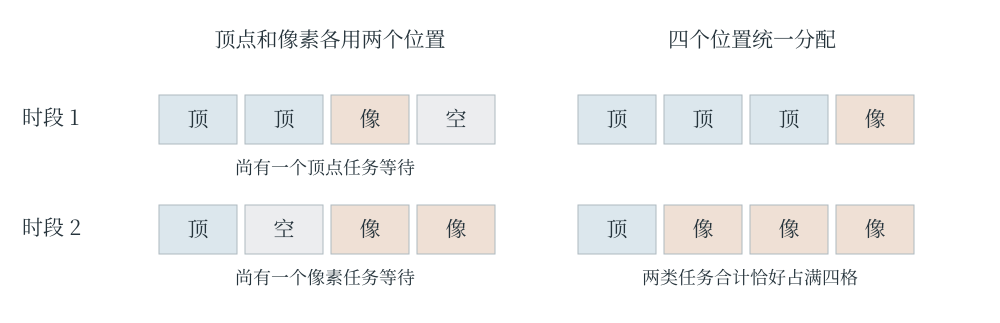
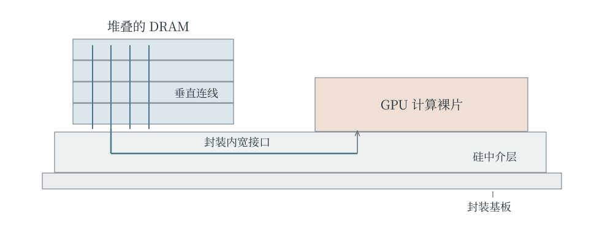
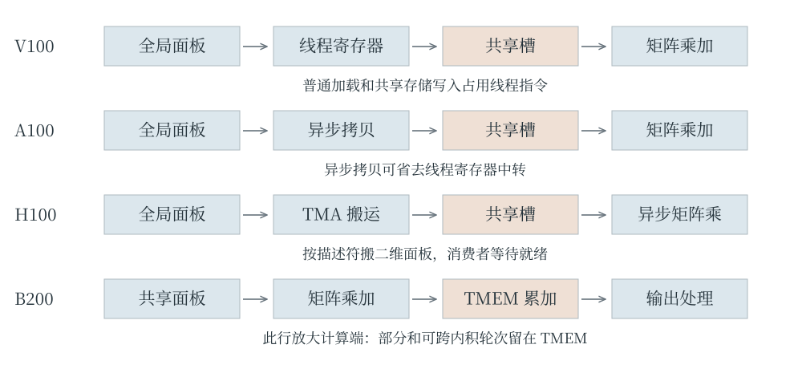
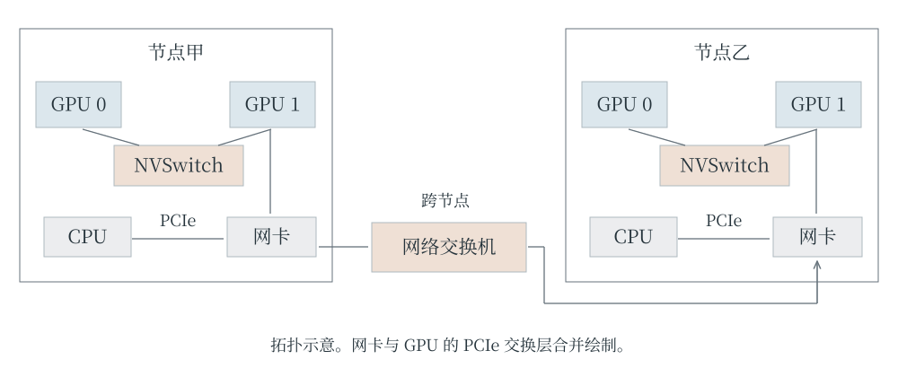
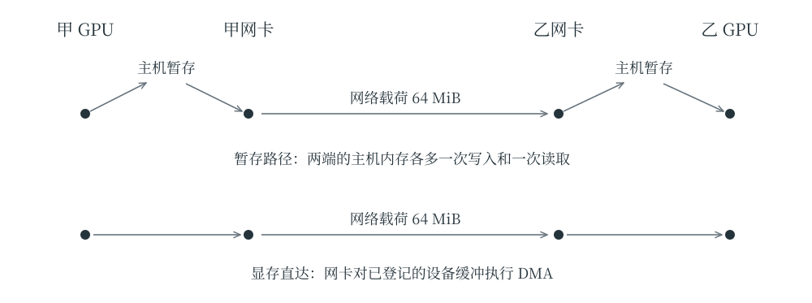
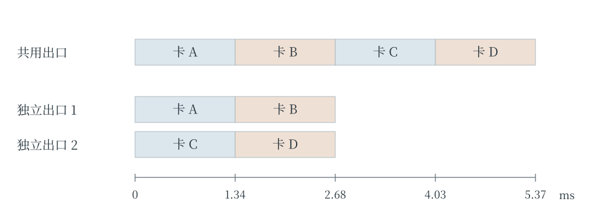

# 第 7 章　GPU 硬件演进与系统互联

设想把上一章的矩阵乘法器换成一个快两倍的单元，其余硬件原样保留。第一块面板已经就位，它确实会更早算完。到第二块时，它可能只能等。若权重根本装不下一张卡，等的甚至是另一台机器。过去二十年，GPU 的许多变化可以从这个处境理解。早期设计先让更多工作能同时执行，后来让数据少出芯片，再后来，即使某一份数据必须远行，也尽量给它一条短而宽的路。

## 7.1　从 G80 到 Maxwell，先让并行单元有事可做

早期图形处理器为顶点计算和像素计算准备不同的硬件。一个场景刚好有很多顶点要变换，却只有少量像素要着色，负责像素的一侧就会闲着。想象每类各有两个位置，眼下有三个顶点任务和一个像素任务，总共四个任务，却只能同时做三个。2006 年的 G80 把这些可编程工作交给统一的流处理器，调度器可以按当时的负载分配资源。程序员后来用同一套资源做科学计算，只需要把“一组顶点”换成“一组可以独立算的输出”。后续 GT200 扩大这套并行机器，并加入双精度支持，更多科学问题才有了合适的数值格式。[NVIDIA Fermi 白皮书中的 G80 与 GT200](https://www.nvidia.com/content/pdf/fermi_white_papers/nvidia_fermi_compute_architecture_whitepaper.pdf)

*图 7-1　上下两行的任务总数相同，顶点和像素的比例互换。把四个位置交给统一调度，就能在这个例子中把空位用上。*

通用程序的访存比画规则图形更难预先安排。**Fermi** 为通用加载引入可配置的片上 L1／共享内存资源和全芯片共享的 L2，让来自不同计算块、确实会再次用到的数据有机会在显存前命中。缓存能应付事先难以预料的重复访问，但两次使用相隔太久，副本仍会被逐出。**Kepler** 则给同一 warp 增加 shuffle 指令。以一组线程求和为例，一条线程可以直接取得同组另一条线程的寄存器值，省去先写共享内存再读回的往返。范围限在参与交换的通道内。[Fermi 存储层次](https://www.nvidia.com/content/pdf/fermi_white_papers/nvidia_fermi_compute_architecture_whitepaper.pdf) [Kepler 的 warp shuffle](https://docs.nvidia.com/cuda/archive/11.1.1/kepler-tuning-guide/index.html)

到了 **Maxwell**，问题还包括怎样少花能量维持这些并行工作。它把 SM 的发射资源和运算通道分区组织，让各调度器管理更明确的一组资源，改进常见指令的利用率。拿同一个内核换卡，能否受益取决于它本来受什么限制。若数据一直迟到，把线程分配得更好也填不上所有空拍。此时得从计算芯片走到封装边缘，去看内存引脚。[Maxwell 的 SM 组织与调度](https://docs.nvidia.com/cuda/archive/11.1.1/maxwell-tuning-guide/index.html)

## 7.2　Pascal 与 Volta，先把数据送近，再让一份数据做更多乘法

显存放在电路板上时，芯片边缘能引出多少条高速信号、每条线能跑多快，都有代价。**Pascal P100** 采用 HBM2，把一叠叠 DRAM 与 GPU 并排放在封装内，用硅中介层提供宽连接，存储堆栈内部通过垂直连线连通多层裸片。P100 的 SXM 版本还引入 NVLink，让连接拓扑中的 GPU 可以直接交换数据。前者改善 GPU 读取自己显存的供给，后者改善 GPU 之间的供给。两条带宽各自对应一对端点。[P100 架构白皮书](https://images.nvidia.com/content/pdf/tesla/whitepaper/pascal-architecture-whitepaper-v1.2.pdf)

*图 7-2　沿箭头走，数据先从堆栈内部送到接口，再横向抵达计算芯片。堆叠增加容量，接口宽度和每个引脚的传输速率共同决定带宽。图中层数仅为示意。*

**Volta V100** 给深度学习增加了 Tensor Core。普通乘加指令每次描述若干标量运算，矩阵指令则让硬件在小块内部复用操作数，并把乘积直接累加。训练中可以用较窄的数保存两个输入，以较宽的格式累计，减少操作数的存储和搬运，同时控制舍入误差。代价是必须把数据排成受支持的形状、格式和布局，最后剩下的一小片也可能填不满。**Turing** 把这条路线扩展到 INT8、INT4 等推理运算。模型能否用更窄的数，还要用原任务检验量化误差。[Volta 架构白皮书](https://www.nvidia.com/content/dam/en-zz/Solutions/Data-Center/tesla-product-literature/volta-architecture-whitepaper.pdf) [Turing 架构](https://developer.nvidia.com/blog/nvidia-turing-architecture-in-depth/)

## 7.3　Ampere 与 Hopper，谁来搬下一块面板

假设搬一块面板要 3 拍，计算要 5 拍，做完四块。若用同一块缓冲按“搬完、算完、再搬”的顺序工作，要 32 拍。若另备一块缓冲，并且搬运和计算有独立资源，头 3 拍装入第一块，以后可以边算边搬，末块在第 23 拍算完。两次安排从显存读的输入字节相同。省的是等待，付出的是第二份片上空间，以及标记“这一块已到齐、那一块可覆盖”的同步。[Ampere 的异步数据复制](https://docs.nvidia.com/cuda/ampere-tuning-guide/)

早在 V100，程序就能安排软件流水，但常用的全局加载和共享存储之间要经过线程寄存器。**Ampere A100** 加入硬件支持的异步复制，合适的全局到共享路径能绕过寄存器中转。在线程算当前面板时，已发出的复制可以准备下一块。A100 也提供 2:4 结构化稀疏矩阵指令。若权重每四项最多保留两项非零，并以要求的格式连同位置编码存放，硬件可跳过相应乘法。一般稠密模型要先满足这种约束，元数据也占空间，规格表中的稀疏峰值有它自己的适用条件。[A100 的异步复制与结构化稀疏](https://developer.nvidia.com/blog/nvidia-ampere-architecture-in-depth/)

**Hopper H100** 面对的新问题是矩阵单元加快以后，线程光为大块数据算地址、发搬运指令，也会占去相当多的时间。张量内存加速器（TMA）允许程序用描述符交代多维块的形状、起点和步幅，再由搬运硬件推进。计算侧可以组织 warp group 做异步矩阵乘，消费面板前要等复制完成，复用缓冲前要等旧读者用完。片上线程块簇还让相邻块在指定范围内合作。**Ada** 是同期的另一条产品线，面向图形及推理等负载，部分型号用更大的 L2 容纳工作集。不能从“Ada 比 Ampere 晚”推断每种 Ada 产品都有 H100 的 TMA。[Hopper 架构与 TMA](https://developer.nvidia.com/blog/nvidia-hopper-architecture-in-depth/) [Ada 调优指南](https://docs.nvidia.com/cuda/ada-tuning-guide/)

*图 7-3　前三行都从同一块全局输入开始读。A100 省掉常见路径中的寄存器中转，H100 又把多维寻址交给 TMA。最后一行把目光移到计算端，下一节讨论那些要保存许多轮的部分和。*

## 7.4　从 H200、Blackwell 到 Rubin，容量和带宽怎样配

H100 和 **H200** 同属 Hopper，但换显存也能显著改变适合跑的任务。以 SXM 产品公布值为例，H100 的 80 GB HBM3 带宽为 3.35 TB/s，H200 的 141 GB HBM3e 为 4.8 TB/s。继续读上一章那份 16 GiB 历史，若只看从 HBM 顺序读一遍的理想下界，两者分别约 5.13 和 3.58 毫秒。更大的容量还能容纳更多条独立历史。实际改善取决于是否已经打满带宽、原来是否需要卸载，以及请求能否一起排进来。[H100 规格](https://www.nvidia.com/en-us/data-center/h100/) [H200 规格](https://www.nvidia.com/en-us/data-center/h200/)

**Blackwell B200** 把两块计算裸片用封装内的高速互连联成一个逻辑 GPU。单个计算裸片有制造尺寸约束，两块协作扩大了可部署的计算资源，也把片间的连通性带进设计。SM 内，数据中心型号的第五代矩阵指令引入专用 Tensor Memory（TMEM），让矩阵累加等数据有专门的片上存放位置，缓解大量部分和占用普通线程寄存器的压力。软件要分配这块空间，安排读取和释放。**Blackwell Ultra B300** 把每 GPU 的 HBM3e 提到 288 GB，并加强注意力中指数等运算使用的专用资源。矩阵乘已很快时，softmax 的时间就更加值得单独优化。[Blackwell 架构](https://www.nvidia.com/en-us/data-center/technologies/blackwell-architecture/) [PTX 第五代张量核心与 TMEM](https://docs.nvidia.com/cuda/parallel-thread-execution/index.html#tcgen05-instructions) [Blackwell Ultra 技术说明](https://developer.nvidia.com/blog/inside-nvidia-blackwell-ultra-the-chip-powering-the-ai-factory-era/)

**Rubin** 改用 HBM4。以同样每引脚 8 Gb/s 做一笔可核算的比较，1,024 位接口每堆栈理论上每秒送 $`1024\times8/8=1024`$ GB，2,048 位就是 2,048 GB。这里除以 8 是把 bit 换成 byte。商品可以采用不同引脚速率，多堆栈共享封装、电源、散热和控制器预算。NVIDIA 公布的 Rubin GPU 最高 22 TB/s 是**一颗 GPU 的聚合 HBM 带宽**。按这个上限，16 GiB 的读取下界约 0.78 毫秒；若应用只用到零散地址的少数几个字，这个带宽不能原样代入。[Rubin GPU 架构](https://developer.nvidia.com/blog/inside-nvidia-rubin-gpu-architecture-powering-the-era-of-agentic-ai/) [Micron HBM4 接口与堆栈规格](https://www.micron.com/products/memory/hbm/hbm4)

实际选存储器要从负载倒算。例如权重与工作区必须常驻 96 GB，标有 80 GB 的单卡先在容量上出局。若剩余候选要在 4 毫秒内读完 16 GiB，还需要至少 4.29 TB/s 的**有效**带宽。4.8 TB/s 的器件在这道题里要达到约 89.5% 的规格带宽，余量很小。随后才看堆栈高度、封装能否布线与散热、供电、验证和交付。Micron 已公开其 24 GB、八层 HBM3E 用于 H200，这给出了可查的供货实例。服务器购买者通常选择已完成封装验证的加速器型号，无法像更换主机内存条那样自行替换其中一叠 HBM。[Micron 公布的 H200 用 HBM3E](https://www.micron.com/products/memory/hbm/hbm3e)

## 7.5　PCIe、NVLink 和 NVSwitch 分别接在哪里

把矩阵按列分给两张卡，输入可由两卡各持一份，输出各占一段。若改为沿内积维度切开，两卡各算出一份部分和，结果相加之前至少一方得收到另一方的数据。局部复用再好也消不掉这次交换。**PCIe** 是 CPU、GPU 和网卡常见的通用 I/O 连接。在拓扑和软件支持时，两张 GPU 可以经 PCIe 做点对点传输。若一个 PCIe 交换芯片下挂多个设备，它们走上游的流量可能共用同一出口。

**NVLink** 为支持的处理器端点提供高带宽连接。P100 的一组 GPU 可以按几条直接链路相连，缺少直连的两卡须另找合法路径。**NVSwitch** 则是转发 NVLink 流量的交换芯片。2018 年的 DGX-2 用它互联 16 张 V100，减少了由卡对之间拓扑不对称造成的限制。到 HGX H100/H200，八卡底板使用第四代 NVLink 和第三代 NVSwitch；HGX B200 八卡底板使用第五代 NVLink。GB200 NVL72 进一步把高速域扩展到机柜内的 72 个 GPU。PCIe 仍负责主机和很多 I/O 设备的连接。Grace 等特定 CPU 与 GPU 之间还可用支持一致性的 NVLink-C2C，和 GPU 之间的交换域分别看。[DGX-2 与 NVSwitch](https://developer.nvidia.com/blog/nvswitch-accelerates-nvidia-dgx2/) [HGX 底板架构对照](https://docs.nvidia.com/enterprise-reference-architectures/hgx-ai-factory-h100-h200-b200/latest/components.html) [GB200 NVL72](https://www.nvidia.com/en-us/data-center/gb200-nvl72/)

*图 7-4　在左侧两张卡之间传部分和，路线经过节点内的交换域。送到右侧节点还须经过网卡和网络交换机。CPU 和 PCIe 画在各自的节点内，便于辨认主机缓冲与网卡的连接位置。*

手册里的带宽要带着方向读。以厂商列的每 GPU 双向合计为例，Hopper 的 900 GB/s、Blackwell 的 1,800 GB/s、Rubin 第六代 NVLink 的 3,600 GB/s 都是相应配置下各链路的汇总。若收发对称，仅单向发送，1,800 这个数对应理想上限约 900 GB/s；具体设备对和交换路线能分到多少还要另查。即使每卡都接了很多链路，一组同时发送的数据若非得经过同一出口，出口才决定何时发完。[NVLink 各代与方向口径](https://developer.nvidia.com/blog/inside-nvidia-blackwell-ultra-the-chip-powering-the-ai-factory-era/) [Rubin 的机柜与网络](https://developer.nvidia.com/blog/inside-the-nvidia-rubin-platform-six-new-chips-one-ai-supercomputer/)

## 7.6　跨过机柜，网卡怎样接手

要把一块梯度从甲机 GPU 送到乙机 GPU，朴素办法是在甲的主机内存准备暂存区，GPU 先把梯度拷过去，网卡再取走；乙机网卡先写主机内存，再由乙机 GPU 取回。若传 64 MiB，甲的暂存区多了一次 64 MiB 写和一次 64 MiB 读，乙也一样。两端合计多经过主机内存接口 256 MiB，有效网络载荷仍是 64 MiB。

**InfiniBand（IB）** 提供跨主机的高性能互联。**RDMA** 让网卡按已建立的连接和内存访问授权，把数据直接放到远端指定区域。在支持的 GPU、网卡、PCIe 拓扑与驱动上，**GPUDirect RDMA** 又让网卡直接对 GPU 缓冲做 DMA，于是上面两块主机暂存区可以一起省去。普通主机内存也能做 RDMA，GPU 直读能力要另行核对。两端仍需建立连接、登记可访问的缓冲，生产方要先完成写入，接收方也要等到约定的完成通知并满足 GPU 的内存可见性要求，再启动消费。省去 CPU 拷贝后，这些控制工作仍然重要。[GPUDirect RDMA 的拓扑与同步要求](https://docs.nvidia.com/cuda/gpudirect-rdma/) [RDMA 连接、工作请求与完成队列](https://docs.nvidia.com/rdma-aware-networks-programming-user-manual-1-7.pdf)

*图 7-5　两行中间都要跨网络一次。上行每端各有一次暂存写和一次暂存读，下行的网卡可直接使用已登记的显存区域。箭头只画载荷，队列和完成通知仍须由软件安排。*

选网卡前先画全体流量。假设四张 GPU 各有 64 MiB 要同时送过同一台服务器的一个 400 Gb/s 出口。即使不给报头和协议留字节，每秒也只有 50 GB，四份传完至少 5.37 毫秒。若要在 2 毫秒内完成，单方向就需要约 134.2 GB/s。两张 400 Gb/s 的卡仍不够，三条独立且能均衡分流的同速出口才有理论余量。若三条线都接到同一条有效载荷上限 50 GB/s 的上联，结果又回到 5.37 毫秒。通信两组端点之间所有必经链路合起来有多宽，这比清点面板插了几张卡更接近答案。

*图 7-6　每格都是 64 MiB，横轴按理想有效载荷速率换算。两条路径要从发送端一直独立到接收端，下面两行才能真正同时走。*

还有一道容易漏算的限制。假如这块 400 Gb/s 网卡插在 PCIe 4.0 ×16 槽里，向网卡喂数据的一侧先到了上限。每条通道每秒传 160 亿次，编码每 130 位携带 128 位数据，16 条通道合计单向约 $`16\times16\times(128/130)/8=31.5`$ GB/s，尚未扣除报头。就算光模块、线缆和交换机都能跑满，单向 50 GB/s 的目标也达不到。换成实际协商为 PCIe 5.0 ×16 的链路，这个上限才升到约 63 GB/s。验收时要读出网卡实际协商到的代际和通道数，再看它与其他设备是否共享上联。[Intel 处理器手册中的 PCIe 编码、速率与通道宽度](https://cdrdv2-public.intel.com/655258/655258-011.pdf)

带宽还需要足够多的并发请求去填。仍取 50 GB/s，若一笔请求从发起到可以用下一笔补上要 4 微秒，维持满速至少要有 $`50\times10^9\times4\times10^{-6}=200{,}000`$ 字节在途。若每项携带 4 KiB，有效窗口至少要容纳 49 项。短消息首先受启动和通知影响，许多发送者同时发给一个接收端还会在出口排队。真实选型要匹配 GPU 与网卡的 PCIe 带宽和 NUMA 位置、网卡端口速率、交换机上联、线缆距离与模块，以及现有网络采用 IB 还是支持 RDMA 的以太网（RoCE）。逐对测单向大块吞吐，再令所有 GPU 同时以业务消息大小收发，记录最慢一对，往往能看出是哪段共享线路先饱和。

例如 NVIDIA 的 DGX B200 用户手册列出了计算网络用的 ConnectX-7 适配器和 BlueField-3 DPU。高性能网卡负责队列、传输和直接放置；带独立处理器的 DPU 还可接管虚拟网络、存储等基础设施服务，减少这些工作与训练争抢主机资源。部署时可以分别配置计算和存储流量，检查它们最终是否又经过同一物理链路。选用 DPU 能卸下的工作，以及额外的功耗和管理成本，要放在同一个部署方案中衡量。[DGX B200 部件与端口](https://docs.nvidia.com/dgx/dgxb200-user-guide/introduction-to-dgxb200.html) [HGX 网络硬件参考设计](https://docs.nvidia.com/enterprise-reference-architectures/hgx-ai-factory-h100-h200-b200/latest/networking-hardware.html)

回看这段历史，改进有三种读法。shuffle 和局部累加让一些字节根本不必远行；HBM 和高速互联让必须搬的字节能更快通过；异步搬运与多条独立通路，让传输时还有别的工作可做。它们可以同时出现在一台机器里，但哪一项能缩短这次请求，得看矩阵单元究竟在等哪一份数据。下一章把同一份工作放上三类加速器，看设计者把这些机会安排在了什么地方。

## 练习与解答

### 1. 更宽的内存够不够

要在 4 毫秒内把 16 GiB 读一遍，有效带宽至少是多少？若一台设备标称 4.8 TB/s，该访问模式只能达到规格值的 80%，够用吗？

**解答。** 最低带宽为 $`16\times2^{30}/0.004`$，约 4.295 TB/s。按 80% 只有 3.84 TB/s，读完约需 4.47 毫秒。即使一次计算都不做，也已超过期限。

### 2. 一条链路上的四个发送者

四张卡各传 64 MiB，两个独立的 400 Gb/s 单向出口均衡分担。忽略开销，若接收侧只有一个同速出口，最好能多快？接收侧也有两条独立路径时呢？

**解答。** 数据合计 268,435,456 字节。接收侧只有一个 50 GB/s 出口时，至少约 5.37 毫秒。两端及中间都能均分流量时，合计 100 GB/s，约 2.68 毫秒。双向带宽不能拿来把单向用时再减半。

### 3. 增加并发能补多少等待

保持 4 微秒的请求周转时间，每项 4 KiB，只有 16 项可以同时在途。在这个模型里最多能支撑多少带宽？若改用显存直达路径，线上 64 MiB 的消息会变小吗？

**解答。** 窗口一共 65,536 字节，每 4 微秒周转一次，上限为 16.384 GB/s。显存直达能省去主机暂存和相应的等待，同一消息的有效网络载荷依然是 64 MiB。只有改变需要传的内容、表示或分工，线上字节才会减少。

[本篇算例的 Python 复算程序](../../experiments/part02/verify.py)

[全书目录](../../README.md) · [上一章 · GPU 体系结构与一次前向计算](ch06.md) · [下一章 · GPU、TPU 与昇腾的架构取舍](ch08.md)
