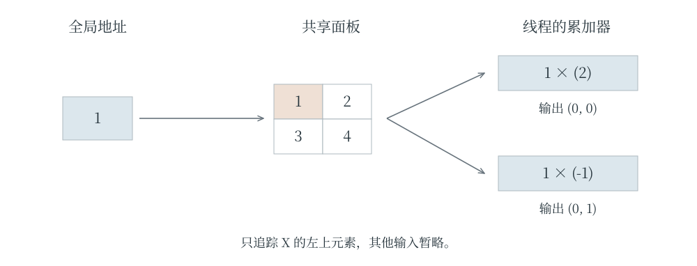
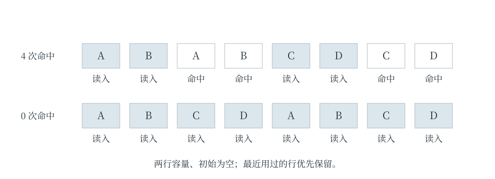
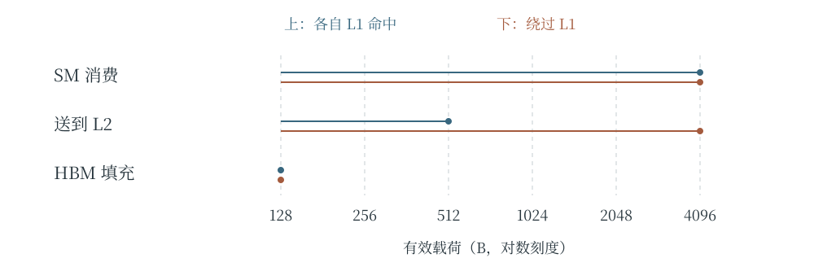
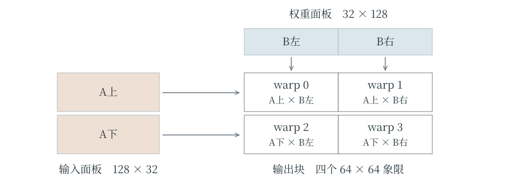
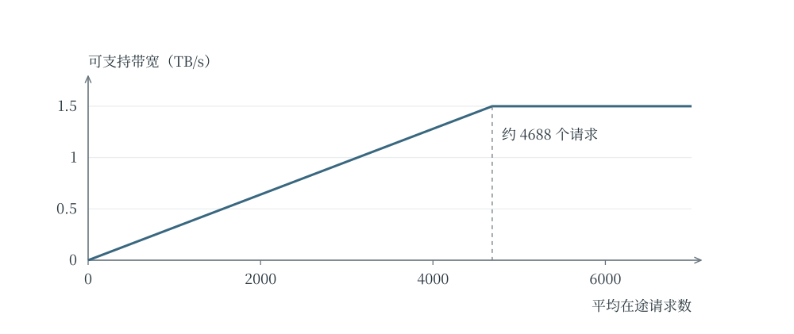
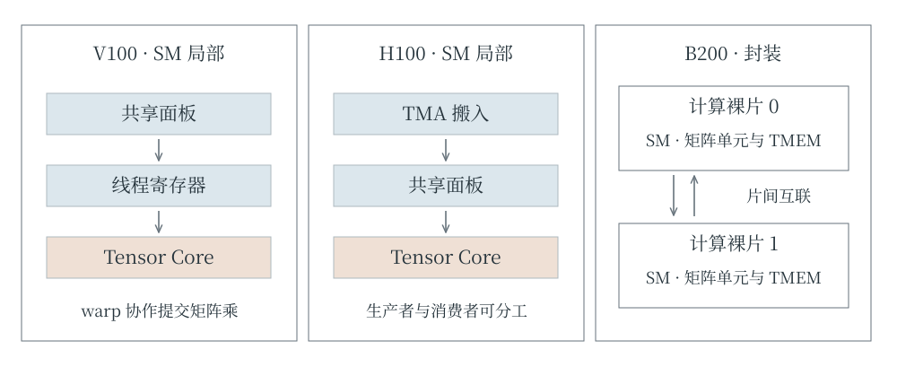

# 第 7 章　GPU 存储层次与矩阵乘法的数据流

第六章里，四个线程各算一格输出。左上角先算 $`1\times2`$，再加 $`2\times1`$，得到 4。右上角先算 $`1\times(-1)`$，再加 $`2\times3`$，得到 5。留意这两笔算式开头的 1。它们用的是输入矩阵里的同一个数。假定输入和权重起初都在显存里，这个 1 要从显存读两次吗？

如果两个线程各自去读，第二次能不能直接用缓存里的副本，要看这段数据还在不在。我们也可以让同一个线程块先取来一小片输入，把它放到块内线程都能读的共享内存里。下文把一次取来的这片矩阵称为**面板**。沿图 7-1 看，左上格和右上格各有自己的部分和，却可以从同一块面板取到那个 1。



*图 7-1　从左向右追踪输入的第一个 1。中央是块内线程共同载入的面板，右侧是两个输出格各自的第一项乘加。这个输入元素入片一次，在片内供两格使用。缓存命中可进一步改变更远一层的流量。*

## 7.1　同一份输入要搬几次

把输出从四格扩大到十六格。两张 $`4\times4`$ 矩阵相乘，每格要做四次乘加，全题共 64 次乘加。输入和输出都用 FP32。下文计数时，一个字就是一个 4 字节的数，部分和从零开始。现在只在数据进入线程能够复用它的那片存储、以及最终结果写出时计数。先假定进入以前没有缓存帮忙，传输也不用凑整。这样只要知道每个数取了几次，就能算出三种做法的差别。

**各算各的。** 每个输出格独自读四对输入，部分和一直保留在寄存器。每格读 8 个字，16 格共 128 个输入字，最后写 16 个输出字，合计 576 字节。这 576 字节是假定每次取数都要重新搬一次得到的。真实 GPU 会合并相邻请求，也可能在缓存中找到数据，因此显存接口测得的读写量可能更小。

**四格共用一份面板。** 用一个 block 负责一个 $`2\times2`$ 输出块，四个 block 覆盖完整输出。沿 $`k`$ 分成两段，每段长度 2。算左上块且处理第一段 $`k`$ 时，只需把 $`X`$ 的左上 $`2\times2`$ 和 $`W`$ 的左上 $`2\times2`$ 各读进一次，共 8 个字。四个线程从这两块中各取两对数，形成四个部分和。下一段改读 $`X`$ 的右上块与 $`W`$ 的左下块，各 4 个字，继续加到原来的四个寄存器中。于是每个输出块读 16 个字，共读 64 个字，再写 16 个字，合计 320 字节。


*图 7-2　按色框定位每一段的左、右操作数。两次相遇都更新同一个左上输出块。邻近输出块还会需要其中一侧面板，如果可在更近的缓存命中，它们可以继续复用。*

**整张输入都能留在片上。** 若整个问题的两个输入都能在通过计数边界后保留到最后一次使用，$`X`$ 的 16 个字、$`W`$ 的 16 个字各读一次，再写 16 个输出，合计 192 字节。这给出了冷输入、完整写回、无重复传输且忽略事务取整的理想有效载荷。按一次乘法和一次加法各算一次浮点运算，三种安排的 64 次乘加都是 128 FLOPs。每字节对应的有用浮点运算从 $`128/576`$ 增到 $`128/320`$，再到 $`128/192`$。这个比值叫算术强度，第九章将给它配上带宽，换算成时间。

| 计数边界与安排 | 输入字 | 输出字 | 输入在边界以内怎样重用 |
|---|---:|---:|---|
| 每次标量操作数都跨边界 | 128 | 16 | 一个线程只保留自己的累加器 |
| 每个输出块的每段面板各进一次 | 64 | 16 | 同一面板给两行或两列输出使用 |
| 两张完整输入各进一次 | 32 | 16 | 最后一个消费者用完前都保留 |

沿着第二种安排再往里数一层。如果每次标量乘加从共享面板显式读两个字，块内仍有 $`64\times2=128`$ 次输入字读取，和 64 次累加器更新。让单个线程同时负责多个输出后，某个共享加载的字又可以在寄存器中被重复使用。这样可以少读几次共享内存。更远处的显存接口（这里采用高带宽存储器 HBM）却可能仍然看到原来那么多字节。以后看性能分析器，先找计数器对应哪条边，再决定要改变哪一层的复用。

## 7.2　显存容量与芯片上的副本

刚才三种做法搬了 576、320 和 192 字节。假如把它们放到同一张标称 80 GB 的卡上依次运行，监控工具会显示第一个程序占用的显存是第三个的三倍吗？两张输入表和一张输出表自始至终一样大。要解释这个读数，得看前面反复提到的“块内”在芯片的什么地方。

在采用独立 HBM 显存的 GPU 上，标称容量说的是板上那一组显存。HBM 是一种堆叠式动态内存，也有显卡使用 GDDR。L2 缓存和 SM 上的寄存器、共享内存使用芯片上的存储电路。它们在芯片制造出来时就占据了固定面积。向框架申请一个张量，设备分配器会为张量找出一段全局地址。随后一次加载命中 L2，或被保存在寄存器中，都不会再为这个张量申请一块同等大小的显存。


*图 7-3　从外向内读，框线表示物理位置。沿下方两条箭头分别读一次普通加载和一次块内复用。L1 的缓存策略及异步搬运能否绕过某一级，要看芯片与指令。*

设有一张 BF16 权重表，4096 行、4096 列，每项 2 B，本体恰占 32 MiB。A、B 两个线程读同一位置，可能各取得一个寄存器操作数，L2 中还留着包含它的一段缓存行。这张表在显存中依旧只有 32 MiB。若程序显式做一份完整的转置副本，同时保留两张表，张量本体的存储才会增至 64 MiB。反过来，调用同一张表一千次，容量可以维持不变，累计读过 HBM 的流量却可能远超 32 MiB。后面算带宽时，分子用的是后一个量。

`nvidia-smi` 的 **FB Memory Usage** 给出设备显存的总量、已用量等；驱动保留、上下文、其他进程及框架内存池都会影响可见数字。PyTorch 的 `memory_allocated()` 统计当前张量占用，`memory_reserved()` 统计其缓存分配器管理的空间。比如释放最后一个引用后，前者可以下降，后者还能保留这段空间供下一次使用。读数相差的一截，不能据此推断为 L2 或寄存器占用。中间激活若要跨内核保留，通常要有全局存储；若生产者和消费者融合，一小块中间值可以只活在寄存器里。变量叫“中间结果”并不能决定它住在哪一层。[NVIDIA 显存统计口径](https://docs.nvidia.com/deploy/nvidia-smi/index.html) · [PyTorch 分配器统计](https://docs.pytorch.org/docs/stable/notes/cuda.html#cuda-memory-management)

### 两组线程怎样共用一份数据

假设同一块里的两个 warp 都要用权重 2。第一种写法，两组线程各自访问它的全局地址。硬件可能用缓存副本满足第二次请求；这只是一次加速机会，程序必须在两次都未命中时也得到正确结果。第二种写法，一组线程先把这块权重写进显式分配的 shared memory，按参与者范围同步，另一组线程再读约定好的格子。程序确定副本放在哪里、活多久，也负责编排交接。许多架构把 L1 和 shared memory 建在同一组片上存储资源上，因而容量配置互相制约；两者的寻址和生存期仍然不同。L2 由多个 SM 使用，也不能靠缓存命中通知另一个块“数据已经写好”。

| 位置 | 可以复用数据的范围 | 投影中的数据 |
|---|---|---|
| 线程寄存器 | 线程指令直接读写自己的值，指令允许时可在线程间交换 | 自己负责的输出格的部分和 |
| 块内共享存储（shared memory） | 同一 block 的线程按地址读写，程序负责写入、同步和复用 | 同一输出块都要用到的一个输入面板 |
| 一级数据缓存 L1 | 同一 SM 上按相应缓存策略发起访问的工作 | 近期加载过的地址所处的缓存数据 |
| 二级缓存 L2 | 通过设备相应缓存路径访问相同地址的多个 SM | 不同输出块重复使用的部分权重 |
| 设备全局内存的显存后备 | 有相应映射和访问权的执行者 | 权重、输入、最终输出和跨 kernel 保留的状态 |

对照图和表，先找谁能读到同一份值，再看谁安排它留多久。例如 L2 由多个 SM 使用，一个线程块临时留在共享内存里的面板通常只有本块能读。下文用普通线程块来计数。线程块簇等架构扩展另有自己的协作范围。[CUDA 存储层次](https://docs.nvidia.com/cuda/cuda-programming-guide/01-introduction/programming-model.html)

“全局”描述地址空间和访问范围。发出一条普通全局加载之后，数据可能在 L2 就被找到。反过来，CUDA 的 **local memory** 拥有线程私有的逻辑地址，却可能由设备内存系统提供后备。一个直接后果是寄存器溢出（spill）。本来可以接着使用的临时值被存到该线程的内存位置，以后再加载。缓存命中也会消耗加载指令和片上带宽，未命中还会触及更远的存储。要判断寄存器节省是否合算，应同时看编译后的寄存器数、局部加载和存储，以及真实运行中的事务数。

## 7.3　同一条加载指令会访问哪些地址

四个线程愿意共用面板，还得设法把面板装进来。如果每个线程只负责搬一个数，让哪几个线程在同一拍去取哪几个数，会有差别吗？先把线程号逐一换成地址。

第二章的行优先数组中，若每行有 $`N`$ 列，每个元素 4 字节，第 $`(i,j)`$ 项的地址为

```math
a(i,j)=a_0+4(iN+j).
```

同一个 warp 执行一条加载指令时，不同通道可以请求不同的地址。内存系统把它们需要的字节归入对齐的区段，一起发出能够覆盖这些请求的事务，这就是合并访存。在以下计算中，用现代 NVIDIA 所描述的一种常见口径，以 **32 字节 sector** 计数。每个通道读一个对齐 4 字节的数，基地址是 32 的整数倍，所有 32 个通道都活跃。每个数完全落在一个 sector 中，地址 $`a`$ 对应的 sector 编号是 $`\lfloor a/32\rfloor`$。一个 sector 可以属于更大的缓存行，指令触及多少 sector、整个缓存保留多少行、最终从 HBM 搬多少字节需要分别计数。[CUDA 合并访问示例](https://docs.nvidia.com/cuda/cuda-c-best-practices-guide/index.html#coalesced-access-to-global-memory)

令基地址为 0，第 $`l`$ 个通道取 $`4l`$。编号 0 至 7 的通道分享 sector 0，8 至 15 分享 sector 1，整组恰好覆盖四个 sector。总共请求 128 个互不重复的字节，四段也正好 128 字节。现在让每个通道多走一个元素，地址变成 $`4(l+1)`$。从第一个 sector 只取编号 1 至 7，到第五个区段才取到最后一个数，一共五段、160 字节。同样是连续读取，因为起始位置改变，这条指令对所取区段的有用覆盖率从 100% 降到 80%。

把步长增大到 8 个元素，每个通道读 $`32l`$。这次每个 sector 都只用到开头的一个数，需要 32 段，覆盖率 $`128/1024=12.5\%`$。若这些恰好是行宽为 8 的矩阵中的同一列，线程计算的数学目标完全合理，差别出在线程编号被映射到了哪一个下标。改变分工，让相邻通道沿列编号增加，就有机会让它们读到同一段。


*图 7-4　为看清边界，图只展开前八个通道。纵向每行是一个 32 字节区段，每点一个 4 字节字。把同样的编号规律延到 32 个通道，对应 4、5、32 个区段。*

```python
def sectors(addresses, sector_bytes=32):
    return {a // sector_bytes for a in addresses}

assert [len(sectors([4 * (offset + step * t) for t in range(32)]))
        for offset, step in [(0, 1), (1, 1), (0, 8)]] == [4, 5, 32]
```

刚才是把每条指令单独拿出来数区段。如果后一组接着读编号 33 至 64，上一组多取得的那一段中恰有它要用的数据，缓存可能命中。程序达到的带宽损失取决于相邻组和缓存状态。还有一个极端，32 个通道一起取同一个 4 字节权重。按每个通道的语义相加是 128 字节，唯一需要的内容只有 4 字节，落在一个 sector 里。这正是应分清**通道请求量、唯一地址量、区段传输量**的地方。使用相同硬件计数器比较两种实现时，也要确认分子取的是其中哪一个量。

### 线程映射与数据布局

上一章权重为两行两列，$`W_{00}`$ 紧挨 $`W_{01}`$。安排两个输出列的线程一起执行 $`k=0`$ 的加载，两个地址就相邻了。安排两个输出行的线程执行同一个输出列，则两者都要 $`W_{00}`$，有广播复用的机会，另一方面两个输入行却可能相距很远。一个线程映射会同时改变 $`X`$、$`W`$ 和 $`Y`$ 的访问形状。选择布局之前把三组地址都列出来，常能解释为什么加速其中一次加载后，总时间反而增加。

有时后续运算需要另一种布局。交换数组的两个步长，可以让程序按转置视图解释数据，但数值的物理位置不变，后续加载访问的仍是原有地址。实际转置则需要读写整个数组，多个后续运算可以共同分担这次开销。在算子内部逐块读入、重排数据，也可以只处理当前需要的数据块。

### 缓存容量与重复读取

缓存每次接收一行数据，空间有限时要决定替换哪一行。为了把容量效应与合并访问分开，考虑一个只能容纳两条缓存行的简化缓存，用 A、B、C、D 表示四条不同的缓存行。每次未命中就读入整行，满时替换最久未使用的那一行，初始为空。若按 A、B、A、B、C、D、C、D 的次序读取，一共只有四次未命中。若按 A、B、C、D、A、B、C、D 读取，每一行再次轮到时它已被挤出，共八次未命中。两种程序的唯一工作集都是四行，每行都恰好使用两次，区别只在两次使用之间夹了多少其他行。



*图 7-5　方格内是当步请求的行，深浅区分需要远处取数与可以从缓存取数。上排的第三、四、七、八次访问复用了近处副本。*

实际缓存还会限制一条地址能放入哪些位置。称这些可选位置组成一个组，每组可容纳的缓存行数叫组相联度。即使整个缓存还有空间，若许多活跃的行恰好竞争同一组，还是会出现替换。具体 GPU 的地址映射、替换和预取策略各有实现。上面的模型用来预测访问次序可能带来的差异，可再通过计数器和冷、热两组运行检查。对于大权重投影，这也是为什么只改输出块的遍历次序，算出来的数和全局加载指令数不动，HBM 读流量却可能改变。

可以用三个地址把组相联度的影响单独挑出来。假设缓存有两组，每组容纳两行，行号为偶数的进第 0 组，奇数的进第 1 组，组内替换最久未用的一行。按 $`0,2,4,0,2,4`$ 访问时，总共只有三行，本该放得进四行的缓存。可它们都要进第 0 组，头一轮读 4 时赶走 0，下一轮读 0 又赶走 2，六次都未命中。只把第三份数据移到行号 5，顺序变成 $`0,2,5,0,2,5`$，头三次填入后再读三次全中。两个算例读取的有效数据同样多。若在真实机器上怀疑某种行距造成冲突，可以保持每次访问的元素数和对齐条件，只改行距，再看未命中是否随之改变。这里用奇偶分组是为了能手算，实际设备的组号未必由行号的最低位决定。

用几个计数器观察同一段只读权重，可以把缓存的作用看得更清楚。四个 SM 各读同一段对齐的 128 B 系数八次。一共消费 $`4\times8\times128=4096`$ B。若各自的 L1 在首次读后都留住这段系数，L1 向下只请求 $`4\times128=512`$ B 有效载荷。若绕过 L1 且每次请求都到 L2，则是 4096 B。假定 L2 初次填入后一直命中、没有并发重复取回，两种情形都可能只从 HBM 取 128 B。这里数的是理想载荷；实际事务粒度、合并、逐出和计数器口径都会改变测量。要检验该解释，可固定访问序列，同时比较 L1、L2、显存三处的请求或字节。只盯显存带宽会错过一次八倍的片上流量变化。



*图 7-6　每个刻度按两倍递增。最上排写程序消费的载荷，中排写向 L2 的请求，底排写理想显存填充。两端数字相同、唯独中排不同，正是只看显存计数器会漏掉的性能差别。*

## 7.4　共享内存中的并行读取

刚才数的是一条加载指令碰到几个 32 字节区段。其中有几段要去显存取，还得看缓存里已经有什么。现在设面板已经放进共享内存，32 个线程转过来要读它的一列。这次要问的是，共享内存能在同一轮里交出多少个数？

共享存储要在一个时刻服务许多线程，内部被划为多个可以并行工作的 **bank**。用一个便于推算的 NVIDIA 模型，32 个 bank，每个 4 字节字占一个位置，相邻字轮流分配。按字编号 $`u=a/4`$，bank 编号为 $`u\bmod32`$。考虑一个 warp 的一次标量 32 位读取。若每个线程落在不同 bank，可同时供给。若多个线程要从同一 bank 读不同字，对该 bank 的工作要拆开服务。如果它们读取相同的字，则可广播。更宽指令、跨事务及其他平台的 bank 组织要另算。[CUDA 共享存储与 bank](https://docs.nvidia.com/cuda/cuda-c-best-practices-guide/index.html#shared-memory-and-memory-banks)

让 32 个线程先按行把一个 $`32\times32`$ 面板写入共享存储，再让第 $`l`$ 个通道读第 $`l`$ 行的第 0 列。其字号为 $`32l`$。所有编号模 32 都是 0，但字号各不相同，于是某个 bank 要服务 32 个不同的字。若在每行末尾留一个不用的字，使物理行距（leading dimension）为 33，则这一列的字号变为 $`33l`$，模 32 的结果恰是 $`l`$。列里的数值、矩阵的数学形状、线程读到的顺序都保持一致，只改变了每行起点的位置。


*图 7-7　图把模 32 缩小为模 4，便于把所有字画出来。数字是 bank 编号，色框指出一次列读。32 行版本中多出的一列要占 $`32\times4=128`$ 字节。*

从列读的编号还能算出其他步长会怎样。设线程 $`l`$ 读取字号 $`c+sl`$，步长 $`s`$ 为正整数。32 个线程将访问 $`32/\gcd(s,32)`$ 个不同 bank，每个被触及的 bank 承担 $`\gcd(s,32)`$ 个不同字。步长 2 是二路冲突，步长 8 是八路冲突，步长 31 或 33 可以分散到所有 bank。$`s=0`$ 时每个线程都读同一个字，应单独按广播处理。指令若因宽度而被分解，要分别检查可在同一事务内服务的那组地址。

把实际转置分成搬入和读出两步来看。让线程先连续读全局内存，再在片上按转置位置存取，可能解决第一道题却制造第二道题。多出来的填充可消除这一例中的冲突，又会增加块内资源占用。倘若它让一个 SM 从常驻四块降为三块，还要回第六章估计少一块并发工作的影响。

还有一种布局可以保留全部 32 列，同时将按列读取的请求分散到 32 个 bank。设共享面板的行列号 $`r,c`$ 都从 0 数到 31，把逻辑上的第 $`c`$ 列放到物理列 $`c\mathbin{\oplus}r`$，其中 $`\oplus`$ 表示按位异或。异或两次同一个数会得到原值，所以每行都是一一对应的重排。第 3 行、第 1 列实际存入第 $`1\mathbin{\oplus}3=2`$ 列，读取时也要按同一规则访问第 2 列。行固定时，32 个列号遍历全部 bank；列固定时，随着行号增长，bank 编号 $`c\mathbin{\oplus}r`$ 同样遍历全部 32 种取值。两种方向的标量读取都只需一轮。

下面在第六章那台有 64 KiB 共享空间的教学 SM 上比较这几种布局。若每块有四个这样的 FP32 面板，其余资源容许四块同时驻留，原布局每块恰好 16 KiB。每行填一个字后，每块变成 $`4\times32\times33\times4=16896`$ 字节，只容三块。异或布局仍为 16 KiB，容得下四块。原布局的列读取要排队。填充会挤掉一个常驻块，异或重排则要求写入和读取的线程约定同一种地址算法。实际核对时，先用每格各不相同的输入检查转置结果，再观察共享存储请求拆成的服务轮数、可常驻的块数和运行时间。若标量计数符合预期而向量内核仍慢，应回到具体指令，看一轮请求包含多少字、哪些通道共同参与。CUDA 的 TMA（张量内存加速器）也支持按规则重排共享存储，文档中示范的是以 16 字节元素搬运的转置，读写双方还要满足指定的对齐与分块条件。上面的逐字异或用于手算这项取舍。[CUDA 的 TMA 共享存储重排](https://docs.nvidia.com/cuda/cuda-programming-guide/04-special-topics/async-copies.html) · [Nsight Compute 共享存储指标](https://docs.nvidia.com/nsight-compute/ProfilingGuide/)

## 7.5　一个 128 × 128 输出块怎样取数

前面每个数都按 4 字节计。现在换成模型投影的一种常见配置，输入和权重用 BF16，每个数占 2 字节，部分和用 FP32，每个占 4 字节。矩阵变大以后，先圈出一个线程块要算的输出，再算为了更新它一次，要从哪两张表各搬多少数。

把前面共用面板的办法用到 4096 × 4096 的方阵乘法上，内积也长 4096。若每个 block 包办一个 128 × 128 输出块，两个输出方向各切 32 段，一次启动便有 1024 个块。块可以分批上机；块内设 128 个线程，恰为四个 warp。为便于核算，想象每个 warp 管一个 64 × 64 的输出象限，每一轮只沿内积推进 32 项。具体指令怎样把碎片分到各个线程，随架构、指令形状和布局而变。下面只用到总数和共享关系。



*图 7-8　固定一个内积区间。上面两组 warp 需要同一份输入上半块，左边两组需要同一份权重左半块。下一轮换两块输入，四个象限的部分和要保留。*

一个块这一轮搬入 128 × 32 的输入和 32 × 128 的权重，各 8 KiB，共 16 KiB。若四个 warp 各自搬自己的两片，每组搬 4 + 4 KiB，合计 32 KiB；利用块内共享只需搬一半。这是从全局地址送入块内所请求的面板载荷。另一个 block 也可能需要同一个面板，它能否在 L2 命中，要等到统计整颗芯片时再问。

这 128 个线程实际怎么取数？以按行连续的权重为例，把 32 × 128 项按行编号为 0 到 4095。教学分工可以让编号为 t 的线程先读第 t 项，再读 t+128、t+256，直到结束。每线程共取 32 项，同一 warp 在同一步取同一行内相邻 32 个 BF16，合计 64 B。起点按 32 B 对齐、以 32 B sector 计时，会触及两个 sector。若把线程号改作行号，同行相邻的位置就变成相隔 4096 项，每个通道可能各触及一个 sector。搬相同的 64 B 有效值，接口上的请求可以相差十六倍。矩阵有固定的行距，不能把整块二维面板误作在显存里连续的 8 KiB。

下面用地址检查这两种分工。在没有 GPU 的电脑上也能运行。每一项地址整除 32 就是它所在的 sector 编号，重复出现的编号只数一次。

```python
def sectors_for_one_warp(stride_in_elements):
    addresses = [2 * lane * stride_in_elements for lane in range(32)]
    return len({address // 32 for address in addresses})

assert sectors_for_one_warp(1) == 2
assert sectors_for_one_warp(4096) == 32
```

在第二种分工中，32 个线程同时索取 32 个不同的 sector，但缓存可能已保留一部分。这个程序预测一次指令触及的地址集合；显存控制器到底读了多少字节，要在设备上另量。

计算阶段，四个象限共做 128 × 128 × 32 次乘加，即 1,048,576 FLOP。把这一个阶段的计算除以刚才的 16 KiB，得到 64 FLOP/B。这个比值暂不包含最终输出写回，也没有把共享内存到矩阵单元的读数混进来。整个内积需 128 轮；如果每一轮都把 128 × 128 个 FP32 部分和写出，下轮再读回，仅 127 次交接就要多搬 127 × 2 × 64 KiB，接近 16 MiB。保住部分和，比单纯把这次加法提速更要紧。

若全部累加值都分布在普通线程寄存器中，四个 warp 平均每线程已有 128 个 FP32 累加值，还要给地址、输入片段、临时量留位置。设教学 SM 有 65,536 个 32 位寄存器，编译结果为每线程 160 个，仅按总数相除，每块要 20,480 个，最多容纳三块；块内双缓冲另需 32 KiB。两项都要满足，还要考虑硬件分配粒度和线程等上限。改成八个 warp 分同一输出，平均每线程的累加值减到 64，整块的累加值仍是 16,384 个。若再让内积步长由 32 变为 64，输入面板和双缓冲空间都会翻倍。更多线程、更深的块，都有自己的代价。

可以让编译器报告每线程寄存器和 spill，再用分析器查 local load/store、常驻块和可发射的 warp。所谓 spill，是寄存器放不下的活跃值被放入线程私有的 local 地址空间，之后通常经缓存访问设备内存。若强行压低寄存器上限，多驻留一个块却多出大量这种读写，总时间可能更长。单看 occupancy 的百分数回答不了这个问题。

## 7.6　一次显存访问要等多久

分块复用减少了需要跨边界搬运的数据，但剩下的数据仍要及时送到。接口的带宽是持续传输能力，单次请求的等待时间则决定了要同时保留多少个请求，才能接近这个能力。

一次未命中的请求从发出到返回需要 $`L`$ 秒，一次请求能带回 $`s`$ 字节。只有一个请求可在途时，即使接口支持很高峰值，长期平均仍至多得到 $`s/L`$。若平均同时有 $`q`$ 个独立请求在途，稳态下“在途数 = 每秒完成数 × 平均停留时间”。以字节表示，要支撑有效带宽 $`B`$，平均在途数据至少需要达到

```math
D_{\mathrm{flight}}=BL,\qquad q=BL/s.
```

这里 $`B`$ 的单位是字节每秒，乘以以秒计的 $`L`$，得到在一次往返期间接口能够传输的字节数；再除以每个请求的字节数 $`s`$，得到需要维持的平均请求数。结果通常不是整数，规划数量时应向上取整。这个估算假设请求足够独立且系统达到稳定状态。

假设一个教学接口能传 $`1.5\times10^{12}`$ B/s，一段固定请求往返 400 ns，则要平均保持 600000 字节在途。如果这里的独立请求按 128 字节计，至少要有约 4688 个并发请求才能达到目标。该数字按整个给定接口计，它可以由许多 SM、warp 和每条指令的多个请求共同提供。这里的 128 是为这笔在途预算选定的服务单位，与 7.3 节统计的 32 字节 sector 可处在不同事务层次。



*图 7-9　在固定延迟的教学模型中，4096 个在途请求支撑约 1.31 TB/s。水平线表示接口的传送上限。真实高负载下排队会使平均经历时间变化。*

例如读一张指针表，每条记录只告诉你下一条的地址。单条链的下一次请求无法提前发出，即使每次都装入 128 字节且都算有用，400 ns 一次也只有 0.32 GB/s。若一次只使用返回的 4 字节索引，其有用带宽更小。改为同时跟踪很多条彼此独立的链，可以增加在途数，代价包括保存每条链的当前状态和使不同请求及时就绪。第五章动态稀疏注意力的一次读取就可能出现类似的两段依赖，索引阶段先选出位置，主体阶段才能使用这些地址取值。

怎样区分并发访存不足与带宽已经饱和？可以设计一次控制实验。先固定数据规模大于目标缓存的容量、地址模式、每次加载的字节数以及总有用工作。只改变同时跟踪的独立链数，记录每步实际处理的元素数和时间，并观察 HBM 字节与带宽。当吞吐随并发明显上升、HBM 带宽还低时，继续暴露独立访问可能有益。当带宽已接近同设备、同读写方向的可持续水平，增加在途数主要使排队加深，应把注意力移到能否少读、读得更规整。一条耗时数字本身无法作此区分。

## 7.7　双缓冲与矩阵流水

增加在途请求可以提高传输并发，计算和传输之间还存在另一种等待：当前块算完后，下一块可能尚未到达。预先搬运可以缩短等待，但必须确保缓冲里的数据已经写完、也没有被正在使用它的线程覆盖。

考虑前面的 $`2\times2`$ 输出块。处理第 0 段 $`k`$ 时，线程已经知道下一段两块面板的地址。如果搬运引擎可以与算术单元同时工作，就可以准备 A、B 两套共享面板，在计算当前段时预取下一段。计算完成后，两套面板交换用途。这种**双缓冲**需要满足两个同步条件。

首先，计算线程读取面板前，必须确认异步复制已完成，并按照所用 API 建立块内可见性。发起复制的指令返回，并不表示数据已经到达。其次，搬运线程覆盖缓冲区 A 前，必须确认所有使用 A 的计算线程都已完成读取。屏障用于协调参与线程的执行位置，事件或流水线原语还可以标记异步操作的完成。具体实现可以采用集体复制、等待和块内屏障，也可以使用带阶段标记的生产者—消费者协议。使用普通块级屏障时，参与线程的执行路径须遵守一致到达的约定。[CUDA 异步数据复制](https://docs.nvidia.com/cuda/cuda-c-best-practices-guide/index.html#asynchronous-copy-from-global-memory-to-shared-memory)

下面用一个数值例子检查第二个条件。回到章首只有两行两列的矩阵，每次处理一个内积位置。如果 A 保存 $`k=0`$ 面板，计算右上角输出时需要读取 $`X_{00}=1,W_{01}=-1`$。假如计算线程还没读到 1，搬运操作已用下一段的 2 覆盖同一位置，计算结果就可能变成 $`2\times(-1)=-2`$，与正确的 $`-1`$ 相差 1。如果新旧值恰好相同，这组输入可能无法暴露错误。因此，同步协议必须保证所有读取完成后才开始覆盖。


*图 7-10　每次复制耗 3，计算耗 5。观察 A 的两次写入之间何时完成第一次读取。时间轴假设复制和计算各有独立资源，且已计入必要的先后关系。*

设共处理 $`n`$ 段，复制耗时 $`c`$，计算耗时 $`u`$，每类资源各次操作串行，两类可完全重叠。单缓冲依次完成两项，共 $`n(c+u)`$。双缓冲的第一段先复制，之后的段间间隔至少为 $`\max(c,u)`$，最后一次计算还须结束，总时长为

```math
T=c+(n-1)\max(c,u)+u.
```

取 $`n=4,c=3,u=5`$，串行耗时 32，理想双缓冲耗时 23。第一段在 0 至 3 复制，3 至 8 计算，第二段的复制在 3 至 6 完成并等到时刻 8 开算。第三段复用 A 时，必须等时刻 8。若只处理一段，总时长仍是 8。如果两套面板使每块共享存储翻倍、常驻块数下降，或者复制和计算同时争用片上通路，实际收益还要扣除这些代价。这正是即便有异步复制指令，也应实测单缓冲版本与双缓冲版本的原因。

这四段计算用两套面板就能从 32 拍缩至 23 拍，原因是搬第二段时有第一段可算。如果一次复制很久才返回，搬运单元在等待期间又能接下新的请求，两套面板也可能轮换不过来。算子实现一章会逐拍推演第三、第四套缓冲何时才有用。先看芯片为刚才的两套面板提供了哪些指令。

### 矩阵流水怎样改写这张时间表

先看一条普通线程指令路径。线程发出全局加载，收到操作数后再把它写进共享内存。设同一线程还负责上一片的乘法，装载用的临时寄存器和发射机会就要同计算竞争。Ampere 的 A100 增加异步全局到共享拷贝，合适的拷贝可绕开中转寄存器。程序先发下一片，趁它在路上时做当前片的矩阵乘，再等拷贝完成。一次只算一片时，首片的等待仍然存在。[Ampere 架构与异步拷贝](https://developer.nvidia.com/blog/nvidia-ampere-architecture-in-depth/)

Hopper 的 H100 再向前走一步。二维面板有行距，若成百上千个线程各自算地址、发拷贝，这一段指令仍占空间。Tensor Memory Accelerator（TMA）可以按描述符搬一整块多维数据，少量线程便能发起；异步屏障跟踪传输完成。典型生产者准备面板，消费者 warp group 用 WGMMA 发起异步矩阵乘。负责搬的线程可以提前发下一笔，但在消费者还读着旧槽时，生产者不能覆盖它。TMA 改的是组织二维搬运的成本，HBM 上的有效权重字节依旧要来一次。[Hopper 的 TMA、线程块簇与异步执行](https://developer.nvidia.com/blog/nvidia-hopper-architecture-in-depth/)


*图 7-11　上三行把同一个面板送进共享存储，第四行从这个位置接着追到累加器。异步路径仍有完成条件。图中省略了各级缓存的命中与等待时间。*

在数据中心 Blackwell 的 SM100 路径上，`tcgen05` 矩阵指令可把累加值留在专用 Tensor Memory（TMEM）。再看那 64 KiB 部分和：它有了独立于普通线程寄存器文件的存放位置。输出阶段仍须取出、转换或存回；分配和释放 TMEM 也有协作要求。在此前四 warp 的寄存器预算表里直接套一个新峰值，便会算错限制项。Blackwell Ultra 又增强了与注意力有关的特殊函数运算。QK 乘法算快以后，softmax 中求指数的时间就更显眼；只有这个阶段本来就拖慢整层，增强它才会明显降低整层时间。[PTX 第五代 Tensor Core 指令](https://docs.nvidia.com/cuda/parallel-thread-execution/#tcgen05-family-instructions) · [Blackwell Ultra 的注意力路径](https://developer.nvidia.com/blog/inside-nvidia-blackwell-ultra-the-chip-powering-the-ai-factory-era)

把视野放大到整颗 GPU，设计者还会碰到另一个上限。单片硅能曝光的面积有限，把更多 SM 和高速接口放上去越来越难。数据中心 B200 把两块计算裸片封在一起，中间用高速片间链路连接，对软件呈现一颗 GPU。读下一幅图时可以顺着数据的去向放大或缩小范围。在同一 SM 内可以用局部存储交接，跨裸片要通过封装内互联，跨 GPU 则需经过设备互联。软件看见一个设备，说明它能够作为整体提交任务；这并不消除裸片间运送数据的物理成本。[Blackwell 数据中心 GPU 的双裸片设计](https://www.nvidia.com/en-us/data-center/technologies/blackwell-architecture/)



*图 7-12　三处硬件变化分别落在运算电路、面板搬运和封装互联。读每幅小图时，先沿实线找正在传的数据，再看框线圈定的是一个 SM、一块裸片还是整颗 GPU。仅画所讨论的路径。*

同一时期也有不同产品路线。Ada 的图形芯片用更大的 L2 改善局部复用，并支持为光线追踪重整着色执行次序；不能据此假定 Ada 有 H100 的 TMA。再往后看，Rubin 同时采用 HBM4 与新一代 Transformer Engine。用一次解码来检验它们各自负责什么：若每条请求单独读一遍大权重，提高带宽会缩短搬权重的下界；若多请求共用权重，缩短矩阵计算或降低操作数精度才可能成为主要收益。厂商发布的整机吞吐还包含互联、软件与所选模型，不能代替这个核的实测。[Ada 架构说明](https://images.nvidia.com/aem-dam/Solutions/geforce/ada/nvidia-ada-gpu-architecture.pdf) · [Rubin 架构说明](https://developer.nvidia.com/blog/inside-nvidia-rubin-gpu-architecture-powering-the-era-of-agentic-ai)

到这里可以重新读懂章首的那个 1。沿两个输出格能数出它在程序里被用了几次，沿加载地址能数出它落在哪个区段，沿共享面板的时间线还能看出两个线程何时能取到它。这三笔账都从输入已经在 GPU 上开始。下一章把同一笔计算向前推一步，看看数据还在主机内存时，一个词元要多等多久。

## 练习与解答

### 1. 一条未对齐读取会放大多少

32 个通道各读一个 4 字节字。第 $`l`$ 个读字号 $`7+l`$，初始地址按 32 字节对齐。求这条指令覆盖的 sector 数。若下一条读字号 $`39+l`$，两条合起来最少覆盖多少不同 sector？

**解答。** 第一条读字号 7 至 38，对应 sector 0 至 4，共五段。第二条读 39 至 70，对应 4 至 8，共五段。按指令相加为十段，取并集只有九段。若共享的第 4 段在第二次访问时命中，就不必再次从更远一层取回。这两个数字分别用于不同的计数边界。

### 2. 共享面板该加几列

32 个线程读一列不同的字，物理行距分别为 32、34、35 个 4 字节字。分别有多少 bank 被用到，每个被用到的 bank 要提供几个不同字？一行填充到 35 总比 33 好吗？

**解答。** 与 32 的最大公约数分别为 32、2、1。三种情况依次是一个 bank 提供 32 字，16 个 bank 各提供两字，32 个 bank 各提供一字。33 和 35 的行距对此列访问都能均匀分散，35 会占更多空间，还需检查别的访问和对齐要求。

### 3. 改变输出块的长宽

仍算 $`4\times4`$ 投影，用 $`1\times2`$ 输出块，$`k`$ 段长仍为 2，每块每段的两张小面板各读一次。求总字节数。

**解答。** 一共有八个输出块。每块每段读 $`1\times2`$ 个 $`X`$ 字和 $`2\times2`$ 个 $`W`$ 字，共 6 字，两段 12 字。八块读 96 字，加最终 16 个输出字，合计 448 字节。和 320 字节方案相比，$`W`$ 面板在同一个块内沿输出行方向的复用减少了。

### 4. 哪一套缓冲先被覆盖

三个区间都要复制 5 拍、计算 2 拍，用双缓冲 A、B、A。写出最早的复制与计算时间。第三次复制开始时，A 安全吗？

**解答。** 复制依次占 $`[0,5),[5,10),[10,15)`$，计算依次占 $`[5,7),[10,12),[15,17)`$。第一次对 A 的计算在时刻 7 已结束，第三次复制从 10 开始，满足复用条件。总时长 17，对应 $`5+2\times5+2`$。这次受复制节奏限制，加快本就较短的计算对稳态间隔帮助较小。

### 5. 同一次访问经过的三种带宽

某 kernel 用 2 ms 完成 3 GB 的通道逻辑读取，L2 至计算侧计到 2 GB，HBM 侧实际读 1 GB，暂不计写。三个层次对应的速率是多少？如果 HBM 实测可持续上限为 1 TB/s，能断定它已经满带宽吗？

**解答。** 采用十进制单位，分别是 1.5、1.0、0.5 TB/s。只有 0.5 TB/s 能与给定的 HBM 上限直接相比。平均值约为该上限的一半，还需按阶段检查是否有短时间饱和、是否缺少在途请求，以及近处通路或执行依赖是否限制了进度。

### 6. 四个 warp 的输出是否装得下

一个块计算 128 × 128 的 FP32 输出，每线程还需要 24 个普通 32 位寄存器来存地址和其他值。假定部分和均分，教学 SM 有 65,536 个寄存器，每个块放 128 个线程。若增至 256 个线程而输出大小不变，单从寄存器总数估算，可驻留块数怎样变化？

**解答。** 四个 warp 时每线程存 128 个部分和，加上 24 个，一块共用 19,456 个寄存器，总数允许三块。八个 warp 时每线程存 64 个部分和，一块共用 256 × 88 = 22,528 个，总数只允许两块。每线程的压力下降了，整块的额外值却从 3,072 个增到 6,144 个。真实分配还有粒度、共享内存和块数限制；这个数只给寄存器一项的上界。

本章的地址枚举、逐块读写计数和流水线时间均可直接复算。[第二篇复算程序](../../experiments/part02/verify.py)

[全书目录](../../README.md) · [上一章 · GPU 的由来与执行结构](ch06.md) · [下一章 · GPU 系统中的数据放置与共享](ch08.md)
