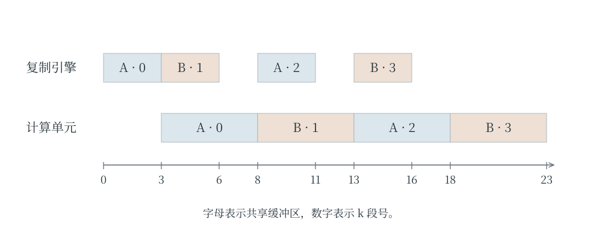
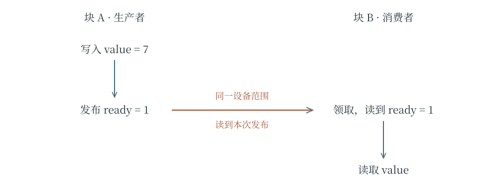

# 第 7 章　GPU 存储系统：数据如何到达计算单元

上章的四个累加器可以同时工作。计算左上角元素时，先要读取 $`X_{00}=1`$ 和 $`W_{00}=2`$，下一步还要读取 $`X_{01}=2`$ 和 $`W_{10}=1`$。计算右上角元素也需要 $`X_{00}`$。这个数可能只从显存进入片上一次，在块内被读取两次，再在寄存器中参与运算。分析数据流量时，需要说清楚统计的是哪一层存储之间的传输。

先建立一个可以自己检查的场景。一个 block 计算一块输出，每个线程负责其中一格，点积期间把自己的部分和放在寄存器里。输入和权重起初在设备全局内存，输出最后也要写回那里。第五章计算 KV Cache 的 16 GiB 是同一时刻占用的空间。本章要数的是请求执行期间，具体哪些字节从哪里到了哪里。

## 7.1　存储层次与数据副本

GPU 常用 HBM（高带宽存储器）作为设备的大容量显存。数值以字节存储，程序用地址找到数据。HBM 通过许多并行通道传送数据，为大量同时发生的访问提供较高的总带宽。从一条具体指令的角度，一次未命中的访问仍可能等待很久。机器把几种更小的存储放在计算单元附近，以便接下来能更快、更频繁地使用同一个数。

| 位置 | 可以复用数据的范围 | 投影中的数据 |
|---|---|---|
| 线程寄存器 | 线程指令直接读写自己的值，指令允许时可在线程间交换 | 自己负责的输出格的部分和 |
| 块内共享存储（shared memory） | 同一 block 的线程按地址读写，程序负责写入、同步和复用 | 同一输出块都要用到的一个输入面板 |
| 一级数据缓存 L1 | 同一 SM 上按相应缓存策略发起访问的工作 | 近期加载过的地址所处的缓存数据 |
| 二级缓存 L2 | 通过设备相应缓存路径访问相同地址的多个 SM | 不同输出块重复使用的部分权重 |
| 设备全局内存的显存后备 | 有相应映射和访问权的执行者 | 权重、输入、最终输出和跨 kernel 保留的状态 |

这几行表格描绘的是可见范围和管理方式。在一些 NVIDIA 架构上，L1 与共享存储使用统一片上容量的一部分，两者可配置的空间会互相影响。缓存由硬件按访问保留与替换，程序可通过布局、访问次序和适用的提示影响命中。共享存储由程序显式安排地址和生命周期，即使两者使用临近的物理资源，编写 kernel 时仍需分别推理。现代设备还提供跨块集群等额外的共享能力，下面的手算只使用一个普通 block 能依赖的机制。[CUDA 存储层次](https://docs.nvidia.com/cuda/cuda-programming-guide/01-introduction/programming-model.html)


*图 7-1　从左向右追踪输入的第一个 1。中央是块内线程共同载入的面板，右侧是两个输出格各自的第一项乘加。这个输入元素入片一次，在片内供两格使用。缓存命中可进一步改变更远一层的流量。*

“全局”描述地址空间和访问范围。发出一条普通全局加载之后，数据可能在 L2 就被找到。反过来，CUDA 的 **local memory** 拥有线程私有的逻辑地址，却可能由设备内存系统提供后备。一个直接后果是寄存器溢出（spill）。本来可以接着使用的临时值被存到该线程的内存位置，以后再加载。缓存命中也会消耗加载指令和片上带宽，未命中还会触及更远的存储。要判断寄存器节省是否合算，应同时看编译后的寄存器数、局部加载和存储，以及真实运行中的事务数。

## 7.2　线程访存与地址合并

第二章的行优先数组中，若每行有 $`N`$ 列，每个元素 4 字节，第 $`(i,j)`$ 项的地址为

```math
a(i,j)=a_0+4(iN+j).
```

同一个 warp 执行一条加载指令时，不同通道可以请求不同的地址。内存系统把它们需要的字节归入对齐的区段，一起发出能够覆盖这些请求的事务，这就是合并访存。在以下计算中，用现代 NVIDIA 所描述的一种常见口径，以 **32 字节 sector** 计数。每个通道读一个对齐 4 字节的数，基地址是 32 的整数倍，所有 32 个通道都活跃。每个数完全落在一个 sector 中，地址 $`a`$ 对应的 sector 编号是 $`\lfloor a/32\rfloor`$。一个 sector 可以属于更大的缓存行，指令触及多少 sector、整个缓存保留多少行、最终从 HBM 搬多少字节需要分别计数。[CUDA 合并访问示例](https://docs.nvidia.com/cuda/cuda-c-best-practices-guide/index.html#coalesced-access-to-global-memory)

令基地址为 0，第 $`l`$ 个通道取 $`4l`$。编号 0 至 7 的通道分享 sector 0，8 至 15 分享 sector 1，整组恰好覆盖四个 sector。总共请求 128 个互不重复的字节，四段也正好 128 字节。现在让每个通道多走一个元素，地址变成 $`4(l+1)`$。从第一个 sector 只取编号 1 至 7，到第五个区段才取到最后一个数，一共五段、160 字节。同样是连续读取，因为起始位置改变，这条指令对所取区段的有用覆盖率从 100% 降到 80%。

把步长增大到 8 个元素，每个通道读 $`32l`$。这次每个 sector 都只用到开头的一个数，需要 32 段，覆盖率 $`128/1024=12.5\%`$。若这些恰好是行宽为 8 的矩阵中的同一列，线程计算的数学目标完全合理，差别出在线程编号被映射到了哪一个下标。改变分工，让相邻通道沿列编号增加，就有机会让它们读到同一段。


*图 7-2　为看清边界，图只展开前八个通道。纵向每行是一个 32 字节区段，每点一个 4 字节字。把同样的编号规律延到 32 个通道，对应 4、5、32 个区段。*

```python
def sectors(addresses, sector_bytes=32):
    return {a // sector_bytes for a in addresses}

assert [len(sectors([4 * (offset + step * t) for t in range(32)]))
        for offset, step in [(0, 1), (1, 1), (0, 8)]] == [4, 5, 32]
```

上面按单条指令数 sector。如果后一组接着读编号 33 至 64，上一组多取得的那一段中恰有它要用的数据，缓存可能命中。程序达到的带宽损失取决于相邻组和缓存状态。还有一个极端，32 个通道一起取同一个 4 字节权重。按每个通道的语义相加是 128 字节，唯一需要的内容只有 4 字节，落在一个 sector 里。这正是应分清**通道请求量、唯一地址量、区段传输量**的地方。使用相同硬件计数器比较两种实现时，也要确认分子取的是其中哪一个量。

### 线程映射与数据布局

上一章权重为两行两列，$`W_{00}`$ 紧挨 $`W_{01}`$。安排两个输出列的线程一起执行 $`k=0`$ 的加载，两个地址就相邻了。安排两个输出行的线程执行同一个输出列，则两者都要 $`W_{00}`$，有广播复用的机会，另一方面两个输入行却可能相距很远。一个线程映射会同时改变 $`X`$、$`W`$ 和 $`Y`$ 的访问形状。选择布局之前把三组地址都列出来，常能解释为什么加速其中一次加载后，总时间反而增加。

有时后续运算需要另一种布局。交换数组的两个步长，可以让程序按转置视图解释数据，但数值的物理位置不变，后续加载访问的仍是原有地址。实际转置则需要读写整个数组，多个后续运算可以共同分担这次开销。在算子内部逐块读入、重排数据，也可以只处理当前需要的数据块。

### 缓存容量与重复读取

缓存每次接收一行数据，空间有限时要决定替换哪一行。为了把容量效应与合并访问分开，考虑一个只能容纳两条缓存行的简化缓存，用 A、B、C、D 表示四条不同的缓存行。每次未命中就读入整行，满时替换最久未使用的那一行，初始为空。若按 A、B、A、B、C、D、C、D 的次序读取，一共只有四次未命中。若按 A、B、C、D、A、B、C、D 读取，每一行再次轮到时它已被挤出，共八次未命中。两种程序的唯一工作集都是四行，每行都恰好使用两次，区别只在两次使用之间夹了多少其他行。


*图 7-3　方格内是当步请求的行，深浅区分需要远处取数与可以从缓存取数。上排的第三、四、七、八次访问复用了近处副本。*

实际缓存还会限制一条地址能放入哪些位置。称这些可选位置组成一个组，每组可容纳的缓存行数叫组相联度。即使整个缓存还有空间，若许多活跃的行恰好竞争同一组，还是会出现替换。具体 GPU 的地址映射、替换和预取策略各有实现。上面的模型用来预测访问次序可能带来的差异，可再通过计数器和冷、热两组运行检查。对于大权重投影，这也是为什么只改输出块的遍历次序，算出来的数和全局加载指令数不动，HBM 读流量却可能改变。

可以用三个地址把组相联度的影响单独挑出来。假设缓存有两组，每组容纳两行，行号为偶数的进第 0 组，奇数的进第 1 组，组内替换最久未用的一行。按 $`0,2,4,0,2,4`$ 访问时，总共只有三行，本该放得进四行的缓存。可它们都要进第 0 组，头一轮读 4 时赶走 0，下一轮读 0 又赶走 2，六次都未命中。只把第三份数据移到行号 5，顺序变成 $`0,2,5,0,2,5`$，头三次填入后再读三次全中。两个算例读取的有效数据同样多。若在真实机器上怀疑某种行距造成冲突，可以保持每次访问的元素数和对齐条件，只改行距，再看未命中是否随之改变。这里用奇偶分组是为了能手算，实际设备的组号未必由行号的最低位决定。

## 7.3　共享内存与 bank 冲突

前一节讨论了怎样把线程的请求合并，减少经过显存接口的数据事务。数据即使已经进入片上，许多线程同时读取时仍可能竞争同一存储资源。下面用 bank 模型分析这种竞争。

共享存储要在一个时刻服务许多线程，内部被划为多个可以并行工作的 **bank**。用一个便于推算的 NVIDIA 模型，32 个 bank，每个 4 字节字占一个位置，相邻字轮流分配。按字编号 $`u=a/4`$，bank 编号为 $`u\bmod32`$。考虑一个 warp 的一次标量 32 位读取。若每个线程落在不同 bank，可同时供给。若多个线程要从同一 bank 读不同字，对该 bank 的工作要拆开服务。如果它们读取相同的字，则可广播。更宽指令、跨事务及其他平台的 bank 组织要另算。[CUDA 共享存储与 bank](https://docs.nvidia.com/cuda/cuda-c-best-practices-guide/index.html#shared-memory-and-memory-banks)

让 32 个线程先按行把一个 $`32\times32`$ 面板写入共享存储，再让第 $`l`$ 个通道读第 $`l`$ 行的第 0 列。其字号为 $`32l`$。所有编号模 32 都是 0，但字号各不相同，于是某个 bank 要服务 32 个不同的字。若在每行末尾留一个不用的字，使物理行距（leading dimension）为 33，则这一列的字号变为 $`33l`$，模 32 的结果恰是 $`l`$。列里的数值、矩阵的数学形状、线程读到的顺序都保持一致，只改变了每行起点的位置。


*图 7-4　图把模 32 缩小为模 4，便于把所有字画出来。数字是 bank 编号，色框指出一次列读。32 行版本中多出的一列要占 $`32\times4=128`$ 字节。*

读者也可以直接从模运算推出一般结论。设线程 $`l`$ 读取字号 $`c+sl`$，步长 $`s`$ 为正整数。32 个线程将访问 $`32/\gcd(s,32)`$ 个不同 bank，每个被触及的 bank 承担 $`\gcd(s,32)`$ 个不同字。步长 2 是二路冲突，步长 8 是八路冲突，步长 31 或 33 可以分散到所有 bank。$`s=0`$ 时每个线程都读同一个字，应单独按广播处理。指令若因宽度而被分解，要分别检查可在同一事务内服务的那组地址。

全局存储的合并与共享存储的 bank 是连续的两道题。让线程先连续读全局内存，再在片上按转置位置存取，可能解决第一道题却制造第二道题。多出来的填充可消除这一例中的冲突，又会增加块内资源占用。倘若它让一个 SM 从常驻四块降为三块，还要回第六章估计少一块并发工作的影响。

还有一种布局可以保留全部 32 列，同时将按列读取的请求分散到 32 个 bank。设共享面板的行列号 $`r,c`$ 都从 0 数到 31，把逻辑上的第 $`c`$ 列放到物理列 $`c\mathbin{\oplus}r`$，其中 $`\oplus`$ 表示按位异或。异或两次同一个数会得到原值，所以每行都是一一对应的重排。第 3 行、第 1 列实际存入第 $`1\mathbin{\oplus}3=2`$ 列，读取时也要按同一规则访问第 2 列。行固定时，32 个列号遍历全部 bank；列固定时，随着行号增长，bank 编号 $`c\mathbin{\oplus}r`$ 同样遍历全部 32 种取值。两种方向的标量读取都只需一轮。

下面在第六章那台有 64 KiB 共享空间的教学 SM 上比较这几种布局。若每块有四个这样的 FP32 面板，其余资源容许四块同时驻留，原布局每块恰好 16 KiB。每行填一个字后，每块变成 $`4\times32\times33\times4=16896`$ 字节，只容三块。异或布局仍为 16 KiB，容得下四块。三种方案各有代价：原布局存在列读取冲突，填充减少了可驻留块数，重排则要求生产者与消费者按新的地址规则读写。实际核对时，先用每格各不相同的输入检查转置结果，再观察共享存储请求拆成的服务轮数、可常驻的块数和运行时间。若标量计数符合预期而向量内核仍慢，应回到具体指令，看一轮请求包含多少字、哪些通道共同参与。CUDA 的 TMA（张量内存加速器）也支持按规则重排共享存储，文档中示范的是以 16 字节元素搬运的转置，读写双方还要满足指定的对齐与分块条件。上面的逐字异或用于手算这项取舍。[CUDA 的 TMA 共享存储重排](https://docs.nvidia.com/cuda/cuda-programming-guide/04-special-topics/async-copies.html) · [Nsight Compute 共享存储指标](https://docs.nvidia.com/nsight-compute/ProfilingGuide/)

## 7.4　矩阵分块的访存量

把手算投影扩成 $`4\times4`$ 乘 $`4\times4`$。为便于计数，输入和输出均为 4 字节，输出从零开始，不读旧的 $`Y`$。一共有 16 个输出格，每格执行四次乘加，共 64 次乘加、128 FLOPs。选一个明确的边界，只数要通过这个边界提交的输入字与最终输出字，暂假定更远层没有缓存复用。

**第一种安排。** 每个输出格独自读四对输入，部分和一直保留在寄存器。每格读 8 个字，16 格共 128 个输入字，最后写 16 个输出字，合计 576 字节。这里的朴素模型让每次标量请求各自通过计数边界。在有合并和缓存的真实实现中，同一个表达式产生的 HBM 字节数会不同。

**第二种安排。** 用一个 block 负责一个 $`2\times2`$ 输出块，四个 block 覆盖完整输出。沿 $`k`$ 分成两段，每段长度 2。算左上块且处理第一段 $`k`$ 时，只需把 $`X`$ 的左上 $`2\times2`$ 和 $`W`$ 的左上 $`2\times2`$ 各读进一次，共 8 个字。四个线程从这两块中各取两对数，形成四个部分和。下一段改读 $`X`$ 的右上块与 $`W`$ 的左下块，各 4 个字，继续加到原来的四个寄存器中。于是每个输出块读 16 个字，共读 64 个字，再写 16 个字，合计 320 字节。


*图 7-5　按色框定位每一段的左、右操作数。两次相遇都更新同一个左上输出块。邻近输出块还会需要其中一侧面板，如果可在更近的缓存命中，它们可以继续复用。*

**第三种安排。** 若整个问题的两个输入都能在通过计数边界后保留到最后一次使用，$`X`$ 的 16 个字、$`W`$ 的 16 个字各读一次，再写 16 个输出，合计 192 字节。这给出了冷输入、完整写回、无重复传输且忽略事务取整的理想有效载荷。三种安排都完成 128 FLOPs。每字节对应的有用浮点运算从 $`128/576`$ 增到 $`128/320`$，再到 $`128/192`$。这个比值叫算术强度，第八章将给它配上带宽，换算成时间。

| 计数边界与安排 | 输入字 | 输出字 | 输入在边界以内怎样重用 |
|---|---:|---:|---|
| 每次标量操作数都跨边界 | 128 | 16 | 一个线程只保留自己的累加器 |
| 每个输出块的每段面板各进一次 | 64 | 16 | 同一面板给两行或两列输出使用 |
| 两张完整输入各进一次 | 32 | 16 | 最后一个消费者用完前都保留 |

沿着第二种安排再往里数一层。如果每次标量乘加从共享面板显式读两个字，块内仍有 $`64\times2=128`$ 次输入字读取，和 64 次累加器更新。让单个线程同时负责多个输出后，某个共享加载的字又可以在寄存器中被重复使用。于是一次“减少读数”的优化可以只减少共享存储访问，而 HBM 流量几乎不动。以后看性能分析器，先找计数器对应哪条边，再决定要改变哪一层的复用。

## 7.5　带宽、延迟与并发请求

分块复用减少了需要跨边界搬运的数据，但剩下的数据仍要及时送到。接口的带宽是持续传输能力，单次请求的等待时间则决定了要同时保留多少个请求，才能接近这个能力。

一次未命中的请求从发出到返回需要 $`L`$ 秒，一次请求能带回 $`s`$ 字节。只有一个请求可在途时，即使接口支持很高峰值，长期平均仍至多得到 $`s/L`$。若平均同时有 $`q`$ 个独立请求在途，稳态下“在途数 = 每秒完成数 × 平均停留时间”。以字节表示，要支撑有效带宽 $`B`$，平均在途数据至少需要达到

```math
D_{\mathrm{flight}}=BL,\qquad q=BL/s.
```

这里 $`B`$ 的单位是字节每秒，乘以以秒计的 $`L`$，得到在一次往返期间接口能够传输的字节数；再除以每个请求的字节数 $`s`$，得到需要维持的平均请求数。结果通常不是整数，规划数量时应向上取整。这个估算假设请求足够独立且系统达到稳定状态。

假设一个教学接口能传 $`1.5\times10^{12}`$ B/s，一段固定请求往返 400 ns，则要平均保持 600000 字节在途。如果这里的独立请求按 128 字节计，至少要有约 4688 个并发请求才能达到目标。该数字按整个给定接口计，它可以由许多 SM、warp 和每条指令的多个请求共同提供。这里的 128 是为这笔在途预算选定的服务单位，与 7.2 节统计的 32 字节 sector 可处在不同事务层次。


*图 7-6　在固定延迟的教学模型中，4096 个在途请求支撑约 1.31 TB/s。水平线表示接口的传送上限。真实高负载下排队会使平均经历时间变化。*

例如读一张指针表，每条记录只告诉你下一条的地址。单条链的下一次请求无法提前发出，即使每次都装入 128 字节且都算有用，400 ns 一次也只有 0.32 GB/s。若一次只使用返回的 4 字节索引，其有用带宽更小。改为同时跟踪很多条彼此独立的链，可以增加在途数，代价包括保存每条链的当前状态和使不同请求及时就绪。第五章动态稀疏注意力的一次读取就可能出现类似的两段依赖，索引阶段先选出位置，主体阶段才能使用这些地址取值。

怎样区分并发访存不足与带宽已经饱和？可以设计一次控制实验。先固定数据规模大于目标缓存的容量、地址模式、每次加载的字节数以及总有用工作。只改变同时跟踪的独立链数，记录每步实际处理的元素数和时间，并观察 HBM 字节与带宽。当吞吐随并发明显上升、HBM 带宽还低时，继续暴露独立访问可能有益。当带宽已接近同设备、同读写方向的可持续水平，增加在途数主要使排队加深，应把注意力移到能否少读、读得更规整。一条耗时数字本身无法作此区分。

## 7.6　双缓冲与同步

增加在途请求可以提高传输并发，计算和传输之间还存在另一种等待：当前块算完后，下一块可能尚未到达。预先搬运可以缩短等待，但必须确保缓冲里的数据已经写完、也没有被正在使用它的线程覆盖。

考虑前面的 $`2\times2`$ 输出块。处理第 0 段 $`k`$ 时，线程已经知道下一段两块面板的地址。如果搬运引擎可以与算术单元同时工作，就可以准备 A、B 两套共享面板，在计算当前段时预取下一段。计算完成后，两套面板交换用途。这种**双缓冲**需要满足两个同步条件。

首先，计算线程读取面板前，必须确认异步复制已完成，并按照所用 API 建立块内可见性。发起复制的指令返回，并不表示数据已经到达。其次，搬运线程覆盖缓冲区 A 前，必须确认所有使用 A 的计算线程都已完成读取。屏障用于协调参与线程的执行位置，事件或流水线原语还可以标记异步操作的完成。具体实现可以采用集体复制、等待和块内屏障，也可以使用带阶段标记的生产者—消费者协议。使用普通块级屏障时，参与线程的执行路径须遵守一致到达的约定。[CUDA 异步数据复制](https://docs.nvidia.com/cuda/cuda-c-best-practices-guide/index.html#asynchronous-copy-from-global-memory-to-shared-memory)

下面用一个数值例子检查第二个条件。如果 A 保存 $`k=0`$ 面板，计算右上角输出时需要读取 $`X_{00}=1,W_{01}=-1`$。假如计算线程还没读到 1，搬运操作已用下一段的 2 覆盖同一位置，计算结果就可能变成 $`2\times(-1)=-2`$，与正确的 $`-1`$ 相差 1。如果新旧值恰好相同，这组输入可能无法暴露错误。因此，同步协议必须保证所有读取完成后才开始覆盖。



*图 7-7　每次复制耗 3，计算耗 5。观察 A 的两次写入之间何时完成第一次读取。时间轴假设复制和计算各有独立资源，且已计入必要的先后关系。*

设共处理 $`n`$ 段，复制耗时 $`c`$，计算耗时 $`u`$，每类资源各次操作串行，两类可完全重叠。单缓冲依次完成两项，共 $`n(c+u)`$。双缓冲的第一段先复制，之后的段间间隔至少为 $`\max(c,u)`$，最后一次计算还须结束，总时长为

```math
T=c+(n-1)\max(c,u)+u.
```

取 $`n=4,c=3,u=5`$，串行耗时 32，理想双缓冲耗时 23。第一段在 0 至 3 复制，3 至 8 计算，第二段的复制在 3 至 6 完成并等到时刻 8 开算。第三段复用 A 时，必须等时刻 8。若只处理一段，总时长仍是 8。如果两套面板使每块共享存储翻倍、常驻块数下降，或者复制和计算同时争用片上通路，实际收益还要扣除这些代价。这正是即便有异步复制指令，也应实测单缓冲版本与双缓冲版本的原因。

再考虑一种搬运接口。一段面板从发出到可读需要 9 拍，但接口每隔 2 拍就能接收下一段，允许多段同时传输。计算每段需要 3 拍。这里的传输延迟是 9 拍，连续发起请求的最小间隔是 2 拍；分析流水线时需要分别考虑这两个数。

仍按面板序号顺次计算，一段算完才归还它的槽。用两个槽准备八段，前两段在第 0、2 拍发出，第 9、11 拍就绪，计算占据 $`[9,12)`$、$`[12,15)`$。第三段最早第 12 拍才能占回第一个槽，到第 21 拍才可读。于是计算单元在第 15 至 21 拍空等。用四个槽时，另外两段已在第 4、6 拍发出，计算可以连续做到第 21 拍。第五段复用第一个槽，恰好从第 12 拍搬到第 21 拍，赶上下一个计算位置。

| 面板槽数 | 前四段的发出时刻（拍） | 八段全部完成（拍） |
|---:|---|---:|
| 1 | 0，12，24，36 | 96 |
| 2 | 0，2，12，15 | 51 |
| 3 | 0，2，4，12 | 39 |
| 4 | 0，2，4，6 | 33 |


*图 7-8　点是发起搬运的时刻，九拍后才能使用。沿上排的 2 号点向后数九拍，双槽的第三段要等到第 21 拍才能开算。下排提前发起同一段，填上了计算行的空白。*

表中最后一行已经达到这台教学机器的极限。第一段最早第 9 拍就绪，之后八段共需 24 拍计算。稳态下若希望每 3 拍开始一段计算，一个槽从发起搬运到消费者读完至少被占 $`9+3=12`$ 拍，需要的槽数至少是 $`12/3=4`$。如果接口改为每 5 拍才能接一段，加槽也达不到每 3 拍一段的供应率。把这里的四个槽落实为每槽 16 KiB 的面板，单个块便占满那台教学 SM 的 64 KiB。实际还可以让几个块各自维持较浅的流水，共同把接口中的请求数提上去。比较两种设计，要同时记下整个 SM 的在途工作和每个块自己的等待。

## 7.7　主机内存与扩展内存

上一章让输入事先就位。现实中词元通常先在 CPU 侧整理，再传到设备。主机主存和独立 GPU 的本地显存具有不同的容量和访问路径。**统一虚拟地址空间**允许系统用统一的地址体系识别不同种类的分配。是否能在某一处理器直接解引用某个具体地址，仍取决于分配类型、映射和访问权。**统一内存**则进一步提供管理放置、映射或迁移的机制，具体行为随硬件、系统与提示而异。于是一个指针值可以持续有效，而服务它的数据此刻可能在链路另一端。

显式复制时，常先在主机准备一块页锁定（pinned）缓冲。操作系统保证这些页在传输期间维持可供设备直接访问的后备，让 DMA 引擎能按约定完成复制。普通可分页缓冲的传输在一些路径中要先经过临时的页锁定缓冲。页锁定内存是有限的系统资源，要按队列深度管理其生命周期。异步提交之后，主机若马上改写输入缓冲，可能与仍在读取它的 DMA 冲突。这里的“最后一个消费者”已经从块内线程换成了一个设备引擎。[CUDA 主机与设备间的数据传输](https://docs.nvidia.com/cuda/cuda-c-best-practices-guide/index.html#data-transfer-between-host-and-device)

举一个预算。16 MiB 的输入经过一条单向有效带宽 32 GB/s 的教学链路，光传输有效载荷就需约 0.524 ms。若设备计算恰耗 0.20 ms，输出很小，且必须先传完整块再算，则这一批至少约 0.724 ms。连续来两批时，若使用两个互不覆盖的主机和设备缓冲、独立的复制与计算引擎，并用事件让第二次计算等它自己的复制完成，可以让第二次输入复制和第一次计算重叠。理想总时间约为 $`2\times0.524+0.20=1.248`$ ms，直接串行约为 1.448 ms。如果下一批输入依赖第一批输出，这种提前复制的机会就会消失。

主机到 GPU 的数据传输也可能经过不同路径。双插槽服务器的物理内存分布在不同 NUMA 节点。假定 GPU 连接第一个 CPU 插槽的 PCIe 根端口，输入页却分配在第二个插槽，那么读取还要经过插槽间互连。进程中的指针本身不能反映这条物理路径。Linux 的默认本地分配策略通常在首次实际分配物理页时选择执行线程所在节点；显式策略、可用容量与 cpuset 约束都可能改变放置结果。[Linux NUMA 内存策略](https://docs.kernel.org/admin-guide/mm/numa_memory_policy.html)

怎样证实慢发生在哪里？先查 GPU 与两个 NUMA 节点的拓扑，分配两块等大的主机缓冲，让预期节点的线程先写满各自的页，并核对实际放置。两块都登记为页锁定缓冲，按相同方向传给同一 GPU，比较预热后的完成时间。假设在该大小下两条路径分别量到 24 与 12 GB/s 有效载荷吞吐，那么 64 MiB 单向复制分别需要约 2.80 与 5.59 ms。这里的两个带宽是教学输入。页数、页锁定方式、设备计算以及另一条传输是否同时占链路，都要保持一致。若差异随放置互换而反转，就有了定位证据。这样的差异发生在算子启动以前，调整片上分块不会使这些字节提前到达。[CUDA Best Practices Guide](https://docs.nvidia.com/cuda/cuda-c-best-practices-guide/index.html#numa-best-practices)

最后回到那份 16 GiB 的 KV Cache。把它从显存迁到主机可能让请求放得下，但如果下一个词元要经一条有效 32 GB/s 的链路重新取回全部 16 GiB，仅单方向就约需 537 ms。第五章用 3 TB/s 设备侧读带宽预算得到约 5.73 ms。两次估算读取的是同样的逻辑历史，传输路径不同，所需时间相差近两个数量级。若只迁移稀疏选择后的少数页，要重新数索引、实际页数和预取能隐藏的部分。这些数字说明，容量扩展解决了存储空间的问题，访问路径仍可能限制运行速度。下面继续考察扩展内存的访问方式，以及多个处理单元共享数据时的同步要求。

### 容量扩展与访问带宽

沿着一次缺失继续往外走。进程若拿到一段可寻址的扩展内存，指令表面上仍然是“读这个地址”，底层却可能要跨过主机的互连。CXL.mem 为主机访问设备侧内存提供协议；能否从 GPU 使用、通过哪条路径以及能否缓存，要看具体主机、设备和软件配置。本例只讨论主机读扩展内存。**地址能被访问、多个处理者能否看到一致的数据、请求能以多高的速率完成，是三个不同的问题。** [CXL 规范](https://computeexpresslink.org/cxl-specification/)

假设一批特征占 64 MiB，本地内存不够，把其中冷的 16 MiB 放到扩展层。设本地有效读取速率 100 GB/s，远端链路 16 GB/s；一次扫描每个特征都恰好用到且首次不命中。逐段串行读的理想时间为 $`48\times2^{20}/10^{11}+16\times2^{20}/(16\times10^9)`$ 秒，即约 1.55 ms；若两种读取真能完全重叠且没有共享瓶颈，下界约 1.05 ms。把总字节除以两种带宽之和会得到约 0.58 ms，连必经远端链路的 1.05 ms 都没有付足。若工作负载实际只访问 1 MiB 冷数据，则要按实际流量重新计算。放置时常用访问频率而非分配容量来定义冷热，原因就在这里。

再把访问改成追指针：一个返回值指定下一个地址。即使总量很小，单个请求也无法预先发出整串读取，此时要算每跳延迟，不能只除以流式带宽。做测量时分别跑顺序扫描、独立并发随机读、单链依赖读，记录数据位置和缺失率；前两者很快而第三者很慢，是判断“搬得慢”还是“下一次地址来得晚”的有用反例。

## 7.8　缓存一致性与内存可见性

回到矩阵乘。设第一个工作块把一格部分和 7 写到全局地址 `value`，再把地址 `ready` 中的标志位从 0 改成 1。另一个块在另一台 SM 上计算后半段。它若读到 1 就去取 7。这里有两个独立地址。即使硬件能让所有观察者最终同意每个地址各自的值，也还要规定两次写与两次读之间的先后。前一个问题叫**缓存一致性**（coherence），后一个问题属于**内存一致性模型**（memory consistency model）。一次实验恰好读到 7，对下一次调用没有约束力。

可以把通信写成一份只用一次的合同。初始化在 kernel 启动前完成，只有一个写者，发布以后没人再覆盖这格数据。下面的两列在不同线程执行，`ready` 是双方共享的设备范围原子对象。读者只尝试领取一次；尚未就绪时由外层稍后安排工作。

```text
生产者                              消费者
value = 7                           if ready.load(acquire) == 1:
ready.store(1, release)                 use(value)
```

左列的 release 把此前的写排在发布之前。右列的 acquire 若读到本次发布的 1，就把随后读取 `value` 的操作排在这次原子读取之后。沿图 7-9 从左上走到右下，四个事件连成一条 *happens-before* 关系，此时读取线程必须取得 7。若两端只用 relaxed 操作，标志位自身的读写仍是原子的，普通载荷的跨线程读写却缺少同步，可构成数据竞争。把作用域缩到各自线程块，也无法连接两个不同的块。把载荷改成 `volatile` 或要求某一次读绕过 L1，都补不出那条关系。[CUDA C++ 内存模型及线程作用域](https://nvidia.github.io/cccl/libcudacxx/extended_api/memory_model.html) [PTX 内存一致性模型](https://docs.nvidia.com/cuda/parallel-thread-execution/index.html#memory-consistency-model)



*图 7-9　竖向表示同一线程内的先后。横边只在领取读到对应发布、且作用域包含双方时成立。删除横边，虽然两列各有顺序，却再也走不到对面的载荷读取。*

为什么这项区分对跨代移植重要？沿全局加载走一遍，靠近执行单元的 L1 可随型号、指令和配置改变。PTX 对普通全局数据描述了在 L2 层的一致性，并明确说缓存操作符属于性能提示。它们允许程序表示想把一次访问缓存在何处。它们不替程序员定义跨地址、跨线程的发布关系。[PTX 缓存操作符与全局加载](https://docs.nvidia.com/cuda/parallel-thread-execution/index.html#cache-operators)

| 代际与代表器件 | 顺着一次访问看到的变化 | 移植上面的通信时要检查什么 |
|---|---|---|
| Fermi、Kepler | Fermi 的普通全局加载可经 L1、L2。Kepler 的常见默认全局路径在 L2 缓存，GK110 另有只读路径，部分后期型号允许选择 L1。 | 只读路径要求数据在相应执行期间满足只读条件。不能用它读取其他线程正在改写的标志位。 |
| Maxwell、Pascal | GM204 提供启用全局 L1 缓存的选择。即使同属 Pascal，GP100 普通全局加载默认经 L1，GP104 的默认行为也不同。 | 相同工作集，换卡后 L2 请求数可能改变。观察命中率前记录具体芯片和编译选项。 |
| Volta、Turing | 共享内存与 L1 使用统一的片上资源。Volta 起支持独立线程调度。 | 同一 warp 中通过共享内存交换数据，也要用包含参与线程的同步。另一块的读者仍需跨块协议。 |
| Ampere | 可对合适的全局访问设置 L2 驻留策略，也可发起从全局到共享的异步复制。 | 前者改变逐出倾向。后者要等复制完成，并在共享缓冲被其他线程使用或复用处交接。 |
| Ada | 延续统一的 L1／共享内存组织，部分产品大幅扩大 L2。较大的工作集可能在设备端缓存中留得更久。 | 容量改变的是命中机会。独立线程块之间继续使用覆盖双方的同步。 |
| Hopper | 线程块簇允许簇内寻址分布式共享内存；某些异步引擎通过单独的访问代理读写。 | 簇内线程块的生命周期、簇同步和异步代理的可见性都有明确条件；跨簇全局数据仍要选覆盖双方的范围。 |
| Blackwell 数据中心 GPU | 一颗 B200 中的两个裸片对软件呈现为一个 GPU。其他 Blackwell 产品的物理组织要按型号核对。 | 设备范围以逻辑设备为界。跨两颗设备或让主机参与，还要核对系统范围原子和相应内存分配的支持。 |

沿这张表纵向读，增加缓存、增加可协作的线程范围、引入新的搬运者，是三类不同的改进。以 Hopper 为例，普通线程先写共享缓冲，随后异步引擎从中读取。即使同一个线程已经走到发起指令处，仍应按该指令规范建立普通访问与异步代理之间要求的 fence。反方向从引擎取结果，又要按操作指定的完成机制等待。把新机器的搬运指令替换进旧循环时，原有两个线程间的屏障只证明了其中一段。[Kepler 指南](https://docs.nvidia.com/cuda/archive/11.1.1/kepler-tuning-guide/index.html) [Maxwell 指南](https://docs.nvidia.com/cuda/archive/11.1.1/maxwell-tuning-guide/index.html) [Pascal 指南](https://docs.nvidia.com/cuda/archive/12.9.0/pascal-tuning-guide/index.html) [Volta 指南](https://docs.nvidia.com/cuda/volta-tuning-guide/index.html) [Ampere 指南](https://docs.nvidia.com/cuda/ampere-tuning-guide/index.html) [Ada 指南](https://docs.nvidia.com/cuda/ada-tuning-guide/index.html) [Hopper 指南](https://docs.nvidia.com/cuda/hopper-tuning-guide/index.html) [Blackwell 架构](https://www.nvidia.com/en-us/data-center/technologies/blackwell-architecture/)

再看一个流量计算。四个 SM 各读同一段对齐的 128 B 系数八次。一共消费 $`4\times8\times128=4096`$ B。若各自的 L1 在首次读后都留住这段系数，L1 向下只请求 $`4\times128=512`$ B 有效载荷。若绕过 L1 且每次请求都到 L2，则是 4096 B。假定 L2 初次填入后一直命中、没有并发重复取回，两种情形都可能只从 HBM 取 128 B。这里数的是理想载荷；实际事务粒度、合并、逐出和计数器口径都会改变测量。要检验该解释，可固定访问序列，同时比较 L1、L2、显存三处的请求或字节。只盯显存带宽会错过一次八倍的片上流量变化。


*图 7-10　每个刻度按两倍递增。最上排写程序消费的载荷，中排写向 L2 的请求，底排写理想显存填充。两端数字相同、唯独中排不同，正是只看显存计数器会漏掉的性能差别。*

再看 CPU 和 GPU 之间的数据共享。传统离散卡上的主机缓冲与设备副本是两份存储，CPU 修改原数据不会自动修改设备副本。Grace Hopper 的 NVLink-C2C 提供有硬件一致性支持的处理器间访问路径，可让双方在受支持的配置中访问同一份数据。这样可以减少一份副本，但仍需明确读写顺序，并选择覆盖 CPU 和 GPU 的同步作用域及支持相应原子操作的内存。如果两个处理器交替修改同一小块数据，每次交接都可能产生跨链路通信。将多个元素合批处理，可以减少交接次数：一次处理一个或十六个元素，即使每次传输的有效载荷都只有 64 B，协议往返次数也可能从十六次降到一次。实际收益取决于业务是否允许等待批次凑齐。[Grace Hopper 的一致性互连与内存访问](https://developer.nvidia.com/blog/nvidia-grace-hopper-superchip-architecture-in-depth/)

最后检查进度。若让已经占满设备的消费者块一直自旋，而生产者块还没被调度，正确的原子指令也不能保证生产者取得执行机会。可以把这两个阶段拆为同一流中依次提交的两个 kernel，交接更容易证明，代价是阶段边界与启动开销。若需多轮复用同一槽，还要给每一轮编号，并在所有消费者读完后通知生产者该槽可以重新写入；上一轮留下的 1 不能证明下一轮的部分和已经写好。

本章从地址排列、缓存复用和并发访存解释了数据如何送到计算单元，也说明了何时可以安全地读取或改写它。下一章把这些存储约束与计算能力放在同一个性能模型中，比较不同设备适合的工作负载。

## 练习与解答

### 1. 一条未对齐读取会放大多少

32 个通道各读一个 4 字节字。第 $`l`$ 个读字号 $`7+l`$，初始地址按 32 字节对齐。求这条指令覆盖的 sector 数。若下一条读字号 $`39+l`$，两条合起来最少覆盖多少不同 sector？

**解答。** 第一条读字号 7 至 38，对应 sector 0 至 4，共五段。第二条读 39 至 70，对应 4 至 8，共五段。按指令相加为十段，取并集只有九段。若共享的第 4 段在第二次访问时命中，就不必再次从更远一层取回。这两个数字分别用于不同的计数边界。

### 2. 共享面板该加几列

32 个线程读一列不同的字，物理行距分别为 32、34、35 个 4 字节字。分别有多少 bank 被用到，每个被用到的 bank 要提供几个不同字？一行填充到 35 总比 33 好吗？

**解答。** 与 32 的最大公约数分别为 32、2、1。三种情况依次是一个 bank 提供 32 字，16 个 bank 各提供两字，32 个 bank 各提供一字。33 和 35 的行距对此列访问都能均匀分散，35 会占更多空间，还需检查别的访问和对齐要求。

### 3. 改变输出块的长宽

仍算 $`4\times4`$ 投影，用 $`1\times2`$ 输出块，$`k`$ 段长仍为 2，每块每段的两张小面板各读一次。求总字节数。

**解答。** 一共有八个输出块。每块每段读 $`1\times2`$ 个 $`X`$ 字和 $`2\times2`$ 个 $`W`$ 字，共 6 字，两段 12 字。八块读 96 字，加最终 16 个输出字，合计 448 字节。和 320 字节方案相比，$`W`$ 面板在同一个块内沿输出行方向的复用减少了。

### 4. 哪一套缓冲先被覆盖

三个区间都要复制 5 拍、计算 2 拍，用双缓冲 A、B、A。写出最早的复制与计算时间。第三次复制开始时，A 安全吗？

**解答。** 复制依次占 $`[0,5),[5,10),[10,15)`$，计算依次占 $`[5,7),[10,12),[15,17)`$。第一次对 A 的计算在时刻 7 已结束，第三次复制从 10 开始，满足复用条件。总时长 17，对应 $`5+2\times5+2`$。这次受复制节奏限制，加快本就较短的计算对稳态间隔帮助较小。

### 5. 同一次访问经过的三种带宽

某 kernel 用 2 ms 完成 3 GB 的通道逻辑读取，L2 至计算侧计到 2 GB，HBM 侧实际读 1 GB，暂不计写。三个层次对应的速率是多少？如果 HBM 实测可持续上限为 1 TB/s，能断定它已经满带宽吗？

**解答。** 采用十进制单位，分别是 1.5、1.0、0.5 TB/s。只有 0.5 TB/s 能与给定的 HBM 上限直接相比。平均值约为该上限的一半，还需按阶段检查是否有短时间饱和、是否缺少在途请求，以及近处通路或执行依赖是否限制了进度。

### 6. 怎样区分缓冲区的不同使用轮次

一个设备范围的原子标志位从 0 变为 1 后再也不复位。生产者随后准备复用缓冲写 9。消费者用 acquire 读到 1，能把这次读取当作“9 已经就绪”吗？

**解答。** 不能。这个 1 可以来自发布 7 的第一轮，不能证明第二轮写 9 已经完成。若读者还在读，覆盖普通载荷还可能构成数据竞争。一种解法是让消费者在读完后发布归还通知，生产者领取后才能覆盖，再用新的轮次号发布 9。队列若允许多个读者，还须等本轮最后一个读者交还。

本章的地址枚举、逐块读写计数和流水线时间均可直接复算。[第二篇复算程序](../../experiments/part02/verify.py)

[全书目录](../../README.md) · [上一章 · 从 CPU 到 GPU：怎样让许多计算同时进行](ch06.md) · [下一章 · 从 GPU 到 TPU 与 NPU：架构的取舍和性能边界](ch08.md)
