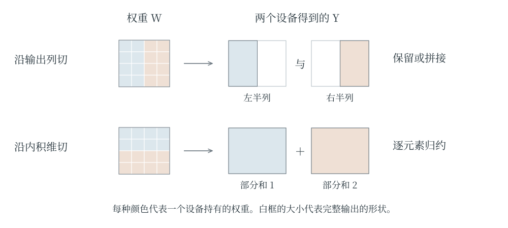
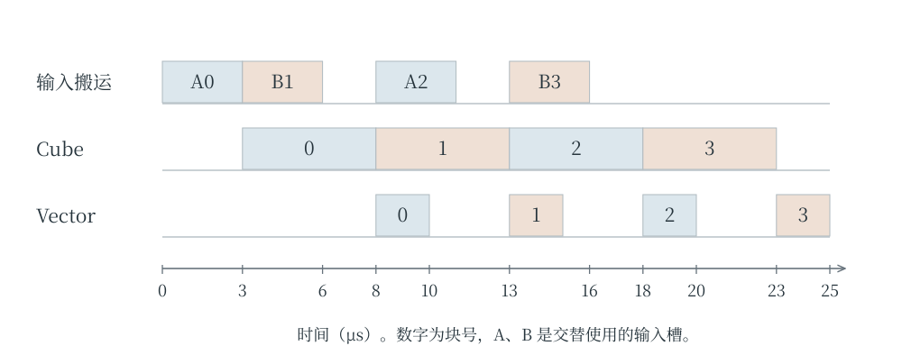
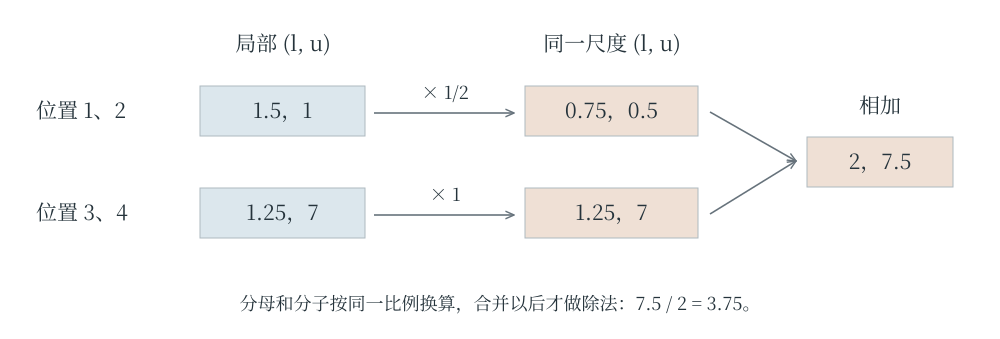
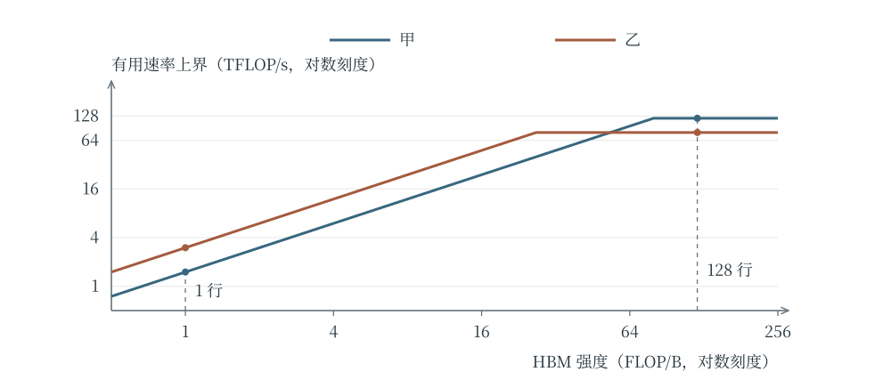

# 第 8 章　GPU、TPU 与昇腾的计算架构

给三种处理器出同一道题。输入和权重沿用第六章的两张小矩阵，先算出两行结果 $`(4,5)`$、$`(10,9)`$，再给每行加偏置 $`(-6,0)`$，最后用 ReLU 把负数置零。答案应为 $`(0,5)`$、$`(4,9)`$。特意给第一列减 6，是为了让激活函数真有一项工作可做。现在分别去三种芯片上找这四个数。乘法由谁做？加偏置时，刚算出的 4 还在手边吗？只送一行输入，与一次送 128 行，哪一步最吃力？

## 8.1　GPU 的矩阵指令与算子融合

在 NVIDIA GPU 上，算子库可以让一个线程块负责一片输出。线程按行列编号选取要搬的面板，warp 协作把矩阵乘交给 Tensor Core，末尾再用普通运算指令给每列加偏置、比较大小。以支持寄存器累加的指令路径为例，乘法结束时，4 和 5 分布在负责这些位置的线程寄存器中。若库提供合适的融合实现，线程在写回之前就可以分别算 $`\max(4-6,0)=0`$ 和 $`\max(5+0,0)=5`$。模型在纸上写了三个运算，设备只须写回最终输出。[CUTLASS 对矩阵乘主循环与输出处理的划分](https://docs.nvidia.com/cutlass/latest/media/docs/cpp/efficient_gemm.html)

GPU 的长处在这种组合自由。程序可以改变线程分工，也可以在矩阵运算旁插入索引、变长掩码或自定义激活。付出的代价也具体。如果加偏置和 ReLU 另起一个内核，前一个内核就要先把中间张量保存到设备全局内存，后一个再读。若尝试全部塞进一个内核，寄存器和共享内存可能紧张，可同时驻留的块变少。遇到一个新的运算组合，工程师要比较库实现、融合实现和各自实际产生的流量。


*图 8-1　追的是乘法刚刚算出的四个数。若下一项运算能直接接住它们，中间张量可以省掉一次写与一次读。若交给另一内核先存后取，能否命中 L2 还会影响有多少字节到达 HBM。*

什么时候值得留下这个乘法的末尾，在原处多做几条指令？先给它定个量级。把输出放大到 128 行、每行 4,096 列，BF16 中间张量正好占 1 MiB。分两次启动，第一段存、第二段取，在两个内核的边界上共 2 MiB。若这些字节全要经过带宽 2 TB/s 的 HBM，就占用约 1.05 微秒接口时间；如果大部分能从 L2 取得，这部分 HBM 时间就会小得多。一旦把中间结果保留为 FP32，张量和相应的读写量又都翻倍。因此遇到“融合可以省一次访存”的说法，要能指出省的是哪一份结果、它有多大、原先在哪里交接。

还得核对两次实现到底在算什么。假设某个 FP32 部分和恰好是 $`1+1/256`$，偏置为 $`-1`$。在 1 附近 BF16 的相邻可表示数是 1 和 $`1+1/128`$。若先把中间值按就近、偶数舍入写成 BF16，它恰在中点，会舍到 1，再加偏置得到 0。若把偏置加在 FP32 累加器上，最后才转 BF16，就得到仍可精确表示的 $`1/256`$。两者经过 ReLU 后依然不同。比较运行时间前，先约定中间舍入是否属于算子定义；若需要逐位复现，融合实现也可以显式保留这次舍入。这样一次数值对照，能避免把改变计算规则带来的收益误算成硬件进步。

## 8.2　TPU 的脉动阵列与张量分片

另一种搭法是让数自己沿着相邻单元前进。画四个处理单元，排成两行两列。每格从左侧接收一个输入，从上侧接收一个权重，做一次乘加，把输入送给右邻、权重送给下邻，部分和留在原格。这是一种**脉动阵列**的数据流。为看清它为什么能少取数，我们约定每拍移动一格，并让第二行输入和第二列权重各比第一行、第一列晚一拍。这样单元 $`(i,j)`$ 在第 $`i+j+k`$ 拍恰好收到属于内积第 $`k`$ 项的两个数。


*图 8-2　从左到右，每拍有 1、3、3、1 个单元在做有效乘加。沿左上格能读出 2 和 4；右下格要晚两拍才收到第一对数，最后得到 9。图示采用输出留在原格的教学阵列。*

第一拍，左上格遇到 1 和 2，记下 2。这两个数随后会离开这个格，1 传向右边，2 传向下边。第二拍，右上格拿刚送来的 1 乘 $`-1`$，左下格拿 3 乘刚送来的 2；同时左上格又收到 2 和 1，把自己的结果补到 4。于是从左边界进入一次的 1 已在两格发挥作用。总共八次乘加，用了四拍；四格每拍都工作本可做十六次，这道小题只用上一半位置。对于 $`r\times c`$ 个有效输出和长度为 $`k`$ 的内积，同一理想时序需 $`r+c+k-2`$ 拍。内积更长、持续有下一块输入时，阵列更容易填满。短边、不规则形状和补齐的空格都会降低有效利用率。

Google TPU 的矩阵乘单元（MXU）采用脉动阵列。上面的四格用来推导数据怎样复用，各代芯片的阵列尺寸、数据装载和驻留方式有自己的实现。TPU 也有标量与向量单元。矩阵乘结束后，加偏置和 ReLU 可以由向量侧接手，编译器安排分块、布局、片上缓冲以及它们之间的依赖。在具有向量内存（VMEM）的产品上，让可复用的数据留在片上有助于减少 HBM 往返。若结果需要跨计算块重排或跨芯片汇合，这项开销仍须算进去。[Google Cloud TPU 架构](https://docs.cloud.google.com/tpu/docs/system-architecture-tpu-vm) [第一代 TPU 论文](https://research.google/pubs/in-datacenter-performance-analysis-of-a-tensor-processing-unit/)


*图 8-3　把图 8-2 的四格放回芯片里，就得到图中央的 MXU 局部。Google 所称的 TensorCore 还包含标量、向量等单元，比较两家规格时要先核对这个名字指的是多大一块硬件。*

投影规则、批量足、编译器能够提前安排形状时，这种设计很有吸引力。另一端的难题是模型里的不规则访存和芯片间搬运。TPU v4 为嵌入等负载配置 SparseCore，并用可重构光交换连接大系统；到了 TPU7x（Ironwood），一颗芯片上有两个 chiplet，各有 96 GiB HBM，运行时可将它们暴露为两个设备。把需频繁交换的数组切在这条边界上，不能把总计 192 GiB 当成到处等距的一块内存。Google 在第八代又分别强调 8t 的训练规模、8i 的低延迟推理，2026 年 11 月公布的 8i Max 则同时增加片上存储和 HBM 带宽，面向更大的上下文工作集。读这些型号时，可以追问它增加的是阵列位置、存储容量，还是每秒能送到阵列的字节。[TPU v4 论文](https://arxiv.org/abs/2304.01433) [TPU7x 的芯粒与内存](https://docs.cloud.google.com/tpu/docs/tpu7x) [第八代 TPU 技术说明](https://cloud.google.com/blog/products/compute/tpu-8t-and-tpu-8i-technical-deep-dive) [8i Max 的设计目标](https://cloud.google.com/blog/topics/ai-infrastructure/tpu-8tx-and-tpu-8i-max)

阵列为什么特别在意输入形状？回到四格的小阵列。内积从 2 项加长到 8 项时，仍然只花两拍把数据推进到右下角，做完却已有 32 次有效乘加。总计 10 拍、40 个计算位置，有效比例从二分之一升到五分之四。把阵列做大后，还多出另一种空闲。假定库选用行方向 128 对齐的计算块，两条请求分别贡献 63 行和 65 行，它们用同一套权重。各做一次时要安排两个 128 行块，共有 256 行位置，实际只用一半。若两条请求已经同时到达，把它们前后接成 128 行，一块就能算完，再按第 63 行边界拆回结果。若第二条请求要晚两毫秒，省下一块计算也未必补得回第一条的等待。Google 的调优文档按芯片代际和形状讨论补齐；128 是这道题选的块高，不能直接当成所有 TPU 运算的规则。[TPU 的矩阵形状与补齐](https://docs.cloud.google.com/tpu/docs/performance-guide)

扩到两个设备，问题又进了一层。让 $`X`$ 有 128 行、宽 4,096，权重 $`W`$ 为 $`4096\times4096`$。两种分法都能把 BF16 权重从 32 MiB 平分为每设备 16 MiB，但“分了一半”还不能告诉我们通信量。



*图 8-4　两行取自同一个矩阵乘法。上行可把两片输出左右拼回，下行的浅、深色结果落在同一批坐标上。只有下行需要对同一个数做加法。*

沿输出列切，两边各算 2,048 列。假设输入已经复制到两边，各自得到 512 KiB 的 BF16 输出；若下一层接受这种列分片，这里可以直接往下算。若两边都需要完整结果，每边就要再发出并接收 512 KiB。沿内积切，则每边各有 $`X`$ 的一半特征和 $`W`$ 的一半行，算出的是同一组输出的两份部分和。每份 FP32 部分和有 $`128\times4096\times4=2`$ MiB。假定做两设备直接交换、两边都要保留完整的 FP32 和，每边需发 2 MiB、收 2 MiB，再将对应元素相加。若下一层只需一半结果，则可分片归约以减少通信。两道题的输入和输出放置条件都写明了，读者可以换成自己的相邻层再算一遍。这种沿矩阵维度的推理也适用于 GPU 和昇腾，第二十章会把它延伸到训练。

## 8.3　昇腾的片上存储与执行流水

在昇腾上，可以先把这道题看成三份工作。把两个输入片段送到本地，做矩阵乘，再对结果逐元素处理。以 CANN 文档中的 Cube 与 Vector 分离架构为例，**Cube** 负责矩阵运算，**Vector** 适合加偏置、激活和归约一类运算，标量单元负责控制，搬运引擎（MTE 等）在不同存储之间送数。CANN 是软件栈，Ascend C 给算子作者提供编程接口。各产品支持的存储路径和融合方式需对照目标型号。[昇腾 AI Core 架构与产品差异](https://www.hiascend.com/doc_center/source/en/CANNCommunityEdition/850/opdevg/Ascendcopdevg/atlas_ascendc_10_0008.html)

顺着图 8-5，先找左侧输入的 1。全局内存（GM）中的矩阵数据可以先搬入片上的 L1 Buffer，再分别装进供 Cube 取数的 L0A 和 L0B。Cube 把乘积累加到 L0C，第一项得到的 2 就在这里等下一项补成 4。名称里的 L1 在这里指可显式搬入的缓冲，不能套用 GPU 普通加载命中 L1 缓存的解释。向量侧通常使用统一缓冲区 UB。本例选一条容易验证的交接路径，矩阵端经 Fixpipe 写出全局中间结果，向量侧再把它读到 UB、加偏置、做 ReLU 并写回。支持更短通路或相应融合操作的产品可以另排这一步。[昇腾矩阵运算的输入与累加存储](https://www.hiascend.com/document/detail/en/CANNCommunityEdition/910/API/ascendcopapi/docs/en/api/SIMD-API/basic_api/cube_compute_ISASI/overview/matrix_computation_unit.md)


*图 8-5　上半部解释为什么两个乘数和部分和需要不同的位置。下半部把乘法结果交给向量运算。预留一块中间存储可以解开两端的执行时序，却多了一次写出和取回。*

这种分工的优势，是算子作者可以明确安排“第几块在哪儿”。假设一块搬入需 3 微秒、矩阵乘需 5 微秒、向量处理需 2 微秒；设三段使用独立资源，有足够缓冲，交接时间已计入各段。第一块在第 10 微秒完成。随后当 Cube 算第二块时，向量单元可处理第一块，搬运单元又准备第三块。四块的理想总时间是 $`10+3\times5=25`$ 微秒，逐块顺序做则需 40 微秒。真实程序里若搬入和中间结果写回挤在同一接口，或者同一块 UB 太早被覆盖，这个排程便不能成立。调优时可以沿时间线找 Cube 等的是数据、事件，还是下游迟迟没有腾出位置。

布局也会改变代价。假设某种选定格式按每组 16 个通道存放，有 17 个有效通道，就要留两组、共 32 个位置。32 个位置中只有 17 个装着有效数据，利用率约为 53%。批量放大不会改变这个比例；可以试能处理尾块的实现或在模型允许时调整通道数，再连同重排开销比较。这是选定分块的算例，不能推断每一种昇腾指令都要求同一格式。多芯片部署还要看互联。华为的 Atlas 900 A3 和 Atlas 950 SuperPoD 采用不同代的 UnifiedBus，解决的是多颗 NPU 怎样共享和交换工作；单个 Cube 的局部操作数仍须按本地路径送达。[Ascend C 的硬件抽象](https://www.hiascend.com/doc_center/source/zh/canncommercial/80RC3/developmentguide/opdevg/Ascendcopdevg/atlas_ascendc_10_0015.html) [Atlas SuperPoD 的互联设计](https://www.huawei.com/en/news/2025/9/hc-xu-keynote-speech)



*图 8-6　同一编号在三行间依次前进。第 6 到第 8 微秒，搬入一行有一段空白，因为第 0 块仍占用输入槽 A。最后一块离开向量单元时是第 25 微秒。*

把这 25 微秒画出来，还能读出应给哪一个队列多留空间。图中为输入备 A、B 两个槽，Cube 用完某槽才释放；矩阵输出有独立缓冲。0 到 3 微秒把第 0 块搬进 A，3 到 6 微秒把第 1 块搬进 B。第 6 微秒复制引擎已经闲了，A 却要到第 8 微秒才用完。第 2 块只好等两微秒再搬，仍赶得上第 13 微秒开始计算。若额外给输入分一个槽，只能填上复制时间线的这段空白，最终结果仍要等矩阵和向量两段做完。若一开始只有一个输入槽，搬入与使用这个槽的矩阵段就得轮流执行，按同样规则四块需 34 微秒。这里能省的 9 微秒有具体来处。

Ascend C 的队列接口把这个约束写进了程序。生产者申请一片本地张量，填好后入队；消费者出队取得它，使用完才释放。缓冲数取二时，生产者可以准备下一片，前提是容量够用、前一片也按时释放。算子调优时可以固定分块，比较单缓冲和双缓冲的执行轨迹。若搬运留白少了，Cube 开始和结束的时刻却都没变，继续挤这段留白不会缩短本次计算。[Ascend C 的队列与缓冲](https://www.hiascend.com/developer/techArticles/20240819-1) [双缓冲的容量与适用条件](https://www.hiascend.com/document/detail/en/canncommercial/800/opdevg/ascendcbestP/atlas_ascendc_best_practices_10_0033.html)

## 8.4　分块注意力的跨单元执行

投影以外还有一个共同的考题。注意力里，矩阵单元先算分数，接着要沿一整行做 softmax，随后再做一次矩阵乘。为看清行归约为何能决定硬件间的交接方式，取四个分数 $`(0,\ln2,0,\ln4)`$，对应四个值 $`(2,0,4,6)`$。指数权重为 1、2、1、4，整行的答案是 $`(2+0+4+24)/8=3.75`$。若让两个计算块各自处理前两项和后两项，简单平均两个局部答案会得到 $`(2/3+28/5)/2`$，约 3.13。问题出在两块代表的权重总量不同。

实际可以每块留下三个数。取该块最大分数 $`m`$，再用 $`e^{s-m}`$ 累加权重和 $`l`$、加权值和 $`u`$。第一块得到 $`(\ln2,1.5,1)`$；第二块得到 $`(\ln4,1.25,7)`$。合并时选共同的最大值 $`\ln4`$，第一块的两项和都要乘 $`e^{\ln2-\ln4}=1/2`$。现在权重和为 $`0.75+1.25=2`$，加权值和为 $`0.5+7=7.5`$，相除又是 3.75。读者可以检查，在把两块信息搬到一起时，四个原始分数都已经用完了。



*图 8-7　每个框的左数是权重和，右数是加权值和。两条箭头会合处只做加法。在图的最右端做一次除法，就能恢复整行答案。*

这项计算怎样分给芯片里的各个部件？GPU 可以在线程组内归约，用片上的面板接下一次乘法。TPU 得把矩阵结果交给能做行归约和指数的单元，再供给下一段阵列。昇腾要安排好 Cube 与向量侧的分块交接。任意平台若让一片 $`128\times128`$ 的 BF16 分数和同样大的概率矩阵都写回设备全局存储再读一次，两个中间张量共要读写 128 KiB。用局部统计量可以省去这两张完整的中间表，收益取决于片上交接、归约和指数计算能否跟上。第十章会进一步说明这种算法怎样兼顾数值稳定与反向传播。

## 8.5　算术强度与性能边界

将权重放大到 $`4096\times4096`$，用 BF16，每个元素 2 字节。令 $`M`$ 是同一批参与投影的输入行数。每个输出要做 4,096 次乘加，一乘一加算两次浮点运算。一共 $`M\times4096`$ 个输出，得到工作量 $`F`$。若输入和权重各从 HBM 读一次、最终投影结果写一次，忽略偏置和激活，最低有效载荷记为 $`D`$。

```math
F=2M\cdot4096^2,\qquad
D=2\bigl(4096^2+2M\cdot4096\bigr)\ \mathrm{B}.
```

权重无论如何都是 32 MiB。取 $`M=1`$，加上输入输出各 8 KiB，约每读写一字节做一次浮点运算。取 $`M=128`$，输入输出各 1 MiB，合计 34 MiB，要做约 42.95 亿次浮点运算，即约 120.47 FLOP/B。多出来的计算可以共享同一套权重。这个比值叫**算术强度**。若要求把 BF16 中间投影先写出再读回做激活，第二种形状还会产生 2 MiB 的全局中间张量读写；实际进入 HBM 的部分取决于缓存和调度。

怎样从这笔账看出一台机器适不适合？假设两台教学设备，同一精度下甲可做 120 TFLOP/s、HBM 可送 1.5 TB/s，乙分别为 80 TFLOP/s、3 TB/s。设计算能力为 $`P`$，带宽为 $`B`$。任何一次执行至少要给运算留 $`F/P`$ 的时间，给数据留 $`D/B`$ 的时间，因此两者中的较大值给出时间下界。这就是 Roofline 模型的用法。相应的有效运算速率上限为 $`\min(P,BF/D)`$。用 $`M=1`$ 代入，甲、乙的乐观时间分别约 22.38 和 11.19 微秒，带宽更大的乙占优。换成 128 行则约为 35.79 和 53.69 微秒，甲的运算能力这时候才有机会发挥。同一机器没有变，合适的选择已经倒过来了。



*图 8-8　横轴是每个有效字节带来的运算。左侧斜线意味着传输时间占上风，右侧平台意味着增加带宽也无法突破计算上限。它给出了测量结果应满足的边界。*

可以把图中的交点也算出来。把上面的 $`F`$ 除以 $`D`$ 并约去公共因子，得到 $`I(M)=4096M/(4096+2M)`$ FLOP/B。乙的计算先到上限，此后能做 80 TFLOP/s；甲此时还能随输入的复用增加而提速。令甲的带宽上限 $`1.5I`$ 等于 80，解得 $`M\approx54.76`$。在整数行上，54 行乙占优，55 行甲开始占优。到 64 行，用上述假设，甲约需 23.07 微秒、乙约需 26.84 微秒。这是为两个教学设备导出的交点。若某个库把 65 行补成更大的块，若权重已经在片上，或输入要等请求凑齐，实测交点就会移动。

## 8.6　跨架构性能测量

把这个预测和一次设备测量放在一起看。随书保留了一组 Radeon 780M 上的投影计时。权重是 $`1024\times1024`$ 的 FP32，比较一个工作项同时算一行或四行的两种 OpenCL 实现。输入有 128 行时，已有运行记录的中位数从约 3,198 微秒降到 1,871 微秒；输入只有一行时，却从约 516 微秒升到 610 微秒。当另外三行根本不存在，给它们预留的工作组织就不能摊薄权重读取。这个实验记录了执行时间和编译资源，用“少读了多少显存字节”解释它时还需实际流量计数。第九章有这组原始数据、复算方法和逐步改变实现的过程。[原始设备记录](../../experiments/part03/projection_780m.json)

若手头要比较 GPU、TPU 与昇腾，可以沿同一顺序做实验。先固定权重、输入形状、数值精度与允许误差，逐格核对小例，再预热各自成熟的矩阵库。先给一个请求发一行，再一次发 128 行，计时到设备真正完成，单列首次编译和主机复制。若一行慢，做热权重复用与轮换大工作集的对照；若 128 行慢，查矩阵单元有效计算和尾块；若乘完还等很久，比较单独投影与“投影＋偏置＋激活”的完整时间，并检查中间张量是否真的写回。CUDA 上的随书脚本可用同尺寸的一张权重或轮换八张权重做这个对照。[投影计时程序](../../experiments/part02/measure_projection.py)

这组 Radeon 记录还保存了编译结果。一次算一行时，每个工作项所用的向量寄存器数是 11；算四行增到 21，两者都没有报告寄存器溢出。128 行的实测加速约为 $`3198/1871=1.71`$ 倍，一行输入时则慢了约 18%。我们能据此排除“跑快的版本用的寄存器一定较少”，却还不能从寄存器数还原 HBM 流量。这个量要靠另外的计数器或对照实验。随书的 BF16 投影脚本可以固定行数，只改变轮换的权重数；它使用 CUDA 事件计到设备完成。两种对照一项改形状，一项改工作集，检验的是两个不同的解释。[Radeon 计时与编译器资源记录](../../experiments/part03/projection_780m.json) [CUDA 对照实验](../../experiments/part02/measure_projection.py)

如果有条件把同一个模型拿到三种设备上，先拿本章的四个标量对数值，再拿完整层做计时。TPU 上要把首次编译单列，并等异步提交的结果真正就绪；在昇腾上沿用同一批量，查看矩阵、向量和搬运的时间线，在 CUDA 上则核对内核及相邻的数据传输。把批量、精度、中间舍入、权重是否已驻留和最终输出放置方式记在同一行，读者才知道比的是哪一种调用。对于逐词生成，别忘了把合批等待算回用户看到的延迟。[JAX 异步计算的计时方法](https://docs.jax.dev/en/latest/benchmarking.html) [TPU 运行跟踪](https://docs.cloud.google.com/tpu/docs/profile-tpu-vm)

第六章从四个输出中找出可以并行的乘加，第七章追的是同一块输入何时能送到。到了这里，同一个数学结果已经可以在不同芯片上由不同的部件接力算完。下一章把设备和精度固定下来，只动投影的实现，逐步对照纸上的字节数、实际运行时间和工具给出的证据。

## 练习与解答

### 1. 脉动阵列的填充与排空

沿用图 8-2 的单步移动规则，阵列有效输出为 2 行 3 列，内积长度为 4。末格何时完成？有效乘加占这段时间内全部计算位置的多少？

**解答。** 以 0 为首拍，末格 $`(1,2)`$ 在 $`1+2+3=6`$ 拍收到最后一项，共 7 拍。六格各做四次有效乘加，利用比例为 $`24/(6\times7)=4/7`$。若连续块可以适当衔接，端到端利用率还要按实际排程计算。

### 2. 中间张量的访存成本

128 行、每行 4,096 项，投影和激活的中间结果为 BF16。若两段之间必须整张写回 HBM 再完整读入，HBM 有效带宽为 2 TB/s，这份中间结果占用多少接口时间？

**解答。** 张量为 1 MiB，写读合计 2,097,152 字节，占接口约 1.05 微秒。融合若引入额外转置、降低计算单元利用率或原读写实际命中缓存，整层节省的墙钟时间都可能小于这个数。

### 3. 三级流水的瓶颈

将 8.3 节的矩阵乘从 5 微秒降到 2 微秒，其他假设相同。四块何时完成？再把向量处理从 2 微秒降到 1 微秒，能省下多少？

**解答。** 三段变为 3、2、2 微秒，第一块用 7 微秒，其余三块每 3 微秒完成一个，共 16 微秒。再缩短向量段后，第一块需 6 微秒，稳态间隔还是 3 微秒，共 15 微秒。它只把最后完成的时刻提前 1 微秒，下一步应该回头检查搬入段。

[本篇算例的 Python 复算程序](../../experiments/part02/verify.py)

[全书目录](../../README.md) · [上一章 · GPU 架构演进与系统互联](ch07.md) · [下一章 · 矩阵乘法内核与性能测量](ch09.md)
