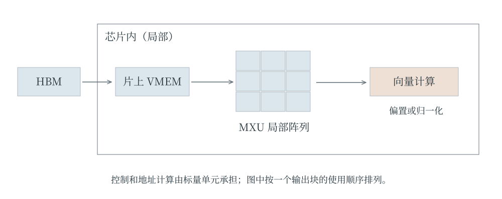
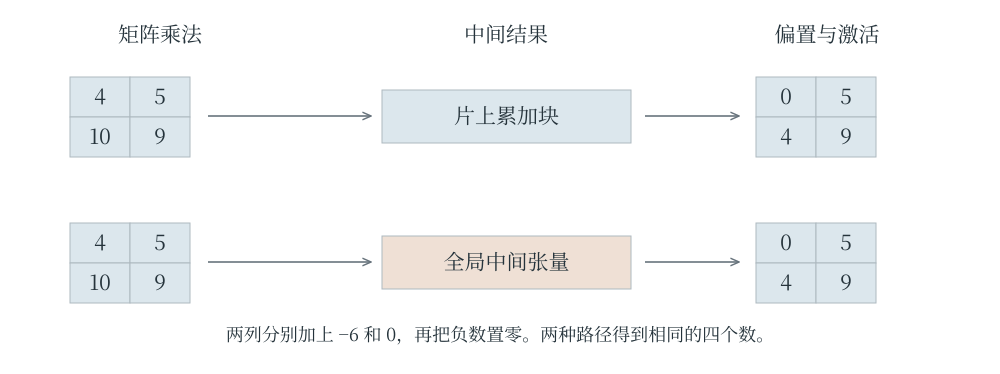
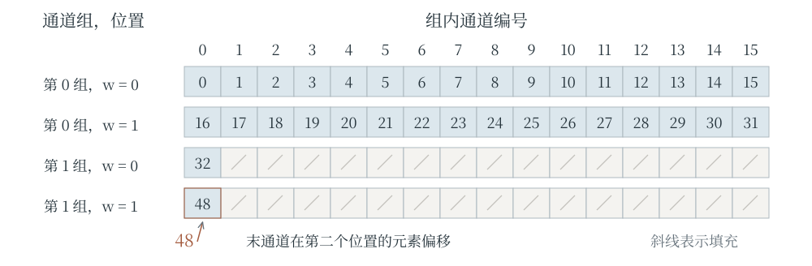
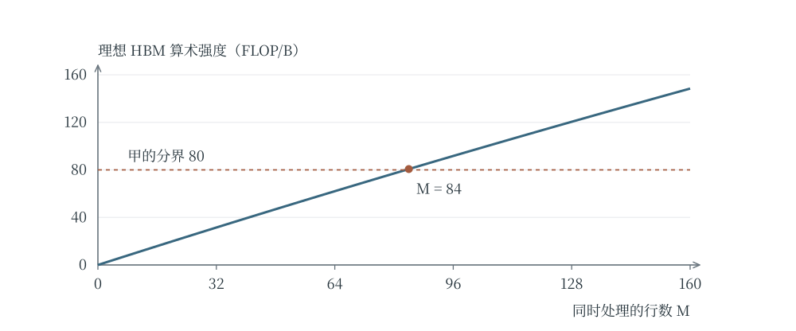
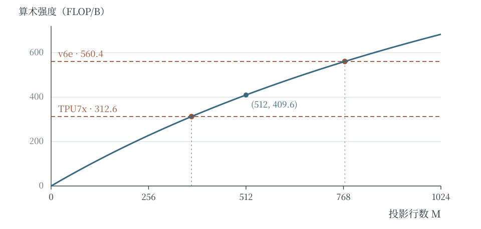
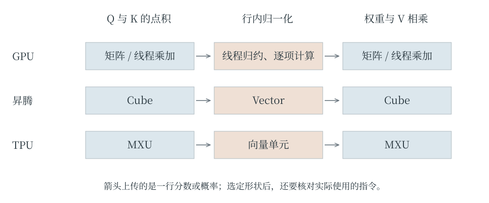
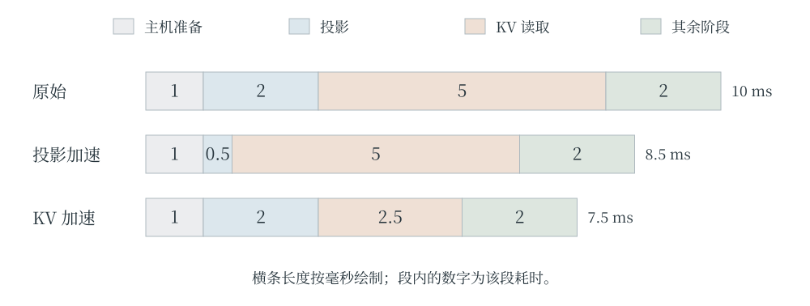

# 第 8 章　GPU、昇腾与 TPU 的架构取舍

前一章让一个线程块算出了四个数 4、5、10、9。假如不提供 warp 指令，而是把一组乘加器排成方阵，让相邻的两个乘加器直接传数，能算出同样的结果吗？如果可以，接下来的偏置、激活、归一化由谁来算？先让同一层走过几种硬件，再决定究竟应当怎样比较它们。

## 8.1　脉动阵列的矩阵乘法

CPU 和 GPU 的章节里我们从一条指令出发，现在换个方向，从数据要相遇的地点设计线路。排出 $`2\times2`$ 个处理单元，每个单元有一个保留部分和的寄存器。每拍可以接收左侧送来的一个 $`X`$ 值、上方送来的一个 $`W`$ 值，做一次乘加，再把 $`X`$ 传给右邻、把 $`W`$ 传给下邻。这样的局部规则组成一个**脉动阵列**。下文例子把部分和留在对应输出的位置，是一种输出驻留的数据流。实际矩阵引擎可采用其他驻留与装载方式。

目标是让单元 $`(i,j)`$ 在同一拍收到 $`X_{ik}`$ 与 $`W_{kj}`$。第 $`i`$ 行从左边界输入数据的时间比第 0 行晚 $`i`$ 拍；第 $`j`$ 列从上边界输入数据的时间比第 0 列晚 $`j`$ 拍。进入阵列后，$`X`$ 到第 $`j`$ 列还要经过 $`j`$ 步，$`W`$ 到第 $`i`$ 行还要经过 $`i`$ 步。这样两个元素恰好在 $`t=i+j+k`$ 相遇。如果不对输入时间做相应错位，行元素可能与不属于同一个 $`k`$ 的列元素相乘。


*图 8-1　从左到右依次过四拍。深色格子在这一拍做有效乘加，浅色格子保留旧部分和。格内数字为这一拍结束后的寄存器值。沿任一格看，最后与第六章得到同一个输出。*

- 第 0 拍，左上格遇到 1 和 2，部分和为 2。第 0 行的 1 下一拍还会送到右邻，第 0 列的 2 下一拍还会送到下邻。
- 第 1 拍，左上格又加 $`2\times1`$，先完成 4。右上第一次遇到 $`1,-1`$，得 $`-1`$。左下第一次遇到 $`3,2`$，得 6。
- 第 2 拍，右上加 $`2\times3`$ 得 5，左下加 $`4\times1`$ 得 10。右下开始，加 $`3\times(-1)`$，为 $`-3`$。
- 第 3 拍，右下加 $`4\times3`$ 得 9，四个输出全部完成。

四拍里每个单元最多各做一次乘加，总共 16 个位置，做了 8 次有效乘加，利用率 50%。单元间只传给邻居，让一个输入能依次服务多个乘法，同时要付出波头进入与波尾离开的时间。如果同样四个单元沿 $`K=8`$ 维连续累加，最后一项在 $`t=1+1+7=9`$ 相遇，共十拍，有效利用率 $`32/40=80\%`$。阵列边长为 $`r,c`$、内积长度为 $`k`$ 时，孤立且尺寸正好占满的一块，按此注入规则共需 $`r+c+k-2`$ 拍，利用率为

```math
U=\frac{k}{r+c+k-2}.
```

该式的前提是一块从空阵列开始，按上述节拍送数，最后一项算完才结束计时。实际设备可以流水衔接多块，也可能先要变换布局或等写回。若输出只有一行，映射到四格阵列的下方两格就找不到有用行，填满边长同样会成为问题。于是第 6 章的矩阵片段、第 7 章的片上面板，在这张图上有了共同的解释，每个乘法位置都要在正确时刻拿到配对的数据。

## 8.2　同一层在四种处理器上的数据路径

将我们的算子稍加扩展，用 $`Y=\max(0,XW+b)`$ 表示一层，偏置 $`b`$ 对每一行广播，最后对每一格取与 0 的较大者。给四格例子的两列分别加 $`(-6,1)`$，投影得到 $`(4,5),(10,9)`$，加偏置成 $`(-2,6),(4,10)`$，截去负数得到 $`(0,6),(4,10)`$。矩阵乘法需要大量规则重复的乘加，偏置与激活只需逐元素处理。比较不同机器时，我们重点看这 8 次乘加由什么单元完成，以及四个累加值如何送往后续的逐元素计算单元。

**在 NVIDIA GPU 上**，block 可以分到 SM，协作线程将 $`X,W`$ 的面板放在约定位置，以目标架构支持的矩阵指令作乘加。输出阶段可以让线程直接在片上处理累加块，做偏置、激活与格式转换，再一次性把结果写出。若将矩阵乘和激活拆成两个 kernel，前一项通常要提供可供后一项读取的全局结果，中间张量可能在 L2 命中，也可能经过 HBM。融合省去一次全局中间值交接的机会，要与额外寄存器压力及实现支持的形状一起评估。CUDA 软件栈中，库负责提供常用算法变体，PTX/机器指令和调度约束决定每种变体到底能够做什么。[CUDA 矩阵库的输出处理接口](https://docs.nvidia.com/cuda/cublas/index.html#cublasltmatmuldesc-attributes-t)

以 Blackwell Ultra 的 B300 系统为实物参照，NVIDIA 的 DGX B300 用户指南列出八颗 B300，每颗配 288 GB GPU 内存，总量按该文档口径约 2.3 TB。这个配置向我们的算子提供多个各自带本地存储的计算设备。放在一颗 GPU 上的 block 不能靠另外七颗的容量自动扩大自己的本地工作区。如果权重或 KV 需要分片，设备间移动的部分要另外画边。读取规格时还应注明是单 GPU、一个 HGX 基板还是一台 DGX，低精度峰值是否带结构化稀疏条件，以及本地 HBM 和 NVLink 分别连接哪两端。[DGX B300 系统配置](https://docs.nvidia.com/dgx/dgxb300-user-guide/introduction-to-dgxb300.html) [HGX 参考架构](https://docs.nvidia.com/enterprise-reference-architectures/hgx-ai-factory/latest/components.html)

**在 Google TPU 上**，矩阵乘可以落到矩阵计算单元 MXU。Google 的 TPU 架构文档列明，v6e 和 TPU7x 的 MXU 包含 $`256\times256`$ 规模的脉动乘加阵列，TensorCore 还含向量和标量处理能力。因而“芯片会怎样做偏置和激活”是有实际落点的问题。进入加速器前，编译器须确定布局、分块与哪些逐元素操作可合并。相邻操作所需布局不同，额外转置或填充会改变实际工作量。读图 8-1 可以理解局部传递与填充的成因，将它用于预测某颗 TPU 的逐拍时序还需要该代实现的数据流和指令细节。[Google TPU 架构](https://docs.cloud.google.com/tpu/docs/system-architecture-tpu-vm) [Cloud TPU 性能指南](https://docs.cloud.google.com/tpu/docs/performance-guide)



*图 8-2　以有 VMEM 的 TPU 为例。线条表示程序中的数据依赖；用于暂存、转置或融合的具体步骤由编译结果决定。Google 的 TensorCore 包括矩阵、向量和标量单元，和 NVIDIA 所说的 Tensor Core 范围不同。*

在 TPU 上先找出要重复使用的东西。只要操作数能按节拍送到，矩阵阵列里相邻单元能沿固定方向接力，执行大量规则乘加，省去为每个乘积重新发一次独立加载。先前逐拍算出的结果 4、5、10、9 说明了这个原则。真实 MXU 有自己的数据流；手算的输出驻留阵列只用来解释相邻传递、填充和排空。模型中的非线性仍然要执行。为矩阵结果加上偏置，再与零取较大值，是向量操作；它需要能读到矩阵结果，编译器安排的布局最好能让两步连续进行。[Cloud TPU 架构](https://docs.cloud.google.com/tpu/docs/system-architecture-tpu-vm)

从初代 TPU 看，这个选择起初针对数据中心推理：用规则阵列执行低精度矩阵运算，使同一批操作数在片上发挥更多作用。后来训练还需要反向传播、更大规模的状态和多芯片同步。v2、v3 采用适合训练的 bfloat16 矩阵路径和 HBM，并通过片间互联组成更大的系统。到了 v4，跨芯片安排通信路径也成为架构问题。把一个大矩阵的行分到两颗芯片，两边可能各自算得很快；若下一层要沿另一维切分，数据仍要交换。v4 的光交换用于配置芯片互联拓扑，解决的就是比单个 MXU 更大的问题。[初代 TPU 的实测分析](https://arxiv.org/abs/1704.04760) · [TPU v4 系统论文](https://arxiv.org/abs/2304.01433)

Google 对 TPU7x（Ironwood）的公开说明还区分 HBM 和更接近计算单元的向量存储 VMEM。按公布的单芯片规格，Ironwood 有 192 GiB HBM 和 7380 GB/s HBM 带宽。若只取第五章的 16 GiB 缓存，理想单次搬运尺度约为 $`16\times2^{30}/(7380\times10^9)=2.33`$ ms。这个除法要求整份数据在该芯片可用，且能以给定速率流过 HBM，计算、布局转换和其他流量还要进入实际程序的时间。整组 TPU 的芯片间互联 ICI 有自己的端点和带宽，切分以后的数组需要按实际通信路线再计数。[TPU7x 规格与存储系统](https://docs.cloud.google.com/tpu/docs/tpu7x)

**在昇腾 AI Core 上**，Ascend C 把任务组织为搬入、计算、搬出，CANN 提供对应的软件栈。可按目标产品的硬件抽象把矩阵计算交给 Cube，把逐元素运算交给 Vector，让搬运引擎在全局内存和本地存储之间送数据。在暴露这些存储层次的实现上，矩阵操作数可经 L1、L0A/L0B 进入矩阵计算，L0C 存放累加结果，向量计算会用到统一缓冲区 UB。具体怎样把 Cube 输出交给向量侧，取决于产品、数据类型、布局和实现支持的路径。有些目标的矩阵与向量资源组织不同，写算子时需先选定目标，再使用支持的搬运和同步协议。[Ascend C 硬件抽象](https://www.hiascend.com/document/detail/en/canncommercial/800/opdevg/Ascendcopdevg/atlas_ascendc_10_0015.html) [CANN AI Core 与搬运单元](https://www.hiascend.com/doc_center/source/en/CANNCommunityEdition/900/programug/Ascendcopdevg/atlas_ascendc_10_0008.html)


*图 8-3　顺着上半图找两个乘数，再从 L0C 沿下半图读到 Vector。GM 表示设备全局内存。此处选取一种经 GM 交接的路径，应用到具体产品时须核对是否有更短的受支持通路。*

为什么把两个乘数和部分和分开存？仍看一个 128 × 128 输出块。每轮沿 K 取 32 项时，输入 A 的一行要和 B 的多列相乘。Cube 在消费一轮操作数时，可由搬运单元准备下一轮；L0A、L0B 分别服务两个操作数，L0C 可以跨轮保留较宽的部分和。MTE 是搬运引擎的统称。搬运与矩阵计算各有执行资源，可以在不同面板上同时推进，这正是拆开它们的好处。不过，两个输入到达的时间若不同，Cube 仍要等较晚的那一个。另一个实际约束是布局：搬进来的面板若还需要重排，这段准备既占用搬运通路，也要在消费者启动前完成。

在矩阵核 AIC 与向量核 AIV 分离的一类实现上，CANN 文档给出经 GM 交接的实例：矩阵端把结果写入 GM，向量端把数据搬进自己的 UB，再做后续计算。在 128 × 128 的 FP32 输出上，若这一实现确实按 FP32 写出并读回，两次交接共请求 128 KiB；若目标支持在送出时转换为 BF16，则同一边界的载荷减半，舍入也提前了。把任一核的利用率读数提高到很漂亮，都不能单独消去这两次访问。要核实瓶颈，可以在保持数学输出相同的前提下比较分开的算子与该目标支持的融合实现，对照时间线上的搬运、Cube、Vector 和同步等待。不同代的支持路径及转换条件须从目标手册查证。[CANN 对 AI Core 分离架构与搬运路径的说明](https://www.hiascend.com/doc_center/source/en/CANNCommunityEdition/900/programug/Ascendcopdevg/atlas_ascendc_10_00065.html)

这条路径随芯片而变。昇腾 950 的第三代 DaVinci 增加了 Cube 与 Vector 间的高速交换通道，白皮书还给出了 L0C 到 UB 的随路量化：把较宽的部分和转为后续需要的类型，可以连同交接一起做。放回刚才那块输出，如果下一步本来就要 BF16，一块 64 KiB 的 FP32 结果最后只需在 UB 中占 32 KiB，而且受支持的路径可以避开全局中间表。若后续归约要求保留 FP32 精度，便不能把这一项减半算进预算。这里的 UB 指 Vector 的本地 Unified Buffer；描述超节点互联时出现的 UnifiedBus 指另一种部件。[昇腾 950 架构白皮书，第 4.1 节](https://public-download.obs.cn-east-2.myhuaweicloud.com/ascend/%E6%98%87%E8%85%BE950%20NPU%E6%9E%B6%E6%9E%84%E7%99%BD%E7%9A%AE%E4%B9%A6.pdf)

以本层为例，如果计划并行处理两个 tile，要分别核对 Cube 消费的输入、Vector 消费的结果以及输出缓冲何时可以复用。上章双缓冲的两个条件仍然适用：读取前要确认数据就绪，覆盖前要确认原数据已被全部使用完毕。矩阵本身算得足够快以后，输出格式转换、队列等待和下一次搬入都可能出现在最长依赖链上。软件能让开发者显式控制这些阶段，同时也要求开发者对局部容量和数据就绪负责。

**在 AMD Instinct GPU 上**，可以仍然采用分块矩阵乘、片上面板和寄存器累加的思路，在 ROCm 生态中映射到 CU、LDS 和矩阵指令。以 MI350 系列的 CDNA 4 为例，AMD 给出的每 CU 的 LDS 容量为 160 KB。程序如何使用这些空间，还要和每个工作组的资源、目标指令与 wavefront 的协作方式一起决定。把另一个平台的 32 通道映射或 bank 编号公式原封不动地写入代码，等于提前假定了这些硬件条件。可移植实现应保留矩阵、作用域和同步的语义，为目标选择对应的局部布局。[AMD Instinct MI350 微架构](https://rocm.docs.amd.com/en/docs-10.1.0/reference/gpu-arch/mi350.html)



*图 8-4　沿输出块的生命周期看几种平台的共同问题。图中两种交接是可供比较的执行方案，每种方案是否能在目标机器上实现，要由指令、局部存储和编译结果确认。*

因此做设备移植，最有信息量的第一份对照是同一组输入、同一精度约定下的输出，随后再问生成了哪些矩阵和向量操作，面板布局怎样改变，中间结果在哪里落地，哪两个阶段能重叠。这样更换后端时，就能把差异定位到一个可验证的环节。一次芯片比较如果只保留整模型吞吐，往往很难知道应改排列、分块、库的调用方式还是模型本身。

### 一条逻辑运算怎样成为不同的设备程序

继续追 $`Y=\max(0,XW+b)`$。前端只须给出五项信息，输入和权重的形状、数值类型、矩阵乘的归约维、偏置与哪一轴对齐、激活对每个元素做什么。对两行样例，可以先算出一个单元测试，再去看设备程序把哪些节点放到一起。下面的参考程序特意逐元素写出后处理，便于与设备输出逐项比较。

```python
projected = [[4, 5], [10, 9]]
bias = [-6, 1]
activated = [[max(0, value + bias[col])
              for col, value in enumerate(row)] for row in projected]
assert activated == [[0, 6], [4, 10]]
```

假设一个后端选中有融合输出阶段的矩阵库，输出就在写回前完成偏置和激活。另一个后端先生成形状恰好的矩阵乘，再生成一次逐元素 kernel。对 $`128\times4096`$ 个两字节结果，中间张量恰为 1 MiB。若两种布局相同、两个 kernel 之间数据全部要通过 HBM，后一方案多写这 1 MiB 又读回 1 MiB。在 1.5 TB/s 的教学带宽下，多出的有效载荷对应约 1.40 µs，还有提交与两阶段交接开销。若中间张量留在 L2，同样的逻辑边界可能主要消耗片上带宽。若融合迫使矩阵乘换用明显较慢的形状，整次运行也可能变慢。分析时可以先列出两种结果各需满足的条件，再对照性能记录核实。

在 XLA 一类编译器里，可以观察高层算子怎样变成带形状、布局的中间表示，以及目标后端最终交给库或生成代码的部分。在 CUDA 上可以检查矩阵实现与输出阶段的配置，在 Ascend C 上可以检查各级缓冲和队列的生命周期。追踪同一个 $`Y_{01}=6`$ 会提出同样的三个问题：它以什么精度累加到 5，何时取得偏置 1，什么时候转成最终的两字节输出？若后端允许在加偏置前先舍入到低精度，而参考程序在较高精度加完才舍入，靠近零的值可能得到不同的符号或激活结果。移植验收时应把这些边界也放进测试输入。[OpenXLA 编译架构](https://openxla.org/xla/architecture)

### 通道分块与存储填充

再沿着 Ascend 后端追一步。模型中的特征可以用四个坐标表示：样本号 $`n`$、通道号 $`c`$、高度 $`h`$、宽度 $`w`$。连续 NCHW 布局把 $`w`$ 放在最内层。取一个样本、一行、两个位置，每个位置有 17 个 FP16 通道。若要在位置 1 读取相邻通道，每次跨两个元素。某些算子希望把同一位置的一组通道连续装入，因此使用 NC1HWC0，将 $`c`$ 拆为组号与组内序号。选取文档所述的 $`C_0=16`$ 路径，组号是 $`\lfloor c/16\rfloor`$，组内序号是 $`c\bmod16`$，宽度坐标排在两者之间。[CANN 数据格式转换的类型和通道约定](https://www.hiascend.com/doc_center/source/en/CANNCommunityEdition/900/API/ascendcopapi/atlasascendc_api_07_0200.html)

先检查最后一个通道。在原布局里，$`c=16,w=1`$ 的元素偏移为 $`16\times2+1=33`$。新布局顺次放第一组的两个位置，再放第二组的两个位置。该元素位于第四段 16 格的首位，偏移为 $`3\times16=48`$。这次转换只移动数值，却让逻辑上的 34 个元素占用 64 格，FP16 占用从 68 B 增到 128 B。如果转格式单独运行，且每个原始值从显存读一次、所有填充位置也写入显存，输入和输出载荷合计为 196 B。相邻算子能沿用分块布局，或者上一算子直接按目标格式写出，才能把这笔搬运分摊或省掉。只有在目标算子接受的类型、布局与芯片上比较两条完整路径，才知道额外的 30 格是否值得。



*图 8-5　每行十六格在存储中连续，依次接到下一行。同一物理格的编号按元素计。下方两段共有 30 个填充位置，模型的有效通道仍只有 17 个。*

## 8.3　用 Roofline 模型估算性能上限

设有两台教学设备可供选择。甲每秒能做 120 万亿次指定精度的稠密浮点运算，可持续显存带宽为 1.5 TB/s。乙的相应数字为 80 万亿次和 3 TB/s。服务收到的第一项工作，是给一个新词元乘上一张 $`4096\times4096`$ 权重矩阵。第二项工作使用同一份权重，一次处理 128 个词元。如果要分别安排这两项工作，应把它们交给哪台机器？

设一次调用有 $`F`$ 个有用浮点运算，有 $`D`$ 字节需要通过选定的存储边界。按本书惯例，一次乘加算两个 FLOPs。令 $`P`$ 为匹配数据类型和指令的计算速率上限，$`B`$ 为该边界可提供的带宽上限。即使所有乘法和搬运都安排得恰到好处，计算所需时间仍至少为 $`F/P`$，搬运所需时间至少为 $`D/B`$。整个过程必须容纳这两段工作，故

```math
t\geq \max(F/P,\ D/B).
```

这里先采用两类工作的时间可以交叠的乐观模型。若一项操作必须先把数据搬完才能启动，串行的那部分还要在关键路径上相加。将上式改写为速率，定义算术强度 $`I=F/D`$，得到

```math
F/t\leq \min(P,\ B I).
```

将 $`F/t`$ 看成实际平均计算速率。计算能力本身给出上限 $`P`$；另一方面，若每搬一个字节只能完成 $`I`$ 次有用运算，带宽 $`B`$ 最多每秒提供 $`BI`$ 次运算所需的数据。因此实际速率同时受两项限制，取其中较小者。这个推导假设 $`F,D`$ 和选定边界的 $`B`$ 使用一致的统计口径。

以 FLOP/字节为横轴、FLOP/s 为纵轴，$`BI`$ 是斜线，$`P`$ 是水平线。在每个算术强度下，两条线中较低的一条给出性能上限。这种分析方法称为 Roofline 模型。交点 $`I_*=P/B`$ 给出一个有单位的分界。甲的分界为 $`120/1.5=80`$ FLOP/B。若强度为 4，只看这两个资源，甲的性能上界为 6 TFLOP/s。若强度达到 120，算得带宽侧允许到 180 TFLOP/s，计算侧把上界限制到 120。乙的分界为 $`80/3\approx26.67`$ FLOP/B，斜坡更陡，平台更低。[Williams、Waterman 与 Patterson 的 Roofline 原始报告](https://www2.eecs.berkeley.edu/Pubs/TechRpts/2008/EECS-2008-134.html)


*图 8-6　从某个强度向上找到各设备曲线，就能比较该处的乐观速率。比较两项请求各自的延迟，还要用各自的总工作量除以对应速率。*

如何得到 $`D`$，决定了图能回答什么。若用“所有输入各读一次、结果写一次”的字节数，就在分析给定数据起点和终点时理想实现能做到什么。若用性能计数器测得的实际 HBM 读写量，就在分析这一次实现的 HBM 强度。有足够缓存复用时，单次调用的输入甚至可能已在片上，冷启动的字节数也会变。若用实测可持续带宽绘制经验上限，要给出测量的访问方向与模式，某一段更容易合并的访问可能超过这条经验线。只有物理上限与严格的工作量下限配在一起时，得出的才是硬下界。

## 8.4　单词元与批量投影的性能

令输入为 $`M\times K`$，权重为 $`K\times N`$，输出为 $`M\times N`$。这里 $`K=N=4096`$。采用 2 字节输入和权重、片上高精度累加、最终写 2 字节输出。单算稠密投影，输入与权重起初在显存，结果必须写回显存，无偏置、无旧输出，假设每项只通过这条边界一次。于是

```math
\begin{aligned}
F &= 2MKN,\\[0pt]
D &=2(MK+KN+MN).
\end{aligned}
```

只取 $`M=1`$，这一行产生 4096 个输出，每个输出需要 4096 次乘加。权重本身就占 32 MiB，而输入和输出各 8 KiB。要搬 33570816 字节，只做 33554432 FLOPs，约 1 FLOP/B。把 128 行放到一起时，权重仍只取一份。尽管输入和输出扩大 128 倍，总有效载荷只从约 32 MiB 增到 34 MiB，工作量却到了 42.95 亿 FLOPs。这种强度的增长来自不同输入行复用同一张权重表。若把 128 次乘法各自启动，且权重每次都要重新进入片上，就要为那些加载另算。

表中甲、乙两列给出设备完成这个投影所需时间的理想下界。载荷按输入与权重各读一次、输出写一次计算。

| 行数 | 载荷（MiB） | 运算（GFLOPs） | 强度（FLOP/B） | 甲（µs） | 乙（µs） |
|---:|---:|---:|---:|---:|---:|
| 1 | 32.016 | 0.03355 | 1.00 | 22.38 | 11.19 |
| 64 | 33 | 2.147 | 62.06 | 23.07 | 26.84 |
| 128 | 34 | 4.295 | 120.47 | 35.79 | 53.69 |

例如 128 行在甲的计算时间为 $`4294967296/(120\times10^{12})`$ 秒，约 35.79 µs。搬运时间为 23.77 µs，取较大者。乙做一个词元的下界较短，甲做 128 行的下界较短。正好在某台机器上跨过它自己的分界，和改变两台机器的相对快慢，是两件不同的事。表中 64 行已经体现了这一点，甲还在自己的带宽斜坡上，却已比乙的计算平台给出更短时间。



*图 8-7　横轴逐步增大 $`M`$，纵轴是同一投影的理想 HBM 算术强度。甲的 80 FLOP/B 水平线落在整数 83 与 84 之间。*

代入正方权重，强度可进一步写为

```math
I(M)=\frac{M}{1+2M/4096}.
```

小时近似等于 $`M`$，大到权重成本摊薄以后，极限为 2048 FLOP/B，因为输入仍要多读，输出仍要多写。求 $`I(M)\ge80`$ 得 $`M\ge 83.25\ldots`$，因此 84 行才首次走到甲的计算平台。若关注交互式请求，凑够 84 行所用的等待时间也要算在用户的时钟里。预填充已经给出一批已知输入，容易获得这些行。解码时可以跨请求组批，但要等各请求的历史状态和当前词元就绪。

回看第五章的另一项工作。32 层、32 个查询头、8 组 KV、每头 128 维，在 128K 历史上解码一行。历史打分及值加权约做 68.72 GFLOPs，按共享的 KV 在各层每位置只读一次，则跨显存读取 16 GiB，强度约为 4。仅历史搬运在甲、乙分别约需 11.45 和 5.73 ms，比刚才一个投影的微秒数量级大得多。共享权重投影可以随批量增加复用，不同请求的私有 KV 通常仍需逐份读取。整层模型的瓶颈会随上下文长度、批量以及共享前缀的条件一起移动。

## 8.5　从性能上限到实际运行时间

Roofline 给出了指定工作量和带宽条件下的上限，不能单独指出每次执行中损失发生在哪一层。接下来把显存、片上通路和计算能力分别纳入分析，再用计数器与运行时间判断应该检查哪一处。

假设观察到一个投影只达到甲计算峰值的四分之一。至少有两种截然不同的可能。它可能是算术强度为 20 的算子，在 1.5 TB/s 下恰好得到 30 TFLOP/s，已经把可用 HBM 流量用足。也可能是强度为 160 的算子，片上从共享存储取数的指令存在 bank 冲突，矩阵单元频繁空等。两者得到同一个 FLOP/s，却需要完全不同的改动。

把 7.4 节的办法写一般些。如果一次调用在显存、L2、共享存储等边界的流量分别为 $`D_h,D_2,D_s`$，相应可用带宽为 $`B_h,B_2,B_s`$，则每个比值都给出一项资源时间。再加上矩阵乘、特殊函数和串行依赖本身，可用

```math
t\geq\max(t_\mathrm{matrix},\,D_h/B_h,\,
D_2/B_2,\,D_s/B_s)
```

作为几项约束同时满足的必要条件。这里每个 $`D`$ 按对应边界统计，命中 L2 的访问仍会消耗 L2 路径的资源。对含指数、倒数或归约的算子，还应为相应管线估算能力，否则把一项指数算成“一次普通浮点加法”会误导判断。若多个操作都争用同一资源，应在该资源上累计它们的工作。如果多个阶段由于先后关系无法重叠，则应沿最长依赖链相加。

看一份构造出来的计数记录。某段程序做 24 GFLOPs 的矩阵工作，HBM 流量 120 MB，某片上边界流量 1.8 GB，测量窗口为 200 µs。给它匹配甲的 120 TFLOP/s 和 1.5 TB/s，再设片上带宽 12 TB/s。对应下界分别是 **200、80、150 µs**。这份记录恰好达到计算能力上限，HBM 的平均读写速率只需达到 0.6 TB/s。如果有人声称只对共享布局作调整、保持 $`F`$ 和计算速率不变就能把它缩到 120 µs，新的时间已经比计算下界还短。应先检查 FLOP 口径、精度、计数窗口以及是否删掉了有用工作。

换一份同工作量的现场，时间为 400 µs，HBM 字节仍为 120 MB，但片上实际传输为 4.8 GB，则该边界单独就需要 400 µs。若改布局后把片上字节降至 1.8 GB，其他下界不变，乐观时间才回到 200 µs。这两份记录是逆推瓶颈的教学数据。实际调查时，可以用性能工具取得 HBM 读写、缓存命中、各单元活跃周期、就绪 warp 与等待原因，再设计一次只改变某个因素的实验。[Nsight Compute 层次化 Roofline 与指标说明](https://docs.nvidia.com/nsight-compute/ProfilingGuide/index.html)


*图 8-8　三条分别按各自资源折算，横轴统一为微秒。可重叠时读最长条，若要相加则必须另有串行依赖依据。*

设计这样的实验，首先固定张量内容、形状、布局、数值精度与允许误差。预热库选择和编译后，把计时起止对准设备实际工作。可以只改变共享面板的行距，再比较 bank 冲突和耗时。也可以只放大独立任务数，观察就绪 warp、HBM 负载与延迟。为了分清权重是否驻留缓存，可以用重复访问同一对象和轮转多个大于缓存容量的对象做对照，并清楚记录预热状态。验证工具本身有开销，分别采样计数器和干净运行的时间更容易解释。实验完成时应能写出哪项数量按预期变化，以及哪项观察足以推翻原先猜测。

### 用同一个库测量三种输入形状

在有 BF16 支持的 GPU 和 CUDA 版 PyTorch 的环境里，可以实际测量第 8.4 节的三种投影。下面两行命令在项目根目录运行。第一行重复使用同一张 32 MiB 权重表。第二行轮流使用八张地址不同、内容相同的权重表，让这一组权重的存储占用扩大到 256 MiB。[投影实测脚本](../../experiments/part02/measure_projection.py)

```sh
python experiments/part02/measure_projection.py --rows 1 64 128
python experiments/part02/measure_projection.py --rows 1 64 128 --copies 8
```

输入已驻留设备，输出缓冲预先分配。程序预热矩阵库，并取少量输出与用相同 BF16 输入值计算的双精度参考作对照，再用同一设备流中的事件记录七组时间。每组包含 32 次连续调用，先除以 32，再取七组的中位数。输出同时保留各组原值、设备型号、PyTorch 和 CUDA 版本、有效 TFLOP/s 及数值误差。这个计时窗口回答“这些连续提交的投影平均隔多久能完成一个”，持续提交跟不上设备时窗口中也会有空闲间隔。[PyTorch 矩阵乘接口](https://docs.pytorch.org/docs/stable/generated/torch.mm.html) [PyTorch CUDA 事件](https://docs.pytorch.org/docs/stable/generated/torch.cuda.Event.html)

第一次读结果，可以先把每种形状的理想载荷除以时间。若由此算出的“每秒逻辑字节”超过标称 HBM 带宽，可以检验一个具体解释：同一份权重的一部分在 L2 被复用。比较两次运行，若轮换权重后小行数更慢且实际 HBM 读取增加，这个解释就多了一项支持。若时间变化很小，可能仍能缓存，也可能有主机提交、形状利用率或其他单元限制。这时再采样 HBM 字节与设备时间线。八张表是否足以改变缓存行为取决于设备，脚本中根据公式打印的理想载荷也要和计数器报告的真实流量分开记录。

性能分析器怎样准备缓存，也会改变上面的实验。设 L2 足以完整留住刚读过的 32 MiB 权重，四次调用紧挨着执行，其他数据不会将它挤走，单算这份权重的 HBM 读量就可能是 32 MiB。若每次调用前都清空缓存，相同的四次矩阵乘要读 128 MiB。此时拿后一种运行给出的 128 MiB，除以前一种运行的时间，会算出从未同时发生过的字节率。Nsight Compute 收集一组指标时可能需要重放内核，缓存控制选项 `--cache-control all` 会在每次内核重放之前清理缓存，`none` 则保留先前工作的影响。用同一套预热次序、重放方式和缓存策略比较两个内核，再用独立的应用计时检查它们在真实调用序列中的收益。遇到一个超过标称带宽的结果，首先对齐的就是这两段运行的边界。[Nsight Compute 缓存控制选项](https://docs.nvidia.com/nsight-compute/NsightComputeCli/index.html)

模型还能帮我们设计一个更小的实验。把权重改为 $`1024\times1024`$ 的 FP32 矩阵，让一个线程算同一列的四个输出。输入有四行时，一次读取的权重可以供四个乘加使用；只有一行时，另外三个输出根本不存在。可以先预测哪种形状会受益，再看第 9.7 节在同一张 Radeon 780M 上得到的时间。那里只改变每线程负责的行数，便于把数学上允许的复用和程序真正利用的复用对应起来。

## 8.6　服务器中的互联与资源限制

性能比较还有一个前提：模型及其运行状态必须能放进可用的存储。单芯片参数表描述的是设备能力，服务器还决定了可用容量、设备之间的传输路径和资源共享方式。

第一章的教学模型有 60 亿个两字节参数，权重为 $`12\times10^9`$ B，约 11.18 GiB。第五章的一条 128K 请求另有 16 GiB 的 KV。仅这两项已达约 27.18 GiB，超过第一章留给本进程的 24 GiB。如果权重与状态都必须常驻单卡，这个配置就无法执行前面假定的单卡解码，时间估算也失去了适用前提。预留工作区、框架和碎片后只会更紧。在忽略一切其他分配的乐观条件下，能放下的历史位置最多为

```math
\left\lfloor
\frac{24\times2^{30}-12\times10^9}{128\times2^{10}}
\right\rfloor=105055.
```

扩容、压缩、跨设备切分和分层存储分别改变了不同条件。增加本地 HBM 容量可以保留原来的访问路径，改变 KV 表示则要重新确认模型质量或数值语义。跨设备切分能利用多片 HBM，但可能引入同步或集合通信。把冷页放到主机，则在下一次命中冷页时支付链路时间。该选哪种取决于历史有多少真的会被读到、传输能否提前、以及关键路径的预算。第五章的选择性读取与本章的设备放置就是在这里相遇的。

为什么不能简单地在每块计算芯片旁放任意多 HBM？高带宽依赖大量近距离并行连接。堆叠内存和先进封装缩短连线，也消耗封装边缘、走线、面积与供电预算。计算单元持续活动产生热量，需要通过封装与冷却系统传走。功率上限会约束可持续时钟，温度、供电配置以及是否同时压满多个单元都可能让实测持续性能变化。芯片内部、封装内、板内和跨主机是一组不同的距离，带宽、延迟和每搬一字节的能量都可能换一个量级。DGX、TPU slice 等系统的拓扑图应沿着一次真实切分后的通信路径阅读。

设把工作切到两台设备，某个阶段每步必须传 64 MiB 中间结果。在有效单向 100 GB/s 的链路上传完至少约需 0.671 ms。若此前单设备该段计算 1 ms，即使均分后降为 0.5 ms，且两段严格串行，总和也约 1.171 ms。若通信可以在计算中分块发起，则应画出最早可发送和最迟必须收到的时刻，只有落在两个时刻之间的那部分可以隐藏。第二篇到这里已经提供判断互联是否会改变结论的工具，具体怎样切分张量与集合通信留到第四篇。

再把功耗换为每次输出的能量。假设相同质量和服务目标下，某整机以平均 600 W 完成每秒 300 个有效输出词元，能耗为 2 J/词元。另一配置为 900 W、600 个/秒，对应 1.5 J/词元。如果机房只能给这组作业 800 W，后一种配置即使每词元用能较低也无法按该功率运行。比较测得的能耗应约定是否计入主机、互联、空闲功耗与冷却，以及吞吐是否满足同样的延迟约束。单 GPU 额定功率不能直接代入整机实际测量的分子。

互联链路还可以向软件提供不同的访问方式。华为在超节点架构中介绍了 UnifiedBus 的统一寻址与内存语义；Ascend 算子里用于本地暂存的 Unified Buffer 是另一项资源。假设某个映射支持远端读取，一个计算单元先写入一张 4 KiB 的表，另一个计算单元随后读取。同一个地址可以解析，只说明能够定位数据。如果写入尚未完成、读取方没有访问权限，或者程序仍在读取上一轮的数据，仅有地址映射并不能保证读到新表。因此，应核对具体 API 对访问权限、同步范围和写入可见性的规定，不能仅凭互联名称推断所有处理器都满足第七章介绍的发布条件。

假定这条教学路径每次发起至首字节返回耗 2 µs，此后有效载荷带宽为 250 GB/s。整表一次搬运约需 $`2+4096/250000=2.016`$ µs。把相同字节拆成 64 笔 64 B 读，并且每笔都由上一笔返回的指针决定，光等首字节就有 128 µs。如果 64 个地址预先可知，可以发起多笔未完成事务，等待可能重叠，实际收益取决于并发上限、远端队列和链路流量。将数据放到同一地址空间以后，访问模式仍决定能否接近带宽上限。另一类系统用光交换重新选择芯片之间的连接；第十四章会沿一条 TPU v4 的通信切面计算它能承载多少流量。[UnifiedBus 超节点架构](https://www.huawei.com/en/news/2025/9/hc-superpod-innovation)

### 稀疏峰值与实际工作量

想比较两台设备的矩阵峰值，得先看分子怎样数。以支持 2:4 结构化稀疏的一条矩阵路径为例，在规定分组方向上，四个权重里只保留两个，并记录其位置。对输入 $`(1,2,3,4)`$，权重 $`(5,0,0,7)`$ 的点积为 33，设备只需取有用的 5 与 7 及其位置。若分子沿用稠密的四次乘加，就计八次浮点操作；数实际有用的两次乘加就只有四次。同一耗时能得出相差两倍的数字。

代价先落在权重上。原来的权重若是 $`(5,1,0,7)`$，删掉 1 后输出从 35 变成 33，准确性还要验证。若四个权重原本各占 2 B，理想数值载荷由 8 B 降到 4 B，还得加位置元数据；激活和输出也照常搬。只有分组方向、类型、形状及实际调用路径都适合，才能把这项结构带来的好处记入设备比较。[NVIDIA Ampere 结构化稀疏设计](https://developer.nvidia.com/blog/nvidia-ampere-architecture-in-depth/)

## 8.7　用实际负载比较架构方案

8.5 节已经给出投影的工作量、流量和计时办法。下面先把这些量代入具体架构，看看换设备或换数据路径会改变哪一项限制，再把收益放回整条请求的时间线。

### 两代 TPU 的投影性能上限

继续取 $`K=N=4096`$，将第 8.4 节的 FLOP 与字节相除。若权重和输入各从 HBM 读一次、输出写一次，三者均为 BF16，便得到强度 $`I(M)=4096M/(4096+2M)`$ FLOP/B。分母里的 $`2M`$ 提醒我们，批量增大以后，输入和输出也在增长。强度在小批量时接近 $`M`$，在批量趋于无穷时趋近 2,048，永远不会无限增加。

下面比较同一厂商的两代芯片。Google 公开的每芯片 BF16 峰值和 HBM 带宽，在 v6e 上是 918 TFLOP/s、1,638 GB/s，在 TPU7x（Ironwood）上是 2,307 TFLOP/s、7,380 GB/s。两项都采用十进制单位，带宽上限与计算上限相交时的强度分别约为 560.4 和 312.6 FLOP/B。把它们代回投影的强度公式，v6e 的交点约在第 772 行，TPU7x 在第 369 行。后者虽然计算峰值更高，但内存带宽增长得更多，填满计算单元所要求的每字节工作量反而更少。[Google TPU7x 每芯片对照表](https://docs.cloud.google.com/tpu/docs/tpu7x#system-architecture)



*图 8-9　横轴为一次投影的行数，纵轴为每搬运一个字节完成的 FLOP。曲线低于某条水平线时，该芯片在这份理想流量预算下先受到 HBM 带宽约束。*

取 $`M=512`$，强度恰为 409.6 FLOP/B。在 v6e 上带宽上限约给出 $`1.638\times409.6=671`$ TFLOP/s，低于 918。在 TPU7x 上它给出约 $`7.380\times409.6=3{,}023`$ TFLOP/s，高于计算能力上限，于是更紧的上界为 2,307。一个可检验的预测随之出现。按这个流量运行时，两台机器上的同一形状可能先遇到不同限制。实际若发生权重重读、布局复制或矩阵阵列填不满，测得的点就会下移。此时应拿编译器生成的形状、设备计时和 HBM 流量逐项解释偏差。[本例的可运行复算](../../experiments/part02/projection_ridge.py)

刚才说 512 行投影在 TPU7x 上先受计算限制，允许实际流量比理想值多多少？这次投影共有 $`2\times512\times4096^2=17{,}179{,}869{,}184`$ 个 FLOPs。权重 32 MiB，输入和输出各 4 MiB，理想 HBM 流量共 40 MiB。两条上限相交时，每搬一个字节要完成约 312.6 个 FLOPs；把总工作量除以这个数，分界便在约 52.41 MiB。假如同一窗口的计数器给出 56 MiB，算术强度就只有约 292.6 FLOP/B，按上述芯片规格折算的带宽上界降至约 2,159 TFLOP/s，已经低于计算峰值。此时值得追查哪些输入或中间结果多经过了一次 HBM。反过来，测到 40 MiB 也只说明带宽上界还有余量，矩阵阵列是否吃满仍须看设备时间。这样一来，计数器就有了具体的判据。

### 扩展内存与近存计算

假设一个解码步骤要在很大的表里读取 64 个数，每个 2 B。热表放在 HBM；为容纳更大的模型，设计者考虑把冷表放在高带宽闪存（HBF）。除了容量，还要计算每次查表实际读取多少数据。设想一种简化介质，最小读取单位是 4096 B，且本次查询不命中缓存，每个被选中的页只读一次。如果 64 个数恰在同一页，需要读取 4096 B；如果分散到 64 页，则需要读取 256 KiB。两种情况下计算单元需要的有效数据都是 128 B，后一种情况每取得一个有效字节，介质需要读取 2048 字节。合并排序相邻请求、集中存放常用行或缓存热页，都可能减少读取的页数。

另一种设计把选择或归约放到内存附近，称为近存计算（PNM）。假设查询还要求把这 64 个值求和。若远端只能传整页，最坏要过板间链路 256 KiB；若近端能按索引读取、累加并返回一个 FP32 和，响应仅 4 B。但请求仍要经过链路：用 32 位索引指定 64 个位置就有 256 B，此外还有命令、排队和同步。更关键的是，近存单元内部可能仍要读 64 页。若机器原本允许远端聚集读取、只返回 128 B，就应以 128 B 为响应基线，而非 256 KiB。先选定观察的接口，才能回答“究竟少搬了多少”。

两种想法可以组合，也可以分别受挫：扩大冷层解决的是放不下，把归约放近解决的是结果比输入小。自回归的下一次查询往往要等上一次结果，随机小读的启动时延可能无法被并发遮住；写入频繁的状态还得另算写放大与寿命。实验宜同时记录冷热命中率、每个有效字节触及的物理页和单请求尾延迟。HBF 与近存计算是架构研究方向，上一段的页大小与时间模型不是量产芯片规格。[推理硬件的研究问题](https://arxiv.org/abs/2601.05047) · [闪存推理中复用窗口与数据布局的实验](https://arxiv.org/abs/2312.11514)

### 确定性张量流水

设一次投影依次经过取数、乘法和偏置相加，各阶段由不同单元执行。在这台教学设备上，取数用 2 拍、乘法用 3 拍、加法用 1 拍；各单元每拍都能接收一项新工作，操作完成后，结果立即可供下一阶段使用。若 A、B、C、D 四项输入在第 0、1、2、3 拍依次发起，编译器可安排 A 在第 2 拍开始乘法、第 5 拍开始加法、第 6 拍完成；B、C、D 的相应时刻依次后移。到第 9 拍，四个结果均已就绪。图中可以先沿 A 的执行路径阅读，再观察每个单元在连续时钟周期内处理的工作。


*图 8-10　每一个字母表示一次发起或完成事件，空白表示该行没有新事件。同一笔乘法从发起到结果可用隔了三拍。横看每行相邻的字母，又能看见单元每拍都能接新工作。*

这种组织方式由软件提前安排部分调度。如果数据能在约定时刻到达，后续单元就可以按计划读取，不必在运行时重新仲裁数据路径。Groq 早期 TSP 论文介绍了编译器安排指令与片上数据移动的架构；图中的拍数则用于说明机制。静态时间表要求数据按时就绪。假设输入 B 经过不可预测的排队，直到第 5 拍才可用，原定第 3 拍开始的乘法就无法按计划执行。实现可以在进入确定性执行区域前缓冲输入、为整批预留时间，或者设置明确的等待和重启条件。如果将后续运算统一延后两拍，已经就绪的 C、D 也需要等待。具体设计需要说明如何处理这种可变延迟。[TSP 架构论文](https://groq.com/wp-content/uploads/2024/02/2020-Isca.pdf)

还需要检查片上存储的容量。设某级有 32 MiB 可用 SRAM，要同时为输入输出和临时量保留 8 MiB，常驻权重只剩 24 MiB。一层有四个等大的 8 MiB 专家，最多同时留住三个。若下一批调用恰好轮到第四个，且需要从有效 40 GB/s 的边界补进 8 MiB，即使没有排队也要约 210 µs。一张只画乘加拍数的表就解释不了这次延迟。把权重摊到多颗芯片可免去这次重新装载，但要重新计算激活跨芯片的字节和等待。第二十一章会进一步讨论它对实际生成延迟的影响。

### 当训练与逐词解码各有一条产品路线

Google 公布的第八代方案区分面向训练的 TPU 8t 和面向推理的 TPU 8i。可以从第五章留下的 KV 读数理解后者对片上 SRAM 的投入：若一个解码步骤反复要读一小段热状态，而且在两步之间能保住它，就可以减少反复到 HBM 取回的次数。若每步依次扫过的有效历史远大于本地容量，流过 HBM 的部分仍要算。训练的大矩阵更容易装满阵列，许多芯片交换梯度或激活时又希望叠住通信。两个负载需要的是不同的本地容量、矩阵吞吐和互联组合。[TPU 8t 与 8i 的架构对照](https://cloud.google.com/blog/products/compute/tpu-8t-and-tpu-8i-technical-deep-dive)

### 用一道注意力题同时检查三条路径

只看一个头，让一条查询与 128 个历史键分别做长度为 64 的内积，得到 128 个分数。先减去行最大值，逐项求指数，再除以总和；最后用 128 个权重合并 128 行、每行 64 项的 V。两个矩阵阶段各需要 16,384 FLOP（乘、加各算一次）。中间 128 个 FP32 分数只有 512 B，却有一个不能靠多加矩阵单元消除的依赖：这一行归一化时必须取得足够的全行统计量。若分数和概率都以 FP32 分两次写入、两次读出全局内存，逻辑载荷共 2048 B；若在片上衔接，可以避开这两张全局中间表。K 和 V 若为 BF16、每项各读一次，本身合计 32 KiB，省掉 2 KiB 也不会让它们消失。



*图 8-11　沿每一行从左到右看，同一数学依赖落到了三种硬件组织上。框间的箭头要求结果可见；它本身不能证明数据去了 HBM。*

在 GPU 上，先看这条只有一行的查询有没有足够同行或同类请求能拼成矩阵块；再看线程归约能否保住行最大值和分母。在昇腾上，沿 Cube → Vector → Cube 逐段查看缓冲和搬运事件：矩阵核上的空档可能是在等向量侧的结果。在 TPU 上，先看编译器把这个窄形状怎样放进 MXU，再看转换布局、向量归一化与下一次点积之间是否出现中间拷贝。同一条时间线现象，例如“矩阵单元长时间空闲”，对应三种可检验的解释。把查询数从 1 增至 32、保持每条历史长度不变，测形状变化；固定形状只改变是否融合，测交接成本。两次实验各改一件事，才能看出哪种解释站得住。

### 回到完整请求的时间线

现在把单个投影放回用户的一次请求。假设一条请求从被服务到结果返回共 10 ms，其中主机准备 1 ms，投影 2 ms，读 KV 5 ms，其他必经阶段 2 ms。为使计算可手算，这次时间线的各段均串行。如果仅把投影加快四倍，总时长变成 $`1+0.5+5+2=8.5`$ ms，速度比约为 1.18。如果只把 KV 阶段减半，则变为 7.5 ms，速度比约为 1.33。局部能优化多少和它原来占了多大份额一起决定收益。



*图 8-12　所有横条共用毫秒刻度，颜色边界表示阶段完成的时刻。若队列中有多请求并发，应用于吞吐时还要画共享资源，单条串行时间线只回答这条请求的延迟。*

若某阶段占原耗时比例 $`p`$，能提速 $`s`$ 倍，其他串行时间保持原值，则总体速度比是

```math
S=\frac{1}{(1-p)+p/s}.
```

在上例，投影即使快到不占时间，整条请求也还需 8 ms。相同设备在长提示预填充和长历史解码上的 $`p`$ 可以完全不同。如果用户关心首个词元，计时应从请求到达到首个可交付输出。如果关心后续词元，就测稳态生成间隔。如果比较训练交付，则还要看达到同一目标质量用了多少步。把不同负载和起止时刻写成同一个“快几倍”，会把读者想作出的决策混在一起。

遇到一份新的硬件方案，可以沿本章的算例实际做一遍。先运行固定输入和输出检查，在容量表里逐项放入权重、状态与工作区。再给投影列出 $`M,K,N`$ 与精度，给历史读取列出每个查询真正访问的字节，用同样口径画出两台候选设备的时间下界。最后将程序移到可用机器上，对照事件时间线、字节计数和阶段占比。若某个库对当前形状插入大块填充、回退到通用实现或需要昂贵的格式转换，其测量结果本身就是选型依据。

至此我们可以给第九章留下一项具体的工作。为了让 $`M=128`$ 时那 34 MiB 的理想流量接近现实，许多线程需要在局部容量内重复使用同一批权重，同时避免图 7-5 的冲突，让图 6-2 的发射槽持续有工作。下一篇将打开矩阵乘法的实现，逐步改变循环顺序、分块和流水，检查每一项改动究竟改变了哪一个下界。

## 练习与解答

### 1. 两台设备的性能上限何时相等

对 8.3 节的甲、乙两台设备，求相同工作量、相同 HBM 流量下两条理想 Roofline 开始由甲占优的强度。对本章投影，最少需要多少行？

**解答。** 乙在 $`80/3`$ FLOP/B 后到达 80 TFLOP/s 平台，甲的斜线到 $`1.5I=80`$ 时追平，交点 $`I=53\frac13`$ FLOP/B。其后甲的上界较高。将 $`M/(1+2M/4096)\gt 80/1.5`$ 解得 $`M\gt 54.75\ldots`$，最小整数是 55。这里比较的是同一 $`M`$ 下两台设备的乐观时间，不能由此直接保证实测排序。

### 2. 画一座非方形阵列

按本章输出驻留模型，让 $`2\times3`$ 个单元完成一块内积长度 4 的乘法。最后一次相遇发生在哪个时刻？有用单元利用率是多少？

**解答。** 从 0 计时，在 $`(i,j,k)=(1,2,3)`$ 相遇，时刻为 6，共七拍。六个单元各做四次有效乘加，共 24 次，利用率为 $`24/(6\times7)=4/7`$。若下一块能提前接续送入，长期平均利用率需要用新的边界时序重新计算。

### 3. 检查超过性能上限的结果

有人报告用甲计算 48 GFLOPs，在 200 µs 内完成，声称使用本章 120 TFLOP/s 的稠密计算口径。即使 HBM 完全不耗时，能否成立？

**解答。** 用量除以时间为 240 TFLOP/s，所需计算时间至少 400 µs，与给定的口径不相容。应核对是否把稀疏跳过的工作也算成有效 FLOPs、是否错用不同精度的峰值、或者只量到了异步提交。核实前应保留原始形状、计数和时间，不给这个数据点解释成实际的密集计算速率。

### 4. 留出工作区之后还能存多长历史

沿用 24 GiB 和 60 亿参数配置，为工作区另留 2 GiB，每位置跨全部层使用 128 KiB，求单请求最多能保留多少个已处理位置。

**解答。** 可用于历史的字节数为 $`22\times2^{30}-12\times10^9=11622320128`$，取整得 88671 个位置。与正文的 105055 相差 16384，恰好是 2 GiB 能放的历史长度。分页分配若需要向上取整，实际可用位置还可能减少。

### 5. 共享权重带来多少收益

两条请求同时解码。把两行输入合起来，单次读取 32 MiB 投影权重就能服务两行。另设每条请求各有 16 GiB 独立的历史需要完整读取，忽略其余流量。只计算这两项流量，合批后一共少读多少？能期待解码总时间减半吗？

**解答。** 分别执行时为 32 GiB 历史加 64 MiB 权重，合批时为 32 GiB 历史加 32 MiB 权重，减少 32 MiB，约占原总量的 $`32/(32768+64)\approx0.0975\%`$。若这两项读取支配时间且共用同一带宽，上述节省离总时间减半很远。批处理还可能改善小矩阵利用率和启动开销，要把这些改善放回实际各阶段的占比再评价。

### 6. 把注意力的中间值留在片上，最多省几次读写

沿用一条查询、128 个历史位置、头宽 64 的例子。若只把 softmax 与后面的加权求和融合，分数仍须由前一个算子写出。分数和概率都以 FP32 存储，合并前两张全局中间表共读写 2048 B。现在还要多少？可以据此预言 HBM 带宽节约同样的值吗？

**解答。** 分数仍须写一次、读一次，128 × 4 × 2 = 1024 B。概率可以在片上生成并消费，省掉它的 1024 B 逻辑读写。若原先的读取命中 L2，穿过 HBM 接口的节约量可能更小。还应另算 K、V 的载荷，并比较两种实现的时间与数值误差。

本篇的阵列逐拍结果、投影与容量预算、Roofline 交点及练习均可用标准 Python 复算。芯片交点按 2026 年 11 月 12 日查阅的 TPU7x 对照表计算。第 8.3 节的甲、乙和章末服务计时使用教学参数。[第二篇复算程序](../../experiments/part02/verify.py)

[全书目录](../../README.md) · [上一章 · GPU 存储层次与矩阵乘法的数据流](ch07.md) · [下一章 · 矩阵乘法：从三重循环到高性能算子](ch09.md)
