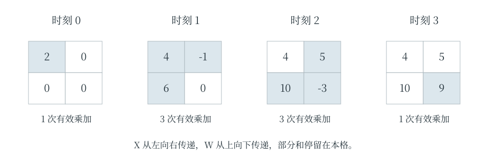
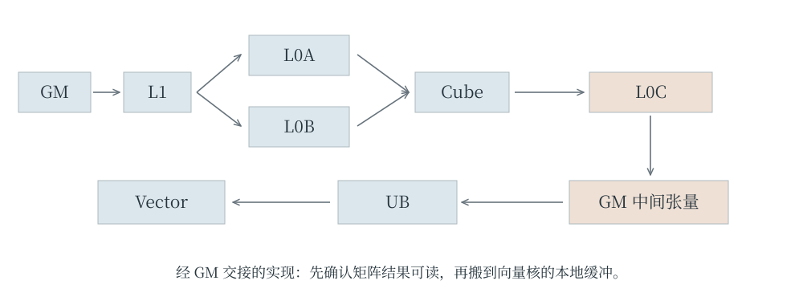

# 第 8 章　GPU、TPU 与昇腾的架构取舍

给三种处理器出同一道题。输入和权重沿用第六章的两张小矩阵，先算出两行结果 $`(4,5)`$、$`(10,9)`$，再给每行加偏置 $`(-6,0)`$，最后用 ReLU 把负数置零。答案应为 $`(0,5)`$、$`(4,9)`$。特意给第一列减 6，是为了让激活函数真有一项工作可做。现在分别去三种芯片上找这四个数。乘法由谁做？加偏置时，刚算出的 4 还在手边吗？只送一行输入，与一次送 128 行，哪一步最吃力？

## 8.1　GPU 上的可编程线程与矩阵指令

在 NVIDIA GPU 上，算子库可以让一个线程块负责一片输出。线程按行列编号选取要搬的面板，warp 协作把矩阵乘交给 Tensor Core，末尾再用普通运算指令给每列加偏置、比较大小。以支持寄存器累加的指令路径为例，乘法结束时，4 和 5 分布在负责这些位置的线程寄存器中。若库提供合适的融合实现，线程在写回之前就可以分别算 $`\max(4-6,0)=0`$ 和 $`\max(5+0,0)=5`$。模型在纸上写了三个运算，设备只须写回最终输出。[CUTLASS 对矩阵乘主循环与输出处理的划分](https://docs.nvidia.com/cutlass/latest/media/docs/cpp/efficient_gemm.html)

GPU 的长处在这种组合自由。程序可以改变线程分工，也可以在矩阵运算旁插入索引、变长掩码或自定义激活。付出的代价也具体。如果加偏置和 ReLU 另起一个内核，前一个内核就要先把中间张量保存到设备全局内存，后一个再读。若尝试全部塞进一个内核，寄存器和共享内存可能紧张，可同时驻留的块变少。遇到一个新的运算组合，工程师要比较库实现、融合实现和各自实际产生的流量。


*图 8-1　追的是乘法刚刚算出的四个数。若下一项运算能直接接住它们，中间张量可以省掉一次写与一次读。若交给另一内核先存后取，能否命中 L2 还会影响有多少字节到达 HBM。*

## 8.2　TPU 怎样把矩阵乘排成一片阵列

另一种搭法是让数自己沿着相邻单元前进。画四个处理单元，排成两行两列。每格从左侧接收一个输入，从上侧接收一个权重，做一次乘加，把输入送给右邻、权重送给下邻，部分和留在原格。这是一种**脉动阵列**的数据流。为看清它为什么能少取数，我们约定每拍移动一格，并让第二行输入和第二列权重各比第一行、第一列晚一拍。这样单元 $`(i,j)`$ 在第 $`i+j+k`$ 拍恰好收到属于内积第 $`k`$ 项的两个数。



*图 8-2　从左到右，每拍有 1、3、3、1 个单元在做有效乘加。沿左上格能读出 2 和 4；右下格要晚两拍才收到第一对数，最后得到 9。图示采用输出留在原格的教学阵列。*

第一拍，左上格遇到 1 和 2，记下 2。这两个数随后会离开这个格，1 传向右边，2 传向下边。第二拍，右上格拿刚送来的 1 乘 $`-1`$，左下格拿 3 乘刚送来的 2；同时左上格又收到 2 和 1，把自己的结果补到 4。于是从左边界进入一次的 1 已在两格发挥作用。总共八次乘加，用了四拍；四格每拍都工作本可做十六次，这道小题只用上一半位置。对于 $`r\times c`$ 个有效输出和长度为 $`k`$ 的内积，同一理想时序需 $`r+c+k-2`$ 拍。内积更长、持续有下一块输入时，阵列更容易填满。短边、不规则形状和补齐的空格都会降低有效利用率。

Google TPU 的矩阵乘单元（MXU）采用脉动阵列。上面的四格用来推导数据怎样复用，各代芯片的阵列尺寸、数据装载和驻留方式有自己的实现。TPU 也有标量与向量单元。矩阵乘结束后，加偏置和 ReLU 可以由向量侧接手，编译器安排分块、布局、片上缓冲以及它们之间的依赖。在具有向量内存（VMEM）的产品上，让可复用的数据留在片上有助于减少 HBM 往返。若结果需要跨计算块重排或跨芯片汇合，这项开销仍须算进去。[Google Cloud TPU 架构](https://docs.cloud.google.com/tpu/docs/system-architecture-tpu-vm) [第一代 TPU 论文](https://research.google/pubs/in-datacenter-performance-analysis-of-a-tensor-processing-unit/)


*图 8-3　把图 8-2 的四格放回芯片里，就得到图中央的 MXU 局部。Google 所称的 TensorCore 还包含标量、向量等单元，比较两家规格时要先核对这个名字指的是多大一块硬件。*

投影规则、批量足、编译器能够提前安排形状时，这种设计很有吸引力。另一端的难题是模型里的不规则访存和芯片间搬运。TPU v4 为嵌入等负载配置 SparseCore，并用可重构光交换连接大系统；到了 TPU7x（Ironwood），一颗芯片上有两个 chiplet，各有 96 GiB HBM，运行时可将它们暴露为两个设备。把需频繁交换的数组切在这条边界上，不能把总计 192 GiB 当成到处等距的一块内存。Google 在第八代又分别强调 8t 的训练规模、8i 的低延迟推理，2026 年 11 月公布的 8i Max 则同时增加片上存储和 HBM 带宽，面向更大的上下文工作集。读这些型号时，可以追问它增加的是阵列位置、存储容量，还是每秒能送到阵列的字节。[TPU v4 论文](https://arxiv.org/abs/2304.01433) [TPU7x 的芯粒与内存](https://docs.cloud.google.com/tpu/docs/tpu7x) [第八代 TPU 技术说明](https://cloud.google.com/blog/products/compute/tpu-8t-and-tpu-8i-technical-deep-dive) [8i Max 的设计目标](https://cloud.google.com/blog/topics/ai-infrastructure/tpu-8tx-and-tpu-8i-max)

## 8.3　昇腾的搬运、矩阵与向量流水

在昇腾上，可以先把这道题看成三份工作。把两个输入片段送到本地，做矩阵乘，再对结果逐元素处理。以 CANN 文档中的 Cube 与 Vector 分离架构为例，**Cube** 负责矩阵运算，**Vector** 适合加偏置、激活和归约一类运算，标量单元负责控制，搬运引擎（MTE 等）在不同存储之间送数。CANN 是软件栈，Ascend C 给算子作者提供编程接口。各产品支持的存储路径和融合方式需对照目标型号。[昇腾 AI Core 架构与产品差异](https://www.hiascend.com/doc_center/source/en/CANNCommunityEdition/850/opdevg/Ascendcopdevg/atlas_ascendc_10_0008.html)

顺着图 8-4，先找左侧输入的 1。全局内存（GM）中的矩阵数据可以先搬入片上的 L1 Buffer，再分别装进供 Cube 取数的 L0A 和 L0B。Cube 把乘积累加到 L0C，第一项得到的 2 就在这里等下一项补成 4。名称里的 L1 在这里指可显式搬入的缓冲，不能套用 GPU 普通加载命中 L1 缓存的解释。向量侧通常使用统一缓冲区 UB。本例选一条容易验证的交接路径，矩阵端经 Fixpipe 写出全局中间结果，向量侧再把它读到 UB、加偏置、做 ReLU 并写回。支持更短通路或相应融合操作的产品可以另排这一步。[昇腾矩阵运算的输入与累加存储](https://www.hiascend.com/document/detail/en/CANNCommunityEdition/910/API/ascendcopapi/docs/en/api/SIMD-API/basic_api/cube_compute_ISASI/overview/matrix_computation_unit.md)



*图 8-4　上半部解释为什么两个乘数和部分和需要不同的位置。下半部把乘法结果交给向量运算。预留一块中间存储可以解开两端的执行时序，却多了一次写出和取回。*

这种分工的优势，是算子作者可以明确安排“第几块在哪儿”。假设一块搬入需 3 微秒、矩阵乘需 5 微秒、向量处理需 2 微秒；设三段使用独立资源，有足够缓冲，交接时间已计入各段。第一块在第 10 微秒完成。随后当 Cube 算第二块时，向量单元可处理第一块，搬运单元又准备第三块。四块的理想总时间是 $`10+3\times5=25`$ 微秒，逐块顺序做则需 40 微秒。真实程序里若搬入和中间结果写回挤在同一接口，或者同一块 UB 太早被覆盖，这个排程便不能成立。调优时可以沿时间线找 Cube 等的是数据、事件，还是下游迟迟没有腾出位置。

布局也会改变代价。假设某种选定格式按每组 16 个通道存放，有 17 个有效通道，就要留两组、共 32 个位置。32 个位置中只有 17 个装着有效数据，利用率约为 53%。批量放大不会改变这个比例；可以试能处理尾块的实现或在模型允许时调整通道数，再连同重排开销比较。这是选定分块的算例，不能推断每一种昇腾指令都要求同一格式。多芯片部署还要看互联。华为的 Atlas 900 A3 和 Atlas 950 SuperPoD 采用不同代的 UnifiedBus，解决的是多颗 NPU 怎样共享和交换工作；单个 Cube 的局部操作数仍须按本地路径送达。[Ascend C 的硬件抽象](https://www.hiascend.com/doc_center/source/zh/canncommercial/80RC3/developmentguide/opdevg/Ascendcopdevg/atlas_ascendc_10_0015.html) [Atlas SuperPoD 的互联设计](https://www.huawei.com/en/news/2025/9/hc-xu-keynote-speech)

## 8.4　把同一层放大，算出性能可能在哪里受限

将权重放大到 $`4096\times4096`$，用 BF16，每个元素 2 字节。令 $`M`$ 是同一批参与投影的输入行数。每个输出要做 4,096 次乘加，一乘一加算两次浮点运算。一共 $`M\times4096`$ 个输出，得到工作量 $`F`$。若输入和权重各从 HBM 读一次、最终投影结果写一次，忽略偏置和激活，最低有效载荷记为 $`D`$。

```math
F=2M\cdot4096^2,\qquad
D=2\bigl(4096^2+2M\cdot4096\bigr)\ \mathrm{B}.
```

权重无论如何都是 32 MiB。取 $`M=1`$，加上输入输出各 8 KiB，约每读写一字节做一次浮点运算。取 $`M=128`$，输入输出各 1 MiB，合计 34 MiB，要做约 42.95 亿次浮点运算，即约 120.47 FLOP/B。多出来的计算可以共享同一套权重。这个比值叫**算术强度**。若要求把 BF16 中间投影先写出再读回做激活，第二种形状还会产生 2 MiB 的全局中间张量读写；实际进入 HBM 的部分取决于缓存和调度。

怎样从这笔账看出一台机器适不适合？假设两台教学设备，同一精度下甲可做 120 TFLOP/s、HBM 可送 1.5 TB/s，乙分别为 80 TFLOP/s、3 TB/s。设计算能力为 $`P`$，带宽为 $`B`$。任何一次执行至少要给运算留 $`F/P`$ 的时间，给数据留 $`D/B`$ 的时间，因此两者中的较大值给出时间下界。这就是 Roofline 模型的用法。相应的有效运算速率上限为 $`\min(P,BF/D)`$。用 $`M=1`$ 代入，甲、乙的乐观时间分别约 22.38 和 11.19 微秒，带宽更大的乙占优。换成 128 行则约为 35.79 和 53.69 微秒，甲的运算能力这时候才有机会发挥。同一机器没有变，合适的选择已经倒过来了。


*图 8-5　横轴是每个有效字节带来的运算。左侧斜线意味着传输时间占上风，右侧平台意味着增加带宽也无法突破计算上限。它给出了测量结果应满足的边界。*

## 8.5　从纸面预算走到设备时间

把这个预测和一次设备测量放在一起看。随书保留了一组 Radeon 780M 上的投影计时。权重是 $`1024\times1024`$ 的 FP32，比较一个工作项同时算一行或四行的两种 OpenCL 实现。输入有 128 行时，已有运行记录的中位数从约 3,198 微秒降到 1,871 微秒；输入只有一行时，却从约 516 微秒升到 610 微秒。当另外三行根本不存在，给它们预留的工作组织就不能摊薄权重读取。这个实验记录了执行时间和编译资源，用“少读了多少显存字节”解释它时还需实际流量计数。第九章有这组原始数据、复算方法和逐步改变实现的过程。[原始设备记录](../../experiments/part03/projection_780m.json)

若手头要比较 GPU、TPU 与昇腾，可以沿同一顺序做实验。先固定权重、输入形状、数值精度与允许误差，逐格核对小例，再预热各自成熟的矩阵库。先给一个请求发一行，再一次发 128 行，计时到设备真正完成，单列首次编译和主机复制。若一行慢，做热权重复用与轮换大工作集的对照；若 128 行慢，查矩阵单元有效计算和尾块；若乘完还等很久，比较单独投影与“投影＋偏置＋激活”的完整时间，并检查中间张量是否真的写回。CUDA 上的随书脚本可用同尺寸的一张权重或轮换八张权重做这个对照。[投影计时程序](../../experiments/part02/measure_projection.py)

三种设计由此各有用武之地。工作里常换索引方式和融合逻辑，可编程线程让 GPU 有多种实现可试；规则的大块矩阵反复出现，TPU 阵列里相邻单元传数的收益更容易兑现；数据分块和处理阶段能够提前排清，昇腾可以让矩阵、向量与搬运单元重叠起来。最终要交付的是有精度和延迟要求的模型。选择之前，先在它真正要跑的形状上测完整一层。下一章就从这个投影动手，把纸上的 34 MiB 与实际内核逐步对照。

## 练习与解答

### 1. 阵列为什么要等最后一拍

沿用图 8-2 的单步移动规则，阵列有效输出为 2 行 3 列，内积长度为 4。末格何时完成？有效乘加占这段时间内全部计算位置的多少？

**解答。** 以 0 为首拍，末格 $`(1,2)`$ 在 $`1+2+3=6`$ 拍收到最后一项，共 7 拍。六格各做四次有效乘加，利用比例为 $`24/(6\times7)=4/7`$。若连续块可以适当衔接，端到端利用率还要按实际排程计算。

### 2. 给中间张量选去处

128 行、每行 4,096 项，投影和激活的中间结果为 BF16。若两段之间必须整张写回 HBM 再完整读入，HBM 有效带宽为 2 TB/s，这份中间结果占用多少接口时间？

**解答。** 张量为 1 MiB，写读合计 2,097,152 字节，占接口约 1.05 微秒。融合若引入额外转置、降低计算单元利用率或原读写实际命中缓存，整层节省的墙钟时间都可能小于这个数。

### 3. 三段流水，哪一段值得优化

将 8.3 节的矩阵乘从 5 微秒降到 2 微秒，其他假设相同。四块何时完成？再把向量处理从 2 微秒降到 1 微秒，能省下多少？

**解答。** 三段变为 3、2、2 微秒，第一块用 7 微秒，其余三块每 3 微秒完成一个，共 16 微秒。再缩短向量段后，第一块需 6 微秒，稳态间隔还是 3 微秒，共 15 微秒。它只把最后完成的时刻提前 1 微秒，下一步应该回头检查搬入段。

[本篇算例的 Python 复算程序](../../experiments/part02/verify.py)

[全书目录](../../README.md) · [上一章 · GPU 硬件演进与系统互联](ch07.md) · [下一章 · 矩阵乘法的实现与测量](ch09.md)
