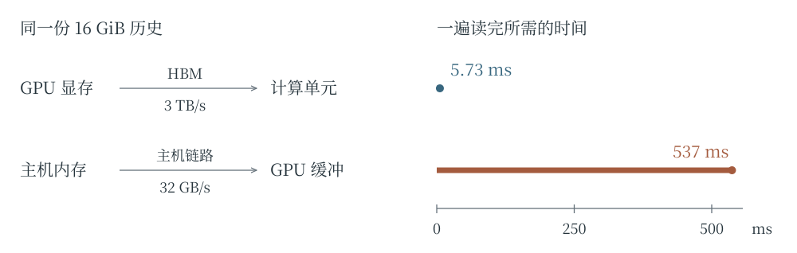
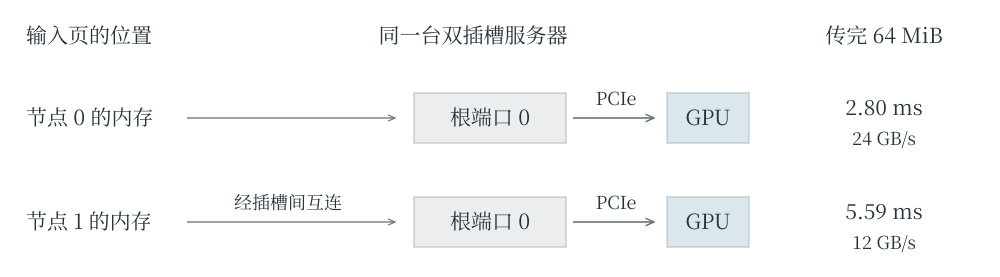
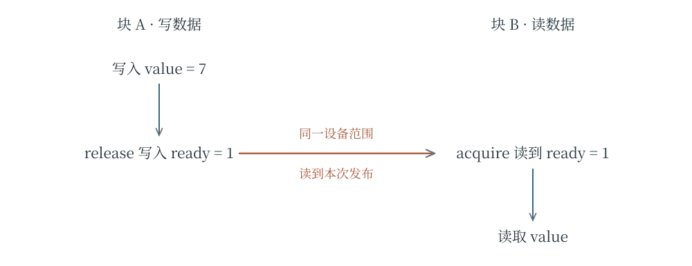

# 第 8 章　GPU 系统中的数据放置与共享

第五章算过，一条请求的历史达到 128K 个词元时，例中的模型要为它保存 16 GiB 的键和值。显存紧张，把这段 KV Cache 搬到容量更大的主机内存，看起来就能再接一条请求。可是下一次生成词元时，GPU 还要读这些历史。刚刚腾出的 16 GiB，会让这个词元多等多久？

## 8.1　把历史移到主机以后

先看图 8-1 的上行。假定 16 GiB 都留在 GPU 的高带宽显存（HBM）里，这一步恰好把它们从 HBM 读一遍。按 3 TB/s 的有效读取速率，光把字节送到芯片，就需约 $`16\times2^{30}/(3\times10^{12})\approx0.00573`$ 秒，即 5.73 毫秒。这里 GiB 按 1024 进位，带宽规格中的 GB、TB 按 1000 进位。

再看下行。现在相同的数据在主机内存，下一步开始时 GPU 上还没有副本。设主机到 GPU 的链路每秒能单向送来 32 GB，仅让这 16 GiB 通过链路就要约 $`16\times2^{30}/(32\times10^9)\approx0.537`$ 秒。图上的 537 毫秒还没算 GPU 做注意力的时间。两条路径处理的是同一份历史，只改了放置位置。



*图 8-1　每行都从历史实际存放处出发。下行先算主机链路的传输时间。如果一批一批地送，某些计算可以提前开始，但最后一批历史仍须经过这条链路。*

如果先把整份历史拷回显存，再启动和原来一样的注意力计算，那么本地那一遍读取仍要做，前置复制就额外增加约 537 毫秒。若每搬回一层就开始算这一层，下一层的传输可以与当前计算重叠。此时要沿时间线找真正多等了多久。

能否在这条较慢的链路上少传一些？如果下一次只用其中六十四分之一，且所需内容恰好装在可以单独取回的连续页中，GPU 只用取回 256 MiB，链路时间就降到约 8.39 毫秒。若所选词元分散在许多页中，实际要取回的页会更多。第五章的稀疏注意力改变了哪些位置要参与计算，内存管理还要回答，包含这些位置的数据能按多细的粒度搬运。两者都知道，才能给这一次生成估算时间。

## 8.2　从一个地址找到数据所在的页

程序里的指针保存着一个地址。GPU 拿到指针时，怎样知道数据还留在本地，还是要去主机找？统一虚拟地址空间让系统可以用一套地址标识不同的分配。某个处理器能否直接读取其中一段，取决于这段内存的映射和访问权。统一内存再提供放置、远程访问或迁移等机制，具体行为由硬件、操作系统和分配方式共同决定。于是同一段数据即使换了位置，程序里保存的地址也可能照旧有效。[CUDA 统一内存与数据放置](https://docs.nvidia.com/cuda/cuda-programming-guide/04-special-topics/unified-memory.html)

设备指令拿到的是一个虚拟地址。把地址想成两项即可，前段标识虚拟页，后段给出页内偏移。页表保存从虚拟页到物理页框的对应关系；地址翻译缓存（TLB）在芯片附近记下近期用过的映射。已经找到页框以后，读取那一行数据仍要经过数据缓存和内存接口。一次翻译未命中，页表里完全可能有有效映射，这时需要查表。若访问的页尚未驻留在本设备，才另外涉及远程访问、报缺页或迁移，具体行为取决于分配方式和系统支持。


*图 8-2　从上往下读三次访问。第二行的页表仍能指出本地页框。第三行需由系统处理未驻留映射，等待时间不能并入一次普通 TLB 未命中。*

例如页大小为 4096 字节，从一个与页边界对齐的数组首地址往后数 8288 字节，会越过两整页，再走 96 字节。设备只需查第三页的映射，就能用页框起点加 96 找到这个数。如果该页从主机迁到显存，新的映射会指向新的页框，页内这 96 字节的偏移仍然适用。

地址翻译要花多少次查表？用一个教学 TLB 手算。假定它完全相联，有 16 项映射，按最近最少使用淘汰。依次访问一段对齐的 128 KiB 区域，每隔 4 KiB 读一个数，然后原序重读。若映射以 4 KiB 为页，一轮用 32 个页号。第二轮到页 0 时它早已淘汰，到页 15 时后一半旧映射也已逐一淘汰，第二轮仍是 32 次未命中。若操作系统确实把该区映在一张对齐的 2 MiB 大页内，第一轮填一项即可，第二轮查映射能全部命中。用户程序仍然只需要那 128 KiB。同一物理大页的其余范围怎样利用、是否适合整体迁移，决定了这个选择的代价。真实硬件有多级和组相联结构，页走访也可能命中缓存。要验证这类解释，可固定访问次数和有效载荷，改变跨页步幅、访问顺序与映射大小，同时记录耗时及可取得的翻译指标。[CUDA 虚拟内存管理](https://docs.nvidia.com/cuda/cuda-programming-guide/04-special-topics/virtual-memory-management.html)

## 8.3　一次主机到 GPU 的复制

现在改用显式复制。让 CPU 准备好一批输入，GPU 拿到后才开算。数据走哪条路、主机能在什么时候重用原缓冲区，这时都可以在时间线上找出来。

程序常先在主机准备一块页锁定（pinned）缓冲。操作系统保证这些页在传输期间维持可供设备直接访问的后备。这样设备的直接内存访问引擎（DMA）就可以按约定完成复制。普通可分页缓冲的传输在一些路径中要先经过临时的页锁定缓冲。页锁定内存是有限的系统资源，要按队列深度管理其生命周期。异步提交之后，主机若马上改写输入缓冲，可能与仍在读取它的 DMA 冲突。这里的“最后一个消费者”已经从块内线程换成了一个设备引擎。[CUDA 主机与设备间的数据传输](https://docs.nvidia.com/cuda/cuda-c-best-practices-guide/index.html#data-transfer-between-host-and-device)

假设输入有 16 MiB。沿一条单向有效带宽为 32 GB/s 的链路复制，传输时间是 0.524288 ms。若设备计算恰耗 0.20 ms，输出很小，且必须先传完整块再算，则这一批至少约 0.724 ms。连续来两批时，若使用两个互不覆盖的主机和设备缓冲、独立的复制与计算引擎，并用事件让第二次计算等它自己的复制完成，可以让第二次输入复制和第一次计算重叠。理想总时间约为 $`2\times0.524288+0.20\approx1.249`$ ms，直接串行约为 1.449 ms。如果下一批输入依赖第一批输出，这种提前复制的机会就会消失。

主机到 GPU 的数据传输也可能经过不同路径。一台双插槽服务器有两颗 CPU，各自连着一组本地内存。从一颗 CPU 到另一颗所连的内存还要多走一段互连。这种内存访问代价随位置变化的组织叫非统一内存访问（NUMA）。假定 GPU 连接第一个 CPU 插槽的 PCIe 根端口，输入页却分配在第二个插槽，那么读取还要经过插槽间互连。进程中的指针本身不能反映这条物理路径。Linux 的默认本地分配策略通常在首次实际分配物理页时选择执行线程所在节点；显式策略、可用容量与 cpuset 约束都可能改变放置结果。[Linux NUMA 内存策略](https://docs.kernel.org/admin-guide/mm/numa_memory_policy.html)



*图 8-3　GPU 接在插槽 0 上。把手指放在实际存放输入的那一端，沿线走到 GPU。下行多经过一次插槽间传输，右侧给出正文教学条件下整笔复制的用时。*

怎样证实慢发生在哪里？先查 GPU 与两个 NUMA 节点的拓扑，分配两块等大的主机缓冲，让预期节点的线程先写满各自的页，并核对实际放置。两块都登记为页锁定缓冲，按相同方向传给同一 GPU，比较预热后的完成时间。假设在该大小下两条路径分别量到 24 与 12 GB/s 有效载荷吞吐，那么 64 MiB 单向复制分别需要约 2.80 与 5.59 ms。这里的两个带宽是教学输入。页数、页锁定方式、设备计算以及另一条传输是否同时占链路，都要保持一致。若差异随放置互换而反转，就有了定位证据。这样的差异发生在算子启动以前，调整片上分块不会使这些字节提前到达。[CUDA Best Practices Guide](https://docs.nvidia.com/cuda/cuda-c-best-practices-guide/index.html#numa-best-practices)

## 8.4　冷数据放在远端，读取要花多久

主机也会遇到容量不够的问题。例如一张特征表放不进本地内存，可以把不常用的部分放到扩展内存。CPU 仍能按地址读它，但一次读可能走本地内存接口，也可能经 CXL.mem 协议访问扩展设备。下面只计算 CPU 读取这张表的时间。若要让 GPU 直接用这块内存，还要查看具体设备和系统支持的映射与访问路径。[CXL 规范](https://computeexpresslink.org/cxl-specification/)

假设一批特征占 64 MiB，本地内存不够，把其中冷的 16 MiB 放到扩展层。设本地有效读取速率 100 GB/s，远端链路 16 GB/s；一次扫描每个特征都恰好用到且首次不命中。逐段串行读的理想时间为 $`48\times2^{20}/10^{11}+16\times2^{20}/(16\times10^9)`$ 秒，即约 1.55 ms；若两种读取真能完全重叠且没有共享瓶颈，下界约 1.05 ms。把总字节除以两种带宽之和会得到约 0.58 ms，连必经远端链路的 1.05 ms 都没有付足。若工作负载实际只访问 1 MiB 冷数据，则要按实际流量重新计算。放置时常用访问频率而非分配容量来定义冷热，原因就在这里。

再把访问改成追指针：一个返回值指定下一个地址。即使总量很小，单个请求也无法预先发出整串读取，此时要算每跳延迟，不能只除以流式带宽。做测量时分别跑顺序扫描、独立并发随机读、单链依赖读，记录数据位置和缺失率；如果许多条独立读取可以把接口用满，单链却很慢，就值得查每次得到下一个地址要等多久。

## 8.5　看见就绪标志以后

上面算复制时间时，我们默认 GPU 读到的是 CPU 准备好的那批输入。可要是写的一方还没写完，读的一方已经开始算，再高的带宽也只会更快地交出错误结果。先把距离缩短到同一颗 GPU 上，就能把这个问题看清。

线程 A 先把部分和 7 写进 `value`，再把 `ready` 从 0 改成 1。另一个线程块里的线程 B 看见 1，接着去读 `value`。它一定读得到 7 吗？这里有两个地址。**缓存一致性**（coherence）关心同一地址上的写入按什么次序被观察到。要从读到 `ready` 推出可以读 `value`，还要在不同地址的操作之间建立先后关系。这是**内存一致性模型**（memory consistency model）要规定的事。

先看只写一次的情形。启动前已把标志清零，A 是唯一写者，写完以后暂时不再改这格数。让 `ready` 成为作用域覆盖两个线程块的设备范围原子变量，B 只在读到本轮标志时使用数据。

```text
生产者                              消费者
value = 7                           if ready.load(acquire) == 1:
ready.store(1, release)                 use(value)
```

左列用 release 写标志，把此前对载荷的写排在这次发布之前。右列用 acquire 读标志，若取得本次发布的 1，就把随后读取 `value` 的操作排在这次原子读取之后。沿图 8-4 从左上走到右下，四个事件连成一条 *happens-before* 关系，此时读取线程必须取得 7。若两端只用 relaxed 操作，标志位自身的读写仍是原子的，普通载荷的跨线程读写却缺少同步，可构成数据竞争。把作用域缩到各自线程块，也无法连接两个不同的块。把载荷改成 `volatile` 或要求某一次读绕过 L1，都补不出那条关系。[CUDA C++ 内存模型及线程作用域](https://docs.nvidia.com/cuda/archive/13.3.0/cuda-programming-guide/05-appendices/cuda-cpp-memory-model.html) [PTX 内存一致性模型](https://docs.nvidia.com/cuda/parallel-thread-execution/index.html#memory-consistency-model)



*图 8-4　竖向表示同一线程内的先后。横边只在读方取得这次发布的值、且作用域包含双方时成立。从左列的写入沿箭头走到右列的读取，可以逐步核对 B 为什么能取到 7。*

沿着这四个事件读，还能看出怎样安全地写第二轮。B 读完 7 之后要通知 A，这个位置可以覆盖了。A 拿到这次通知，才能把新值 9 写进去，再发布本轮标志。如果标志永远是原来的 1，B 即使再次看见 1，也无从判断是哪一轮的结果。

## 8.6　换一代硬件，哪些交接条件要重新检查

为什么这项区分对跨代移植重要？沿全局加载走一遍，靠近执行单元的 L1 可随型号、指令和配置改变。PTX 对普通全局数据描述了在 L2 层的一致性，并明确说缓存操作符属于性能提示。它们允许程序表示想把一次访问缓存在何处。它们不替程序员定义跨地址、跨线程的发布关系。[PTX 缓存操作符与全局加载](https://docs.nvidia.com/cuda/parallel-thread-execution/index.html#cache-operators)

| 代际与代表器件 | 顺着一次访问看到的变化 | 移植上面的通信时要检查什么 |
|---|---|---|
| Fermi、Kepler | Fermi 的普通全局加载可经 L1、L2。Kepler 的常见默认全局路径在 L2 缓存，GK110 另有只读路径，部分后期型号允许选择 L1。 | 只读路径要求数据在相应执行期间满足只读条件。不能用它读取其他线程正在改写的标志位。 |
| Maxwell、Pascal | GM204 提供启用全局 L1 缓存的选择。即使同属 Pascal，GP100 普通全局加载默认经 L1，GP104 的默认行为也不同。 | 相同工作集，换卡后 L2 请求数可能改变。观察命中率前记录具体芯片和编译选项。 |
| Volta、Turing | 共享内存与 L1 使用统一的片上资源。Volta 起支持独立线程调度。 | 同一 warp 中通过共享内存交换数据，也要用包含参与线程的同步。另一块的读者仍需跨块协议。 |
| Ampere | 可对合适的全局访问设置 L2 驻留策略，也可发起从全局到共享的异步复制。 | 前者改变逐出倾向。后者要等复制完成，并在共享缓冲被其他线程使用或复用处交接。 |
| Ada | 延续统一的 L1／共享内存组织，部分产品大幅扩大 L2。较大的工作集可能在设备端缓存中留得更久。 | 容量改变的是命中机会。独立线程块之间继续使用覆盖双方的同步。 |
| Hopper | 线程块簇允许簇内寻址分布式共享内存；某些异步引擎通过单独的访问代理读写。 | 簇内线程块的生命周期、簇同步和异步代理的可见性都有明确条件；跨簇全局数据仍要选覆盖双方的范围。 |
| Blackwell 数据中心 GPU | 一颗 B200 中的两个裸片对软件呈现为一个 GPU。其他 Blackwell 产品的物理组织要按型号核对。 | 设备范围以逻辑设备为界。跨两颗设备或让主机参与，还要核对系统范围原子和相应内存分配的支持。 |

沿这张表纵向读，增加缓存、增加可协作的线程范围、引入新的搬运者，是三类不同的改进。以 Hopper 为例，普通线程先写共享缓冲，随后异步引擎从中读取。即使同一个线程已经走到发起指令处，仍应按该指令规范建立普通访问与异步代理之间要求的 fence。反方向从引擎取结果，又要按操作指定的完成机制等待。把新机器的搬运指令替换进旧循环时，原有两个线程间的屏障只证明了其中一段。[Kepler 指南](https://docs.nvidia.com/cuda/archive/11.1.1/kepler-tuning-guide/index.html) [Maxwell 指南](https://docs.nvidia.com/cuda/archive/11.1.1/maxwell-tuning-guide/index.html) [Pascal 指南](https://docs.nvidia.com/cuda/archive/12.9.0/pascal-tuning-guide/index.html) [Volta 指南](https://docs.nvidia.com/cuda/volta-tuning-guide/index.html) [Ampere 指南](https://docs.nvidia.com/cuda/ampere-tuning-guide/index.html) [Ada 指南](https://docs.nvidia.com/cuda/ada-tuning-guide/index.html) [Hopper 指南](https://docs.nvidia.com/cuda/hopper-tuning-guide/index.html) [Blackwell 架构](https://www.nvidia.com/en-us/data-center/technologies/blackwell-architecture/)

再看 CPU 和 GPU 之间的数据共享。传统离散卡上的主机缓冲与设备副本是两份存储，CPU 修改原数据不会自动修改设备副本。Grace Hopper 的 NVLink-C2C 提供有硬件一致性支持的处理器间访问路径，可让双方在受支持的配置中访问同一份数据。这样可以减少一份副本，但仍需明确读写顺序，并选择覆盖 CPU 和 GPU 的同步作用域及支持相应原子操作的内存。如果两个处理器交替修改同一小块数据，每次交接都可能产生跨链路通信。将多个元素合批处理，可以减少交接次数：一次处理一个或十六个元素，即使每次传输的有效载荷都只有 64 B，协议往返次数也可能从十六次降到一次。实际收益取决于业务是否允许等待批次凑齐。[Grace Hopper 的一致性互连与内存访问](https://developer.nvidia.com/blog/nvidia-grace-hopper-superchip-architecture-in-depth/)

同步还牵涉到执行机会。如果占满设备的消费者块都在原地等，负责写数据的生产者块可能一直排不上。对没有必要同时运行的两个阶段，可以把它们放进同一设备流，先提交写数据的内核，再提交读数据的内核。这样多了一次启动，却省去了块与块之间的忙等。需要流式交接时，则要一起检查槽位能否归还、写方何时能运行，以及操作所选的同步范围能否覆盖双方。

再回到那条长上下文请求。已知可用显存，16 GiB 这个数就能告诉我们整份历史是否放得下。要估计下一个词元何时出现，还要沿着它真正会读的页，找出在哪条链路传、哪些传输能提前，以及计算在等哪个完成信号。下一章用同样的思路比较几种加速器，把一次投影里的运算时间也加进来。

## 练习与解答

### 1. 十二毫秒够取回多少历史

主机链路单向有效带宽为 32 GB/s。留给它 12 ms，每页 64 KiB，只传完整页，忽略固定开销。最多可以取回多少页？若这一轮实际命中 6000 个互不相同的远端页，赶得上吗？

**解答。** 在 0.012 秒里能通过 384,000,000 B。每页 65,536 B，最多传完 5,859 页。6,000 页共 393,216,000 B，单向就要 12.288 ms。若 6,000 次读取中有一些落在同一页，则应重数真正需要取回的页。

### 2. 查了页表，搬了多少页

用 8 项完全相联、按最近最少使用淘汰的 TLB，顺序读 12 个不同的 4 KiB 页，再按原序重读。所有页一直驻留在本地显存。两轮合计有几次翻译未命中？需要从主机迁入几页？

**解答。** 第一轮的 12 个页号都要查表。第二轮开始时缓存里是页 4 到 11。重新读 0 到 3 会逐个挤掉 4 到 7，后续访问也都来迟一步，因此两轮共有 24 次翻译未命中。页表始终给出本地页框，从主机迁入的页数为零。

### 3. 怎样区分缓冲区的不同使用轮次

一个设备范围的原子标志位从 0 变为 1 后再也不复位。生产者随后准备复用缓冲写 9。消费者用 acquire 读到 1，能把这次读取当作“9 已经就绪”吗？

**解答。** 不能。这个 1 可以来自发布 7 的第一轮，不能证明第二轮写 9 已经完成。若读者还在读，覆盖普通载荷还可能构成数据竞争。一种解法是让消费者在读完后发布归还通知，生产者收到这次通知后才能覆盖，再用新的轮次号发布 9。队列若允许多个读者，还须等本轮最后一个读者交还。

本章的页数、链路预算和翻译命中次数可以用标准 Python 复算。[第二篇复算程序](../../experiments/part02/verify.py)

[全书目录](../../README.md) · [上一章 · GPU 存储层次与矩阵乘法的数据流](ch07.md) · [下一章 · GPU、昇腾与 TPU 的架构取舍](ch09.md)
