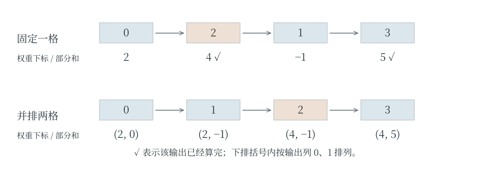
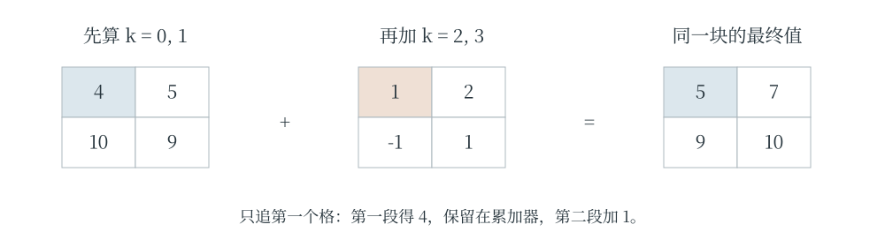
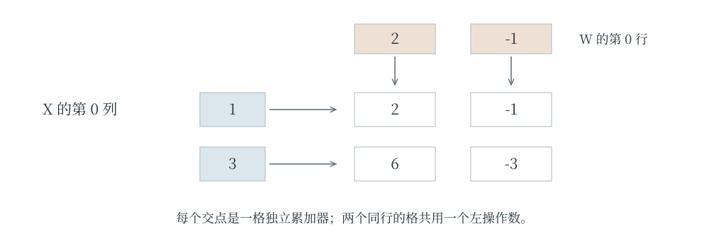
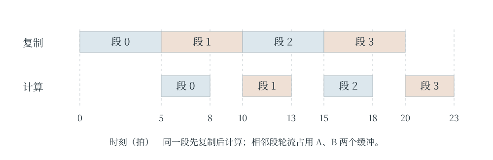
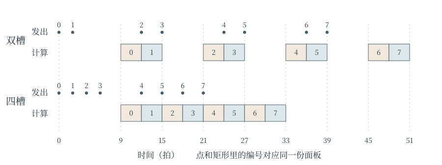
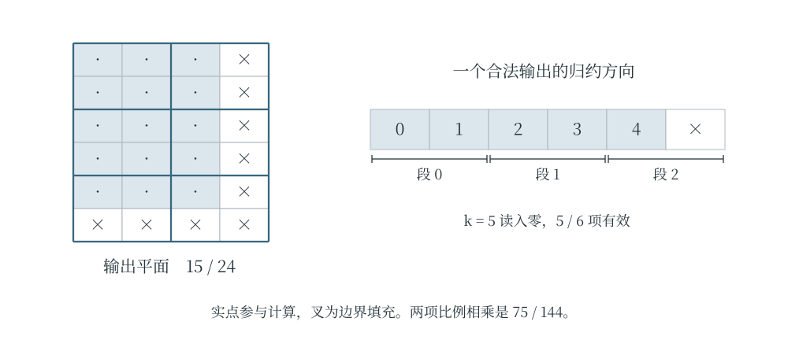
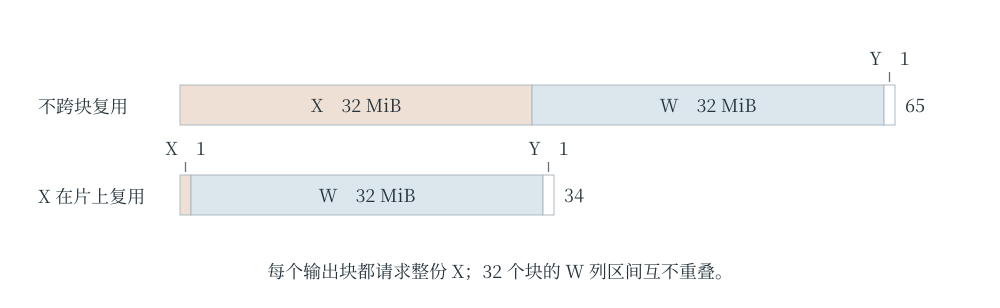
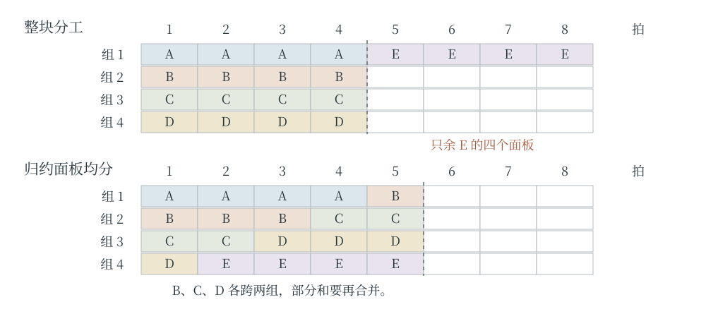
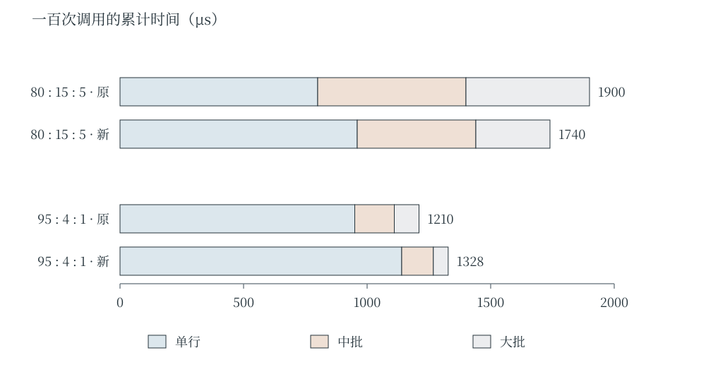
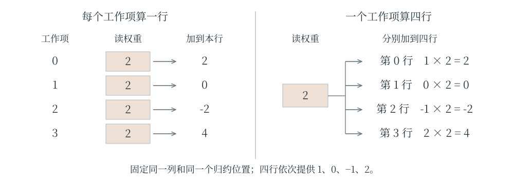

# 第 9 章　矩阵乘法内核与性能测量

沿用第八章的 $`4096\times4096`$ 权重矩阵。128 个词元同时与它相乘，约需 42.95 亿次浮点运算。如果输入和权重都只从显存读入一次、输出也只写入一次，按每个元素占两字节计算，搬运量为 34 MiB。这是理想情况下的最低数据搬运量。实际执行时，片上空间放不下整张权重矩阵，不同线程块也需要分别计算输出，因此可能重复读取数据。本章从循环顺序和分块入手，讨论如何减少这些读取。

先从第二篇的两个小矩阵开始。令 $`X`$ 的两行为 $`(1,2),(3,4)`$，权重 $`W`$ 的两行为 $`(2,-1),(1,3)`$。第一行第一个输出从 $`1\times2`$ 得到 2，再加 $`2\times1`$ 得到 4。把四格做完，输出是

```math
Y=XW=\begin{bmatrix}4&5\\10&9\end{bmatrix}.
```

第三篇先固定这四个答案，再逐步改变实现。第一个问题最容易动手：一份权重装进来，能供几行输入使用？到注意力层，接着问整张分数表是否需要写出去。减小数值位宽，还得为舍入误差定一个能接受的范围。最后，把这些算子放回框架，检查数据的最后一次使用和编译器实际生成的程序。第十四章会再拿出本章的同一份计时记录，看看局部省下的时间究竟有多少落到了请求上。

程序写下一次矩阵乘，主机先根据输入形状、类型与所在设备选择实现，再把工作提交到设备队列。提交返回时设备可能还没开始读矩阵。要量调用者等了多久，应先排除队列里此前的工作，从提交前开始计时，到本次结果可用时停表。如果要量一串调用的平均成本，则连续提交，最后等一次，再除以调用数。这两个数分别回答一次请求和一段连续工作的问题。下文纸上的 4096 维预算与后面的 1024 维实测会分别列明输入形状和计时边界。

## 9.1　三重循环与数据访问顺序

算子库通常把通用矩阵乘法称为 GEMM（General Matrix Multiply），常见的完整接口是 $`C\leftarrow\alpha AB+\beta C`$。本章先取 $`\alpha=1,\beta=0`$，输出从零开始。对 $`M\times K`$ 的输入和 $`K\times N`$ 的权重，输出的行号 $`i`$、列号 $`j`$ 各指定一个独立的格，$`k`$ 走过给该格提供贡献的所有特征。这里需要区分输出维度与归约维度。按 $`i,j`$ 划分后，每一份负责完整的输出元素，切开 $`k`$ 后得到的只是部分和。

先固定 $`i,j`$，让 $`k`$ 在最内层走。一个线程可始终在寄存器里保留一个部分和，最后才写输出。采用行优先布局，计算 $`Y_{00}`$ 时，读取 $`X`$ 的元素下标为 0、1，读取 $`W`$ 的下标为 0、2。换到下一列，两个输入数要再用一次。若输出列很多，权重两个相邻的内积项在地址上可以相隔数千个元素。

现在让 $`k`$ 在中间、$`j`$ 在最里面。固定 $`i=0,k=0`$ 时，左侧的 1 可连续乘权重第一行的 2 和 $`-1`$，同时更新两个输出。接着将左侧的 2 乘权重第二行的 1 和 3。这样可以连续读取权重的一行，代价是累加器需要保存一行部分和，而非一个元素。下面用小程序观察这个变化。

```python
x = [[1, 2], [3, 4]]
w = [[2, -1], [1, 3]]
y = [[0, 0], [0, 0]]
for i in range(2):
    for k in range(2):
        value = x[i][k]
        for j in range(2):
            y[i][j] += value * w[k][j]
assert y == [[4, 5], [10, 9]]
```



*图 9-1　从左向右看前四次乘加。上排依次计算每个输出，下排复用一个输入元素来计算两个输出。两排访问相同的四个权重，先后顺序不同。*

连续访问是否更快，取决于线程如何读取数据。CPU 的向量指令可以把相邻列放进同一向量。GPU 则常让同一个 warp 中相邻线程负责相邻输出列，此时即使单个线程沿 $`k`$ 看起来跨步很大，整组线程在同一条指令处仍然可以合并访存。只追一个线程会漏掉这一点。反过来，单线程访问次序很漂亮，整组线程却各读相距很远的一行，也可能造成浪费。

循环换序保留了每格沿 $`k`$ 的累加顺序。在相同乘加和舍入约定下，这一步连浮点部分和的次序都可以保持。后面把 $`k`$ 切给不同块并行时，数值验证就要额外考虑括号重新组合。

## 9.2　输出分块与数据复用

循环换序改变了单次访问的先后，但输出规模扩大后，同一个输入仍会被许多输出重复使用。如果每算一个输出就重新取一次数，数据搬运量会迅速增加。分块的目的，是让一组相邻输出在数据仍留在片上时共同使用它。块越大并不总是越好，因为输入面板与部分和都要占空间。

把问题放大为四行四列，特意把原来的两张表放在左上角：

```math
X=\begin{bmatrix}1&2&1&0\\3&4&0&1\\0&1&2&1\\2&0&1&3\end{bmatrix},
```

```math
W=\begin{bmatrix}2&-1&1&0\\1&3&0&1\\1&2&1&-1\\-1&1&2&1\end{bmatrix}.
```

先让一个 block 只计算左上 $`2\times2`$ 输出。沿归约维每次前进两项。第一段加载 $`X`$ 的前两行前两列、$`W`$ 的前两行前两列，算出的部分和正好是第二篇的四个数。第二段加载 $`X`$ 同两行的后两列和 $`W`$ 后两行的前两列。此时 $`X`$ 的小块恰好是单位矩阵。把第一段留下的部分和与第二段新增的贡献相加，就得到完整的左上块：

```math
\begin{bmatrix}4&5\\10&9\end{bmatrix}
+
\begin{bmatrix}1&2\\-1&1\end{bmatrix}
=
\begin{bmatrix}5&7\\9&10\end{bmatrix}.
```

第一段结束后如果提前清零，就会丢掉那四个熟悉的部分和。



*图 9-2　左上角一格的部分和依次为 $`0\to4\to5`$。整个块在每个归约段内读取八个输入字，完成八次乘加。输出寄存器保存部分和，直到两段计算全部完成。*

把这段手算推广。块负责 $`m\times n`$ 个输出，每段处理 $`k_b`$ 个特征。暂按完整块计，一段要输入 $`mk_b+k_bn`$ 个数，做 $`mnk_b`$ 次乘加。若每个输入占 $`b`$ 字节，这一段只计输入面板的算术强度为

```math
I_{\rm panel}=\frac{2mn}{b(m+n)}.
```

这个式子来自两项计数：每个输出格需要 $`k_b`$ 次乘加，按一次乘加两次浮点运算计算，共有 $`2mnk_b`$ FLOPs；两个输入面板合起来占 $`b(mk_b+k_bn)`$ 字节。用前者除以后者，约去共同的 $`k_b`$ 就得到上式。它只计算面板输入，还没有计入输出写回、同步或跨块重读。

即使面板输入的算术强度不随 $`k_b`$ 变化，加大 $`k_b`$ 仍可能有益：循环控制和同步的开销可以由更多计算分摊，加载也更容易组合成较大的请求。代价是同时在片上保存的面板变大。与此相对，加大 $`m`$ 或 $`n`$ 可以让同一面板服务更多输出，从而改变这个边界的算术强度。

例如 $`m=n=128,k_b=32`$，输入为两字节。每段两个面板合计 16 KiB，做 1048576 FLOPs，输入面板边界的强度是 64 FLOP/B。如果要和第八章的 HBM Roofline 比较，还要加输出、跨块重复读取，扣除 L2 命中所服务的传输。特别是同一行输出块会反复需要同一张左面板。改变工作块的遍历次序，可以使时间上靠近的块共用 L2 中的数据，但能否留下这张面板取决于同时运行的工作和复用间隔。

第六章数过的 576、320、192 字节也能从这里重新得到。对四阶乘法，四字节输入和输出，每格独立取两条长度 4 的向量，要读 128 个字、写 16 个字。用 $`2\times2`$ 输出块，每个块两段各取 8 个字，四块读 64 字、写 16 字。理想地把所有输入保留到最后一个使用者，只需读 32 字、写 16 字。这些字节数都按同一指定边界计算。数学工作始终是 128 FLOPs，变好的是同一个数通过边界后的使用次数。

## 9.3　线程块如何执行矩阵乘法

有了块级复用，还需要确定片上各线程如何读取数据。先把一个块的输出分给若干 warp，再把一个 warp 的部分和分到参与线程。线程若只算一格，每次取一个左数和一个右数只做一次乘加。若一个线程负责 $`r\times c`$ 个输出，在固定的一个 $`k`$ 上只需 $`r`$ 个左数和 $`c`$ 个右数，就能组成 $`rc`$ 对。称这一小片输出为寄存器微块。

取 $`r=2,c=2`$，还是章首那两行。第一步取左值 1、3 和右值 2、$`-1`$，组成四个积 $`2,-1,6,-3`$；第二步取左值 2、4 和右值 1、3，将四个积加到原位。两步只需八次标量操作数取入，却能完成八次乘加。若让四个线程各自为一格独立加载，每格每步取两个数，按线程请求相加则要十六次。机器可能用广播减少实际事务。微块还改变了指令层次的复用，取到寄存器里的值能直接参与后续乘加。



*图 9-3　任选一个输入，顺着行或列找它服务的两个格。把微块放大到 $`8\times4`$，一个归约位置取 12 个操作数、做 32 次乘加，也需要同时保留 32 个累加分量。*

微块很大时，寄存器压力会上升，可能减少 SM 可同时驻留的工作或引入溢出。采用 Tensor Core 时，矩阵片段由一组线程协作持有，实际每个通道拥有的元素与指令和数据布局有关，不能随手把逻辑上的一整行当作某线程的私有片段。第六章的 `m16n8k16` 给出了具体的协作边界。要算一个更大的输出块，程序要把它铺成这样的指令片段，同时沿 $`K`$ 保留累加片段。

不同存储层次对数据布局的要求并不相同。从显存读取时，相邻线程最好访问连续地址；从共享内存读取矩阵片段时，warp 内线程的访问则应尽量分散到不同 bank。写回时，分配给各线程的累加元素顺序也可能与输出的行优先顺序不同。因此，实现可能需要在片上变换布局，或在输出阶段交换元素，再合并写出。布局变换需要额外指令，但可以改善显存和共享内存两侧的访问效率。[CUTLASS 分层 GEMM 与输出阶段](https://docs.nvidia.com/cutlass/latest/media/docs/cpp/efficient_gemm.html)

### 线程布局与存储布局

将一个 $`4\times4`$ 面板按行写入共享内存，第 $`(r,c)`$ 格放在第 $`4r+c`$ 个元素。现在给四个线程，每个线程各发一条读指令。线程号记为 $`t`$，从 0 到 3。若这一步各线程读第一行的第 $`t`$ 列，地址是 0、1、2、3；若各读第 $`t`$ 行的第一列，地址变成 0、4、8、12。两次指令读取的数据量完全相同。这两种访问可以通过两次映射说明：第一次把“线程号、在线程内取第几个数”映到面板坐标，第二次把坐标映到存储偏移。通过这两次映射，才能确定指令实际访问的地址。

为了便于计算，假设共享内存只有四个 bank（可独立服务的存储体），连续的单字元素依次归到 bank 0、1、2、3；每个 bank 每拍只能取一个不同的字。第一行读一拍完成，第一列的四个不同地址却都映射到 bank 0，需要四拍。现在给每行末尾空出一格，位置改为 $`5r+c`$。四个列读地址变成 0、5、10、15，除以 4 的余数恰好各不相同。若分配四个完整的五字行，空间从 16 字变成 20 字；有用数据和矩阵乘法的数学含义都没变。这里的四个 bank 是手算模型，不能用它给某款 GPU 预测四倍加速。

这个区分解释了 CuTe 为什么让布局可以组合。调大行步长改变存储偏移的映射；换一组线程负责搬运，改变的是线程到坐标的映射。若搬运线程按行写入一份带填充的面板，但计算线程仍按四字行距读它，程序甚至能正常运行，却会从第二行开始拿错乘数。检验时先写入标签 $`10r+c`$，让每个消费者报出取得的标签，再用相同形状检查存储体冲突与实测时间。前者验证“两种映射对上了”，后者才验证吞吐是否改善。[CuTe 的布局定义](https://docs.nvidia.com/cutlass/4.4.2/media/docs/cpp/cute/01_layout.html) · [布局的组合](https://docs.nvidia.com/cutlass/4.4.2/media/docs/cpp/cute/02_layout_algebra.html)

## 9.4　预取与缓冲区复用

分块回答了数据如何复用，却没有保证计算单元随时有数据可用。若每段都先等待复制结束再计算，计算与搬运会轮流占用时间。预取把下一段的复制提前，与当前段计算重叠；为了不覆盖还在使用的数据，还必须规定缓冲区何时可以复用。

以一个 block 的执行过程为例。时刻 0 请求第 0 段，等它就绪才计算，然后又等第 1 段。先前已经知道下一段的地址，于是可以让复制与当前乘加重叠。对第 $`j`$ 段，消费者有两条依赖，自己的输入已到齐，且上一段的累加结果可用。对复用某个缓冲区的生产者，也有两条依赖，复制引擎有空位，而且旧消费者已用完该区。在那些矩阵指令异步完成的实现中，最后一条读取相关操作何时完成要按指令协议确定。

用一个偏向搬运的阶段举例。四段面板每次传 5 拍、算 3 拍，假定传、算各有一套独立资源。单缓冲顺次执行需 32 拍。双缓冲的四个复制区间是 $`[0,5),[5,10),[10,15),[15,20)`$，四个计算区间分别是 $`[5,8),[10,13),[15,18),[20,23)`$。整个块用 23 拍。末三次计算之间仍有空档，因为复制的稳态间隔比计算长。第三个缓冲可能容纳更多在途工作；在这台复制引擎每五拍完成一段、已经连续忙满的教学机器上，它不能把稳态供应提到每三拍一段。



*图 9-4　顺着计算行里的白隙往上找，会发现下一段还在搬。若白隙来自数据的固定返回延迟、而非复制资源饱和，增加在途深度才有另一种机会。*

每多保留一段，本章的 $`128\times128\times32`$ 例子就多占 16 KiB 面板空间。若其余共享需求为 8 KiB，一块双缓冲需 40 KiB，三缓冲需 56 KiB。在有 96 KiB 可分配共享存储的教学 SM 上，先只按这一限制计，两个双缓冲块装得下，两个三缓冲块装不下。更深的流水可能让一次复制隐藏得更好，也可能把另一个原本可供调度的块挤掉。应同时观察数据就绪等待、矩阵单元活跃时间与驻留块数。

### 增加缓冲区能省下哪些等待

现在只换掉复制引擎，看看怎样的硬件值得为它多留几套面板。一段面板从发出到可读需要 9 拍，但接口每隔 2 拍就能接收下一段，允许多段同时传输。计算每段需要 3 拍。这里的传输延迟是 9 拍，连续发起请求的最小间隔是 2 拍；分析流水线时需要分别考虑这两个数。

仍按面板序号顺次计算，一段算完才归还它的槽。用两个槽准备八段，前两段在第 0、2 拍发出，第 9、11 拍就绪，计算占据 $`[9,12)`$、$`[12,15)`$。第三段最早第 12 拍才能占回第一个槽，到第 21 拍才可读。于是计算单元在第 15 至 21 拍空等。用四个槽时，另外两段已在第 4、6 拍发出，计算可以连续做到第 21 拍。第五段复用第一个槽，恰好从第 12 拍搬到第 21 拍，赶上下一个计算位置。

| 面板槽数 | 前四段的发出时刻（拍） | 八段全部完成（拍） |
|---:|---|---:|
| 1 | 0，12，24，36 | 96 |
| 2 | 0，2，12，15 | 51 |
| 3 | 0，2，4，12 | 39 |
| 4 | 0，2，4，6 | 33 |



*图 9-5　点是发起搬运的时刻，九拍后才能使用。沿上排的 2 号点向后数九拍，双槽的第三段要等到第 21 拍才能开算。下排提前发起同一段，填上了计算行的空白。*

表中最后一行已经达到这台教学机器的极限。第一段最早第 9 拍就绪，之后八段共需 24 拍计算。稳态下若希望每 3 拍开始一段计算，一个槽从发起搬运到消费者读完至少被占 $`9+3=12`$ 拍，需要的槽数至少是 $`12/3=4`$。如果接口改为每 5 拍才能接一段，加槽也达不到每 3 拍一段的供应率。把这里的四个槽落实为每槽 16 KiB 的面板，一个块就占 64 KiB。实际还可以让几个块各自维持较浅的流水，共同把接口中的请求数提上去。比较两种设计，要同时记下整个 SM 的在途工作和每个块自己的等待。

在库代码里，反复执行数据搬运和矩阵指令的部分通常称为 mainloop；完成累加后的处理和写出称为 epilogue。上一篇的 $`Y=\max(0,XW+b)`$ 可以在 epilogue 中加载偏置、执行逐元素变换，再转换为输出格式。若接口要求中间乘积先舍入到特定类型，融合后仍须在相同位置进行舍入。第十三章会给出一个因舍入位置不同而改变输出的例子。

## 9.5　不规则矩阵形状与工作分配

前面的块都能完整覆盖输入和输出。真实模型的维度未必是块尺寸的整数倍，末块既有有效元素，也有越界位置。边界处理先要保证结果正确，随后才能比较为填充和掩码付出的开销。

考虑 $`M=5,N=3,K=5`$ 的小问题，用 $`2\times2`$ 输出块、每段 $`k_b=2`$。覆盖输出要三行块、两列块，每块都走三段。若每一段都执行足额的 $`2\times2\times2`$ 次乘加，一共发出 144 次，其中只有 $`5\times3\times5=75`$ 次服务真实输入，约占 52.1%。在越过 $`K`$ 时，加载要用零填充，才不会给合法输出加入额外贡献。越过 $`M,N`$ 的通道还必须禁止越界存储。错误地只保护写出，而让最后一个 $`k`$ 读入未定义数据，连合法的最后一格都可能算错。



*图 9-6　平面中共分配 24 个输出位置，真实位置 15 个。每个位置又按 6 项归约，其中真实项 5 个。两个方向的利用比例相乘得到 $`75/144`$。*

把块缩小可以减少尾部，却会削弱规则矩阵指令和面板复用。另一种做法是内部大块沿原路径跑，余块交给一个专门的实现。这样要多维护路径，有时还要多启动一次 kernel。工程中的形状分布很重要，一百万次执行都落在同一种尾部，值得专门处理；偶尔出现的形状可能直接走通用掩码更划算。

若 $`M,N`$ 都小而 $`K`$ 很长，只切输出格会留下太少 block。**split-K** 沿 $`K`$ 分出多个独立区间并行求部分和，之后再归约。设输出有 64 格、拆成四段，每段写一份 FP32 小计，临时空间就要 $`64\times4\times4=1024`$ 字节。若另起一次归约，写入和读回小计共 2048 字节，另有最终输出的写出。原子累加可以换一种交接方式，却会引入同地址争用和累加顺序问题。还要看后处理是否可推到各段中。某格两段分别为 $`-3`$ 和 5，先求和再做 ReLU 得 2，分段都做 ReLU 后再相加则得 5。偏置也只能按约定加一次。

当模型已有许多独立的小乘法时，可以沿问题数继续并行。形状、步长相同的一批可用批量 GEMM；形状不同的可把各问题的指针、维度与偏移交给 **grouped GEMM** 的工作分配器。假设三个专家各得 1、8、3 行输入，权重各不相同。按最大行数统一填充要算 24 行，有用的只有 12 行。按组保留真实边界可以减少填充和多次独立启动，代价是调度要查元数据，每组仍可能有自己的余块，任务大小还不均衡。不同权重也阻止把这些行直接拼成一次共享同一张权重表的普通投影。

### 常驻线程块与任务调度

把八个彼此独立的输出 tile 摆到四个能同时工作的执行位置上。按编号计算的耗时依次为 $`(6,1,1,1,6,1,1,1)`$ 个时隙。若每个位置固定取编号相差 4 的任务，第一组拿到 0 和 4，两个耗时最长的任务恰好分到同一组。其余三组都在第 2 个时隙结束，整个调用却要到第 12 个时隙才能完成。工作总量只有 18 个时隙，四个位置并未均分到这些工作。

可以让一组线程在 kernel 里处理完一个 tile 后继续取下一个，这叫**常驻式 kernel**（persistent kernel）。若四组各自取走前四块，轻的三组在时刻 1 空出。让它们依次从共享任务表取走编号 4、5、6，再由一个先空出的组在时刻 2 取走 7。编号 0 在时刻 6 完成，编号 4 在时刻 7 完成，整批随之结束。这里假设领号和同步都免费；实际可用原子计数器分派，也可在主机预排顺序，或在设备按固定步长计算下一块。常驻决定线程组能否接着干，领号策略才决定谁接到哪块。普通的一块一个 thread block 也能由硬件在资源空出时陆续调度。要判断常驻是否有益，应比较实际的整次执行，计入反复设置流水线的开销、可否复用片上数据，以及软件领号的争用。[CUTLASS 分组矩阵乘调度](https://docs.nvidia.com/cutlass/latest/media/docs/cpp/grouped_scheduler.html) · [Triton 的常驻矩阵乘实现](https://triton-lang.org/main/getting-started/tutorials/09-persistent-matmul.html)

若改成十个等长且不可再分的 tile，无论用什么方法分发，四个位置至少要跑三轮。末轮只剩两个有用任务，端到端的执行位置利用率至多为 $`10/(4\times3)`$，约 83.3%。若常驻组已把可用寄存器和共享内存占满，另一条流的小 kernel 还可能取不到驻留位置。减小常驻规模有时能给它留出空间，却会降低本批能并行处理的块数。想优化线上任务，要同时测量这一批的完成时刻，以及其他并发任务的等待时间。

### 预先打包权重的成本

若同一份权重会被反复使用，可以在第一次乘法前将它预先转换为矩阵指令所需的布局。下面按有效带宽估算转换成本。64 MiB 权重完整读一次、写一份新排列，载荷为 128 MiB；按 200 GB/s 串行预算，需约 0.671 ms。若实测同一形状每次投影从 90 µs 降到 70 µs，使用 33 次只省 0.66 ms，到第 34 次才补回打包成本。此处时间是教学参数，计算时要把首次触发和预热后的执行分开。

若调用者仍持有原布局，峰值还会多一份 64 MiB。在训练中权重每步更新，推理中切换适配权重或设备格式，都可能使旧排列失效。反过来，固定权重长期服务、同一布局可供许多批复用，打包的成本便可以摊薄。读一段 kernel 基准时，先问计时起点是在打包之前还是之后，就能判断它适不适合自己的调用周期。

## 9.6　矩阵乘算子的实现

读一段 CUDA、Triton 或库模板时，先找哪一行确定输出块的坐标，再找 $`K`$ 循环，最后找何处提交累加值。在 Triton 风格的伪代码中，一次程序实例接下整个输出 tile，可以把内核读成以下几行。这里 `load` 的掩码让非法地址不参与读取，零填充仅供边界算术使用。

```text
rows, cols = 本实例负责的输出行号、列号
acc = 一个初值为零的 FP32 输出块
for k段 in 所有归约段:
    a = load(X[rows, k段], 合法行与特征, 其余填零)
    b = load(W[k段, cols], 合法特征与列, 其余填零)
    acc = dot(a, b, acc)
store(Y[rows, cols], acc, 合法输出位置)
```

把 `load` 具体化一次。若左表是行优先，某个左操作数的元素偏移为 $`iK+k`$；若传入的左表是转置视图，同一个式子就可能读错格。因此内核接收行、列步长 $`s_m,s_k`$，组成 $`i s_m+k s_k`$。一个块要的是一片地址，Triton 中让 `rows[:, None]` 竖着排、`k[None, :]` 横着排，两者按广播规则相加就张成左面板。行掩码竖着排，特征掩码横着排，二者按位与，才同时保护行尾与归约尾。写回时换成行掩码和输出列掩码。完整内核用 16 阶块和 FP32 累加，附章首小表、三个方向都带余数的形状，以及权重转置视图的逐格对照。可以先在纸上把块长改成 2，追 $`M=5,N=3,K=5`$ 的最后一块：它只有 $`(4,2)`$ 一个可写位置，在最后一段只允许 $`k=4`$ 的那一项进入它的部分和。[可运行的 Triton 矩阵乘与参考对照](../../experiments/part03/triton_projection.py)

与最初的三重循环相比，每个 $`k`$ 对结果的贡献都还在，但程序与编译器之间的分工发生了变化。上面的代码指定了块形状、掩码与点积，具体如何映射到硬件则由目标后端实现。Triton 的矩阵乘教程还演示了按组遍历输出块，以改善 L2 复用。TileLang 的示例使用共享缓冲分配、流水循环和 tile 级矩阵乘表达类似的调度方式。CUTLASS 则提供可组合、与硬件相关的 mainloop 和 epilogue。审查这类代码时，需要区分数值语义由哪一层保证、分块由哪一层选择，以及同步由哪一层实现。[Triton 矩阵乘教程](https://triton-lang.org/main/getting-started/tutorials/03-matrix-multiplication.html) [TileLang 官方示例](https://github.com/tile-ai/tilelang)

可以拿 9.5 节的三个专家去读 DeepGEMM 的接口。对专家前向，词元路由改变每个专家收到的行数 $`M`$，训练好的投影宽度 $`K,N`$ 仍然相同。DeepGEMM 的一种分组 GEMM 让各专家的输入段排进一张连续表，每段起点要满足行块对齐。用四行对齐作教学假设，专家依次收到 1、8、3 个词元，则三段占 4、8、4 行，起点分别是 0、4、12。权重仍是三张不同的表，算子按行的归属选专家。与先前统一填到 24 行相比只需 16 个地址槽，其中 12 行有效。若每行 4096 个 BF16 元素，那么四个空行占去 32 KiB 的输入缓冲。这是地址空间开销，是否真的从显存读了四个空行，要看掩码和具体核。真实对齐由相应接口查询。[DeepGEMM 分组矩阵乘的布局约定](https://github.com/deepseek-ai/DeepGEMM#grouped-gemms-contiguous-layout)

为什么训练反向还需要另一种分组？记某专家收到 $`m_e`$ 行输入 $`X_e`$ 和上游梯度 $`G_e`$。前向 $`X_eW_e`$ 的输出有 $`m_e`$ 行，而权重梯度 $`X_e^{\mathsf T}G_e`$ 输出始终是 $`K\times N`$，变化的 $`m_e`$ 移成了这次乘法的归约长度。库为此提供沿归约维分组的路径。读到函数名里的 grouped 时，先在纸上画出哪条轴会随路由改变，就能判断某个接口能否直接承接上一算子产生的布局。如果 FP8 输入还要转置、重排或生成尺度，这些准备也要计入一层的耗时。第十一章会用两个部分和说明缩放因子应该在哪一步参与计算。[DeepGEMM 官方实现](https://github.com/deepseek-ai/DeepGEMM)

卷积也可以改写为矩阵乘法，但需要先明确输入元素与矩阵下标的对应关系。输入序列 $`(1,2,3,4)`$、过滤器 $`(1,-1)`$，用步长 1 取连续窗口，得到三次局部内积，输出均为 $`-1`$。若把窗口展开成三行 $`(1,2),(2,3),(3,4)`$，就能直接调用矩阵乘，但展开需要存六个输入项，原来只有四个。隐式形成这些窗口可以省掉中间数组，代价是加载面板时要计算窗口地址并处理边界。与下一章的注意力一样，推导里出现的矩阵有时只须存在于索引规则里。

### 用四次乘法算出两个卷积位置

还有一条路会改变局部乘法本身。输入四个相邻数 $`d=(1,3,2,4)`$，一个宽度为三的卷积核 $`g=(2,1,-1)`$。按深度学习常用的不翻核约定，两个相邻输出为 $`1\times2+3\times1-2=3`$ 和 $`3\times2+2\times1-4=4`$。直接计算做六次数据与权重的乘法。因为两个窗口共用中间两项，可以先对输入和权重作线性变换，再让两个输出复用变换后的乘积。

以一维 Winograd $`F(2,3)`$ 为例。将输入的四项换成 $`(d_0-d_2,d_1+d_2,d_2-d_1,d_1-d_3)=(-1,5,-1,-1)`$。对应的权重四项取 $`g_0,(g_0+g_1+g_2)/2,(g_0-g_1+g_2)/2,g_2`$，本例为 $`(2,1,0,-1)`$。依位置相乘得到 $`(m_0,m_1,m_2,m_3)=(-2,5,0,1)`$。取 $`m_0+m_1+m_2=3`$ 和 $`m_1-m_2-m_3=4`$ 就找回了两个输出。可以展开第一个和：来自 $`d_2g_0`$ 的正负项抵消，留下 $`d_0g_0+d_1g_1+d_2g_2`$，这解释了为什么同一个 $`m_1`$ 能服务两个位置。这里计四次通用乘法，某个权重恰为零属于这组输入的巧合。

沿行和列各用一次这种变换，一个 $`4\times4`$ 输入块可产生 $`2\times2`$ 个三乘三卷积输出。逐个计算这四个输出本来要做 $`4\times9=36`$ 次乘法，变换域内只做 16 次，代价则是三道变换的加减、中间结果和改变了的舍入误差。固定权重的变换可以在多次推理间复用，输入和输出变换仍随新块发生。通道少、块位于边缘，或者已有低精度矩阵路径足够快时，变换的额外开销可能抵消减少乘法带来的收益。一次可信的选型应让直接卷积、隐式 GEMM、Winograd 取同一形状与精度，连同布局转换、临时内存峰值和输出误差一同计入。[Winograd 小卷积的推导与实验](https://openaccess.thecvf.com/content_cvpr_2016/html/Lavin_Fast_Algorithms_for_CVPR_2016_paper.html)

### 怎样接近 34 MiB 的理想搬运量

让一个 block 负责 $`128\times128`$ 个输出，再把第八章的 $`M=128,K=N=4096`$ 代入。恰有一行、32 列输出块。对第 0 块，整段 $`K`$ 走完，要读完整的 1 MiB 输入 $`X`$，读权重的前 128 列共 1 MiB，再写 $`128\times128`$ 个两字节输出，即 32 KiB。换到第 1 块，权重换为后面 128 列，$`X`$ 却丝毫不变。每个块都得看到 $`X`$；问题是它从哪里看到。

如果 32 个块彼此无从复用，每块各自从计数边界载入一份 $`X`$，全部输入读取需要 32 MiB，权重读取需要 32 MiB，输出写入需要 1 MiB，共 65 MiB。若第二个及以后的块都从片上取得已加载的 $`X`$，理想 HBM 口径只计它一次，就回到 $`1+32+1=34`$ MiB。两种情况下相差的 31 MiB 全部来自对输入的重复读取。如果换成许多行块、只有一列块，最希望跨块留下的则会变成右边的权重。因此，调整块的遍历顺序前，需要确定哪些数据会被不同块重复使用。



*图 9-7　各条按 MiB 共用比例尺。权重和输出的长度始终相同，只有输入段随跨块复用而变。两个数字都是给定假设下的有效载荷。*

如果线上只来了一个词元，直接按同一块形状执行，前面的 128 行里只有一行有效。此时跨行复用权重的机会已经消失。第八章算得的算术强度约为 1 FLOP/B，因而实现可以转向并行读取长向量、分担内积，再把短的部分和收回。等到请求凑出更多行，再改派给规则的矩阵乘。模型层写下的仍是同一个乘号；服务批量会改变它在算子库里走哪一条路，也会改变该看的性能计数器。

### 剩余输出块的负载均衡

即使每个块内部已经很快，整次投影仍可能慢在收尾。设有四组能同时工作的线程块，输出分成 A 至 E 五块，每块沿 $`K`$ 都要读四个面板。先忽略缓存差异，把处理一个面板的时间记作一拍。如果一组独占一块输出，前四拍恰好完成 A 至 D，后四拍只有一组做 E。设备提供了 $`4\times8=32`$ 个工作槽，实际乘加只占 20 个。最后一轮只有一个输出块可计算。即使加强该块内部的预取，其余三组也仍然没有任务。

换一种分工。把“A 的四个面板、B 的四个面板……”依次排成 20 项，给四组各发相邻的五项。第一组算完整 A 及 B 的第一段，第二组算 B 的后三段及 C 的前两段，第三组算 C 的后两段及 D 的前三段，第四组算 D 的最后一段及整个 E。没有增加矩阵乘法，最后一组现在也在第五拍完成自己的乘加。但 B、C、D 各有一处跨组接缝，必须有人接手部分和，才可以加偏置、写最终结果。



*图 9-8　横轴每格为处理一个面板的时间，格内字母指它属于哪一块输出。下半图只画乘加阶段，跨行的同名字母对应的部分和还需要归约。*

接下来计算合并部分和的额外开销。若每个输出块是 $`64\times64`$，部分和用 FP32，一份小计为 16 KiB。假设每个跨组的输出块由一组写出小计、另一组读回并在自己的寄存器小计上累加，这三个输出块共多出 96 KiB 的逻辑读写和 12288 次标量加法，还要有发布和等待。若这些代价在关键路径上合计少于三拍，均分面板才有机会胜出。真实实现可只对末段工作采用这种分法，以保留前面整块的局部性。Muhammad Osama、Duane Merrill 等人在 Stream-K 中把归约循环的迭代也作为可分配的工作。这样才有机会把最后几块摊给空闲的处理单元，刚才那份额外的小计则解释了为什么不能只看忙碌的单元多了几个。NVIDIA 的 CUTLASS 示例把不同分解方式放在同一矩阵乘接口下，方便工程师在自己的形状上核对总时间。这个算例只预测哪种形状值得试，四组五拍并非实卡耗时。[Stream-K 原论文](https://arxiv.org/abs/2301.03598) [CUTLASS 的 Blackwell GEMM 分解示例](https://github.com/NVIDIA/cutlass/blob/main/examples/74_blackwell_gemm_streamk/blackwell_gemm_streamk.cu)

在目标 GPU 上比较两个实现时，可保持形状、布局、累加和输出精度一致，先验证两者的数值结果是否一致，再查看时间线上矩阵指令期间的等待。若换大输出块后读请求少了、耗时却变长，应查驻留块数与寄存器溢出；若预取加深后耗时没动，查复制通路是否已经连续忙满。一种改动可能减少共享存储的访问，却增加寄存器或 HBM 的开销。分别测量这些资源，才能判断瓶颈是否真的改善。

### 不同专家的矩阵乘法

前面的 128 个词元共享一张权重表。若输入先经过路由，分到四个专家的词元分别只有 1、3、8、12 行，该怎样使用同一套矩阵指令？先检查能否把这 24 行直接拼成一次普通矩阵乘。拿输入 $`(1,2)`$ 做试验。送到章首的权重表，它应该输出 $`(4,5)`$；送到单位矩阵，它应该输出 $`(1,2)`$。行拼接可以压紧存储，计算时仍要能从输出块找到该专家自己的 $`W`$。

取一个教学配置，矩阵指令每次覆盖 8 个输出行，列数与归约长度都整除。若接口要求各专家拿到相同行数，可以把四份输入都补到 16 行，一共占 64 个行槽，其中 24 个有用。换成一份任务表，让每个专家只计算自己的输出块，需要的块数依次为 1、1、1、2，共 40 个行槽，有用比例由 37.5% 升为 60%。还空着的 16 个槽全在各专家的末块里。若四个专家都换成 6 行，总词元数一样，却只需四个块、32 个行槽。仅记录“每批 24 个词元”无法复现这项优化，应同时记录每个专家的行数。

成组矩阵乘（grouped GEMM）可以让一个内核处理这一组不同的矩阵问题。把五个输出块从 0 编至 4，四个专家所占区间依次为 $`[0,1)`$、$`[1,2)`$、$`[2,3)`$、$`[3,5)`$。拿到编号 4 的工作块先找到最后一个专家，再从编号 4 减去区间起点 3，得到局部块号 1，因此只负责该专家第 8 至 11 行的实际输出。实际任务表还包含指针、形状和步长，任务也可以沿输出列进一步切分。常驻工作块能连续领取许多这样的块，节省小矩阵逐个启动的间隙；每次找所属问题、装入新权重、平衡各组剩余工作，都会占用时间。CUTLASS 的 grouped 调度器给出了在设备搜索与主机预排之间的实现选择。[CUTLASS 成组内核调度](https://docs.nvidia.com/cutlass/latest/media/docs/cpp/grouped_scheduler.html)

在真实投影里，即便一个专家只收到了 1 行，也可能要读一整张 $`4096\times4096`$ 的权重表。若四张 BF16 权重都冷，且完整输出都需要，单算权重的理想载荷就是 128 MiB。减少空行可以减少无用乘加，却不直接消去这四份载荷。拿两组形状做对照时，应一同看有效词元耗时、实际权重读取以及任务表准备时间。第二十一章还要把这些不同行数的结果送回原来词元的位置，那一步才会遇到设备之间的互连。

### 专用累加存储与分块预算

前面的块内核把部分和视作线程持有的寄存器。这个视角解释了寄存器压力，却不能原样套到每一代矩阵指令。以 Blackwell 的部分 `tcgen05.mma` 指令为例，结果累加在专用 Tensor Memory（TMEM）中，矩阵运算可异步推进。指令的发起者、运算完成的时刻、以及后来读走结果的线程，需要分别识别。这里仅讨论使用这条指令路径的 kernel。[PTX 的第五代 Tensor Core 指令与 Tensor Memory](https://docs.nvidia.com/cuda/parallel-thread-execution/index.html#tcgen05-instructions) [CUTLASS 的 Blackwell GEMM 示例](https://github.com/NVIDIA/cutlass/tree/main/examples/70_blackwell_gemm)

取 $`128\times128`$ 个 FP32 累加器。无论存放在哪里，都需要表示 $`128^2\times4=65536`$ B 的有效结果。若在教学机器上平均分给 128 个线程，每线程需要 128 个 32 位寄存器，地址和输入还没算。换成以 TMEM 为目的地的实现，这 64 KiB 不再以同样方式长期占用线程寄存器，却占用专用空间。程序仍须按目标指令允许的形状与粒度分配，并在完成后释放。若两个结果块的生命周期重叠，有效载荷便升至 128 KiB。按旧方法只看每线程寄存器数，会漏掉新的容量瓶颈。

顺着一次写回看代价。等待矩阵结果可读以后，可以分条带搬到线程寄存器，在那里加偏置、截断负值，再合并写出。若每次只取 16 行，则一个条带有 $`16\times128\times4=8192`$ B，要分八个条带处理；把条带缩小能减少同时活跃的后处理值，却可能增加指令和交接。矩阵引擎完成只表示下游可以开始读取结果；若仍有条带未读，不能因乘法已经结束就重用那块 TMEM。调优时把发起、完成、最后一次读取和释放标在同一块结果的时间线上，再区分等待来自输入流水、矩阵运算还是后处理。

## 9.7　测量一次算子优化的收益

分块、预取和任务划分已经给出了若干计算同一矩阵乘法的实现。它们的优势依赖输入形状：9.5 节的小矩阵可能浪费块内位置，较大矩阵却能充分复用面板。延续 8.6 节按行数测量的办法，现在再把各种形状出现的频率计入。先考虑下面三类输入。所有时间都是为说明评测方法给定的微秒数，计时范围均包含取得完整输出所需的操作。

| 输入类别 | 每一百次调用中的次数 | 原实现 | 新实现 |
|---|---:|---:|---:|
| 单行投影 | 80 | 10 µs | 12 µs |
| 中等批量 | 15 | 40 µs | 32 µs |
| 大批量 | 5 | 100 µs | 60 µs |

新实现的大批量速度是原来的 $`100/60\approx1.67`$ 倍，但这一百次调用的原总时间是 $`80\times10+15\times40+5\times100=1900`$ µs，新总时间为 1740 µs，整体只快约 1.092 倍，耗时减少约 8.4%。如果上线后的调用比例变为 $`95:4:1`$，总时间反而从 1210 增至 1328 µs。即使对三个速度比求一个平均数，也不能回答这两种负载的总耗时问题。



*图 9-9　块的长度表示累计时间，不表示调用次数。右组只有一次大批调用，该项的大幅提速不足以抵消九十五次单行调用的退化。*

因此，测试集应来自要优化的程序，至少包含形状、类型、步幅、掩码、尾块与重复频率。单行和大批投影应分开观察；解码、预填充和训练通常给出不同的形状分布。改进了常见形状，又让某种少见的长请求严重退化，平均值仍可能变好，尾部结果却不能省略。

### 计时器两端必须围住同一项工作

设备工作通常异步提交。CPU 发出一个乘法调用后就停止计时，可能只测到了提交耗时。CUDA 事件可以测设备流到达两个事件之间的时间；同步后的主机计时还能包含调用与等待开销。两者都可用，但回答的问题不同。多条流协作时，应让各分支在起始事件之后开始，并让终止事件等待所有必要分支，不能只围住最快完成的一条流。

也要分清“一个内核快了”与“完整算子快了”。设旧实现把偏置融合进 GEMM，共 20 µs；新 GEMM 为 14 µs，却需要额外 4 µs 转置和 5 µs 偏置处理，完整结果用了 23 µs。把后两项移出计时区，得到的 1.43 倍速度比没有对应到同一项工作。编译、分配、数据转换和首次调度是否计入，应由实际使用方式决定，并对两种实现采用相同范围。

预热用于分开首次编译、初始化与稳定执行，不能用固定重复次数保证所有机器都已稳定。保留分轮结果，观察温度、功率和频率是否随轮次漂移。反复访问同一份输入还可能测到热缓存路径。随书的投影实验可轮换多份等值权重：增加副本数后若时间明显变化，说明原来的数据复用条件值得继续检查；但轮换本身不保证每次都彻底清空缓存。[投影测量程序](../../experiments/part02/measure_projection.py)

数值检查应先于速度结论，并使用独立于计时区的参考结果。除普通随机矩阵，还要测试零值、较大动态范围、归约中的抵消和不整齐的尺寸。误差阈值需要对应输入、累加和输出精度；若某元素的正确结果接近零，单独使用相对误差会失去意义。会累加到已有输出的内核，在每轮前要恢复相同初值，否则后面的重复调用已经换了问题。经过这些检查后，用不带重型分析器的运行报告耗时，再用时间线及计数器解释原因。[PyTorch 基准测量工具](https://docs.pytorch.org/tutorials/recipes/recipes/benchmark.html) · [GPU 内核测量的范围与方法](https://mlc.ai/modern-gpu-programming-for-mlsys/appendix/benchmarking_gpu_kernels.html)

最后不要把监控页的 GPU 利用率当成计算效率。NVIDIA 的 utilization.gpu 衡量采样期间至少有内核执行的时间比例。设一台教学 GPU 有 100 个 SM，在 200 ms 中有 160 ms 始终只有一个 SM 工作，该比例仍可达到 80%；按 SM 数与时间均匀计的活跃份额却只有 $`160/(100\times200)=0.8\%`$。这两个数都还不是 Tensor Core 达到峰值的比例。指标名相近，计数对象并不相同。[NVIDIA 的利用率定义](https://nvidia.custhelp.com/app/answers/detail/a_id/3751/kw/resolution)

[复算不同形状分布下的整体收益](../../experiments/part03/kernel_workload.py)

### 同一张 GPU 上，每个线程算几行合适

现在用两段只差一个分块参数的程序检验前面的推断。在一张 Radeon 780M 上计算 $`Y=XW`$，权重是 $`1024\times1024`$ 的 FP32 矩阵，占 4 MiB。相邻的 64 个线程组成一组，各负责一个输出列。一行版本中，负责第 $`j`$ 列的线程取出 $`W_{tj}`$，乘上 $`X_{it}`$，加进自己的部分和。四行版本取到同一个权重后，分别用第 $`i`$ 到 $`i+3`$ 行的输入更新四个部分和，再取下一个权重。两版都逐项乘加，工作组大小和数据类型相同。



*图 9-10　取权重矩阵的一格来看。两边执行相同的四次乘加，左边把四行分给四个工作项，右边由同一个工作项保存四个部分和。这张图数的是程序中的权重读取，显存实际接到几次请求还取决于缓存。*

先算一笔账。如果输入只有一行，四行版本也只有第一行有效，两版都要取完 4 MiB 权重，都启动 $`1024/64=16`$ 个工作组。如果有 128 行，一行版本把这段读权重的循环做 128 遍，四行版本只做 32 遍。按源码中的有效权重读取计数，分别为 512 MiB 和 128 MiB。相邻线程和先后运行的工作组可能命中缓存，因此从显存实际读了多少字节还要另测。

| 输入行数 | 每线程行数 | 工作组数 | 逐次提交并等待（µs/次） | 连发七次后等待（µs/次） |
|---:|---:|---:|---:|---:|
| 1 | 1 | 16 | 727 | 595 |
| 1 | 4 | 16 | 825 | 726 |
| 128 | 1 | 2048 | 3926 | 3438 |
| 128 | 4 | 512 | 2538 | 2099 |

两列时间都从主机提交工作算到 GPU 完成。一次一等衡量调用者多久能继续；连续提交七次再等，把提交与等待摊到七次乘法上。数据始终放在设备上，同一份权重反复使用。每版先预热五次，随后测八轮，轮与轮之间交换两版的先后顺序。逐次提交先取每轮七次的中位数，再取八轮中位数；批量提交取八轮总耗时的中位数再除以七。输入和权重取 $`-2`$ 到 $`2`$ 的整数，任一部分和的绝对值至多为 4096，可以用 FP32 精确表示。四组输出逐元素与 CPU 的 FP64 结果核对一致。

单行输入没有获得额外的权重复用，四行版本的单次等待反而多了约 98 µs。换成 128 行，单次等待由 3.93 ms 降到 2.54 ms，连发时也由 3.44 ms 降到 2.10 ms。逻辑上的权重读取缩到四分之一，耗时却仍有原来的六成多。乘加总数没有减少，单个线程还要保留更多部分和。若要判断这次提速有多少来自内存，下一步应在两版上对照设备内存读取字节、缓存命中和实际活跃的线程束，结合第 13 章的寄存器报告解释。本机这组记录没有采集上述硬件计数器。

时钟也值得交叉检查。这次单行测试中，批量队列里有个别命令的设备起止时间仅相差约 2 µs，而逐次提交并等待时，最短的设备事件仍超过 400 µs。现有记录无法解释这项差异。表中采用了两种独立提交方式的主机计时，原始记录还保留每批从首个设备事件开始到最后一个结束的跨度，方便复核。[OpenCL 事件时间戳定义](https://registry.khronos.org/OpenCL/specs/unified/refpages/man/html/clGetEventProfilingInfo.html)

在仓库根目录进入实验目录。带 `--replay` 的命令只需 Python，就能从原始样本复算表格；带 `--record` 的命令在本机重新测量，需要 OpenCL GPU 驱动以及 NumPy、PyOpenCL。在支持 AMDGPU 代码对象的设备上，还可安装 pyelftools 和 msgpack，加上 `--amd-metadata` 一并读取编译器的寄存器报告。[实验程序](../../experiments/part03/measure_opencl_projection.py) · [780M 原始记录](../../experiments/part03/projection_780m.json)

```text
cd experiments/part03
python measure_opencl_projection.py --replay projection_780m.json
python measure_opencl_projection.py --record local_projection.json
```

把这个内核带到自己的程序，第一份该取的数据是投影调用的实际形状。拿一段完整请求轨迹，按行数、输入步长和数据类型统计调用次数，同时标出哪些调用挡在请求完成之前。同为 128 行，连续张量和转置视图可能走不同路径。先从轨迹中原样重放最费时的一组，再用相同形状的连续副本作对照；如果复制后才快，记得把那次复制放回请求计时。这样得到的结论才足以决定是否给这一组单独派发内核。

本章的优化始终围绕同一项矩阵乘法：复用数据减少读取，分块和流水增加可并行工作，再检查资源占用及同步成本。部分和能直接相加，是这些安排成立的重要条件。下一章加入 softmax 后，各块输出还受同一个归一化分母影响，需要重新推导合并规则。

## 练习与解答

### 1. 单独加长归约段，强度怎样变化

取 $`m=64,n=128`$，输入每数两字节，比较 $`k_b=16`$ 和 32 的面板字节与每段 FLOPs。只按输入面板，哪一种强度更高？

**解答。** 短段占 $`2(64+128)16=6144`$ 字节，做 262144 FLOPs。长段占 12288 字节，做 524288 FLOPs。两者都是约 42.67 FLOP/B。长段若提速，应当去检查同步次数、指令组织或事务效率，同时看多占的空间是否改变驻留。

### 2. 把同一个微块沿另一方向切开

每个线程独自计算 $`1\times4`$ 或 $`2\times2`$ 的输出微块。每个 $`k`$ 都从共享存储取齐所需操作数，线程内重复使用。各需几次标量输入，更新多少个累加器？

**解答。** 前者取一个左数与四个右数，共五个；后者取两个左数与两个右数，共四个。两者都更新四个累加器。这个计数有利于方形微块，但若横向四列能使用更规整的向量读取或更适合指令片段，仍应在目标机器上检验实际时间。

### 3. 把 5 行换成 6 行

沿用 $`N=3,K=5`$ 和三个方向块长均为 2 的设定。把 $`M`$ 从 5 改为 6，有效乘加与发出的乘加分别变化多少？

**解答。** 仍是三行输出块、两列输出块、三段归约，发出的乘加保持 144 次。有效量从 75 增到 90 次，比例由约 52.1% 增到 62.5%。即使发出的矩阵指令数量相同，新增真实行还可能增加有效读写。

### 4. 什么时候能提前处理一个部分和

某输出的两段小计为 $`-3`$ 和 5，偏置为 $`-1`$。依次给出先合并再做偏置和 ReLU、以及每段各自加偏置做 ReLU 再相加的结果。如何安排 split-K 的最后一步？

**解答。** 正确顺序得到 $`\max(0,-3+5-1)=1`$。分段处理得到 $`0+4=4`$。归约阶段应先取齐所有小计，再按原约定完成偏置、激活与存储类型转换。若要移动某项操作，须证明它与归约可交换并满足舍入约定。

### 5. 行尾每次多填一个字就行吗

沿用四 bank 的单字教学模型，让四个线程读同一列的四行。行步长改为 6 字，需要几拍？步长改为 7 字呢？

**解答。** 取第 0 列，步长 6 的地址是 0、6、12、18，bank 依次是 0、2、0、2，两拍。步长 7 的地址是 0、7、14、21，bank 为 0、3、2、1，一拍。换同一块的列只会给所有 bank 编号加同一个偏移。对这个模型，一拍的条件是行步长和 4 互质；真实机器还须考虑 bank 宽度、访问字宽和指令的分组方式。

本章的块内部分和、面板流量、尾部和流水时间可以在普通电脑上复算。[第三篇复算程序](../../experiments/part03/verify.py)

[全书目录](../../README.md) · [上一章 · GPU、TPU 与昇腾的计算架构](ch08.md) · [下一章 · 归约算法与分块注意力](ch10.md)
