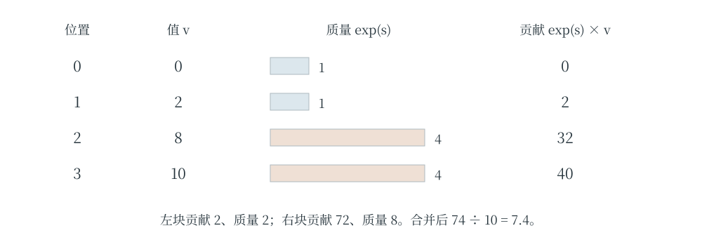
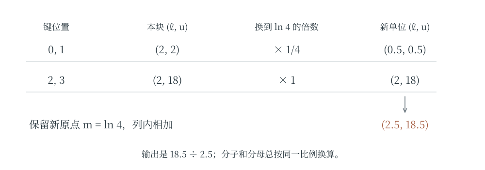
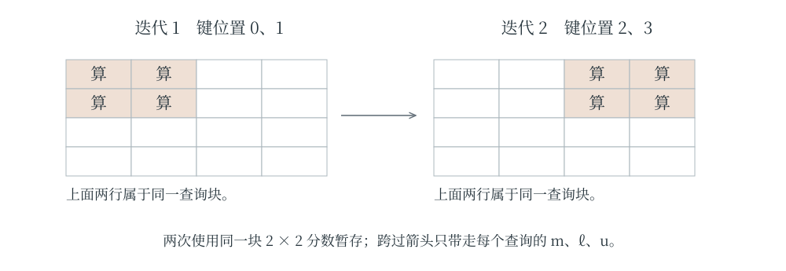
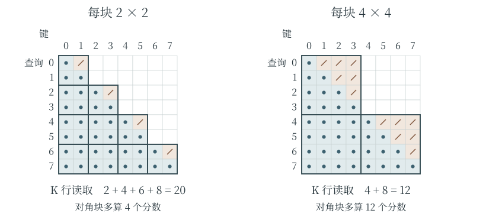
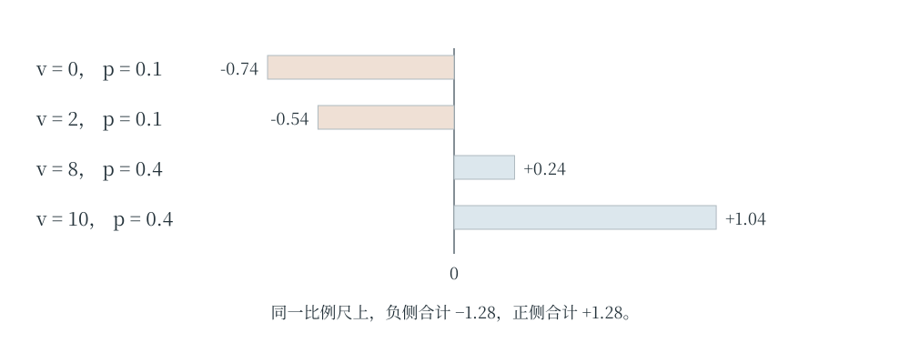
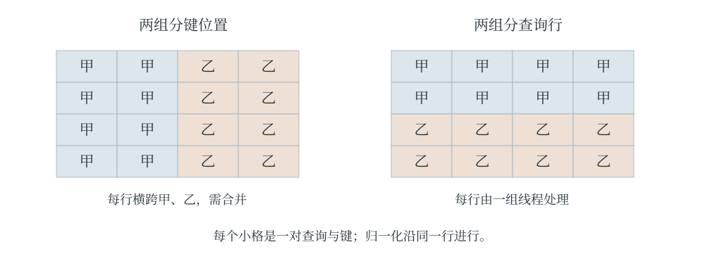
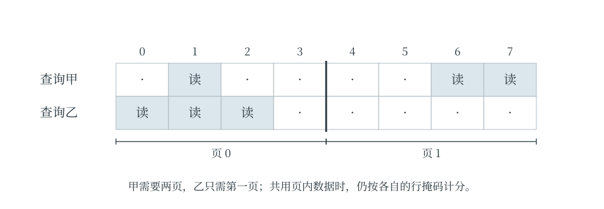

# 第 10 章　归约算法与分块注意力

上一章沿 $`K`$ 将矩阵乘法分成两段，第一段计算部分和，第二段在此基础上继续累加。现在设投影产生了查询向量，第一行仍是 $`q=(4,5)`$。模型用它读取历史信息。若将历史也分成两段，能否分别计算两段的注意力输出，再像矩阵部分和那样直接相加？

取四个二维键。前两个为 $`(0,0)`$，后两个为 $`(\sqrt{2}\ln4/4,0)`$。点积除以 $`\sqrt{2}`$，就得到分数 $`(0,0,\ln4,\ln4)`$。让四个位置的值是标量 $`(0,2,8,10)`$，暂看一个已经能看到全部四项的查询。分数取指数得到 $`(1,1,4,4)`$，分母为 10。因此完整输出为 $`(0+2+32+40)/10=7.4`$。这组便于手算的数据将用于说明，为什么计算时无需存下完整的分数矩阵。

## 10.1　逐元素计算与行归约

给一个数加偏置、取与零的最大值，只要输入到达就能决定输出。求一行的最大值、和、均方根时，当前格还需要其他格的信息。把多个输入汇成较少结果的操作叫归约。并行归约时，各段需要保留哪些信息，取决于结果的合并方式。

举一个不涉及指数的例子。第一段 $`(1,2)`$ 的平均为 1.5，第二段 $`(9)`$ 的平均为 9。平均两个局部结果得到 5.25，全体平均却是 4。如果分别保留元素和与元素数，两段的结果是 $`(3,2),(9,1)`$，逐项相加后求 $`12/3`$ 就对了。RMSNorm 也可以按特征段计算平方和与计数，得到全行的均方根后，再把每格输入乘相应的倒数。LayerNorm 还需要均值，直接相减“平方的平均与平均的平方”在两个数接近时容易损失有效位。可合并的方差算法可以维护数量、均值和围绕均值的平方离差，合并时补上两组均值不同所产生的组间项。局部平均和局部方差各简单平均，会遗漏这些信息。

softmax 同时涉及最大值和指数和。对行内有限分数 $`s_j`$，从每个分数中减去同一个 $`m`$，分子分母的公共因子 $`e^{-m}`$ 会抵消。选 $`m=\max s_j`$，所有送进指数的数都小于等于零。即使给章首每个分数都加上 1000，正确概率也不动，稳定实现仍可得到正常结果。若先在有限精度中直接计算 $`e^{1000}`$，可能早在归一化之前就遇到上溢。

问题在于每段选择的最大值可以不同。让第一段包含前两个位置，第二段包含后两个位置。段内各自做 softmax，分别得到均匀权重，输出为 1 和 9。两段长度相等，可按段平均仍只有 5。完整行给两段的总概率分别是 0.2 和 0.8，因为第二段每个位置的指数是第一段的四倍。哪个位置在各自段内更大，和这一整段在全行里占多大权重，是两份不同的信息。



*图 10-1　横条长度与指数质量成正比。把左右两段的局部均值各乘它自己的总质量，再除以全部质量，得到 $`(2\times1+8\times9)/10=7.4`$。*

## 10.2　用三个统计量合并分块结果

局部平均值丢掉了每段在全行中所占的权重，因此无法直接相加。要合并两段，需要知道各段的权重总量和加权值之和。为了避免指数上溢，这里取分数最大值作为计算的参考，并将它与上述两项一起记录，得到下面三个统计量。

对一组非空可见位置 $`A`$，计算并保存下面三项。其中 $`m_A`$ 是分数的参考原点，$`\ell_A`$ 是在该原点下的总质量，$`u_A`$ 是同一单位下的加权值总和。若每个值有 $`d_v`$ 个分量，$`u_A`$ 也是 $`d_v`$ 维向量。

```math
\begin{aligned}
m_A&=\max_{j\in A}s_j,\\[0pt]
\ell_A&=\sum_{j\in A}e^{s_j-m_A},\\[0pt]
u_A&=\sum_{j\in A}e^{s_j-m_A}v_j .
\end{aligned}
```

合并另一组 $`B`$ 时，先把两边折算到共同的原点 $`m=\max(m_A,m_B)`$。对 $`A`$ 内的任意一格，$`e^{s_j-m}=e^{s_j-m_A}e^{m_A-m}`$。第二个因子与 $`j`$ 无关，可以在累加完后乘一次，于是

```math
\begin{aligned}
a&=e^{m_A-m},\qquad b=e^{m_B-m},\\[0pt]
\ell&=a\ell_A+b\ell_B,\\[0pt]
u&=a u_A+b u_B.
\end{aligned}
```

章首两段的统计量分别为 $`(0,2,2)`$ 和 $`(\ln4,2,18)`$。以 $`\ln4`$ 为公共原点，左段的两个统计量都要缩为四分之一，变成 $`(0.5,0.5)`$；右段仍为 $`(2,18)`$。所以 $`\ell=2.5,u=18.5`$，输出 $`u/\ell=7.4`$。公共原点下的分母变小了，最后的比值与完整行相同。若只给分母换单位而忘了给分子同比换算，得到的会是 $`20/2.5=8`$。



*图 10-2　从本块的 $`(\ell,u)`$ 向右读，两项先同乘换算倍数，最后一列才逐项相加。最终状态还可继续合并下一块。*

还可以把最终的统计量用于恢复任一位置的概率。记

```math
L=m+\ln\ell=\ln\sum_j e^{s_j}.
```

章首 $`L=\ln4+\ln2.5=\ln10`$，于是 $`p_j=e^{s_j-L}`$。注意这里 $`L`$ 是一个标量，恢复某个概率还需要重新取得对应的分数。这个细节决定了反向传播到底省掉了什么，又需要重算什么。[在线 softmax 归一化算法](https://arxiv.org/abs/1805.02867)

这些统计量既可以按顺序逐段合并，也可以用树形结构并行合并。实数运算中，只要覆盖了正确的可见集合，两种次序会得到同一组的统计量。在浮点机器上，分块和合并顺序会改变舍入，因此验证时要对照给定精度的误差要求。掩码还带来一个数学边界。如果某块对当前查询完全不可见，它不参与归一化分母和加权求和，可以直接跳过。在首块为空时直接算 $`-\infty-(-\infty)`$ 会得到未定义值。若整行都被屏蔽，分母为零，程序必须依据接口约定指定返回值或拒绝该输入。普通包含自己的因果行至少有一个可见位置。

## 10.3　分块统计量与注意力计算

先用一小段程序复现图 10-2。这里传给函数的两块都非空，位置掩码已在块外处理。把传给 `combine` 的两个块对调，分母和输出仍然相同。

```python
from math import exp, log, isclose
def combine(a, b):
    m = max(a[0], b[0])
    s, t = exp(a[0] - m), exp(b[0] - m)
    return m, s*a[1] + t*b[1], s*a[2] + t*b[2]

_, den, num = combine((0, 2, 2), (log(4), 2, 18))
assert isclose(num / den, 7.4)
```

对于长度为 $`T`$、头宽为 $`d`$ 的一层，传统写法先做 $`QK^{\mathsf T}/\sqrt d`$，把分数矩阵 $`S`$ 写到全局内存，再逐行读 $`S`$ 做 softmax，把概率矩阵 $`P`$ 写回，最后读 $`P`$ 乘 $`V`$。假设 $`T=8192,d=128`$、单头、批为 1，两张方阵都以两字节完整物化，一张就是 128 MiB。仅这两张数组各写一次、读一次，按全局数组边界合计 512 MiB。相比之下，$`Q,K,V,O`$ 各为 2 MiB。分数和概率只在相邻计算步骤间使用，却需要写入全局内存再读出。

设一个线程块负责若干个查询行，先把它们装到片上，并为每行开一组 $`(m,\ell,u)`$。然后按键的位置从左往右扫。每次取一块 K、一块 V，用矩阵乘求一个小分数块，做掩码和行内归约，更新各查询行的三项统计量。用完这块分数以后，缓冲就可以给下一组位置。扫完后才把 $`u/\ell`$ 写成输出。2022 年发表第一版 FlashAttention 时，Tri Dao 正在斯坦福攻读博士。他与 Daniel Fu、Stefano Ermon、Atri Rudra、Christopher Ré 把 GPU 片上容量和 HBM 读写量直接写进算法分析。在这里，分数块一用完就释放，原先两次内核之间必须保存的整张分数表也就省了下来。不同版本会再改变循环次序和线程分工。沿某一行核对，即使少写了整张表，它仍与每个可见的键做了一次点积。[FlashAttention 原论文](https://arxiv.org/abs/2205.14135) [斯坦福课题组的研究者记录](https://cs.stanford.edu/~chrismre/alumni.html)



*图 10-3　横轴是键位置，纵轴是查询位置。高亮的一块分数只在当前迭代使用。一次扫过整行之后，跨迭代留下的是每行统计量和输出累加器。*

沿用第九章的计算方法，估算分块所需的存储和读取量。设查询块有 $`r`$ 行、键块有 $`c`$ 个位置。临时分数的规模是 $`rc`$，输出累加器的规模是 $`rd_v`$，另外还需要查询、键值面板和每行标量。增大 $`r`$ 能让一块 K、V 服务更多查询，也会增加寄存器与片上空间。若一个查询块独立扫一遍 K、V，而这些数据无法被其他块从缓存复用，所有查询块累计对 K、V 的读取仍可能很大。不能把完整方阵的 512 MiB 直接当作硬件一定节省的 HBM 流量。需要对照原实现实际物化了哪些矩阵、何种精度、缓存命中和新实现的块间重读。

若保留全部精确的可见配对，长序列中点积和读取值所需的主要算术量仍与 $`T^2d`$ 同阶。变化集中在中间矩阵的存储与传送，以及不同单元能否接上工作。因果掩码还允许整块跳过未来的位置，而穿过对角线的面板要在块内细分。若只是把未来分数算完后设成 $`-\infty`$，遮挡保证了结果正确，矩阵指令是否少发则是另一个问题。

把因果注意力的上界算得更接近一次实际执行。沿用 $`T=8192,d=128`$ 的单头预填充，Q、K、V、O 各占 2 MiB。令每个工作块负责连续 $`b`$ 个查询，键块也有 $`b`$ 行。序列长度可整除，查询只看自己及过去，整块都在未来的项直接跳过。先取 $`T=8,b=2`$ 在图上数。四批查询要读的键行数分别为 2、4、6、8，合计加载 20 行 K 和 20 行 V。改成 $`b=4`$，两批只读 4、8 行，合计各 12 行。两种切法都有 36 个有效的位置对。



*图 10-4　左列行号代表查询，上方列号代表键。带点的格参加 softmax，短斜线表示必须屏蔽的格。沿同一块行从左向右数，得到它实际要读多长的键前缀。*

设块行数 $`h=T/b`$。所有块行合计加载的 K 行数为 $`b(1+2+\cdots+h)`$，相当于全 K 表的 $`(h+1)/2`$ 遍。V 也一样。若单个查询块只取一次自己的 Q、最终只写一次 O，各块之间的 K/V 读取都穿过所统计的边界，流量可以这样逐项核算。

| 块边长 | 查询块数 | K 与 V 合计读取 | 再计 Q 读与 O 写 |
|---:|---:|---:|---:|
| 64 | 128 | $`4\times64.5=258`$ MiB | 262 MiB |
| 128 | 64 | $`4\times32.5=130`$ MiB | 134 MiB |

方块加大也多做了一些工作。若矩阵指令算满每个与对角线相交的块，然后施加掩码，每个对角块会算出 $`b(b-1)/2`$ 个未来位置的分数。把 $`h`$ 个这样的块相加，64 行方案多算 258048 格，128 行方案多算 520192 格。第二种方案还只剩一半数量的独立查询块。不同批量与头数会改变设备是否仍有足够的工作可发。若多个块从 L2 命中同一段 KV，134 与 262 MiB 的差会表现在片上路径上，只有实际访问 HBM 的部分消耗显存带宽。调块时可以分别核对矩阵工作量、两级读流量和运行时间，判断哪一种因素决定了实际耗时。[FlashAttention-2 的因果分块与并行分工](https://arxiv.org/abs/2307.08691)

还要检验对角上的遮挡是否真的生效。设三个位置的分数全为零，可见的值依次为 2、4、8。正确的三行输出是 $`2,3,14/3`$。若第二行只把未来位置的值设为零，却仍将该位置分数的指数计入分母，分子仍是 6，分母从 2 变为 3，输出便是 2。另一个常被掩盖的错误出现在数值范围。给可见分数全加 1000，数学上的输出不变；直接取指数会溢出，减掉每行最大值后再取指数仍能得到原结果。随书程序遍历不同块长，用高精度参考结果同时检查这两个反例，还可改变不能整除块长的序列长度。搬运量和计算槽位来自整数计数，读者用普通电脑即可重算。在 GPU 上验证时，再对两种实现使用相同输入和相同上游梯度，比较得到的输入梯度，并用绝对误差检查接近零的分量，以免用相对误差把舍入放大成错误报告。[因果注意力分块实验](../../experiments/part03/attention_tiles.py) · [PyTorch 浮点数值说明](https://docs.pytorch.org/docs/stable/notes/numerical_accuracy.html)

最后一个块不满时，可以用七个位置检验上面的计数。在分块实验中设 `--length 7 --width 2 --tiles 2 4`。块长为 2 时，四组查询的键前缀长分别为 2、4、6、7，共读 19 行 K；块长为 4 时只读 $`4+7=11`$ 行。两版都应保留 $`7\times8/2=28`$ 对。程序按尾块的实际行列数计，得到遮挡格分别为 3 和 9。读者若算出更多，可以查一查自己是否把第八个位置也算了进去。设备若总以完整指令块执行，末端的填充还要另计。

### 处理完全被掩码遮住的工作块

把一条查询分给两个工作块。第一块覆盖的所有位置都不可见，第二块有一项得分 2、值 7。按可见集合直接计算，分母只有 $`e^2`$，输出自然是 7。若实现机械地给第一块记最大值 $`-\infty`$，在块内算 $`e^{-\infty-(-\infty)}`$，便会出现未定义的差，接下来与第二块归约也可能污染结果。一个空块是否存在，是并行划分造成的；它不能改变原本有定义的查询。

可以给局部状态另带“有无有效项”，或用等价的受保护分支。合并时一侧为空就直接取另一侧，两侧非空才按共同的最大值重标定。若整行都为空，原始归一化出现 $`0/0`$，需要接口另行规定填零、屏蔽该查询或报告输入错误，并与反向保持一致。测试时把唯一可见项放在最后一块，再把它也遮去，就能区分算子正确处理空块和调用者如何定义整行。

## 10.4　通过重计算完成反向传播

前向没有保存完整的概率矩阵，训练仍要计算对查询、键和值的梯度。一个可行的办法是保留每行归一化信息，在反向逐块重算分数和概率。这样减少了长期保存的中间结果，同时增加了重算和重新读取输入的工作。

令一行的输出为 $`o=\sum_jp_jv_j`$，从后续层传来的梯度为行向量 $`g=\partial\mathcal L/\partial o`$。先求损失对每个概率的导数，记为 $`h_j=g\,v_j^{\mathsf T}`$。softmax 中每个分数都会影响整行概率。由 $`\partial p_i/\partial s_j=p_i(\mathbf 1_{i=j}-p_j)`$，把所有概率路径的贡献相加，得到分数梯度

```math
\frac{\partial\mathcal L}{\partial s_j}
=p_j\left(h_j-\sum_i p_i h_i\right).
```

式中要求对整行求一次加权平均，这似乎又需要保存整行概率。但利用前向已经算出的输出，这个平均恰好等于 $`g(\sum_i p_i v_i)^{\mathsf T}=g\,o^{\mathsf T}`$。记它为 $`D`$，每行只需算出一个标量。之后在各块内重算对应分数和概率，就能求出该块的分数梯度。对于章首的标量例子取 $`g=1`$，$`D=7.4`$。前向保存的 $`L=\ln10`$ 加上重算的块分数，恢复出概率 $`(0.1,0.1,0.4,0.4)`$。四个分数的梯度依次为 $`-0.74,-0.54,0.24,1.04`$。前两个为负，是因为让低于当前均值的值获得更多权重会拉低输出。四项之和为零，可以独立检查：给所有分数加同一个常数，损失应当不变。



*图 10-5　每根有符号横条为 $`p_j(v_j-7.4)`$。用 $`(\ln10,s_j)`$ 可以在块内恢复 $`p_j`$，并用正负面积抵消检查整行的一致性。*

对一般向量，按行堆叠分数梯度得到 $`\bar S`$，上游各行组成 $`G`$。块内还要计算

```math
\begin{aligned}
\bar V&=P^{\mathsf T}G,\\[0pt]
\bar Q&=\bar S K/\sqrt d,\\[0pt]
\bar K&=\bar S^{\mathsf T} Q/\sqrt d.
\end{aligned}
```

计算 $`\bar Q`$ 时，同一查询需要汇总所有键块的贡献；计算 $`\bar K,\bar V`$ 时，同一键值块又需要汇总多个查询块的贡献。如果按查询块分配工作，每个工作块可以独立写入自己的 $`\bar Q`$，但需要合并各块对 $`\bar K,\bar V`$ 的贡献；如果按键块分配工作，则需要合并各块对 $`\bar Q`$ 的贡献。实现时可以采用额外遍历、分段归约或原子累加。前向计算省去完整的 $`P`$ 后，反向仍需保留或重建 $`Q,K,V,O`$ 和行归一化信息，还要为梯度及暂存数据分配空间。因此，估算训练显存时还要计入这些状态。

这次重算必须恢复相同的掩码、缩放与偏置。如果注意力中还有 dropout，反向须恢复前向所使用的随机选择，可以保存相应随机状态并以兼容的索引重建。在每个块上随手重抽一个掩码，就不再是这次前向计算的导数。基本手算采用无 dropout 的情形，避免把概率归一化和之后的随机缩放混为一步。

下面用一个例子说明反向传播时重新抽取随机掩码为什么会出错。只看两个可见位置，概率 $`(1/4,3/4)`$，值 $`(2,6)`$，上游梯度为 1。训练时以一半概率保留每一项，以 $`1/(1/2)=2`$ 放大留下的权重。设前向恰好只保留第一项，送去乘值的权重成为 $`(1/2,0)`$，输出为 1。softmax 此前已经归一化，dropout 之后不会把剩余项重新归一化。损失对原来两个概率的导数是 $`(4,0)`$，由本节的行梯度公式，两个分数的梯度为 $`(3/4,-3/4)`$。反向若重抽成只保留第二项，就会按另一个输出 9 和另一对概率导数 $`(0,12)`$，算出 $`(-9/4,9/4)`$。两次随机选择各自的概率都合法，优化器收到的梯度方向却完全相反。实际实现可以给逻辑上的批、头、查询和键位置分配可重现的随机数，在反向重建同一位置的选择。这样能省下整张掩码的保存，代价是维护可复现的随机状态与索引规则。[FlashAttention 原论文的 dropout 与反向重算算法](https://arxiv.org/html/2205.14135)

## 10.5　从减少访存到优化计算流水

避免写出大方阵解决的是一项主要的访存开销。数据仍需在片上经过矩阵乘、归约和指数运算，这些阶段使用的硬件资源不同。接下来分析阶段之间的等待，以及不同的线程分工如何影响等待时间。

以负责一个查询块的 SM 为例。第一段矩阵乘算完后，要做求最大、指数、行和、重缩放以及第二段矩阵乘。矩阵乘法可以使用高吞吐的硬件单元，而标量或向量指令、warp 间交换及屏障同步则使用其他执行资源。减少分数矩阵的写回后，这些操作以及它们之间的等待就可能成为新的性能瓶颈。

例如一个查询块分给两个 warp。有两种分工。若各 warp 负责一半键位置，则两组都对同一批查询行产生局部统计，必须合并最大值、分母和输出。若各自负责一半查询行，共同读取 K、V，每一行在所属 warp 内即可完成更新。后者减少了一种合并，前提是查询行数足以让两组都得到工作，且共享加载的布局合适。FlashAttention-2 将按查询维增加并行、改变 warp 间工作分配与减少非矩阵运算结合起来，所解决的正是同一个正确公式内部的利用率问题。[FlashAttention-2](https://arxiv.org/abs/2307.08691)

另一种机会是让相邻面板的不同阶段重叠。某一块等待矩阵指令完成时，可以让生产者预取后续面板，或让另一组已就绪的查询做 softmax。Hopper 上的 FlashAttention-3 结合了异步数据搬运、矩阵指令和面向硬件的调度，也研究了低精度路径。重叠需要更多在途片段、就绪信号和缓冲，块形状过大时会反过来挤压并行度。涉及低精度的版本还要单独验证误差。[FlashAttention-3](https://arxiv.org/abs/2407.08608)



*图 10-6　同一颜色表示同一组持有的工作。横向切开查询行时，行内归一化留在组内；沿键维切开时，一行需合并两份统计。*

在 Blackwell 上，矩阵乘法进一步加快。即使图 10-3 中的矩阵乘瞬间完成，下一块仍要等待指数计算和重缩放。FlashAttention-4 让异步矩阵乘与其他阶段交错，并减少行状态重缩放的次数。回看图 10-2，若右块到来时改用 $`\ln4`$ 当原点，累计分子、分母依次是 18.5 与 2.5。若仍用左块的原点 0，右块指数都是 4，直接累加就得到 74 与 10。这两个比值同为 7.4。遇到稍大的分数时，立刻换原点能使最大的指数回到 1。暂时容忍较大的指数，则能省去整条输出向量的换算。论文按新最大值和旧原点之间的差设阈值，差小时保留旧原点。差过大必须换算以控制数值范围。这项优化依赖中间类型的可表示范围，并不允许始终用原点 0。反向还有另一处瓶颈，作者利用片上张量存储及两个线程块协作的矩阵指令减少共享存储流量和对查询梯度的原子累加。[FlashAttention-4 原论文，第 3 节](https://arxiv.org/html/2603.05451v1#S3)

解码时一条请求往往只有一行新查询，刚才沿查询行切分的机会急剧减少。若历史很长，可以让多个块各自扫描一段 KV 并交回 $`(m,\ell,u)`$，再用 10.2 节的规则合并。这样换回并行度，代价是多一批部分状态和跨块归约。批量、头数和 GQA 的共享程度也会影响这个选择。对很短的序列，额外调度和一次归约启动就可能超过节约的扫描时间。

沿用图 10-1 的四个候选，指数质量依次是 1、1、4、4。可以让两个线程块各自返回“局部输出、局部分母的对数”。左、右块的局部输出为 1 和 9，对数分母分别是 $`\ln 2`$ 和 $`\ln 8`$。最后的线程块先求全局对数分母 $`L=\ln(2+8)=\ln10`$，再以 $`e^{\ln2-L}=0.2`$ 和 $`e^{\ln8-L}=0.8`$ 加权，得 $`0.2\times1+0.8\times9=7.4`$。分母取对数是把局部最大值和归一化因子收成一个标量，真实计算用稳定的 log-sum-exp 合并。没有有效键的分片对分子、分母贡献均为零，需要避开全掩码时无定义的局部除法。

现在把标量 $`V`$ 扩成 128 维，设一行查询看 8192 个键，一份 K/V 均用两字节、均为 128 维。八个线程块各扫描 1024 个键，仍共需读取 4 MiB 的逻辑 KV 载荷。若每个块写出 128 个 FP32 局部输出和一个 FP32 对数分母，再由第二个 kernel 全部读回，就多 $`2\times8\times129\times4=8256`$ 字节。对长历史，增加少量中间数据后，便可能获得八组并发读取。若原来已有足够多请求和头把带宽占满，切得更细并不会减少那 4 MiB。Flash-Decoding 的两级归约由此有了明确的使用条件。真实 GQA 的物理流量还取决于共享同一键值头的查询是否复用已加载的数据。[Flash-Decoding 实现说明](https://pytorch.org/blog/flash-decoding/)

## 10.6　稀疏注意力与递归状态

第五章的稀疏注意力增加了另一层约束。若一行只选少量远端位置，实际要先获得索引，并把散落的位置凑成可计算的面板。两行分别选 3 项和 17 项，硬按长度 17 补齐成一批，只用到 34 个位置槽中的 20 个。按选中块长度分组有机会减少填充，但要重排任务、保留正确位置和掩码。递归线性注意力又不同，分块时交接的是键特征与值特征之间的状态，不是 softmax 的最大值与分母。实现复用了“按块推进”的想法，块间交接的对象仍要从各自公式推导。

沿用第五章的八个历史位置。假定 KV 按 4 个位置一页存放，教学机器每次把一整页送进片上。查询甲选择位置 1、6、7，需要页 0 和页 1，搬回八份位置记录，只用到三份。查询乙选择 0、1、2，只需页 0。若两条查询各自加载且没有缓存命中，要搬 12 份位置记录；若一组工作先共用页 0，再给甲补页 1，则只搬八份。两条查询有六个有效配对，数学工作在这两种调度下完全一样。将一页搬进来之后，甲的分母仍只能积累选中的位置。随意把同页的其他键也算进去，即使那些值恰为零，也会改写归一化分母。



*图 10-7　粗线分开两页。按列读位置 1，它在一份物理记录里、被两条查询选中；按行阅读，甲和乙仍然各算自己的分母。*

再看固定状态的递推。第五章把 KDA 的一步更新写成关于旧状态的仿射变换。为看清块间传递，用一个数代表状态。某段 A 算出“把旧值乘 $`1/2`$，再加 1”，后面一段 B 算出“乘 $`1/4`$，再加 2”。在前缀还没到来时，两段就能各自准备自己的乘数与加数。A 后接 B 的总变换为

```math
s_{\rm out}=\tfrac14(\tfrac12s_{\rm in}+1)+2
            =\tfrac18s_{\rm in}+\tfrac94.
```

所以旧状态为零时，输出为 2.25。两块若颠倒，结果却是 $`1/2\times2+1=2`$。与图 10-2 的可见集合不同，这些转移能按树形括号合并，却得保留时间顺序。真正模型把标量换成结构化的矩阵与状态，若为求并行把每段的转移全展开为稠密矩阵，额外存储和乘法的开销可能抵消并行带来的收益。分块算法要利用门控与低秩更新的结构，解码时还可以直接从上一步的状态继续递推。选择哪种执行路径取决于同时可见的序列长度、状态宽度和批量。[Kimi Linear 原始技术报告](https://arxiv.org/abs/2510.26692)

把分块实现接进解码器，还有一个方阵测试查不到的错。缓存中已有三个位置，本次一起追加两个位置，此时只有两个查询，却有五个键。令所有合法分数相同，五个值依次为 2、4、8、16、32。第一个新查询实际在位置 3，应看到前四项，输出 7.5；第二个在位置 4，应看到全部五项，输出 12.4。若实现从掩码左上角开始编号，得到的却是 2 和 3。两版可能同样省显存、同样快，只有带缓存偏移的用例能发现这次错位。部署时把这一小例与长提示、单词解码分别测试，先核对输出，再在真实长度分布下比较峰值显存和时延。

矩阵乘法可以合并部分和，softmax 注意力需要合并最大值、分母和加权和，递归状态则必须按时间顺序合并状态转移。分块优化能否成立，取决于这些中间量是否保留了后续计算需要的信息。第五章的稀疏选择可能改变模型读到的内容；本章的在线 softmax 则保留了原有可见集合，仍须在浮点误差范围内复现 7.4 及其梯度。只有先通过这一检查，少保存了多少中间量、减少了哪一级的访问才构成有效的性能收益。下一章进一步改变数值表示，讨论缩减位宽后如何检查误差和实际收益。

## 练习与解答

### 1. 换一个切点，答案还一样吗

把章首的四项改分成前三项和最后一项，给出各段的 $`m,\ell,u`$，再合并。

**解答。** 第一段以 $`\ln4`$ 为原点，三项权重为 $`(1/4,1/4,1)`$，故 $`\ell=1.5,u=8.5`$。第二段也是 $`\ln4`$，$`\ell=1,u=10`$。直接相加得 $`\ell=2.5,u=18.5`$，输出仍为 7.4。第一段局部输出约 5.67，单看两个局部输出仍不足以合并。

### 2. 少读一项等于少写一个中间矩阵吗

仍用四项例子。由于选择器漏掉最后一个位置，只对前三项按 softmax 归一化，求结果。若四项都保留、只改变分块次序，结果又是多少？

**解答。** 三项指数为 $`(1,1,4)`$，分子 $`0+2+32=34`$，分母 6，输出 $`17/3`$。保留四个可见配对且正确合并时，实数结果始终是 $`37/5`$。第一项操作改变了分母的成员，第二项操作改变的是统计量的计算次序。

### 3. 从输出重建一块反向

若上游梯度变成 2，只恢复后两个位置。求这两项的值梯度与分数梯度，说明还需从本块外得到什么。

**解答。** 概率均为 0.4，两个值梯度均为 $`2\times0.4=0.8`$。$`D=2\times7.4=14.8`$，两个分数梯度分别为 $`0.4(16-14.8)=0.48`$ 和 $`0.4(20-14.8)=2.08`$。块需要全行的归一化信息、上游梯度和全行输出或由它算出的 $`D`$。如果只用本块的局部均值 9，求得的会是另一项计算的梯度。

### 4. 行统计与概率方阵相差多少

一个头有 8192 个查询位置。若概率方阵用两字节保存，对比仅为每行保存一个四字节 $`L`$ 的容量。能由这个比值推出整个训练过程的显存节省吗？

**解答。** 方阵为 128 MiB，行统计为 32 KiB，相差 4096 倍。比值只覆盖这两个对象。训练还需输入、输出、梯度、参数及可能的重算工作区，实际节省取决于原实现保存了什么、哪些对象同时存活以及分块反向怎样累加。

本章的复算包含稳定的逐行参考、不同分块次序以及对查询、键、值的有限差分检查。[第三篇复算程序](../../experiments/part03/verify.py)

[全书目录](../../README.md) · [上一章 · 矩阵乘法内核与性能测量](ch09.md) · [下一章 · 低精度数值与模型量化](ch11.md)
