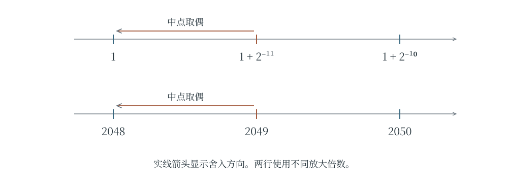
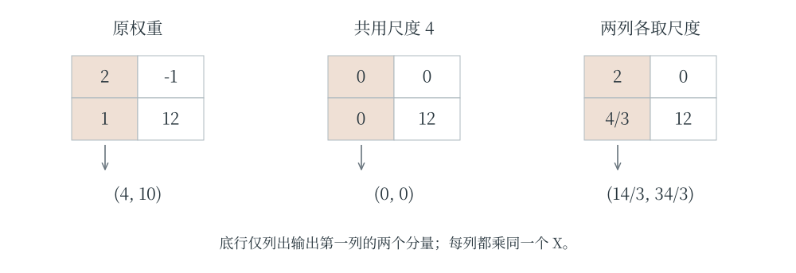
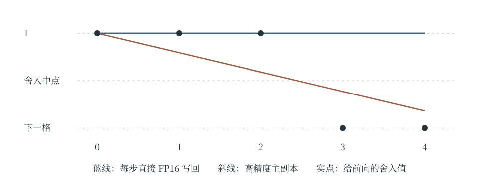
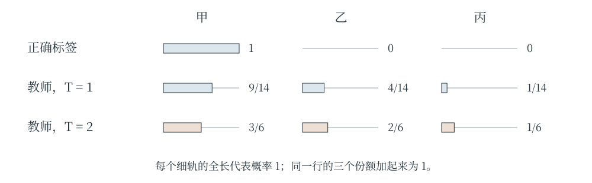

# 第 11 章　少用几个比特：低精度计算与量化

第九章让 128 行输入共用一张权重表，第十章让一小块注意力分数在片上生成、用完就腾出空间。接下来考虑量化带来的变化，也就是用更少的字节表示和传输数据。一张 $`4096\times4096`$ 的两字节权重表占 32 MiB，若每个权重只用 4 位，裸数据只需 8 MiB。位宽改变之后，存储、乘法和累加都可能受到影响。我们仍从两个输入、两个输出的小例子开始，逐步计算量化误差及其传播。

## 11.1　用有限编码表示数值

只有三位编码时，最多区分八种状态。若用它表示区间内的八个等距数，小数轴一端和另一端的格距相同。提高量程会拉大格距，缩小格距又会使离原点很远的数落到边界外。整数定点量化通常就采用这种等距格，只是再附一个尺度，把“一个编码单位”等于多大的实际数值说清楚。

浮点数把一些位用作指数。对二进制正规数，可写为 $`(-1)^s 2^e(1+f)`$，尾数小数部分有 $`p`$ 位时，在 $`[2^e,2^{e+1})`$ 内的格距是 $`2^{e-p}`$。增大 $`e`$，同一个尾数码就能覆盖更大的数，但相邻数的绝对间隔也随之增加。这种安排适合跨度大的数据，却不能保证很小的更新加到很大的数上还能被记住。

例如 FP16 的小数部分有 10 位。在 $`[1,2)`$ 内格距为 $`2^{-10}`$，$`1+2^{-11}`$ 刚好在 1 与下一个数的中点，按最近、平局取偶舍入到 1。在 $`[2048,4096)`$ 内格距变成 2，2049 也恰在中点，舍入到 2048。若反复在 FP16 中从 2048 加 1、每次都存回，可能次次得到 2048。若在 FP32 中连续累加，再把 2050 转回 FP16，就能存下 2050。数据从哪种格式读入，和部分和以哪种格式跨越相邻乘加，必须分别约定。



*图 11-1　两段数轴都放大到能看清单格的比例。第一段相邻差约千分之一，第二段相差 2。中点是否取向左端还取决于该端的尾数最低位。*

| 格式示例 | 指数位、尾数小数位 | 用在系统中时要查哪项条件 |
|---|---|---|
| FP32 | 8、23 | 高精度参考、部分和或主权重会占用多少空间 |
| FP16 | 5、10 | 较窄的指数范围会不会让梯度上溢或下溢 |
| BF16 | 8、7 | 动态范围是否足够，较小的参数更新会不会被舍入为零 |
| FP8 E4M3、E5M2 | 4、3 或 5、2 | 目标具体变体、非有限值编码、缩放和累加指令 |
| FP4 E2M1 | 2、1 | 共享尺度能否跟上同组数据的幅度差 |
| INT8、INT4 | 整数编码 | 符号、零点、截断边界、打包与解码布局 |

表中浮点格式还各有符号位。零、次正规数和特殊编码会占用一部分位型。溢出是数太大，既可能得到无穷，也可能由转换指令饱和到最大有限值。下溢涉及零附近的处理，不同硬件路径对次正规数可能采用保留或冲零。常见 FP8 E4M3FN 的最大有限正数为 448，E5M2 则可到 57344，但后者为同一数量级里的数留下更少尾数位。格式名称、缩放方式和舍入模式要一起写在实验记录中。[FP8 格式原论文](https://arxiv.org/abs/2209.05433)

E2M1 给了一个更直观的尺度例子。常用的有限正幅值连同零只有 $`0,0.5,1,1.5,2,3,4,6`$。若一组共享尺度 2，能表示的正数就将这些数乘 2。要同时保存很小和很大的值时，只换一种乘法指令还不够，哪些数共用同一尺度，会影响小数值能否被保留，以及大数值是否超出范围。

## 11.2　权重量化与数值还原

编码只有有限个取值，真实权重却可以落在任意位置。量化需要先规定怎样将实数映射到编码，以及怎样从编码近似恢复原值。有了这两个步骤，才能讨论误差来自舍入还是截断，也才能比较不同尺度。

定义一类常用的仿射量化。对实数 $`w`$，取正尺度 $`s`$、整数零点 $`z`$，先求最近整数、平局取偶，再夹到允许的编码区间：

```math
\begin{aligned}
q&=\mathrm{clip}(\mathrm{round}(w/s)+z),\\[0pt]
\hat w&=s(q-z).
\end{aligned}
```

这里的 clip 使用该组预先约定的上下限。对称量化常取 $`z=0`$。例如在整数格 $`[-3,3]`$ 上，若最大绝对值是 3 就取 $`s=1`$。第二篇权重矩阵的两行分别为 $`(2,-1)`$ 和 $`(1,3)`$。四个权重都落在格点上，解码后四个输出分量都精确。这组数据恰好没有量化误差。只检查它，无法发现格距过粗带来的问题。

只把右下角的 3 改为 12，得到新的权重矩阵

```math
W'=\begin{bmatrix}2&-1\\1&12\end{bmatrix}.
```

输入仍用原来的 $`X`$。浮点参考的两行输出分别为 $`(4,23)`$ 与 $`(10,45)`$。若全表共用对称尺度 $`s=12/3=4`$，左上角 2 除以 4 是平局，舍入为 0，$`-1`$ 和 1 也舍入为 0。解码的表只剩右下角一个 12，输出变成 $`(0,24),(0,48)`$。右下的大数本身表示得很好，却通过共用尺度影响了与它无关的第一列。

把两个输出通道拆开，每列单独选尺度。第一列的尺度为 $`2/3`$，两个码是 3 和 2，解码为 $`2,4/3`$。第二列的尺度仍为 4，解码为 $`0,12`$。新输出为

```math
X\hat W'=
\begin{bmatrix}14/3&24\\34/3&48\end{bmatrix}.
```

第一列的量化结果不再全为零，计算输出也更接近参考值；第二列的小负权重仍被量化为零。这个试算只有七种合法整数码，专为手算舍入而设。迁移到 INT8 或 INT4 时，要使用实际的端点和打包规则。



*图 11-2　沿第一列追踪，原本的 $`(2,1)`$ 在整表尺度下变成 $`(0,0)`$，改为列尺度后变为 $`(2,4/3)`$。按列增加了一份尺度，也改变了载入和广播尺度的方式。*

若某组在校准数据上偏向一侧，可以选非零的 $`z`$。设允许码为 0 至 15，要将 $`[-2,4]`$ 两端都映射到整数格，尺度为 $`6/15=0.4`$，实数 0 对应码 5。输入实数零的填充位置就该写码 5。若图像边界或 GEMM 尾块用原始整数 0 填充，解码恰是 $`-2`$，这个看似无害的填充值会参与乘加。超出校准区间的值会被夹到端点，误差还能远大于半个格距。[整数量化及零点的推导](https://arxiv.org/abs/1712.05877)

## 11.3　缩放粒度与算子实现

缩放粒度同时影响数值误差和执行方式。若归约维上的乘积都共用一个尺度，可以先累加整数，再统一缩放；若不同段的尺度不同，就要在合并前处理尺度差异。为看清原因，假设两段的输入与权重都采用零点为零的量化，整数部分和均为 2，对应的输入尺度与权重尺度之积分别是 0.5 和 1，那么反量化后的结果为 $`0.5\times2+1\times2=3`$。先把整数加成 4，再统一乘 0.5 或 1，分别得到 2 或 4，都不等于 3。若采用非零零点，还需要计入相应补偿项。

若每行激活有一个尺度、每列权重有一个尺度，且先取零点为 0，则同一个输出格在 $`K`$ 维上的所有整数乘积共享两项尺度。可以先用较宽整数累加，再一次性恢复实数单位：

```math
\hat y_{ij}=s^x_i s^w_j\sum_k q^x_{ik}q^w_{kj}.
```

若零点不为零，应对中心化后的整数相乘。展开 $`\sum_k(q_x-z_x)(q_w-z_w)`$，会出现原始整数内积、两项乘行和或列和的修正，以及 $`Kz_xz_w`$。权重固定时，某些列和可提前计算；依赖当前激活的量要在线取得。累加器也有容量上限，即使每个操作数都只有八位，很多个大乘积相加仍可能超出所选整数范围。

问题若出在同一列内的异常值，就可能沿 $`K`$ 再分组。此时尺度随归约段变化，每组的部分和必须先换到共同单位。让四个整数乘积全为 1，前两项的尺度乘积为 1，后两项为 4。整数小计是 2、2，实数总和应为 $`2\times1+2\times4=10`$。如果只拿到整数总和 4，就看不到两段各贡献多少。另一行产生小计 4、0，整数总和同为 4，实数输出却为 4。不存在一个只依赖该总和的统一事后解码可以对两行都正确。


*图 11-3　每列的数字用各自的单位计量。第九章 split-K 要合并的是同单位的部分和，分组量化先要解决单位对齐。*

再计算 32 MiB 权重的量化存储开销。按每 128 个权重存一份两字节尺度，4 位紧密打包、长度整除、对称零点不另存。每组的载荷为 64 字节，另有 2 字节尺度，因此平均每个权重 $`0.5+2/128=0.515625`$ 字节。整表为 8.25 MiB，压缩比约 $`32/8.25=3.88`$。把组长缩到 32，尺度开销变为 1 MiB，总量 9 MiB；这样可以用更细的粒度适应局部数值范围。如果每组还要补齐对齐边界、保存零点，或者设备要求重排尺度，物理载荷还得加上这些字节。

真正执行时，某些路径能让压缩权重一路到片上才拆包，再由矩阵指令使用合适的格式；另一种实现先单独生成完整两字节权重，再调用普通 GEMM。后一种针对这次调用要读 8.25 MiB、写 32 MiB，随后的 GEMM 还要再读权重，中间张量是否触及 HBM 取决于缓存。若本来只计算单行投影，一次性的解码、额外读写就可能抵消载荷减少。若解码后的权重常驻显存，多次调用可以分摊解码成本，但仍需占用未压缩权重所需的容量。选择方案前应问清节省的是模型文件、常驻容量，还是每个词元实际跨过显存边界的字节。

实际格式的存储占用也可以这样逐项计算。例如 NVIDIA 的 NVFP4 一维块缩放使用 E2M1 编码，每 16 项共享一份 E4M3 块尺度，另有张量级 FP32 尺度。沿用 $`4096^2`$ 个权重，忽略对齐与其他元数据，4 位载荷占 8 MiB，块尺度占 1 MiB，再加 4 字节张量尺度。恰好有相同量级的总字节，可以用不同的粒度和不同格式来实现；不能从文件大小反推出 kernel 在什么地方要读尺度。这里的 NVFP4 也与前面手算用的七级等距整数格有实质区别，4 和 6 是相邻的两个可表示幅值，两者的距离已经是 2。[NVIDIA Transformer Engine 的 NVFP4 定义](https://docs.nvidia.com/deeplearning/transformer-engine/features/low_precision_training/nvfp4/nvfp4.html)

还有一种误差，检查尺度以前就能确定它会发生。若设备接受完整的有符号 INT8，取两个输入数都为 $`-128`$，一个整数乘积是 16384。让同一输出有 131072 个这样的乘积，它们的精确和恰为 $`2^{31}`$，比有符号 INT32 的最大值多 1。单个乘积都装得下，全长累加却装不下。若把归约切成两半，每份在 INT32 中累加得到 $`2^{30}`$，再先转成 INT64 后合并，就能精确收回原数。两份若仍由一条 INT32 加法合并，分段本身没有解决上界。这个极值输入适合检查内核在允许的取值范围内是否会发生累加溢出。实际能否触及上界取决于编码是否允许 $`-128`$、零点、归约长度和实现的累加方式；测质量时，另需观察真实输入中风险出现的频率。

### 零点怎样成为整数内积的一项补偿

若 $`x=s_x(q_x-z_x)`$、$`w=s_w(q_w-z_w)`$，点积要把整数核的结果乘回 $`s_xs_w`$。问题藏在括号内。以两个元素为例，输入编码 $`(4,6)`$、零点 3，权重编码 $`(5,2)`$、零点 2。中心化后点积为 $`1\times3+3\times0=3`$。直接用整数矩阵乘却得到 $`4\times5+6\times2=32`$。展开得 $`32-2(4+6)-3(5+2)+2\times3\times2=3`$。最后一项来自两个位置各自贡献一次零点乘积。

若权重固定，可以预先计算其列和；激活随请求改变，其行和一般还要现场计算。若采用零点为零的对称权重，含 $`z_w`$ 的两项消失。布局若把归约维从 2 补到 4，填充格也须编码为对应的实数零，补偿项中的计数必须跟随实际参与求和的范围。否则数值误差会系统性地偏向一侧，换更宽的累加器也修不好。

## 11.4　量化误差的传播

固定输入，只把权重换为 $`W+E_w`$，输出变化精确等于 $`XE_w`$。在 11.2 节的整表例子里，第一列误差是 $`(-2,-1)`$。输入第二行 $`(3,4)`$ 读出误差 $`3(-2)+4(-1)=-10`$，恰好解释了为何 10 变成 0。若同一误差向量遇到方向不同的激活，两个误差可以相消，也可以相加。只统计权重的平均绝对误差，不能推断每个实际输出的偏差。

激活也量化时，设解码得到 $`X+E_x`$ 与 $`W+E_w`$，则

```math
\Delta Y=XE_w+E_xW+E_xE_w.
```

例如按 $`K`$ 求和，逐项取绝对值就能给单个输出的偏差一个上界，但真实误差还取决于符号和共现。输出之后若接 ReLU，接近零的值只需受到很小的扰动就可能改变正负，从而改变激活结果。接 softmax 时，两个接近的分数可能交换排名。评估通常要先用逐层对齐找出误差从哪一层开始放大，再在有代表性的输入上比较任务质量、长上下文检索或生成分布。

权重在部署前固定，可以预先编码、重排并保存尺度。激活依赖当前词元，静态校准可以用一组代表性样本预先确定截断区间，推理时少一次在线归约；动态缩放会在当前块或当前行重新求范围，减轻输入分布变化带来的截断，同时增加取最大值和同步开销。取绝对最大值能覆盖离群点，取分位数可能牺牲少数离群点，换取主体数据更细的格距。决定该牺牲哪一边，需要看后续算子究竟依赖哪些值。

下面用一个例子说明校准时的取舍。假设观测到 101 个激活，100 个是 1，另一个是 12。还是用 $`[-3,3]`$ 七个整数码。若用尺度 4 覆盖最大值，100 个数值 1 都被量化为 0，12 精确，均方误差是 $`100/101`$。若用尺度 1，100 个 1 都精确，12 被限在 3，均方误差是 $`81/101`$，反而较小。现在让下游只读取第 101 个激活，前一种选择的输出误差为零，后一种相差 9。校准集上最小的平均误差与当前任务最关心的通道，可以指向不同决策。

KV Cache 又多了一层时间因素。一个键的量化偏差会作用于后面许多查询。只改变 $`K`$ 时，固定 $`q`$ 的分数变化为 $`qE_K^{\mathsf T}/\sqrt d`$，进而改变整行概率。只改变 $`V`$ 时，在概率不变的前提下，输出变化就是对值误差的加权和。前者改变“去哪里读”，后者改变“读到什么”。第五章越过 128K 长度时，按块分配尺度和页的收益要与每步读尺度、追加未成组的新词元、最后一个半满组的处理放在同一条时间线上。用短提示测出的准确率与容量比例，不能替代跨距离和多证据的检索实验。

考虑第十章中输出为 7.4 的注意力计算。先只改最后一个值，让它从 10 变成 11，四份概率不动，输出仅增加 $`0.4\times1=0.4`$。恢复原值后，改为只扰动最后一个键，使其分数从 $`\ln4`$ 增加到 $`\ln8`$。末项分数的指数从 4 增至 8，归一化分母就从 10 变成 14。新的分子是 $`0+2+32+80=114`$，输出 $`57/7\approx8.14`$，连前三项的概率也都被改写。两次扰动是为隔离传播路径而构造的，量级各有自己的单位，不能用这两个数直接判定 K 或 V 哪个更适合压缩。在真实缓存中，可以对同一批查询分三次只换 K、只换 V、两者都换，逐层观察概率与输出，定位损失更可能从哪里进入。

### 在舍入前调整数据的数值范围

考虑一行输入 $`x=(8,1)`$ 和一列权重 $`w=(1,8)^{\mathsf T}`$，输出为 16。沿用七个对称整数码，输入、权重各用自己的绝对最大值除以 3 定尺度。两边的格距恰好都是 $`8/3`$。数值 1 均被舍到零。反量化以后，输入变为 $`(8,0)`$，权重变为 $`(0,8)^{\mathsf T}`$，两个本来各贡献 8 的乘积一起消失了。

矩阵乘允许我们为**输入通道**换单位。取可逆对角矩阵 $`D=\mathrm{diag}(4,1/2)`$，把输入换成 $`xD^{-1}=(2,2)`$，权重换成 $`Dw=(4,4)^{\mathsf T}`$。完整精度下，$`D^{-1}D`$ 抵消，任何输入的投影都保持原值。现在两侧分别用 $`2/3`$ 与 $`4/3`$ 作尺度，四个分量各自恰落在本侧的码 3，反量化的点积仍为 16。SmoothQuant 用校准样本观测各输入通道的激活幅度，并结合相应权重幅度选这种变换，让激活与权重共同承担有限格距的误差。权重可离线变换。输入一侧能否折入前一层的归一化参数，取决于中间是否有分支以及其他消费者是否也需要原输入。[SmoothQuant 原论文](https://arxiv.org/abs/2211.10438)

一条校准样本只演示了原理。锁定上述尺度，再输入 $`x'=(1,8)`$。精确点积应为 65，换单位后输入是 $`(0.25,16)`$，仍沿用 $`2/3`$ 的格距和最大值 2，解码后只剩 $`(0,2)`$，得到 8。缩放输入并反向缩放权重的恒等式仍然成立。误差来自后续量化：旧尺度无法覆盖第二个通道的新取值，因而发生了截断。实践中应把校准与验收样本分开，对照逐层误差、截断率和任务输出，并记录在线重选尺度会在归约及同步上花多少。可以在普通电脑上改两个输入，分别观察舍入和截断造成的误差。[量化校准实验](../../experiments/part03/calibrate_projection.py)

在第二条输入上，原来的量化方案会怎样？保留原来的单位和 $`8/3`$ 的格距，输入 $`(1,8)`$ 与权重 $`(1,8)`$ 都解码为 $`(0,8)`$，点积是 64，距参考值 65 只差 1。做了通道变换的方案却差了 57。两套方案的整数码都在合法范围里，只看最终编码，看不出哪个通道超出了量程。可以在截断之前记录每通道有多少值超出可表示范围，再看这些通道对下游输出贡献多大。

## 11.5　训练中的低精度数值

前面的推导说明，单次量化误差可能随输入方向和后续算子放大。如果部署所需位宽下的误差超出要求，一种选择是重新训练，让模型在优化过程中适应量化；这又引出舍入无法直接提供有用梯度的问题。

在模型训练好后直接选择尺度并编码，称为训练后量化。它可以先不改训练流程，通过校准和误差分析选择量化粒度。如果精度仍不够，可在训练前向中插入“量化再解码”，让模型经常看到将来要部署的格点，这就是量化感知训练的一种做法。舍入函数在格子内部的真实导数为零，边界又不平滑，训练中常使用直通估计器，让某段范围内的梯度近似传回高精度参数。这个近似梯度服务于优化；它同时要求部署时使用匹配的截断、舍入和尺度，否则训练适应的误差与服务时遇到的误差会不同。

另一个常见场景是混合精度训练。前向和反向中的主要矩阵运算可用较低精度输入、较高精度部分和，但参数更新可保留高精度主副本。设 FP16 权重起始为 1，每步理想更新为 $`-0.0001`$。1 以下紧邻的 FP16 值是 $`1-2^{-11}`$，两者中点为 $`1-2^{-12}`$。单步幅度比半格还小，若每步立即写回 FP16，会反复读回 1。若在高精度主副本中累积四步，得到约 0.9996，再供前向转成 FP16 时变为 0.99951171875。这里付出的是额外的常驻副本和转换，使小更新能够跨步累积。



*图 11-4　横轴是更新步。高精度主副本经过中点后，供前向使用的低精度副本终于跳到下一格。每步直接舍入的路径一直没有跨过中点。*

梯度过小时还可以把损失先乘一个尺度，在反向中放大梯度，更新前再除回来。这样可能使部分小梯度跨过下溢阈值，同时增大溢出风险。动态损失缩放会检查非有限梯度，并按实现规则跳过有问题的更新、调整尺度。它无法补回前向中已经丢失的权重或激活信息。梯度裁剪若按原单位定义，应在恢复原单位后比较阈值。低精度前后向、高精度主权重和损失缩放分别作用于不同位置。[混合精度训练原论文](https://arxiv.org/abs/1710.03740)

下面用一个梯度说明损失缩放的作用。以保留次正规数、最近取偶的 FP16 为例，最小正数为 $`2^{-24}`$。一个真实梯度 $`2^{-26}`$ 单独转成 FP16 会舍入到零。若在反向开始前把损失乘 $`2^{13}`$，且中间结果均未溢出，这个梯度在窄类型里以 $`2^{-13}`$ 通过，回到 FP32 后再除 $`2^{13}`$，原值可以恢复。反过来，若原梯度已经被舍入成零，事后乘以任何有限尺度都无法恢复。

```python
from struct import pack, unpack
def fp16(x):
    return unpack("e", pack("e", x))[0]
g, scale = 2**-26, 2**13
assert fp16(g) == 0 and fp16(g * scale) / scale == g
```

还可以删掉某些连接，或者训练一个更小的学生模型模仿教师的分布。结构化剪枝若符合硬件可以跳过的模式，会减少实际计算，但留下的布局和重训练质量要一起评估。蒸馏得到一个不同参数、可能不同结构的模型，后续成本随新模型改变。这两种路线都值得与量化一起比较，只是比较时要带上各自改动的计算和质量，不能把所有收益都归给每个数的位宽。

## 11.6　模型压缩的质量与实际收益

设某次请求原需 10 ms，其中权重读取占 4 ms，计算、状态读取与其他串行工作占 6 ms。只对权重使用 3.88 倍压缩，乐观地按相同比例缩短该段，又为解码与尺度处理新增 0.6 ms，则总时间约为 $`6+4/3.88+0.6=7.63`$ ms，速度比约 1.31。若目标机器有合适的低精度矩阵指令，计算段也可能缩短，需另列该段的工作量、支持的布局和实测速率。若批量很大，本来权重加载已经充分摊销，降低读量的收益就会更小。

### 知识蒸馏：训练更小的模型

压低位宽后，第九章投影里的行和列还在。如果部署预算要求连乘法次数也降下来，可以另训一个层数更少或宽度更窄的模型。大模型在同一前缀上给出的预测称为教师信号，小模型称为学生。两者内部形状可以不同，只要这里比较的输出指向同一组词元。部署一张更小的权重表省下多少，仍要用新模型的质量、实际批形状和端到端时间检验。

假定一个位置只有甲、乙、丙三个候选词，样本上的正确答案是甲。教师在三个词上的原始分数取 $`(\ln 9,\ln 4,0)`$，学生刚开始给三者同样的分数。只用正确答案，乙和丙都得到零目标。教师却认为乙比丙更接近甲。把分数 $`z_i`$ 除以温度 $`T`$，再算 $`p_i=\exp(z_i/T)/\sum_j\exp(z_j/T)`$。在 $`T=1`$ 时，教师的三个权重是 $`9:4:1`$；在 $`T=2`$ 时，开平方得到 $`3:2:1`$。学生的预测 $`q`$ 在两种温度下都还是 $`(1/3,1/3,1/3)`$。



*图 11-5　每行是一份总量为 1 的训练目标，每列固定一个词。硬标签让乙和丙得到相同的监督；教师给乙的份额更高。提高温度会把一部分份额从甲移给其余候选。*

可以用第三章的交叉熵分析一次更新中的差别。对学生的原始分数 $`u_i`$ 求导，软目标损失 $`-\sum_i p_i\log q_i`$ 的导数是 $`(q_i-p_i)/T`$，其中 $`1/T`$ 来自对 $`u_i/T`$ 的链式求导。常用做法把这项损失乘 $`T^2`$，再和正常温度下的硬标签损失按比例混合。高温下两份分布趋近均匀，分布之差通常也随 $`1/T`$ 缩小，这个因子用来调节两种监督的相对梯度尺度。这里取 $`T=2`$，只看乘过系数的软项，三个导数为 $`(-1/3,0,1/3)`$。下降一步，学生会抬高甲、暂时保持乙、压低丙。如果只用硬标签，梯度则是 $`(-2/3,1/3,1/3)`$，乙和丙会一起被压低。两个目标都希望甲获胜，教给学生的第二选择已经不同。[经典蒸馏的软目标与温度推导](https://arxiv.org/abs/1503.02531)

成本出现在训练数据的接口上。一个长 2048 个预测位置的样本，词表有 65536 项，每项教师分数存 2 B，整张表正好 256 MiB。若每行只存最大的 8 项及其词号，每项用 2 B 数值和 2 B 无符号词号，仅占 64 KiB。两种计算均忽略文件头。此时若只对前八项重新归一化，学生就看不见教师给其余词分配了多少，也无法反映尾部各词的相对概率。保留八项在全词表中的概率，再把余下概率合成一个“其他”类，可以监督尾部总量，却仍无法恢复每个尾部词的导数。另一条路是在线运行冻结的教师，每批即时产生目标，以教师推理和显存换掉落盘开销。若只能取得教师生成的文字，照样可以训练学生模仿回答，但每步读到的是选出的词。比较这些方案时，应连同教师能够提供的信号、学生的词表以及要保持的任务能力一起写进实验条件。

如果教师能提供中间层输出，还可以直接教学生表示样本。这里有一个容易忽略的自由度。设教师给两个样本的特征分别为 $`(1,0),(0,1)`$；学生给出 $`(0,1),(-1,0)`$，相当于把整套坐标旋转了九十度。逐样本比较对应分量，平方误差之和为 4。可是这两点之间的距离，师生都是 $`\sqrt{2}`$。若下一层也能相应地旋转权重，这个坐标差不必改变预测。特征蒸馏可以训练一个小投影来对齐坐标，关系蒸馏则可让学生拟合样本间的相对距离，而允许坐标系不同。后一种选择也有代价，两点之间只有一个距离，独靠它无法确定甲乙丙的输出概率。一个有 32 个样本的批，若枚举所有不同的无序样本对，就有 $`32\times31/2=496`$ 项。选哪一层、用什么投影、取哪些样本对，决定了需要额外保存或传输哪些教师张量。上面的软目标、特征和距离可以分别用输出梯度、坐标误差和成对距离检验。[关系蒸馏中的距离与角度监督](https://openaccess.thecvf.com/content_CVPR_2019/html/Park_Relational_Knowledge_Distillation_CVPR_2019_paper.html)

可以用一项真实分类任务检验这些不同的监督信号。ICLR 2020 的 CRD 论文表 1 固定 CIFAR-100 数据集、ResNet32×4 教师和 ResNet8×4 学生，指标是测试集预测首选类别正确的比例，表中给出五次运行的平均值。学生独立训练为 72.50%，模仿教师软输出的 KD 为 73.33%，模仿样本间几何关系的 RKD 为 71.90%，对比表示蒸馏 CRD 为 75.51%。最后一种方法把同一图像的师生表示配成正例，训练学生将它与其他样本的表示区分。由这个对照可以算出：同一学生采用 CRD 比 KD 多 2.18 个百分点；采用 RKD 却比独立训练少 0.60 个百分点。能写出关系损失，只证明有东西可学，还要验证学生的容量和这项任务是否适合这种监督。表中的学生部署架构相同，额外特征和负样本消耗的是训练预算。要把这个选择带到语言模型，应重新固定学生、训练词元预算与领域测试集，另测生成质量和服务成本。这组图像分类结果不能用于推算语言模型的质量或推理时延。[原论文表 1 及实验设置](https://arxiv.org/pdf/1910.10699)

回到本节的 10 ms 请求。量化保留了原有矩阵的行列，只改变表示、指令和转换开销；蒸馏则可能连矩阵尺寸和层数也改变。因此，不能把量化例子里的 3.88 倍压缩直接套给学生模型。先在未参与校准或蒸馏的任务上检查质量，再把各自的矩阵形状、状态容量和服务时间代回同一请求。教师生成训练信号的成本另行保留，部署收益才有可比较的含义。

评价一个候选配置时，可以先对同一输入保存参考的投影、激活与注意力输出，切换格式后逐层定位第一次显著偏差。再分别测试一行和多行投影，分开报告存储格式、指令输入、累加类型、输出格式与尺度粒度。最后在实际服务中启用该配置，检查有效容量、真实 HBM 字节、端到端延迟和质量。一次跑分的结果还应结合上下文长度和异常值分布，在不同负载下复查。

即使模型与算子已经选好，框架仍要准备输入、维护中间张量并提交设备工作。下一章沿同一个投影查看这些动作，解释为什么纸面上的读写节省还不一定等于程序的提速。

## 练习与解答

### 1. BF16 在不同数值范围内的间距

在 BF16 的 $`[256,512)`$ 内，尾数小数位为 7，紧邻 256 的下一个更大数是多少？按最近偶数舍入，从 256 直接加 1 并存回会怎样？

**解答。** 格距为 $`2^{8-7}=2`$，下一个是 258。257 在两者中点，256 的尾数最低位为偶，故存回 256。若先在更高精度加两次 1 再存回，258 可以表示。

### 2. 算出按列量化的误差

沿用 $`W'`$、每列尺度和输入第二行 $`(3,4)`$。求两个输出的误差，并指出来自哪一个权重。

**解答。** 第一列只有第二个权重从 1 变成 $`4/3`$，故输出误差为 $`4/3`$。第二列只有第一个权重从 $`-1`$ 变成 0，故输出误差为 3。参考结果 $`(10,45)`$ 变成 $`(34/3,48)`$。同一组输入在两列以不同的单位解码。

### 3. 裸 4 位权重之外还要多少空间

一张 $`4096\times4096`$ 权重表，每 64 个值共享一个两字节尺度，4 位编码紧密打包。求权重和尺度合计容量，并与两字节权重比较。

**解答。** 共有 262144 组，尺度占 524288 字节，即 0.5 MiB。编码权重占 8 MiB，总共 8.5 MiB，约缩小 3.76 倍。该数尚未计打包布局的填充、零点或解码工作区。

### 4. 零点与填充的一个反例

激活用 $`s=0.4,z=5`$ 的非对称编码，权重某一项解码为 3。一个应填零的越界激活若写了整数 0，给实数内积误加多少？应填什么码？

**解答。** 整数 0 解码为 $`0.4(0-5)=-2`$，误加 $`-6`$。填码 5 解码为实数 0。若加载路径直接跳过该配对，也可避免它参与乘加。

本章的舍入、分组尺度、缓存容量和参数更新均有可执行的复算。[第三篇复算程序](../../experiments/part03/verify.py)

[全书目录](../../README.md) · [上一章 · 注意力计算与归约优化](ch10.md) · [下一章 · 框架与运行时：一个张量的生命周期](ch12.md)
