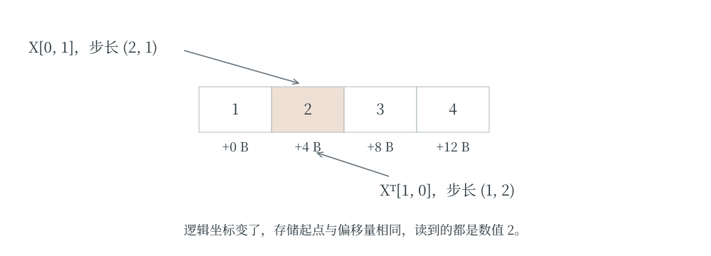
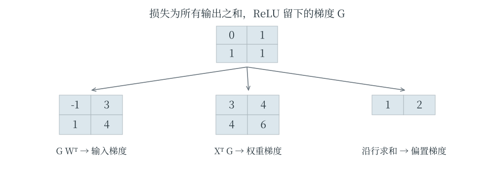
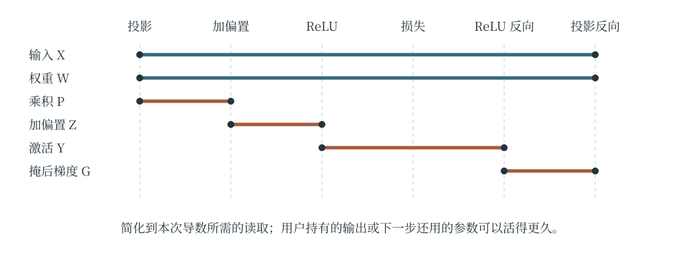
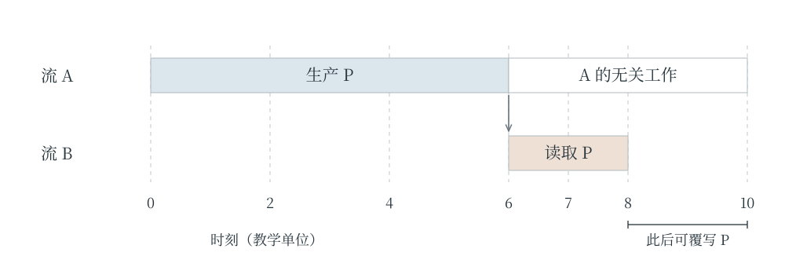
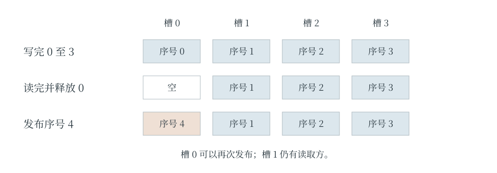

# 第 12 章　张量的生命周期与框架运行时

前面几章讨论了矩阵乘法的循环、HBM 访问量以及输入和累加格式。实际使用模型时，代码可能只有一行 `(x @ w + b).relu()`。这行代码如何变成设备上的工作？Python 变量消失后，底层存储何时能被复用？有些修改为何在前向正常，却在反向报错？这些问题涉及框架的算子派发、自动微分和内存管理。

仍以第二篇中的一层计算为例。输入 $`X`$ 的两行为 $`(1,2),(3,4)`$，权重 $`W`$ 的两行为 $`(2,-1),(1,3)`$，偏置 $`b=(-6,1)`$。前向依次得到

```math
\begin{aligned}
P=XW&=\begin{bmatrix}4&5\\10&9\end{bmatrix},\\[0pt]
Z=P+b&=\begin{bmatrix}-2&6\\4&10\end{bmatrix},\\[0pt]
Y=\mathrm{ReLU}(Z)&=\begin{bmatrix}0&6\\4&10\end{bmatrix}.
\end{aligned}
```

为便于手算，取损失 $`\mathcal L=\sum_{ij}Y_{ij}=20`$。该损失对每个输出的梯度都是 1，便于观察框架如何在反向中取得前向保存的信息。它只是检查执行过程的教学目标；将所有输出压到零也能使它最小，因此不能用它判断模型是否学会了有用的任务。先按即时执行，也就是调用算子时立即交由运行时执行，跟踪一次训练。

## 12.1　张量、元数据与底层存储

设一段连续存储里依次放着四个 FP32 数 1、2、3、4。仅凭地址，还看不出里面是两行两列，还是四行一列。张量需要描述形状、各维步长、存储偏移、类型和设备。对以元素计步长的二维张量，元素 $`(i,j)`$ 的字节地址为

```math
a=a_0+b_{\rm elem}(h+i s_0+j s_1).
```

这里 $`h`$ 是起始元素偏移，$`s_0,s_1`$ 分别是行、列步长。$`X`$ 的形状为 $`(2,2)`$、步长 $`(2,1)`$。如果只交换形状轴和步长，构造 $`X^{\mathsf T}`$ 的视图，步长成为 $`(1,2)`$。视图坐标 $`(1,0)`$ 指向基底的第二个数，也就是原来 $`X_{01}=2`$。元数据变了，四个数仍在同一段存储里。



*图 12-1　沿着两种坐标找到同一个数 2。透过任一对象修改这个地址，另一对象下一次读取时也会看到新值。*

这种共享叫别名。`clone` 可以显式取得独立数据。`contiguous` 在布局已经满足要求时可以直接返回原对象，转置后若确需连续排列则可能分配和复制。`reshape` 能构成视图时可以共享，无法用兼容步长表示时可能复制。广播也常采用元数据来完成。偏置只有两个元素，两行输入都用它，在广播维可以用零步长描述，因此两个不同逻辑下标可能落到同一个地址。在有重叠的输出视图上并行写，必须先定义写入语义。即使张量的外观形状相同，也不足以判断同一个内核能否正确处理它们。

本章这份 FP32 的 $`X`$ 裸数据只有 16 字节。原张量和转置视图各指向它，张量元数据、引用和分配器管理的实际块另占空间。把两份逻辑张量的元素数相加，会把同一份存储重复计入。反过来，一个只取前两项的小视图仍可能使很大的基底存储保持存活。想知道“删掉这个变量能省多少”，需要先知道是否仍有对象引用同一块存储。

可以用一次实际分配观察这一现象。先建一张 $`4096\times4096`$ 的 FP16 表，只取它第一行的头两个数，并删除原表的 Python 名字。这一小段在行内连续，外观载荷只有 4 字节，但它的存储对象仍报告 33554432 字节。此时调用 `contiguous()` 允许返回已经连续的那段视图，因而不足以切断共享。把这两个元素 `clone()` 到新张量，才会得到一份 4 字节的独立后备；旧视图的最后一个引用也消失后，32 MiB 的后备才有机会回收。跟踪程序可以在 CPU 上直接比较两次 `untyped_storage().nbytes()`。这一读数只数具体存储，不含进程的其他分配。[复现小视图保留大存储](../../experiments/part03/trace_layer.py)

这次复制何时才能省下内存？若另一个分支还握着原表的转置视图，复制这两个数后，32 MiB 的后备仍要保留，还新分配了 4 字节。若小视图是原表最后一个使用者，把它换成副本后，长期存活的数据才从 32 MiB 减到 4 字节。两种情况下，返回给调用者的数值和形状都相同。想判断是否值得复制，要找到最后一个仍会读取原存储的使用者。

## 12.2　矩阵乘法的算子派发

张量的形状、步长和设备决定了它能否被某个实现直接使用。同样一个矩阵乘表达式，连续 CPU 张量与 GPU 上的转置视图可能走不同路径。框架需要根据这些信息找到合适实现，同时为需要梯度的操作记录反向依赖。

以即时 PyTorch 为例。Python 表达式 `x @ w` 进入框架的矩阵乘接口，核对输入秩、形状、类型和设备，并在相应的算子规则下选择实现。算子有名为 schema 的接口约定，描述参数、返回值，以及有关原地修改或别名的约束。派发器（dispatcher）按算子、张量相关的派发键和当前上下文，找到适用的处理路径。自动微分、自动混合精度或特定设备后端都可能参与。一条路径还可以先加工参数、记录信息，然后重新派发到底层实现。[PyTorch 算子注册与派发教程](https://docs.pytorch.org/tutorials/advanced/dispatcher.html)

对于本例的两个普通二维张量，可以在 CPU 的跟踪里看到外层矩阵乘和底层 `aten::mm`，之后还有偏置加法与 ReLU。换到 GPU，设备实现可以调用矩阵库或某个专门内核，并把所需工作放入执行流。同一个算子在形状、类型、步长不同的时候也可能先做转换、选择另一种库算法或走通用实现。一次 Python 调用、一次框架算子事件和一次 GPU kernel 启动属于不同层次。看剖析器时，应先看事件的嵌套和设备时间线，再决定能否把某个耗时算到调用者身上。父事件的包含时间和子事件相加会重复计数。

若需要梯度，框架在前向构造反向计算所需的图。`X` 和 `W` 可以是由用户创建的、需要梯度的叶子张量。`P` 有自己的数值和生成它的历史。`Z`、`Y` 在链上继续延伸。图的边回答的是反向时要把导数送给哪些前驱，保存的数据回答的是计算这些局部导数需要哪些数值。两个问题紧密相关，却有不同的内存代价。加法的局部导数只需知道形状以处理广播；矩阵乘要求输入梯度时要用权重，要求权重梯度时又要用输入。[PyTorch 自动微分原理](https://docs.pytorch.org/docs/stable/notes/autograd.html)

## 12.3　反向传播所需的保存值

从损失发出一个标量种子 1。求和的反向将它广播到 $`Y`$ 的四格，得到全 1 的上游梯度。ReLU 的反向要知道哪几格在正半轴。我们的四个输入没有等于零，掩码为

```math
G=\begin{bmatrix}0&1\\1&1\end{bmatrix}.
```

某些实现可用 ReLU 输出的正值位置重建此掩码，于是保存输出便足够。若换作别的激活函数，所需的前向值会随局部导数改变。

偏置 $`b`$ 加到每一行，反向时同一列的贡献要汇合到同一个参数。于是 $`\bar b=(1,2)`$，而送给矩阵乘输出的梯度仍为 $`G`$。此后两条分支分别计算

```math
\begin{aligned}
\bar W=X^{\mathsf T}G&=\begin{bmatrix}3&4\\4&6\end{bmatrix},\\[0pt]
\bar X=GW^{\mathsf T}&=\begin{bmatrix}-1&3\\1&4\end{bmatrix}.
\end{aligned}
```

可以只查一个数。$`W_{01}`$ 在两行各被使用一次，两处上游梯度均为 1，所以它的梯度为 $`1+3=4`$。若模型只要求 $`\bar W`$，$`X`$ 的数值仍是反向输入，即使 $`X`$ 本身设置成不需要梯度。反过来，在某一支不需要梯度时，引擎可以少做相应工作。决定某个输入能否释放，应检查所有仍需执行的反向公式。



*图 12-2　沿 $`\bar W`$ 分支往前找，反向要读先前的 $`X`$；沿 $`\bar X`$ 分支则需要 $`W`$。同一份 $`G`$ 同时服务三项结果。*

对这个简单损失做一次步长 0.1 的梯度下降，只更新 $`W,b`$。新权重两行为 $`(1.7,-1.4),(0.6,2.4)`$，新偏置为 $`(-6.1,0.8)`$。同一输入再前向，输出约为 $`(0,4.2),(1.4,6.2)`$，损失变为 11.8。一次训练步因此至少包括三类不同的读写，前向产生输出和保存值，反向产生梯度，优化器最后修改持久参数。把更新提前到仍在读旧权重的反向分支之前，会算出另一个函数的梯度。

当一个张量在前向被两个分支共同使用，引擎需要汇总所有到达的梯度贡献，再将总梯度传给产生该张量的操作。训练里还常故意不在每个小批后清空叶子上的 `.grad`，使多个小批的贡献累积后才更新一次。若同一个上述损失用两次独立前向反传，而且始终不清空梯度、也不更新权重，$`W_{01}`$ 的 `.grad` 就会从 4 增至 8。若想模拟大批的平均损失，还要按样本或有效词元数给每批配正确权重，直接相加会改变梯度的尺度。

## 12.4　为什么失去 Python 引用后，内存还在

知道反向需要哪些前向值之后，才能判断一块存储何时可以复用。Python 变量离开作用域只说明一个引用消失；如果反向计算或另一个视图仍需要这块存储，提前覆盖就会破坏计算。

考虑一种看似省内存的改法。前向结束后，立刻复用输入缓冲区装下一条请求，还通过转置视图把原来第二个数 2 改成 3。前向早已算出损失 20，看起来平安无事。等到计算 $`X^{\mathsf T}G`$，右下梯度本应由 $`2+4=6`$ 产生，如果误读新 $`X`$ 则得到 $`3+4=7`$。反向使用了与本次前向不同的输入，因此算出的梯度不再对应原来的损失。

框架可在保存张量时记录其版本，并在反向需要取回时检查是否被原地修改。实验脚本对共享存储的转置视图执行修改，PyTorch 在反向报告版本不符。把修改放进 `no_grad` 只改变是否记录这次操作的梯度历史，数据仍被写入，版本检查仍有意义。若业务确实需要提前复用原地址，可以让需要旧值的一方另存副本，付出复制与生命周期成本；也可以保留足够的输入与参数版本，在反向前重算；最简单的情形是把覆盖移到最后一个使用者之后。



*图 12-3　横条表示某个数值必须仍能取得的区间。即使前向局部变量已经离开作用域，只要反向还要用旧版本，它的值就仍须保存或能够重建。*

这也解释了保存中间值与重计算之间的交换。若一段变换 $`u=f(x),v=g(u)`$ 占用很大，且反向需要 $`u`$，可以保存边界 $`x`$，在反向时再执行 $`f`$。这样少保留的是 $`u`$ 的长期驻留，增加的是重算的执行时间和当时的临时峰值。若 $`f`$ 用了随机掩码，重算还要恢复兼容的随机状态；若 $`f`$ 修改了外部统计量，重复执行可能产生额外副作用。第十章重算注意力分数，是一个已经证明能够由 $`Q,K`$、掩码和尺度正确再生的特例。

内存观察工具还把**活跃分配**与**分配器保留的空间**分开。一块临时张量失去所有使用者后，设备分配器可以将其归还到自己的空闲池，供随后形状合适的张量复用。操作系统或驱动看到的进程占用因此可能很久不下降。即使空闲总字节很多，也可能因尺寸类、碎片或跨流等待，暂时找不到一块适用的空间。在支持相应后端的 PyTorch 中，`memory_allocated` 与 `memory_reserved` 可以帮助区分这两个层次。排查训练显存持续增长，先查是否把带图的输出不断追加到列表，再查分配器和流的复用条件。[PyTorch CUDA 内存管理](https://docs.pytorch.org/docs/stable/notes/cuda.html#memory-management)

空闲显存充足时，分配仍可能因碎片化而失败。设一个简化分配器最多向设备取得一段 128 MiB 的连续地址，不能搬移活对象。段内从低地址到高地址依次是空闲 48 MiB、某个视图还引用的基底 32 MiB、空闲 48 MiB。此时已分配给活对象的是 32 MiB，保留的是 128 MiB。接下来一块 64 MiB 的连续临时张量会申请失败。总空闲有 96 MiB，其中最大的连续空闲块却只有 48 MiB。若视图最后一次使用结束，分配器可合并三个相邻区间，仍在同一段内满足 64 MiB。这个推断以不能再申请新段、不能虚拟重映射为前提。

排查内存问题时，可以在相同批量的连续几个训练步中比较同一阶段的显存占用。如果每次反向传播完成后，活跃分配量的最低值仍在上升，应检查这些分配的创建位置，例如是否保存了仍引用整个计算图的损失记录。如果最低值稳定，只是在长短混合的批次申请较大临时区时失败，则应检查失败时各段内的空闲块和已使用块。若驱动报告的设备占用明显超出框架分配器能解释的范围，再查其他进程及绕开此分配器的分配。PyTorch 的显存快照可查看段、块、分配历史和失败事件，记录须在复现之前开启。仅凭一条峰值日志无法在这三个解释中作出选择。即使释放了所有完全空闲的缓存段，含有活跃对象的段仍不能整体释放。[PyTorch 显存快照与可见范围](https://docs.pytorch.org/docs/stable/torch_cuda_memory.html)

## 12.5　异步提交、设备流与完成时刻

即使没有反向传播，设备工作也可能在 Python 调用返回后继续执行。张量是否仍被使用，因而不能只看主机代码执行到了哪一行，还要看各设备流中的最后一次读取是否完成。

在只有一条设备流时，同流中后来提交的依赖操作可按该流的顺序看到先前结果。主机一般无须等设备完成计算，就可以继续执行后续代码。比如矩阵乘耗 6 个时间单位，偏置与激活合计耗 2。主机快速把两项都入队后，第二条 Python 语句已返回，设备却可能刚开始乘法。若此时取一个 GPU 标量到主机决定 Python 分支，主机必须等待产生该数值所需的设备工作完成。因此，标量读取可能显示出较长的等待时间，其中包含此前已经排队的计算。

把投影移到流 A、激活移到流 B，则同一份存储会跨两个有序队列。假设流 A 在时间 0 开始写 $`P`$，到 6 才完成。流 B 在 1 就尝试读取 $`P`$，单靠两行主机代码的书写顺序，无法给两条独立流建立所需的依赖。可以在 A 写完的位置记录事件，在 B 读之前等待该事件。这样 B 最早从 6 开始，8 完成。若 A 上还有一项无关准备工作，可以与 B 的 2 单位计算重叠。过早等待整个设备，往往会把无关工作也挡住。



*图 12-4　第一次交接保证 B 能读到 A 的新数据。若别处要覆盖同一缓冲，还要等 B 的最后一次读取。一个事件连出的先后关系只覆盖它实际连接的工作。*

还需要单独处理内存复用的问题。即便 B 等到了 A 生产数据，Python 侧可能在 B 的读取实际完成之前就删掉 $`P`$。分配器如果只跟踪原分配流，有机会过早把该空间借给新张量。可通过 `record_stream` 让分配器知道额外使用流，或由程序显式安排最后一次使用和安全复用之间的依赖。这个操作与消费者对生产者的等待承担不同的责任，一个程序可能两者都需要。真实并发还取决于设备资源和流语义，异步提交本身不能保证在硬件上同时执行。[PyTorch CUDA 流语义](https://docs.pytorch.org/docs/stable/notes/cuda.html#cuda-streams)

### 计算图重放时更新输入数据

一次捕获把“从地址 A 读两个数，写入地址 B”的设备工作记录下来。第一轮 A 中是 $`(1,2)`$，第二轮 Python 变量改为指向新分配的 C，里面是 $`(3,4)`$。如果录下的参数仍指 A，重放便继续读 $`(1,2)`$。保留一块长期存在的静态输入缓冲，每轮先把新值复制进去，再按依赖关系重放，是一种容易核验的实现。执行图支持的参数更新也可改变某些节点的参数，适用范围要按具体接口检查。[CUDA Graph 的更新机制](https://docs.nvidia.com/cuda/cuda-programming-guide/04-special-topics/cuda-graphs.html)

额外的数据复制会抵消一部分减少提交开销带来的收益。假定省了四次各 3 µs 的调度开销，额外复制 1 MiB 输入，设备路径 200 GB/s，仅有效载荷就需 5.24 µs，余下至多 6.76 µs 可覆盖其余成本。若原生产者直接把下一批写进这块地址，可省一次拷贝；有两批在途时却要保证后一批不会覆盖仍在重放的输入。这个例子把运行时的地址稳定、缓冲生命周期和编译器对形状的检查接在了同一条时间线上。 多个请求同时在途时，可以为每个在途位置保留匹配的捕获与缓冲；它也会长期占用多套存储。对照图 12-4 标出上一次读取和下一次覆写，就能检查交接是否安全。若工作结构、地址或数据依赖的主机分支变化，还需检查捕获是否继续适用。[PyTorch CUDA Graphs 的静态输入与重放示例](https://docs.pytorch.org/docs/stable/notes/cuda.html#cuda-graphs)

## 12.6　运行轨迹与数据交接

项目中的实验建立上述三个可求导的 CPU 张量，用 profiler 记录一次前向和反向，同时用 saved-tensor hooks 观察哪些形状被保存和取回。下面是独立可运行的最小训练片段，完整脚本另外核对梯度、转置别名、版本报错和更新后的输出。

```python
import torch
x = torch.tensor([[1., 2.], [3., 4.]], requires_grad=True)
w = torch.tensor([[2., -1.], [1., 3.]], requires_grad=True)
b = torch.tensor([-6., 1.], requires_grad=True)
y = (x @ w + b).relu()
y.sum().backward()
assert w.grad.tolist() == [[3., 4.], [4., 6.]]
assert b.grad.tolist() == [1., 2.]
```

读调用轨迹时可以先预测，有一次前向矩阵乘，反向为两个需要梯度的矩阵输入各做一次矩阵乘，偏置反向还会沿广播维求和。若关掉某个输入的梯度要求，对应的部分反向工作就可能消失。捕获列表中的张量形状若碰巧相同，单看形状无法辨认是 $`X`$ 还是 $`W`$，应结合局部导数、产生位置和保存钩子的观察来判断。框架版本、设备和编译模式也会影响看到的是复合算子、库调用还是一段已经融合的设备代码。[本篇 PyTorch 跟踪实验](../../experiments/part03/trace_layer.py)

在本书实际运行的 PyTorch 2.8.0+cpu 记录里，`aten::matmul` 出现 1 次，`aten::mm` 出现 3 次。可以把这份记录对回纸面：外层 `matmul` 在这次二维前向中调用了一次 `mm`，另外两次 `mm` 正好用于 $`X^{\mathsf T}G`$ 和 $`GW^{\mathsf T}`$。因此不能把 1 和 3 相加，声称执行了四次矩阵乘。`aten::sum` 出现两次，一次构造标量损失，一次把广播维上的偏置梯度收回。保存钩子记下三次形状为 $`(2,2)`$ 的保存和三次取回。下一次看更大的模型，也可以先从公式预测次数，再用这种父子调用关系解释剖析器给出的数字。

### 使用共享内存环在进程间传递数据

12.5 节在同一进程内交接缓冲，调用轨迹也能沿这些数据依赖解释。若输入准备与模型执行分属两个进程，仍要回答同样两个问题：接收方从哪里读，发送方何时可以覆盖。共享内存省下复制以后，这两个约定反而更需要明确。

设输入准备程序和推理运行时是同一台机器上的两个进程。共享内存接口 memif 提供了一种传输办法：双方先建立控制连接，协商并映射数据区与队列，再通过队列中的描述符说明数据的位置和长度。设两个进程将同一片内存分别映射到虚拟地址 1000 和 9000，发送方写入区域内偏移 64 的位置。接收方应从 $`9000+64`$ 读取，不能直接使用发送方的地址 1064。传输协议还需要说明数据属于哪个区域、占多少字节，以及缓冲区何时可以复用。[DPDK memif 接口与环语义](https://doc.dpdk.org/guides/nics/memif.html)

设一个教学单生产者、单消费者队列有四个可用槽位。生产者连续发布序号 0 到 3，消费者只完成了序号 0 的读取。生产者现在可把序号 4 写在 $`4\bmod4=0`$ 号槽；若再写序号 5，就会覆盖消费者尚未读完的 1 号槽。只比较数组下标无法区分“从未写过”和“已经绕过一圈”，所以这里用单调序号记录进度。发布顺序也很重要：生产者先写好载荷和描述符，再发布可读位置；消费者完成最后一次读取后才能释放槽位。如果异步设备仍在读取这块内存，收到描述符的进程就不能提前释放它。



*图 12-5　横向查看四个物理槽，纵向跟踪每个槽位的使用状态。序号 4 回到槽 0；它与序号 0 的下标相同，但属于不同的使用周期。*

是否实现零拷贝，需要检查实际数据路径。假定 32 个输入块各为 4 KiB，逐块从共享区复制到运行时的私有缓冲，每批会多出 128 KiB 读和 128 KiB 写。若运行时能直接消费共享区，可以省掉这 256 KiB 逻辑流量，但可能使槽位的占用时间变长。若推理设备必须从另一片已登记内存接收输入，后段复制仍然存在。检查共享内存方案时，可故意放慢消费者，记录占用的槽位数和拷贝字节，分别评估数据复制和队列等待的变化。

到这里，张量的地址、最后一次使用和实际提交的工作已经可以逐项追踪。编译器还可以在这些运行时操作之前捕获更高层的计算，改变算子的分组与实现。JAX 的函数追踪体现另一种设计，函数在抽象输入上被追踪以产生可编译表示，普通 Python 副作用和依赖运行时数据的控制流需要按框架规则表达。设备提交图与高层计算图可以先后作用于同一段程序。下一章将沿当前的三步投影，看编译器在什么条件下有权合并它们，以及捕获结果什么时候可以给下一次调用继续使用。[JAX 即时编译与追踪](https://docs.jax.dev/en/latest/jit-compilation.html)

## 练习与解答

### 1. 同一块存储的第三个数

原 $`X`$ 偏移为 0、行优先，转置视图步长为 $`(1,2)`$。转置视图坐标 $`(0,1)`$ 落在原张量哪里？若只保留这个视图，原存储何时可以复用？

**解答。** 元素偏移为 $`0\times1+1\times2=2`$，即第三个数 3，对应原 $`(1,0)`$。只要视图仍可合法读取这块存储，就必须保留相应后备。异步设备上还要等已经提交的最后一次使用安全结束，或建立足以保证安全的流顺序。

### 2. 哪一项修改会污染权重梯度

在前向结束后，把 $`X_{01}`$ 从 2 改成 3，假设一个没有版本检查的引擎直接使用新值。求它得到的 $`\bar W`$，与正确值比较。

**解答。** $`G`$ 仍来自原来的前向，第一行是 $`(0,1)`$，第二行是 $`(1,1)`$。重新计算 $`X^{\mathsf T}G`$，得到的两行分别为 $`(3,4)`$ 和 $`(4,7)`$。右下项多 1，恰是修改值乘第一行第二列的上游梯度。实际引擎在需要已保存旧张量时应侦测这样的原地修改。

### 3. 两次反向后，梯度是加还是覆盖

相同权重、相同输入，在两次独立前向上依次对 $`\mathcal L`$、$`0.5\mathcal L`$ 做反向，中间不清空梯度。$`b`$ 的最终梯度是多少？

**解答。** 第一次是 $`(1,2)`$，第二次贡献 $`(0.5,1)`$，累积后为 $`(1.5,3)`$。这里每次都有自己的前向图。要对同一个已被反向消费的图再反传，还需按框架规则保留或重新构建所需状态。

### 4. 等到生产完成以后，谁还在用缓冲

A 在时刻 6 完成生产，B 等待事件后在 $`[6,8)`$ 消费。主机在时刻 7 释放最后一个 Python 引用。如果另一条流此时就覆写这块地址，会怎样？

**解答。** 生产者到消费者的边已经保证读到新值，仍缺少消费者最后使用到下一写者之间的边。时刻 7 的覆写可能与 B 的读取冲突。应让分配器跟踪 B，或通过同步安排使新写入在 B 用完之后才开始。这种问题无法由观察 Python 引用数单独判定。

[全书目录](../../README.md) · [上一章 · 低精度计算与量化](ch11.md) · [下一章 · 从计算图到机器指令](ch13.md)
