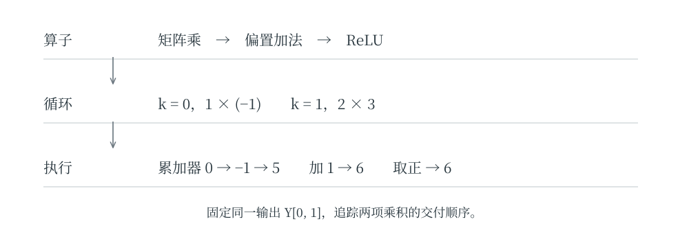
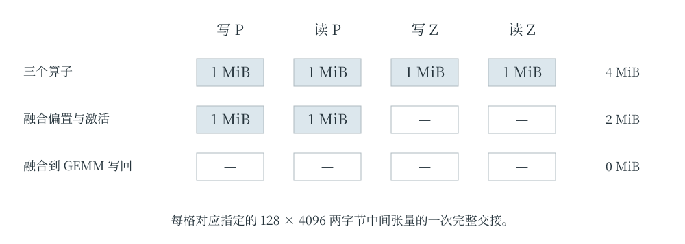
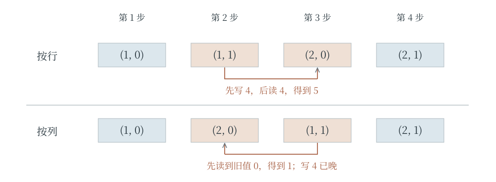
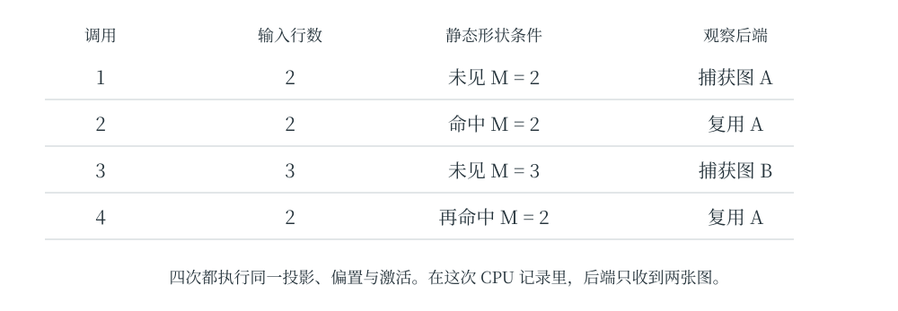
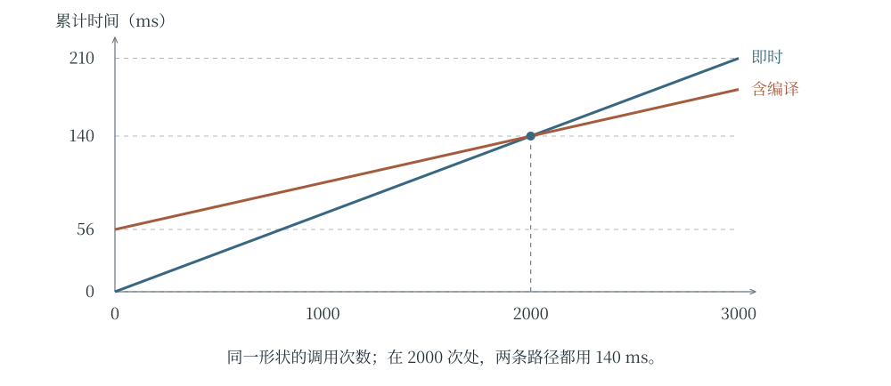
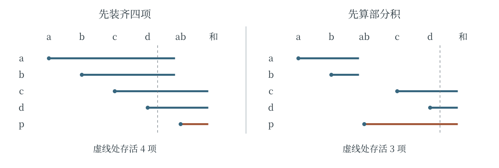

# 第 13 章　编译器：把通用模型变成适合机器的程序

第十二章的模型可以写成一行 `(x @ w + b).relu()`。即时执行时，框架依次调用矩阵乘、偏置加法和激活算子。矩阵乘库通常只负责自己的运算，无法根据后续操作决定是否省去中间结果的写回。编译器可以同时分析这些操作，并在满足原有数值和接口语义时将它们融合。

接下来考虑编译器如何处理这个模型。输入仍是前面两张矩阵和偏置 $(-6,1)$，读者已知道输出应为 $(0,6),(4,10)$，训练时也知道每一份正确梯度。编译器需要在满足这些结果和梯度约束的前提下，判断哪些数据搬运可以省去。

## 13.1　从 Python 程序捕获计算图

同一句 Python 可以带来完全不同的执行结果。`x` 可能是二维张量，也可能是带有自定义操作的对象；矩阵乘是否需要梯度取决于输入；代码还可以依据形状或张量里的真实数值分支。因此捕获一段计算时，前端需要记录这次实际看到的操作，并说明这段图在哪些前提下还能再用。在 PyTorch 的一条常见路径中，TorchDynamo 观察 Python 执行，把可捕获的张量计算整理为 FX 图，将该图和示例输入传给选定的后端。[PyTorch 编译概览](https://docs.pytorch.org/docs/stable/torch.compiler.html)

把我们的图写成便于阅读的中间表示（IR），得到如下结果。每个名字只被定义一次，使用它的操作直接引用其定义位置。编译器因此可以检查一份结果有哪些使用者，以及它最后一次被使用的时刻。

```text
p = matmul(x, w)          # [M,K] × [K,N] → [M,N]
z = add_bias(p, b)        # 第 j 列使用 b[j]
y = relu(z)               # 每个元素取 max(0, z[i,j])
return y
```

形状推导从三条关系得到约束：左表列数等于右表行数，偏置长度应匹配输出列数，ReLU 保持形状。若 $M$ 由请求给出，这些关系仍然可以成立，具体要发多少工作块则可能随 $M$ 改变。张量类型之外还要记录设备、布局、数值运算约定和可能的副作用。只保留“这是三个二维数组”，不足以安全地选择下层实现。

同一程序需要几种不同的视角。图 IR 能看到三个算子相邻，适合发现融合机会。循环或结构化算子 IR 能看到 $i,j$ 是并行轴、$k$ 是归约轴，以及偏置只索引 $j$，适合进行分块、换序和向量化。指令层则需确定实际加载、矩阵指令、寄存器和屏障。这些层次把不同的信息保留到还来得及使用的时候。太早把一切变成零散加载和标量加法，就需要重新猜测哪组循环本来表示矩阵乘。[MLIR Linalg 的迭代维度与索引映射](https://mlir.llvm.org/docs/Dialects/Linalg/)



*图 13-1　沿 $Y_{01}$ 向下看。图层给出它依赖的算子，循环层展开沿归约维读取的两个乘积，执行层还要等最后一个部分和就绪。三个视角描述同一个输出 6。*

导出给另一套推理运行时时，图需要写明调用哪个算子域、采用哪一版算子集（opset），并保留影响结果的属性。假如输入是一条只有两个采样点的线，值为 $(0,8)$，希望线性插值放大两倍。新坐标 $j=1$ 对应旧坐标的哪里？ONNX 的 Resize 采用 `half_pixel` 时，坐标是 $(j+0.5)/2-0.5=0.25$，线性插值得 2。采用 `asymmetric` 时，坐标是 $j/2=0.5$，结果为 4。两种定义都输出四个数，也都可以成功编译。若转换器只保留形状、节点名和缩放倍数，两个后端很可能在最普通的输入上就出现差异。可用这种有明确中间答案的小样本查语义，再检查目标运行时将各节点交给了哪种设备实现，最后才比较延迟。[ONNX Resize 的坐标与插值约定](https://onnx.ai/onnx/operators/onnx__Resize.html)

## 13.2　证明算子融合的条件

有了计算图，编译器能同时看到乘法、加法和激活之间的依赖。若中间值只供下一步使用，将操作融合有机会省去全局内存的写入与读取。不过，省去中间存储之前，必须检查所有使用者以及原本的舍入语义。

数值参考中，$P_{01}=1\times(-1)+2\times3=5$，$Z_{01}=5+1=6$，ReLU 后仍为 6。如果偏置和激活只有这一个后继用途，结果采用足够精度，且原接口允许在同一精度完成这些操作，就能把写出挪到 ReLU 之后。下面的 Python 是该变换的标量参考，行循环、列循环和内积求和分别对应第九章的三个下标。

```python
def fused_layer(x, w, bias):
    result = []
    for row in x:
        output_row = []
        for j, offset in enumerate(bias):
            acc = sum(value * w[k][j] for k, value in enumerate(row))
            output_row.append(max(0, acc + offset))
        result.append(output_row)
    return result

assert fused_layer([[1, 2], [3, 4]], [[2, -1], [1, 3]], [-6, 1]) == [[0, 6], [4, 10]]
```

对每个输出元素，可以逐项验证融合条件：所有归约项都要参与计算，乘加顺序必须符合原有顺序或允许的重排约定；偏置只依赖输出列，在归约完成后恰好加一次；ReLU 只读取该元素加偏置后的结果。若 $P,Z$ 没有其他可观察用途，程序可以只留下寄存器中的临时值。如果调用者还要求返回 $P$，就必须保留该结果。若有调试钩子取走了中间结果，或另一个输出通过视图共享了将被覆盖的存储，也要保留这些语义。

可以计算纯全局数组接口的收益。三步完全分开时，乘法写 $P$、加法读 $P$ 写 $Z$、ReLU 读 $Z$ 写 $Y$。其中两个中间数组各一写一读。以 $128\times4096$ 个两字节元素计，$P,Z$ 各为 1 MiB，融合可省去 4 MiB 的中间数据读写。若基线已经把加法和激活放在一个 kernel，就只能省去 $P$ 的一次写入和一次读取，即 2 MiB；第二篇计算的正是这种情况。中间数据在 L2 命中时，省掉的仍有全局读写指令和启动，实际 HBM 变化则要由测量决定。



*图 13-2　只数中间张量 $P,Z$ 经全局数组边界的交接。三条路径最终都要写 $Y$，所以图中省略这项共同成本。*

在选择融合前，还应检查计算图中是否有运算可以提前完成或省略。设推理权重和偏置都已冻结，常量 $b=(1,-2)$，有两个分支分别写 $t_1=2b$、$t_2=2b$，结果取 $y=(x+t_1)+(x+t_2)$。导出时即可把两个纯常量乘都算出 $(2,-4)$，这叫常量折叠。即使 $b$ 在运行时才传入，只要两次读取之间没有修改、乘法无副作用、类型和舍入约定相同，第二个分支也能引用第一个结果，这叫公共子表达式消除。若只有第一分支被返回，第二条未使用且无副作用的分支可完全删去。对训练图要重查前提，下一步更新后的 $b$ 未必还是这个值，观察中间结果的钩子也算使用者。

例如把两次“以概率一半保留输入，否则输出零”交给独立随机掩码。两分支同时保留的概率原是 $1/4$。如果编译器只看两个节点同名同形，就把第二次采样替换为第一次的结果，同时保留的概率会变成 $1/2$。单独检查每一分支的平均保留率，发现不了这个错误。可用这个例子读模型交换格式中的算子版本与训练标志：导出图声明了何种语义，优化器才能据此证明消重、删除或折叠是否合法。[ONNX 的算子版本、图及推理模型语义](https://onnx.ai/onnx/repo-docs/IR.html)

### 浮点舍入对融合结果的影响

设接口要求矩阵乘以较高精度累加，但其返回张量先舍入为 FP16，之后才加偏置。一格精确部分和为 $1+2^{-11}$，可由行 $(1,2^{-11})$ 和列 $(1,1)^{\mathsf T}$ 得到，偏置为 $-1$。在 1 上方 FP16 格距为 $2^{-10}$，中点按最近偶数舍入到 1。因此先写 FP16，再加偏置并做 ReLU，输出是 0。若融合时把全部操作保留到高精度、最后才舍入，则先得到 $2^{-11}$，ReLU 后仍为 $2^{-11}$，这个数本身能由 FP16 表示。

发生改变的是舍入边界。若接口要求前一种结果，融合的 kernel 仍可以保留一次内部转换，既满足数值语义，又省去实际写回。若框架的混合精度或近似数学设置允许另一种行为，就应明确其误差条件并做验证。并行归约次序、NaN、无穷和负零等也可能影响合法变换。验证时应放入触碰语义边界的输入，章首那组恰好全是整数的例子无法发现这个差异。

## 13.3　从计算图到设备执行计划

改写图只确定一个候选计算，仍需回答第九章的分块问题。是调用现成矩阵库并使用它支持的 epilogue，还是生成一个专门 kernel？若库已为重要形状提供成熟路径，借用库能节约开发与调优成本。若激活更复杂、布局特殊或形状很小，专门生成更有机会让中间值留在片上。牺牲了优秀的矩阵乘路径去融合一个便宜的偏置，也可能付出更大的总代价。

看一个带数字的选择。假设分阶段执行时矩阵库耗 30 µs，后处理和交接共 8 µs。一个融合候选节省后面 8 µs，却由于累加器压力和形状适配只能用 43 µs 完成整个任务，于是原来的 38 µs 更短。另一个块配置使融合用时降为 32 µs，才有了调用级收益。计时要包括实际的布局转换与前后必要等待，测到的数字还应记录输入形状和设备。这里的 30、8、43、32 是说明选择条件的构造值。

可枚举的候选往往包括输出块宽高、归约段长、流水阶段数、向量宽度和工作组规模。并非每个组合都能运行。某一配置的片上面板、累加器和层数一经相乘，就可能超过设备容量。向量读取对齐条件若不满足，要改用更窄的访问、增加边界处理，或回退到其他实现。合法候选中才轮到**自动调优**，用代价模型筛选或在目标平台实测。把搜索结果缓存下来，需要把设备、类型、相应布局和形状分布都纳入复用条件。

另一类图优化针对存储分配。设 $P$ 完整写出后进入加法，且没有其他算子需要读取它，就可以在条件允许时复用 $P$ 的地址作为 $Z$ 的地址。两次算子启动仍然存在，减少的是需要同时占用的存储。如果框架向用户暴露了持有 $P$ 的视图，覆盖就改变了视图可观察的值。若两个 kernel 在不同流里重叠，即使图上看似“前一节点最后使用完了”，也得等设备上的最后读取结束。第十二章的张量生命周期由此成为编译器做内存规划的依据。

是否还有其他消费者也会影响融合。假设调用者除了 $Y$ 外还要 $P$ 的总和，用于记录投影幅度的一个简化统计。本例应返回 $4+5+10+9=28$。若内存规划器直接让加偏置操作覆盖 $P$，事后从同一片地址求和便成了 $-2+6+4+10=18$。如果统计读取排在覆盖之前，结果仍为 28，但须付一次读取。还可以在 GEMM 写出前让每块顺便求局部和，最后只归约这些标量；这一路可省整表，却有新的跨块交接，浮点加法顺序也可能改变。若调用者要求完整的 $P$，只返回总和就不够。这三个接口对于 $Y$ 的数学定义完全相同，允许移除的中间存储却不一样。

训练图还需要考虑反向传播对前向结果的使用。前向做完 ReLU，反向要知道哪些格为正；需要权重梯度时又要取得 $X$。自动微分转换可以先构造包含前向和反向关系的图，再划分要跨边界保存的值与重算部分。保存完整中间张量、保存较小的掩码或以后从输出重建，其可行性取决于局部导数和谁还在用该输出。常量折叠也有边界，固定形状产生的索引可以提前算出，正在被优化器更新的训练权重，不能作为永久不变的常量写入编译结果。若在推理中对固定权重预先打包，权重版本变化后要更新对应产物。

把逐元素运算移到矩阵乘的另一侧，融合的代价会换方向。设输入先逐元素经过 ReLU 得到 $U$，再计算 $UW$。沿用第九章的 $128\times4096$ 两字节输入和 $128\times128$ 输出块，输出共有 32 个列块。每个列块都要用同一份 $U$。单独启动 ReLU 时，524288 个元素各算一次。融合进矩阵乘的加载阶段时，若每个列块都自己算，这些元素会各算 32 次，成为 16777216 次逐元素变换。输出侧的 ReLU 每个结果格只归一个块，输入侧的同一格却有 32 个消费者。两种融合都合法，调度代价相差很远。

逐项数一遍全局数组接口的逻辑流量，可以判断这里究竟省掉了多少。单独计算需读 1 MiB 的 $X$ 并写 1 MiB 的 $U$，随后 32 个列块各读 1 MiB 的 $U$，合计 34 MiB。融合后，32 个列块各读 1 MiB 的 $X$，合计 32 MiB，节省 2 MiB 和一次启动。两种方案的权重读取和最终输出相同，因此未计入比较。缓存可以承接这些重复读取，因此实际 HBM 字节要另测。若输入变换很贵，把它重做 32 遍就可能得不偿失；若程序允许一个工作块连续负责几块输出并留住变换后的输入，计算重复可以再降，所需片上容量也会变化。读一个融合方案时，沿一个具体的输入格数清它被多少工作块使用，才能把“少了一个算子”换算为执行代价。

### 循环重排与数据依赖

把输出格 $(i,j)$ 展开为一串事件：先清零，再依次累加 $X_{ik}W_{kj}$，最后才加偏置。取 $M=N=K=2$，乘加事件共有八个。所有合法事件都满足 $0\le i,j,k<2$，访问的元素坐标分别为 $(i,k),(k,j),(i,j)$。这些约束与坐标都是循环变量的线性组合加常数。编译器可以把事件看作整数格点，把它们之间“这一写必须先于那一读”的关系看作有向边；这就是这里**多面体模型**的用处。例如固定输出坐标 $(i,j)$，可用的 $k$ 落在一条线段上的整数点里。把下标换成从路由表里读出的专家编号，就失去了这里能直接列出的仿射访问关系。

为每个格点指定一个按字典序比较的时刻。原循环的时刻表为 $(i,j,k)$，若换成 $(k,i,j)$，对于输出 $(1,0)$，原先是先做 $k=0$ 再做 $k=1$，新表里仍是这个次序。四个格子会交错更新，不过在能同时保留四份部分和、输入输出无别名、偏置只在各自最后一步加的条件下，逐格的浮点加法顺序没变。若直接把所有 $k$ 分给两个线程并写同一输出而无单独的累加槽，两条边会同时需要旧值，图就不再等价。即便用归约树修复写冲突，也要另查浮点舍入约定。

再看一个会使循环交换失效的反例。给 $3\times3$ 整数表的顶行置为 $(1,2,3)$，其余初始值为零；对 $i=1,2$ 和 $j=0,1$ 写 $T_{ij}=1+T_{i-1,j+1}$，第 1、2 行的最右格始终为零。行优先按 $i$ 再 $j$ 做，先写出 $T_{1,1}=4$，下一行才读到它，故 $T_{2,0}=5$。如果按 $j$ 再 $i$，处理第零列时便会用尚未更新的 $T_{1,1}$，得到 1。原依赖从 $(1,1)$ 指向 $(2,0)$，在以列为先的新时刻表中竟指向过去。合法性应先对所有这类边成立，然后才比较目标芯片、分块可容纳的部分和和访存收益。AKG 在面向 NPU 的工作中将多面体调度与分块、融合、低层同步配合使用；需要实际选择块长、决定是否保留输入面板时，合法时刻表给出的是起点。[AKG 论文的调度与分块方法](https://www.di.ens.fr/~zhaojie/pldi2021-paper)



*图 13-3　列表示先后时刻，格里的坐标指定这一步要写哪个元素。沿行寻找先写 $(1,1)$ 再读它的那一步。同一条依赖若只能向时间的反方向连线，就不能按这张时刻表执行。*

## 13.4　编译结果的复用条件

针对固定形状选择的分块和生成的代码可能更快，但输入形状、步长或设备改变后，原来的假设未必继续成立。复用编译结果之前，运行时需要检查这些假设；检查失败时，还要选择重新编译或其他可用实现。

设第一次调用时 $M=2,K=N=2$，输入行优先、位于 CPU、类型为 FP32。编译器可能为这个形状把边界条件化简。第二次调用的 Python 函数名相同，却可能送来三行。若前一份代码只生成了两行输出，直接复用就会遗漏最后一行。编译系统可以在入口放一组 **guard**，即运行时检查。只有使已有实现成立的条件满足，才能使用这份特化产物。形状、步长、类型、设备、某些 Python 值或对象状态都可能成为条件。

可以为不同的 $M$ 分别特化，也可以用符号行数并保留尾部检查。沿用第九章的二行输出块，符号实现对 $M=3$ 要启动两行块，并遮住第四行；对 $M=2$ 只用一行块。符号实现减少多变输入带来的编译，但可能保留更多地址运算，调优也要照顾一个范围。把相近长度放入少量桶是中间方案，按桶复用并靠掩码保持正确，但桶内填充会增加计算和存储开销。若第 11 章的非对称编码也在场，屏蔽归约尾部时还要使用正确的零点。



*图 13-4　两次出现的算子序列都可以是 matmul、add、relu，但其输入条件不同。图只展示本章固定类型与布局的实验，真实系统还会检查其他 guard。*

再看一个更难的分支。`if x.shape[0] > 1` 只依赖元数据，可以用约束或特化选择路径。`if x.sum().item() > 0` 需要实际数据，若 $x$ 在 GPU，还可能将标量带回主机形成等待。编译器可以在无法捕获之处分段，让 Python 执行外部逻辑，再继续捕获后半段；适用的框架也允许把分支显式写成图内条件算子。**图中断**描述的是一次捕获在哪里分段，**guard 失效**描述已有产物的前提是否仍成立。前者可能让一次调用含多张图；后者可能让同一代码位置针对不同输入生成多个编译结果。启用整图模式时，不能捕获的内容也可能直接报错。处理策略、重编译限额和后端能力应按所用版本核对。[PyTorch 编译故障排查与 guards](https://docs.pytorch.org/docs/stable/torch.compiler_troubleshooting.html)

别名也能使表面上相同的形状有不同语义。设 $v$ 是 $x$ 第一行的视图，程序先将 $x$ 原地加一，再返回 $v$ 的和。对起始第一行 $(1,2)$，正确返回 5。若编译器把这次求和提前到写入之前，就会得到 3。可以把内部原地操作转换成显式的新值和依赖，但要把对外可见的别名更新和副作用一并表示。简单地把每条 Python 语句都当作无副作用的数学函数，在这个两行例子上就会失败。

## 13.5　检查一次实际捕获

本篇的 CPU 实验把固定矩阵交给 `torch.compile`，设置 `dynamic=False` 和 `fullgraph=True`。第一次使用一个观察后端，记录 FX 图中的调用目标，再用该图执行以校验数值。在 PyTorch 2.8.0+cpu 上，输入行数按 2、2、3、2 进入时，后端收到两张图。两张图的核心操作都是矩阵乘、加法与 ReLU，四次输出均与即时执行相同。这个后端在捕获处留下了可检查的证据，故可以直接观察图的复用。它返回图自身的 `forward`，没有由这项实验生成高性能机器码。

接着把同一层交给 `aot_eager` 后端，运行完整反向，比对 $X,W,b$ 的梯度。三项均与第十二章的手算及即时执行相符。这项检查触及自动微分转换后的前后向执行。在常见的 PyTorch 编译训练路径中，Dynamo 做捕获，AOTAutograd 处理自动微分图及其划分，Inductor 等后端再针对目标生成代码或调用库。GPU 上可能生成 Triton 内核，也可能继续使用外部矩阵库。判断“本次到底生成了什么”还要看该后端的输出代码和目标设备时间线。[复现捕获及前后向对照](../../experiments/part03/trace_layer.py) [PyTorch 编译器](https://docs.pytorch.org/docs/stable/torch.compiler.html)

还有一个不必换设备就能验证的 guard。把第一次输入改成它自己的转置。这个例子的两维碰巧都是 2，故形状、元素类型和设备全部没变，步长却从 $(2,1)$ 变成 $(1,2)$。同一层对转置输入应给出两行 $(0,9)$ 与 $(2,11)$。跟踪程序另起一个观察后端，只改变输入布局，按“连续、转置、连续”送入。本次仍记录到两张图，换回连续输入时命中了已有图。逐格对照即时输出则表明两种布局都算对了。两个输入形状相等，不能推出特化前提相同。

换一个后端，仍可以追同一个输出格。XLA 在高层图中选择布局与融合，之后生成适合设备的执行代码。在 TVM TensorIR 中，则可把同一格的计算写成两个空间轴和一个归约轴，改变循环分块、存储作用域和调度，继续用原来的输入逐格验算。一个改写负责证明“这样的输出等价”，另一个改写要回答“这些值在哪一级存储器相遇”。[XLA 架构](https://openxla.org/xla/architecture) [TVM TensorIR](https://tvm.apache.org/docs/deep_dive/tensor_ir/index.html)

以昇腾 CANN 的 Ascend C 向量加法示例为参照，`CopyIn` 先将源数据搬入片上输入缓冲区，`Compute` 从输入队列取得张量并将计算结果写入输出队列，`CopyOut` 再将结果写回全局内存。将偏置加法按这三个阶段分析，可以考察融合的收益：若加完偏置后直接在片上执行 ReLU，就有机会省去偏置结果的一次全局写和下一次全局读，对整张 1 MiB 表共节省 2 MiB。条件是没有其他算子需要偏置结果的原值，所需格式的舍入仍然保留，且输入、输出和在途队列能够放入片上存储。矩阵乘法涉及矩阵与向量执行单元之间的数据传递，还需要单独核算。向量加法示例说明了两个逐元素算子的融合；能否进一步与矩阵乘融合，还取决于实际设备支持的数据通路。[Ascend C 向量加法的队列与执行过程](https://www.hiascend.com/doc_center/source/en/CANNCommunityEdition/900/programug/Ascendcopdevg/atlas_ascendc_10_0033.html)

## 13.6　编译成本与执行收益

现在可以给“编译后更快”加上时间范围。假设即时执行一次 70 µs，特化代码一次 40 µs，每次 guard 与分派再花 2 µs，首次生成该产物花 56 ms。若某一组条件共命中 $n$ 次，忽略两边共同的准备时间，则

$$
\begin{aligned}
T_{\rm eager}&=70n\ \mathrm{\mu s},\\
T_{\rm compiled}&=(56000+42n)\ \mathrm{\mu s}.
\end{aligned}
$$

两条线在 $n=2000$ 相交。第一次严格省时是 2001 次。若一共来 3000 次请求，但均分给三种形状，每种都付出独立的 56 ms，则每份只用 1000 次，合计 294 ms，比即时执行的 210 ms 长。若一个动态实现只编译一次，连检查在内每次 50 µs，则合计 206 ms。这些数字给出一个可复算的选择，实际编译与执行或许能后台重叠，缓存可能跨进程复用，在线系统的冷请求还可能对尾延迟特别敏感。



*图 13-5　纵轴包含首次编译和后续执行。若一个形状频繁失效或每次部署都丢掉缓存，应按实际复用期计数。*

编译成本还需要与形状填充的开销一起比较。假设已有按长度 256 编译的注意力，线上反复来长度 129 的请求。实现会对填充后的正方形执行全部分数乘法，再屏蔽无效键，并只取前 129 行输出。有效配对为 $129^2=16641$，旧桶却执行 $256^2=65536$ 对。若新设 160 桶，执行 $160^2=25600$ 对，每次省 39936 对。屏蔽无效键应在 softmax 归一化前完成。只把填充的值向量设成零，虚假的键仍会分走真实位置的概率。

假设在这段工作区间，每减少一对可省 1 ns，新增的编译和调优一次需 56 ms，其他费用两边相等。调用 1000 次只能省 39.936 ms，增设新桶反而拖慢总任务。第 1403 次才第一次超过 56 ms。已经有支持变长输入的 kernel 时，就要按内核执行的块重新计数。有的实现已能跳过填充块、因果上三角或空段，方阵模型会高估缩短填充带来的收益。记录真实长度的频数、各桶的实测热耗时和各自冷启动，便可按自己的部署数据计算总成本。PyTorch 的符号形状还允许复用带运行时约束的同一份图。分桶时，把它也作为实测候选。[PyTorch 动态形状文档](https://docs.pytorch.org/docs/stable/torch.compiler_dynamic_shapes.html)

一份可信的实验会同时记录冷启动、稳定状态和新形状首次出现的时延。先用章首输入、非整除形状、转置视图以及半格舍入的反例核对数值和梯度，再按真实请求序列比较含编译、调优和缓存命中的累计时间。单独把已经热好的最快 kernel 与包含首次初始化的另一条路径比较，会误判第一个请求，也会误判长期吞吐。

### 跨硬件代际的程序表示

考虑前面的分块方案在另一代芯片上能否继续使用。这里需要区分三个层次。第一种是模型仍算同一个函数；第二种是编译器仍能接收某份中间程序；第三种是二进制指令和流水时序完全不变。以前两种为目标，编译器就有余地重新选指令。以 NVIDIA 的 PTX 为例，它是虚拟指令集，描述操作数、内存空间和指令语义；为某个目标生成的机器代码才在具体芯片上发射。虚拟指令也有版本和目标能力要求，并不保证每一条新指令都能在旧架构上执行。[PTX 指令集规范](https://docs.nvidia.com/cuda/parallel-thread-execution/index.html)

设生产线程把八个元素搬到共享缓冲，消费者分两组各读四个。接口若只表示“八次复制已发起”，消费者不能据此开始；若表示“目标数据已对该组可见”，它可以开始读，却仍不能在**另一组尚未读完**时覆盖缓冲。正确的实现至少要分开表达数据就绪和缓冲可复用。架构甲用一份缓冲、逐轮等待；架构乙用两份缓冲交替、对每一份记录其轮次。给每次写入填上轮号，让第二组故意晚一轮，若它本应读 6 却读到 7，说明复用协议被破坏。程序即使能够编译并快速运行，也没有保证两组线程读到正确轮次的数据。这是阅读新 XPU 软件接口的一个起点：先问它能表达哪些可见性与完成条件，再问它能映射到哪一代机器，最后才比较流水能重叠几拍。

## 13.7　从编译后端到机器指令

上面的实验验证了图捕获、执行与数值结果，却还没有说明一条计算最终如何映射到设备指令。下面固定输入类型、布局和舍入约定，沿着一个输出元素检查后端生成的代码。

固定矩阵为章首的两行两列，行优先，四张表各自连续，元素为有限 FP32 数。本例约定第一项乘积先舍入，第二项用一次融合乘加累加，再加偏置并取最大值。发一个一维线程块，至少四个线程，不超过设备限制；超过编号 3 的线程直接退出。这里使用普通标量指令，便于跟踪一个线程的执行。编译输入、标量校验以及生成命令都在[后端复算脚本](../../experiments/part03/lower_projection.py)里。[LLVM 的 NVPTX 后端](https://llvm.org/docs/NVPTXUsage.html)

**从格子到地址。** 将编号为 $t$ 的线程分给第 $\lfloor t/2\rfloor$ 行、第 $t\bmod2$ 列。固定两列时，列号可由 `t & 1` 取得，输入行的起始元素下标可由 `t & 2` 取得。对 $t=1$，线程要取的 $X$ 是第 0、1 项，即 1 和 2；$W$ 是第 1、3 项，即 −1 和 3。同一列的相邻两项相距两个 FP32，所以第二项权重的地址比第一项大 8 B；同一行两个输入只隔 4 B。若调用者递来转置视图，形状仍是二乘二，这两个立即数却可能同时失效。前端核对的步长，到了后端成了地址的一部分。

**从依赖到指令。** 在随书的 LLVM IR 中，`getelementptr float` 按四字节计算地址，`load` 产出值，`llvm.fma.f32` 则明确要求一次融合乘加。LLVM 20.1.8 的 NVPTX 后端按 `sm_80` 和 PTX 7.0 选出五条全局浮点加载、一条乘法、一条融合乘加、一次加和一次取最大值，最后存一次。这里五个输入是两项 $X$、两项 $W$ 和一个偏置。PTX 中的 `%f1` 等名是虚拟寄存器。把它们简单相加，既没有算地址寄存器，也没有考虑临时值何时已经可以覆盖。[LLVM 指令选择与寄存器分配](https://llvm.org/docs/CodeGenerator.html)

再用 CUDA 12.9 的 `ptxas`（12.9.86）编译这份 PTX，目标仍为 `sm_80`。下面摘出对本格最重要的连续六条机器指令。地址计算插在两条浮点指令之间；对有限的这组输入，随后取最大值实现 ReLU。括号内的含义可以和章首的 6 一一对应。[CUDA 二进制反汇编工具](https://docs.nvidia.com/cuda/cuda-binary-utilities/index.html)

```text
FMUL R0, R0, R9                 // 1 × (−1) = −1
FFMA R11, R8, R11, R0           // 2 × 3 + (−1) = 5
IMAD.WIDE R8, R10, R13, c[0x0][0x178]  // 算输出地址
FADD R11, R6, R11               // 1 + 5 = 6
FMNMX R11, RZ, R11, !PT         // max(0, 6)
STG.E [R8.64], R11              // 将 6 写入 Y 的第 1 项
```

观察 `R11` 在这段指令中保存的值。开始时它装的是权重 3。融合乘加把 5 写回同一位置，偏置加法再写成 6。读取者已经用完旧值，复用同一物理位置完全合法。同理，`R8` 先装输入 2，乘加读完它后便可用来存输出地址的一部分。汇编器报告每线程使用 16 个寄存器、栈帧 0 字节、溢出存取均为 0。这个数字还包括地址等工作值。实验在本地完成了编译和反汇编，四个输出用 CPU 标量参考核对；这些证据可以回答“生成了什么”，设备耗时须另行运行取得。[检查本次生成的 PTX、机器指令与资源数字](../../experiments/part03/projection_sm80.json)

现在回看第 9.7 节在 Radeon 780M 上运行的两版矩阵乘。线程从算一行改为算四行，除了要保存四个累加器，还要为更多输入准备地址。究竟用了多少寄存器，可以直接查两版可执行文件中的 AMDGPU 内核元数据。两版的 wave 都有 32 条执行通道。每条通道使用的向量寄存器（VGPR）从 11 个增加到 21 个，每个 wave 使用的标量寄存器（SGPR）从 22 个增加到 26 个，两类寄存器的溢出数都为零。四行版本确实多占用了寄存器，128 行输入却仍然更快。要进一步判断实际同时运行了多少个 wave，还得看寄存器分配粒度、其他资源限制，以及运行时到底有多少工作组可供调度。[查看两版编译产物的资源读数及同次运行的耗时](../../experiments/part03/projection_780m.json)



*图 13-6　每列是指令执行完毕的时刻，横线表示下次使用前还必须留住的值。左图第四次加载结束时，竖切线穿过四条线。右图先算出部分积 p，第三个位置可以留给后一对操作数。两图采用教学机器的三寄存器限制。*

**把加载提前多少才值得？** 图中只看两组乘数 $a,b,c,d$，允许结果覆盖最后一次使用的输入，并限定三个可存放标量的位置。若按 $a,b,c,d$ 顺序读完才乘，第 4 个数到达时有 4 个活值。保持这个顺序且不允许重新读原输入，就得先把其中一项写到临时空间，再读回来。对 FP32，仅这次溢出就增加每线程 8 B 的逻辑读写。若先算 $p=a b$，再读 $c,d$，完成 $p+c d$ 时最多需要三个位置。后一种排法也有代价，后一组加载发出得晚，可能使运算等数据。在 GPU 上，溢出使用线程私有的 local 地址空间，经过缓存的路径取决于芯片。8 B 不能直接计作 8 B 的 HBM 流量。

**估算真实线程块的资源占用。** 若一台教学 SM 有 65,536 个 32 位寄存器，每块 256 线程，每线程从 64 个加到 65 个，仅按数量，常驻块数的上界从 $\lfloor65536/(256\times64)\rfloor=4$ 降到 3。真实分配还要按架构粒度取整，线程数、共享内存和块数自身也有限制。少一块可能削弱隐藏等待的能力，也可能被更好的指令调度抵偿。比较两版后端时，先确认边界形状和数值语义，再对照机器指令、资源报告、实际溢出流量与耗时。若目标改成较大的半精度矩阵，还要重新选择标量或矩阵指令及其分块布局；依赖图里的四个浮点操作本身不足以决定那项选择。

回到第二篇的 128 行投影。现在可以从输入形状到编译结果，梳理它的执行过程。输入行数决定可复用的权重与可填满的块，块形状决定面板、寄存器和指令，归约要求决定哪些值必须一直保留，精度与数值语义决定中间结果的格式及舍入时机，框架管理这些值的存储和使用期限，编译器在保持计算语义的条件下选择具体执行方式。验证这条执行路径时，可以沿用第九章的形状分布和完整调用计时，另将本章的首次编译与后续复用分开记录。否则，生成了更快的内核，也可能尚未收回编译和布局转换的开销。第四篇将把权重和输入分布到多台机器。部分和除了在设备内部流动，还需要经过设备间链路。

## 练习与解答

### 1. 多一个消费者，还能省掉哪一写

函数现在返回 $(P,\operatorname{ReLU}(P+b))$。给 $128\times4096$ 的两字节张量计数。若融合 kernel 能一边写出 $P$ 一边在片上完成后处理，同三步分开比能少多少中间传输？

**解答。** $P$ 成为对外返回值，必须写出 1 MiB。原路径中，后处理对 $P$ 的一次读取仍可通过片上使用同一累加结果省去，另外 $Z$ 的写、读共 2 MiB 也可省去。合计少 3 MiB 的逻辑传输。最后输出 $Y$ 的写是两种实现共有的。

### 2. 补上一个舍入点

若偏置为 $-1$，精确内积为 $1+2^{-11}$，原语义要求内积先落到 FP16，再加偏置。能否只用一个 kernel，且得到原答案？

**解答。** 可以在寄存器中把累加值转换到规定的 FP16，得到 1，再按规定的类型做加法与激活，输出 0。需要保留的是可见的数值效果；这个转换本身无需通过显存物化整张中间表。

### 3. 两种形状的编译成本

两种静态形状分别调用 2200 和 200 次，仍用本章的 70 µs、42 µs 与 56 ms。若能分别选择，怎样安排这两组？

**解答。** 2200 次即时需 154 ms，编译需 $56+92.4=148.4$ ms。200 次即时需 14 ms，编译需 64.4 ms。第一组选编译、第二组选即时，合计 162.4 ms。两组都即时为 168 ms。这个比较以调用次数已知、两份产物不能共用为前提。

### 4. 找出禁止换序的一条边

令 $v$ 为第一行的视图，先执行 $x\leftarrow x+1$ 的原地更新，再读 $v$ 的和。若改为先把 $v$ 显式复制到独立存储，再更新 $x$，两次返回值分别是多少？编译器要保存哪一种关系？

**解答。** 视图仍指向原存储，更新后读取 $(2,3)$，返回 5。显式复制保留旧的 $(1,2)$，返回 3。前者有一次写到后续别名读取的依赖，后者则有从旧存储读到独立副本的依赖。两段代码张量形状完全相同，单靠形状推导无法决定换序是否合法。

### 5. 同一段内积为什么多出两条访存

图 13-6 的三寄存器机器，若四个输入都必须在第一条乘法前读到，又禁止重读原输入，最少增加几次临时访存？把第一条乘法提前能否省掉它们？

**解答。** 第四项加载前要让出一个位置，至少有一项必须存走，以后还得取回，共一写一读。可以存走 c，装入 d，让 ab 的结果覆盖 a，再取回 c 完成融合乘加，达到这个下界。若提前算出 ab，余下的 p、c、d 恰好占三个位置，临时访存降到零。随书的三寄存器分配器把两种顺序都翻译成可执行的微指令，对每个输入取 −1、0、1 的全部 81 种组合逐项核对。[运行分配器并查看两份指令表](../../experiments/part03/allocate_inner_product.py)

本章的融合、舍入反例、guard 复用、前后向一致性和累计成本可分别复算或跟踪。[标准库复算](../../experiments/part03/verify.py) [PyTorch 跟踪](../../experiments/part03/trace_layer.py)

[全书目录](../../README.md) · [上一章 · 框架与运行时：一个张量的生命周期](ch12.md) · [下一章 · 从服务器到集群：数据怎样跨设备移动](ch14.md)
