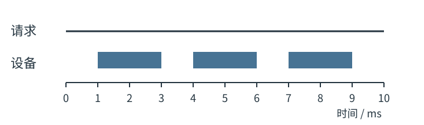
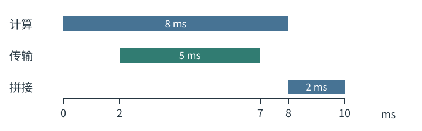

# 第 14 章　性能剖析与实验设计

第九章留下了一组看起来矛盾的结果。同一张 1024 × 1024 的 FP32 权重表，在 128 行输入上，改为每个工作项计算四行，逐次等待从 3926 µs 降到 2538 µs。只给一行，时间却从 727 µs 增到 825 µs。这两对数来自同一台 Radeon 780M 的记录。今天接手维护这段程序，如果只能改一处，你会先改哪里？单看一个“GPU 忙碌率”不能作答。我们先把时钟、工作量和结果对齐，再决定下次测量要问什么。[原始设备与计时记录](../../experiments/part03/projection_780m.json)

## 14.1　同一次调用的三种计时范围

从调用者角度，一次投影从数据准备好开始，到它可以使用结果结束。主机线程的时钟记下这个区间。设备队列还能记下指令开始和结束的时刻，两者之差只覆盖设备执行。还可以让设备连续处理一串调用，从主机提交第一项开始计时，到最后一项完成为止。把总时间除以项数可得摊销成本。若一次乘法耗 2 ms，而下一次提交所需的 0.3 ms 总能被它盖住，连续提交许多次后的均值可以接近 2 ms。单独调用时，这 0.3 ms 仍可能全部落在用户的等待里。

*图 14-1　横轴为教学时刻。三个 2 ms 内核共工作 6 ms。最后一次完成在 9 ms，要求调用者拿回结果则到 10 ms。三个数都能从同一条记录读出。*

图中的设备第一次在 1 ms 开工，到 3 ms 停下，接着在 4 至 6、7 至 9 ms 工作。客户在 0 ms 就已开始等待，10 ms 拿到结果。监控若只看首个内核到最后一个内核，会报 6/8 的忙碌比例；若用完整请求窗口做分母，则为 6/10。若三个内核各耗时减半而各段空档仍照旧，客户要等 7 ms。若只消除内核之间两段各 1 ms 的空档，则要等 8 ms。两种改法对应不同的时间区间。多条流同时工作时，还应把重叠的区间取并集。把内核用时直接相加，甚至可能比整次请求还长。

## 14.2　把“可能是内存”改成可以推翻的预测

对 128 行的例子，单精度权重本体占 4 MiB。按程序中各工作项请求的有效数据计，一行版相当于读 128 遍，四行版读 32 遍。逻辑载荷从 512 降到 128 MiB。如果每次这样的读取都穿过同一个受限接口，接口的可持续速率又相同，纯读取时间应近似缩到四分之一。实际时间只缩到 2538/3926 ≈ 0.65。至少有一个条件在真实机器上不成立。乘加量没变，部分和更多，缓存可以服务部分访问，工作组数也同时变了。这组计时无法把几个原因拆开。

先做只需改变输入的试验。固定行数与数值分布，轮流使用多张权重表，使工作集超过被检验那一级缓存，和反复使用一张表比较。两组实验都要在计时之外准备和驻留数据，避免把首次缺页、上传也算进来。若热权重时差距远小于轮换权重时的差距，重复利用确实值得继续追。再取实际设备支持的读字节、缓存命中、活跃线程和寄存器占用，分别列出每次完成同一份输出所对应的数值。即使读字节明显减少，也要看它是否原本落在关键路径。计数器可能分批采集或重放内核，带采集的时延还要与正常运行的时延相互校验。[Nsight Compute 性能分析指南](https://docs.nvidia.com/nsight-compute/ProfilingGuide/index.html)

## 14.3　从总耗时判断下一步查哪里

考虑另一份教学记录。请求用了 10 ms，其中四个小内核各执行 0.5 ms，其他 8 ms 分布在主机准备、等待依赖与返回结果上。把每个内核提速一倍，总耗时最多减少 1 ms。若合并提交能单独消掉 3 ms 的可见空档，即使内核代码一行没改，请求也会更早结束。验证时，把相同输入和相同输出送入两条路径，一次只改提交方式，保留各段起止时刻。若空档移到了下一阶段而用户时间没变，最初看见的空档还有别的工作在遮盖它。

这也解释为何“带宽占峰值的百分之几”要仔细读。用输入输出的有效字节数除以总时间，得到的是应用吞吐。用设备外存控制器计数除以同一区间的设备时间，才是对应接口的平均实际流量。非对齐、重复读、压缩、缓存以及与其他任务共享接口，都可能让这两种数值偏离。第三种数是厂商规格书给出的峰值，测量前还须说明设备、精度和接口范围。三个分子放在同一列，结论很容易反过来。

### 两项工作同时进行，该从哪一项省时间

一次投影有两个输入。一边在设备上计算查询，0 ms 开始，8 ms 就绪。另一边从主机传来检索到的特征，2 ms 开始，7 ms 到达。拼接要等两边齐全，再用 2 ms。先问自己，如果传输提速一倍，用户会早多少拿到结果？

*图 14-2　传输在第 7 ms 就已完成，计算要到第 8 ms 才结束。把拼接左端投影到横轴，读出的是两项就绪时间中较晚的一个。*

设两个输入就绪时刻为 A、B，拼接用时为 J，完成时刻就是 max(A, B) + J。原记录为 max(8, 7) + 2 = 10 ms。只把传输的 5 ms 减半，它在 4.5 ms 到，最后仍是 10 ms。把计算的 8 ms 减半，则是 max(4, 7) + 2 = 9 ms，省下 1 ms。若两处一起改，完成时刻变为 max(4, 4.5) + 2 = 6.5 ms。两次单独改动合计只省 1 ms，两处一起改却省 3.5 ms。这是依赖关系本身造成的，沿一次计时推出来的优先级会在第一次优化后改变。

实机上还有一步。集合通信和算子即使落在两条不同的流里，也可能共用显存带宽。把计算单独跑、传输单独跑、两者一起跑，各记一次相同边界下的区间。若一起跑时计算从 8 拉到 11 ms，上面的静态替换就解释不了全部变化。此时应比较内外存流量，再在应用中重测交付结果。采集短窗口可以保留时间线和输入形状，剩余迭代关闭详细跟踪，以便量出采集本身的代价。[PyTorch Profiler 的活动与采集窗口](https://docs.pytorch.org/tutorials/recipes/recipes/profiler_recipe.html)

## 14.4　用重复实验检验一个小收益

教学试验交替运行 A 和 B，每一轮先后次序对半交换，并保持输入不变。六轮中同轮的 A 减 B 时间依次为 4、1、3、−1、2、3 ms。平均收益为 2 ms，其中一轮变慢。若这六轮可视为独立、差值近似正态，样本标准差约 1.79 ms，标准误约 0.73 ms。用自由度 5 的双侧 95% t 系数 2.57，均值差的区间约为 0.12 至 3.88 ms。这只能描述这样的重复运行。六轮若全来自同一个长时间热状态，并不足以代表一周中冷启动、并发压力和频率变化的影响。

有两个常见误判值得当场排除。其一，挑 A 最慢的一轮和 B 最快的一轮，两者往往不是同一实验条件。其二，提前终止超时的任务，却只比较顺利跑完的那部分。要回答“客户是否更快拿到正确结果”，先把失败和超时也计入总请求数，随后再比较成功请求的时延。短输入、长输入和不同批量可以产生相反的结论。把各组样本数留在图旁，别人就能根据自己的负载重新加权。

## 14.5　写下可以复核的结论

现在回到章首的设备记录。128 行下单次等待少了 1.388 ms，单行多了 0.098 ms。假定只有这两种形状，每次调用等权、串行，无排队，用四行版替代一行版的平均收益随长批比例 p 变化，为 1.388p − 0.098(1 − p) ms。临界比例约 6.6%。这个数字只能用于这台机、这两种实现与这项计时。对真实服务，长短请求还会相互影响，模型外工作也会改变结果。从计时表推出一个带条件、可以被另一段请求轨迹推翻的选型判断，就比留下“新版更快”四个字多走了一步。[复算计时与教学对照](../../experiments/worked/edition_cases.py)

## 练习与解答

### 1. 两段重叠的执行时间

一次请求从 0 到 9 ms，两条设备流分别在 1 至 5、3 至 8 ms 工作。设备至少有一条流工作的时间占多少？可以把两次计时直接相加吗？

**解答。** 区间并集是 1 至 8 ms，共 7 ms，占 7/9。两条流的执行时间相加为 9 ms，其中 3 至 5 ms 重复计入。进一步区分计算与搬运时，还须分别说明观察的是哪个引擎。

### 2. 把固定开销带回预算

调用共 5 ms，其中 3 ms 的设备读数完全处在关键路径，其余时间固定。把这段读数缩短到四分之一，新的总时间和加速比是多少？

**解答。** 新时间为 2 + 3/4 = 2.75 ms，加速约 1.82 倍。若只能看到逻辑读数减少四倍，还须另测实际接口字节与执行时间，才能使用题设的 0.75 ms。

### 3. 一次形状变化足以翻转选择吗

按章末的两种实测形状，100 次调用中只有 4 次为 128 行。统一采用四行版会节省时间吗？

**解答。** 四次共省 5.552 ms，另 96 次共增加 9.408 ms，总计慢 3.856 ms。若分别为两种形状选择实现，还应从节省时间里扣除派发和切换开销。

[全书目录](../../README.md) · [上一章 · 从计算图到机器指令](ch13.md) · [下一章 · 训练语料、分词与数据配方](ch15.md)
