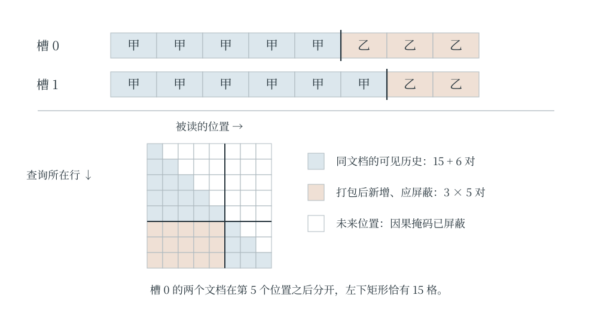
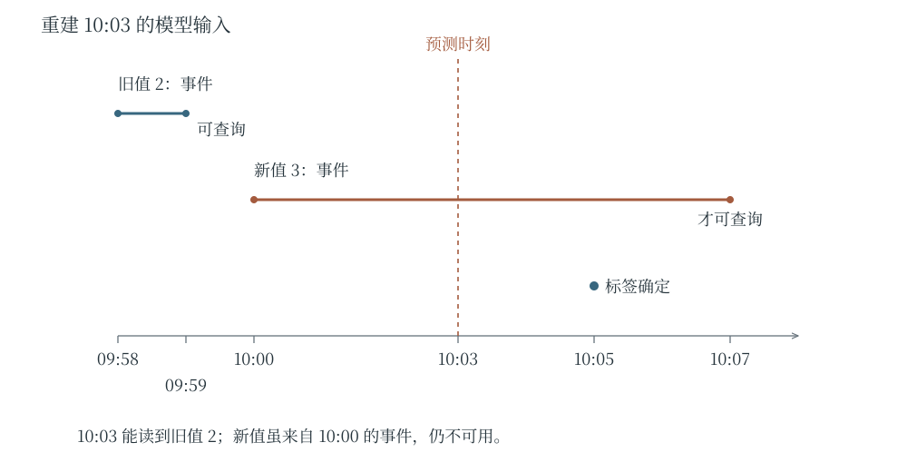
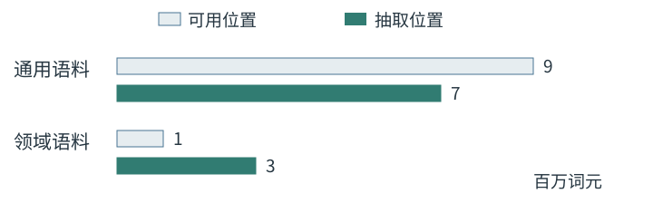

# 第 15 章　预训练语料与数据配比

假定要用两份语料训练一个行业模型。通用文档共有 900 万个词元，行业文档只有 100 万个。机器排期刚够处理 1,000 万个有效目标词元。把文件从头读一遍似乎正合适。可真正要解决的是行业任务，若要求训练中的行业词元占三成，这台机器将见到怎样的数据？回答这个问题，得先弄清楚统计表中的一个“词元”从哪儿来。

## 15.1　一段原文能提供几个监督信号

设分词器把两条短句切成 [甲，入，库] 和 [乙，出]。独立训练两条记录，若只预测句内的下一个词元，第一句有两个目标，第二句有一个，合计三个。把两句硬连，会多出一次由“库”预测“乙”。若任务确实是预测连续日志，这个连接可能有意义。若两份文档来自互不相关的用户，它就改变了学习目标。加上起止符也会改变有效计数。分词器的版本、文本规范化规则、文档边界及其对应的损失掩码需要同时进入数据清单。

先做最小审计。抽出三条原始记录，保存原文、去重组号、词元编号、训练可见的位置以及需要预测的目标。把这些数据展开成列，读者可以直接数出有损失的格子。再读训练日志中的计数器，问它算的是填充后位置、真实输入还是有效目标。即使三者都写成 tokens/s，得到的训练预算也不同。若两种分词器把同一句中文分别切出 6 个和 9 个位置，按相同词元预算采样，看到的原文字节也会变。可同时记录每个原始字节的负对数似然以及实际处理位置，分别评估建模效果与执行成本。

## 15.2　训练数据的组织与读取

假设下一次更新需要 1,024 个有效词元。要凑齐这一批，数据通常先经历文档识别、去重、过滤、划分训练与验证集合、分词、切段和打包。这些决定会进入模型学到的函数。假设收来 12 份文档，每份恰有 100 个参与损失的预测位置，其中 5 份是同一篇文章的镜像，另 7 份各不相同。对位置取平均损失时，镜像文章贡献 $`500/1200\approx41.7\%`$ 的权重；若每组保留一份，它贡献 $`100/800=12.5\%`$。两次的平均损失都按“有效词元”计算，优化器实际拟合的内容分布却发生了变化。是否保留重复、是否有意提高某个领域的采样比例，应根据目标任务的留出集质量来决定。

假如先把每份文档独立地以 80% 的概率放入训练集，其余放入验证集，这篇文章同时出现在两侧的概率是 $`1-0.8^5-0.2^5=67.2\%`$。随后再把长文切片并打乱，看上去训练与验证完全是不同的行，验证损失中却混入了“再次见到同一段文字”的成绩。可以先按内容哈希合并完全相同的文档，把能识别的近重复归入同一组，再以组为单位划分、切片和打包。保留一份带版本的数据清单，把组号、归属、分词器、采样和打包规则绑定在一起。后面恢复检查点时，“读到第 400 条”的游标只有在这份清单下才定位到同一条；换过清单就要显式迁移或重新定义训练起点。[去重对记忆与评估重叠的实证研究](https://aclanthology.org/2022.acl-long.577/)

设四段有效输入长度分别是 5、3、6、2，固定每槽 8 个位置。若各占一槽，设备处理 32 个位置，其中 16 个有用；按 $`5+3`$ 与 $`6+2`$ 打包成两槽，只需 16 个位置。这里按已定义的有效训练位置计数。在自回归模型中还应按标签掩码实数真正贡献损失的位置，文档首尾的预测目标和位置编码重置须服从训练定义。若要求各文档独立，后一段不能看到上一段的词元。以 5 和 3 为例，两段各自内部的因果可见配对数合计 $`5\times6/2+3\times4/2=21`$。若直接当成长 8 的单文档，有 36 个可见配对，额外的 15 个恰是后段三个位置看前段五个位置。减少填充时必须保持训练目标一致。掩码让数学任务正确，内核能否同时跳过那 15 对则取决于实现。



*图 15-1　上半数物理槽，下半数第一条打包序列的可见配对。两段在存储上相邻，并不自动取得彼此的历史。*

在数据副本间还要决定谁读哪一段。可以按全局样本或词元流分配区间，再把区间派给 rank 和读取进程。改变读取进程数时，“worker 2 的第 7 批”并不稳定；“版本 V 的洗牌序列中，已用于更新的逻辑位置到 2048”才是恢复时可重新划分的对象。若从一个样本切到一半，还要记录文档内偏移或足以重建它的打包状态。维护样本权重、类别配比和有效词元损失分母，与维护模型参数同样属于数学正确性。

同一段话只改一个词，整文件的哈希已经不同。怎样在几个 TB 文本里把它们找出来？先在分词或规范化后取连续短片段，每篇文档对应一个去重后的片段集合。设文档甲为 $`\{a,b,c,d,e\}`$，乙为 $`\{a,b,c,d,f\}`$，交集有 4 项，并集有 6 项，Jaccard 相似度为 $`2/3`$。对并集中六个元素做一次随机排列，分别记下甲乙各自排第一的元素。两份最小值相同，当且仅当六个元素中排第一的属于那四个共同元素，概率正好为 $`2/3`$。这就是 MinHash 可用少量签名估计集合重叠的原因。用 12 个独立排列，匹配个数的期望为 8，实际值可能上下波动。若用一次匹配就宣布重复，短小的模板、目录和免责声明都会惹麻烦。工程上可以先廉价地提名候选，再核查原有片段、长度、业务模板以及来源；提高候选相似度阈值通常会减少复核数量，也可能漏掉经过改写的材料。[近重复文档的集合相似度与抽样](https://doi.org/10.1109/SEQUEN.1997.666900)

评测时污染和训练时重复也要分开计。设验证集 100 题，10 题有已确认的近重复训练样本，模型答对其中 9 题，其余 90 题答对 54 题。原始准确率 63%，在无这类匹配的子集上为 60%，相差 3 个百分点。这个切分给出可复核的敏感性检查；两组题的难度也可能不同，不能把差值直接解释为记忆造成的因果收益。保留规范化程序版本、候选阈值、人工确认结果与文档族 ID，再制定整族划分策略，才能让数据分片变更后仍得到同一项验证任务。

### 训练时只能使用预测当时已经知道的特征

前面讨论的是固定文本。第二十一章的嵌入表也可能接收用户、商品等随时间变化的特征；训练样本需要还原预测当时实际可读的值。去重解决了内容重复，却不能保证这一点。设模型要在 10:03 判断用户下一步是否会点击。一个行为发生在 10:00，但经过采集和计算，到 10:07 才进入在线特征服务；用户是否点击的标签在 10:05 才确定。第二天生成训练表时，若按用户编号连接“最新特征”，模型可能读到 10:07 的信息。即使把行为的发生时间限制在 10:03 之前，仍会错误地认为这条特征当时已经可用。

这里至少有两种时间：事件发生时间 $`t_e`$，以及这份特征版本能被线上查询的时间 $`t_a`$。对预测时刻 $`t_p`$，要重现当时的输入，候选版本通常需同时满足

```math
t_e\le t_p,\qquad t_a\le t_p.
```

还应满足该特征的有效期，并从候选中按事先规定的版本顺序选值。标签可在预测之后产生，因为它是训练目标；标签产生后才出现的信息不能倒流进这一时刻的输入。源数据的写入时间只有在确实对应线上可用时间时，才适合拿来表示 $`t_a`$。



*图 15-2　发生在预测之前，与预测当时可读取，是两个条件。新特征引用的是更早的行为，但它直到预测之后才进入在线服务。*

例如旧版本在 09:58 记录“近一小时点击数为 2”，09:59 已可查询。新版本的事件时间为 10:00、值为 3，却到 10:07 才可用。10:03 的训练样本应取得 2。若新版本是第二天补写的纠错值，也要保留其真正的生效时间；覆盖原行后就无法重建旧输入。Feast 的时点连接文档区分了事件时间限制与创建时间限制，后者还取决于后端支持和时间字段语义，不能只因调用了历史检索 API 就默认没有泄漏。[时点连接及迟到数据的处理](https://github.com/feast-dev/feast/blob/master/docs/getting-started/concepts/point-in-time-joins.md)

这也解释了为何数据版本是评测协议的一部分。模型、代码和随机种子完全相同，回填一批特征后再生成验证集，结果也可能改变。实践中可选少量历史请求，保留当时实际送入模型的特征，与离线重建逐字段核对；再检查事件时间、可用时间、空值策略和转换版本。先确保训练和服务看到的是同一种输入，讨论算子提速或模型收益才有意义。[可运行的历史特征重建](../../experiments/part04/temporal_features.py)

数据清洗、打包与历史版本共同确定了这一批究竟在训练什么。接下来先固定这些条件，再看同一批数据能否按时送到设备。分布式作业中，同一个微批的多个参与者需要在集合操作处会合，因此输入慢的一端也可能让其他设备表现为通信等待。

## 15.3　同一训练预算下，两种语料各会读几遍

先按 7∶3 分配一千万个训练位置，再分别从两个语料库取样。在各库内部均匀取位置，预算花完后两库分别贡献 700 万和 300 万个有效位置。每个通用位置被使用的平均次数是 700/900 ≈ 0.78，每个领域位置则是 300/100 = 3。这是曝光次数的平均值。如果按轮次无放回遍历领域库，三轮可使每个位置恰好出现三次。如果每次独立地有放回抽取，少数位置会出现很多次，有的直到最后仍未被抽到。假设库里有 N 个不同位置，独立抽 m 次，一个指定位置从未被抽到的概率为 $`(1-1/N)^m`$。在 m = 3N 且 N 足够大时，该概率约为 5%。平均三次与每项三次给出的训练经历并不相同。



*图 15-3　横轴单位为百万词元。上方 9 与 7 表示有些通用位置可以一次都没出现；下方 1 与 3 说明必须重用领域材料或取得新数据。*

若按文档均匀采样，长文与短文每次各得一票，随后是否截断、如何选择片段会再次改变位置概率。举例说，库中只有长 100、长 900 的两篇文档。每次等概率选文档，再从文中均匀抽一个目标，短文里单个位置的抽中概率为 1/200，长文里是 1/1800。若按长度决定抽中文档的概率，两者都会变成 1/1000。无论采取哪种方法，都可以先按来源、长度和语言累计**实际进入损失**的计数，再和配方校对。改变打包顺序或从检查点恢复后，这份记录尤其有用。

## 15.4　用留出集辨别领域收益

把同源近重复文档归入同一组之后再划分训练和验证。假设在固定的通用、领域留出集上，以每个有效目标的平均负对数似然为单位，原配方分别得到 1.50、2.20，新配方得到 1.56、1.90。这是两种质量变化。若预期业务九成来自领域，两者按请求组成近似加权，在每类请求有效长度相同时，新配方的均值由 2.13 降至 1.866。若实际只有一成领域，均值却由 1.57 升至 1.594。真实请求长度不齐时，应先决定比较每词元还是每请求，再按相应单位加权。一个总分无法替读者选择业务分布。

这次收益可能来自多看领域数据，也可能来自数据清洗。做两轮配方对照时固定模型初始点、总有效位置、代码和评测版本，先只改抽样权重；另做一轮只改近重复过滤。若领域验证损失下降，再用独立来源的任务测准确率并看置信区间。领域语言变得更像原文，和能正确回答需要证据的问题，仍需分别检验。把失败按来源和重复次数还原到数据清单，就有机会判断下一笔预算更该用于买新资料、清洗旧资料还是继续训练。[训练数据去重研究](https://aclanthology.org/2022.acl-long.577/)

## 练习与解答

### 1. 打包省下了什么，又必须保留什么

把长 6 与长 2 的独立文档打在一起。若错误地让两段相互延续，新增多少个因果可见配对？

**解答。** 两段各自有 $`6\times7/2=21`$ 与 $`2\times3/2=3`$ 个可见对，共 24。长 8 单段共有 36 个，多 12 个，即后段两个位置各可读前段六个位置。物理打包可保留，注意力与标签边界须按任务恢复。

### 2. 抽文档与抽位置

两篇文档各有 40、160 个有效目标。每次先等概率抽一篇，再从中等概率抽一个目标，短文中单个位置被抽到的概率是长文的几倍？怎样实现全库均匀？

**解答。** 两者分别为 1/80、1/320，相差四倍。用 40/200 和 160/200 的概率先选文档，再均匀选位置，各位置便都是 1/200。

### 3. 哪种业务比例会支持新配方

沿用章中的两组留出损失，设领域部分占有效目标的比例为 q。新配方何时降低加权平均损失？

**解答。** 新减旧为 0.06(1 − q) − 0.30q。领域比例高于 1/6 时净变化为负。这个界线来自给定验证集，还要用独立任务确认业务效果。

[全书目录](../../README.md) · [上一章 · 算子性能剖析与对照实验](ch14.md) · [下一章 · 训练规模、收敛与计算预算](ch16.md)
