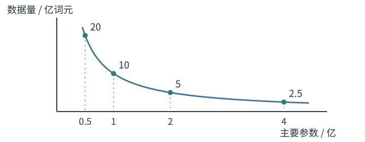
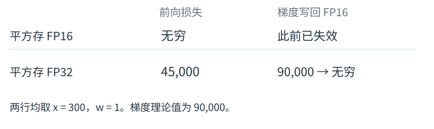

# 第 16 章　训练规模、收敛与计算预算

语料已经编好号。现在给你四张卡和两天排期，第一笔钱该花在增大模型、增加有效词元，还是先把训练跑稳？第一个可以查验的预算，是同一个训练目标究竟要做多少工作。最后要交付的则是一份达到约定质量的权重。两者之间隔着数据效率、数值精度和真实机器的运行时间。

## 16.1　用等量工作比较两个候选

沿用稠密 Transformer 的近似。若一份主要权重在每个词元位置做一次乘加，前向需大约两次浮点运算。反向还要计算输入梯度和权重梯度，粗略合计六次。取参与这些矩阵乘的参数量 N、实际送入主干的位置数 D，得到工作量 $`C\approx6ND`$。它省略随序列长度增长的注意力配对、重算、路由、优化器更新等项。例如拼接两段材料时，提示和填充都可以从监督目标里排除。提示仍须参与前向计算。填充若也进入了稠密内核，同样要计入 D。用于算 FLOP 的位置数和用于平均损失的目标数可以不同。

教学预算取 6 × 10¹⁷ FLOP。一亿参数处理十亿词元和两亿参数处理五亿词元都恰好达到这个近似预算。假设在所用设备上前一配置持续达到 20 TFLOP/s，后一配置达到 15 TFLOP/s，仅训练计算约需 8.33 小时和 11.11 小时；较大的矩阵也可能在另一个批量下反而跑得更快。算到这一步，还不知道哪个模型更好。要在若干较小预算处各记录留出损失，连同训练速度、达到目标的步数以及能否部署一起比较。若新模型需要两倍权重字节，今天几小时的训练收益还得同未来每次服务的成本一并核算。

*图 16-1　四个点都满足相同的参数量与数据量乘积。点位由教学预算计算，图上没有验证损失，无法单凭这条曲线选出最佳模型。*

研究中的缩放律是从多组实际训练拟合出来的。常见拟合将验证损失分为一个随模型变大的下降项、一个随数据增加的下降项和一项难以继续降低的底数。即使稠密工作量近似成立，两个下降项的斜率和系数也随数据、目标和训练规则变化。外推前可以刻意留出一个已经跑得起的预算点，用小运行预测它，再比较预测误差和候选之间的差距。若误差已经比两个候选的差距大，就先花钱缩小不确定性。[固定算力的模型与数据实验](https://arxiv.org/abs/2203.15556)

### 模型增加一倍，为什么损失可能升高

设留出损失可以分解成三项。一项在给定任务上难以继续降低，一项随参数增加而下降，一项随可用数据增加而下降。固定算力时，往一个方向走得更远，就得从另一项拿回预算。下面算一个可以写出极小值的例子。用 $`n,d`$ 表示参数量和数据量相对于基准的倍数，等算力条件下两者的乘积近似固定，损失写成 $`L=L_0+A n^{-\alpha}+B d^{-\beta}`$。假设预算限定 $`nd=16`$，只为手算取 $`A=B=1,\alpha=\beta=1/2`$。方案 $`(n,d)=(4,4)`$ 的两项各是 $`1/2`$，加起来为 1；改成 $`(8,2)`$ 则是 $`1/\sqrt8+1/\sqrt2\approx1.061`$。同样的训练计算，增大模型反倒可能给出更高的损失。沿预算曲线在 $`\log n`$ 上求导，内部极小点满足 $`\alpha A n^{-\alpha}=\beta B d^{-\beta}`$。两侧是两种投入的边际影响，真实拟合系数改变，平衡点也会移动。[Chinchilla 等算力训练研究](https://arxiv.org/abs/2203.15556)

上线后还要评估服务成本。若两种方案经业务评测均达到质量门槛，较小模型多训练一段共多用 1200 卡时，却能在相同到达回放和延迟承诺下每百万份有效回答省下 30 卡时，那么累计交付四千万份时，两种方案的总卡时打平。若产品只活跃到两千万份，省下的服务成本仅补回一半；若小模型依靠更长的思考或更多重试才能达标，每百万份的实际节省还得重测。模型选择从训练曲线开始，到可交付回答的数量才结束。

## 16.2　一次训练为什么突然坏了

设同一检查点的下一批包含一个远大于平时的特征。为了把问题缩到纸上，用单参数模型 y = wx，初值 w = 1，目标为 0，损失取 y²/2。正常样本 x = 2，预测为 2，损失为 2，梯度为 4。可疑样本 x = 300，预测为 300。在 FP32 下，平方是 90,000，损失为 45,000，梯度为 90,000。FP16 的最大有限数是 65,504。若程序把平方结果先写回 FP16，再乘 1/2，前向已出现无穷。若平方在 FP32 完成，损失可以是有限的，随后把梯度存回 FP16 仍会溢出。只记最后的 loss，区分不了这两处故障。

| 重放条件 | 原精度路径（平方写回 FP16） | 提高平方及梯度存储精度 |
|---|---|---|
| 正常批 x = 2 | 前向和梯度均为有限数 | 前向和梯度均为有限数 |
| 可疑批 x = 300 | 平方第一次变成无穷 | 损失 45,000，梯度 90,000 |

这张表是按给定运算顺序推得的教学结果。排查真实训练时，要固定检查点、样本编号、随机状态和实际采用的内核，记录首个非有限值的层、张量及数据类型。把两种批次与两种精度交叉重跑。若只有可疑批的低精度路径失败，便应去看特征尺度、归一化、损失缩放或累加精度。若连高精度也失败，则可以检查无效标签、除零和数据解码。提高某个算子的精度有时增加访存和转换，还有可能激活不同实现，复测时须分别记速度和稳定性。

*图 16-2　两条路径都从 x = 300、w = 1 开始。上面这一路的损失已经失效，下面这一路的损失还正确，问题要到把梯度转为 FP16 时才出现。*

处理过第一次异常，还要验证更新真的回到了预期轨迹。取学习率 0.00001，用 FP32 保存这次 90,000 的梯度，参数应从 1 变到 0.1。若日志只把无穷替成零再继续，权重仍是 1。下一批若恰好回到 x = 2，两条轨迹都能打印有限损失，却分别是 0.02 和 2。这也给出了一个便宜的回归检查。保留已知小批次、正确的一步权重和下一批损失，同时比较三样东西。只盯着报警消失，容易漏掉一次本应发生的更新。

动态损失缩放有助于保住很小的梯度；已经在前向溢出的平方，事后缩小梯度救不回来。发现非有限梯度而跳过更新时，再核对四个计数：优化器走了几步、学习率按什么计数、训练已消费哪些位置、重启后从哪里继续。若决定跳过坏样本，记录其标识和原因；若决定重播，就恢复到相应数据边界。否则机器虽然恢复产出数字，质量曲线已经悄悄换了起点。

## 16.3　用质量曲线选择每次更新的批量

假设两种配置每步处理 4,000 和 8,000 个有效词元，每步耗 0.8 秒和 1.2 秒。小批配置每秒 5,000 个，大批约 6,667 个。若达到同一留出损失分别需要 120 万和 180 万个有效词元，所需训练时间为 240 秒和 270 秒。扩大批量后每单位时间做了更多预测，一次参数更新之间却隔了更多样本。学习率与批量的配合也可能改变结果。因此同时保存按时间和按有效词元绘出的两条曲线，前一条决定交付日期，后一条帮助解释差异的来源。

要重复这次比较，可以从同一个已验证的检查点开始，用固定留出集按相同的有效词元间隔评测。把超出预算仍没达标的运行也列入结果；在不同随机种子上重复，分别报首次达标的时间和未达标次数。每步多打印几个指标会拖慢训练，故每个候选采用同一采集频率。下一章要进一步追问，算力预算里这一步的 0.8 秒，有多少花在等待数据。

## 练习与解答

### 1. 同一近似预算能容多少数据

若主要稠密参数为 2.5 亿，近似训练预算为 6 × 10¹⁷ FLOP，最多可安排多少词元？此估算还没有覆盖什么？

**解答。** 用预算除以六倍参数量，约为四亿词元。长上下文注意力、重算、填充、优化器和等待都可能增加实际时间，必须用目标形状实测。

### 2. 在哪个位置升精度

若可疑样本的平方在 FP32 计算并直接完成除二，损失保存为 FP16，梯度保存为 FP16，检查前向损失为有限数能排除训练出错吗？

**解答。** 45,000 在有限范围内，舍入后仍可为有限数，但梯度 90,000 超出范围。应检查未缩放的梯度、转换前后值和实际参数更新能否完成。

### 3. 一次更快的运行值不值得采用

大批配置保持每秒 6,667 个有效词元，要与小批的 240 秒打平，最多可用多少词元达到相同目标？

**解答。** 大约 160 万个。若实测需要 180 万个，按当前条件仍较慢；若更合适的学习率把需求降到 150 万，则约 225 秒即可达标。

[全书目录](../../README.md) · [上一章 · 预训练语料与数据配比](ch15.md) · [下一章 · 训练数据流水线与存储性能](ch17.md)
