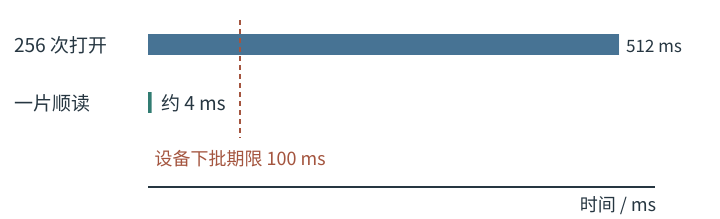

# 第 17 章　训练数据流水线与存储性能

上一章比较两种批量时，假定数据总能按时交到设备上。假设每一批有 2 MiB 的词元编号，设备每隔 100 毫秒就要用到下一批。平均每秒读 20 MiB，看起来普通磁盘都够用，训练时间线上为什么还会整段空白？存储系统可以先把后面一批读好，暂存在内存里。要和原来的训练逐步对照，交给优化器的批次、提交顺序、每个样本的随机变换和损失分母都要保持一致。做得好不好，先看这批数据是否赶上了它要参加的那一步。

## 17.1　算够了带宽，仍然来不及

取每批 256 条序列，每条 2,048 个词元编号，每个编号用四字节。忽略标签副本和元数据，载荷为 256 × 2,048 × 4 = 2 MiB。设备每 100 ms 消耗一批，平均只需 20 MiB/s。假定单个读取进程每次打开对象都要等 2 ms，流式读取带宽 1 GiB/s。若每条序列一个对象且串行读取，仅打开 256 个对象就要 512 ms，读内容还要约 1.95 ms。把这批打成一个连续分片，按同一模型，一次打开和顺读共约 3.95 ms。提高顺读峰值，对第一种布局的帮助有限。

*图 17-1　横向长度表示时间，按给定条件计算。512 ms 是打开对象的累计等待；即便数据载荷很小，也已越过下一批的 100 ms 期限。*

对象服务通常支持并发。若有八个独立请求槽，没有服务端限流，打开 256 个对象可分为 32 轮，理想固定等待缩至 64 ms。共享出口还要负责全部有效字节，过多请求也可能互相排队。实际应先量在途请求数、每次读的字节分布以及第一个字节抵达的时间，再决定增加工作进程还是改变文件布局。若目标是稳定供给，第 99 百分位的一批准备时间经常比均值更有说服力。[MLPerf Storage 的训练数据供给场景](https://mlcommons.org/benchmarks/storage/)

### 用一次本地读取分清固定开销与载荷

上面的 2 ms 是教学条件。可以在自己的电脑上读一批真实文件，看 256 次打开和一次打开差多少。随书程序把相同的 2 MiB 写成 256 个 8 KiB 小文件和一个连续文件。两条路径都在同一进程中生成完整字节串，哈希校验放在计时外。先各读一遍，再交替先后次序做十二轮。此次 Windows、Python 3.13.14 的记录中，小文件路径中位数为 69.822 ms，十二轮在 66.308 至 80.459 ms 之间；单文件中位数为 0.837 ms，范围为 0.691 至 1.146 ms。两边校验值相同。[读取程序](../../experiments/worked/storage_batch.py) · [逐轮原始计时](../../experiments/worked/storage_local.json)

这项本地热读同时包含文件打开、关闭、Python 对象创建、小块拼接和从系统缓存复制的成本。它既没有施加教学例中的 2 ms 延迟，也没有测磁盘冷读或远端对象服务。若要区分拼接和文件系统，可以先把同样的小块留在内存里只测拼接，再在同一打开的文件里对照 256 次读取和一次读取。若要比较云端存储，应使用同一对象键分布、并发深度和连接设置，把请求首字节及整个批次就绪的时刻记下来。这个区分很实用，本地实测足以看出“读的总量相同”不保证步时相同，却无法直接给出远端服务的吞吐。

## 17.2　分片粒度、洗牌与预取深度

连续分片为什么也会吃亏？假设每片装 64 条定长样本，存储端每次必须把整片交给读取端。本轮随机挑中的 64 条恰好各在不同片里，且主机缓存为空。为了得到 64 条有效样本，读端实际取回 4,096 条，读放大为 64 倍。若支持按索引的范围读取，载荷可以小很多，却可能要发起更多请求。折中做法是打乱分片顺序，在内存中的几个分片内混洗。此时来源相同或时间相邻的样本可能一起进入小批，因此还要比较训练效果和每批来源比例。

把主机预处理想成供给者，把设备想成消费者。若一批解压需要 70 ms，设备计算要 100 ms，稳定流水中两者能重叠，理想步时是较大的 100 ms。若某次数据读取额外停顿 250 ms，两个已准备的批次只能覆盖 200 ms，仍有约 50 ms 空等。长期供给若只有每秒八批，而设备每秒要十批，再深的队列也只会延后耗尽时刻。增大预取还占内存；若每批解码后占 48 MiB，16 个槽就可能保留 768 MiB。要把解压前、解压后、锁页和正在拷入设备的缓冲分别计数。

Derek Murray 等人设计的 tf.data 把“从几个文件交错取数”和“提前准备下一批”做成了可以分别调整的操作。前者让一个文件的等待时间可以拿来读另一个，后者在训练计算期间准备后续批次。用本节的数字试一遍，先固定样本清单和两个预取槽，只把串行打开改成并发打开。如果大多数批早已准备好，只有偶尔一次停顿耗光两个槽，再把队列扩到三个。比较两次运行中每千步有多少步真的等过数据、等了多久，以及多占了多少主存。这样就能知道缩短训练的是哪项改动。[tf.data 的输入流水线设计](https://research.google/pubs/tfdata-a-machine-learning-data-processing-framework/) [TensorFlow 的交错读取与预取](https://www.tensorflow.org/guide/data_performance)

## 17.3　训练读取和存储修复共用出口

检查点与语料通常都很大。容量成本和故障期间需要搬走的字节，可以给出相反的选择。设 4 GiB 数据按四个 1 GiB 数据片存放。三副本共占 12 GiB；使用四数据片加两校验片的 MDS 纠删码，占 6 GiB，任选四个健康片可恢复整组。丢掉一个数据片，直接从副本读取 1 GiB 即可。若采用朴素全片解码，需从四个健康片读 4 GiB，再生成丢失的一片。共享读取入口只有 2 GiB/s，仅恢复读取就分别至少要 0.5 和 2 秒，输出写回另计。局部修复码、缓存和专用链路会改变这笔账。

现在训练作业还想从同一入口持续读 1.5 GiB/s。若保证它不掉速，能留给修复的平均速率至多 0.5 GiB/s，纠删码这一轮读取下界就变成 8 秒。若优先修复，训练可能饿等。更麻烦的是把同一条带的几片放在同一机架，一次机架故障就可能超过可容忍的缺片数。存储规划需要同时画出字节的路径、放置的故障域和风险暴露时间。一个系统在健康状态下读得够快，并不能推出修复期间也够快。

## 17.4　读一份训练作业的输入记录

先在一个固定样本顺序上分别做冷读和热读。记录读取请求数、实际取回字节、解码后有效字节、批在 CPU 上就绪的时刻，以及设备实际开始消费的时刻。再只改变一个条件，如扩大分片或增加预取槽。若首字节等待下降但设备仍空闲，检查解压、分词或复制是否变成新的限制。有多个副本时，还应按训练步对齐各自最后一批就绪的时刻。只报告总存储带宽，会把一台主机晚 80 ms 造成的全组等待藏起来。下面把这个现象放回一次并行训练步。

## 17.5　输入流水线与训练等待

读取器还能悄悄改掉第十六章的实验条件。假定程序每交三批正文，就交一批维修问答。每批都装 128 个真实位置；正文每批有 128 个有效目标（跨块边界也有合法上文），问答每批只有 32 个回答目标，余下 96 个是提示。把四批的逐词损失加起来统一取平均，正文和回答的有效份额是 384 比 32，回答只占 7.7%。若训练计划写的是“回答梯度占四分之一”，可以分别累计两类的损失和与目标数，再把两类均值按 3∶1 合成。若计划写的是“实际见到的有效目标有四分之一来自回答”，则要改变采样量。在这个例子里，三批正文要配四批问答才够 384 比 128，提示也多算了。两种约定的卡时会不同。

并行读取时，给每个样本保存来源、样本号、有效目标数。把每个来源在各卡上的损失和、目标数分别相加，再按事先约定的分母归一化。快队列先到就多用一批，会让来源比例跟存储延迟一起漂移。做一次恢复演练就能查出来：在第 50 次更新后重启，将接下来几步的样本号、各来源的目标数和不中断运行逐步对照。为此要记录与已提交更新一致的采样游标、洗牌种子或随机状态，以及预取队列的重建位置。数据加载线程可能已把第 51、52 批读进内存；只记最后一次读盘的位置，重启后就会跳过已经预取、尚未训练的样本。

假定两份数据副本各花 8 ms 算一个微批，最后同步。本轮左边的数据在 0 ms 就就绪，右边在 6 ms 才解压完。如果忽略通信的服务时间，左边在 8 ms 已到达同步点，右边要到 14 ms 才到。左边记录到 6 ms 等待。扩容训练网络不会让右边更早读出这段数据。把每个样本的拉取、解码、进入就绪队列、GPU 开始计算和集合最晚到达的时刻放在同一条时间线上，才能看出等待属于哪一段。

读取器可以把后续批同时准备好。设消费者每 4 ms 取一批，下一段读取突然要 12 ms，期间无新批产生。若开始时队列里有两批，分别覆盖时刻 0 至 4 和 4 至 8，第三批到 12 才就绪，消费者只空等 4 ms。若开始有三批，足以盖住这一次停顿。但是，若读取长期平均每 6 ms 才交付一批，任意有限预取队列最终都会被每 4 ms 的消费者抽空。预取可以缓解短时读取波动，但需要额外的锁页缓冲、解压结果存储和更复杂的恢复游标。[PyTorch 的有状态数据加载器](https://github.com/pytorch/data/tree/main/torchdata/stateful_dataloader)

*图 17-2　左卡在集合通信中等待右卡。追踪两条依赖链可知，右卡迟到源于输入数据解码，而非集合通信本身。*

这里的“存储”也要落实到具体接口。文件系统按路径打开文件，对象存储按键取回对象或字节范围，块设备按地址读写数据块。相同的 2 MiB 样本在三者上会产生不同的请求。对照本地小文件实验，先数打开操作发生在哪里，再追有效载荷从哪个设备到达主机。后面看到吞吐数字，才知道它量的是元数据请求、大块传输，还是内存缓存。

缓存热分片可减轻共享存储压力，缓存键里应包括数据版本。同一路径下的文件换过分词器之后，旧词元就不能接着用。若有几百个读取进程同时去取冷分片，工作有多少能摊到不同存储节点上？DeepSeek 的 3FS 让客户端在打开文件时先向元数据服务查布局，再按布局找保存相应数据块的存储目标。这样，大块载荷可分散读取，大量小对象仍要支付打开和查询布局的开销。测这种系统时，分别让读取进程分散读样本、让训练任务集中写检查点，再把两者叠在同一时间段。哪一种先拖慢了批次就绪，决定是要改文件粒度还是调整共享带宽。[3FS 的元数据与数据读取路径](https://github.com/deepseek-ai/3FS/blob/main/docs/design_notes.md)

回到行业模型的排期。配方决定设备应看到哪些目标，模型规模决定为每个位置做多少计算，读取器则决定每秒真能交给模型几批。如果把热读的 0.837 ms 直接写成“训练每步省了 69 ms”，就会漏掉它原来可能完全藏在 100 ms 计算后面的事实。先按图 17-2 找出哪几步晚到了，再比较同样的有效词元要多少墙钟时间。等数据能稳定送入，单卡显存若只够放下部分训练状态，下一篇就要把一次更新拆给多台设备了。

## 练习与解答

### 1. 预取能遮住几次偶发迟到

设备每 80 ms 用掉一批，读端暂停 210 ms，队列里恰有两个完整批次且第一个刚开始消费。恢复后假定立即有下一批，至少空多少时间？

**解答。** 两批能支撑 160 ms，仍有 50 ms 空档。如果恢复后还要重新解压，应再计剩余准备时间。

### 2. 限流后的修复时间

共享入口为 3 GiB/s，训练至少要保住 2.2 GiB/s。按全片解码需要读 4 GiB 的条件，修复读取的下界是多少？

**解答。** 留给修复至多 0.8 GiB/s，读取下界为 5 秒。计算、写回和负载波动会增加实际恢复时间。

### 3. 冷缓存与命中分片

每个分片含 64 条等长样本，本批要取的 64 条分布于八个不同分片，其中六片已在主机缓存。仅统计后端实际返回的字节，读放大为多少？

**解答。** 后端返回两整片，相当于 128 条样本。对本批全部 64 条有效样本，读放大为 2。若统计的是主机内存读取，还应另算从六个已有分片取数据的开销。

### 4. 输入更快之后，能采用新读取器吗

一次教学回放固定 100 次更新，每步读三批正文和一批问答。改用并行读取后，耗时从 120 秒降到 105 秒。日志显示问答的有效目标数少了一半，重启后第一批的样本号也与无中断基线不同。你会怎样解释这 15 秒？

**解答。** 目前只能说新作业更早结束，两次更新所用的数据不同。先核对掩码、按来源计数和批次提交次序，再核对恢复时已消费与已预取的位置。重放同一批样本，确认有效目标和各步更新一致，再量设备实际等输入的空档、端到端时间以及同一预算的验证结果。若新配方本身更好，可以另做训练配方实验，把它的收益与读取优化分开。

[全书目录](../../README.md) · [上一章 · 训练规模、收敛与计算预算](ch16.md) · [下一章 · 集群互联与网络性能](ch18.md)
