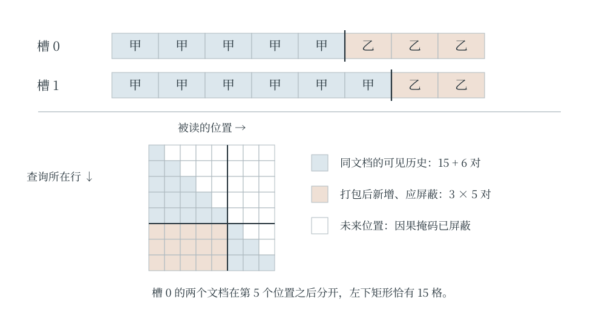
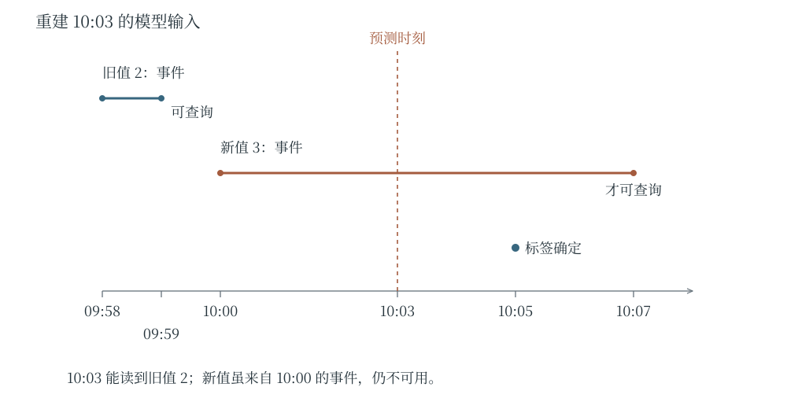
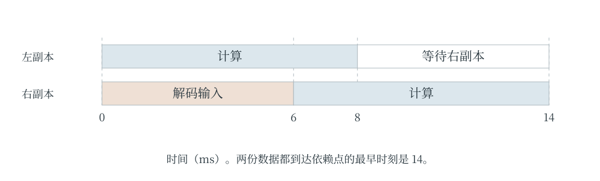
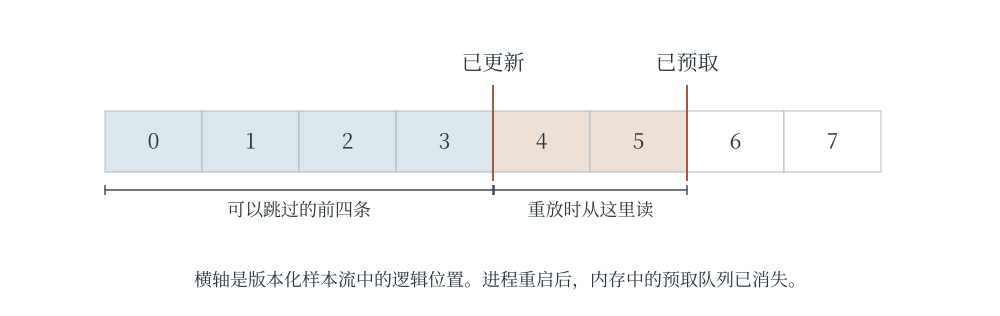
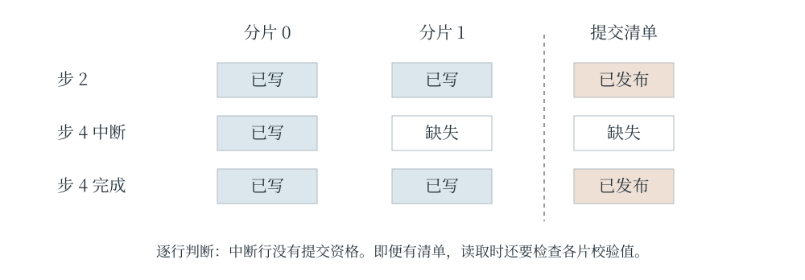
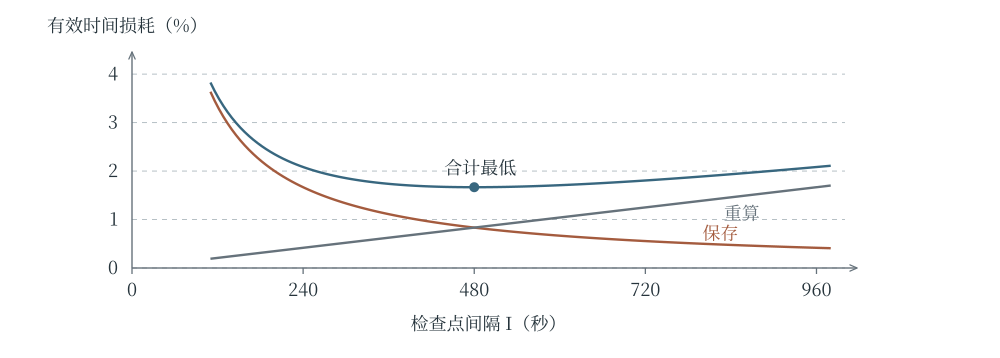
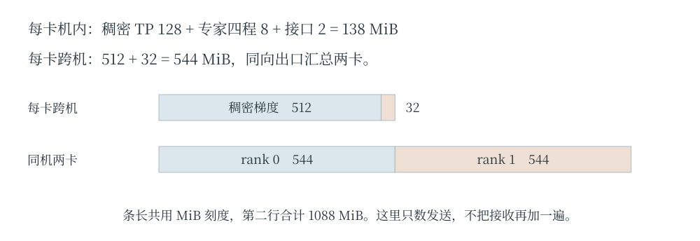

# 第 18 章　数据与容错：从最快一步到可靠地完成训练

上一章完成了一个分布式训练步：稠密层和专家层分别完成计算与通信，参数梯度汇总后更新权重。连续训练时，还必须处理数据读取和故障恢复。假设一台服务器在写检查点途中掉电，其他设备已经从输入队列读走下一批数据，重启后的参数、优化器状态和数据游标应当对应同一次完成的更新。否则，即便每个文件都能正常读取，恢复后的训练过程也可能重复或遗漏样本。

## 18.1　训练数据的组织与读取

第十六章那次更新需要 1024 个有效词元。要产生它们，数据通常先经历文档识别、去重、过滤、划分训练与验证集合、分词、切段和打包。这些决定会进入模型学到的函数。假设收来 12 份文档，每份恰有 100 个参与损失的预测位置，其中 5 份是同一篇文章的镜像，另 7 份各不相同。对位置取平均损失时，镜像文章贡献 $`500/1200\approx41.7\%`$ 的权重；若每组保留一份，它贡献 $`100/800=12.5\%`$。两次的平均损失都按“有效词元”计算，优化器实际拟合的内容分布却发生了变化。是否保留重复、是否有意提高某个领域的采样比例，应根据目标任务的留出集质量来决定。

假如先把每份文档独立地以 80% 的概率放入训练集，其余放入验证集，这篇文章同时出现在两侧的概率是 $`1-0.8^5-0.2^5=67.2\%`$。随后再把长文切片并打乱，看上去训练与验证完全是不同的行，验证损失中却混入了“再次见到同一段文字”的成绩。可以先按内容哈希合并完全相同的文档，把能识别的近重复归入同一组，再以组为单位划分、切片和打包。保留一份带版本的数据清单，把组号、归属、分词器、采样和打包规则绑定在一起。后面恢复检查点时，“读到第 400 条”的游标只有在这份清单下才定位到同一条；换过清单就要显式迁移或重新定义训练起点。[去重对记忆与评估重叠的实证研究](https://aclanthology.org/2022.acl-long.577/)

设四段有效输入长度分别是 5、3、6、2，固定每槽 8 个位置。若各占一槽，设备处理 32 个位置，其中 16 个有用；按 $`5+3`$ 与 $`6+2`$ 打包成两槽，只需 16 个位置。这里按已定义的有效训练位置计数。在自回归模型中还应按标签掩码实数真正贡献损失的位置，文档首尾的预测目标和位置编码重置须服从训练定义。若要求各文档独立，后一段不能看到上一段的词元。以 5 和 3 为例，两段各自内部的因果可见配对数合计 $`5\times6/2+3\times4/2=21`$。若直接当成长 8 的单文档，有 36 个可见配对，额外的 15 个恰是后段三个位置看前段五个位置。减少填充时必须保持训练目标一致。掩码让数学任务正确，内核能否同时跳过那 15 对则取决于实现。



*图 18-1　上半数物理槽，下半数第一条打包序列的可见配对。两段在存储上相邻，并不自动取得彼此的历史。*

在数据副本间还要决定谁读哪一段。可以按全局样本或词元流分配区间，再把区间派给 rank 和读取进程。改变读取进程数时，“worker 2 的第 7 批”并不稳定；“版本 V 的洗牌序列中，已用于更新的逻辑位置到 2048”才是恢复时可重新划分的对象。若从一个样本切到一半，还要记录文档内偏移或足以重建它的打包状态。维护样本权重、类别配比和有效词元损失分母，与维护模型参数同样属于数学正确性。

同一段话只改一个词，整文件的哈希已经不同。怎样在几个 TB 文本里把它们找出来？先在分词或规范化后取连续短片段，每篇文档对应一个去重后的片段集合。设文档甲为 $`\{a,b,c,d,e\}`$，乙为 $`\{a,b,c,d,f\}`$，交集有 4 项，并集有 6 项，Jaccard 相似度为 $`2/3`$。对并集中六个元素做一次随机排列，分别记下甲乙各自排第一的元素。两份最小值相同，当且仅当六个元素中排第一的属于那四个共同元素，概率正好为 $`2/3`$。这就是 MinHash 可用少量签名估计集合重叠的原因。用 12 个独立排列，匹配个数的期望为 8，实际值可能上下波动。若用一次匹配就宣布重复，短小的模板、目录和免责声明都会惹麻烦。工程上可以先廉价地提名候选，再核查原有片段、长度、业务模板以及来源；提高候选相似度阈值通常会减少复核数量，也可能漏掉经过改写的材料。[近重复文档的集合相似度与抽样](https://doi.org/10.1109/SEQUEN.1997.666900)

评测时污染和训练时重复也要分开计。设验证集 100 题，10 题有已确认的近重复训练样本，模型答对其中 9 题，其余 90 题答对 54 题。原始准确率 63%，在无这类匹配的子集上为 60%，相差 3 个百分点。这个切分给出可复核的敏感性检查；两组题的难度也可能不同，不能把差值直接解释为记忆造成的因果收益。保留规范化程序版本、候选阈值、人工确认结果与文档族 ID，再制定整族划分策略，才能让数据分片变更后仍得到同一项验证任务。

### 训练时只能使用预测当时已经知道的特征

前面讨论的是固定文本。第十七章的嵌入表也可能接收用户、商品等随时间变化的特征；训练样本需要还原预测当时实际可读的值。去重解决了内容重复，却不能保证这一点。设模型要在 10:03 判断用户下一步是否会点击。一个行为发生在 10:00，但经过采集和计算，到 10:07 才进入在线特征服务；用户是否点击的标签在 10:05 才确定。第二天生成训练表时，若按用户编号连接“最新特征”，模型可能读到 10:07 的信息。即使把行为的发生时间限制在 10:03 之前，仍会错误地认为这条特征当时已经可用。

这里至少有两种时间：事件发生时间 $`t_e`$，以及这份特征版本能被线上查询的时间 $`t_a`$。对预测时刻 $`t_p`$，要重现当时的输入，候选版本通常需同时满足

```math
t_e\le t_p,\qquad t_a\le t_p.
```

还应满足该特征的有效期，并从候选中按事先规定的版本顺序选值。标签可在预测之后产生，因为它是训练目标；标签产生后才出现的信息不能倒流进这一时刻的输入。源数据的写入时间只有在确实对应线上可用时间时，才适合拿来表示 $`t_a`$。



*图 18-2　发生在预测之前，与预测当时可读取，是两个条件。新特征引用的是更早的行为，但它直到预测之后才进入在线服务。*

例如旧版本在 09:58 记录“近一小时点击数为 2”，09:59 已可查询。新版本的事件时间为 10:00、值为 3，却到 10:07 才可用。10:03 的训练样本应取得 2。若新版本是第二天补写的纠错值，也要保留其真正的生效时间；覆盖原行后就无法重建旧输入。Feast 的时点连接文档区分了事件时间限制与创建时间限制，后者还取决于后端支持和时间字段语义，不能只因调用了历史检索 API 就默认没有泄漏。[时点连接及迟到数据的处理](https://github.com/feast-dev/feast/blob/master/docs/getting-started/concepts/point-in-time-joins.md)

这也解释了为何数据版本是评测协议的一部分。模型、代码和随机种子完全相同，回填一批特征后再生成验证集，结果也可能改变。实践中可选少量历史请求，保留当时实际送入模型的特征，与离线重建逐字段核对；再检查事件时间、可用时间、空值策略和转换版本。先确保训练和服务看到的是同一种输入，讨论算子提速或模型收益才有意义。[可运行的历史特征重建](../../experiments/part04/temporal_features.py)

数据清洗、打包与历史版本共同确定了这一批究竟在训练什么。接下来先固定这些条件，再看同一批数据能否按时送到设备。分布式作业中，同一个微批的多个参与者需要在集合操作处会合，因此输入慢的一端也可能让其他设备表现为通信等待。

## 18.2　输入流水线与训练等待

假定两份数据副本各花 8 ms 算一个微批，最后同步。本轮左边的数据在 0 ms 就就绪，右边在 6 ms 才解压完。如果忽略通信的服务时间，左边在 8 ms 已到达同步点，右边要到 14 ms 才到。左边记录到 6 ms 等待。扩容训练网络不会让右边更早读出这段数据。把每个样本的拉取、解码、进入就绪队列、GPU 开始计算和集合最晚到达的时刻放在同一条时间线上，才能看出等待属于哪一段。

读取器可以把后续批同时准备好。设消费者每 4 ms 取一批，下一段读取突然要 12 ms，期间无新批产生。若开始时队列里有两批，分别覆盖时刻 0 至 4 和 4 至 8，第三批到 12 才就绪，消费者只空等 4 ms。若开始有三批，足以盖住这一次停顿。但是，若读取长期平均每 6 ms 才交付一批，任意有限预取队列最终都会被每 4 ms 的消费者抽空。预取可以缓解短时读取波动，但需要额外的锁页缓冲、解压结果存储和更复杂的恢复游标。[PyTorch 的有状态数据加载器](https://github.com/pytorch/data/tree/main/torchdata/stateful_dataloader)



*图 18-3　左卡在集合通信中等待右卡。追踪两条依赖链可知，右卡迟到源于输入数据解码，而非集合通信本身。*

文件、对象与块存储讲的是不同接口。文件系统提供路径、目录和文件操作；对象存储按键取放对象并可支持范围读；块设备提供按地址读写的块。决定训练效果的是在该接口上实际产生多少次元数据查询、多少随机小读、多少顺序大读，以及多个读取者是否争同一个后端。若每份 4 KiB 小样本都要单独启动一次 1 ms 的串行远端操作，只计启动带宽上限便约 4.096 MB/s；一次拉取一个含 256 份的连续分片，光固定项便可摊给 1 MiB。但若洗牌只需要其中一个样本且无缓存，其余字节就成了读放大。常见折中是先打散分片顺序、在缓冲内再打散记录，并用索引跳到需要的区间。所得洗牌分布与全局随机置换不同，要检查相关样本是否仍密集相邻。

缓存热分片可减轻共享存储压力，首先要把版本带入缓存键。只看同一条路径名，下次训练可能读到旧分词结果。3FS 的设计把元数据服务和分布式数据存储分别组织，并讨论副本一致性、并行 I/O 与训练负载。用这类系统时，应分别测试多张卡分散读取样本、所有卡同时写检查点，以及两者重叠的情况，检查共享存储能否满足吞吐和完成时间的要求。[3FS 设计说明](https://github.com/deepseek-ai/3FS/blob/main/docs/design_notes.md)

## 18.3　检查点与训练状态

对第十七章的小例子，步 0 的 $`W_{00}=2`$，按总损失做一步步长 $`1/8`$ 的 SGD 后 $`W_{00}=1.90625`$。若保存了新权重，却把输入游标退回到词元 A、B 之前，重启便会重复使用两行。若保存了旧权重，游标却越过 A、B，这两行的梯度就永远没进参数。两份文件各自都可能校验通过；组合起来仍不是任何一个合法训练边界。

选最容易恢复的边界：所有微批都已贡献梯度，所有必要归约完成，优化器已更新，下一步还没改变这份逻辑状态。此时通常要保存主权重、优化器矩、更新计数、学习率及损失缩放等调度状态、路由器及专家参数，还要能恢复随机流、数据版本、洗牌和打包的已消费位置。如果低精度权重能从主权重按同一规则确定性生成，可以恢复时重建；若单独维护的低精度值、随机舍入状态或其他缓冲会影响后续结果，也要保留。若坚持在梯度累积的中间截断，就连已经累计的梯度、已完成的微批数和相应游标也变成检查点的一部分。



*图 18-4　位置从零计。小实验每步用两条样本，步 2 已消费位置 0 至 3。如果读取器已预取位置 4、5，恢复应能再次取得它们，不能跳到第六个位置之后。*

优化器历史为什么不可省？只取一个坐标演算。动量更新 $`v_t=0.5v_{t-1}+g_t`$，$`w_t=w_{t-1}-v_t/8`$。若断点处 $`v_t=2`$，下一次即使梯度恰为 0，动量项仍应变为 1，使权重减少 0.125。若丢失动量状态并从零重置，权重就不会变化。Adam 还有二阶矩和与步号有关的校正。同样的权重文件可以生成完全正常的推理输出，却不足以续接这次训练。

## 18.4　检查点的完整性与提交

用两份分片说明提交协议。先截取同一训练步的不变快照，给它一个独立代号 $`s`$。每个写者把分片写到本代独有的名字，记录张量逻辑坐标、长度和校验值。协调方只在所需分片全部确认达到约定的持久化层级、清单里的步号与布局都相容以后，才发布该代的清单。恢复程序只从已发布清单中选择版本，再逐片核验。写入新检查点时保留上一份完整检查点，这样即使新版本尚未写完就发生故障，仍有可用的恢复状态。



*图 18-5　只有清单提交后，这一代检查点才能用于恢复。文件名中的步号更大，或某个分片提前写完，都不足以确认整代可用。*

为了异步保存，可以把稳定快照先暂存到主机内存，再让后台写存储，与下一步前向重叠。这样主训练线程等的是冻结或复制完成的时刻，而恢复程序能选的是整份清单已持久发布的时刻。若后台仍引用会在下一步中改变的张量，第一个分片读到步 $`s`$，第二个读到步 $`s+1`$，即使它们最后都写成功也无法恢复。两代后台任务同时存在还需要足够的暂存空间，并防止晚完成的旧任务把最新指针倒写回去。对象存储环境中可用不可变对象和有适当条件写入语义的提交记录；文件系统中的原子改名、持久化与断电保证取决于具体协议和设备。PyTorch 分布式检查点提供分片保存、加载及规划能力，数据游标与应用随机状态仍要由训练作业纳入整体协议。[PyTorch Distributed Checkpoint](https://docs.pytorch.org/docs/stable/distributed.checkpoint.html)

算大作业的写量。稠密模型共 $`2^{29}`$ 个参数，若只需每参数主权重 4 字节加两个矩 8 字节，持久载荷为 6 GiB。再加两位 $`4096^2`$ 专家，各 192 MiB，合计 **6.375 GiB**，暂忽略很小的路由及元数据。这里按唯一逻辑参数计，只存一份 DP 副本。若只有 4 GiB/s 可用于写，从稳定快照到内容完全送出的理想下界为 1.59375 秒。若输入读取与写入共用一条 4 GiB/s 总服务预算，为保住输入预留 1 GiB/s，后台只余 3 GiB/s，写出至少 2.125 秒。即使训练线程很快返回，在这段时间内掉电仍可能丢失这代。按每 1 秒发起一次全量保存，后台会积压，直到内存被占满或训练被迫等待。

本篇附有一个写入磁盘的实验。它用同一投影、路由和两位专家，保留动量，按固定版本的样本序列连续训练六步。先发布步 2，写出步 4 的第一片后模拟中断，恢复器应选步 2；重新写完整的步 4 后，恢复器应选步 4。再改坏步 4 一片的一个字节，恢复器应回退到步 2。每次将余下训练跑到步 6，逐项对照权重、速度、路由、损失轨迹与已消费样本。实验检验进程级的部分写入和内容损坏，单目录本身不提供机房故障冗余。[检查点故障注入与续训实验](../../experiments/part04/recover_step.py)

在这次六步复算中，还能观察到一个容易误诊的现象。步 1 至 3 使用的样本编号依次是 $`(0,1),(2,3),(4,5)`$；进入新的洗牌轮次，步 4 又恰好取到 $`(4,5)`$，随后是 $`(0,2),(1,3)`$。两步相邻的样本号相同，却各属于不同轮次，是原定数据流的一部分。若只记“最后见过样本 5”，就分不清这是正常的重新采样还是回滚重放。故障后还要同时核对轮次、逻辑位置及版本。三种恢复路径到步 6 的 $`W_{00}`$ 都是约 1.5525918534，脚本还比对其余所有参数和速度。这里的目标函数沿用上一章的输出第一列之和，专用于核验状态轨迹。

### 数据副本与完整检查点

沿一次保存看文件系统内部。以 3FS 为例，客户端先向元数据服务查路径与文件布局，按布局找到数据块对应的一组存储目标。文件名、目录关系等元数据由事务型键值库保存；大块数据则走客户端与存储服务之间的路径，不必由元数据服务逐字转发。管理服务维护成员和配置，有主节点与故障接替机制。**重新选出管理主节点，解决的是谁可以更新集群配置；它无法证明某次训练保存已经齐全。** 这两个经常都被称作“恢复”的动作，检查的是不同的状态。

考虑由甲、乙、丙组成的一条副本链。设一次写入更新 4 MiB 数据，教学模型让客户端把有效载荷送到甲、甲转给乙、乙转给丙，每条边都完整传一次。客户端发送 4 MiB，三条链路的发送量合计是 12 MiB；三段可以按块流水，并不能据此断言耗时是单链路耗时的三倍。3FS 的块存储基于 CRAQ：稳定的已提交版本可以从不同合格副本读取，正在更新的版本则必须先判定是否可读。旧副本能否提供数据，还要由协议检查其版本和成员状态。节点失联后，重建与重新配置还会占用可服务正常读写的带宽。[3FS 的组件、客户端和复制协议](https://github.com/deepseek-ai/3FS/blob/main/docs/design_notes.md)

再回到训练：若这 4 MiB 是权重分片，三个副本均确认，却还缺包含动量的另一分片，仅有块级一致性仍无法恢复这一步。发布者应在所有分片及校验信息齐全后再提交本代清单；恢复程序只读取已提交的完整检查点。可用两个观察分清病因：**写一份已知大块也慢**，检查客户端、复制链和存储目标；**各分片均很快但整代迟迟不出现**，先检查最后一个完成的分片及清单提交所依赖的条件。增加存储副本可以改善特定故障下的可用性，并不会催促还没产出分片的训练进程。

### 恢复数据游标与样本顺序

存档时，主训练线程已经用完第 100 批，数据加载进程却可能已经把第 101、102 批放到预取队列，底层文件游标指向第 103 批。若把这个文件游标当作训练进度一起提交，恢复后会漏两批。应区分已读取、已入队、已参与提交更新三种位置。以提交的逻辑样本编号为准，恢复后重新构造从 101 开始的队列，最多重复做两批预处理，没有重复更新参数。

还有随机增强。假设第 101 批的一条图像可随机左右翻转，恢复后数据加载进程数改变，依赖“该进程启动以来的第几次随机调用”就可能产生另一张图。若需要复现该样本的增强，可以从训练轮次、样本稳定编号和增强次数导出种子，同一轮重复抽到同一样本时要区分出现次数。这样固定了增强选择；设备算子的非确定性、数据并行归约顺序和不同副本数仍可能让整次训练偏离逐位一致。

## 18.5　设备故障后的恢复

一次集合归约若缺一个贡献，其他三卡拥有的只是部分梯度。即使某个 rank 恰好已更新了自己的权重，也不能把剩余参与者随意凑成原步的完成状态。作业需要检测超时或显式错误，中止失效的通信组，重新确定成员与布局，从最近一次一致边界重放。对偶发慢卡，超时过短会把长尾误判为故障，反复重启反而更慢；过长则让设备确实故障时，其余设备空等。定位时应区分没有输入、运行在慢速模式、某个专家负载过重、链路重试以及存储超时。记录最后成功的步号、微批、集合序号和各 rank 的最后就绪点，通常比笼统报一个 NCCL 超时更快找到第一处停顿。

若恢复后设备数改变，例如只剩一整台双卡服务器，可以保留 TP=2，将 DP 从 2 改为 1。要保持原 1024 有效词元的更新，仍每微批 128 行，就把累积次数从 4 改为 8。用逻辑参数坐标把新旧分片映射起来，专家 0 仍恢复自己的优化器状态；重新分配的是设备上的工作，不改变专家身份。采样器从全局已消费位置给新副本分任务，损失按相同全局有效数归一化。设备数减少时模型若已放不下，要重新挑分片方案或等待替代卡。即使数据、公式和参数都能等价恢复，浮点归约顺序、随机数映射和非确定性 kernel 仍可能带来小差别，应按任务定义分别验证样本连续性、数值容差和目标质量。

损坏与掉卡还不一样。位翻转可能产生可解析却错误的浮点数，清单校验可以发现写后损坏，但不能发现快照前就已算错的梯度。训练过程中检查非有限值、异常损失、梯度范数与重复或缺失的样本，保留多个可恢复代次，才能给调查留下起点。单主机盘上的两个目录也不能抵抗主机整体消失；要让某一故障域损坏后仍可恢复，成功提交时要有足以跨越该故障域的持久副本或纠删编码片。

下面估算更换慢卡何时划算。健康卡群每步 1.0 s，现在有一张卡使同步步变为 1.3 s。若换掉它需要停机、读检查点和重建通信组共 30 s，并已确认回滚要重做 20 个健康步，则付出约 50 s。假设替换能完全恢复原速，后续每步省 0.3 s，至少还有 167 个这样的慢步才划算。一次持续十步的抖动只多花 3 s，立刻驱逐反而扩大损失。如果观察期内换卡还不能保证消除拥塞，预期收益要乘上真正解决根因的概率。可以先比较慢 rank 在不同数据分片、不同端口组合下的本地计算就绪与通信等待，确认慢的是设备、输入还是共享线路，再用完成期限决定是否切换。

## 18.6　有效训练进展与检查点开销

假设一次全作业故障的平均间隔为 $`M`$ 秒，每隔 $`I`$ 秒**有效计算**做一次同步保存，有效暂停 $`C`$ 秒。若故障稀少、在间隔内近似均匀、保存与恢复时间相对间隔较短，单位有效计算时间的一阶浪费率近似为

```math
w(I)\approx C/I+I/(2M).
```

两项可以从单位换算得到。每计算 $`I`$ 秒就暂停 $`C`$ 秒，保存开销占有效计算时间约 $`C/I`$。若故障在一个间隔中均匀出现，每次平均损失 $`I/2`$ 秒的计算；平均每 $`M`$ 秒发生一次，重算比例约为 $`I/(2M)`$。对两项之和求导得到 $`-C/I^2+1/(2M)`$；令导数为零，得到下面使用的间隔。保存越慢，适合的间隔越长；故障越频繁，适合的间隔越短。

第一项来自经常停下来写，第二项来自平均丢半个间隔。求导可得 $`I\approx\sqrt{2CM}`$。取 $`C=4`$ 秒、$`M=8`$ 小时，即 28800 秒，得到 480 秒。此时保存和重算两项各约 0.833%，合计约 1.67%，另有发现故障、重启与读取检查点的负担。这里的 $`C`$ 是同步停顿示例，不是上一节异步文件的理想传输时间。异步方案若在后台还有很长的未提交窗口，损失需按最近**已提交**代的年龄估算。共享故障、抢占、机架维修常不满足独立均匀到达，实际选择应当根据作业故障与恢复日志重算。



*图 18-6　横轴是有效计算秒数。最优点两项边际影响相抵；若目标是避免某次长时间回退，还需考察尾部与恢复耗时。*

前式把所有故障看成同一类。现在让四卡作业每 60 秒把一代完整分片复制到另一台主机的内存，每 600 秒再向独立存储提交一代。两份内存副本若在同一机架，单台主机故障后可以从另一台主机的内存副本恢复；机架断电时，两个副本会一同消失。**故障域**是可能因同一事件同时失效的一组资源。第十七章中，将通信限制在机架内可以节省跨架带宽；但如果两份状态也放在同一机架，一次机架故障就可能同时损失两个副本。Gemini 研究了怎样在主机内存放置副本，并把快照传输与训练通信安排在同一张网络上。[Gemini，SOSP 2023](https://www.amazon.science/publications/gemini-fast-failure-recovery-in-distributed-training-with-in-memory-checkpoints)

为了只看丢掉的计算，先假设快照即时提交、故障时刻均匀散布在保存间隔内，且 90% 的故障只有一台主机失效、10% 波及整架。平均回退为 $`0.9\times60/2+0.1\times600/2=57`$ 秒；仅使用持久层时为 300 秒。如果一次掉架，快照间隔依旧可能把作业推回近十分钟。还有一种容易漏掉的情形：保存副本的另一台主机仍在接收数据，失败时刻的“最近 60 秒”根本还没有提交。可直接在[双层检查点回放](../../experiments/part04/checkpoint_tiers.py)里改变内存提交延迟和故障范围，看恢复器实际选了哪一代。判断是否值得增加副本，需要记录检查点代号、各分片的位置、最后一次确认的时刻，以及故障影响了哪些主机。

可以把故障固定在第 665 秒，只改变内存副本的提交延迟。即时提交时，单机故障后能取回第 660 秒的那代，只重算 5 秒；整架失效则需从第 600 秒重算 65 秒。用 `--failure-at 665 --memory-delay 10` 再跑一次，第 660 秒开始的内存快照要到 670 秒才提交，此时两种故障都只能回到第 600 秒。记录里有备份开始时间还不够，少了提交时刻，单机故障的重算量就会被低估整整一分钟。

最后对整步做一次交付核算。原四卡作业每步 1024 个有效词元。若 60 秒墙钟内执行了 105 步，其中 5 步是故障后为追平先前进度而重放的重复工作，端到端只净推进 100 步，有效吞吐为 $`102400/60\approx1706.7`$ 词元/秒。只把设备执行过的所有词元都放进分子，会得到 1792，连失败重算都成了“性能提升”。若终点还有未持久化的进展，报告时应区分当前有效步号和已有可恢复保证的步号。

再汇总第十六、十七章中这个 1024 词元训练步的通信量。沿用两台各两卡、四次微批、梯度最后同步的安排；只数正文列出的稠密与专家矩阵有效载荷。每卡机内要发 $`128+8+2=138`$ MiB，依次来自稠密 TP、专家四程、边界梯度聚齐。每卡跨机要发 $`512+32=544`$ MiB，来自相同参数片和相同专家在两个副本间的归约。每台共用出口的两卡同方向要发 1088 MiB，在 40 GB/s 下，端口纯服务时间就约 28.52 ms。这个数字只给网络工作量的下界；与反向重叠后，真正暴露在步尾的等待还要按图 15-5 的就绪点求。检查点的 6.375 GiB 则按保存代数计算，不能计作每步的梯度通信。



*图 18-7　上半部分统计每张卡的发送量，下半部分显示同机两张卡共用跨机出口。两份副本的链路服务在全双工条件下可同时进行。*

```python
tokens = 2 * 4 * 128
local_mib, remote_mib = 128 + 8 + 2, 512 + 32
one_port_ms = (2 * remote_mib * 2**20) / 40e9 * 1000
assert (tokens, local_mib, round(one_port_ms, 2)) == (1024, 138, 28.52)
```

还有一种很难从单机测试重现的慢步。假设上面的 1088 MiB 梯度已经就绪，现将检查点写往远端存储，两个任务恰好共用同一方向的 40 GB/s 出口。如果从梯度发送开始到发完，写盘流持续占 8 GB/s，梯度只能分得 32 GB/s，纯服务时间从 28.52 ms 增至 35.65 ms。要让这个假设成立，写盘流至少要在这 35.65 ms 内送出约 285 MB；若只剩 2 MB 在排队，就无法持续干扰这么久。若存储另走独立网络，应转去核对两条路径是否仍共用 GPU 到主机的 PCIe 上行、拷贝引擎或锁页内存带宽。

一次对照可以固定模型、样本顺序、放置和检查点间隔，先记录未写盘的步，再比较写盘恰好与最后一个梯度桶重合的步，同时观察已提交的代号及其时间。若调整写盘时机后训练尾部缩短，却让提交推迟，还要把新增的未保护进展计入本节的故障模型。这样才能同时评估异步保存对训练速度的影响，以及故障后实际需要重做多少工作。

回顾这一训练步：矩阵乘产生的部分和经过通信与归约，专家层按路由处理词元，反向传播再计算各参数的梯度。完成更新后，主权重、优化器状态和数据进度需要共同保存，作业才能在故障后从一致的位置继续训练。 第十六章比较的是达到同一验证质量的时间；经历故障后，还要将重算、重新读入和恢复等待计入这段时间。重做的微批消耗了设备，却没有让已恢复的训练状态多前进一步。

本篇从一次矩阵乘的设备通信走到了训练恢复。下一篇转向在线推理：权重固定后，无须再同步梯度，但请求随时到达、长度各异，显存中的历史状态也随生成不断增长。资源调度的单位因此从训练步转成了请求及其执行轮次。

## 练习与解答

### 1. 打包省下了什么，又必须保留什么

把长 6 与长 2 的独立文档打在一起。若错误地让两段相互延续，新增多少个因果可见配对？

**解答。** 两段各自有 $`6\times7/2=21`$ 与 $`2\times3/2=3`$ 个可见对，共 24。长 8 单段共有 36 个，多 12 个，即后段两个位置各可读前段六个位置。物理打包可保留，注意力与标签边界须按任务恢复。

### 2. 第 4 步的检查点不完整

一个训练步消费两条样本。步 2 的两片与清单都正确，步 4 只有一片，预取器已读至位置 9。恢复时从哪个位置开始？到步 6 共需重跑多少步？

**解答。** 从已提交步 2 恢复，前四条位置 0 至 3 已用于更新，下一条是位置 4。到步 6 尚需执行步 3、4、5、6，共四次更新。不能用单片或预取位置跳过其中任何一步。

### 3. 把保存间隔拉到十六分钟

沿用 $`C=4`$ 秒、$`M=28800`$ 秒，取 $`I=960`$ 秒。保存和丢失计算两项分别多少，合计比 480 秒时怎样？

**解答。** $`4/960\approx0.417\%`$，$`960/57600\approx1.667\%`$，合计约 2.083%。480 秒时约 1.667%。少保存虽然降低第一项，但第二项的增加超出了收益。

### 4. 新旧并行度与损失尺度

旧作业两个数据副本、四次累积、每副本每微批 128 个有效词元。恢复到一个副本、八次累积。假定每微批计算损失总和；要保留每词元平均目标，最后按什么归一化？还须记录什么才不会重复数据？

**解答。** 两种布局都是 1024 个有效词元，把全步损失和或相应总梯度除以 1024。若实际有填充，使用真实标签有效数。按持久化的全局消费位置、数据与分词版本、洗牌顺序及未完打包状态继续，重新分配给新副本；不能直接沿用某个已消失 rank 的本地预取序号。

本章关于排队、恢复间隔和训练开销的计算可独立复算。[第四篇复算程序](../../experiments/part04/verify.py)

[全书目录](../../README.md) · [上一章 · 混合专家：条件计算与系统协同设计](ch17.md) · [下一章 · 推理引擎：变长请求怎样共享设备](ch19.md)
