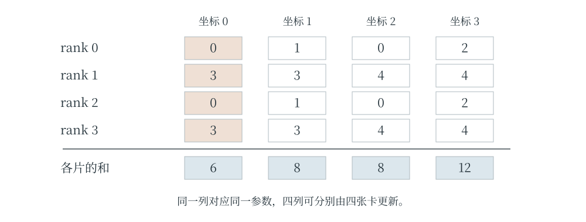
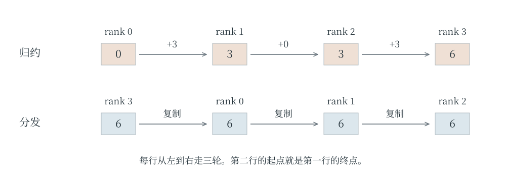
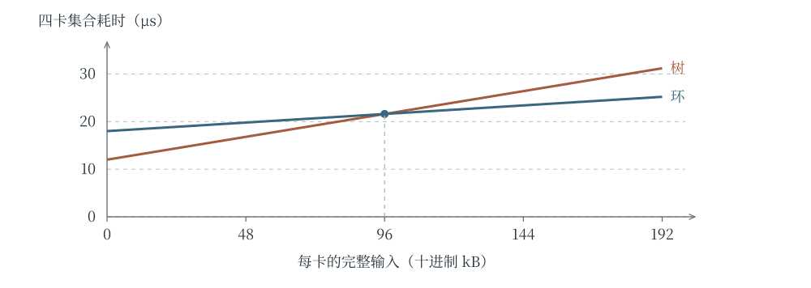
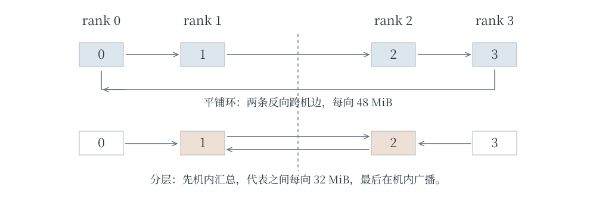
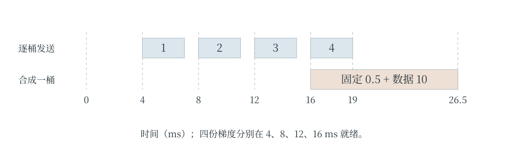
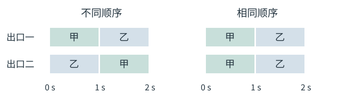
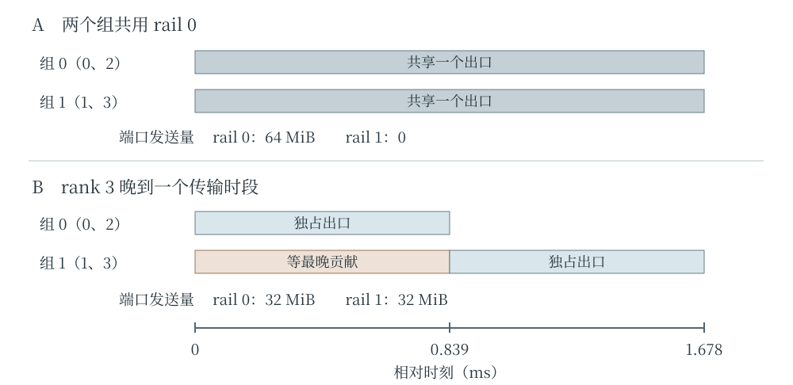
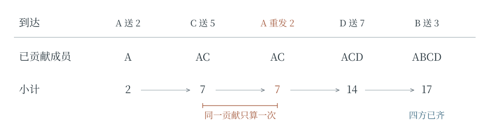

# 第 19 章　集合通信算法与梯度同步

上一章分析了一条消息怎样跨设备到达。接下来要确定谁应当发送哪些数，以及接收以后还要做什么运算。先把矩阵缩回第三篇的手算大小。设甲、乙各保存完整的 $`W`$，分别处理两行输入。甲处理词元 A 的 $`(1,2)`$，乙处理词元 B 的 $`(3,4)`$。两张卡都能在本地完成前向并计算损失，但它们得到的梯度不同。要让共享的 $`W`$ 经过更新后保持一致，需要先汇总梯度。

## 19.1　从局部梯度到全局梯度

要优化这一步，有两个量必须分开算。一个是为得到正确总梯度，每条必经链路到底要传多少字节。另一个是这些字节有多少赶在反向计算结束前传完。前者决定通信时间能有多短，后者决定优化器实际还要等多久。先把两张卡上的梯度加对，再把同一操作放大到四张卡，就能比较不同传法是否省在了训练步真正要等的地方。

第三篇用两列偏置 $`(-6,1)`$，取 ReLU 后所有输出之和作教学损失。A 的输出是 $`(0,6)`$，只有第二个输出让梯度通过，掩后梯度为 $`(0,1)`$。于是它对四个权重的梯度是 $`(1,2)`$ 的转置与 $`(0,1)`$ 的外积，按行铺平得到 $`(0,1,0,2)`$。B 的输出是 $`(4,10)`$，掩后梯度为 $`(1,1)`$，四个权重的梯度为 $`(3,3,4,4)`$。逐坐标相加得 $`(3,4,4,6)`$，正好是第十二章一张卡一次算两行的结果。

这项操作分为两步。先在**相同参数坐标**上求和，再把和发送给**所有将独立更新同一份权重**的参与者。这就叫 AllReduce。参与者在通信组里有一个序号 rank；即使两组都用编号 0，也未必是同一张物理卡。求和以后是否除以词元数取决于目标函数。若想训练全局每词元平均损失，两行都有效时再除以 2。若甲有 1 个有效词元、乙有 3 个，局部均值分别为 2 与 6，全局均值是 $`(2+18)/4=5`$，把两个局部均值等权平均只得到 4。掩码、梯度累积和通信框架自带的平均都可能改变这个分母。

将参与者扩展到四个，仍使用上述两种输入。rank 0、2 看 A，rank 1、3 看 B。因此共有四个词元，最终和为 $`(6,8,8,12)`$。把四个坐标编号 0 至 3。如果每张卡接下来只更新自己的权重分片，就没有必要让所有卡都接收完整梯度。**ReduceScatter** 将各卡的同坐标数值归约，再把不同结果片分配给不同的卡。**AllGather** 倒过来做分发，将各卡独有的片段汇集成完整结果并发送给每张卡，它无需相加。如果每卡一开始就有给各个目的地的不同记录，要按目的地重排并互换，便是 **All-to-All**。第二十一章送词元去不同专家时会真正用到它。



*图 19-1　每列对应一个参数坐标。各卡在相同坐标上求和，再将四个结果分别分配给四张卡。如果各卡再将自己得到的结果发送给其余三卡，所有卡都能得到完整的梯度。*

## 19.2　环形集合通信

上一节确定了归约和分发的结果，但没有规定参与者之间怎样安排传输。环形算法把数据切成若干块，让每张卡每轮处理一块，从而不必在每一轮都发送完整梯度表。下面先用四个坐标检查这个过程。

给四个 rank 连一条单向逻辑环 $`0\to1\to2\to3\to0`$，允许一张卡同时从前驱收、向后继发。每一轮每卡只发一个坐标块。第一轮 rank $`r`$ 发送块 $`r`$；收到前驱块后先加上自己的同坐标贡献，下一轮转发这个小计。令所有传输读取本轮开始时的值，添加在收到的一端发生。

| 归约轮次 | 0 发的块 | 1 发的块 | 2 发的块 | 3 发的块 | 块 0 在接收处的数值 |
|---|---:|---:|---:|---:|---|
| 第 1 轮 | 0 | 1 | 2 | 3 | rank 1 得到 $`0+3=3`$ |
| 第 2 轮 | 3 | 0 | 1 | 2 | rank 2 得到 $`3+0=3`$ |
| 第 3 轮 | 2 | 3 | 0 | 1 | rank 3 得到 $`3+3=6`$ |

第三轮结束后，rank 0 持有完整块 1，rank 1 持有块 2，rank 2 持有块 3，rank 3 持有块 0。这个旋转归属仅为使轮次好读；需要按 rank 顺序返回的标准接口可在内部改变块编号或起始发送位置。随后再走三轮，收到的块已经是最终结果，只需存入对应位置并转发。以块 0 为例，它从 rank 3 经 0、1 到 2，四卡终于各有一个 6。把这六轮中的“收到就加”误写到后半程，结果会随传输次数越变越大。



*图 19-2　每个数值下方标出了持有该块的 rank。前三轮收到数据后要累加，后三轮只需转发最终结果。另外三个块也同时从不同起点沿环传输。*

设每卡完整输入 $`n`$ 字节、参与数 $`p`$，块等大且整除。每半程有 $`p-1`$ 轮，每轮每卡发 $`n/p`$。完整环式 AllReduce 中，**每卡发送** $`2(p-1)n/p`$，每卡还会收到同样多。全组发送是前者乘 $`p`$；物理网络中跨多跳的链路字节则要按路由重新数。以 $`p=4,n=32`$ MiB 为例，每轮每卡发 8 MiB，六轮发 48 MiB，收 48 MiB，全组共发送 192 MiB。理想全双工下发与收可以同时发生，不能直接把两者相加再除以单向带宽来求关键路径时间。

沿用上一章的有效带宽 $`B=40`$ GB/s 和每轮 $`\alpha=3`$ 微秒，不另计归约核、流水填充或拥塞。每卡在同一链路上的六次发送串行，估算为

```math
T_{\rm ring}=2(p-1)\alpha+
\frac{2(p-1)n}{pB}.
```

对 32 MiB 得 $`18+1258.29\approx1276.29`$ 微秒。增加卡数时，每卡的字节数逐渐接近两倍 $`n`$，轮数却一直增长。这正是小块梯度常在启动上吃亏的原因。

下面的程序演示一个数据块在环上的归约过程。将 `chunk` 改为 2，可以自行验证各参与者的顺序与章末第一题的解答。

```python
rows = [[0, 1, 0, 2], [3, 3, 4, 4]] * 2
chunk = 0
owner, total = chunk, rows[chunk][chunk]
for _ in range(3):
    owner = (owner + 1) % 4
    total += rows[owner][chunk]
assert owner == (chunk - 1) % len(rows)
assert total == sum(row[chunk] for row in rows)
print(f"chunk {chunk}: owner={owner}, sum={total}")
```

手算时，另外三个块很容易被忽略。随书程序让 2 至 8 个参与者各输入一组有正有负的整数，每人持有的数组都切成等大的块。每种人数试 12 组，将归约和分发后的每一项与直接逐列求和对照，84 组均吻合。这里选小整数，结果出现偏差时便可直接追查块号和传递顺序。消息发出后何时才可覆盖原缓冲，还得看通信接口。[复算环形归约的各轮传输](../../experiments/part04/verify.py)

### 环形通信中发送缓冲区的复用

每轮环形通信都需要发送当前数据块，并接收前驱发送的数据块。如果所有进程都先调用阻塞发送，再提交接收请求，短消息可能恰好被通信库缓存，程序看起来可以运行；长消息则可能因各进程都在等待对方准备接收而停住。问题在于程序依赖了通信库不保证提供的缓冲空间。

用 MPI 的点对点接口表示一轮，可以先给接收区发出非阻塞接收，再从另一块互不重叠的发送区发出非阻塞发送，最后等待这两个请求都完成。接收完成，才可读新数据；本地发送完成，才可覆盖原来的发送区。后一事件并不证明邻居的归约已经算完，也不能代替下一轮的块号、消息标签与参与组匹配。需要这两件事一起完成的简单交换也可用 Sendrecv 表达。这个小例子讨论的是 MPI 接口的语义，集合通信库不必内部调用 MPI。[MPI 的非阻塞通信语义](https://www.mpi-forum.org/docs/mpi-4.1/mpi41-report/node71.htm)

假设一轮实际搬运 4 ms，另有 3 ms 不访问这两份缓冲的计算。若后台传输可以推进且两者用不同资源，理想关键路径是 4 ms；若通信必须等进程重新进入通信库才推进，可能仍接近 7 ms。两种实现的调用都能很快返回。验证重叠时，应比较计算单独执行、传输单独执行和两者同时执行的总时间，并确认计时包含通信实际完成的时间。非阻塞调用允许程序安排重叠，但不能保证通信具有独立的后台进展能力。

## 19.3　环形与树形归约的开销

环形方案可以分摊大消息的传输，但要经过多轮。每一轮都有启动开销，因此消息很小时，轮数较少的算法可能更快。比较时需要同时保留消息大小和启动次数。

一个朴素的二项树方案先让 1 把全表送给 0、3 送给 2，两对同时相加；第二轮让 2 送给 0。再反向广播两轮。四轮中关键路径每轮走整张 $`n`$，理想模型是 $`4\alpha+4n/B`$。环要六次启动，但只在关键路径搬 $`1.5n`$。两式相等时 $`2\alpha=2.5n/B`$，代入上面的参数，交点是 **96000 字节**。4 KiB 时树约 12.41 微秒，环约 18.15 微秒；32 MiB 时这棵树约 3.37 毫秒，环约 1.28 毫秒。这里专门选了不分段的整表树来揭示权衡。分段树、双树或递归减半再倍增都会改变公式。



*图 19-3　纵截距来自启动，斜率来自同一带宽下的有效载荷。两条线交叉的条件依赖四个 rank、全双工链路和这里选用的算法。*

再把物理位置画回去。0、1 在服务器甲，2、3 在乙；每台只有一个跨机出口。若平铺成上一节的环，边 $`1\to2`$ 和 $`3\to0`$ 各跨一次机，六轮下来**每个方向**通过 $`1.5n`$。若每机先把两卡的 $`n`$ 字节局部求和交给一个代表，两位代表全双工交换局部结果并各自相加，再在各自机器内广播，那么跨机每方向只传 $`n`$。$`n=32`$ MiB 时，昂贵的跨机边每向少过 16 MiB，代价是本地多了汇总与分发过程，代表还可能成为热点。若有两张真正独立的网卡，更好的分工可能是本地先 ReduceScatter，两个代表并行处理不同片，再 AllGather。若两个端口背后共用同一条上行，这种并行并未增加出口容量。



*图 19-4　只数穿过中间虚线的字节。切线两边仍有本地交换和归约，必须单独加入端到端时间。*

把长消息切成更多小段，可以让设备接到一段就开始归约、上一段正在转发时继续接下一段。通信库还可使用多个通道，把工作分给不同连接与计算资源。段太小，描述符、同步和头部的比例就变高；通道太多，通信使用的 SM、缓存与内存带宽可能挤占矩阵乘。应用看到的是一个 AllReduce，底层可能随消息大小、拓扑和机器变成不同的协议和算法。[NCCL 的集合操作约定](https://docs.nvidia.com/deeplearning/nccl/user-guide/docs/usage/collectives.html)

取哪个算法还会改变求和顺序。例如用逐次存回的 FP32 加法，考察三张卡在同一坐标上的贡献 $`2^{24},1,-2^{24}`$。先加前两项，$`2^{24}+1`$ 恰在相邻 FP32 格点中间，最近取偶舍回 $`2^{24}`$，再减去原值便为零。先把一正一负的两大项合并，再加 1，则得 1。两种通信路径都可能准确传输各自的数据。改变 rank 映射、分片大小或归约树之后，应先检查该精度和操作顺序允许的误差，别一看到末位不同就断定链路损坏。反过来，若对齐的是不同参数坐标，再宽的累加器也无济于事。

### 跨机架通信的带宽下界

设两机架各有四张卡，八张卡各持一份 64 MiB 的独立梯度，要得出逐元素和。先将连接两个机架的全部链路作为统计边界。在不压缩数值、没有先验相关性的通用情形下，左侧至少要把一份独立的 64 MiB 贡献送到右侧，右侧也要反向送一份，才能让双方还原完整的和。若两向各有 20 GB/s、可全双工重叠，单就这一切口的载荷下界约为 3.36 ms。两边的本地归约与分发还没计入。

可以让每架先把四份加成一份，再让两架交换结果，最后在架内分发。也可先在架内做 reduce-scatter，把 64 MiB 分给四对代表，各对只跨架交换 16 MiB，再在架内收齐。两种方法跨切口的必要字节一样，后者能否更快取决于出口是否真正独立。若四条发送队列共享同一条 20 GB/s 上行，四路平分后总时间仍受 3.36 ms 约束。理解集合库为何按拓扑选算法，可以先找出这样的物理切口，再看实现有没有反复穿越它。

## 19.4　梯度分桶与通信重叠

即便选定了通信算法，一次训练步的时间也不一定等于计算时间与通信时间简单相加。反向传播逐层产生梯度，较早就绪的部分可以与后续计算重叠；分桶既影响启动次数，也决定通信最早何时开始。

反向是从网络顶端一层一层往回算的，最后一层的权重梯度可以在第一层的梯度尚未存在时就传走。设四份大小相同的梯度分别在时刻 4、8、12、16 ms 就绪，独立通信引擎一次服务一份，每份需 3 ms，其中启动占 0.5 ms。逐份启动则依次在 7、11、15、19 ms 完成，计算在 16 ms 结束，优化器还须等 3 ms。若先等四份齐，再打一个大桶，启动只付一次，数据占 $`4\times2.5`$ ms，却要到 $`16+10.5=26.5`$ ms 才完成。一次启动确实少花了时间，训练步反而变长了。



*图 19-5　第一个桶在 4 ms 才有内容，最后一个桶在 16 ms 才可能发出。优化器等的是最晚完成的必要数据，不是分段时间的总和。*

若通信和矩阵乘争用显存，每桶通信开始后可能把下一层计算拖慢。正确的复算规则是把下一桶的**实际就绪时刻**与通信引擎上一桶的**实际释放时刻**取较大值，再加本桶服务时间。不能把两份各自单跑的时间线静态叠放就宣布全部隐藏。另一个等待来自参与者到达不齐。某 rank 还在解码输入或等待前面的专家，其余 rank 即使已进入集合调用，也未必能完成依赖该贡献的那几轮。只看“通信总时间”会把之前的慢计算错归给网络。

调用的先后本身也是协议的一部分。在同一组中，若两张卡先归约 W、后归约 b，另两卡反过来，可能因形状不同而报错或挂起。两表的形状若恰好相同，还可能算出数值正常、参数坐标全错的和。设计梯度桶时要固定坐标映射和启动次序，并按库的完成约定让更新流等待。

Shen Li 等人介绍 PyTorch 的分布式数据并行（DDP）时，把这件事落实到了自动微分引擎。某个参数的梯度一旦就绪，事先注册的回调就通知归约器。桶里的梯度都到齐、轮到该桶时，即可启动归约，其余层继续反向。把图 19-5 中 4 ms 和 16 ms 才就绪的两层放在同一个桶里，早到者就得白等 12 ms。即使二者合计的字节刚好是通信库最擅长的大小，也可能失去重叠机会。调桶大小之前先量各层就绪次序，然后比较最后一个必要归约的完成时刻，这样才能看出调整后的收益。[PyTorch DDP 的梯度通知、分桶与重叠机制](https://arxiv.org/abs/2006.15704)

可以结合图 19-2 阅读通信库代码。昇腾 HCCL 将拓扑信息、算法选择和算法执行分开：源码中的 `topo_info` 组织拓扑与 rank 映射，`selector` 为给定操作选择算法，`algorithm` 包含执行器和拓扑匹配。因此，结果块由哪个 rank 持有、数据在物理网络中经过哪个出口，可以在不同部分分别查找。同一种集合通信操作也可以使用不同的数据路径。使用 NVSHMEM 单边读写时，发送方可以直接访问远端对称内存，但程序仍需明确数据何时对接收方可见，以及缓冲区何时可以复用。上一章图 18-4 介绍了这两个条件。[HCCL 源码结构](https://github.com/hicann/hccl/blob/master/README_en.md) [NVSHMEM 编程模型](https://github.com/NVIDIA/nvshmem)

### 性能测试给出的两列带宽怎样读

分析四卡 AllReduce 的测试结果时，首先需要弄清带宽的计算口径。假设每卡贡献 64 MiB，从调用到完成耗时 3 ms。应用关心整张梯度表的归约耗时，于是按每卡输入大小除以完成时间，得到 $`67108864/0.003\approx22.37`$ GB/s。这就是 nccl-tests 的算法带宽（algbw），GB 在这里是十进制的 $`10^9`$ 字节。

再用环逐轮核算。四卡先 ReduceScatter、再 AllGather，每卡共发 $`2(4-1)/4=1.5`$ 份输入，合 96 MiB，同时还接收等量数据。nccl-tests 对 AllReduce 把 algbw 乘这个系数，故报告的总线带宽（busbw）约为 33.55 GB/s。不要为同时收到的那 96 MiB 再乘二。采用树、分层或网络内归约时，测试仍可报告同一换算值，某根网线真正通过的字节却会随路由和卸载改变。要核对跨机出口，回到图 19-4 选定物理切面，读同一时段、同一方向的端口计数。[nccl-tests 带宽定义与各集合的换算](https://github.com/NVIDIA/nccl-tests/blob/master/doc/PERFORMANCE.md)

假如微基准仍稳定在 3 ms，训练时间线上某个桶却占了 5 ms，下一步是对比各 rank 的梯度桶就绪时间。若最晚到达者在共同计时起点后 2 ms 才产出数据，剩下 3 ms 与基准相符，调大网卡速率很可能解决不了头两毫秒。若大家同时就绪，同方向出口的字节也符合切面推算，就去查同时传的其他桶和其他作业。这些信息可以帮助判断基准带宽与实际训练等待之间的差异。

### 两项作业同时占用两条链路

单个集合优化到这里已能自圆其说，集群还可能同时跑两个集合。假设作业甲、乙在两个互相独立的出口上各有一条 1 GB 传输，共四条，所有传输同时就绪。每个出口只能以 1 GB/s 依次服务，一项作业必须等自己的两条都完成。第一个出口先传甲，第二个先传乙，第一秒虽已传完 2 GB，两项作业都得等到第二秒。若两个出口都先传甲，甲在 1 秒完成，乙在 2 秒完成。总字节、利用率和最后一个结束时刻完全相同，平均作业完成时间却由 2 秒变成 1.5 秒。



*图 19-6　每段为一秒的传输。沿同一作业的两个色块取较晚的右端，才是它能继续训练的时刻。*

若不断让新来的短作业先走，长作业可能长期等不到两个出口。公平份额、优先级和最大等待时间会改变选择。测集合通信时，既要保留单作业的基线，也要复现多作业的到达顺序；只报交换机总带宽，看不见作业等待的这种差别。

## 19.5　定位集合通信的性能瓶颈

取两台各有两张 GPU 的机器。甲机有 rank 0、1，乙机有 2、3。两对副本分别按 $`(0,2)`$、$`(1,3)`$ 做梯度求和，每个 rank 提供一个 32 MiB 梯度桶。对两个参与者，直接全双工交换本地表、各自在本地求和就足够。假定每个组都等本组两个桶就绪后才交换，每个方向的有效载荷都是 32 MiB。每个端口可传 40 GB/s，先略去启动和两端求和时间，只从甲往乙计端口字节。一个独占端口的服务时段是 $`32\times2^{20}/(40\times10^9)\approx0.839`$ ms。

如果两个组各走一条独立的网络通道（rail），它们可以在 0.839 ms 内同时完成。现在用这个模型模拟两次慢步。两次都是 rank 1 在时刻零备好本地桶，直到第 1.678 ms 才拿到结果。先看完成时间。表中每一步都从第一份桶就绪时开始计时。

| 慢步 | 组 $`(0,2)`$ 取得结果 | 组 $`(1,3)`$ 取得结果 |
|---|---:|---:|
| A | 1.678 ms | 1.678 ms |
| B | 0.839 ms | 1.678 ms |

**先选一条记录。** 如果现在只能多查一项，你想看通信调用花了多久，还是想知道每张卡何时备齐本地梯度？A 的两组同时完成，可能一起在等链路，也可能一起晚开始。B 的组 0 如期完成，可以把排查范围先缩到组 1。仅凭完成时刻，还判断不了它在等数据还是等线路。

**查梯度就绪时刻。** 对齐四个 rank 的设备时钟后，A 的四个桶都在零时刻就绪；B 的 rank 0、1、2 同样如此，rank 3 却到 0.839 ms 才就绪。按本例的协议，B 的组 1 至少有 0.839 ms 在等最后一份梯度。这已经解释了 B 为什么比正常情况晚开始。A 的输入都已备好；还需要哪条证据，才能判断两个组是否真的争用了同一个出口？

**查端口，再作判断。** 取两组交换期间从甲机向乙机的有效载荷。A 在 rail 0、1 上分别传了 64、0 MiB，B 则是 32、32 MiB。本例没有其他流量。A 的两个组共用 rail 0，按本次回放设定，两组在整个重叠时段均分带宽，各得 20 GB/s，传完一份 32 MiB 都需 1.678 ms。端口字节可以验证流量走了哪条线，单凭总数看不出两组在传输途中如何轮流使用它。B 的组 1 在 rank 3 到齐后独占 rail 1，实际传输只用 0.839 ms。两次的区别可用一个对照验证：把 A 的一组移回空闲通道，两组应同时提前结束；如果只改 B 的通道而保留 rank 3 的就绪时刻，组 1 仍得等它。此时该回看 rank 3 产出梯度之前的工作，例如是否晚收到输入，或被分到更多专家词元。图 19-7 把两次诊断所得的时间线放在一起。



*图 19-7　取第一份梯度就绪为零。上半图两组都在传，下半图暖色时段只有组 1 在等伙伴。下方各端口的发送量只取甲往乙，端口字节与组的最晚就绪时刻合起来可以区分这两次慢步。*

可以在普通电脑上复算两条轨迹。运行 [跨端口归约回放](../../experiments/part04/fabric_trace.py)，程序会列出四个 rank 的本地梯度就绪、本组最晚就绪、完成时刻，并按方向汇总两个端口的载荷。再运行下面的混合情况。现在组 1 晚 0.4 ms，随后加入与组 0 共用的出口。组 0 先独占线路 0.4 ms，送完 16 MB，还余约 17.55 MB。此后每组以 20 GB/s 发送，组 0 约在第 1.278 ms 完成。组 1 等它让出线路后独占余量，最后仍在第 1.678 ms 完成。若只看最后一个数，这第三种情况仍会被混进去。

```sh
python experiments/part04/fabric_trace.py --rails 0 0 --ready-ms 0 0 0 0.4
```

真实库可以在最后一个 rank 到齐前就发送部分分片，交换机也未必公平分带宽。怎样把回放换成现场证据？给训练步、梯度桶和 rank 记同一个标识，取梯度生产流完成和消费流取得归约结果的设备事件，另记通信任务实际运行的区间。主机调用返回时刻只能标明提交进展。跨机对齐还须估计时钟偏移及误差，误差超过两条候选路径的差，就不能凭时间戳排出先后。此时可先看各机本地持续时间，再用同时采集的端口增量和单组、双组对照来检验。

在 InfiniBand 网上，先由接线和拓扑表确定训练真正经过的端口，在负载窗口前后读取端口计数并取差。在协议规定的计数口径下换算发送数据量，分别与模型的 64/0 MiB 和 32/32 MiB 比较，同时查看是否有其他作业过同一端口。一个端口的发送等待计数 PortXmitWait 增长，表示它在某些计数周期有数据待发却没发出去，可能缺少下游信用，也可能没有获得仲裁。计数周期随设备实现变化。若怀疑下游拥塞，就向下一跳追查流量与等待，再移开同时传的另一组作对照；若端口空闲直到某一 rank 的数据准备完，应向上游查这一 rank 的计算和输入。用计数器把待检验的假设缩小一步，就有了下一次实验的对象。[InfiniBand 端口计数与 PortXmitWait 的解释](https://docs.nvidia.com/ibdiagnet-infiniband-fabric-diagnostic-tool-user-manual-v2-13-0.pdf)

### 交换机内聚合如何减少链路流量

继续以机架的上行链路为统计边界。机架里有两台工作机，某一梯度块各有 32 KiB。先设求和者在机架外，最后两台机器都要得到和。如果机架交换机只做单播转发，两份原块向上共 64 KiB；求和者逐台单播送回结果，向下也是 64 KiB。现在让机架内第一个共同节点保存一份小计，两台的块在这里逐坐标相加。上行只需一个 32 KiB 小计，下行只需收到一次 32 KiB 结果再本地分发。两台工作机各自的端口仍然各发、各收 32 KiB。节省出现在哪个端口，要先说明观察的是哪条切面、哪个方向、用了怎样的返回路径。

第 19.3 节的分层归约也能在主机上先求出局部和，得到相同的跨机架载荷。将归约移入交换机，还可以省去本地归约主机接收、求和、再发送的过程。交换机需要为尚未收齐的数据块保存状态，并处理重复到达的数据包。例如，四个工作进程 A、B、C、D 在同一坐标上的贡献依次为 2、3、5、7，数据包按 A、C、A 的重传、D、B 的顺序到达。如果仅凭包数判断，收到第四个包后就会错误地得出 $`2+5+2+7=16`$，而此时还没有收到 B 的贡献 3。



*图 19-8　同一代块的一个坐标。逐列读“已贡献成员”和小计；第三列虽然收到了包，小计依旧是 7。收到第五个包后四个不同成员才全部到齐。*

在这个小协议里，槽保存块所属的轮次、已经计入的成员以及各坐标的小计。遇到同一轮的重复贡献，只重做必要的回应。若最后一份结果发给 C 时丢了，C 重发自己的贡献，接手的一方还得能重发旧结果。清空槽立即拿来处理下一轮，会让这个迟到请求无处可查。可让协议在证实旧结果已被消费之前保留结果或影子槽，同时用轮次区分迟到包。于是一个慢成员既能拖住自己的块，还能占去其他块本可使用的槽。SwitchML 的端点和交换机共同管理有限的聚合槽、参与者和重传，并让端点转换数值表示以适配交换机能做的算术。图中的单整数协议只用于追踪正确性。[SwitchML 论文及作者报告](https://www.usenix.org/conference/nsdi21/presentation/sapio)

假设有 8 个槽，每个装 256 个 32 位坐标，光小计就要 8 KiB；成员标记、块标识、保留结果另算。再假设一个槽从被占到可安全复用平均需 40 µs。即使上行端口无限快，持续满载时每秒也只能释放约 $`8/(40\times10^{-6})=200000`$ 个块，对应约 205 MB/s 的新归约结果。这是结果载荷的速率，四台工作机的输入合计可以是它的四倍。增加槽可掩盖等待，但要花片上存储，且端口和加法流水迟早会先饱和。如果操作是第二十一章按专家号分派的 All-to-All，目的端仍需每一行原始激活，相加会直接丢掉数据。先检查消费者需要的数学对象，再谈能否把工作移到网络里。

还有一种更激进的做法。Trio-ML 在多线程网络处理器上用定时线程检查聚合记录，超时后可以发回部分和，并告诉所有工作机有几个成员参加了这次聚合。沿图 19-8 试一次：若 B 到达之前就超时，三个不同成员的和为 14，返回的平均是 $`14/3`$；四者齐全时的平均是 $`17/4`$。即使剩下的三台同意采用同一数值，也已经改变这一坐标的训练更新。各分片若分别超时，还可能对应不同的贡献者集合。部署方要检查训练算法能否接受这种变化，以及较慢的成员是否恰好持续处理较长或较困难的样本。公平的比较既要量相同端口和参与者条件下一个块多久完成，也要量达到同一验证质量用了多久。网络计时器给出了另一种选择；误差要到模型的学习曲线上核算。[Trio-ML 论文的超时处理与实验](https://people.csail.mit.edu/ghobadi/papers/trio_sigcomm_2022.pdf)

如何区分这项收益与端口速率的影响？先取一个工作进程，假设它有一份 1 MiB 的 32 位梯度。在 100 Gb/s 的独占发送口，光发有效载荷都要 83.9 µs。每包 256 个数需要发 1024 包，每包 1024 个数只需 256 包。两种做法的有效字节完全相同，解析包头和查询聚合记录的次数相差四倍。再给两种做法都留 512 KiB 在途载荷，允许同时飞行的包数分别是 512 和 128。固定相同包数反而改变了可掩盖往返时间的字节预算。这些都是可控变量，还没触及训练是否可以接受部分和。

Trio-ML 论文的实验使用了六台各有一张 A100 和一个 100 Gb/s 网口的服务器，两端软件都接入 PyTorch 和 DPDK。一侧是 Tofino 上的 SwitchML-256，每包 256 个梯度、聚合池 512 个槽，关闭容易在工作进程延迟的场景误触发的 1 ms 重传。另一侧是 MX480 上分层聚合的 Trio-ML，默认每包 1024 个梯度、发送窗口 4096 包，配置 100 个定时线程、10 ms 超时。**交换机聚合池与主机发送窗口计量的是不同资源。** 论文图 12 在每步三个候选位置分别以 16% 概率人为延迟一个工作进程，延迟为正常步时的 0.5 至 2 倍。ResNet-50 在 ImageNet 上达到 90% 的 top-5 验证准确率时，基线耗时是 Trio-ML 的 1.56 倍。这个读数同时包含分包、调度和允许部分聚合的影响。要单独测包处理，应先在相同端口、参与者和完整和语义下扫包长与在途字节，再固定这些条件、仅开启超时，并同时画验证质量随训练步数和墙钟时间变化的两条曲线。论文另在四台服务器接同一转发引擎、工作进程没有被人为延迟时测了微码性能；这组数据回答的是设备处理能力。[实验拓扑、图 12 及第 6.3 节微基准](https://people.csail.mit.edu/ghobadi/papers/trio_sigcomm_2022.pdf)

本章的 AllReduce 最终让每张卡得到完整梯度，供它独立更新整份权重。如果改成每张卡只更新一段参数，第 19.2 节四卡环的前三轮 ReduceScatter 就已得到所需的梯度分片。随后可以发送更新后的权重分片。这个很小的改动，正是下一章分片优化器的起点。

## 练习与解答

### 1. 追踪另一个坐标

给出块 2 在环式归约前三轮的发送者和收到后的三个小计。最终谁持有它？

**解答。** 块 2 从 rank 2 开始，其值为 0。三次发送者依次是 2、3、0。rank 3 加上自己的 4 得 4，rank 0 加 0 仍为 4，rank 1 加 4 得 8。最终 rank 1 持有它，后三轮逐跳转发的都是 8。

### 2. 只更新自己的四分之一

四卡、32 MiB 输入，如果接收者只要自己的最终梯度片，省了多少发送？哪一步还可能需要通信？

**解答。** 只走 ReduceScatter 的三轮，每卡发 24 MiB，比完整环少发 24 MiB，最终拥有 8 MiB 的梯度片。若下一次前向要求每张卡都持有完整的新权重，还要另行收集权重片。权重与梯度的类型不同时，两次传的字节也不同。

### 3. 最后一个参与者迟到两毫秒

沿图 19-5，前三桶照常，第四桶必须等所有贡献，最晚的贡献在 18 ms 到达。假定第四桶此前未开始且仍需 3 ms。何时能更新？若只知道更新完的时刻，怎样分辨图 19-7 里的两种慢步？

**解答。** 第三桶在 15 ms 完成，通信资源已经空闲，但数据依赖要到 18 ms 才满足。第四桶在 21 ms 完成。在图 19-7 里，两种慢步都在第 1.678 ms 结束。要恢复因果，先查看组内两个本地就绪时刻，再查看同一窗口各端口的发送增量。全组同时就绪且 64 MiB 都走 rail 0，与一人晚到且两端口各送 32 MiB，给出了不同的下一步对照实验。

### 4. 平均梯度时哪个分母是对的

三卡各得 2、2、4 个有效词元，局部某坐标平均梯度为 1、3、6。若通信库按三卡取平均，发送什么可得到全局词元平均？

**解答。** 分子为 $`2+6+24=32`$，分母为 8，正确答案为 4。可以先按有效数还原成各卡的局部和，对它们求 SUM 再除 8。若库固定取三卡平均，则各卡先把局部和乘 $`3/8`$，库再除 3，得到同一个结果。有效数随步变化时，8 也须由各卡正确汇总。

逐轮的块位置、消息大小与等待时间可复算。[第五篇复算程序](../../experiments/part04/verify.py)

[全书目录](../../README.md) · [上一章 · 集群互联与网络性能](ch18.md) · [下一章 · 分布式训练的并行与分片](ch20.md)
