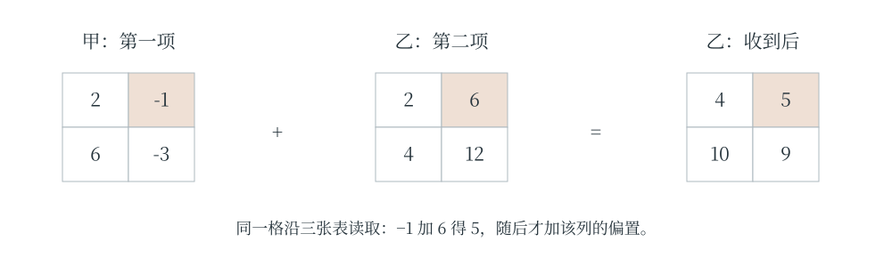
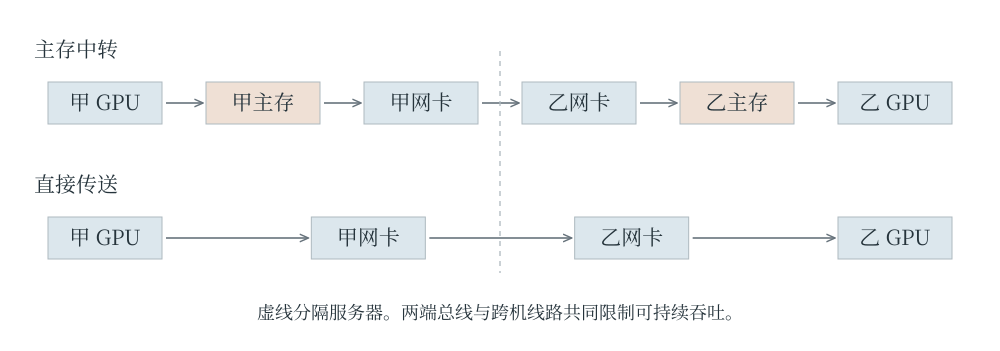
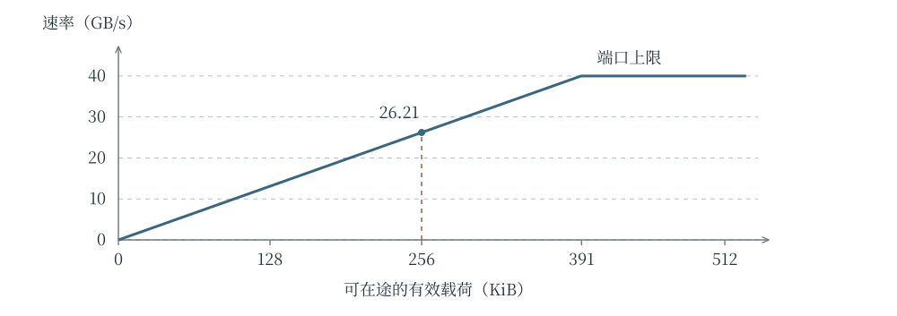
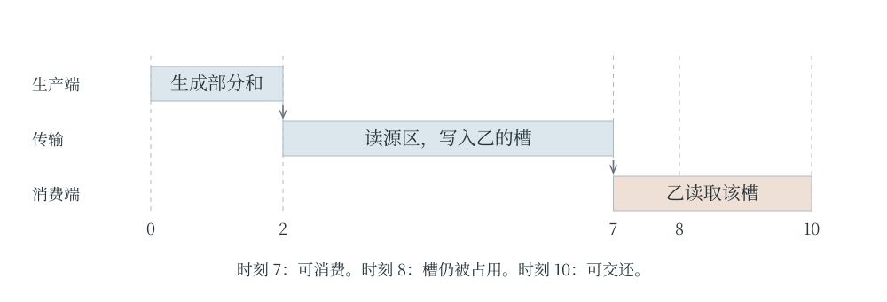
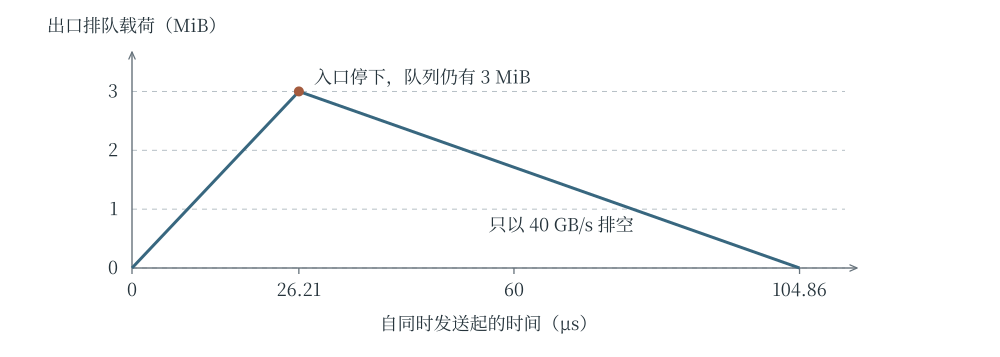
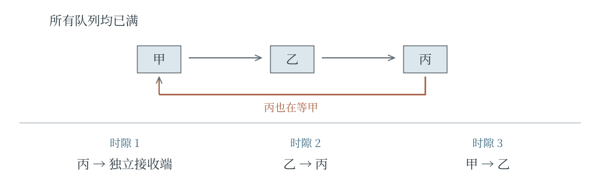
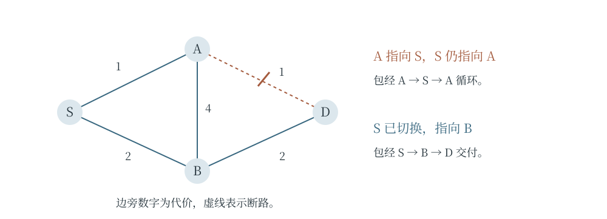
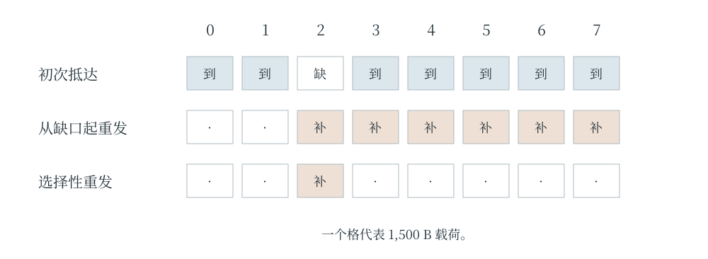

# 第 19 章　服务器互联与集群网络

现在把投影层叠成 32 层，每层都有一张 4096 × 4096 的权重表。按每参数 16 字节计入训练时的长期状态，仅这些状态就有 8 GiB。如果一张卡只给训练留了 6 GiB，再改输入流水线也腾不出这 2 GiB。我们得把一部分工作交给另一张卡。还有一种动机，即使模型放得下，也希望两张卡能同时处理两批样本。两种拆法都会产生传输，先用第七章那四个输出找出第一笔必须移动的数据。

## 19.1　跨卡计算需要交换哪些数据

仍使用前文便于手算的矩阵。$`X`$ 的两行是 $`(1,2),(3,4)`$，$`W`$ 的两行是 $`(2,-1),(1,3)`$。让卡甲计算内积的第一项，卡乙计算第二项。两边分别拿着 $`X`$ 的一列和 $`W`$ 的一行，各自作一次外积：

```math
P_{\rm A}=\begin{bmatrix}2&-1\\6&-3\end{bmatrix},
```

```math
P_{\rm B}=\begin{bmatrix}2&6\\4&12\end{bmatrix}.
```

要得到原先的 $`(4,5),(10,9)`$，需要将两个部分和按坐标相加。若只有乙需要完整结果，甲把四个部分和发给乙便够了；若两边都要接着处理完整输出，甲也得收到乙所掌握的信息。偏置 $`(-6,1)`$ 要在归约后加一次。尤其看左上格，两边分别算出的 2 与 2，加起来是 4，再加偏置得到 $`-2`$，才轮到 ReLU。落在哪张卡上不改变这个先后关系。



*图 19-1　沿右上格追踪，甲发出 −1，乙已有 6，收到后得到 5。若只把最终的标量损失交给乙，不足以让乙逐格计算激活。*

再看 128 行的投影。每张卡沿 $`K`$ 维算半段，部分和仍有 $`128\times4096`$ 格。若约定用 BF16 传送，载荷恰好 **1 MiB**；若保留 FP32 部分和，要发 2 MiB。分割内积会改变浮点加法的括号，传输前窄化还会增加舍入，这两项都应列入数值验收。本篇的带宽题默认两字节传送，小表用精确数验算。遇到梯度累加或优化器状态，会另注明类型。

## 19.2　分析跨设备的数据路径

上一节确定了要交换的是部分和，以及它在不同精度下的大小。知道数据量之后，还需要知道它经过哪些设备和链路：相同的 1 MiB 如果需要多次中转，传输次数和等待就会不同。

服务器里的 CPU、系统内存、GPU、网卡可以同时工作。CPU 可以把“从哪读、往哪写、总共多长”放入工作队列，由设备上的直接内存访问引擎（DMA）搬运。CPU 省去逐字复制，字节仍要真实经过互联。把一块 GPU 内存先复制到本地固定页主存，再经网卡送到远端主存，最后复制到远端 GPU，就是一种分段中转。固定页的一个作用是使设备在传送期间有可用、稳定的地址映射。

以这 1 MiB 的部分和为例。假设两个端点 GPU 与主机间的有效速率各为 32 GB/s，主机到主机的网络阶段的有效速率为 40 GB/s，三段必须整块串行，暂不计启动和等待。三段分别耗时 $`32.768,\ 26.214,\ 32.768`$ 微秒，总计约 91.75 微秒。**同一份 1 MiB 载荷在三个阶段各经过一次**。这个算法不会告诉你每条内存总线一共发了多少事务，但足以解释为什么给中间那段网络提速两倍也省不掉两端的复制。

支持 GPU 直接访问的网卡可以以 GPU 缓冲作为本地或远端数据端点，省去这两份主存中转。网卡读出 GPU 内存、经过交换网络、远端网卡再把数据放入 GPU，端点总线仍在路径里。若连续切成小段，三段能像流水线一样同时服务不同的小段。稳定吞吐率至多为三段速率的最小值，本例最多 32 GB/s；对第一小段，还得等它依次走完各级。具体机器中支不支持这条直接路径，要查 PCIe 拓扑、设备能力和内存注册方式。[NVIDIA GPUDirect RDMA 的拓扑与可见性说明](https://docs.nvidia.com/cuda/gpudirect-rdma/)



*图 19-2　上行数有几次主存交接，下行看网卡从哪里取数据。删除中转区后，两端 GPU 到网卡之间的物理路径仍须计入。*

一台双路服务器有时会给看似相同的两次发送报出很不一样的速度。若 GPU 和网卡靠近同一个 PCIe 交换结构，访问可走较短的本地路径；另一对设备可能跨 CPU 插槽，或须经主机分段。NUMA 表示不同处理器访问某段内存的代价可以不同，连负责填队列的线程和分配中转页的位置也会有影响。两张卡各标称 32 GB/s，却可能共用一条 32 GB/s 上行。两卡同时读满时，按 64 GB/s 预算就错了一倍。画拓扑图时，设备型号要写在点上，同时竞争的资源要写在边上。

同一机箱或一个紧耦合域内的 GPU 还可能通过 NVLink 和交换芯片等互联。紧耦合扩展常称 scale-up；跨多个计算单元、通过数据中心网络扩展常称 scale-out。互联域的边界不一定与机箱边界相同。通常可以结合链路延迟、带宽和共享路径，安排域内的细粒度通信与跨域的数据聚合；具体分工要根据实际拓扑决定。互联方式也影响故障范围：一个本地互联域或一条共享上行链路发生故障，可能同时影响使用它的多条逻辑连接。

## 19.3　消息大小、带宽和固定开销

一条标为 400 Gb/s 的链路，每秒最多有 500 亿字节的线速，尚未扣除协议和实现开销。设一次实验在给定大小和并发下可持续搬运应用载荷 $`B=40`$ GB/s。用十进制 GB/s 计速率、二进制 MiB 计容量。另设每条消息的固定开销 $`\alpha=3`$ 微秒，用一个最简单的单向模型

```math
T(n)=\alpha+n/B.
```

发 1 MiB，序列化时间约 26.21 微秒，加上固定项约 29.21 微秒。发四字节，带宽项近乎为零，仍须付约 3 微秒。把 1 MiB 切成十六条 64 KiB 消息，若每条都独立启动且完全串行，要约 $`48+26.21=74.21`$ 微秒。若可以流水提交，多条在途，固定项又不会十六次完整占住关键路径。小包便于早些交给下游，也会增加头部、队列项与完成处理，合适粒度依赖于谁在等。

还有一条常常藏起来的限制。假定发出的字节平均经过 10 微秒才释放发送额度，系统至多允许 $`W`$ 字节未完成。持续速率至多为 $`W/(10\,\mu\mathrm{s})`$。想持续达到 40 GB/s，要允许在途的有效载荷约 400000 字节，合 390.625 KiB。这就是此处的带宽时延积。若窗口只有 256 KiB，速率上限约 26.21 GB/s。线路此时会有空位，增加未完成请求或合适地增大消息能填上它。若端口原已忙满，增加队列只会增加排队时间。这里的 10 微秒是额度返回所需时间，与前式的单向固定开销分别规定。



*图 19-3　取横轴 256 KiB，向上读到约 26.21 GB/s。超过拐点后若实测速率仍低，应回到拓扑、竞争和协议有效载荷查原因。*

若想区分“端口变快”和“窗口变大”，可以分别改下面两行，画出自己的拐点。模型按秒计时，因此得到的是字节每秒。

```python
bandwidth = 40e9
rtt = 10e-6
def delivered(window_bytes):
    return min(bandwidth, window_bytes / rtt)
for window_kib in (256, 512):
    rate = delivered(window_kib * 1024)
    assert 0 < rate <= bandwidth
    print(f"{window_kib} KiB: {rate / 1e9:.2f} GB/s")
```

## 19.4　数据可见性与缓冲区复用

带宽和时延估算只能说明传输可能有多快，不能单独保证数据正确。发送端、网络和接收端各有自己的执行进度，程序必须在合适的时间读取目标缓冲，也必须等最后一个使用者结束才能覆盖它。

考虑甲把 $`P_{\rm A}`$ 写进乙的一块 GPU 缓冲。乙要启动加法。程序里有至少四个相关动作：甲的计算填好源区、传输读取源区、乙看到完整新值、乙消费完并把缓冲归还。给它们编成一个叫“通信完成”的事件，容易丢掉其中一道依赖。

以可靠连接上的 RDMA 写为例。应用预先注册内存区域，建立设备可用的地址映射及访问权限，向发送工作队列提交描述符，由网卡推进；请求的完成可以经完成队列领取。接收方授权后，一侧写可以直接指定远端地址。普通 RDMA Write 不自带一个供远端应用领取的接收完成通知；Write with Immediate 或配套控制消息可以构成通知协议，仍要满足相应接收资源和顺序条件。与之对照，Send/Receive 要让接收端预先提供接收空间，双方按消息和队列协议相遇。注册、建连接和通知都有固定开销，长期重用缓冲池可以摊薄它们。[RDMA 通信操作及完成语义](https://docs.nvidia.com/rdma-aware-networks-programming-user-manual-1-7.pdf)

在返回“可以动了”之前，先指明是谁可以动。发送端本地的成功完成按操作与传输约定允许它回收相应源资源；接收端何时观察到通知、GPU 何时保证看见远端写入的数据、乙的 kernel 何时读完，则分别需要依据设备和框架的顺序与可见性约定。在无相应保证的路径上，让一个已运行的 GPU kernel 自旋读取普通主存或显存标志，不会自动建立正确的设备内存顺序。使用通信库时可依赖其定义的流顺序和完成接口，在消费流上等待通信事件；自行编排时必须遵守供应商对该设备组合规定的同步或刷新操作。[GPUDirect RDMA 的同步和内存顺序](https://docs.nvidia.com/cuda/gpudirect-rdma/#synchronization-and-memory-ordering)



*图 19-4　读竖线的方向。就绪允许乙开始读取；归还允许下一轮覆盖同一槽。双缓冲只是让甲能先写另一个槽，两条依赖都还在。*

给这张图标上时间。甲在时刻 2 完成计算，传输到 7 才满足接收侧可见条件，乙从 7 用到 10。如果甲在 8 就授权下一轮覆写乙的同一槽，这一轮后两拍仍可能读到下一轮的内容。若设两个槽且轮换使用，下一次占用同一个槽之前仍须收到归还或具有等价的序号与额度协议。一次训练里，张量有它的版本，缓冲也有它的代次；两者混错时，模型可能给出一个貌似合理的浮点数。

进一步考察网卡内部的队列，可以分析链路带宽没有跑满、训练却很慢的一种原因。双端建立可靠连接后，分别有一对发送与接收队列，称为 QP（queue pair）。一次写从本地已注册内存的某段取数，操作中带有本地访问键、远端地址及访问键。程序可以提前向发送队列投递多项工作。对于请求通知的发送，在本地完成队列 CQ 中取到成功的完成记录以后，才能按相应语义回收资源。普通单边写无需接收方为载荷逐次张贴接收工作请求。若改用带立即数的写来通知接收方，则接收方要预先张贴接收工作请求，取走通知后及时补回。两种写都需要远端目标区在操作期间保持有效。[rdma-core 的发送工作请求手册](https://github.com/linux-rdma/rdma-core/blob/master/libibverbs/man/ibv_post_send.3) · [DOCA RDMA 的写与接收操作](https://docs.nvidia.com/doca/sdk/doca-rdma/index.html)

取上节的 64 KiB 分片。本地一次容许七项工作在途，恰能覆盖 40 GB/s 链路上 10 微秒的额度周转。现在假定启用了立即数通知，接收方每次只备下四个通知槽，从消耗一个到补回它平均要 10 微秒。稳定吞吐率又多了一项约束，$`4\times65536/(10\,\mu\mathrm{s})\approx26.21`$ GB/s。若接收未就绪触发重试，实际值还会下降。增大发送队列的深度，无法让接收方提前补槽。做一次对照实验时，可以固定消息大小和路由，只增加预贴的接收数量，再检查就绪不足的重试、完成处理速率和端口载荷是否一起改变。普通单边写遇到同一数值的瓶颈时，应查它真正使用的窗口与缓冲归还协议。

## 19.5　多发送者竞争同一个出口

前面的估算把链路留给一条消息。训练时多张卡可能在同一时刻发出梯度，它们即使各自连接到高速入口，也可能汇聚到同一个较窄出口。此时队列和流控会改变每条消息的完成时间。

实际传输把大消息拆成包，交换机沿选定路径转发。四张卡在反向结束时同时向同一出口各发 1 MiB，设四个入口各可达 40 GB/s，出口只有 40 GB/s，先忽略传播时间、包头与流控。入口合计 160 GB/s。在最初约 26.21 微秒内，四份数据到齐，出口刚送走一份，排队量增至 3 MiB。此后出口还要约 78.64 微秒清空，全程约 104.86 微秒。换成四条通往不同接收端、物理上互不竞争的出口，四份就可能同时结束。集合通信算法之所以关心“这一轮谁发给谁”，根源就在这类汇聚。



*图 19-5　上升段的斜率为总输入减出口，下降段只剩出口。若交换缓冲容不下峰值，真实系统将提前流控、丢包或降低发送速率。*

InfiniBand 与以太网上的 RoCE 可以把 RDMA 操作交给网卡执行，底层的流控、拥塞反馈和路由选择则依赖具体网络。链路信用限制向下一跳注入的量。RoCEv2 网络可结合 ECN 标记和端侧降速；启用 PFC 时按优先级暂停上游，对无关流的牵连要看它们是否共用队列。反馈需要时间，不能指望第一批同时到来的包全都避开排队。多路径可让无须经过同一瓶颈的流分散，也可能因哈希碰撞挤到同一路径，逐包分散还要处理乱序。查慢传输时，先看哪些流共享出口，再看端口计数、队列与重传，比单看平均链路利用率更有解释力。[NVIDIA RoCE 配置与拥塞管理](https://docs.nvidia.com/networking-ethernet-software/cumulus-linux-53/Layer-1-and-Switch-Ports/Quality-of-Service/RDMA-over-Converged-Ethernet-RoCE/)

下面结合图 19-5 估算拥塞反馈需要的时间。假设队列达到 0.5 MiB 时交换机开始标记拥塞，从标记到发送者降速并使新速率抵达此出口共需 6 微秒。原先净积压率是 $`160-40=120`$ GB/s。达到标记水位只需约 4.37 微秒。之后六微秒内，还会多入队 720000 字节，队列约达 1.19 MiB。若该队列实际只能用 1 MiB，即使第一份反馈准时生效，缓冲也已先用完。把总输入降到恰好 40 GB/s 只会让队列停止增长，降到更低才会排空。这里假定突发持续到反馈生效、各端同时响应、没有更早的暂停或丢包。

在 DCQCN 一类端侧拥塞控制中，交换机可以通过 ECN 给经过的包作标记，接收端据此向发送端报告，发送网卡调整注入速率，之后再试探可用带宽。PFC 则通知上游暂停这个链路上某个优先级的流量，发往其他目的地但同属该优先级的包也可能一起等。若抓到慢步，把拥塞标记增加的时刻、发送速率改变的时刻和暂停持续的区间放在同一条时间轴上。端口长期平均只有半载，与其中十微秒因四流同时抵达而拥塞可以同时成立。这也是缩小梯度桶有时能缓和突发、有时只多花启动费的原因。[DCQCN 的系统设计与实测](https://www.microsoft.com/en-us/research/publication/congestion-control-for-large-scale-rdma-deployments/)

端口的采样间隔会影响我们看到的拥塞程度。沿用图 19-5，让这次突发之后直到 1 ms 都没有其他业务。两次相隔 1 ms 的发送计数相减，得到 $`4\times2^{20}`$ B，平均仅 4.19 GB/s，约为出口能力的十分之一。同一条线上，开头约 105 µs 却一直在满速发送，峰值还积压了 3 MiB。只留下这两个计数，便不能从中恢复峰值或突发时刻。若设备能记录队列最高水位，可以用它核对积压量；要还原队列何时开始增长，还需把更细的采样与训练桶的发送时刻对齐。

### 从队列状态判断拥塞原因

图 19-5 的右半段有一个前提：下游还在取包，因而停止注入以后，队列会自行排空。若观察到同一优先级连续暂停，首先该问哪一个缓冲必须先腾位置。把一次训练传送抽象成三个转发队列，各能放两包，均已触发对上游的暂停。甲的队头要进入乙，乙的队头要进入丙，丙的队头恰好要进入甲。每个队列都须收到下游可继续发送的许可，才能释放队头。即使停止注入新流量，这六个包仍相互等待，无法继续转发。这就是循环等待。这里的箭头表示**被占用的队列依赖哪个资源才能释放**。机房的线缆连成环，只说明有路径可选，尚不能据此诊断死锁。



*图 19-6　上排的箭头从持有缓冲的一方指向它正在等的一方。下排只把丙的下一跳改到可排空的接收端，沿时间向右读，三次释放便依次发生。*

一个对照实验可以区分“暂时很慢”和“无法自行恢复”。只改丙的队头，让它能在下一个时隙进入一个独立且一直排空的接收队列。再假设每出一包就能解除本例的暂停、许可在下一时隙可用。第 1 个时隙丙送走一包，第 2 个乙便能向丙交一包，第 3 个甲也能动了。两次实验的初始队列深度、暂停优先级、甚至过去一毫秒的平均吞吐都可以相同。区分它们的证据是连续多个时隙里有没有完成事件，以及沿队头的下一跳追踪，依赖最终通向排空点，还是回到了已经持有的资源。实际 XON/XOFF 水位有回差，还要计入暂停帧和恢复帧的传播时间。

现场常见的另一种现象是丙堵住了去 GPU 0 的流，而同一优先级里去 GPU 1 的健康流也被暂停。即使等待链最终能排空，这个无关训练桶的尾部也会被拖长。抓证据时，需要在同一窗口对齐每跳每优先级的暂停时长、队列深度与成功转发字节，并查明恢复当前队列所需的包究竟在哪条通路上。规划路由和队列时，可为释放资源必需的响应提供一条确认能继续排空的通路。看门狗是另一种取舍：识别持续暂停后，可按配置让队列临时丢弃流量或采取其他处置，打破等待，再由可靠传输修复损失。验收应量到恢复后的重传量和训练步完成时间。仅把“暂停计数归零”当成功，可能是把等待移到了端点。[SONiC PFC 看门狗的检测、处置和恢复](https://github.com/sonic-net/SONiC/wiki/PFC-Watchdog-Design)

### 怎样在自己的两张卡上识别瓶颈

可以把那一格外积当成验收标记。先在甲的发送缓冲中按“代号、行号、列号”填可复算的内容，在乙搬完后用消费端 kernel 检查标记与数值；多代轮换同一批缓冲，能把偶尔读到旧数据的问题与单纯变慢区分开。计时时把一次性的注册、启动、预热与重复传送分列。主机刚把操作放入队列就停表，量到的是提交开销；端到端单向时间需要可比的时钟或合适的事件约定。若只用一侧时钟，可以让乙收到后返送确认，报告往返时间；两条路径及回复大小不对称时，直接除以二不会给出可信的单向延迟。

假如在资源空闲、同一协议区间内测到 64 KiB 消息需 4.6384 微秒、1 MiB 需 29.2144 微秒，这里采用构造数字示范推断。两份数据相差 983040 字节、时间相差 24.576 微秒，相除得到 40 GB/s。用小消息减去其带宽项 1.6384 微秒，固定项便是 3 微秒。若随后令同机两张卡同时发，启动几乎不变、每卡的大消息斜率却约变为原来的两倍，就有理由去查共用出口。若只有第一条大消息偏离直线，应先查注册或页映射。大小跨过换协议的阈值时，应分段拟合，不能指望一条直线解释所有消息。

### 多路径传输与乱序等待

假设一个梯度块分为四包，编号 0 至 3。为用满两条路径，偶数走甲，奇数走乙。一次观测中，第 0、1、2、3 包分别在第 2、8、4、6 微秒抵达。到第 6 微秒，接收端实际拥有三包，但按序交付的连续前缀仍只有第 0 包：1 之后的 2、3 都到齐也不能补上那个洞。等到第 8 微秒，连续前缀才从 1 包跳至 4 包。若每包 4 KiB，用暂存区保存越过缺口的数据，此次峰值是 8 KiB；若接收端能按偏移直接写入预留目标缓冲，则不必另留 8 KiB 暂存，但仍要记录哪些位置已到、什么时候允许消费者看到完整块。

再看这次乱序对训练步的影响。若下游只在一整块完成后启动归约，乱序放置不会把第 8 微秒的就绪点提到第 4 微秒；它可以省去额外拷贝，并使另一条路径继续传。若应用确实允许独立消费子块，才可用更细的完成标记提前开工。反过来，若把每个乱序都当成丢包立刻重传，原本晚到的第 1 包和重传会争用同一出口。可用到达位图、重传计数和块完成时间检验：是容量不够、等待缺包，还是过早判丢？Google Falcon 的设计把以太网上的可靠传输落实到端点硬件，并区分上层操作的交付要求；上面的四包轨迹是解释这些选择的教学模型，并非它的实现时序。[Falcon 的设计说明](https://cloud.google.com/blog/topics/systems/introducing-falcon-a-reliable-low-latency-hardware-transport)

### 同一出口能替四个发送者节省什么

假设四个进程都在同一机架，需要各向另一机架发 64 MiB，四份数据必须经过同一个有效带宽 25 GB/s 的出口。空队列、忽略固定开销时，从第一字节到最后一字节至少需 4 × 64 × 2²⁰ / (25 × 10⁹) 秒，约 10.74 ms。每张网卡单独测都能跑满接口，也不可能让同一出口同时跑四倍速。若四份是同一组梯度，可以先在机内分层求和，只将合并后的 64 MiB 发送过线，这一段载荷下界变为约 2.68 ms，代价是机内的归约、同步和结果分发。若四份是不同词元的激活，目标专家需要每一行，各行就不能靠求和合为一份。把专家挪到输入附近可能改变需要跨线的比例，代价转移到专家权重和负载均衡上。

跨线字节数为何有时比网络计数器小？上面只算一次有用载荷。协议头、重传、双向回送，以及同一台机器上的其他作业都可能添字节。拓扑图用颜色标出训练作业实际采用的两个出口，同时记录两个方向的计数差、网卡完成事件和最后一张卡结束通信的时刻。若带宽并未饱和，而最后一张卡迟迟未发，回到主机输入、内核完成和发送队列去找时间差。将协议处理卸载到 DPU 可以减少某些主机工作，若唯一瓶颈就是那 256 MiB 共用的物理出口，仍要面对上述传输下界。

## 19.6　InfiniBand 集群拓扑

前面计算了单条消息与共享出口的限制。扩大到整个集群后，需要把每个参与者对应到实际设备，再检查它的消息经过哪些端口。通信程序通常用 rank 表示进程在通信组中的编号；以下采用一个工作进程使用一张 GPU 的配置。rank 编号本身不说明设备的物理位置，必须另查绑定关系。

考虑两份前述四卡作业。现在有甲、乙两个机架，每架两台服务器，每台两张 GPU。两份作业都跨机架运行，机架甲的两台机器会同时往乙发送梯度。为便于计算通信量，先给每张 GPU 分配一条通往近邻网卡端口的路径，假设每端口单向可持续传 40 GB/s 应用载荷。同一架中，两台服务器的 0 号端口都接入一台叶交换机，1 号都接入另一台。各机架按相同位置对齐的一组网卡与交换路径称作一条 *rail*。发送端在 0 号口发，到对端也在 0 号口收，这条路可以一直使用 rail 0。真实系统应按接线和 GPU 到端口的距离建表，设备枚举号相同并不保证路径相同。[DGX SuperPOD 的 InfiniBand 计算网络与接线图](https://docs.nvidia.com/dgx-superpod/reference-architecture-scalable-infrastructure-h100/latest/network-fabrics.html) · [NCCL 对跨 rail 路径选择的说明](https://docs.nvidia.com/deeplearning/nccl/user-guide/docs/env.html#nccl-cross-nic)

机架内的叶交换机负责接服务器，脊交换机把不同叶交换机连起来，这是折叠 Clos 中常见的两层组织。先只看图中 rail 0。叶交换机接到两条各 40 GB/s 的下行，向脊层只有一条 40 GB/s 上行。在大家都要跨架时，下行总容量与上行总容量的比为 $`80/40=2`$，即 **2∶1 收敛**。本架两台机器若互相发送，可在叶交换机内转发，包甚至用不到这条上行。同一台交换机，随通信双方的位置不同，约束就不同。


*图 19-7　实线画出 rail 0 的载荷去路。沿机架甲向右数，进入同一上行的两个 512 MiB 之和为 1 GiB。rail 1 有自己的一套同样链路，图下方分别列出了两个出口的流量。*

设每卡有 512 MiB 梯度要传给对端的对应卡，反方向也同时有同量数据，这个尺寸在第二十一章会由权重形状推出来。先只算甲往乙。按位置对齐后，每条 rail 上有两块 512 MiB，共 1 GiB。两个出口可并行，每个出口的服务下界为 $`2^{30}/(40\times10^9)=26.84`$ ms。若四块都挤在 rail 0，同一出口有 2 GiB，时间下界变成 53.69 ms，另一条 rail 空着。若每个叶的可用上行增至两条 40 GB/s，两端及中间均有相应路径，且路由能将两条流分散到独立出口，原来的 1 GiB 才可能只用 13.42 ms。同一个“有两条路”的设备清单，允许这三种很不同的结果。

工程上可以把每条有向链路写成一行。沿实际选择的路，把每个发送者的字节加进所有经过的行。若边 $`e`$ 的总载荷为 $`D_e`$、可用速率为 $`B_e`$，这一轮耗时至少是各边 $`D_e/B_e`$ 的最大值。这个下界还没加入首包穿过各跳的时延和分段之间的依赖。

InfiniBand 子网管理器发现连接，为端口分配本地标识 LID，并依据拓扑计算路由。在按目的 LID 静态转发时，两条通路都已接好，交换机仍可能让去某个目的地的流量总走同一出口。支持并启用自适应选路的网络能在允许的路径间调整，端点前的固定链路和机架切面的总容量仍在。于是排查有了三个可以对照的位置。作业把这个 rank 绑定到哪个网卡端口，交换机实际经哪个出口转发，同时发送时各出口分别通过多少字节？一条单流跑得快，只能证明被它选中的路径可用。把两份作业同时启动，再在同一窗口读各上行的发送量，才能看出分流是否生效。[InfiniBand 子网管理与本地标识](https://networking-docs.nvidia.com/qm87xx/public-view/software-management)

可以沿图 19-7 再做一个网络设计实验。假设训练的高频跨机通信总在对应的 GPU 位置之间进行，每条 rail 自成一张较小的网络。若甲机 0 号 GPU 偶尔要给乙机 1 号 GPU 发数据，它可以先在甲机内部转给 1 号，再从 rail 1 到达乙机。Rail-only 论文据此研究了用多个按 rail 独立组织的网络替代跨 rail 的直接交换路径，以及专家路由产生任意目的地时如何转发。第二十一章的跨机数据并行正有固定同伴，第二十二章的专家分发则随输入改变。[Rail-only，§IV 及图 6](https://frank.csail.mit.edu/assets/files/rail_only_hoti_2024.pdf)

下面估算这次绕行增加的时间。设一块 1 MiB 必须完整地先过一条有效 160 GB/s 的机内链接，再过 40 GB/s 的网络，忽略启动，独占网络只需 26.21 微秒，两段依次执行要 32.77 微秒。若连续各小块允许流水，足够长的流仍可能逼近 40 GB/s。可要是本机正在做张量并行，留给转发的有效带宽只剩 20 GB/s，机内就成为新的瓶颈。评价这样的设计得拿出三份量：同编号流占多大比例，跨编号流增加了多少机内字节，这些字节到来时机内互联上还有多少余量。论文所分析的流量分布和带宽比例，到了另一种训练策略上要重新测。

### DPU 通信卸载的开销与收益

以路径上的一个 64 KiB 分片为例，看看通信工作由哪些设备承担。主机可以准备描述符，网卡的硬件引擎推进可靠传输和 DMA。带有可编程处理资源的 DPU 还能接管部分队列管理或基础设施服务。若应用要把某段准备工作从主机迁过去，还需要让 DPU 获得可用的描述信息、缓冲和完成通告。BlueField 上的 DOCA RDMA 提供明确的上下文与任务接口，具体执行资源和可用操作随模式而变。[DOCA RDMA 的任务与资源模型](https://networking-docs.nvidia.com/doca/archive/3-5-0/doca-rdma)

假设一条已预热的发送路径只有一个提交者，它平均每 4 微秒准备好一个 64 KiB 分片。物理出口可达 40 GB/s，额度充足，提交与传输可以重叠。长流最多达到每秒 25 万个分片，即 16.384 GB/s。若把准备工作移到设备侧以后，连同主机交接摊下来每片只用 1 微秒，准备端可供给 65.536 GB/s，实际吞吐率仍受出口的 40 GB/s 限制。这时一段长流有约 2.44 倍的理想提升空间。反过来，如果提交者原本每微秒就能产出一片，迁移可能释放 CPU 时间，却不会减少图中那 1 GiB 穿越出口的 26.84 ms。应分别记录每秒准备的描述符、待发队列见底的时间、端口忙时与训练步时，才能区分收益来自减少 CPU 工作、加快提交，还是缩短了整个训练步。

如果由 GPU 上的生产者直接发起通信，还可以减少它向主机交付描述符的等待。代价可能转移到发起请求的 GPU 线程、用来推进请求的队列及其进展机制。若 DPU 已经为两个租户各保留一半端口份额，一份独占租户的作业即使用上这种提交方式，可用速率也应按 20 GB/s 重新计时。[NVSHMEM 执行模型与 GPU 发起的通信](https://developer.nvidia.com/nvshmem)

网内归约改的是另一件事。设两个发送者对同一项权重各有一份 1 MiB 的梯度。普通转发让两份先后越过某条上行，再由上游相加。若有能力执行相应求和的聚合节点恰好位于分流处，它可先把两个同坐标的块相加，只让一份 1 MiB 的部分和经过上行。下游要完整结果时仍需分发。SHARP 的聚合树就是在支持的操作和数据类型上利用这一点。两个独立训练作业更新的是不同权重，或者是专家交换中发往不同目的地的两行激活，都不能这样相加。评估卸载方案时，需要明确它缩短了哪些准备工作，或者减少了哪些链路上的数据量。[NVIDIA SHARP 的网络内归约机制](https://networking-docs.nvidia.com/sharpum/3150/introduction)

再考虑一个跨机架作业。如果所有参与者都要得到总和，谁先归约、哪一份结果越过机架，就决定了图 19-7 中每条边上应该填多少字节。

### 三维环面拓扑的跨切面带宽

把 64 个加速器排成 $`4\times4\times4`$ 的立方体，每个点沿三个坐标轴各接前后两个邻居，每一行的首尾也相连。这种拓扑叫三维环面（torus）。沿 $`x`$ 轴从中间切开，左边是第 0、1 层，右边是第 2、3 层。固定一对 $`(y,z)`$，从左到右有两条通道，一条从 1 到 2，一条由 0 绕回 3。共 16 对 $`(y,z)`$，所以这个切面有 32 条向右可用的链路。把所有卡的六个端口加起来，会把许多只在左半边或右半边转运数据的端口也算进去。

假设每条链路每方向有效带宽至多 25 GB/s，每个左侧节点各有 4 MiB 要分给右侧节点。右侧回传可用独立的反向通道。光是去程，跨切面的 128 MiB 除以 800 GB/s 就要约 0.168 ms。现在让每一维翻倍，每个发送者的任务仍是 4 MiB。左边变成 256 个节点，去程负载变为 1024 MiB；切面却只有 $`2\times8\times8=128`$ 条链路，时间下界升到 0.336 ms。节点数按体积增长，跨面通道按面积增长。若这些数据恰好全都送给同一个专家，还应按它实际可用的入口重新估时；任务的目的地分布会决定哪条下界先起作用。

这解释了 TPU v4 为什么在一套机器中引入光路交换（OCS）。光开关能改变一段光纤与哪一段相接，把可用的芯片拼成适合任务的切片，某些形状还可选扭转环面，改变哪些邻居通过回绕边相接。它切换的是连接关系，选定光路后，同一端口仍受原本的线速约束。上例的 25 GB/s 是教学假设；选择拓扑时可把真实 rank 的去向和字节放上候选图，先数必经切面，再看路由能否把流量摊到那些边上。只发近邻数据的作业与频繁跨面的专家分派，会给同一张网络不同的答案。[TPU v4 的光路重配置与扭转环面](https://arxiv.org/abs/2304.01433)

## 19.7　网络故障检测与恢复

假设两个训练机房之间的通信经过一张按链路代价选最短路的 IP 网。源端接在 S，目的端接在 D。图 19-8 用五条双向链路构造一个经常被忽略的时间窗。图上的数是选路所用的正代价，不能拿来直接当作毫秒。故障前 S 到 D 的最短路是 S→A→D，代价 2。若 A 到 D 中断，全网重新计算后的最短路分别为 S→B→D（4）和 A→S→B→D（5）。每台路由器都有正确答案，却可能在不同的时刻把答案装入转发表。



*图 19-8　上方被切断的 A—D 原本只需代价 1。若 A 已按新表把包转给 S，而 S 还按旧表送到 A，包就在两点间来回。下方经 B 的路径在故障时仍然畅通。*

这个过程可分为三个阶段。第一阶段是**探测**。在简化的对称 BFD 会话中，协商的发送间隔为 10 ms，检测倍数为 3，自最后一次有效接收起检测预算约 30 ms。两端协商参数、报文丢失与调度都会影响观测值。第二阶段是**本地修复**。A 若已准备好经 B 的备选下一跳，检测到故障即可切换。怎样确认 B 的转发路径不会重新经过 A？用故障前的距离检查，B 到 D 的最短距离 2 严格小于 B 到 A 的最短距离再加 A 到 D 的距离，即 $`3+1=4`$，所以 B 的原最短路不会经 A。本地暂走的 A→B→D 代价 6，比最终的 5 多 1，却避开了等待 S 更新的窗口。第三阶段是**全网收敛**，包括传播变化、计算新路径、安装新表并安全地退出临时修复。若 A 过早改走 S，图中的短暂环路就会出现。备份下一跳取决于拓扑，有些节点并没有满足条件的邻居。[BFD 检测时间](https://www.rfc-editor.org/rfc/rfc5880) [无环备选下一跳判据](https://www.rfc-editor.org/rfc/rfc5286) [转发更新期间的微环路](https://www.rfc-editor.org/rfc/rfc5715)

下面计算网络故障对一次训练步的影响。假设故障前已经做好 56 MB，只差最后 8 MB 的梯度桶。剩余路径有效 10 GB/s，正常这段载荷需 0.8 ms。若从断路到恢复可用发送共空了 35 ms，且末段还得完整重发，余下时间约 35.8 ms；若通信原本可被 10 ms 反向计算覆盖，仍有 25.8 ms 无法与计算重叠，会延长训练步。成功绕路后，若共享出口使有效吞吐降到 1 GB/s，这部分额外等待变为 $`35+8-10=33`$ ms。要判断是探测太慢、切换期间有环、还是恢复后仍在排队，应对齐最后成功包、本地切换、传输重试、恢复后的字节斜率和集合完成事件。这里的选路过程适用于所设的 IP 广域网。机房内 InfiniBand 的子网管理、路径选择和连接重试有各自机制，不能把 BFD 的三个间隔写进所有 RDMA 传输的时延预算。

同一张图也能比较集中式流量工程。假定跨机房隧道要从 S→A→D 改为 S→B→D。若包只携带目的地址，每台路由器改变下一跳的先后都很重要。若控制器另有办法区分两版隧道，可先让沿 B 的新路径具备转发能力，再让入口 S 为新包选择新路径，等旧包离开后移除旧路径。分段路由可以让入口给包施加一列转发指示，实际标签如何解析及底层邻接是否可达，仍取决于转发面。若检测时旧链路已断，在控制器改入口前发出的包仍可能丢失，必须有本地保护或端点重传。一次训练步已经暴露的等待，无法靠后来装好的路由追回。[分段路由的入口选择与转发语义](https://www.rfc-editor.org/rfc/rfc8402)

### 缺包重传与流量暂停

19.5 节的包 1 最后晚到了。现在让它真的丢失。把一条梯度消息分成 8 个等长包，每包载荷 1,500 B，序号从 0 开始；这次丢掉的是包 2，其余七包完好到达。只报告连续前缀时，发送者知道 0、1 已到，却无从得知 3 至 7 的状态。一种简单恢复策略是从 2 起全部重发，需要 $`6\times1500=9000`$ B。若接收方用选择性确认（SACK）报告已收到 3 至 7，发送者保留必要的重发数据，则只需补包 2 的 1,500 B。两者相差 7,500 B。在有效载荷带宽 10 GB/s 的单向链路上，少占用 0.75 µs 串行发送时间；检测丢失和等确认的往返仍要另算。



*图 19-9　沿第 2 列向下看，两种恢复都要补它；再沿 3 至 7 列向下看，才能数出多占链路的五包。位图表达接收状态，发布整条消息的完成事件还要等第 2 包到达。*

**选择性确认与直接放置。** 确认哪些数据包已到达，与决定将数据放在何处，是两个不同的问题。假设数据包携带可校验的消息标识与片内偏移，接收端已准备好目标缓冲区，并能验证访问边界和缓冲区生命周期，那么它可以将先到的包 3 直接写入偏移 4,500 B，等包 2 到达后再写入偏移 3,000 B，无需先放入临时重排区。直接放置减少内存搬运，选择性确认减少重复传输；消息完成标记则使应用能够等数据全部到齐后再进行梯度归约。接收端还须保存每条在途消息的完成状态。若每条消息最多含 64 个可独立到达的片段，以每片一位记录时，一百万条在途消息的位图就需要 8 MB，地址、权限、序号和计时器还要另外占用空间。[DDP 规范的消息与直接放置](https://www.rfc-editor.org/rfc/rfc5041) [veRoCE 公开规范入口](https://developer.volcengine.com/resource/7584346532149723178)

也可以在链路快要溢出时让上游暂停。设一条 100 Gb/s 链路从接收端发出暂停通知，到最后一批已经发出的字节抵达，仍有 4 µs 流量在途；仅这段就需要约 $`100\times10^9\times4\times10^{-6}/8=50000`$ B 的预留缓冲（headroom），还没有计入帧粒度及其他入口。预留这段缓冲可以吸收通知生效前的在途数据。暂停的代价则可能落在共享这条链路、同一优先级的其他流上。一条原本可通向空闲出口的梯度消息也可能被挡住。若现场看见一次集合变慢，把暂停时长、每优先级的队列水位、缺口位图、重复字节和应用完成时刻对齐。只有在缺口真的存在、链路真的忙于重发时，前面算出的 7,500 B 才是这次慢步中可以挽回的资源。[用 256 种缺包组合复算](../../experiments/part04/gap_recovery.py)

到这里，我们能解释一条消息经过哪些设备、发送多少物理字节，以及为何必须等到完整数据可用。训练还需要把许多这样的传输组合起来。例如，四张卡各算出一份梯度，某条链路已经空闲，也不代表更新所需的总梯度已经齐全。下一章从这四份数出发安排集合通信，并把本章的链路带宽、共享出口和完成条件代入同一条时间线。

## 练习与解答

### 1. 一条消息要用多少时间，换精度会怎样

同一输出形状，传 BF16 或 FP32 部分和，沿用 $`40`$ GB/s 和 $`3`$ 微秒固定开销，一次各需多久？

**解答。** 载荷分别为 1048576 和 2097152 字节。带宽项分别为 26.2144 和 52.4288 微秒，加上固定项得到 29.2144 和 55.4288 微秒。FP32 保留较宽的中间结果，但要验证后续归约次序和最终写回格式，才能判断整体误差。

### 2. 两张卡共用一个网卡上行

两卡同时各发 1 MiB，唯一出口可持续 40 GB/s。忽略启动，想在 30 微秒内让两份都过出口，够吗？若图 19-7 的四块 512 MiB 要在 20 ms 内同时从甲机架送出，两条各 40 GB/s 的上行够吗？

**解答。** 出口至少要服务 2097152 字节，需 52.4288 微秒。30 微秒只能送 1200000 字节。两条上游连接即使分别有 40 GB/s，也不能缩短同一出口必须串行送出的载荷。机架题在一个方向共需送出 2 GiB，20 ms 内需要约 107.37 GB/s。两条上行最多提供 80 GB/s，均匀分流也需约 26.84 ms。即使有三条上行，能否接近算出的总带宽仍取决于各端如何把流分配到三条路上。

### 3. 增加多少在途请求才有机会满速

若每条未完成请求恰占 64 KiB，额度 10 微秒后返还，多少条才能覆盖 40 GB/s 的带宽时延积？

**解答。** 目标是在途 400000 字节。六条只有 393216 字节，七条有 458752 字节，所以至少七条。这个条件只消除了窗口不足，接收队列、协议和端点仍可能限制实际速率。

### 4. 哪张通知可以删掉

乙收到可见性已获保证的就绪通知就开始读取，甲见发送完成就反复覆盖同一远端槽。给出一次会算错的时序并修复。

**解答。** 乙在第 7 拍开始、第 10 拍才读完。甲在第 8 拍开始下一次远端写，后半张表可能已经换代。让乙在最后使用完成后归还槽或信用，将下一次同槽写排在其后。另设一个槽可以重叠相邻迭代，但同槽循环复用仍须遵守归还条件。

本章的传输时间、窗口和排队曲线可在普通电脑上复算。[第五篇复算程序](../../experiments/part04/verify.py)

[全书目录](../../README.md) · [上一章 · 输入流水线与分布式存储](ch18.md) · [下一章 · 集合通信与梯度同步](ch20.md)
