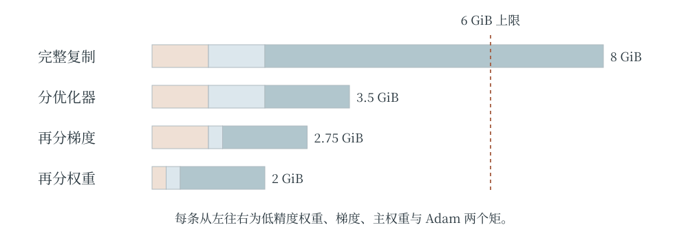
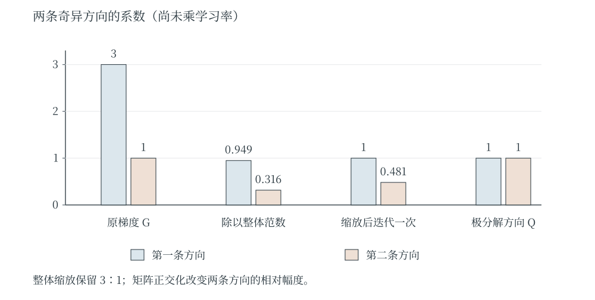
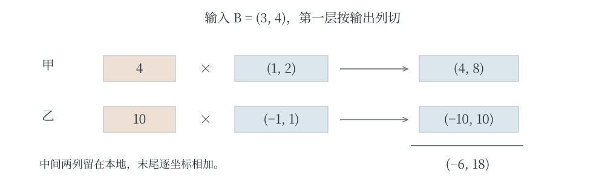
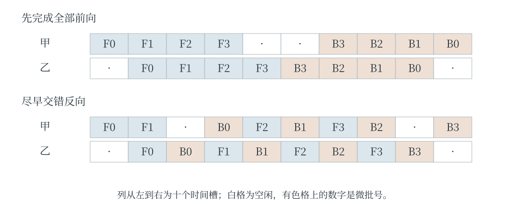
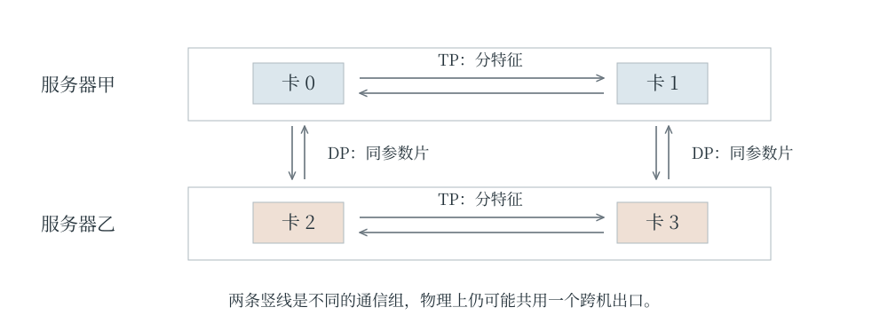
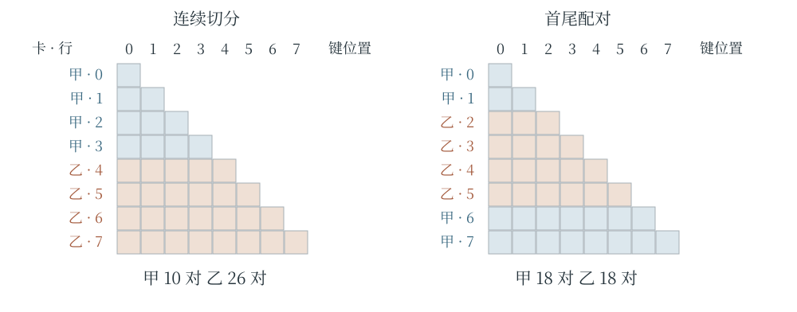
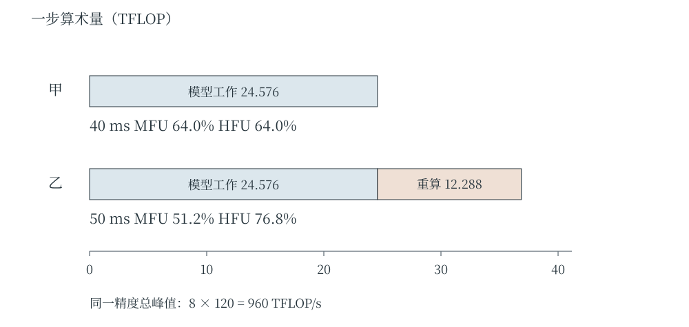

# 第 20 章　分布式训练的并行与分片

考虑一项四卡训练任务。两台服务器各有两张加速卡，0、1 在同一台机器，2、3 在另一台机器。每张卡可供任务使用 6 GiB。模型先取 32 个 $`4096\times4096`$ 的稠密投影，按相邻两层组成 16 对，中间有逐元素激活。忽略偏置、归一化等小项来做容量预算。微批含 128 个有效词元。一份投影权重是 32 MiB，一份形为 $`128\times4096`$ 的两字节激活是 1 MiB。手算仍使用带偏置的小层验证计算语义，容量估算则只计大矩阵。接下来要在这四张卡上安排一次完整的前向、反向和参数更新。

如果只看四卡合计的 24 GiB，容量似乎绰绰有余。难处在于同一时刻哪些数必须一起出现在同一张卡上。我们先试成本最低的改动，让几张卡分担平时保存的状态，保持每次本地矩阵乘完整。如果仍然放不下或算得太慢，再沿矩阵维度、词元或层切开计算。每换一种切法，都沿着同一个词元走到下一层，看新省下的显存要用几次数据交换才能换回。

## 20.1　训练状态与分片

模型共有 $`P=32\times4096^2=2^{29}`$ 个参数。选定一种具体混合精度实现：每个参数有 2 字节计算权重、2 字节驻留梯度、4 字节主权重，Adam 的一阶、二阶矩各 4 字节。梯度在局部算子内可以宽精度累加，这里只数最终长期驻留的梯度缓冲。每个参数共 16 字节，全模型 8 GiB。若在更新时把整张梯度额外转换成独立 FP32 数组，还要增加峰值，这里先设更新器按小块转换。

数据并行（DP）最直接：每张卡拿相同参数，处理不同词元，本地做前向和反向，等全组梯度齐再更新。这样可以减少每卡处理的数据，但每张卡仍需保存 8 GiB 的长期状态。在单卡空间更大的机器上，它仍可能是合适的第一选择，因为本地矩阵乘完整，只在梯度就绪时跨卡交换。在我们的 6 GiB 机器上，必须让一部分状态离开这张卡。

本节采用的 Adam 更新按参数坐标进行。计算 $`W_{01}`$ 的新值，只需要该坐标的梯度、旧权重和两个历史矩，无须读取其他坐标的一阶矩。因此可以将主权重和两个矩按坐标分到四张卡上，梯度先归约到负责该分片的设备，更新后再将**新权重**分发给下一次前向计算需要的设备。还可以进一步分片保存梯度，并让每张卡平时只保留自己的计算权重分片，直到某层执行前才临时收集完整权重。表中分别列出了这三种安排的容量。

| 四卡的长期布局 | 每参数每卡平均字节 | 每卡驻留 | 本步还需发生什么 |
|---|---:|---:|---|
| 全部复制 | $`2+2+12`$ | 8 GiB | 所有人取得总梯度 |
| 只分优化器状态 | $`2+2+12/4`$ | 3.5 GiB | 负责各分片的设备更新并分发新权重 |
| 再分梯度 | $`2+(2+12)/4`$ | 2.75 GiB | 梯度桶归约到对应设备后可释放完整梯度桶 |
| 计算权重也分片 | $`(2+2+12)/4`$ | 2 GiB | 当前层前向及需要时的反向先取得完整权重 |



*图 20-1　图中的 6 GiB 虚线只回答长期状态能否容纳。柱外还得给临时收到的参数、激活、通信桶与算子工作区找位置。*

微软的 Samyam Rajbhandari 等人设计 ZeRO 时利用了一处不对称：算本地梯度要用到当前权重，执行 Adam 更新时，每张卡却只需更新自己负责的坐标。表中第二行只分走主权重和两个历史矩，每卡就从 8 GiB 降到 3.5 GiB。这样已经越过本例的第一道容量门槛。如果峰值仍然过高，再进一步分梯度和计算权重。每走一步都要补问一句，暂时拿走的那些数，在哪一层、哪一刻必须回来？这正是分片方案可能在显存上占优、在训练步里却暴露出通信等待的地方。[ZeRO 对冗余状态和通信量的分析](https://arxiv.org/abs/1910.02054)

接下来计算通信量。所有低精度权重合计 $`Q=1`$ GiB，低精度梯度合计 $`G=1`$ GiB。在四卡环上，全复制梯度 AllReduce 每卡发 $`1.5G=1.5`$ GiB。只分优化器或再分梯度的方案，可以采用 ReduceScatter 梯度、各自更新、AllGather 新权重，每卡发送 $`0.75G+0.75Q=1.5`$ GiB。实现也可能保留全量梯度归约，结果要按选定的具体路径算。如果权重直到用时才收集，且前向结束立刻重新分片、反向用前再收集，按每层每阶段获取一次，发送变为 $`0.75(2Q+G)=2.25`$ GiB。这里计的是一遍前反向与更新；梯度累积多个微批时，参数收集是否重复取决于跨微批保留策略，因此不能直接把单遍的通信量当作一次更新的总量。

显存是否足够取决于同一时刻存活的所有对象。把一层作为收集单位时，完整权重暂存为 32 MiB；若实现为下一层预取另一块，同时有两个完整缓冲，可额外预留 64 MiB。把 32 层误包成一个单位则可能一次性申请 1 GiB。还要计入尚未释放的前向激活与归约桶，才能估算峰值。FSDP 中分组与前向后是否重新分片正会影响内存占用的时间变化。把所有层全预取会失去分片本来要解决的容量优势。[PyTorch fully_shard 的生命周期与重分片选项](https://docs.pytorch.org/docs/stable/distributed.fsdp.fully_shard.html)

下面的程序使用整数计算，便于代入其他模型参数。把 `group` 改成 2 会得到另一份容量表，但可用的通信带宽和局部矩阵形状还要另外检查。

```python
params, group = 32 * 4096**2, 4
gib = 2**30
stage2 = 2 * params + (2 + 12) * params // group
stage3 = 16 * params // group
assert params % group == 0
assert (stage2 - stage3) == 2 * params * (group - 1) // group
print(f"{group} ranks: stage 2 = {stage2 / gib:g} GiB, stage 3 = {stage3 / gib:g} GiB")
```

### 矩阵参数能否采用不同的更新方向

Adam 为各坐标分别调整尺度，但一层权重本来就是一个矩阵。矩阵的一整行或一整列共同表示一个变换方向，逐坐标缩放未必能表达这种结构。Muon 采用的思路是：先保留梯度的动量，再用近似矩阵正交化改变这份更新。为了看清它做了什么，暂时省略动量、衰减和额外的尺度系数，直接看一份 $`2\times2`$ 梯度

```math
G=\begin{bmatrix}3&0\\0&1\end{bmatrix}.
```

除以它的 Frobenius 范数 $`\sqrt{10}`$，两个方向的强弱比仍是 $`3:1`$。若只保留非零奇异值对应的列，将矩阵写成 $`G=U\Sigma V^\top`$，再把这些正的奇异值变为 1，就得到方向因子 $`Q=UV^\top`$。这里的 $`U,V`$ 都只包含上述列；这个约定使零奇异值对应的方向仍为零。本例 $`Q`$ 是单位阵，两个方向的更新幅度相同。这不是把原梯度乘以一个标量：优化器改变了各个奇异方向之间的相对尺度。对于非满秩矩阵，零奇异值方向还要按实现约定处理，不能凭空补出梯度没有提供的方向。

完整分解的代价不小。一个用于理解近似过程的经典 Newton–Schulz 迭代为

```math
X_{k+1}=\frac12 X_k(3I-X_k^\top X_k).
```

先把非零奇异值缩放到适当的收敛区间。例如 $`X_0=G/3=\mathrm{diag}(1,1/3)`$，一次迭代后得到 $`\mathrm{diag}(1,13/27)`$。第二个值从约 0.333 增至约 0.481，逐渐接近 1；每次迭代用的是矩阵乘法。在奇异值为 $`x`$ 的方向，上式相当于 $`x\mapsto(3x-x^3)/2`$，读者可以直接检查 $`x=1`$ 为不动点。有限步只给近似结果，而且缩放与数值精度会影响稳定性。



*图 20-2　纵轴为该方向的更新系数，尚未乘学习率。前两组仅缩放整体，后两组改变方向之间的相对幅度。这里的三次迭代多项式只用于解释原理，不是生产实现的逐行复刻。*

实际 Muon 还涉及动量形式、经过设计的迭代多项式、矩阵形状对应的更新尺度，以及哪些参数继续采用 AdamW。不能把所有向量、归一化参数和嵌入表任意拼成一张大矩阵，再声称实现了同一优化器。它增加了更新阶段的矩阵运算；参数分片后，还要决定在哪里取得完成这种运算所需的信息。是否值得，需要比较达到同等验证质量的时间与设备小时。某篇论文在特定模型上的 FLOPs 收益，不能直接当作另一套集群上的墙钟收益。[Muon 的原始实现说明](https://kellerjordan.github.io/posts/muon/) · [大规模语言模型中的 Muon](https://arxiv.org/abs/2502.16982)

### 参数分片也可能改变优化算法

上面在一台机器上完成的矩阵更新，在分片以后还正确吗？逐坐标 Adam 状态通常能跟着对应参数分片；对整张矩阵做正交化则存在跨列依赖。取

```math
G=\begin{bmatrix}1&1\\0&1\end{bmatrix},\qquad
Q=\frac1{\sqrt5}\begin{bmatrix}2&1\\-1&2\end{bmatrix}.
```

可直接验证 $`Q^\top Q=I`$，并且 $`Q^\top G`$ 对称正定，所以 $`Q`$ 是这张满秩矩阵的极分解方向。若两卡各持一列，并分别把自己的列归一化，则拼回来的结果为

```math
\widetilde Q=\begin{bmatrix}1&1/\sqrt2\\0&1/\sqrt2\end{bmatrix}.
```

两列内积为 $`1/\sqrt2`$，并不正交。因此“每卡就地运行同名优化器”已经换了更新规则。可以收集完整矩阵后更新再分片，也可以按矩阵乘法的依赖构造分布式迭代；二者的通信量、临时空间和可并行性不同。若有意采用逐块近似，需要明确这是算法变体，并重新验证收敛。通信优化必须同时保留参数布局与数学更新的含义。

## 20.2　张量并行与中间激活

状态分片可以降低单卡保存参数和优化器状态的容量，但它没有改变每次矩阵乘的大小。如果单层计算仍太慢，或者收集完整权重的临时峰值过大，可以把同一层的运算也分给多张卡。两者的区别是：状态分片主要决定参数及优化器状态存在哪里；张量并行进一步决定一次矩阵乘由哪些卡共同完成。分开计算之后，必须处理哪些中间结果需要交换。

另一条路是从一开始就让两卡给**同一个**词元做不同的乘法。按 $`W`$ 的输出列切，甲持第一列、乙持第二列，两边都有完整 $`X`$。小表里，甲算出 $`(4,10)`$ 这一列，乙算出 $`(5,9)`$。各自加本列偏置，各自做 ReLU，得到 $`(0,4)`$ 和 $`(6,10)`$。激活逐元素执行，中间的两列可以一直分开。如果下一层非要整行数据，就得把两列聚齐；现在反过来设计下一层，让甲恰好持有其第一行权重，乙持第二行。

设下一层两行权重为 $`(1,2)`$ 和 $`(-1,1)`$。第一词元在甲的贡献为 $`0(1,2)=(0,0)`$，在乙的贡献为 $`6(-1,1)=(-6,6)`$。第二词元的两项为 $`(4,8)`$ 和 $`(-10,10)`$，和为 $`(-6,18)`$。于是中间的逐元素激活无需全量搬动，两张卡只在第二层末尾把同坐标部分和相加。通常称前一层为列并行、后一层为行并行，名称指权重的切轴。[Megatron-LM 的两种线性层切法](https://arxiv.org/abs/1909.08053)



*图 20-3　图中追第二个词元。中间的 4 和 10 从未在一个设备上拼成向量，两个局部内积仍完整覆盖了第二层所需的归约项。*

反向传播时，梯度沿图中的计算路径反向传递。第二层输出梯度按约定在两张卡上作为同一个逻辑梯度使用，各卡可用自己的第二层权重片求本地中间激活梯度，并得到本地权重片的梯度。第一层按输出列切分，每张卡只计算部分输出，它们对**同一原始输入**的梯度要相加。于是这对层前向末尾有一次归约，反向回到输入时另有一次。复制的逻辑损失只能播种一次；若把两份重复输出当成两个独立样本再相加，所有梯度都会平白加倍。

预算放大后，归约的激活为 1 MiB。两卡环 AllReduce 每卡发一份载荷、收一份。16 对层、一微批，一前一反合计每卡发 32 MiB。切得更细可以减少每卡权重与乘法，但会让局部 GEMM 变窄，通信启动仍有固定开销。如果本来卡上矩阵乘已经很小，将张量并行（TP）跨度扩到跨机，可能把热路径从计算变成大量相邻层间的等待。

## 20.3　数据、序列与流水线并行

张量并行让多张卡共同处理同一批输入，按不同维度切分模型中的张量，通信常出现在层内部。还有其他拆分位置：数据并行让副本处理不同样本，序列并行沿位置分配工作，流水并行则按层划分阶段。比较这些方案时，先确保它们执行的是同一次数学更新，再计算各自的通信和等待。

保持每次真正更新对应的有效词元数，是比较并行方案的起点。两个数据副本，各自每微批 128 个有效词元，连续做四个微批再更新，全局一次更新有 $`2\times128\times4=1024`$ 个词元。TP 组内两张卡看见的是同一批，乘在这里会把训练数据重复计数。前几次反向可以先本地累积，对数据副本的梯度通信推迟到最后一批；代价是累计梯度必须保留到更新，分片系统还须选择在本地保留整桶还是每次先归约到片。

词元维也可以切。若两卡在一段逐词元的 LayerNorm 中各持 64 行，每个词元的全部 4096 个特征都在本地，沿特征取均值无需跨卡。但随后算全序列注意力时，一个位置的查询可能需要另一半的键和值。不要仅因两个方案都把张量按序列分块，就给它们相同的通信公式。在 TP 关联的序列并行里，可以围绕按词元独立的操作让激活保持分片，在需要的位置 AllGather 或 ReduceScatter。上下文并行则要解决跨片注意力的可见依赖。

来算一个上下文并行的前向。两卡各持 64 个查询和本地 64 个位置的 K、V，设 K 和 V 的总特征宽分别都是 4096，均为两字节，先按完全可见的注意力。甲把一份本地 KV 送给乙、乙也给甲一份，每卡发送 $`2\times64\times4096\times2=1`$ MiB。甲保留本地 Q，依次对两个键块计算第十章的 $`(m,\ell,u)`$，统一最大值后合并即可。这样 Q 无需跨卡，分数方阵也无需交换。若是严格因果、两段依时间连续编排，较早查询不需未来 KV，就有机会少一向的有效工作。反向时远端键收到的梯度还要归还，另有同步、缓冲以及重算选择。GQA 减少 KV 宽度后，只有依赖 KV 宽度的这一项随之改变。

同样的两张卡还可以互换工作的坐标轴。保留上述 128 个位置，将 4096 个分量具体分成 8 个独立的注意力头，每头 512 维，Q、K、V 各有 8 个头，均为两字节。开始时甲有前 64 个位置的全部头，乙有后 64 个位置的全部头。现在约定甲负责头 0 至 3，乙负责头 4 至 7。甲留下前四个头，把后四个头的本地 Q、K、V 送给乙；乙反向发送甲所缺的四个头。这种每卡按目的地交换不同切片的通信称为 All-to-All。第一次交换以后，每卡有四个头的完整 128 个位置，同一头内的全序列注意力可完全在当地计算。再将输出 $`O`$ 按位置发还，请求者便拿回原来的 64 行全部八个头。这是 DeepSpeed-Ulysses 的序列并行思路。[DeepSpeed-Ulysses 论文与布局变换](https://arxiv.org/abs/2309.14509)

逐卡数实际跨链路的字节。第一次每卡发送 $`3\times64\times4\times512\times2=786432`$ B，即 0.75 MiB，同时从对方接收同量。第二次只换回 $`O`$，每卡发送和接收各 0.25 MiB。整个前向每卡累计发 1 MiB、收 1 MiB；两卡合计在链路上发送 2 MiB。这个两卡 MHA 算例与上一段传递 KV 的**逐卡发送量**恰好相同。前者开算前就为本卡的头集齐序列，后者让本地 Q 留在原处，边收 KV 边合并归一化统计，能隐藏的等待随块划分而变。若将 KV 改为组内共享，或者设备数多于可分的 KV 头，就要分别核算切头、复制或混合切分后的实际流量，两卡 MHA 的等式不能直接沿用。

流水并行（PP）则把相邻层分给不同阶段。阶段甲负责前半模型，阶段乙负责后半模型，一个微批从甲出来，须发送激活到乙；反向还要把该边界的激活梯度送回来。若边界是那张两字节 1 MiB 表，一微批在此边界前向与反向合计 2 MiB，四微批共 8 MiB，两方向各 4 MiB。如果一次只执行一个批次，阶段乙在开始时需要等待甲，甲在完成后也要等待乙。将大批次拆成多个微批后，乙计算第一批的同时，甲可以继续计算第二批。流水线仍有空闲气泡，还需要保存尚未完成反向传播的中间状态；微批过小也可能降低矩阵运算效率。



*图 20-4　每格一拍，F 为前向、B 为反向，数字为微批。上图先做完前向，第一阶段最多保留四批激活；下图尽早交错反向，最多两批。两种所需的总拍数都为十。*

图中假定前反向都各占一拍，传输含在边界内，阶段等长，无跨步更新。两阶段各有八拍有用工作，十拍结束，利用率 $`8/10`$。推广到 $`s`$ 个等时阶段、$`m`$ 个微批且先全前向再全反向，有用设备时间比例为 $`m/(m+s-1)`$。增加微批能摊薄填充与排空，却会在固定全局批下缩小单微批，拖慢矩阵核。1F1B 日程在预热后交错一前一反，可减少活跃激活；不同切分、交错虚拟阶段和不等长反向会改写图中的空槽。[流水日程与组合并行的分析](https://arxiv.org/abs/2104.04473)

## 20.4　激活内存与重计算

参数状态能够放入显存，并不代表训练一定能运行：反向传播还需要前向留下的激活。保存更多中间值可以减少重算，却会抬高峰值；重算或卸载可以降低驻留量，也会增加计算或传输。

如果参数与优化器都装下了，还会有长序列的激活峰值。在本章的 32 次投影上做一道独立的小预算。假定反向恰要每层输入，只有这些输入要长期保存，每张完整表为 1 MiB；输出、梯度和工作区另计。全存要 32 MiB。每四层存一个边界，则保存第 0、4、…、28 层的输入，共 8 MiB。回到某组反向前，从边界重做前三层以恢复另外三个输入，在最坏时刻还要 3 MiB 临时值，最多 11 MiB。所有八组共多做 24 层前向。若这些层含随机门控，必须重建与原前向一致的随机选择；若重算时又触发权重收集，重新发生的通信也要计入。

另一种办法是在前向后暂时卸载激活。1 MiB 经 32 GB/s 的教学主机链路单向约 32.77 微秒，写出再取回至少 65.54 微秒，尚未计入启动和其他流量。若独立计算能遮住其中 50 微秒，仍至少暴露约 15.54 微秒。把所有张量都卸载又会让 PCIe 或主机内存受压。选择重算还是卸载，比较的量应是目标机器上的额外计算时间、可重叠窗口、主机容量及暴露的传输时间，而不只看省了几 MiB。

### 分布式损失归一化与梯度裁剪

回到第三章的四个有效词元。一张卡持有梯度为 6 的一个词元，另一张持有梯度为 2 的三个。若框架对两张卡的梯度一律取平均，两卡直接反传各自均值便会得到 4。要保留按词元平均的目标，可以汇总有效词元数得到 4，两卡分别反传局部梯度和乘 $`2/4`$，于是跨卡平均得 $`(3+3)/2=3`$。若集合操作只做求和，系数应改为 $`1/4`$。这里的首个 2 来自参与平均的副本数，不能硬编码到弹性训练中。

再看一个沿参数切分的向量梯度，两卡分别持有 3 和 4，全局范数应为 5。若阈值是 4，按全局范数裁剪，两片分别乘 $`4/5`$，得到 2.4 与 3.2。若各卡分别按本地范数裁剪，两个分量都未超过阈值，会原样保留 3 与 4，合并后的范数仍为 5。先局部算平方和，再对不同的参数分片做一次标量求和，就得到所需的 25；复制在多个副本上的同一梯度不能重复计入。这种集合的消息很小，计算阶段却必须等它才能确定缩放系数。

## 20.5　安排一次四卡训练更新

下面选择一种具体的四卡配置，计算它的显存和通信开销。每台两卡做 TP，同机形成一个完整的数据副本，两机之间做 DP。跨机按相同 TP 位置配对，0 对 2、1 对 3。每卡负责一半权重，长期状态为 4 GiB。假设通过激活策略把其他激活峰值预算定为 1.25 GiB，并为常驻之外的桶与临时工作区预留 0.25 GiB，总预算 5.5 GiB，剩 0.5 GiB。这是待在实际机器上用峰值测量核对的安排；若框架临时复制更多缓冲，就不能照这张表宣称已能运行。



*图 20-5　横向两卡共同处理相同词元的不同特征，纵向两卡持相同参数片、处理不同词元。下一章会让同机两卡再承担不同专家。*

每个副本依次执行四个微批，每批以本地 TP 交付 16 对层的前反向，故每卡**机内发送** $`4\times32=128`$ MiB。微批梯度累积完，各卡已有自己那半份权重的梯度，共 512 MiB。跨机数据组只有两个 rank，AllReduce 一次，每卡**跨机发送** 512 MiB、接收同量。同机的两张卡共用一个跨机出口，则该机本方向合计要发 1 GiB。在上一章的 40 GB/s 假设下，光串行送出这些字节就需约 26.84 ms。若两组最后一个桶同时就绪，不能给两者各自分配完整的 40 GB/s。更新器只在对应梯度归约完以后动手。若对四个微批各发送一次完整梯度，而其他条件不变，跨机每卡发送就会从 512 MiB 增至 2 GiB。

为何不直接四卡做 DP 并分片？那样 2.75 GiB 的长期状态很有吸引力，仍能在每卡本地做完整 GEMM，但会换来不同的参数分发以及跨机切线流量。两机若距离近、网络富余、TP 把矩阵切得太窄，它完全可能胜出。要在保持全局 1024 个有效词元、相同损失归一化与更新规则下，对照两条方案的关键路径。给某一方案偷偷多加几个样本，再只比每秒做的总乘加，会把数学任务也换掉。

再分析一个纯 DP 方案。四张卡各自处理每微批 128 个词元，累计两个微批，同样共处理 1024 个词元。采用梯度和优化器状态分片时，先用临时缓冲区累积两批完整的本地梯度，再在四卡平铺环上执行一次 ReduceScatter，更新后通过一次 AllGather 收集新权重。按照上一章的跨机通信切面，每个方向分别传输 $`0.75G`$ 和 $`0.75Q`$，合计 1.5 GiB，比 TP×DP 方案的每机每向 1 GiB 多 0.5 GiB。两种方案都只统计稠密层。纯 DP 的好处是前向和反向都能在本地使用完整矩阵核，也无需等待机内 TP 通信。代价之一是显存占用：为了先累积两批再归约，这一阶段未分片的本地梯度可达 1 GiB，不能只用表中的 2.75 GiB 估算峰值。如果每个微批结束后立即将梯度归约到对应设备，再本地累积梯度分片，就需要执行两次 ReduceScatter。比较两种候选方案时，应同时考虑临时空间、通信次数和执行时间。

把“通信已与反向重叠”放进一次可检验的比较。以相同 1024 个有效词元的一步为对象，为前面的稠密网络选一小段反向计算和一批已就绪的梯度。先分别计时，假设得到 12 ms 与 8 ms。把它们改为能同时运行的两条流，确保计时开始时两份输入都已齐，结束事件同时等待两条流完成。若合跑耗时 14 ms，相对依次执行的 20 ms，确实收回 6 ms。这个数只说明墙钟缩短了 6 ms。若时间线显示通信从 0 到 10 ms，计算从 0 到 14 ms，两者实际上重合 10 ms，各自也因争用多用了 2 ms。直接把重合的 10 ms 当作节省量，会高估 4 ms。

实际训练的梯度是陆续就绪的。做整步对照时应固定图 20-5 的放置、桶的大小和顺序，再逐 rank 记录同一组微批的最晚就绪、最后一次通信完成、优化器开始及更新结束。若通信被更早发起，反而让下一桶的生产 kernel 变慢，时间线上能同时看到更长的计算条与更短的步尾。再回到单个同形状 kernel，比较合跑和独跑的显存流量、活跃线程块或执行时间，才有依据调整并行通信的通道数。一旦更新的是某个参数片，还要在两种日程上核对该片更新前后的值与有效词元总数。

### 因果注意力的负载不均衡

若上述训练换成长文本，激活峰值可能迫使我们重新考虑 20.3 节的上下文并行。先把一条序列缩为 8 个位置，编号 0 至 7，只看含当前位置的因果自注意力。每行需要的键分别有 1 至 8 个。把前四行分给甲、后四行分给乙，两卡都拿到四份查询，甲只有 $`1+2+3+4=10`$ 个有效点积，乙却有 $`5+6+7+8=26`$ 个。在内核能跳过掩码区域、每个有效点积等时且通信完全隐藏的模型下，结束时间由 26 对决定。把第 10 章的归约均匀分成同等行数，还没让两卡做同样多的有效算术。



*图 20-6　每个小方格表示一对可见的查询和键，颜色及行旁的甲乙标明处理该查询的设备。右图只改变各行查询的计算设备，横坐标代表的原始键位置保持不变。*

现在把长序列切成四个两行块。甲取首尾两块（行 0、1、6、7），乙取中间两块，双方各有 18 对，理想计算尾长由 26 缩为 18。算术总量仍是 36 对。为看清代价，让 K 与 V 各为 2 维、每分量两字节，并先假设两边都交换自己的四行 KV，每卡发送 $`4\times2\times2\times2=32`$ 字节。在原来的连续分片中，甲完全用不到乙的未来键，可以专门省掉这个方向。换成首尾配对以后，两张卡都有查询依赖对方的历史。若实现传更小的子块，字节与消息次数还会再变。注意力掩码、旋转位置编码以及最后还原输出的次序，也都必须继续使用原始位置。

拿图 20-6 核对一遍最低接收量。连续分片时，乙需要甲的 0 至 3 行，甲用不到乙的任何一行，两卡合计只需接收 4 行。改成首尾配对，甲的查询 7 会用到乙的 2 至 5 行，乙的查询 5 会用到甲的 0、1 行，两卡合计需要 6 行。在每份远端 KV 只传一次的条件下，两种布局的总载荷分别为 32 B 和 48 B。随书程序按位置列举依赖，同时逐行核对输出。最忙卡少做了 8 个有效点积，全组却多收了 16 B。这笔交换是否值得，还要看新增传输能否赶在计算需要它之前完成。

Ring Attention 将一块 KV 向下一个设备传递，本地查询围绕到达的块更新行统计。提前发送下一块，有机会把它的网络时间藏在当前块的矩阵乘里。一旦某卡计算太少或线路太慢，仍会等下一块。生产实现还会受对角块中被掩码但实际执行的指令、消息粒度和双缓冲容量影响。若内核连上三角都照算，就不能把这里的 $`26/18`$ 当作可实现的速度比。运行配套程序，可逐位置核对两种布局与未分片注意力的输出，并看每卡的有效配对和接收需求。[Ring Attention 原论文](https://arxiv.org/abs/2310.01889) [Megatron Core 上下文并行](https://docs.nvidia.com/megatron-core/developer-guide/latest/user-guide/features/context_parallel.html) [因果分片实验](../../experiments/part04/causal_partition.py)

扩展效率也要说清比较条件。固定全局工作时，若两卡耗 100 ms、四卡耗 60 ms，强扩展加速约 1.67 倍，相对理想翻倍的效率为 83.3%。若每卡工作固定、全局批增大、步时接近不变，说明弱扩展较好，还须另看训练到相同质量需要多少更新。接下来分别计算有效模型工作和额外执行的工作，并把单步时间与达到目标质量的更新次数放在一起。

## 20.6　从单步效率到完成训练的时间

前面的并行方案都在减少同一更新的时间。进一步比较重计算、优化器或全局批量时，执行的工作可能改变，利用率就要明确分子。用 $`F_{\rm model}`$ 表示约定的一步模型计算量，$`F_{\rm extra}`$ 表示重计算等额外算术；$`P`$ 为所有参与卡在对应精度下的计算峰值之和，$`t`$ 为整步墙钟时间。在这一计数约定下，

```math
\mathrm{MFU}=\frac{F_{\rm model}}{Pt},\qquad
\mathrm{HFU}=\frac{F_{\rm model}+F_{\rm extra}}{Pt}.
```

MFU 关注为模型训练本来需要完成的工作；HFU 的算术估计还计入为了完成它而额外执行的部分。实际系统对 HFU 的操作计数约定并不总相同，报告时必须给出定义。两者均不能直接从一个“GPU busy”监控值换算出来；混合多种精度、不同计算单元时，也不能随意选最高的低精度稀疏峰值作为所有操作的分母。

为使利用率的百分数便于复算，下面单独取一组八卡教学数据；它不改变前面四卡的容量和通信预算。模型仍以稠密参数乘法为主，参数量 $`N=5\times10^8`$，每步处理 $`D=8192`$ 个有效词元，用常见的近似 $`F_{\rm model}=6ND`$，得到 24.576 TFLOP。这里暂未另计注意力分数矩阵、优化器及其他小算子；长序列或 MoE 要重新计数。八张卡各按对应精度 120 TFLOP/s 计，总峰值为 960 TFLOP/s。方案甲每步 40 ms，没有上述额外工作，MFU 和这里定义的 HFU 都为 64%。方案乙为节省显存多做了相当于模型工作量 50% 的重计算，每步 50 ms，MFU 变为 51.2%，HFU 却升至 76.8%。



*图 20-7　两种方案的模型分子均为 24.576 TFLOP。乙的额外工作使 HFU 增高，却没有多训练一个有效词元。条长按 FLOPs 绘制，右侧时间是另一项测量，不能把条长当作时间轴。*

如果甲放不下目标模型，就只能在能容纳它的方案中比较。乙也可以用省出的显存增大微批，减少通信次数。改变这两项之后要重新量完整步时，才知道节省的峰值显存有没有换来更快的有效进展。

### 到同等质量，才有完整的时间比较

第三章已经看到，批量会同时影响梯度噪声和每次更新的耗时。到了多卡系统，这个区别仍然成立。固定步数适合比较同一训练日程的系统效率；改变批量或优化器后，还要记录首次达到预先约定验证标准的时间。设甲有 2000 步、每步 40 ms，训练本体共 80 秒；乙每步缩至 30 ms，但需要 3000 步才达到该标准，训练本体为 90 秒。若只记录每秒步数，会得出相反结论。

正式比较还要给初始化、编译、周期验证、检查点与恢复规定统一的计时范围。验证每 100 步做一次，只能知道质量在两个观测点之间发生了变化，不能虚构精确跨过阈值的那一秒。未在预算内达标的运行应列为未达标，不能从均值中删除。超参数搜索另计总设备小时，最终训练计一次完整墙钟；并行试了二十套配置得到的最快一条曲线，与只给另一方法一次机会，不是同等调参预算。[AlgoPerf 对训练算法比较条件的设计](https://arxiv.org/abs/2306.07179) · [MLPerf Training 的质量与时间目标](https://mlcommons.org/benchmarks/training/)

[复算利用率与分片矩阵更新](../../experiments/part04/training_accounting.py)

至此四卡可以跑完稠密模型的一步。还有 0.5 GiB 的容量余量。下一章用其中一部分容纳条件执行的专家，看同一个训练步会多出哪些必须交换的数据。

## 练习与解答

### 1. 梯度换成 FP32

在四卡只分梯度和优化器的方案中，若长期梯度从每参数 2 字节改为 4 字节，每卡长期状态如何变化？仍用低精度权重收集、FP32 梯度归约，每卡发送多少？

**解答。** 每参数每卡变为 $`2+(4+12)/4=6`$ 字节，长期状态 3 GiB，比 2.75 GiB 多 0.25 GiB。梯度共 2 GiB，权重共 1 GiB，四卡环的两段各取四分之三，每卡发 $`0.75(2+1)=2.25`$ GiB。

### 2. 第一层两列为何都影响同一个输入

在小表中，只看词元 B，第一层激活两个格都为正。若中间两个激活的上游梯度分别是 2 和 3，各卡对该词元原始输入求出的贡献是多少？

**解答。** 第一列权重 $`(2,1)`$ 乘上游 2 得 $`(4,2)`$；第二列权重 $`(-1,3)`$ 乘上游 3 得 $`(-3,9)`$。原始输入的梯度为 $`(1,11)`$。两卡各自算对自己的列，仍须相加才完整。

### 3. 用更多微批填流水

图 20-4 的等时两阶段扩到八微批，先全前再全反。一共多少拍，利用率以及边界双向总载荷如何变化？设每个微批边界仍有 1 MiB。

**解答。** 前向与反向各 $`8+2-1=9`$ 拍，共 18 拍，每阶段有用 16 拍，利用率 $`8/9`$。八份激活向前、八份梯度向后，边界共 16 MiB。题设保持单微批大小，故全局处理量也比四微批时增加了一倍。

### 4. 把累积次数减半

保持两个数据副本、每微批 128 个词元和原来的 16 对层。每两微批就更新一次，求每步有效词元、每卡机内发送及跨机梯度发送。处理相同 1024 词元时又怎样？

**解答。** 每步 512 词元，机内发送 64 MiB，跨机每步仍发送 512 MiB。处理 1024 词元要走两步，机内合计 128 MiB，跨机合计 1 GiB。中途多做一次参数更新，第二步使用的权重已改变；两次运行的优化轨迹一般也不同。

本章的容量预算、局部前向与反向计算、流水线安排及跨机通信量都可以通过程序复算。[第五篇复算程序](../../experiments/part04/verify.py)

[全书目录](../../README.md) · [上一章 · 集合通信算法与梯度同步](ch19.md) · [下一章 · 混合专家模型的路由与负载均衡](ch21.md)
