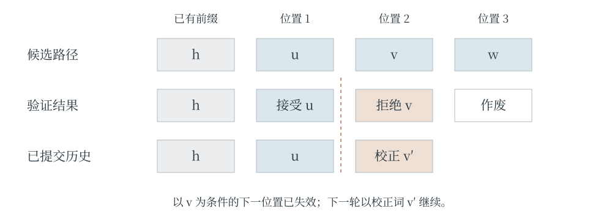
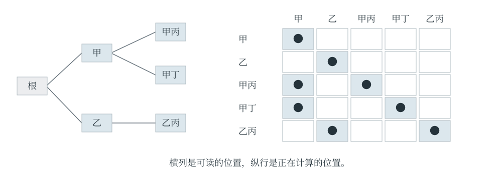

# 第 20 章　生成策略：额外计算何时换来更快或更好的回答

上一章中，A 和 C 可以合批，各生成一个词元。如果只剩 A，一次解码仍要读取模型权重，却只能生成一个位置。直接并行计算后续位置有一个困难：下一位置的输入依赖当前尚未生成的词元。推测解码先提出一段候选，再让目标模型一次验证多个位置。候选被拒绝时，需要按适当的规则修正结果。

本章先用三个候选词说明采样、接受与修正，再分析验证多步所需的计算和显存。最后讨论另一种额外计算：生成多个答案并挑选结果，它的目标是提高答案质量。

## 20.1　下一词的概率与采样

设在当前历史 $h$ 后，模型最后一层为甲、乙、丙算出的三个分数是 $\log 5,\log 3,\log 2$，这里对数取自然对数。模型内部得到的分数称为 logits，用户要的是一个词元。先给分数除以温度 $T>0$，取指数，再除以总和：

$$
p_i=\frac{\exp(z_i/T)}{\sum_j\exp(z_j/T)}.
$$

当 $T=1$，三个概率是 $(0.5,0.3,0.2)$。在区间 $[0,1)$ 上依次分出长度为 0.5、0.3、0.2 的三段。均匀随机数若为 0.67，就落在乙的区间。把乙接到历史后，再算下一步的三个分数。整个回答的概率等于沿它的每一个前缀访问到的条件概率之积；改变第一步的选择，也就改变了以后要访问的分布。

降到 $T=0.5$ 时，三段的长度比从 $5:3:2$ 变成 $25:9:4$，甲的概率升到 $25/38$。贪心解码每步直接取最大分数，可以将低温极限作为直觉，遇到同分则需规定选择顺序。限制为概率最大的前两项（top-k）会去掉丙，于是甲、乙变成 $5/8,3/8$。按累计概率阈值选择最短前缀（top-p）也要先按概率排序，再把保留项重新归一化。本例阈值 0.8 时恰好保留甲乙，换一个前缀未必仍有两项。比较不同实现时，这些参数的变化可能同时影响输出长度、耗时和答案分布。

还有一种约束来自答案的**格式**。若正在填一个只允许甲或丙的枚举字段，可将当前状态下不合法的词元概率置零，剩余概率成为 $5/7,2/7$。下一步合法集合由格式解析器读入实际词元后更新。真实分词器的一枚词元可能包含多个字符，是否允许它要检查整段字符能否接上当前前缀。这样得到的是逐步施加掩码后的采样规则，合法 JSON 也可能含有错误的数值。在下节里，目标分布始终指采样器明确约定的规则，包括它的温度、截断和约束。

## 20.2　草稿的接受与分布校正

为便于手算，给 A 换到一个新的前缀。目标模型给出 $p=(0.50,0.35,0.15)$，一个更便宜的草稿模型给出 $q=(0.60,0.10,0.30)$。与目标分布相比，草稿给乙的概率较低，给甲和丙的概率较高。若总是照收草稿，一千次独立实验中，乙大约只出现一百次，目标却希望它出现三百五十次。

先从 $q$ **抽取**一个候选 $i$。给它设置如下接受概率，抽一个独立的均匀随机数作判定：

$$
a_i=\min(1,p_i/q_i),\quad q_i>0.
$$

这个比值的作用是控制“提出并接受 $i$”的联合概率。草稿本来以 $q_i$ 的概率提出 $i$，若 $q_i>p_i$，只接受其中的 $p_i/q_i$，保留下来的概率恰为 $p_i$。若 $q_i\le p_i$，提出的部分可以全部接受；目标多出的概率还要由拒绝后的校正步骤补足。接受率本身只是整个算法的一半，拒绝后怎样抽样同样决定最终分布。

草稿提出甲的概率是 0.60，针对甲只接受 $5/6$，因此最终有 $0.60\times5/6=0.50$ 的总概率经这条路径成为甲。对乙全部接受，贡献 0.10。对丙接受一半，贡献 0.15。三项合计 0.75。现在逐项对照目标，只有乙还缺 0.25，正好等于拒绝的总概率。每次拒绝时都返回乙，合起来便得到 $0.50,0.35,0.15$。若在拒绝时直接重新从 $p$ 采样，甲又会多分到 $0.25\times0.50$，分布便偏了。


*图 20-1　每格代表 0.05 的概率。先逐列确定两个分布重合的概率质量，再按差额分配拒绝事件的概率质量。图中只有乙有缺口，一般情形可以有多个。*

一般地，直接接受贡献 $q_i a_i=\min(p_i,q_i)$。写 $[x]_+=\max(x,0)$，各候选的缺口为 $[p_i-q_i]_+$。拒绝事件发生时，按缺口的相对大小重新抽样，因此其对第 $i$ 项的无条件贡献恰为 $[p_i-q_i]_+$。两条路径相加就等于 $p_i$。若草稿不支持某个目标词元，它仍能从缺口路径得到；若两分布完全一样，拒绝路径从来不会执行。我们证明的是输出分布相同。两台程序即使用同一个种子，也可能因为耗用随机数的次序不同，写出不同的单个答案。[推测解码的接受与校正算法](https://arxiv.org/abs/2211.17192)

由此还得到一个可观察的量：这个位置的平均接受率是 $\sum_i\min(p_i,q_i)$，也就是 $1-\tfrac12\sum_i|p_i-q_i|$。草稿永远猜概率最大的词，有时在贪心任务中很好用，但随机采样还要知道**提议实际服从的分布**。如果将草稿输出的最高分直接当作提议概率代入接受公式，就无法保证上述概率质量守恒。

草稿也可以从输入里找。设请求前面出现过“线路　状态　正常”，生成到后面又出现“线路　状态”。一个简单的查表器就提出“正常”。若匹配到多行时按固定规则选一行，此时提议分布以概率 1 选择“正常”。假设目标给“正常”“拥堵”“关闭”的概率分别是 0.6、0.3、0.1，接受“正常”的概率就是 0.6。其余 0.4 的轮次从余项抽样，得到“拥堵”“关闭”的条件概率分别为 0.75 和 0.25。把拒绝分支的概率再乘回 0.4，交付分布恰好恢复为原来的三项。这样省下了草稿模型的常驻权重；输入与输出常复用相同片段时才容易提出长而准确的后缀，仍要计入历史查找、目标验证和状态回退的耗时。[vLLM 的 n-gram 草稿](https://docs.vllm.ai/en/latest/features/speculative_decoding/n_gram/)

## 20.3　多词元验证

让草稿先依次提出 $u,v,w$，同时记下各步的提议概率。大模型接到这条暂定后缀后，像预填充一样在一次目标模型调用中计算多个位置。它分别需要在历史 $h$、$hu$、$huv$、$huvw$ 后的条件分布。实现上通常从一个待送入的已提交词元及草稿后缀组成验证块；若边界位置的分数已经可用，就可以复用。因果掩码保证较早的位置看不见更晚的猜测。这样并行起来的是**给定候选后的条件分布计算**，接受判断仍从左到右。

假设 $u$ 被接受，$v$ 被拒，校正抽到 $v'$。本轮可以返回 $u,v'$。为 $huv$ 和 $huvw$ 计算的后续分数都已失去用途，因为用户的历史现在是 $huv'$。下一轮要从保留的前缀接上 $v'$；若 $v'$ 尚未作为输入送入模型，就把它作为下一次待处理的词元。若三个全都通过，就能再从目标在 $huvw$ 后的分布直接抽一枚奖励词元。各步都用当前已接受前缀的正确分布，所以单位置的证明可以逐步应用。遇到结束符或输出上限应立即停止，不能为了凑满一块把后面的候选也送给用户。



*图 20-2　第二个候选遭拒。最下行是最终输出的字符串；中间虚线之后的计算以错误的 v 为条件。退回的是逻辑有效长度，页的释放还要遵守引用计数，当前写指针也要复位。*

可以用两个位置检查“按正确前缀继续”具体保护了哪一个数。设第一步仍服从上节的目标，若第一枚是甲，下一步乙的概率为 0.6；若第一枚是乙，下一步乙的概率只有 0.2。按原模型，交付“甲乙”的概率应为 $0.5\times0.6=0.30$。若草稿第一枚猜甲、目标却把它校正为乙，程序再拿甲分支上的 0.6 给第二枚乙打分，就把一种历史的概率挪给了另一种历史。篇末复算程序穷举了三种候选、两次接受或拒绝的所有路径。把输出上限设为两枚，它用分数运算逐项核对九种双词结果，读者可以改动任一行分布再试。

验证还需要额外显存。若有 32 条序列，每条给 4 个额外验证位置预留目标 KV，按上一章每位置 128 KiB，单这份逻辑空间就需 16 MiB。草稿模型的权重、草稿自己的状态和验证内核的工作区另算。页内已有空位能减少新申请的物理页；若跨页、分叉或同时保存多条草稿，峰值又会提高。用户取消请求时，应能一起清理这些尚未提交的状态。

验证使多个候选位置可以共用一次目标模型调用，但候选可能被拒绝，靠后的计算也可能因此作废。要判断是否加速，既要统计每轮增加了多少有效输出，也要把草稿、验证、缓存和其他请求受到的影响一起计入。

## 20.4　推测长度与成本

把一次普通目标解码轮的时间设为 8 ms。草稿依次猜三步，每步用 1 ms，目标一次验证三步用 10 ms，暂不与其他工作重叠。于是每个验证轮花 13 ms。猜三步并不等于每轮省下两次调用，先算它实际能交付几个词元。

在无限长输出的局部近似下，只要没有提前终止，每轮至少交付一个词元。在前三枚依次通过时，分别能多交付一枚。若第 $j$ 步在前面都通过的条件下接受的概率均为 $a$，交付数 $N$ 的期望为

$$
\mathbb{E}[N]=1+a+a^2+a^3.
$$

这可以按四个事件相加理解，最后的 $a^3$ 对应全通过后得到的额外输出。实际位置的接受概率可以各不相同，把各次方换成相应的条件概率连乘即可。取 $a=0.75$，期望 2.734375 枚，对应长期均摊约 4.75 ms/词，比原来的 8 ms 快约 1.68 倍。若 $a=0.30$，期望只有 1.417 枚，每词约 9.17 ms，普通解码反而较快。在这个固定轮时模型里，划算的必要比较是 $\mathbb{E}[N]>13/8$。短回答靠近末尾时拿不到完整的奖励，离边界近的请求应单独计。

如果想在纸上验证“每轮有几个词”，可以在三个接受判定之后分别停下来，记录到达该深度的概率。下面的写法也适用于第二步、第三步明显难于第一步的情形。

```python
survival = 1
expected = 1
for conditional in [0.75, 0.75, 0.75]:
    survival *= conditional
    expected += survival
assert expected == 2.734375
```


*图 20-3　同一组草稿和验证轮时，只改变条件接受率。曲线上的纵坐标是长期总时间除以总交付词元。流式接口可能一次返回多个词元，但下一轮验证之前仍有 13 ms 等待。*

这是一个很容易被单请求演示掩盖的代价。如果卡上已经有许多真实用户可以一起解码，他们也能提供足够多的矩阵行去摊薄权重读取。此时将部分计算容量用于猜测，可能挤占其他请求的正常解码，验证时间也会随批量变长。评估时同时记录草稿步数、各深度有条件的接受率、每个验证批的耗时、放弃的计算、额外显存，以及上一章的逐请求达标率。图中的 1.68 倍来自给定的单请求条件，不能直接作为其他负载下的系统加速比。

下面用一轮解码的容量说明这种竞争。假设目标模型每轮恰能处理 8 行，这八行在两种方案中的耗时相同，队列里有 8 条已经准备好、都需要下一枚词元的请求。普通解码给每条 1 行，确认 8 枚。若给其中一条分 4 行以验证三枚草稿并计算末位置分布，其余只够 4 条普通请求。沿用条件接受率 0.75，期望交付变为 $2.734375+4=6.734375$ 枚，另有三条请求整轮等候。这里还没计入草稿模型的耗时。换成队列里只有一条请求，空着的三行没有其他用户争用，快慢又回到上一段的整轮时间比较。调度器需要考虑当前批次中可用于其他请求的计算容量，以及受影响的请求距离下一次输出期限还有多久。

### 各位置接受事件的相关性

猜两步，一轮目标验证在遇到第一次拒绝后终止这条草稿前缀。若能再交付一枚修正或奖励词元，且没有遇到结束符，一轮交付数的期望是 $1+P(A_1)+P(A_1\cap A_2)$。假定两个位置各自的潜在接受率都为 0.8，若二者独立，期望是 $1+0.8+0.64=2.44$。若八成前缀两步都会过、两成两步都不过，结果变为 2.6。若六成两步都过、各有两成只过其中一步，结果则是 2.4。三个场景的单位置潜在接受率相同。

线上拒绝第一步后不会沿同一失效前缀真的输出第二步，因此实际可直接计数的是 100 轮有多少轮至少接受一步、多少轮至少接受两步。把两项次数除以总轮数再相加，便能估计上述期望；第二个位置若只在幸存的轮次中统计，其分母不同。比较两种草稿模型时，还要用交付数除以草稿、验证和调度的整轮时间。只把第二步的条件接受率记在看板上，容易为一条很少走到的支路花过多算力。

## 20.5　树形候选与动态推测长度

独立的小草稿模型能在不改目标模型的前提下工作，但有第二套权重和状态。另一条路是在主干隐藏表示上加预测头，利用已经计算的表示预测未来几个位置。训练时能利用后续多个位置的监督信号，多词元预测（MTP）也可以给推理提供候选。不同预测头是否依赖上一步的候选，决定了它们能否并行出草稿、能否共用某些计算；训练了预测头并不免除目标验证。Medusa 展示了多头候选与树形验证的实现，DeepSeek-V3 的技术报告给出了带顺序依赖的多词元预测设计。[Medusa](https://arxiv.org/abs/2401.10774) · [DeepSeek-V3 技术报告](https://arxiv.org/abs/2412.19437)

假定同一前缀下想验证三条两词候选“甲丙”“甲丁”“乙丙”。分别串成三条线，共有六个候选位置；合成一棵树，根后的“甲”只算一次，需要五个非根节点。“甲丙”可以读根和甲，“乙丙”须读根和乙，两个“丙”的历史不同，不能合并。树形掩码据此限制每行允许看的祖先，位置编号按各自深度取值。即使树被排成一个平面数组，也不能让后写入的节点关注所有先写入的节点。树越宽，命中一条好路径的机会可能越大，但验证、掩码及暂存状态的开销也随节点数增加。若要求严格保持采样分布，树还需使用与候选生成方式相匹配的选择和校正算法；在树里挑一条“看起来一致”的路径只给出了启发式规则。



*图 20-4　左侧是候选树，右侧矩阵表示五个候选位置的可见关系。根和公共历史对各行都可见；末行只能读取乙和自身，不能读取甲的后续节点。*

树的宽度决定同时准备哪些分支；即便只走一条分支，引擎还要决定候选生成到哪个深度。若验证表明大多数第三个候选最终都用不上，还值得每次都猜三个吗？对进入同一类上下文的验证轮，设 $s_j$ 为前 $j$ 枚**全部**接受的概率，$E_m=1+\sum_{j=1}^m s_j$ 是猜 $m$ 枚时每轮平均交付数，$C_m$ 是相应的平均轮时。在远离结束符、每轮面对相同分布的近似下，多猜一枚划算的条件是

$$
\frac{C_{m+1}}{E_m+s_{m+1}}<\frac{C_m}{E_m}
\quad\Longleftrightarrow\quad
C_{m+1}-C_m < s_{m+1}\frac{C_m}{E_m}.
$$

右边是多生成一个候选带来的预期输出数，乘以当前平均每个词元的耗时。假设一千轮里第一枚都能拿去验证，其中 900 枚通过；在这 900 轮里又有 720 轮通过第二枚，随后只有 216 轮通过第三枚。于是 $s_1=0.90$、$s_2=0.72$、$s_3=0.216$。第三步的**条件**接受率是 $216/720=0.30$，真正能给始发的一千轮增加交付的只有 21.6%。设猜零至三枚的总轮时依次为 8、9、11、13 ms，猜两枚时只要 $11/(1+0.90+0.72)\approx4.20$ ms/词。如果多猜第三枚，预期收益值 $0.216\times4.20\approx0.91$ ms，小于额外两毫秒，均摊时间反而升到 $13/2.836\approx4.58$ ms/词。若另一台设备在同样批形状下增加第三枚只多花 0.5 ms，选择就会翻转。


*图 20-5　上图的每条线都从最初的一千轮计数。下图放大第三步的选择，点在 0.91 ms 左侧时多猜一枚可降低平均每词时间。两个设备沿用相同的接受记录，仅轮时不同。*

SpecDec++ 把验证时机作为序贯决策，在草稿端训练接受预测头，逐步估计这条候选链发生拒绝的概率，据此选择何时交给目标模型。论文在自己的成本模型中给出停止的充分条件；图中的不等式则只比较相邻两种固定深度，便于在本机审核测量。若提前停止，就看不到本轮更深位置的实际结果。用这类日志校准预测头时，可留一小部分随机抽取的完整验证轮，以免只从“容易的前缀才走得深”的样本推断全部流量。模型、采样温度、批量都可能改变曲线。选深度只影响怎样分配计算；输出分布仍由 20.2 节的接受与校正规则保证。[SpecDec++ 原论文](https://arxiv.org/abs/2405.19715)

可以用[逐深度复算程序](../../experiments/part05/speculation_depth.py)输入同一组存活计数，分别令第三步额外耗时为 2 ms 和 0.5 ms。DeepInfer 的公开实现也把验证长度交给调度器，其 DeepSeek-V4.1-Flash 路径支持 DSpark 和基于置信度的验证调度。不同长度同批进入时，引擎要为它们分别安排位置、缓存和掩码；具体采样模式的接受规则仍需查实现。这份功能说明并未将其算法等同于 SpecDec++。[DeepInfer 固定版本的功能说明](https://github.com/deepseek-ai/DeepInfer/blob/553741557a57df44a46fb3ab72b6aafeaf945337/README.md)

前面讨论的校正规则以保持目标采样分布为前提。另一方面，应用也可能主动生成多份结果，再用测试器挑选能完成任务的一份。此时系统追求的是不同的交付目标，需要分别测量输出质量、额外计算和用户等待时间。

## 20.6　通过多次生成提高答案质量

现在让同一服务完成另一项任务：提交一个能通过测试的程序。假定一次独立采样答对的概率是 0.4，有一个完美且便宜的测试器。在相同输入下独立采三次，只要一份正确就能选出来，因此最终答对概率是 $1-0.6^3=0.784$。这种额外计算改变了最终答案的分布。若无论如何都生成三份，生成工作量接近三倍，三份相同的提示前缀倒可以共用。并行运行能缩短等三份都齐的时间，却要同时容纳三个不断分叉的历史。串行生成、发现正确即停，最多三次，平均只用 $1+0.6+0.6^2=1.96$ 次尝试。

现实中的评分器可能优先选中“看起来像答案”的错误输出。假定它只负责验收一份样本，正确时以 0.9 的概率放行，错误时以 0.2 的概率误放。那么一次放行的概率是 $0.4\times0.9+0.6\times0.2=0.48$，其中真正正确的比例只有 $0.36/0.48=0.75$。连续尝试直到首次放行，可能会更快得到一个被接受的答案，仍需用独立的质量评测确认答对了多少。候选高度相似时，又不能沿用独立试验的 0.784。

搜索还可以在半成品上花预算，例如只保留累计对数概率较高的若干条路径继续扩展（束搜索）。它共享前缀并反复淘汰分支，偏好由评分和长度处理规则决定。对自由问答，较高的模型概率与事实正确之间需要另行验证。若换成同时修改多个位置的扩散式生成，或并行生成不同输出单元的模型，串行依赖、缓存有效区间和“每轮至少交付一词”的前提都要从生成规则重新推导。无论选择哪条路径，最后应让实验分别回答三件事：一个用户等多久、设备共做多少工作、交付答案的质量如何。

推测解码用额外计算换取同一目标分布下的更快生成，多次尝试则用额外计算增加得到好答案的机会。前者要核对分布校正与可交付词元的间隔，后者要把判分、筛选和失败候选都算进成本。两种方法都可能同时保留更多分支状态。下一章将沿这些状态的存储和传输继续分析：当一台机器承担不了全部工作时，拆到别处究竟会省下什么，又会增加哪些等待。

## 练习与解答

### 1. 草稿概率不足时如何校正

目标为 $(0.4,0.4,0.2)$，草稿为 $(0.2,0.3,0.5)$。一次提议的平均接受率是多少？一旦拒绝，下一词应怎样抽？

**解答。** 直接接收的质量为 $(0.2,0.3,0.2)$，和为 0.7。缺口为 $(0.2,0.1,0)$，归一化后按 $(2/3,1/3,0)$ 抽。第三项被提议时的条件接受率为 $0.2/0.5=0.4$。把这两个分支相加可逐项还原目标。

### 2. 后续位置的接受率更低

三层依次通过的条件概率是 0.9、0.6、0.3，轮成本仍为 13 ms。每轮期望交付几个词元？普通轮若缩到 5 ms，推测还划算吗？

**解答。** 期望是 $1+0.9+0.54+0.162=2.602$。每词约 4.996 ms，与 5 ms 几乎持平。整轮耗时如果再增加约 0.01 ms，就会抵消这项优势；如此细微的差别需要实际测量。

### 3. 宽树占多少位置

把三个首选都各自扩出两个子节点，目标端为一条请求的所有非根位置暂存 KV。每位置 128 KiB，另有一个已驻留的公共根。与逐条为六条路径各存两个位置相比，少用多少逻辑存储？

**解答。** 树有 $3+6=9$ 个非根节点，需 1152 KiB；各存各的需要 $6\times2=12$ 个位置，共 1536 KiB。相差 384 KiB。最终还须按物理块取整，掩码及草稿状态另算。

### 4. 加倍尝试，还是改进草稿

一个算术任务单次独立答对率为 0.4，有完美验证器。并行做两次后选对的，与把同一采样规则加速两倍且仍只采一次的，答对率各是多少？

**解答。** 前者为 $1-0.6^2=0.64$，消耗两个候选的生成工作；后者仍为 0.4。加速留下的时间可再用于第二次尝试，但那是另一个要单独预算与评估的策略。

[下载本篇复算程序，逐项核对接受质量和交付长度](../../experiments/part05/verify.py)

[全书目录](../../README.md) · [上一章 · 推理引擎：变长请求怎样共享设备](ch19.md) · [下一章 · 分布式推理：计算与状态应该放在哪里](ch21.md)
