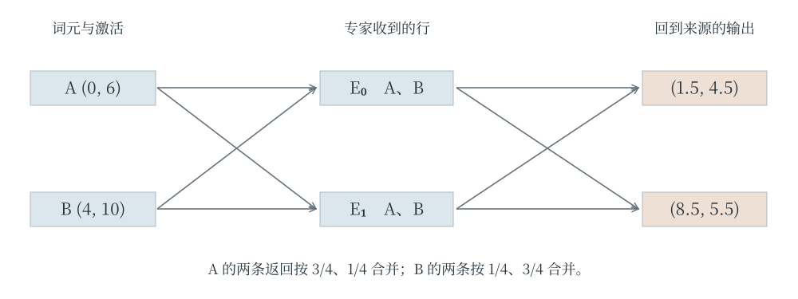
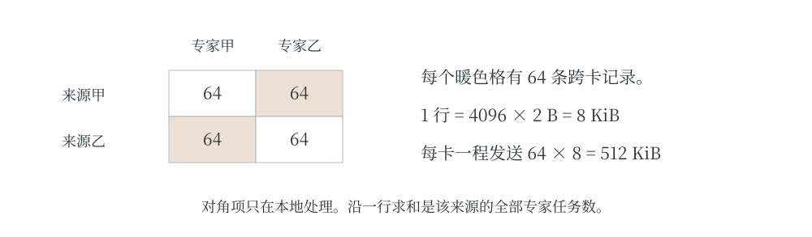
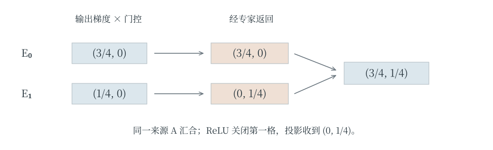
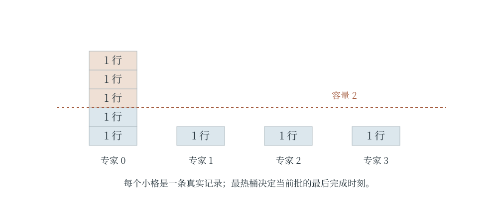
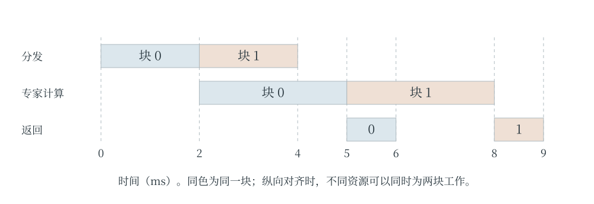
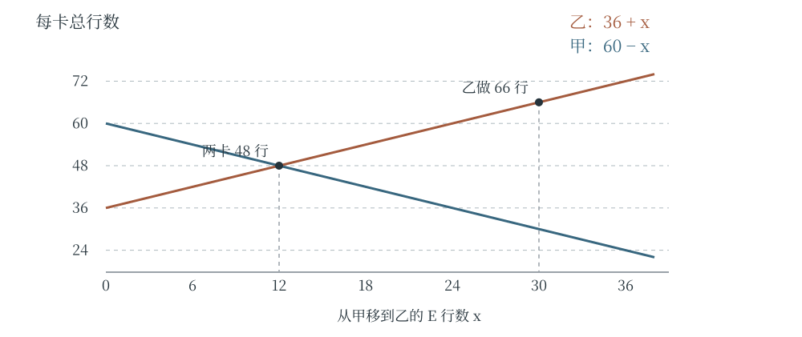
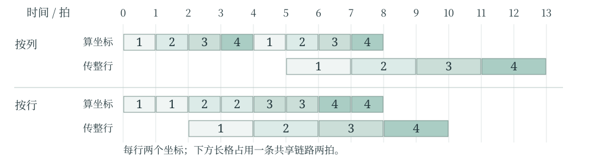
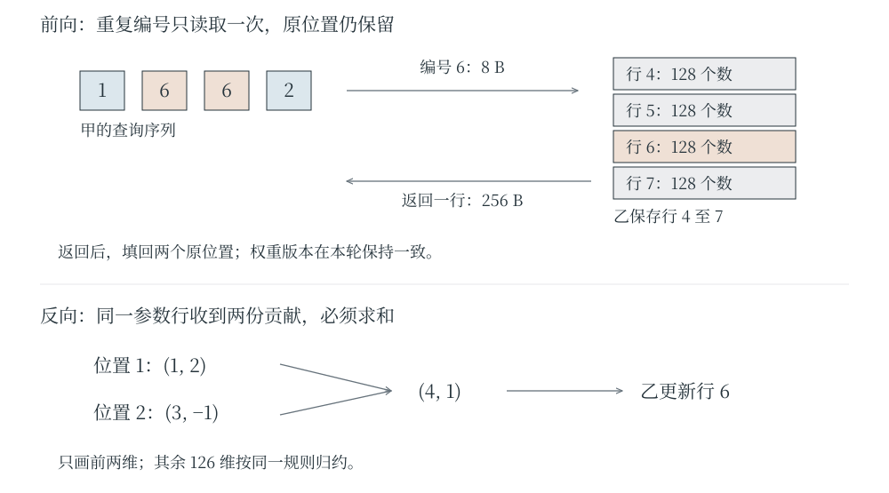

# 第 22 章　混合专家的路由与执行

第二十一章中，词元 A 和 B 经过相同的稠密投影，各张卡要处理的矩阵形状事先确定。现在考虑在投影后接入多套前馈网络，由路由器为每个词元选择其中几套。这样，模型的参数容量可以随专家总数增加，而每个词元只计算被选中的专家。代价是各专家收到多少行要等路由完成后才知道，计算与通信的负载也会随输入变化。

## 22.1　两个词元的专家计算

沿用投影、偏置和 ReLU，得到 $`h_A=(0,6)`$ 与 $`h_B=(4,10)`$。用两个小线性专家代替真正的多层前馈网络，便于手算。专家 0 用单位矩阵，专家 1 将两个分量互换。把专家 0 放在卡甲，专家 1 放在卡乙；词元 A 的原始位置属于甲，B 属于乙。这里的**原始位置**是模型之后要找回该行的位置，专家只是暂时处理它。

路由器通常从 $`h`$ 投影得到各专家的分数，取 top-$`k`$ 后按架构约定生成权重。本例把两条路由分数直接列成可训练的小表，A 对两专家的分数为 $`(\ln3,0)`$，B 为 $`(0,\ln3)`$。对选中项做 softmax，权重恰为 $`(3/4,1/4)`$ 与 $`(1/4,3/4)`$。选中两个专家便于观察同一行如何分发到不同设备，以及结果如何合并。真实稀疏性来自 $`k\lt E`$；例如 8 个等大专家只选 2 个时，单词元用到的专家矩阵参数占该层专家参数的四分之一，共享部分和路由器还要另计。

若 $`E_e(h)`$ 表示专家 $`e`$ 对行 $`h`$ 的变换，$`\mathcal S_t`$ 为词元 $`t`$ 选中的集合，数学上只需

```math
y_t=\sum_{e\in\mathcal S_t}p_{te}E_e(h_t).
```

这里的 $`h_t`$ 是一个词元的隐藏向量，$`E_e(h_t)`$ 与输出 $`y_t`$ 的宽度相同，$`p_{te}`$ 是该词元分给专家 $`e`$ 的标量权重。因此，专家先各自处理同一行，再按权重逐分量相加。求和只遍历选中的集合：增加未选中的专家会增加参数存储，却不会让这个词元多执行一次专家矩阵乘。路由器的计算和结果分发仍然需要单独计入。

对词元 A，专家 0 返回 $`(0,6)`$，专家 1 返回 $`(6,0)`$，合成 $`(1.5,4.5)`$。对词元 B，两份返回分别为 $`(4,10)`$、$`(10,4)`$，合成 $`(8.5,5.5)`$。现在把卡的位置调换，只要每个返回值仍配上正确的词元、专家和权重，四个数都应保持不变。后面每一项系统优化都可以用它们作检查。



*图 22-1　词元 A 的激活分别送往两个专家，返回结果分别乘以四分之三和四分之一，再合并到 A 的输出位置。*

## 22.2　专家分发与分组计算

路由器向运行时提供四条记录，可写为 `(来源, 行号, 专家, 权重)`。先按目的卡数记录，生成每个目的地的长度；对这些长度求前缀和，就得到打包区间的起止。对于甲的 A，发给两卡的条数为 $`[1,1]`$，偏移为 $`[0,1,2]`$。乙对 B 也相同。甲保留给本地专家的 A，并将一份 A 发送到乙；乙也将一份 B 发送到甲。通信结束后，甲上的专家 0 和乙上的专家 1 都收到 A、B 两行。各自可对这两行做一次矩阵乘，然后将结果沿反方向送回。接收后的排列可以改变，但必须保存逆置换，或记录每行对应的来源进程与词元位置。

这次交互叫 dispatch（分发）与 combine（合并）。第二十章的 All-to-All 描述了各发各的内容这一语义；每个目的地行数不同时，需要可变长的交换、计数与偏移，或先按固定容量填充。实现也可能把同一目的节点的多份任务合并、在节点内展开，从而改变真正跨机的份数。通信量须说明是在数逻辑任务、对端设备记录，还是跨节点的唯一激活。

在小例中，每个方向跨两卡的记录只有一行。若激活采用 BF16，每行 2 个分量，共 4 字节。在分发阶段甲发 4 字节，合并时甲再发 4 字节；乙对称。甲同时收了 8 字节，但说“每卡前向发送”时只记 8。本地的专家任务占算力和片内流量，却不经过卡间链路。权重标量如果留在来源端，到收到结果时再乘即可；索引、偏移、计数和对齐也有开销，本章的表格将它们与激活载荷分开统计。



*图 22-2　左边对角线是原地处理。右边把隐藏宽度扩到 4096 后，每张卡只数自己送出的非对角项，每个方向各发送 512 KiB。*

现在考虑上一章同一台机器中的两张卡。稠密 TP 对的最后一层已把 128 行激活归约到两卡。约定甲做前 64 行的来源，乙做后 64 行的来源，避免同一词元被派发两次。每个来源词元各有一个本地专家和一个远端专家。宽度 4096、两字节输入与返回，每条记录 8192 字节。每卡在分发或合并阶段各发送 $`64\times8192=524288`$ 字节，即 0.5 MiB。分发和合并两程使每卡每微批前向发送 1 MiB。两台机器各自有两位专家的完整集合，专家交换都可以留在机内，而同号专家的两个数据副本仍要在更新前跨机同步梯度。

### 稀疏专家层中的计算与通信

在甲上再放专家 2，取 $`E_2(h)=2h`$；乙上再放专家 3，取 $`E_3(u,v)=(u,3v)`$。每个词元只挑四位专家中的两位，softmax 在选中项上归一化。让 A、B 的新增两项分数都低于原来的两项。此时 A、B 的路由、输出和前面的手算逐项相同，新增两位专家对它们既不接收消息，也不做乘法。再让甲多接一条 $`h_C=(2,4)`$，乙多接一条 $`h_D=(1,3)`$。根据路由器的分数与选中权重，可以列出派发结果：

| 词元与来源 | 两位选中专家、权重 | 加权输出 | 跨卡分发条数 |
|---|---|---|---:|
| A，甲 | 0 与 1，$`3/4,1/4`$ | $`(1.5,4.5)`$ | 1 |
| B，乙 | 0 与 1，$`1/4,3/4`$ | $`(8.5,5.5)`$ | 1 |
| C，甲 | 0 与 2，$`1/2,1/2`$ | $`(3,6)`$ | 0 |
| D，乙 | 2 与 3，$`1/4,3/4`$ | $`(1.25,8.25)`$ | 1 |

以词元 C 为例，两个专家都在甲，门控使 $`(2,4)`$ 与 $`(4,8)`$ 各贡献一半，这两次专家计算都在本地完成，仅统计跨卡消息会漏掉它们的计算量。专家 2 收到来自不同位置的 C、D 两行，反向传播时这两行都对该专家的权重梯度作出贡献。整个批实际执行八个“词元、专家”配对，若每个词元都执行四位专家则有十六个配对；八个选中配对里又只有三个跨卡。因此，需要分别统计总专家数、每词元激活的专家数和网络传输记录数。按 4096 宽度放大时，额外常驻一个完整专家又要每卡 256 MiB，会用完原方案的余量，还得为打包及激活腾位置。后文统计整个训练步时，仍沿用原来的每卡一位专家配置。

### 共享专家、细粒度专家与潜空间的宽度

回到上表的词元 C。假如模型设计者认为所有词元都需要一道公共变换，可以令 $`y_C=S(h_C)+\sum_{e\in R(C)}g_eE_e(h_C)`$。$`S`$ 叫共享专家，每个词元都要运行；$`R(C)`$ 才是随输入改变的名单。例如仍让 C 的两个路由专家给出 $`(3,6)`$，另设 $`S(u,v)=(u,0)`$，C 的最终输出就变成 $`(5,6)`$。共享支路的权重系数由这里的模型定义为 1，并不参与那两个门控值的归一化。在每个来源卡上保留 $`S`$ 的副本，可让这笔前向计算就地完成，训练时各副本的参数梯度仍要同步。共享专家“共享”的是所有词元都调用它的模型功能，其参数在设备上放几份是另一项决定。

这样会多做计算吗？先看可以公平比较的预算。设原本有四个中间宽度为 256 的专家，每个词元挑两个；激活的中间通道数合计 512。改用八个宽度为 128 的专家，每个词元选四个，仍是 512；也可在这八个中指定一个固定执行，余下七个只挑三个。用相同的输入输出宽度和相同形式的两次线性变换，三种设计每个词元的**专家矩阵乘**预算相同。细分提供更多组合，但现在每个词元可能要投递四份更窄的专家任务。中间宽度减半，投递给远端的输入行仍有原来的 4096 个分量。能否在节点内复用一份送来的输入、每个专家能否凑齐足够多行，决定路由和分发开销会使吞吐下降多少。共享专家可以在训练中学习公共特征，是否真的改善质量仍须在固定预算下对照。[DeepSeekMoE 的细粒度分割与共享专家设计](https://arxiv.org/abs/2401.06066)

怎样才能真的少搬一行？考虑潜空间专家（LatentMoE）的一种形状。来源先用一个共享下投影，把 4096 宽的行压成 1024 宽；路由专家只在这 1024 个坐标里运算，返回后先按门控合并，再共享一次线性上投影回 4096 宽。线性上投影 $`U`$ 对同一词元的各路结果相同，因此 $`U(\sum_e g_e z_e)=\sum_e g_e U(z_e)`$；若上投影按专家各不相同，就不能这样合并。共享专家可继续在原宽度本地执行，再把它与上投影相加。

沿图 22-2 的放置，每卡仍有 64 条记录跨端，输入和返回均为 BF16。普通专家每卡两程发 1 MiB，潜空间专家每卡两程只发 $`2\times64\times1024\times2=262144`$ 字节，即 0.25 MiB。这 0.75 MiB 是特定切面上的载荷节省。每个来源词元增加的一次下投影加一次上投影约用 $`4\times4096\times1024=16777216`$ FLOP，假设乘加计两次；专家内部的乘法预算则随所选中间宽度另算。对固定的线性上投影，路由支路的输出被限制在至多 1024 维的子空间。想把已训练的 4096 宽模型直接改窄，需要重新训练或验证近似误差。Nemotron 3 Super 发布的 BF16 配置恰好采用 4096 的隐藏宽度和 1024 的专家潜空间宽度，另有一个共享专家。上例的两卡放置和 64 条跨端记录是为了隔离通信代价所作的教学假设。[Nemotron 3 Super 发布的模型配置](https://huggingface.co/nvidia/NVIDIA-Nemotron-3-Super-120B-A12B-BF16/blob/main/config.json)

前面的分发方案已经说明如何得到正确前向结果。训练还要求知道损失对每个专家、路由器和上游投影的影响。因为一个词元被复制给多个专家，反向时也必须把各条支路对该词元的梯度相加，之后才能继续传给前一层。

把两个词元分别送到负责的设备只是最小特例。要同时给四台设备预留接收空间，还得让接收方知道每个来源会发几行。先看一次只交换行、保留内容的例子，再把这些行交给专家。

### All-to-All：按目标设备交换数据

再看四张卡之间的一次 All-to-All。每张卡分别记录要发给四个目的地的数据条数，依次得到四行 $`(1,2,0,0)`$、$`(0,1,1,0)`$、$`(2,0,1,0)`$、$`(0,0,1,1)`$。总共十条，其中对角线上的四条留在本卡。矩阵的行表示发送数量，列表示接收数量：rank 0 保留一条自己的数据，还从 rank 2 接收两条；rank 3 只收到自己保留的一条。如果 rank 0 错把自己的发送数量当成接收数量，为 rank 1 预留两个接收槽并等待对方发来两条，就会一直等下去。实现时可以先交换计数，取得各来源的数据长度，再在每个接收端计算前缀和，为数据分配互不重叠的接收区间。

仍将 rank 0、1 放在服务器甲，rank 2、3 放在服务器乙。计数矩阵的右上角表示甲发往乙的数据，只有 rank 1 发给 rank 2 的一条；左下角表示乙发往甲的数据，有 rank 2 发给 rank 0 的两条。设每条激活向量有 4096 个元素，每个元素占两字节，那么两个方向的跨机流量分别为 8 KiB 和 16 KiB。全组共有六条发往其他卡的记录，其中三条需要跨机传输。反向传播或返回处理结果时，可以转置计数表安排反向交换，但还须记录接收区中的每一项对应原来的哪个词元。只有交换数量不足以恢复数据原有的排列顺序。第二十二章讨论专家打包时，会再次用到计数表和逆置换。

## 22.3　专家层的反向传播

这次取新损失 $`\mathcal L=y_{A,0}+y_{B,0}=10`$，只看两词元输出的**第一列**。它与第三篇的教学损失不同，用于区分两条专家支路的梯度。这个目标只用于检查计算和通信是否正确，并不用于训练实际语言能力。给 A 传回的向量 $`g=(1,0)`$。乘门控后，专家 0 的输出梯度为 $`(3/4,0)`$，专家 1 的为 $`(1/4,0)`$。专家 0 的权重是单位矩阵，因此输入梯度仍为 $`(3/4,0)`$；专家 1 交换两个分量，输入梯度为 $`(0,1/4)`$。加在一起，A 的 $`h`$ 梯度为 $`(3/4,1/4)`$；同理 B 为 $`(1/4,3/4)`$。训练时两条支路的梯度都必须传回上游。

路由分数也要学习。对一个词元令 $`a_e=g\cdot E_e(h)`$。在本例选中的集合内，softmax 的导数给出

```math
\frac{\partial\mathcal L}{\partial z_e}
=p_e\left(a_e-\sum_j p_j a_j\right).
```

A 的两专家第一列为 0 与 6，加权均值 1.5。于是对两个分数的导数为 $`-1.125`$ 与 $`1.125`$。B 的两数为 4、10，均值 8.5，两个导数恰好也是 $`-1.125,1.125`$。每对和为零，与给整行分数加同一常数不改变概率相符。实际若分数由 $`h`$ 经路由投影算出，反向还须把这一支的梯度加回 $`h`$；教学小表按词元索引独立取分数，所以没有这条额外支路。硬 top-$`k`$ 选择还涉及离散边界，以上微分针对已确定的选中集合和本章归一化方式。

再沿熟悉的 ReLU 回到稠密投影。A 的第一分量在前向被截掉，因此对投影输出的梯度为 $`(0,1/4)`$；B 两个都通过，得到 $`(1/4,3/4)`$。把两个外积相加，得到

```math
\bar W=\begin{bmatrix}3/4&5/2\\1&7/2\end{bmatrix},
```

```math
\bar b=(1/4,1).
```

专家矩阵的梯度则保留在持有该专家的设备上。取专家 1 的第一列，A 贡献 $`(0,6)/4`$，B 贡献 $`3(4,10)/4`$，总计 $`(3,9)`$，第二列梯度为零。专家 0 的对应列为 $`(1,7)`$。虽然这些梯度的形状相同，但它们对应不同的专家，不能直接相加。DP 组应当归约相同专家的副本，而 EP（专家并行）组用来交换去不同专家的激活。



*图 22-3　A 对投影第二列的梯度来自两个专家分支。两个分支分别乘以门控权重，返回的梯度相加后再经过 ReLU。缺少返回梯度时，前向计算仍然正确，但投影参数的梯度会出错。*

若分发的逆向要把专家算出的输入梯度送回来源，合并的逆向要把按门控加权的输出梯度送往专家，在输入、输出及两种激活梯度都用两字节且等宽的预算中，反向又有两程。大例子于是每卡每微批发 2 MiB，四微批共 8 MiB，均属机内的**专家交换**。此外，原先稠密 TP 接口持有复制的 $`H`$，现在输出端按词元独有地计算损失。回到这处接口，若直接让两卡都需完整的 $`\bar H`$，可以 AllGather 两份 64 行梯度，每卡另发 0.5 MiB/微批，共 2 MiB/步。若重新设计相邻层的返回布局，通信可并入别的归约，必须随新图重数。如果忽略格式转换中的这 2 MiB 通信，就会低估代价。

每个设备额外持有一个 $`4096^2`$ 专家矩阵，其 16 字节/参数的长期训练状态占 256 MiB，两个数据副本之间同步该专家的两字节梯度时，每卡跨机再发 32 MiB/步。因此第二十一章每卡的 5.5 GiB 已预算用量变为 5.75 GiB，再加路由、打包、专家激活、元数据等额外峰值。余下 0.25 GiB 能否容纳它们，要依据并发微批和最热专家检查。若实际专家是多矩阵的门控前馈层，必须用其真实参数量重新计算。

本章的小层可以用两个独立 CPU 进程执行。两进程各持一行输入和一个专家，沿本地管道做四次专家交换，再对共享参数的梯度求和。对投影做步长 $`1/8`$ 的 SGD，左上权重从 2 变为 $`2-(3/4)/8=1.90625`$。这条实验用 FP64 和普通进程消息验证数值与归属；前文 BF16 载荷预算针对明确给定的设备路径。[双进程训练步](../../experiments/part04/distributed_step.py)

至此，前向输出、反向梯度及相应通信都已明确，可以完成一次参数更新。不过，路由器对每个词元分别作决定，下一批到达时，各专家收到的行数可能完全不同。即使总计算量已知，单独看总量也无法确定哪张卡最后完成。

## 22.4　专家负载与容量

给手算例增加两个专家，改做 top-1，用八个词元观察负载。某批路由到四个专家的行数为 $`(5,1,1,1)`$。假设每个专家独占一台等速计算单元、每行用一拍。按总量平均每个专家处理两行，但要等负载最重的专家完成五行计算，整批才可合并。四台机器五拍共有二十个行槽，只有八个有用，利用率 40%。即使所有链路在第零拍就完成记录传输，这个下界仍在。若把专家统统按最大行数填充成矩形批，就会真的算一些无效行。



*图 22-4　水平线是接纳策略，纵轴是实际路由需求。丢弃超限的行会改变三个词元的前向结果；只改变内核的调度顺序则不会。*

设一批有 $`T`$ 个有效词元、每个选 $`k`$ 个专家、专家数 $`E`$。一种固定容量策略给每专家预留 $`\lceil cTk/E\rceil`$ 行，$`c`$ 为容量系数。本例 $`c=1`$ 时容量为 2，专家 0 有三条超限。若选择丢弃这三条专家支路，其他专家还空着的三个槽不会自动替它算，模型的输出和梯度确实变了。若有残差连接，词元可继续走残差，失去的是该次专家贡献。改派次选专家也会改变函数。扩大容量到 5 则要为四桶预留二十行。保留真实行数的 dropless 策略可用分组 GEMM 或块稀疏计算覆盖不同长度，代价是动态布局、尾块和热点的关键路径。[Switch Transformer 的路由与容量](https://arxiv.org/abs/2101.03961) [MegaBlocks 的块稀疏训练](https://arxiv.org/abs/2211.15841)

一个训练期的办法是鼓励长期路由更均匀。例如常见 top-1 辅助项将各专家的硬分配比例 $`f_e`$ 与平均路由概率 $`q_e`$ 相乘再求和，整体乘 $`E`$ 和一个小权重。如果四个专家分配与平均概率都均匀，$`E\sum_e f_e q_e=1`$。为说明方向，若两份比例都近似 $`(5,1,1,1)/8`$，该量是 $`4(25+1+1+1)/64=1.75`$。在给定硬分配的这次反传中，概率项提供可微的调节方向；仅把输入顺序随机打乱不会改变这批的总需求。DeepSeek-V3 另采用随负载调整专家选择偏置的机制，也讨论了通信受限时的节点选择。调节选择与改变专家输出的组合权重是两个位置，阅读实现要分别找出二者。[DeepSeek-V3 技术报告](https://arxiv.org/abs/2412.19437)

下面通过一个算例说明如何使用偏置调节专家负载。一个词元要从甲、乙、丙中选两个专家，原始亲和度是 0.80、0.63、0.62。原先会选中甲和乙。设刚结束的一步里乙过载，丙偏闲，下一步选择时三个偏置是 0、−0.02、+0.02。比较的数就变成 0.80、0.61、0.64，第二个目的地换成丙。合并时仍取**入选者的原始亲和度**。为便于手算，把两者归一到和为 1，忽略其他缩放，丙的权重为 $`0.62/(0.80+0.62)\approx0.437`$。若把 0.64 也拿去算组合权重，就会改变合并结果。偏置来自前一步整批的负载反馈，控制的是后面一批的倾向；它无法减少当前已分配给乙的五行工作。报告中用于整批平衡的偏置和防止单序列极端失衡的小辅助损失同时存在。[DeepSeek-V3 技术报告第 2.1.2 节](https://arxiv.org/html/2412.19437v2#S2.SS1.SSS2)

从网络角度看，还需要考虑专家的物理位置。假设甲与丙在同一远端节点，来自本机的一行激活有 $`4096\times2=8192`$ 字节。按专家分别发，两条支路的激活共跨机 16 KiB；若向目标节点只发送一次，再在节点内复制，则跨机的激活为 8 KiB，节点内仍须向两个专家各分发一行。门控、索引、回程都另计。若甲与丙分居两个远端节点，这个词元两次跨机传输都省不掉。所以路由表上的两项既决定模型算什么，也决定哪些物理链路承担传输。保持选中专家及门控不变、只调整物理放置，和改选另一位专家有不同的数值后果。

### 平均负载与批次内的波动

同样八个词元，两个专家，各个词元单独看都有一半概率选甲。若选择相互独立，甲收到的个数是八次抛硬币的正面数，均值为 4，方差为 2。给甲六个位置，溢出概率为 $`(8+1)/256\approx3.52\%`$，其中 8 对应七个词元选甲，1 对应八个全选甲。若同一请求的八个词元总是一起选甲或一起选乙，甲的均值仍是 4，但方差变为 16，溢出概率达到一半。

第二种极端分布可能来自同类输入成批到达所造成的相关性。增大缓冲能减少丢弃或重路由，但此例中两种分布的平均负载图完全一样，不能据此决定多配几个槽。实践中可以记录每个调度批中各专家收到的词元数，观察最热专家的负载分布，并追踪超出容量的词元如何处理。若这些词元需要重算或等待另一张卡，还应将额外通信和尾延迟计入评估。

## 22.5　专家复制与计算通信重叠

考虑把专家 0 复制到另一空闲卡，让两份相同权重各做一部分分配给高负载专家的行。若五行拆成 3 与 2，其他专家和新副本有独立容量、线路充足，关键部分可从五拍降至三拍。代价是多放一份参数、保持副本版本一致、训练时再汇总它们的梯度，还可能多一次跨节点发送。若新副本与原有忙专家争用同一组矩阵单元，应把二者的工作相加，而不能继续按独立设备的三拍估算。

另一种做法是一边收下一组记录，一边计算已经到齐的专家块，再尽早返回结果。假设两块各需分发 2、计算 3、返回 1 ms，三类资源独立且双向传输不争同一瓶颈。全串行共 12 ms；流水中第一块分别在 2、5、6 ms 完成三个阶段，第二块在 4 ms 发完、等算力到 5 ms，随后 8 ms 算完，9 ms 返回。现在把最重的块放在最后、或使两种传输挤占计算核，时间线都会变。DeepEP 给出面向专家分发与合并的实现，提供针对不同负载的路径。若跨域时可先按目标节点合并消息、到节点内再展开，就能以额外转发和布局管理换取稀缺跨节点带宽。收益取决于同一词元选中的专家有多少位于同一节点。[DeepEP 官方实现与接口](https://github.com/deepseek-ai/DeepEP)



*图 22-5　第二块在第 4 毫秒已经收到，却要等第一块在第 5 毫秒交还计算资源；最后一行在第 9 毫秒返抵来源端。*

下面只用三个资源的空闲时刻复算这幅图。若分发与返回争用同一方向的出口，估算时必须将两者安排在同一条资源时间线上。

```python
sent = computed = returned = 0
for _ in range(2):
    sent += 2
    computed = max(sent, computed) + 3
    returned = max(computed, returned) + 1
assert returned == 9
```

训练大微批有机会让每个专家积出足够长的矩阵，推理解码时一个请求往往只增加一行。即使全模型的激活参数较少，小批仍可能等几个很小的远端消息，矩阵核也填不满。训练关心正反两程及副本梯度同步，在线推理还要关心某一条请求的最后一个专家何时返回。记录每个专家的行数分布、每个节点对的字节矩阵和最晚返回的那条记录，比只记录平均每专家词元数更接近实际瓶颈。

最后试着把专家通信也放进第十九章的机架切面。一个来源节点有四个词元，每个选两个远端专家，每行激活有 4096 个双字节分量。逐专家发送要发八行，共 64 KiB。若每个词元选中的两个专家都在同一远端节点，就可以每词元跨机只发一行，在目的节点内复制给两个专家。这样跨机只发四行，共 32 KiB，本地多了展开行的工作。若两个专家分别在两台远端节点，则同一行得去两个地方，八条跨机记录一条也省不掉。两种情况下全模型完成的专家乘法次数相同。预测收益时可以给每个词元数一数它命中了几个不同的远端节点，再加上目的地、逆置换和门控信息所占的字节。

返回时还得看调用者要什么。如果远端可以取得两项组合权重，而前向只要加权和，它可以先在当地求和再返回一行。若训练还要计算路由分数的梯度，每个专家的输出与上游梯度的内积都可能分别有用。可以保存或重算这些输出，并在反向补送相应的梯度信息。前向省掉的一份返回激活，并不自动省掉这项反向所需的数据。把 forward、backward 都算完，再比较真正暴露在步尾的通信时间，才能决定这次节点内归并是否值得。

### 专家副本之间如何分配工作

考虑把一个热专家复制到另一张卡。设甲原本处理专家 E 的 60 行，乙处理专家 F 的 36 行。两卡速度相同，各自串行处理分给自己的行，每行耗时 10 µs。把 E 的同版本权重再放一份到乙。路由器仍然选中了同一个逻辑专家 E，执行器才在两份物理权重之间选择。若平均分 E，甲做 30 行，乙做 $`36+30=66`$ 行。一份副本花了显存，层的计算时间还从 600 µs 增到 660 µs。E 的两份副本虽然负载相等，整层仍要等乙完成全部工作。

把送到乙的 E 行数记成 $`x`$。甲的工作量是 $`60-x`$，乙是 $`36+x`$，最后一行的完成时刻跟两者的较大值走。两条直线在 $`x=12`$ 时相交，每卡正好 48 行，共 480 µs。还可以独立验算最优性：全层共 96 行，任何两卡分工都至少要等一张卡做 48 行。这次达到了下界。实际 grouped GEMM 对行数的耗时往往呈台阶状，重做这道题时应把两条直线换成对相应专家形状测得的时间，再加 dispatch 和 combine 的暴露等待。[DeepSeek EPLB 的逻辑专家复制与物理放置实现](https://github.com/deepseek-ai/EPLB/blob/main/eplb.py)



*图 22-6　每个横坐标对应一种任务分配。两卡处理每行所需时间相同，完成时间由两卡中较大的工作量决定。移动 12 行比移动 30 行完成得更早，因为乙原本已有 36 行需要计算。*

这个解只考虑了计算时间，还要计入通信。设 E 的输入原本都在甲节点，每行有 4096 个双字节分量。改派的 12 行发出去共 96 KiB；若结果等宽，返回再用 96 KiB。即使计算均衡，如果这两程暴露在关键路径上的时间加起来超过节省的 120 µs，服务依然会变慢。还要决定何时搬权重。若复制的权重为 96 MiB，链路能独占 24 GiB/s，一次搬迁至少花 3.90625 ms。按每个同类批**净省** 120 µs 的乐观情形，至少连续受益 33 批才收回这笔串行开销。若净省只剩 60 µs，就要 66 批。若预装能与空闲期重叠，比较的则是暴露出来的迁移时间，以及常驻副本挤掉其他权重或 KV 页的代价。

可以让脚本把每迁移一行的额外往返等待调到 5 µs。前 12 行每移一行，甲少算 10 µs，扣掉传输仍净省 5 µs，因此移 12 行时总耗时是 $`480+12\times5=540`$ µs。再将参数 `--remote-us` 改为 15，连第一行也不值得移了，因为甲缩短 10 µs，传输却增加 15 µs。这个反例仍用同一组专家、同样多的行。要在机器上用这条规则，应测每多迁移一行给整层增加的等待；能与计算重叠的传输时间无需整段扣除。

因此负载记录需要保留层号、批次顺序、来源节点到专家的行数。把不同领域、不同时间的批合成一张平均直方图，可以把短暂热点看成永久热点，也可能恰好抵消两个相反的热点。上线时可先在连续窗口上重放旧放置与候选放置，连同迁移、排队一起计时；版本切换前让在途行按自己的放置表返回。上面的不等式针对冻结权重的推理窗口。若用于训练，还要把 E 两份权重对应的梯度合并到同一步更新，保持下一步的两份副本一致。[逐行枚举副本分工，改变每行的跨机开销](../../experiments/part04/replica_placement.py)

### 结果回传与专家预取

再看图 22-5 中专家的最后一次矩阵乘。四行分别发回四个来源，每个来源都需要对应行的两个输出分量。我们可以选择计算顺序。按列做，先算四行的第一列，接着才算第二列；按行计算，每算好两个分量就能返回一行。假设每个坐标占一拍，回传整行占两拍，一次只能回一行，计算和传输资源彼此独立。两种次序都做八次计算、送四行。按列时四行分别在第 5、6、7、8 拍末就绪，回传从第 5 拍末一直排到第 13 拍末。按行时就绪点变成 2、4、6、8，最后一行在第 10 拍末送到。差别来自第一行何时凑齐，以及此后链路是否接得上下一行。



*图 22-7　数字表示正在计算或传输的行号。行 1 出现两次，表示计算该行的两个坐标；两个坐标都算完后才能开始传输。*

真实内核用矩阵块交换就绪信号。返回端若要按 top-2 合并同一词元的同一坐标，还得等两个专家对应坐标都到达。若底层 GEMM 在选定方向上切得太细，可能牺牲权重复用，发信号的线程和搬数据的线程也会与乘法争用资源。COMET 从共享张量的生产和消费顺序出发，重排可提前就绪的计算，并在通信和计算间分配执行资源。图中的拍数是用来推导依赖的教学模型；实际判断要分别记录第一个可发块、最后一个块的完成时刻以及整层耗时。[COMET 的依赖分析与负载分配](https://proceedings.mlsys.org/paper_files/paper/2025/hash/e27ea0cd50b798ff8942caf9203f0992-Abstract-Conference.html)

上面的顺序调整利用了已经确定的路由。另一种场景发生在推理时：显存装不下所有专家，当前层尚未算完，下一层的路由也未知。能否趁空闲提前搬一个猜中的专家权重块？设它有 1 MiB，链路有 25 GiB/s，缺块时临时读取至少等 39.1 µs。若猜中，提前 24 µs 发起最多省下 24 µs；若猜错，假设因占链或逐出有用块而多等 16 µs。命中率为 $`p`$ 时，每次尝试的期望净节省是 $`24p-16(1-p)`$ 微秒，临界值为 $`p=0.4`$。在 $`p=0.75`$ 时平均节省 14 µs，却平均额外搬了 0.25 MiB，因为猜错的四分之一次才多搬一个块。这个估计假定命中时该块本来就要加载、预测本身可忽略，且给定的空闲窗口确实存在。若上一例的返回链路已经排满，所谓提前 24 µs 就未必做得到。把真实路由记录按时间顺序重放，同时记命中、额外字节、尾延迟，比单独报告预测命中率更能说明这项开销值不值。

## 22.6　稀疏嵌入表：相同的分发，另一种瓶颈

专家分发让一个词元只访问少数网络。推荐与排序模型中还有更早也更常见的稀疏访问：一个用户或商品编号，只读取嵌入表的一行。第四章的词元嵌入也做查表，但实际推荐系统可能有许多张不同规模的特征表，访问频率极不均匀。此时参数很多，不代表每次请求都需要很多乘法。

设一张表有一亿行，每行 128 个参数，BF16 权重需要 $`10^8\times128\times2=25.6`$ GB。若采用一种为每个参数保存 FP32 主副本和两份 FP32 Adam 状态的实现，权重与这三份状态合计每参数 14 字节，共 179.2 GB。这里用十进制 GB，尚未包括梯度、哈希索引与通信缓冲。稀疏梯度不必总以完整稠密矩阵保存；行级状态优化器也会改变这个预算，不能把一种配置的公式套到所有嵌入实现。

先用八行表、两台机器说明访问过程。甲存行 0 至 3，乙存行 4 至 7，甲收到编号序列 $`(1,6,6,2)`$。按行分片，编号 1 与 2 在本地读取，两个 6 要从乙取得。若本轮权重版本固定，甲可先将两个相同编号合并，只向乙请求一次；回复一个 128 维 BF16 向量，数值载荷为 256 B。假设编号用 64 位整数，请求编号载荷只有 8 B。回复后通过原位置映射，把这份向量放回两个位置。实际报文还有数量、边界、版本等开销，这些字节不能由本例的 8 和 256 代表。



*图 22-8　上半是前向查表，下半是同一行的反向贡献。去重可以省一次读取，但不能把两个位置的梯度当成一个位置而丢掉。*

反向若这两个位置对该行前两维的梯度分别为 $`(1,2)`$ 与 $`(3,-1)`$，行 6 的贡献应为 $`(4,1)`$，其余维按同样方式相加。去重后保留一个未求和的梯度，会改变训练。若在甲缓存远端行，更新后又读到旧版本，还会把一个同步算法悄悄变成带陈旧参数的算法；必须明确缓存失效或版本规则。

行数平均也不等于工作平均。若四分之三的访问落在行 6，分成等大的两半仍会让乙更忙。按列切分则让每次查表都访问两台机器，再拼出完整向量。多表模型还可把整表放在不同设备，减少单次表内通信，却可能遇到某张热表独占流量。选择布局时同时看表容量、每请求的编号数、重复率、热门行分布、归约方式和网络拓扑。对于求和池化的 embedding bag，本地可以先合并一组行，通信语义又与逐行返回不同。[TorchRec 的嵌入与分片设计](https://pytorch.org/blog/introducing-torchrec/)

这类任务值得与 MoE 放在一起比较：两者都需要按标识分发、还原位置与归约梯度，但专家通常还要执行较大的矩阵乘法，查表则可能被不连续读取、热门行和小报文支配。用 TFLOP/s 排名很容易误判后者。应同时报告每秒处理的样本、每样本的有效查表次数、实际跨机字节、热点设备的队列以及最终训练质量。

[复算重复编号分发与梯度归约](../../experiments/part04/training_accounting.py)

本章的两类稀疏计算都需要先按目的设备整理输入，再把结果送回原位置；区别在于，专家层主要执行一组小矩阵乘，嵌入层主要寻找少量表行。因此，分发次数相同也不能推出耗时相同。检查专家层要沿最忙的专家与返回路径找等待，检查嵌入层还要追踪热行命中、远端读取及表的版本。输入流水线已在第十八章算过。接下来把时钟停在一次专家更新的中间，看看断电后能否找回一组彼此一致的权重、优化器状态和样本位置。

## 练习与解答

### 1. 门控权重跟错了行

A 收到了两份正确的专家输出，却误用了 B 的门控权重。输出怎样变？只核对收发字节能发现吗？

**解答。** $`y_A=(0,6)/4+3(6,0)/4=(4.5,1.5)`$，原值是 $`(1.5,4.5)`$。消息大小、目的地和到达次序都可能完全合法，须同时核对来源行号、专家号与组合权重。

### 2. 把部分专家放到远端

128 个词元，top-2，每份激活 8192 字节。全组 256 条选中记录中恰有 96 条跨节点，按记录独立发、返回等宽。仅算前向的跨节点总发送是多少？

**解答。** 分发 $`96\times8192=786432`$ 字节，即 0.75 MiB；返回同量，合计 1.5 MiB。这是全组对所有跨节点有向记录的发送求和。若同一词元有多个专家在同一远端节点且实现可合并，按节点实际注入的字节可能降低。

### 3. 提高容量系数能解决多少超限

沿用 $`(5,1,1,1)`$ 和 top-1，将容量系数改成 1.5。多少条可接纳？若容量固定又完全不许丢弃，要让最热桶全装下，系数 2 是否足够？

**解答。** 容量为 $`\lceil1.5\times8/4\rceil=3`$，可接纳 $`3+1+1+1=6`$ 条，另两条要有处理策略。系数 2 给每桶 4 行，最热桶还差一行。真实可变长桶可以保留所有行，但最热桶依然要完成五行计算。

### 4. 从一条返回值求专家权重梯度

只取词元 B 对专家 1 的贡献。其门控为 $`3/4`$，上游为 $`(1,0)`$，专家输入为 $`(4,10)`$。求该专家权重第一列梯度，解释为什么最终结果还要等 A。

**解答。** B 给第一列贡献 $`(4,10)\times3/4=(3,7.5)`$。A 还贡献 $`(0,6)\times1/4=(0,1.5)`$，两者相加才是 $`(3,9)`$。先更新参数再处理 A，会把一个批的两条梯度错误地分到两个参数版本上。

全部小层结果、路由导数与通信量也可用普通 Python 检查。[第五篇复算程序](../../experiments/part04/verify.py)

[全书目录](../../README.md) · [上一章 · 并行训练与状态分片](ch21.md) · [下一章 · 训练恢复与模型交付](ch23.md)
