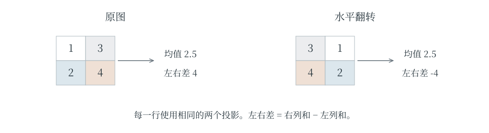
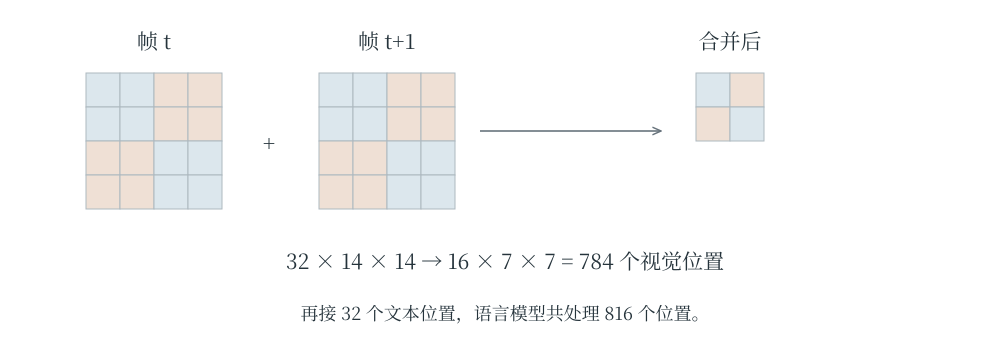
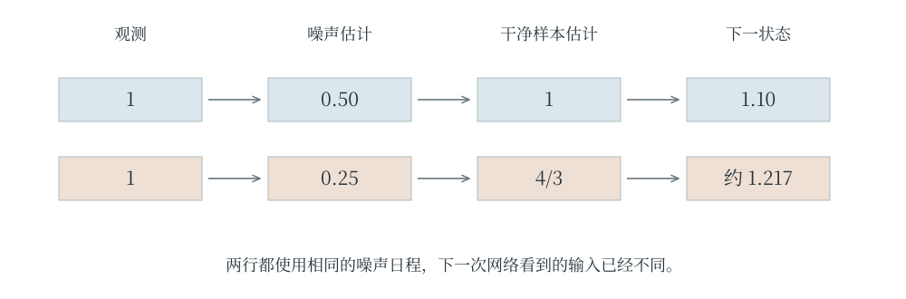

# 第 23 章　当输入输出不再只是文字：多模态与生成式计算

为了核查交接单中的“物件在第 2 秒进入绿箱”，系统需要处理原始视频，并将画面转成模型可用的表示。反过来，根据文字生成一段分拣演示，也涉及视觉表示，但计算过程和资源需求不同。本章以四秒视频为例，介绍图像、音频和视频的输入处理，再分析生成模型的迭代计算。

## 23.1　从像素到视觉表示

先考虑一幅灰度图左上角的一个图像块。四个像素排成两行，第一行是 1、3，第二行是 2、4。按行展开成 $(1,3,2,4)$，对它做一次线性变换。让第一列权重全为 $1/4$，第二列为 $(-1,1,-1,1)$。得到第一维 $(1+3+2+4)/4=2.5$，第二维 $-1+3-2+4=4$。一个向量同时记录了区域平均亮度和左右差。把左右翻转，平均数仍是 2.5，第二维却变成 $-4$。这个例子构造了一个视觉词元：它是从像素计算得到的向量。



*图 23-1　按左上、右上、左下、右下的顺序读数。右侧给出同一组权重作用在原图与镜像上的结果。平均亮度相同的图像仍可由另一维特征区分。*

实际权重通过训练得到。彩色图像每个像素有三个通道，边长 16 的图块便有 $16\times16\times3=768$ 个输入。对每个不重叠的图块应用同一矩阵，得到许多行相同宽度的向量，再让视觉编码器在这些行之间交换信息。若不输入位置，单看若干块很难确定哪个箱子在传送带左边。位置编码或其他空间结构给模型补上了行、列以及视频中帧的次序。边缘尺寸不能整除时，要明确裁剪、缩放或补齐策略；坐标标注也要随变换更新。[Vision Transformer](https://arxiv.org/abs/2010.11929)

视觉编码器输出的宽度可能与语言模型不同。最简单的桥接是让每个视觉向量再乘一个投影矩阵，变成语言模型可以接收的宽度。可以把这些行当作前缀和文本排在一起，也可以让文本在若干层单独用查询去读视觉特征（交叉注意力）。前者增加语言模型的序列长度，后者要保存独立的特征或其键值供特定层读取。即使输入像素和输出文字相同，两种方式的显存占用也可能不同。

### 卷积与矩阵乘法

把章首的 $2\times2$ 小窗沿图像每次平移一格，让不同位置共享一组权重，这就是一个简单卷积层的前向计算（深度学习库通常按互相关的约定，不翻转核）。用三行像素 $(1,2,3),(4,5,6),(7,8,9)$ 和四个全为 1 的权重，不补边。左上窗口给出 $1+2+4+5=12$，再向右移一格得到 16；下一行依次是 24 和 28。四个窗口都用到了中心像素 5。把每个窗口抄成矩阵的一行，再乘一列权重，便可调用第九章的 GEMM。这样显式展开（im2col）把原图的 9 个数抄成 16 项，另有写出和读回这张临时表的开销。隐式 GEMM 让线程块按窗口坐标直接生成当前面板，省去了完整临时表；代价是处理边界和地址映射，不能把“没有临时表”误读为“每个像素只访问一次”。[CUTLASS 的隐式卷积实现](https://docs.nvidia.com/cutlass/media/docs/cpp/implicit_gemm_convolution.html)

部署到手机时，还可以改模型本身。设输入有 8 个通道，输出有 16 个通道，窗口大小 $3\times3$。普通卷积在**一个输出位置、全部输出通道**做 $9\times8\times16=1152$ 次乘加。先对各输入通道分别做空间卷积，再用 $1\times1$ 卷积混合通道，只需 $9\times8+8\times16=200$ 次。代价有两处：这是一类受约束的权重分解，不能把任意训练好的普通卷积直接替换并保证同一输出；如果两个阶段分开启动，中间的 8 个通道还要写出读回。在小图和窄通道上，减少的乘加开销可能抵不过中间结果的读写和启动开销。比较时应先固定任务质量，再测量两个算子合计的执行时间。[MobileNet 的深度可分离卷积](https://arxiv.org/abs/1704.04861)

### 图文对比学习与检索

交接系统有时只需要检索与现场照片相匹配的说明。可以训练两个编码器，一个读图，一个读文，分别把输入压成单位向量。在训练批里把每张图与所有文本作内积，希望原配对比其他配对更相近。以两张照片“绿箱”和“红箱”及其两段说明为例，设图向量分别为 $(1,0),(0,1)$，两段说明也正好用这两个向量。把内积乘以 $\ln 3$ 再作 softmax，第一张图这一行的两个未归一化权重是 3 与 1，正确文本的概率为 $3/4$；第二行同理。交换图文角色，沿列归一化也给出 $3/4$。两个方向的交叉熵取平均为 $-\ln(3/4)$。如果第二段说明也写着“绿箱”，且两段向量相同，对第一张图来说，指定第一段的概率也只能是 $1/2$。批内其他样本充当负例这件事，依赖配对语义。[CLIP 的训练目标与双编码器](https://proceedings.mlr.press/v139/radford21a.html)

训练和检索的计算与通信需求各不相同。每端每张卡放 128 对样本，八卡合起来有 1024 对。如果目标使用全局批内负例，本卡 128 张图需要比较 1024 段文本；只和本地 128 段比，连 softmax 的分母都换了。假设每个向量有 512 个 BF16 分量，同一张卡收齐另外七卡的图、文两类向量，前向新增接收载荷 $7\times128\times512\times2\times2=1.75$ MiB。反向是否要把来自远端查询的梯度送回原编码器，还取决于特征收集的求导实现。部署检索时，历史照片的向量可以提前生成并建索引，新来一段文字只需编码一次再查库。这个用途不要求模型会写说明，也无法从“两张照片内积接近”推出它们在仓库里的先后顺序。

## 23.2　视频输入的计算与存储

把教学视频解码为每秒 8 帧，每帧 $224\times224$、RGB 各一字节，四秒共 32 帧。未压缩像素占 $32\times224^2\times3=4816896$ 字节，约 4.59 MiB。这个大小不同于磁盘上的压缩文件大小。输入管线还要安排解码、缩放、抽帧、布局转换和传输，解码器若跟不上，GPU 就会因等待输入而空闲。

边长 16 的图块使每帧有 $14\times14=196$ 个位置。32 帧共 6272 个。假定本例的桥接器把相邻两帧、各自 $2\times2$ 个空间块合成一行，八行合一行，最终为 $16\times7\times7=784$ 个视觉位置。再接 32 个文本位置，语言模型要对 816 个位置预填充。沿用第一章每位置 128 KiB 的 KV 设定，状态为 102 MiB。它只统计语言模型中的这段前缀，视觉编码的中间激活和输入像素另算。动态分辨率模型会根据图像尺寸改变视觉序列长度，调度入口需要知道预处理后的形状。[Qwen2-VL 技术报告](https://arxiv.org/abs/2409.12191)



*图 23-2　从一个时间片的空间格子看压缩。每四个小方格与下一帧对应的四格合成一个输出。下排依次给出时间片数、每片行数与列数，以及接入文本后的长度。*

若用户为看清标签，同时将宽、高翻倍，帧数不变，每帧面积扩大四倍，桥接后的视觉位置变成 3136。加文字是 3168，KV 增至 396 MiB。全局因果注意力中允许读的“查询位置、键位置”对数由 $816\times817/2$ 增到 $3168\times3169/2$，约为原先的 15.1 倍。投影的行数只扩大约 3.88 倍。若注意力实现利用局部窗口、分块或者没有计算因果上三角，两种算子的实际时间需要分别测量；若先将未压缩的各帧输入视觉编码器，该编码器的成本发生在合并之前。直接用 784 行估它会漏掉一大段工作。

视频还带来时间采样的问题。若真正入箱的一瞬只持续 0.08 秒，8 fps 的帧间隔是 0.125 秒，可能两幅画面都错过关键瞬间。增加采样率会改善机会，但重复帧也耗费算力。一种可实验的方案是先粗看，再围绕疑似变化的时间段读取密集帧；这需要保留源视频、时间戳与对应的索引，并把补读等待计入首答时间。比较不同方案时，应同时看入箱事件召回率与时间定位误差。一个总能猜对箱子颜色、却从不准确报告秒数的系统，还交不出那份交接单。

用位置数来分配令牌预算时，可以把视觉压缩与文本拼接各留作一步。试把边长改为 448，观察哪一项在增长。这个简式适用于尺寸恰能整除、帧数为偶数的本章配置。

```python
frames, side = 32, 224
visual = (frames // 2) * (side // 32) ** 2
length = visual + 32
kv_mib = length * 128 / 1024
assert (visual, length, kv_mib) == (784, 816, 102)
```


*图 23-3　以视频第 2 秒为零点，色带覆盖之后的 10 至 90 ms。第一排的采样帧分布在事件两侧；第二排只将起始相位偏移 62.5 ms，就有一帧覆盖了事件。抽到了事件也只能把时刻定位到有限精度。*

再回到那幅 $14\times14$ 图块网格。左上角贴着箱号，右下角是刚落入箱内的物件。希望右下角的表示包含箱号，一个全局视觉注意力层就给它提供了直接读左上角的机会。代价是每头需考虑 $196^2=38416$ 对有序位置。若把图等分为四个 $7\times7$ 窗口，每个查询只读本窗，合计 $4\times49^2=9604$ 对。只要每层的窗口边界固定，且层间的投影、前馈网络均逐位置独立，重复十次局部层也无法让右下角收到箱号。画出两个位置间的信息路径，就能看出需要在哪一层恢复跨窗交换。


*图 23-4　右下角黑点只能直接关注浅色窗口内的位置，左上角的箱号位于窗口之外。深线表示窗口边界；增加一层全局注意力后，两处可以直接交换信息。*

Qwen2.5-VL 把这项取舍做到视觉编码器里。报告中的 32 层有 4 层做全局注意力，其余层采用局部窗口。按论文的 14 像素图块和最长 112 像素的窗口边长，一个完整窗口每边容纳 8 个图块。上面的 7 格小窗是为手算选择的。比较两种实现时，先保持输入分辨率、桥接器和语言模型一致，再分别测视觉编码的时间、峰值显存，以及需要跨区关联的题目正确率。局部配对数降到四分之一，依旧要支付每个图块的线性投影、前馈计算和数据重排。这解释了为什么不能把这个比例直接写成端到端加速比。[Qwen2.5-VL 技术报告，表 1 与 §2.1.1](https://arxiv.org/html/2502.13923v1)

视频算例已经表明，采样密度会同时影响能否捕捉事件和设备处理量。音频也要选择采样与分帧方式，但它还有一项额外约束：在线系统不能等整段声音结束才开始响应。

## 23.3　音频处理与流式时延

同一视频若还有声音，可以统计麦克风的振幅随时间的变化。以 16 kHz、单声道为例，四秒有 64000 个采样点。把 25 ms 即 400 个采样点作为一窗，每次向前挪 10 ms 即 160 点，对窗内信号作频域变换，再汇总到若干频带。若只取完整窗且不补边，共有 $\lfloor(64000-400)/160\rfloor+1=398$ 帧。设每帧 80 个频带，每个存 2 字节，特征载荷共 63680 字节。语音编码器还可能通过卷积降采样，最终送到融合模块的位置数要看累计步幅。窗的重叠意味着“每 10 ms 输出一帧”与“只需看 10 ms 的数据”是不同的时间量。

若第一帧必须等满 25 ms，又希望合批 4 帧再处理，第四帧最早在 $25+3\times10=55$ ms 到齐。用户听到或看到结果之前还要等编码、生成、网络和播放缓冲。把四帧凑在一起可能有利于设备利用率，多等的 30 ms 却会反复出现在短语边界。双向编码器若依赖更远的未来，还要另算前瞻窗口；离线整段识别的结果不能当作在线流式承诺。

复用一段视觉或声音特征同样需要精确标识。两次问同一视频，应能共用匹配的编码器输出；但抽帧从 0 秒改成 0.0625 秒起步，命中事件的画面就可能不同。缓存键要覆盖媒体内容、时间区间、解码与预处理参数、编码器及投影版本。即使视觉特征可共用，两位用户后续的问题仍会形成不同的语言模型历史。多机部署时，传特征是否划算取决于实际字节数。例如 784 行、每行 4096 个 BF16 元素共 6.125 MiB，已大于上面 4.59 MiB 的原始采样帧。发送已编码特征可以节省重复编码，却未必节省链路流量。

### 音画同步与时钟漂移

假设采集端的声卡名义采样率 16,000 Hz，实际时钟快 100 ppm，即每秒比名义多采 1.6 个点。若接收端只按样本编号除以 16,000 来决定播放时刻，十分钟会多出 960 个样本，时间轴相差 60 ms。即使网络完全没有抖动，这种偏移也会随时长增长。把一个包推迟 60 ms 则只移动了那个包的到达时刻，两类现象在短截图上看起来很像。

可以把视频帧和音频块都对到共同的采集时间基准，跟踪残差随时间的斜率。固定斜率提示时钟频率有差，可考虑按估计比例缓慢重采样；突然跳变则要查丢包、设备重连或时间戳重置。缓冲能吸收一阵抖动，却不能靠固定容量永久吸收不断累积的采样差。对实时语音模型，采集时间、收到数据的时间以及发出回答的时间应分别保留。

### 语音打断与在途任务

假设库管员在回答播放到第 600 ms 时插话。手机立即检测到打断，服务器在 630 ms 收到取消通知，最早在 650 ms 的下一次生成调度边界释放那条请求的工作位。取消需要分别在客户端播放、网络接收和服务端调度三个环节生效。若手机已缓存六块尚未播放的音频，每块 20 ms，放任队列排空会让旧回答又响 120 ms。给本轮输出分配代号，打断后立即撤销手机上未播放的旧代块，并在下一次音频回调生效；若回调周期为 20 ms、硬件无额外排队，仍可能多听到至多约 20 ms。已经送入扬声器的采样点无法撤回。

与此同时，在途网络包仍可能在第 630 ms 之后到达。接收端可按代号忽略它们；服务器则应把“取消时间”和“实际归还批槽及 KV 页的时间”都记下，检查同批其他请求的下一轮能否提前运行。对话历史同样有两种边界。如果模型已生成“请把箱子放到 B 架”，而用户只听到“请把箱子”，让新一轮理所当然地接着讨论 B 架会造成误解。可用音频块的播放游标与文本对齐信息决定保留哪一段助手历史，对无法精确切开的词保留不确定性。验收一次打断，分别在扬声器、网络接收端和 GPU 调度器取证，就能区分播放尚未停止，以及播放已停止、设备仍在处理已取消请求这两种问题。

## 23.4　扩散模型与流匹配

现在反过来，只给模型一句“物件在第 2 秒进入绿箱”，希望得到一段可能的演示。模型无从观察真实事件，需要学一个条件分布。扩散模型的一种训练方法从真实样本 $x_0$ 出发，选噪声级别 $t$，抽取标准高斯噪声 $\epsilon$，按已知系数混合：

$$
x_t=\sqrt{\bar\alpha_t}\,x_0+\sqrt{1-\bar\alpha_t}\,\epsilon.
$$

两个系数分别控制原样本和噪声的比例，系数的平方之和为 1。假如二者独立，且某个分量都已标准化到单位方差，那么混合后该分量的方差仍为 $\bar\alpha_t+(1-\bar\alpha_t)=1$。实际数据的各分量不一定满足单位方差，这里只用简化条件说明系数的作用。

$\bar\alpha_t$ 越小，原信号的比例越低。训练可把 $x_t$、级别和条件描述一起送给网络，最小化所加噪声与预测噪声的平方误差。由于可以从 $x_0$ 直接生成任何选定级别的训练样本，一次训练更新无须把所有去噪步骤跑完。采样时却没有干净的 $x_0$，只能从噪声出发，用网络在当前状态的估计逐步构造下一个状态。不同参数化也可以预测速度或干净样本；采样器和训练目标要匹配。[DDPM](https://arxiv.org/abs/2006.11239)

取一个标量练习。设 $x_0=1$、$\epsilon=0.5$、$\bar\alpha_t=0.36$。带噪观测是 $0.6\times1+0.8\times0.5=1$，恰与原来的数相同，但两个来源的权重已经变了。若网络估出 $\hat\epsilon=0.5$，便能从观测反推一个干净样本估计：

$$
\hat x_0=(x_t-0.8\hat\epsilon)/0.6=1.
$$

用不再注入随机噪声的 DDIM 更新，更新到噪声更少的状态，此时 $\bar\alpha_s=0.64$，复用此次的噪声估计，得到 $x_s=0.8\hat x_0+0.6\hat\epsilon=1.10$。若第一次只猜到 0.25，则 $\hat x_0=4/3$，$x_s\approx1.217$。第二次网络看到的输入已不同，不能预先把后续预测通通算好。数值暂时增大并不等于噪声变重，系数描述的是分布与信号混合方式。[DDIM](https://arxiv.org/abs/2010.02502)



*图 23-5　两行使用同一观测和同一组系数，仅改变网络给出的噪声估计。末列才是下一次调用的输入。真实视频的每一格都是一个数组，网络还会结合邻近位置和文字条件。*

还可以教网络预测“此刻朝哪边走”。流匹配（flow matching）的一种训练构造用 $z$ 表示噪声样本，$y$ 表示数据样本，把时间改记为 $u$，从噪声端的 0 走向数据端的 1。对选中的一对端点，直线路径及其速度有解析式：

$$
x(u)=(1-u)z+uy,\qquad v=y-z.
$$

例如从 $-1$ 走到 2，全程速度为 3，在四分之一处位置为 $-0.25$。训练时可直接抽一个 $u$，构造当前位置，让网络根据位置、时间与文字条件预测速度。还需要考虑一种情况：如果还可能以相同概率从 2 走向 $-1$，两条线都经过中点 0.5，一条向右、一条向左。在该时刻和相同条件下，任何只看到 0.5 的网络都无法辨别抽到了哪一对。平方误差最小的预测值是两个速度的条件平均，本例恰为零。真实模型学习的是许多样本在当前位置形成的平均速度场，采样时没有目标视频可供它相减。[Flow Matching for Generative Modeling，§3](https://arxiv.org/abs/2210.02747)

部署端从噪声起步，最简单的欧拉法按步长乘预测速度后加回当前位置。若局部预测速度为 2.8，从 $-1$ 出发经过四分之一时间后，位置为 $-0.30$。第二步要在这个新位置再次求值。减小步长通常能减小数值积分误差，同时增加网络调用；网络学错的速度场还会带来另一种误差。Wan 的视频生成系统结合了时空潜表示、Transformer 和流匹配训练。做采样器对比时应一起记录每段视频的网络实际调用次数、分辨率与盲评质量，多阶段求解器的一个“步”可能求值多次。[Wan 技术报告](https://arxiv.org/abs/2503.20314)

去噪公式解释了相邻两次模型调用为什么存在依赖：下一轮的输入来自上一轮的更新结果。实现还要决定在哪里保存整段视频的中间状态，以及不同请求怎样合批。下面把状态的形状和迭代次数换算成设备工作量。

## 23.5　生成过程的执行与调度

常见的潜空间方法先用自编码器把真实画面压缩成较小的网格，学习在这个网格中去噪，最后再解码成像素。DiT 用 Transformer 处理潜空间里的图块，噪声级别等条件会影响各层变换。设一个教学视频生成器在潜空间中有 4 个时间片，每片 $28\times28$ 个位置；按每片 $2\times2$ 切块，每次有 $4\times14^2=784$ 个序列位置。这与理解任务恰巧同为 784，执行意义却完全不同。理解任务形成固定的媒体前缀，后续答案逐词追加。这里每轮都要更新整张潜变量网格，下一轮的查询、键和值通常都会改变。[DiT](https://arxiv.org/abs/2212.09748)

若这一层让全部位置相互可见，用普通全局注意力，每步每头有 $784^2=614656$ 个逻辑位置对。选 20 次网络评估便是 12293120 对，只数一个头的一层。独立于潜变量的文本编码可以先算一次；若交叉注意力的文本投影不随步改变，也可保存其键值。自注意力侧若近似复用上一步特征，需另外测量质量损失。对使用无分类器引导的采样器，还可能需要有条件、无条件两份预测。把两份放入一批能摊薄权重读取，却仍有两份样本工作，显存峰值也会变化。


*图 23-6　同一列代表一次计算。上排逐步增加已输出的文字，冷色部分的状态可以复用；下排整个网格每轮都会改变，最终一轮后才输入像素解码器。方格数为示意。*

能并行的是同一步的空间位置、独立样本或符合模型掩码的分片。若把视频按时间切给两台设备，又允许任意帧之间互相注意，就要把远端键值送来，或以等价的分布式算法组合局部结果。要是仅让相邻帧交互，通信可能减少，模型看到的上下文也变了。另一个稳定的测法是先扫网络评估次数，再扫每步并行度，在相同提示、分辨率、种子集合上评估事件出现、时间连续性、画面质量和总延迟。少跑几步有时比加卡有效，是否仍能生成可信的动作只能由成片检验。

### 无分类器引导的计算开销

使用文本条件时，模型既要学习画面的分布，也要依据提示生成与描述相符的内容。无分类器引导（classifier-free guidance）可在训练时偶尔去掉文字条件，让同一网络学会有条件和空条件两种预测。采样时给它同一份带噪画面、同一个时间步，取空条件估计 $u$ 和带文字估计 $c$。常见的一种记号把组合写为 $u+s(c-u)$。当 $s=1$，恰是条件预测；大于 1 时则进一步放大文本条件带来的预测变化。若某一坐标的两个估计为 $u=0.2,c=0.5$，取 $s=2$ 得 0.8。这个数是采样器使用的估计量，不是需要限制在零到一之间的概率。[无分类器扩散引导的原始论文](https://arxiv.org/abs/2207.12598)

设两次独立前向各 12 ms，其后采样器更新用 1 ms。串行完成一步是 25 ms。把两路拼成一个大小为二的批，若实测该批前向为 16 ms，一步才可算 17 ms；做 20 步分别为 500 和 340 ms。批处理复用一份权重，但两路激活都要容得下，下一步还得等组合后的当前潜变量。若显存只能容纳一份激活，就不能按两路合批的时间估算服务时延。两种运行方式想算的是同一个引导估计，可以先比较逐步数值。若为了省掉一支而更改指导强度、训练一个单次前向的蒸馏模型，或者减少采样步数，比较时就应复核图文一致性和样本多样性，再计入达到同等质量所需的调用次数。

到这里，分拣记录里有了三种不同来源的东西：源视频里的像素、根据像素预测的文字、根据文字生成的演示。登记交接单应指向第一种证据，并保留模型作答时使用的版本。要查到哪个班次的规程生效、把结论写回正确的表，还需要走出模型本身。

## 练习与解答

### 1. 减少抽帧的代价

把理解视频从 8 fps 改成 4 fps，其他尺寸与归并规则不变，接 32 个文本位置。语言模型的前缀占多少 KV？单次入箱事件时长 0.08 秒，能否保证采到？

**解答。** 16 帧经两两合并剩 8 个时间片，每片 49 行，共 392 个视觉位置。424 个总位置占 53 MiB。帧间隔 0.25 秒，事件可能完全落在两次采样之间。

### 2. 发送哪一段表示

网络有效带宽为 1 GiB/s，忽略启动时间。发送 6.125 MiB 特征与发送 4.59375 MiB 像素的额外时间是多少？若接收端重做编码需 20 ms 呢？

**解答。** 多传 1.53125 MiB，约为 1.50 ms。若发送端已有可用特征、两路径其余工作相同且接收端重算在关键路径上，发送特征可净省约 18.50 ms。

### 3. 流式合批改成八帧

沿用 25 ms 窗长与 10 ms 步幅，不补边、不看未来。几毫秒才能收到八个完整窗？相对四窗多等多久？

**解答。** $25+7\times10=95$ ms，比四窗 55 ms 多等 40 ms。若系统还要额外看两帧未来，需再等 20 ms。

### 4. 一次质量对齐的采样比较

生成服务的固定准备与解码共 80 ms，每次去噪各用 12 ms。20 次改为 12 次，总时延由多少变到多少？读这项节省还缺哪个实验？

**解答。** 从 $80+20\times12=320$ ms 降为 224 ms，节省 96 ms，墙钟加速约 1.43 倍。要在相同内容、分辨率、提示与种子集合上复核质量，尤其检查动作发生时间和跨帧一致性。

[复算图块、视频状态、音频窗口和两次噪声估计](../../experiments/part06/verify.py)

[全书目录](../../README.md) · [上一章 · 后训练：训练系统与生成系统怎样形成闭环](ch22.md) · [下一章 · 智能体、检索与执行环境：模型之外的时间和状态](ch24.md)
