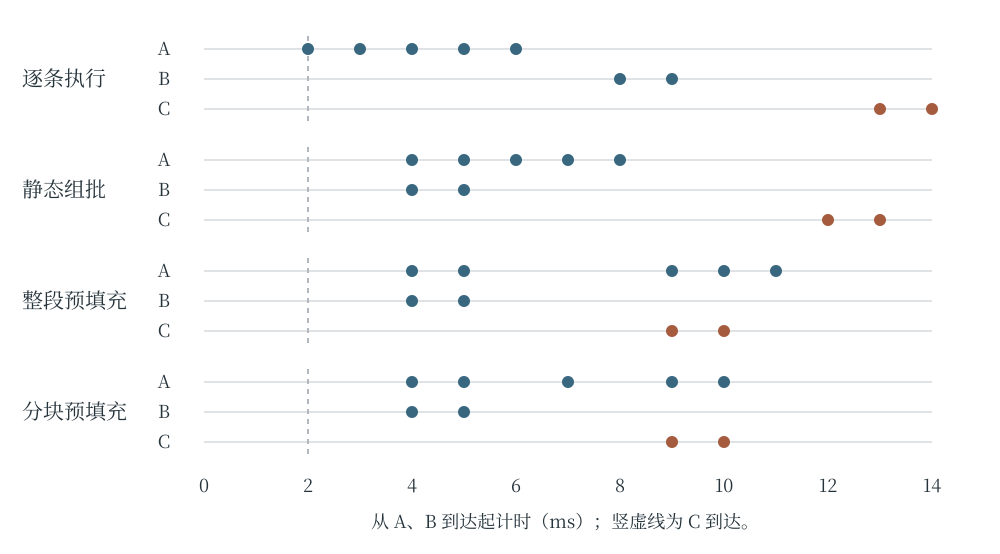
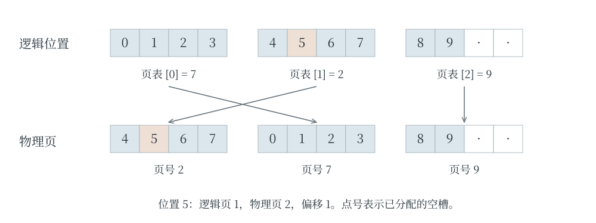
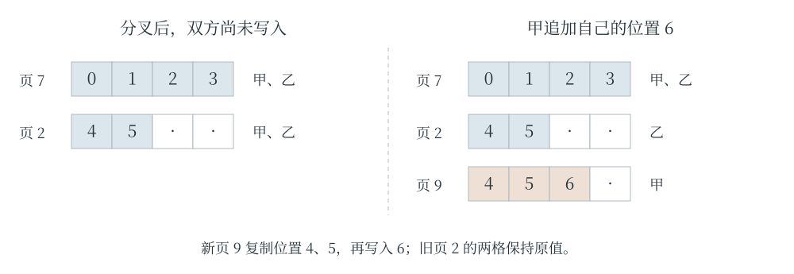
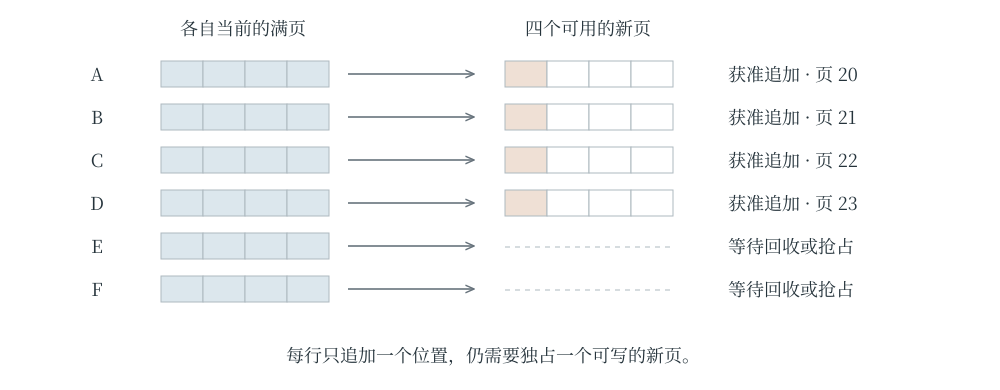
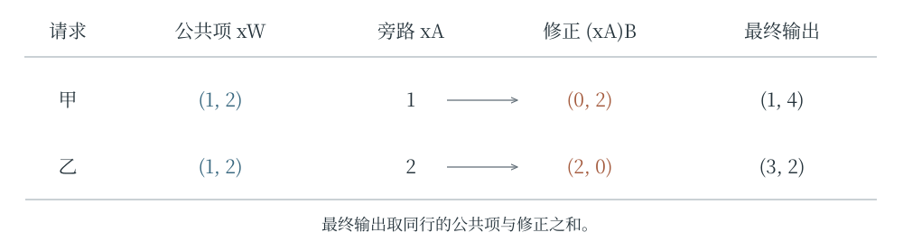
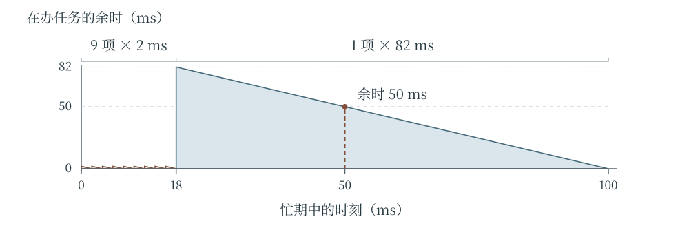
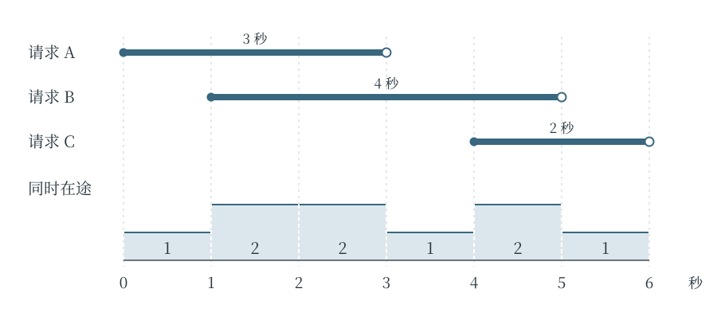
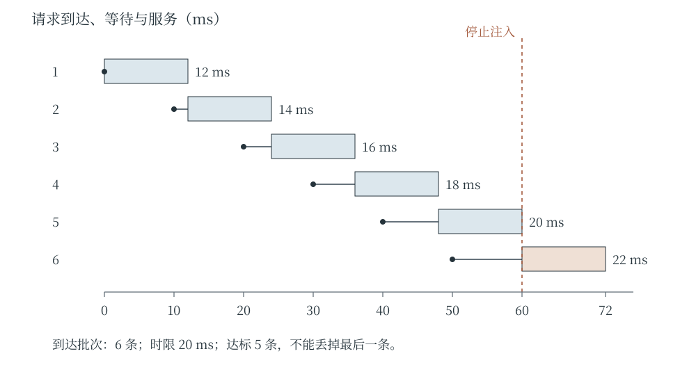

# 第 24 章　单机推理与变长请求调度

上章的交付实验核对了同一句输入的整行输出。把它放进一个服务之后，正确性还多了一项要求。甲的对话仍在生成时，乙的新提示进入设备。权重可以共用，属于甲的历史却要在正确的位置继续读写。先用三条请求画时间线，看看每一次调度究竟推迟了谁。

沿用第一章的服务器：模型有 60 亿个参数，每个占 2 字节，权重约 11.18 GiB。一张 24 GiB 的卡为工作区等预留 4 GiB，剩余约 8.82 GiB 用于请求状态。本章先比较不同组批方式的等待时间，再计算缓存分页、共享与回收所需的显存。

## 24.1　预填充与解码

把已经分好词的输入写为 $`x_1,\ldots,x_s`$。第四章的因果掩码允许所有输入位置在同一层一起计算，每个位置只读取自己的过去。最后一个位置的输出给出下一个词元的概率，从中抽到 $`y_1`$，就可以第一次向用户返回结果。这一段叫**预填充**（prefill）。此时各层的缓存里存着 $`s`$ 个输入位置的键和值；$`y_1`$ 刚被选中，还没有作为输入穿过各层。

下一轮以 $`y_1`$ 为输入，追加它的键和值，再用该位置的查询读取历史，得到 $`y_2`$。这段逐步生成叫**解码**（decode）。若在 $`y_5`$ 处停止，只需四轮解码。生成了五个词元，最后一个词元尚未占用一个已写入的缓存位置。为简单起见，本章将一个词元作为一个流式事件，忽略传输和分词用时；真实服务的首词时延要从客户端发出请求起算。

这两段工作落到第三篇的矩阵乘法上很直观。设某层权重是 $`W`$。预填充可以把许多已知位置的向量叠成 $`X`$，一次算 $`XW`$。单请求解码只有一行已知输入，另一个位置的行要等采样。如果甲、乙恰好都在解码，倒是可以把甲的一行和乙的一行叠起来。两行共读权重，注意力仍各自查自己的历史。于是批越大，**每个可见输出分摊的权重读取**往往越少，但每条请求自己的历史仍然要读。长上下文时，即使权重已经摊得很薄，读取历史也可能占据大半轮时间。

## 24.2　连续到达的请求如何合批

先用一条便于手算的规则近似每轮的内核时间。一轮最多容纳两条请求；该轮共处理 $`p`$ 个提示词元，有解码时每条解码请求各走一步。这台教学设备的一轮耗时为 $`\max(1,p)`$ 毫秒。它模拟短解码可以与部分预填充共享一次发射的情形。设备只能在一轮结束时公布本轮输出或接纳新请求。一条提示全部读完的那一轮产出首词。这里刻意保留了轮次和依赖，实际机器的每轮耗时应按形状、历史长度和负载测量。

| 请求 | 到达时刻（ms） | 提示长度 | 实际输出长度 |
|---|---:|---:|---:|
| A | 0 | 2 | 5 |
| B | 0 | 2 | 2 |
| C | 2 | 4 | 2 |

表里写出了实际输出长度，方便事后复盘。调度器运行时只知道约定的输出上限，要靠停止符、达到上限或取消来发现请求结束。

**逐条执行。** A 先用 2 ms 读提示，随后每毫秒一词，在时刻 6 完成。B 在时刻 8 才收到首词，时刻 9 完成。C 在 2 就到了，但直到 9 才获准开始，首末词在 13、14 到达。C 等待首词的 11 ms 中，7 ms 什么也没算。单请求测试会把这段排队完全漏掉。

**静态组批。** 时刻 0 把 A、B 拼成一个批。它们合计四个输入位置，所以首词都在 4 返回。时刻 5 两者再各出一词，B 结束。A 还需要三轮，直到 8 才能释放整个批。这里即使允许 B 提前向客户端返回结果，只要批成员固定，C 仍用不上空出的执行位置。C 的首末词变成 12、13。计算结果不变，设备忙碌时间减少了 1 ms，A 的首词却比逐条执行晚了 2 ms。

**连续批处理。** 将调度边界设在每次迭代结束时。时刻 5，B 结束，C 可以加入批次。若整段预填充必须一次做完，把 C 的四个输入和 A 的一步解码放在一起，这一轮需要 4 ms。A 在时刻 5 输出上一个词，在时刻 9 才输出下一个词。C 虽然提前开始，A 的输出间隔却增加到原来的四倍。连续批处理允许在每轮调整批次成员，无需等整批请求结束；同一轮中较重的工作仍可能拖慢其他请求。[Orca 的迭代级调度](https://www.usenix.org/conference/osdi22/presentation/yu)

**把长提示切成块。** 让 C 先读前两个位置。在 5 至 7 这一轮，A 前进一步，C 只保存前半段状态。7 至 9 再读后半段，后两个位置可以关注前半段，C 在 9 得到首词。时刻 10，A 和 C 同时结束。与整段进入相比，C 的首词仍在 9，A 则能在两块之间执行一次解码。代价是 C 多经历一次发射并延长了部分状态的生命周期。真实设备把块切得太小，矩阵规模过小、内核启动开销增加，两条请求都有可能变慢。[Sarathi-Serve 的分块预填充](https://arxiv.org/abs/2403.02310)



*图 24-1　四种调度方式处理同一组请求。每个实点表示一个已返回的词元，同一行相邻两点的水平距离表示输出间隔。A 在 5 ms 之后的停顿和 C 的第一个输出时刻反映了不同调度方式的影响。*

为什么可以在中间切开 C？注意力对后半段用的键和值来自同一条提示此前的位置，按原位置编号保存它们，保留块内的因果掩码，结果在数学上与一次预填充相同。两个块的末尾都能产生一组分数，但只有最后一块的末位置代表完整输入；提前把前一块的分数当成答案，会改变模型实际在回答的问题。不同形状的内核还可能有浮点舍入差异。

真机上应该使用多大的分块？可以分别估算一个块中的两类工作。前馈层对 $`p`$ 个新位置做 $`p`$ 行投影；若这一层是完整因果注意力、已有 $`L`$ 个位置被缓存，那么块中第一行要看 $`L+1`$ 个键，最后一行要看 $`L+p`$ 个键。一个查询头中允许参与注意力计算的查询与键配对数为

```math
P(L,p)=\sum_{j=1}^{p}(L+j)=pL+\frac{p(p+1)}2.
```

第一项 $`pL`$ 是块内每个新查询都要读取已有的 $`L`$ 个历史位置；第二项来自块内的因果关系，第 $`j`$ 个查询可读块内前 $`j`$ 个位置。比如 $`L=4`$、$`p=2`$ 时，两行分别读取 5 和 6 个键，共 11 对。把第二块改得更小会改变每轮可与其他请求共享的时间，但历史不会因此消失，后续块仍要读取它。这里数的是允许的逻辑配对，实际执行时间还取决于块大小、掩码实现和数据复用。

以同一条长提示的两块为例。开头的 128 个位置需要 8,256 对；已经读过 1,024 个位置后，同样大小的一块需要 139,328 对。两块的投影行数一模一样。把 128 当作固定块长时，后面几轮可能更慢，和它们同批解码的人也一起等。假设一次教学试排最多分给提示 128 行，再为这个查询头分配十万对的预算，在 $`L=1024`$ 时只能选 93 行：第 93 行加完共 99,603 对，再多一行就有 100,721 对。若层内只保留固定窗口，则每行可见键的数目还要按窗口截断。

实际的 Sarathi-Serve 用分块的预填充与解码组成混合批，让二者共享执行机会。上面的配对预算是用来挑选实验点的手算规则。一次加载的键能被多行复用，不同块还会遇到不同的矩阵形状和内核发射开销，十万对并不对应一个固定的毫秒数。要在本机选块长，可以固定同一组到达，分别记录“已有历史长度、新增行数、同批解码行数”以及每个混合轮的实测时间。若超时的都发生在长提示的后半段，先把后半段的块缩短，再看首词和逐词间隔是否一起改善。[Sarathi-Serve 的调度与评测](https://arxiv.org/abs/2403.02310)

## 24.3　KV 缓存的分页与分配

连续批每轮都可能有人离开。若引擎先为每条请求分配能容下最大输出的一整段连续显存，短请求在结束前会占着许多用不上的位置。即使按需申请，散落在几个地址上的空洞也未必能满足一次大的连续分配。第五章算过每个位置有多少历史，这里把假设写全。全注意力层数 $`L=32`$，每层有 8 个 KV 头，每头 128 维，每个元素 2 字节。全层合计每个位置需要

```math
b_{\rm pos}=2L H_{\rm KV}d\,b=131072\ \mathrm{B}.
```

公式中的 $`2`$ 对应键和价值各保存一份；$`L`$ 是层数，$`H_{\rm KV}`$ 是每层的 KV 头数，$`d`$ 是每头维度，$`b`$ 是单个元素的字节数。这里算的是一个词元在所有层里的逻辑载荷，页表、元数据、工作区和页尾空位需要另计。第五章改变 KV 头数或状态表示时，先重新计算这个乘积，再估算可接纳的并发。

对于上述 2 字节的 $`b`$，4096 个位置恰好需要 512 MiB。把连续的**逻辑位置**每四个编成一页，引擎只需为一页找到四个连续槽，再在块表里记录物理页号。为了便于观察，这里一页只有四个位置，全模型折算为 512 KiB；实际实现可在每层或每个设备上各存本地的一片。

假设某请求的块表为 $`[7,2,9]`$。位置从零数，位置 5 属于逻辑页 $`\lfloor5/4\rfloor=1`$，页内偏移 $`5\bmod4=1`$，因此去物理页 2 的第 1 格读取。一个有 10 个有效位置的请求需要 3 页共 12 格，末页空 2 格。每条独占序列至多浪费末页中尚未使用的空间；代价是需要查页表，注意力内核也要高效读取分散的块。分页改变布局与共享，并没有减少该位置数学上可见的历史。[PagedAttention 论文](https://arxiv.org/abs/2309.06180)



*图 24-2　位置 5 属于第二个逻辑页，块表中对应物理页 2，页内偏移为 1。三个逻辑页依次映射到物理页 7、2、9，物理页不必连续。*

再看一个实际会出现的分叉。两个用户在相同的六个提示词元后分别续写。若系统允许从同一份未满的尾页分叉，初始可让两条序列都指向页 7（四格满）和页 2（只写两格），引用计数都是 2。甲要写入位置 6 时，若直接写旧尾页，稍后乙写入自己的位置 6 就会覆盖它。可以先申请页 9，复制页 2 已用的两格，再在新页追加甲的词元。乙继续使用页 2；页 7 仍由双方共用。复制了 $`2\times128=256`$ KiB 有效载荷，占用一个新的 512 KiB 页。只支持整块前缀复用的实现可以直接共享页 7，对齐边界之后各算自己的尾部，省去共享可写尾页的复杂性。



*图 24-3　按物理页计算显存占用：写入前使用两页，写入后使用三页。甲、乙共用的四个前缀位置始终只存一份。若两个请求都结束，页仍被前缀索引保留，则还需释放索引的保留权才能回收。*

跨请求匹配时，相同的一段后缀并不足以共享。同一个“苹果”在两段不同上文里会得到不同的 KV。用根到节点的词元序列作为前缀索引，可以找最长匹配，把尚未计算的部分排入预填充。缓存键还须区分模型版本、适配器、位置语义等，按服务的隔离范围复用。SGLang 的 RadixAttention 用基数树组织这种匹配，分页解决的是找到前缀之后怎样让请求指向已有存储。这两种机制可以同时使用。缓存若只保存 KV，全提示命中时仍要能得到预测首词的末位置分数，系统可以另存对应输出，或者保留一个位置重算。[SGLang 与 RadixAttention](https://arxiv.org/abs/2312.07104)

## 24.4　显存不足时的调度

回到 8.82 GiB。用未舍入的预算除以每页 512 KiB，取整可放 18071 页。输入 4096、输出上限 256 的请求若保守地预留 4352 格，需要 1088 页；十六条总计 17408 页。若输出通常很短，按需分配可以容纳更多活动请求，但引擎必须在每一轮检查缓存还能否继续增长。开始执行时有空闲页，并不保证整个生成过程都不会缺页。某轮里 20 条活动请求有 6 条刚好要跨页，空闲池只剩 4 页，哪怕还有时间算 20 行，这一轮也无法让六条都跨页。



*图 24-4　每行画一条恰好跨页的请求，只画它的最后一页。二十条活动请求中余下十四条尚有可写位置。此轮若选择 A 至 D 追加，E、F 就得等，尽管它们也只需要计算一行。这里的字母只用于标记六个申请者。*

一个能执行的策略是先回收已无人使用、可以舍弃的缓存页，再按输出间隔期限挑四条继续，让另外两条暂时等待。若未来仍缺页，可暂停一条请求，把其状态搬到主机，或者舍弃状态、保留已提交的词元供重算。迁出 64 MiB、稍后再迁回，假设双向依次各独占 16 GiB/s，有效搬运时间合计至少 7.8125 ms；若重算这段前缀要 6 ms，空闲计算很多时重算占优，高峰期挤占其他用户的预填充机会则未必。估计时还要问清迁出会释放多少**独占**页，暂停一条与他人共用前缀的长请求，实际回收量可能很小。

分块还引入另一项预算。若每轮最多处理 8 个新输入位置（一次解码也消耗一个位置），6 条解码先走一步，就只余 2 个位置给长提示。若每轮都优先处理 8 条即将超时的解码请求，预填充就可能长期得不到执行机会，长提示也就无法产生首词。可以按最老请求的等待增加优先级，为预填充划出最低服务份额，或者在入队前限制某租户的在途请求数。保留份额会让已经在输出的人偶尔等得更久。遇到持续超载时，在入口明确拒绝请求、记录原因并限制重试，有助于控制队列长度，使已接纳请求更有可能满足时延要求。

缓存本身也随模型变化。滑动窗口的一层在窗口移过后可复用较老的槽；若另一些层仍用全局注意力，只能回收窗口层的相应部分。线性注意力保存随步骤更新的聚合状态，两个分支需要从同一时刻的状态快照出发，不能靠删掉一页键值就撤销任意更新。一个可兼容这些模型的调度接口，应能询问追加若干位置要预留多少空间、哪些前缀可分叉、暂停后从哪里恢复。仅向上层返回“还有多少空闲 token”会掩盖这些差异。

回收页还有一个容易遗漏的时刻。假设 A、B 共用前两个页，A 另有一个独占的尾页。在时刻 0，调度器已把 A 的一次解码发给 GPU；时刻 1，用户取消 A；时刻 3，GPU 才写完尾页。在时刻 1 就能从等待队列删掉 A，停止派发下一步，释放它对共享页的逻辑引用。若同时将尾页分配给新请求 C，时刻 3 的旧写入却可能覆盖 C 的词元。一个可行的实现把失去最后一个引用、仍有算子使用的页放到待回收队列，等执行流上的完成事件到达，再把物理页号放回空闲池。此例共享页仍由 B 持有，时刻 3 真正增加的空闲页只有一个。取消率升高时，分别观测已取消但仍在执行的批、等待事件的页和实际空闲页，便能解释请求数已经下降、显存占用稍后才回落的现象。

### 不同适配器的请求如何合批

前面的容量预算默认所有请求共用同一套模型参数。若多个任务共用基座、各用自己的适配器，还要决定哪些计算可以放进同一批，哪些缓存必须分开。

假设仓库有一个公共语言模型，甲客户要求它按货架编号回答，乙客户要求它按商品分类回答。训练时可以冻结一份公共权重 $`W`$，每位客户只训练两个窄矩阵 $`A,B`$。输入行 $`x`$ 的输出变为 $`xW+(xA)B`$，缩放因子取 1。这种低秩适配称为 LoRA，第二十九章会推导训练时该更新哪些数。眼下先回答调度器的问题：同一轮甲乙各来一行，哪些工作能够一起做？

只看一个投影，让公共权重为二阶单位阵，两行输入都恰好是 $`(1,2)`$。甲的 $`A`$ 是列向量 $`(1,0)^\top`$，$`B`$ 是行向量 $`(0,2)`$；乙的 $`A`$ 是 $`(0,1)^\top`$，$`B`$ 是 $`(1,0)`$。两行先堆成一张矩阵做一次 $`XW`$，都得到 $`(1,2)`$。再分别看旁路：甲把输入投成标量 1，乘回 $`(0,2)`$，最后为 $`(1,4)`$；乙投成标量 2，乘回 $`(1,0)`$，最后为 $`(3,2)`$。若沿用合批时常见的“给整批绑定一套权重”，两行公共结果仍会正确，第二个客户就会错误地使用第一个客户的适配器。合批描述符除了请求的页表，还要能把每一行指回自己的适配器。Punica 让异构适配计算共批执行；S-LoRA 还将显存里的适配器权重与不同长度请求的 KV 共用一个分页池。[Punica](https://arxiv.org/abs/2310.18547) [S-LoRA](https://arxiv.org/abs/2311.03285)



*图 24-5　两行输入可以合批计算公共项，但各自的适配器修正作用于不同坐标。若该层产生键或值，同一个词经过不同适配器后也可能产生不同的缓存。*

再换回 $`4096\times4096`$ 的矩阵，权重用双字节，旁路秩取 8，也就是两张窄表的形状分别为 $`4096\times8`$ 和 $`8\times4096`$。基础表一份 32 MiB，每位客户多用 128 KiB。假设 16 位客户都活跃，仅就这一个投影，保存 16 张各自合并好的表要 512 MiB，保留一份基础表和 16 套旁路只要 34 MiB。对单行而言，额外乘加数与基础乘加数之比为 $`2\times8/4096=1/256`$。但各客户分别只有一行时，小矩阵加载、间接寻址和 kernel 启动都可能暴露在时间线上。相反，如果整天只服务一位客户，可以预先计算 $`W+AB`$，让每行重新只做一次稠密投影。是否合并，要把同时驻留的客户数与实际到达批形状一同代入。

前面谈前缀页时，甲乙原本可以共享相同提示的四个位置。现在再看图的最右列：只要这次修正会影响本层或后续层写下的 KV，就不能仅凭词元相同把整套历史页混用。服务可以让基础权重版本、适配器标识及其参数版本参与缓存匹配，再检查前缀词号、位置和既定隔离范围。如果适配只发生在所有 KV 计算之后的最终输出头，历史状态在数学上仍可相同；是否跨客户复用还受服务的隔离约定约束。测量时把“共用基础矩阵的一批行数”和“真正复用了多少历史位置”分开记，才看得见合批省下的运算和缓存带来的收益各有多少。

同一张卡能装下更多请求，并不意味着这些请求都能及时收到输出。合批增大时，设备总吞吐可能提高，但某个短请求也可能等待较长的一轮结束。因此，接下来把缓存容量与用户实际经历的首词、逐词间隔一起衡量。

## 24.5　按服务目标评估吞吐

设这个小服务要求首词时延不超过 7 ms，随后任意两个输出间隔至多 2 ms。令一个请求必须成功结束且两项都达标才算交付。观察窗从 0 到最后一条完成，数量恰好是前表的三条。可以从图 24-1 逐点填下表。

| 策略 | C 的首词时延 | A 的最长间隔 | 九个输出全部交付的耗时 | 达标请求数 |
|---|---:|---:|---:|---:|
| 逐条执行 | 11 ms | 1 ms | 14 ms | 1 |
| 静态组批 | 10 ms | 1 ms | 13 ms | 2 |
| 连续批处理，整段预填充 | 7 ms | 4 ms | 11 ms | 2 |
| 连续批处理，分块预填充 | 7 ms | 2 ms | 10 ms | 3 |

整段提示的原始吞吐是 $`9/0.011\approx818`$ 输出词元每秒。按上述目标统计的有效吞吐（goodput）却是 $`2/0.011\approx182`$ 个达标请求每秒。分块后两项分别为 900 词元每秒与 300 请求每秒。这是三个请求的小窗口算术。如果把这些数带到容量规划，必须重新定义到达流、输出长度分布、持续时间和计数单位。

做容量实验时，先给定预定到达时刻并按时发出，逐级提高到达率；让输入覆盖长短混合、相同与不同前缀。若客户端总等上一次返回才发下一次，服务越慢，客户端反而主动降低压力。观察稳态窗口时分别记录发入、接纳、拒绝、超时、取消与达标的请求，给跨窗请求规定统一口径。例如按到达窗口建一组请求，跟踪到结束再判定达标，分母始终取该窗口的到达数或时长。一起报告首词、请求内最坏间隔的分位数和输出速率，保留前缀命中率及批形状。只有成功请求的低延迟曲线，不能解释那些没有收到回答的用户经历了什么。

根据完整的请求事件记录，就可以检查上述时延目标，无需重新运行模型。把下面的 A 换成 B 或 C 的记录，别忘了同时换成它自己的到达时刻。完整复算程序从到达和提示长度生成这些记录。

```python
arrival, emitted = 0, [4, 5, 9, 10, 11]
gaps = [b - a for a, b in zip(emitted, emitted[1:])]
first = emitted[0] - arrival
assert (first, max(gaps), sum(gaps) / len(gaps)) == (4, 4, 1.75)
```

### 服务时间波动对排队的影响

设预填充入口前有一个必须独占的处理槽，一次接一个任务，先到先服务，每项一旦开始就运行到底。先暂时拿掉动态组批，单独观察这段队列。甲负载的每项都用 10 ms。乙负载中 90% 用 2 ms，10% 用 82 ms。两者平均都是 10 ms，持续有活干时都能平均完成每秒 100 项。若请求按每秒 80 项的泊松过程到达，服务时间独立同分布且与到达独立，两种负载下工作槽长期都会忙约 80% 的时间。

来了一条新请求，它先得等正在执行的那项做完。如果在设备忙碌期间随机观察一次，观察到某类任务的概率取决于该类任务占用的**时间**。图 24-6 画了恰好含九个短项和一个长项的 100 ms 忙期。按任务编号抽一个，长项只占十分之一。沿横轴随机选择一个忙碌时刻，有 82% 的概率遇到长任务。若恰好撞上长项，平均还要等 41 ms 才能轮到下一项。



*图 24-6　图中先运行九个短项，再运行一个长项。竖直取样线表示在第 50 ms 观察，此时长项还要运行 50 ms。余时曲线下每块三角形的面积等于该项服务时长平方的一半，改变任务次序不会改变这些面积之和。*

面积把直觉变成了可算的式子。设每项的服务时间为 $`S`$，到达率为 $`\lambda`$。耗时 $`s`$ 的一项在执行期间给余时曲线贡献 $`s^2/2`$ 的面积。空闲时余时为零。在稳定状态下，每单位时间平均完成 $`\lambda`$ 项，所以任意时刻看到的平均余时为 $`\lambda E[S^2]/2`$。这里使用泊松到达，新到达看到的系统状态也服从相同的时间比例。接下来还要等队列里排在自己前面的请求。第一章的在途数关系给出，平均已有 $`\lambda E[W_q]`$ 项在等，每项平均要用 $`E[S]`$。将这两段等待相加并移项，令忙碌比例 $`\rho=\lambda E[S]\lt 1`$，得到

```math
E[W_q]=\frac{\lambda E[S^2]}{2(1-\rho)}.
```

用毫秒作单位，$`\lambda=0.08`$。甲的 $`E[S^2]=100`$，平均等 20 ms。乙的 $`E[S^2]=0.9\times2^2+0.1\times82^2=676`$，平均等 135.2 ms。再加各自 10 ms 的服务，两个平均响应时间分别为 30 和 145.2 ms。若日志只有平均内核时间和设备利用率，这两种负载会看起来一模一样。按请求记录服务时间分布，才能观察到长任务出现的频率和持续时间。[M/G/1 单服务台的等待公式与推导](https://web.stanford.edu/class/ee384x/EE384X/handouts/H10.pdf)

随书程序给两组任务安排完全相同的到达时刻。用默认随机种子，跳过开头一万项，再记录二十万项，平均等待分别为 20.22 和 134.63 ms，与理论值相近。更值得看的是最后那百分之一：等待的 p99 分别为 104.81 和 698.29 ms。把命令参数改为 `--rate 50`，两组平均等待降到 4.99 和 33.37 ms。实际系统若也在入口排长队，可以先查每项**开始到结束**的用时分布，再查它**到达至开始**的等待；混在一起的响应时间无法直接代入这个公式。连续批引擎会在迭代边界让出设备，批内每条请求的服务时间又受同伴影响。在真机上可以先用这个模型检查独占的前处理、串行传送等阶段，再由各轮的实际到达和完成时间定位解码长停顿。[用标准库回放两种队列](../../experiments/part05/service_variance.py)

### 平均在途请求数

假如换上可以合批的实现，日志中几条请求的完成时间已经互相穿插。只看每秒完成几条，怎样知道服务里同时大约有几条请求？先拿一段完整的小记录试算。A 在第 0 秒到达、第 3 秒结束，B 的起止时刻是 1 和 5，C 的是 4 和 6。观察从空系统开始，又在系统变空时结束。



*图 24-7　两种数法给出同一块面积。沿上半图的每一行数，得到每条请求的停留时间。沿下半图每一列数，得到那一秒里同时在系统中的请求数。*

沿行相加是 $`3+4+2=9`$ 请求·秒，沿列相加是 $`1+2+2+1+2+1=9`$ 请求·秒。同一块面积除以 6 秒，得到时间平均在途数 1.5。也可以先用 9 除以三条请求，得到每条平均停留 3 秒，再乘上平均每秒进入的 $`3/6=0.5`$ 条，仍是 1.5。这就是排队论里 Little 定律的来由。实际系统通常截不出两端恰好都空的窗口。直接用短窗口内已完成请求的时延，可能会漏掉仍在等待的长请求。在系统长期稳定、统计的请求集合及进入和离开边界一致时，才适合用吞吐乘平均停留时间估算平均在途数。

这个等式可以帮助定位合批的收益。把边界设在用户到达和收到末词，等待调度也算在途。把边界缩到取得 KV 缓存和释放缓存，这次算出的平均数才描述占用缓存的请求。两次的差距很大，意味着相当多请求停在模型之外。要估显存峰值，还得回到每一时刻，按各请求当时已经写入的词元数求和。同样是两个在途请求，两段 128 词元的历史与两段 32,768 词元的历史给出的容量相差 256 倍。

### 闭环与开环压测

一种试验是让十个客户端各发一条，收到答复才发下一条。若每条恰花 100 ms 且没有思考间隔，这种闭环最多送到每秒 100 条；服务退化到每条 500 ms 时，它会自动退到每秒 20 条。压测表里可能只有十条在途，却无法据此断定真实高峰没有排队。线上用户通常不会因为别人的回答变慢而自动推迟自己的第一次提问。

另一种试验按预先记录的时刻发请求。假设开环仍每秒到 100 条、稳定完成能力降为每秒 20 条，忽略拒绝与取消，一秒的流量差就能多留下约 80 条。验收时分开记录计划到达、真正发出、被接纳、被拒绝及按时成功的数量；客户端自己迟发的时间也应计入所要模拟的用户等待。闭环适合回答“固定并发能做多少”，开环适合回答“面对这组到达，多少请求仍达标”。

## 24.6　压测结束以后，尚未完成的请求怎么办

开环试验规定了请求何时到达，还需要规定何时停止观察。设在 $`0,10,20,30,40,50`$ ms 各到达一条请求，服务台逐条处理，每条需要 12 ms。依次完成的时刻是 $`12,24,36,48,60,72`$ ms；对应响应时间为 $`12,14,16,18,20,22`$ ms。前面的排队会累积到后面的请求。

如果在 60 ms 停止收集日志，并只统计已经完成的五条，采用最近秩定义的 p99 为 20 ms。第六条恰是最慢的一条，却消失在分母里。正确做法之一是把 $`[0,60)`$ 到达的六条定义为同一批观察对象，在停止注入后继续跟踪，直到它们完成或达到明确的超时界限。六条的 p99 为 22 ms；若响应时限为 20 ms，只有五条达标，达标比例为 $`5/6`$。



*图 24-8　细线为等待，实条为服务，圆点为到达。第六条的等待已经属于本次试验，不能因为完成得晚就从延迟样本中删除。*

此时“吞吐”还要注明时间范围。按 60 ms 注入窗口计算，这一到达批次贡献的达标速率为 $`5/0.06\approx83.33`$ 条/秒；按从首条到达直到全部结束的 72 ms 计算，达标完成速率为 $`5/0.072\approx69.44`$ 条/秒。二者分母不同。这个很短的试验包含启动与排空，不足以估计稳定服务能力；稳态压测需用足够长的窗口，并说明窗口两端如何处理。若试验结束后仍有请求状态未知，就报告未决数量及上下界，不能只对幸存的成功请求计算达标率。

现在把到达率逐档增加，假设四档教学测量如下。达标同时要求任务正确且满足响应时限，拒绝、错误与超时均不算达标。

| 到达率 | 达标比例 | 每秒达标任务 |
|---:|---:|---:|
| 20 条/秒 | 99.0% | 19.8 |
| 40 条/秒 | 98.5% | 39.4 |
| 60 条/秒 | 94.0% | 56.4 |
| 80 条/秒 | 65.0% | 52.0 |

若约定至少 95% 的请求达标，已测档位中最大的合格到达率是 40 条/秒。60 档虽然每秒完成更多合格任务，却没有履行同一比例要求；80 档连达标任务数都下降了。要定位容量边界，可以在 40 与 60 之间增加测量，不能画一条光滑曲线后把插值得到的交点当作已经验证的能力。请求长度、缓存命中和质量判定一旦变化，这张表也要重测。

流式输出还需要保留客户端同一时钟下的首词、后续片段与完成时刻。平均后续词元耗时可以掩盖中间一次长停顿；传输层把多个词元合成一块时，收到一块也不等于只生成了一个词元。把客户端接收事件、生成器的词元计数和服务端排队分别保存，才能定位用户实际感到的卡顿。固定并发测试则可观察每用户速度与系统吞吐的取舍，不能与固定到达率试验混用结论。[MLPerf Endpoints 的服务测量范围](https://docs.mlcommons.org/endpoints-submission-docs/understand/what-is-mlperf-endpoints/)

[复算观察窗、未完成请求与达标速率](../../experiments/part06/evaluation_protocol.py)

至此，分页、合批与调度改变了请求等待和占用资源的方式，但每条普通自回归路径仍要等当前词生成后，才能确定下一步输入。下一章尝试先提出几个候选，再交给目标模型验证。它是否有用，仍用本章的首词、逐词间隔和逐请求达标条件判断，不能只数一次内核输出了几个候选。

## 练习与解答

### 1. 一个平均值可以漏掉多长的停顿

使用连续批处理和整段预填充时，写出 A 的所有输出时刻。平均后续词元间隔是多少？若只要求平均不超过 2 ms，A 能否通过？

**解答。** 时刻为 4、5、9、10、11 ms。四段间隔为 1、4、1、1，平均是 $`(11-4)/4=1.75`$ ms，可以通过平均值判定，但违反了逐间隔上限。

### 2. 更改页长后的空间开销

十个有效位置若改为每页八格，应分配多少个页，留空多少字节？与四格页相比，页表和容量分别怎样变化？

**解答。** 需要两页，16 格中空 6 格，共 768 KiB。四格页需要三页，空 2 格即 256 KiB。页表少一项，为此多留了 512 KiB 尚未使用的空间。下一批若大多是长度恰好为八的倍数的序列，容量比较也会改变。

### 3. 共享改变了抢占收益

甲、乙各使用一份 4096 位置的相同前缀，之后各有 32 个独占位置。页长为四，无其他引用。暂停甲并丢弃它的所有引用，可以立刻给别人多少显存？再暂停乙呢？

**解答。** 甲只能释放 32 个独占位置，即 4 MiB；512 MiB 的共享前缀仍被乙使用。若乙也暂停，便能再释放 512 加 4 共 516 MiB。全程共释放 520 MiB。

### 4. 压测指标的统计口径

按到达时刻统计的 10 秒窗口收到 1000 条请求，80 条被拒，20 条接纳后超时，余下 900 条成功，其中 810 条符合全部延迟目标。请求成功率、到达者达标率和有效吞吐各是多少？

**解答。** 成功率为 90%，达标率为 81%，有效吞吐为 81 个请求每秒。只在成功请求内计算会得到 90% 达标，回答的是另一个问题。压测若由自动重试驱动，还应按原始请求标识去重或另报尝试次数。

[下载本篇复算程序，回放四条调度时间线](../../experiments/part05/verify.py)

[全书目录](../../README.md) · [上一章 · 训练恢复与模型交付](ch23.md) · [下一章 · 生成策略、推测解码与约束生成](ch25.md)
