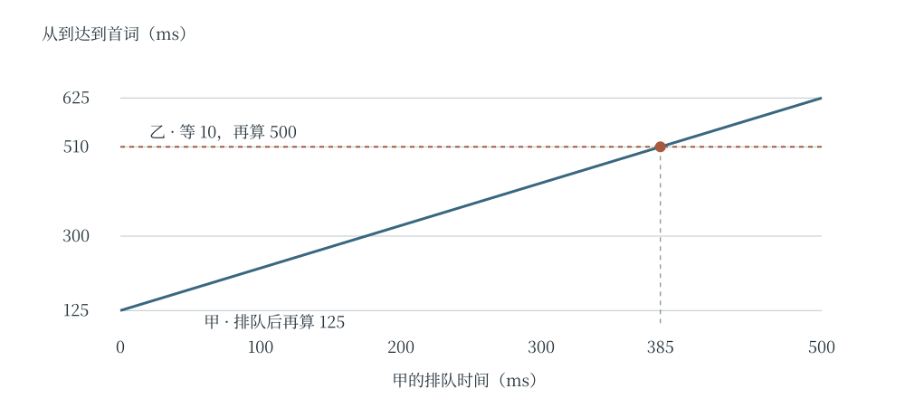
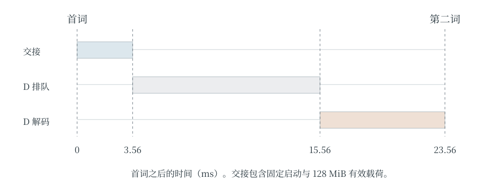
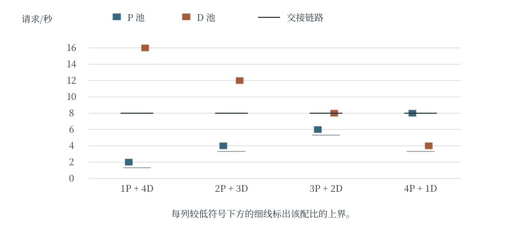
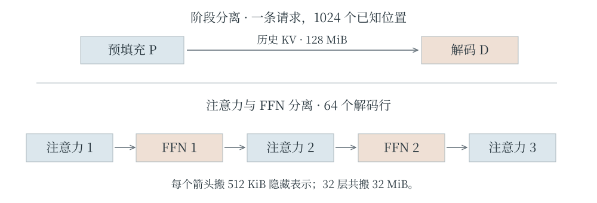
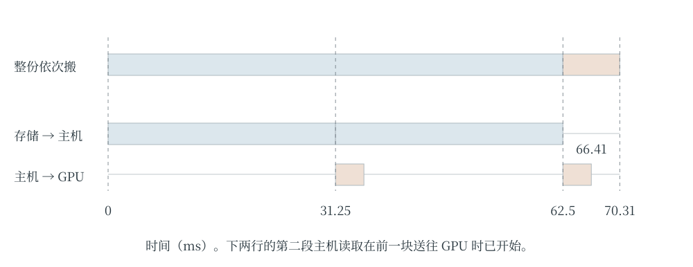

# 第 25 章　分布式推理与 KV 状态管理

两台服务器都装着同一份模型，甲的队列更长，乙身边却没有这位用户的历史。把请求交给空闲的乙，第一词会更早吗？先给复用一次前缀换算出毫秒数，再看它够抵多少排队时间。同样的比较也适用于拆分预填充与解码，只是拆分后多了一份随上下文增长、必须在两端交接的 KV。衡量扩容收益时，固定卡数，数一数哪种放置能让更多请求的首词和后续输出都按时交付。

先把上一章的短请求示例扩展到服务器上的工作规模。沿用第一章的稠密教学模型与每位置 128 KiB 的缓存。为估算容量，先设每个请求有 1024 个输入，返回 65 个词元，第一个词元在预填充结束时产生，余下 64 个需要逐步解码。临近章节末尾再换成专家模型，看哪些结论需要重算。

## 25.1　请求路由与副本选择

若两台设备各自都装得下权重，最简单的方案是各放一个完整副本，新请求在入口择一进入，直到结束都留在该机。副本之间无需为每个词元同步。代价是两台设备各用约 11.18 GiB 存储相同权重；如果请求的输入长度和生成速度差异较大，即使分配给两台设备的请求数相同，负载也可能不均衡。正在解码的请求还需要保留 KV 缓存，迁移请求时须另算这些状态的传输或重建成本。

假设 C 的 1024 个输入中，甲机命中了前 768 个位置的可复用前缀，乙机没有。为隔离变量，设两机完成这种形状的预填充速度都为 2048 个新位置每秒，忽略对已有历史长度的依赖、路由耗时和回程时间。甲只需算剩下的 256 个位置，耗时 125 ms；乙要 500 ms。命中为甲挣得 375 ms 排队余量。若甲队前还要等 300 ms，乙只等 10 ms，预计首词分别为 425 和 510 ms，应选甲。若甲要等 420 ms，就变为 545 和 510 ms，应选乙。



*图 25-1　横轴只改变甲机的排队时间。两者相交于 385 ms，即乙机自身的 10 ms 排队加上 375 ms 复用收益。路由比较的是预计首词完成时刻，单看命中长度或队列条数都可能选错。*

热前缀的价值还受它能否留住影响。把所有相似请求都发给甲，可能令甲频繁抢占，甚至把刚命中的页驱逐出去。若改为主动复制热点，768 个位置占 96 MiB，需比较复制时间、占用显存的机会成本和以后能省下的重复计算。路由器的缓存索引可能落后于真实页表，选择甲机之后仍要由甲确认命中；未命中时须能退回正常预填充。

如果连一个副本的权重都放不下，可以像第二十章那样切分层内矩阵，让多台设备共同承担一个副本。例如四卡按不相交的 KV 头均匀分片，每卡负责 8 个 KV 头中的两个，单个 1024 位置请求的全层历史由 128 MiB 变成每卡 32 MiB。但每一层的输出投影等运算可能要跨卡合并结果，单用户解码需反复等小消息。流水并行将连续的层分配给不同设备，在边界传输隐藏向量；同一用户的下一词要等最后一层给出选择。可以在不同阶段穿插其他用户，提高整体利用率。**增加完整副本**提高的是可同时接任务的能力；**增大单副本并行度**会改变单条请求的内存、时间及对通信的依赖。把两种卡数分开记录才知道扩容的钱花在了哪里。

## 25.2　预填充与解码分离

第二十三章的混合批在同一轮里给长提示和短解码分时。长提示突发时，所有正在输出的用户仍可能一起卡顿。现在让一组设备 P 专门处理一批已知的输入，另一组设备 D 专门接手逐步解码。P 可以选择适合宽矩阵的批形状，D 则按输出间隔和缓存占用控制并发，两组可以独立增减。北京大学、UC San Diego 与阶跃星辰的 Yinmin Zhong 等人在 DistServe 中分别为这两段选择并行方式与放置位置。把解码搬走能解除同卡干扰，却也把原先对本地缓存的一次读取变成一次状态交接。若要判断这笔交换合不合算，得先决定由哪一端把第一枚词发给用户。[DistServe](https://arxiv.org/abs/2401.09670)

逐事件看一次交接。P 计算了 1024 个位置，得到首枚输出 $`y_1`$。约定 P 将首词立即发给客户端。它还要向 D 发送请求标识、模型版本、逻辑位置、已提交长度、各层对应的 KV，以及待输入的 $`y_1`$。D 接到页、核实布局并取得继续生成的所有权后，才可读这 1024 个位置，喂入 $`y_1`$ 算 $`y_2`$。若采用有状态随机流，还要保持采样计数等状态能在正确位置继续。P 得到接收成功的确认后，方可回收它负责移交的状态。一个服务也可以让 D 发首词，两种接口把传输等待计入的用户指标不同。

有效载荷共 $`1024\times128\ \mathrm{KiB}=128\ \mathrm{MiB}`$。取聚合有效带宽 $`40\times10^9`$ B/s，首发和协议的固定开销 0.20 ms，假定整份状态准备好后才开始搬、没有其他流量争抢。则单次交接至少约为

```math
0.20\ \mathrm{ms}+\frac{2^{27}\ \mathrm{B}}{40\times10^9\ \mathrm{B/s}}
\ \approx\ 3.56\ \mathrm{ms}.
```

这里的 $`2^{27}`$ 是 128 MiB 换算成字节，分母是每秒可传输的字节数，相除得到秒，再加上固定开销。这个估算只覆盖状态的单向传输，前提是整份状态已就绪且可独占带宽。若设备还要重排布局、等待接收缓冲或与其他流共享出口，这些时间应加到实际路径上。即使 P 已向用户发送首词，D 也必须取得正确状态，才能继续生成后续词元。

若 D 还要排队 12 ms、首轮解码另需 8 ms，从用户收到 $`y_1`$ 到收到 $`y_2`$ 的间隔约 23.56 ms。拆分让 P 的队列干扰消失了一部分，也给**第一与第二枚输出之间**增加了一段等待。将按层准备好的 KV 提前发送，可以隐藏一部分传输；能隐藏多少，取决于发送时刻、最终到达的分片和第一轮解码的层依赖。



*图 25-2　以 P 返回首词的时刻为零点。D 的第一轮要等交接和排队，右端才出现第二词。示意假定接收端先预留整份缓冲、交接完成时立即确认；这段时间两个端点都要为 128 MiB 留出空间。*

在两台机器上核对这 23.56 ms 时，有个小陷阱。假设发送机记下页已就绪时为 100.00 ms，接收机记下页到齐时为 108.56 ms。若接收机的时钟恰好快 5 ms，跨机器相减得到的 8.56 ms 就多算了 5 ms。可以先在客户端用同一只单调时钟记录两个词的到达间隔，再在 D 端用本机时钟记录页到齐、解码开工和结束。后两段若分别是 12 和 8 ms，便能确认排队比计算更久。要把其余时间准确归给网络，还需对齐两端时钟、估计对时误差，并计入输出发往客户端所走的路径。

若有三条请求同时处在这种整份交接中，相比每条只存一份，瞬间多占 $`3\times128=384`$ MiB。四卡分片也要小心单位：P、D 两端都按同一方式切分时可对应发送四份 32 MiB。四条流若共用一个总计 40 GB/s 的出口，整请求的带宽下限仍约 3.36 ms。只有物理上确有四条独立有效带宽，才可把它除以四。若 D 把 KV 头复制给更多 rank，还需重排或复制，线上字节数可能大于 128 MiB。

还可以决定线上到底发哪种表示。设一种候选编码把这 128 MiB 历史变为 64 MiB，已经包括尺度、位置与分组元数据。假设 P 编码花 1.4 ms，D 读回可计算的布局花 0.8 ms，两段都在单请求的串行路径上，原样传输和编码传输共用相同的固定开销。于是给链路少送 64 MiB 值不值，取决于这 64 MiB 原本要走多久。

| 有效载荷速率 | 原样传输 | 编码、传输、还原 | 用户会等哪条路径更久 |
|---|---:|---:|---|
| 40 GB/s | 3.36 ms | 3.88 ms | 编码路径约多 0.52 ms |
| 20 GB/s | 6.71 ms | 5.56 ms | 原样路径约多 1.16 ms |

表中略去两者相同的 0.20 ms 启动时间，时差按未舍入的数值计算。令 $`B`$ 为可用字节每秒，分界在 $`64\times2^{20}/B=0.0022`$，即约 30.5 GB/s。如果解码器能直接用紧凑格式消费 KV，或发送端已在预填充过程中完成了部分编码，临界带宽要用仍在关键路径上的额外耗时重算。可在 P 的页就绪、编码结束、D 的最后一页到达、首个解码内核开跑时各记一个时间，压缩率和网卡带宽二者都不足以单独给方案排名。

有损格式还会改变下一步读出的内容。第四章中，键参与打分，值参与加权求和。改动一个键可能同时改变一整行归一化后的权重，改动一个值则按它的权重直接进入读出。KIVI 研究这两类误差，对键采用按通道量化，对值采用按词元量化。上表的二比一编码和毫秒数是独立设置的教学条件。评估具体实现时，可以固定同一批长前缀与后续词元，只替换交接格式，测解码分数误差、任务正确率及首词到第二词的间隔。确认同一前缀上的变化以后，再开放采样，检查第一处选词差异怎样影响后续请求的长度与负载。[KIVI，ICML 2024](https://proceedings.mlr.press/v235/liu24bz.html)

### 分开两个阶段，什么时候能收回传输时间

取一条请求，假定分开预填充和解码能移走 30 ms 的阶段干扰，但第一枚需要目标端计算的输出之前，必须多传 512 MiB 的状态。这两项都完全暴露在被比较的等待路径上，其他时间相同。只算载荷，要把传输压进 30 ms，需要超过 512 × 2²⁰ / 0.030 ≈ 17.9 GB/s 的有效吞吐。8 GB/s 要约 67 ms，整体会更晚；32 GB/s 要约 16.8 ms，净省约 13.2 ms。若源端已经返回首词，这段延迟应记到下一次出词或完成时间。若源端等交接完成才允许答复，才可能落在首词上。两套流程不能共用一个模糊的“延迟”数字。

实际往往能在各层 KV 逐步就绪时提前发送一部分，又要和其他请求争链路。测量时分别记录源端最后一层完成、最后一个需要的字节可见和目标端开始下一步的时间戳。用相同到达流比较同时满足首词与后续间隔要求的请求数。如果平均算力利用率提高，却使长提示的交接队列持续增长，拆池并没有按相同目标接住这批流量。[DistServe 的分阶段资源配比与实验](https://www.usenix.org/conference/osdi24/presentation/zhong-yinmin)

## 25.3　预填充与解码实例的配比

先测各阶段在既定批设置下能长期处理的总工作量。为演算，设每个 P 可处理 2048 个提示位置每秒，每个 D 可处理 256 个后续输出每秒，包含同一 D 上并发的所有请求。这里的 256 是设备总速率，不能倒过来当作单用户每词耗时。按本章请求长度，单 P 每秒能接 $`2048/1024=2`$ 条，单 D 每秒能交付 $`256/64=4`$ 条。对于每秒 5.5 条的到达，P 平均每秒要算 5632 个位置，D 要算 352 个输出。池利用率要留在 1 以下，至少需 3 个 P 和 2 个 D。

链路也有自己的队列。若分给两池交接的长期有效带宽为 1 GiB/s，每秒最多传八份 128 MiB。下式的单位统一为请求每秒，持续到达率受三个容量上界中最小的一项限制。

```math
\lambda_{\max}\le \min(2n_P,\ 4n_D,\ 8).
```

三个上界分别来自预填充设备、解码设备和交接链路。每条完成的请求都要经过这三个环节，所以长期到达率不能超过其中任何一项。增加一个 D 只改变第二项；如果第一项已经最小，继续增加 D 不会提高这组假设下的长期容量。临近上界时也不能据此承诺尾延迟，因为突发、请求长度变化和排队都尚未计入。

用三个 P、两个 D，三项分别为 6、8、8，最早拥塞的是 P。把一台 P 挪去做 D，三项变成 4、12、8，持续到达 5.5 时，上游队列会增长，即使下游显得很闲。若保持原配比，但交接通道有效带宽降到 640 MiB/s，链路只能送五条，即使机器数量足够，队列仍会持续积压。这里的 1 GiB/s 是给服务预留的长期份额；前节 40 GB/s 是单条流独占快速出口的短时算例，两者应用在不同的容量问题上。



*图 25-3　横轴是五个实例中分给预填充的数量。每列取三个符号里最低的一个，得到 2、4、6、4 请求每秒。达到图示上界附近时，突发和服务时间方差仍会使长尾增长。*

若用户换成 1024 个输入只求两个输出，D 只做一步，按原比例购置大量 D 就不合算。若绝大多数复用 768 位置的前缀，P 可能只需算 256 个新位置；可若 D 完全冷，仍要拿齐注意力所需的状态。只在 P 端命中，并不自动把交接量降为四分之一。反过来，D 已持有经过验证的相同前缀时，可以只传缺少的 256 个位置，即 32 MiB，加上可靠的状态标识。这时路由、缓存和阶段配比无法分开优化。

对请求做准入也要看下游。若 D 已没有空页，P 再多做十条预填充只会产生一排等待交接的大对象。可以先向 D 申请页或容量凭据，给超时设置可清理的预留；也可以让 P 以有限窗口领先 D，把等待中的 KV 计入 P 的预算。前者在预填充尚未结束时就占用 D 的可用份额，后者在长提示突发时更容易顶满 P。把“等待分配的时间、在途状态字节、交接失败重算量”分开记录，才能区分该加 D、加链路还是改准入。

## 25.4　层内并行与通信开销

预填充与解码通常在阶段之间交接一次。另一种方案把注意力与前馈网络（FFN）放在不同设备池。注意力端保有请求历史，前馈端可将来自多个注意力实例的行拼成大矩阵。如果模型含有许多专家，还能只把被选中的行送往相应专家。这样分开的吸引力来自两种负载的差异，代价是交接出现在每一个被拆开的层。

考虑一批 64 个正在解码的词元经过其中一层。隐藏宽度 4096，元素 BF16 各 2 字节。注意力输出去稠密 FFN 一次，要发送 $`64\times4096\times2=524288`$ B，即 512 KiB；FFN 输出回到下一层所在的注意力端，再发 512 KiB。设 32 层都如此，所有此类边都跨同一出口，一批单步合计 32 MiB。仍取 40 GB/s，每个方向每次消息另付 10 微秒，且这批依赖全部串行。纯传输约 0.839 ms，64 个启动开销合计 0.640 ms，这条路径合计至少约 1.48 ms，再往上加计算与排队。对单条请求、单词元，载荷大幅缩小，64 次依赖却仍在。吞吐和单用户等待在小批量时尤其容易背离。



*图 25-4　上排统计每个请求的 KV 传输，下排统计逐层传输的隐藏状态。下排选取两层画出四条有先后次序的消息；全模型有 32 个这样的往返。两个例子的批量和时间尺度不同，不能直接按箭头长短比较带宽。*

若 FFN 改为第二十一章的专家层，每行选两个远端专家，并朴素地逐副本分发，发送行数可从 64 增至 128，返回的部分输出还要按门控权重合并。若两个专家同机，可以先发一份到那台机再本地分派；若有本地专家，跨节点的载荷还会下降。热门专家队前等得太久，其他专家做完也不能让相关请求前进。改变专家副本和路由可以缓解偏斜，但引入新的权重驻留、统计和路由同步费用。异构设备同理，只有把聚批等待、格式转换和往返链路都算进去，单池较高的算力才可能真的缩短用户等待。

前两种切分方式增加了跨设备状态传输，副本扩缩容也会遇到相同问题。状态用完后是否继续占据显存，需要结合未来复用的概率和重新取得它的时间判断。下面先比较读回与重算，再讨论状态迁移。

## 25.5　状态的保留、迁移与重算

很久没有动过的前缀，放在昂贵的 GPU 显存中可能挤走活跃请求。可以让它退到主机内存，再退到本地或共享存储。取 128 MiB 状态，若主机到设备实际可持续 16 GiB/s，单向读回下限是 7.8125 ms；若存储到主机只有 2 GiB/s，完整读一份下限已达 62.5 ms。两段严格串行至少约 70.31 ms，分块流水可以部分重叠，元数据、排队、解压和重排又会增加时间。对一次原本需 500 ms 的冷预填充，若完整状态和首词所需信息可复原，读回看起来划算。仅复用一小段、链路繁忙或排队过久时，现场重算可能先完成。

若两条链路能独立工作，把状态均分成两块。第一块在 31.25 ms 到达主机，随后 3.90625 ms 送往 GPU，同时存储端读第二块。第二块到主机时是 62.5 ms，送达 GPU 时为 66.40625 ms。比整份依次搬运节省约 3.91 ms。即使再切得更小，慢的那条存储链路仍有 62.5 ms 的总工作，不能被整段隐藏。



*图 25-5　上排整份传输，下两排展示分块后两段链路上的传输时间。第一块进入 GPU 的同时第二块进入主机；末块始终还有一段传输要等。这里只算搬运，忽略切块新增的启动和同步。*

缓存搬运要保住语义。模型权重与适配器、分词后的确切前缀、位置编码配置、各层缓存类型、精度与切分方式，都可能影响能否直接读。如果传给新节点的数据顺序与注意力头的顺序不一致，张量形状可能仍然合法，但输出会发生变化。扩容时应先完成权重加载、内核准备、内存池建立与健康验证，再逐步接入请求；否则新机虽已登记，首批用户仍会遇到冷启动延迟。若加入一台 GPU 需要加载 12 GB 权重，在有效带宽为 4 GB/s 的独占通道上，仅传输数据就需 3 秒，多机一起拉相同分片还可能挤占交接带宽。缩容则先停止接入，让短请求自然结束，长请求再比较迁移、重算与等待的代价。

回到图 25-2。若 D 已接收成功、确认包却丢了，P 不能据此再派一个副本向客户端续写。可给请求和交接尝试分配标识，由有所有权的版本独占提交权；重复接收同一分片应能识别，超时的预留应能释放。向客户端发出的每个片段附带单调的提交位置。若 D 随后故障，使用同一版本的权重、原始提示及**已经发给用户的确切词元**重建前缀，从最后一次确认的位置恢复，避免重复展示已提交文字。要逐词复现还需约定采样随机流和数值确定性。对工具调用等有外部副作用的输出，去重还必须延伸到执行端。故障恢复花掉的时间计入该用户的尾时延。

远端缓存的页命中率还不能直接说明省去了多少预填充，必须检查命中页在前缀中的位置。设一个因果注意力模型有连续 8 页历史，每页 16 个位置。缓存接口约定只能交付所有层都完整、从页 0 起连续的一段，然后用常规预填充处理后缀。若缺页 6，其余七页都在，则可交付的前缀只有页 0 至 5，共 96 个位置；另 32 个位置按此接口重新预填充。若缺的是页 0，相同的七页命中数却交不出一个起始前缀。两者的页命中率都是 87.5%。这项开销来自所用接口。如果系统能验证后来页的完整前缀身份，按层补齐缺页并支持非连续命中，就可能重新使用更多已存结果，但需要不同的调度与依赖检查。对含固定大小递归状态的混合模型，还得有时间位置相符的状态快照。压测时同时记录物理页命中率、实际跳过的预填充位置，以及恢复到可继续解码的时刻。

## 25.6　实际推理系统的执行边界

DeepSeek-V4.1-Flash 的部署资料提供了一个可验证的对照。视觉输入先由视觉设备编码，提示进入预填充池，逐步生成由解码池处理；存储节点则保存可复用状态。对于专家模型，部署说明给预填充和解码使用不同规模的专家并行。预填充已有大量输入行，解码每条请求每步只有一行，扩大解码侧的专家并行范围能改变每卡驻留与读取的专家权重，也要求专家负载与互联足以支撑更宽的分发。用上一节的语言问，就是算少读的权重、额外的远端行和最后一个专家的完成时刻。该模型有自己的压缩状态设计，其每词元状态大小必须按真实配置重算。[官方部署问答](https://github.com/deepseek-ai/DeepInfer/blob/553741557a57df44a46fb3ab72b6aafeaf945337/doc/inference_deployment_qa.md)

在 DeepInfer 的公开快照 5537415 中，可以检查离线引擎如何组织注意力与专家并行、异步组批和推测验证。其说明另行列出构成完整在线系统所需的 KV 缓存系统、阶段分离编排及预填充和解码副本间的负载均衡。这里“引擎能执行含缓存的模型”“集群能跨请求查找并交付正确的缓存”描述的是两层工作。要复核上一段披露的线上行为，应查部署资料；要复核一个本地批如何进入执行器，则应看对应版本的代码。[DeepInfer 固定版本 README](https://github.com/deepseek-ai/DeepInfer/blob/553741557a57df44a46fb3ab72b6aafeaf945337/README.md)

公开配置中的一个细节，把第五章的滑动窗口和第二十四章的推测验证连在了一起。DeepInfer 在适配该模型的解码器预填充时，可以只重放一段有限后缀；说明要求保留范围覆盖滑动窗口和最大回退长度。原因可以画在一条整数线上。约定某次教学计算最多要读前面 8 个已写位置，当前已写至位置 18，只保留最后 8 个便是 11 至 18。若候选验证失败、写指针退回到位置 16，再向前算一步要读的是 9 至 16，第 9、10 个位置已经丢了。允许最多退 2 个位置，就预留 $`8+2=10`$ 个位置，即 9 至 18。这笔额外空间买到了撤销候选的权利。官方快照给出特定配置下保留 140 个词元的设置；把这种局部后缀重放用于含全局可见历史的层，仍须另外提供那些层所依赖的状态。[DeepInfer 固定版本的后缀重放配置](https://raw.githubusercontent.com/deepseek-ai/DeepInfer/553741557a57df44a46fb3ab72b6aafeaf945337/README.md)

不妨借 DistServe 的问题检验集群里的下一步选择。前一基线是一组卡既预填充又解码，长预填充会拉长同批请求的输出间隔；一旦拆池，这次干扰消失，交接就成了新的到达流。论文从两段的延迟目标出发，为不同的集群带宽选择放置、并行和资源配比。单看“挪走了多少预填充计算”无法判断给定集群能多接几位达标用户。[DistServe 的资源配置与实验](https://arxiv.org/abs/2401.09670)

看一个可以逐事件核查的突发。甲、乙的首词在时刻 0 发出，丙、丁在 4 ms 发出。这是四条预填充完成记录，时间原点取在甲完成处。每条都要移交前面的 128 MiB，交接共用一个出口，按就绪顺序服务；同刻按甲乙丙丁的顺序排。假设每条状态传输的时间均为 4 ms。从交接完成到第二词还需要 D 的一次 3 ms 解码，假设此处只给这些请求一个串行执行位，忽略后续输出。甲的状态在 4 ms 传输完成，第二个词元在 7 ms 产生。乙的状态在 8 ms 传输完成，D 已经空出，11 ms 得到第二词。按相同办法，丙、丁的第二词分别在 15、19 ms 返回。取丁自己的首词时间作起点，它等了 $`19-4=15`$ ms。


*图 25-6　每个字母占用一段资源时间，向下对齐即可读出能否交接。下半图丁在 8 ms 已经收齐状态，仍要等到 11 ms 才轮到解码。*

把交接缩成 2 ms，四份状态在 2、4、6、8 ms 齐备。D 从第 2 毫秒开始就没有空过，第二词在 5、8、11、14 ms 依次出现。四位用户的首词到第二词间隔分别为 5、8、7、10 ms。若单看这一段“不超过 10 ms”的承诺，达标由一人变为四人；丁从出口搬完到真正开算又多等了 3 ms。将链路时间减半，没有把每位用户的等待都减半。打开[交接队列回放](../../experiments/part05/handoff_queue.py)，把相同四次就绪摊到 0、4、8、12 ms，对照出口空闲和 D 空闲的时刻，就能看出先前有多少等待来自突发，而非单条请求的数据量。

这里的时间来自指定的服务时长。真实解码会把多条就绪请求编成一批，时间随形状改变；两端有多个通道时，上图也要添上独立的资源行。要验收拆池决策，应在相同总设备数、输入输出分布和质量要求下，先跑同池分块，再跑分池，记录路由等待、首词、第一到第二词的间隔、此后最坏间隔、状态交接字节及满足全部承诺的请求数。

可以把配比直接写成四次试排。下面保留了每阶段的单位，改动输入长度、输出长度或链路份额中的任何一项，就能找到新的限制。

```python
limits = []
for p in range(1, 5):
    d = 5 - p
    per_second = min(p * 2048 / 1024, d * 256 / 64, 1024 / 128)
    limits.append(per_second)
assert limits == [2, 4, 6, 4]
```

五张卡分成三张预填充、两张解码时，三项预算合起来给出每秒六条的容量上界。部署前可以固定这五张卡与到达顺序，只改变状态传输能使用的带宽。本例由预填充端发首词，因此交接变慢会拉长首词到第二词的间隔。若预填充队列一直长，单纯扩宽链路未必能更早交付首词。机房里尚能为链路预留份额，换到无线设备，连下一秒能送走多少字节也得估计。

## 练习与解答

### 1. 命中前缀是否值得等

同一提示长度 1024，甲复用 512 个位置，乙全部重算，两者预填充速率仍为每秒 2048 个新位置。乙排队 30 ms。甲最多能排多久还能先交首词？

**解答。** 复用省下 $`512/2048=0.25`$ 秒，即 250 ms。两者相等时甲可以等 280 ms；若要求严格早于乙，应小于 280 ms。还要假设命中状态确实可用，其他传输与返回开销相同。

### 2. 首词之后的状态传输

若 P 到 D 的带宽减半为 20 GB/s，固定开销仍为 0.20 ms，D 排队和计算各为 12、8 ms，首词由 P 发送。第一到第二词间隔变成多少？25 ms 的间隔目标能否达到？

**解答。** $`2^{27}/(20\times10^9)`$ 秒约为 6.71 ms，再加 0.20、12、8，合计 26.91 ms，超出约 1.91 ms。若只统计到首词，这次退化可能完全看不见。

### 3. 输出翻倍之后重新配比

仍有五个同规格实例、1024 个输入，将每条请求的后续解码词元从 64 加到 128。每秒到达 4.5 条，长期交接带宽仍为 1 GiB/s。能否只调 P、D 比例来承载？

**解答。** 每个 P 仍可接 2 条/秒，每个 D 现在也只能接 $`256/128=2`$ 条/秒。两侧分别至少需要 3 个实例，五个不够。链路上限仍约 8 条/秒，单独提高传输带宽无法解决这次瓶颈。

### 4. 迁移正在生成的请求

P 已发出首词，并将包含 1024 个位置的历史状态传给 D。D 又发回第二、三枚词元。另一台机器只保有原始提示，怎样在故障后继续？若它另有完整、兼容的提示 KV，能省掉什么？

**解答。** 先从提交记录取回客户端已经收到的词元标识和位置，确认旧所有者无法再向同一请求提交。冷副本重做提示预填充，再按原样喂入已提交的输出前缀，在正确的边界产生下一枚，按提交位置继续发送。持有原提示 KV 的副本可省去对应位置的预填充；仍要把缓存之后的已提交词元送入，补齐解码历史并恢复必要的采样状态。本例已提交三枚词元。若从提示结尾的 KV 重建，依次喂入这三枚，在第三枚的位置得到第四枚的分布。

[全书目录](../../README.md) · [上一章 · 采样、推测解码与约束生成](ch24.md) · [下一章 · 端云协同推理与弱网适配](ch26.md)
