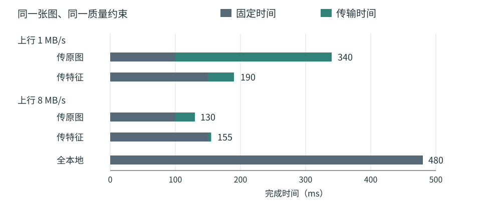
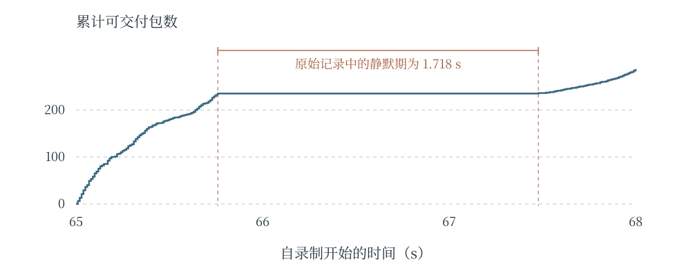
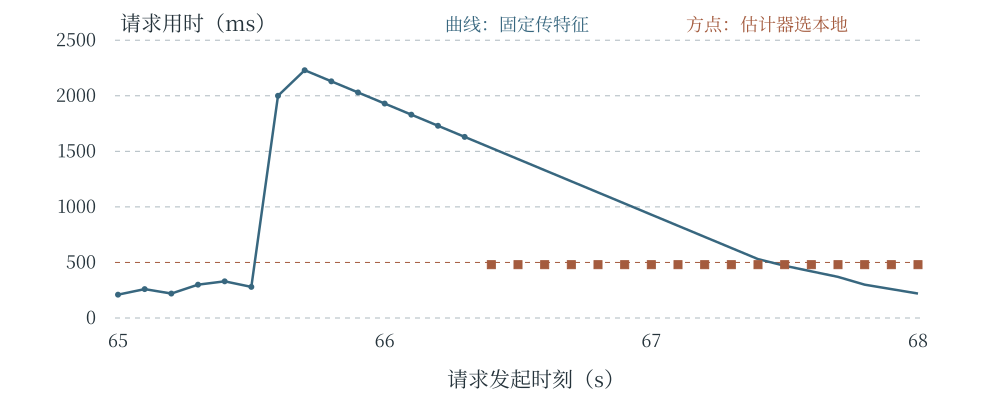

# 第 26 章　端侧计算与弱网协作

在机房里，上一章从两台机器之间搬一份状态。现在同样的决策落到手机上，却多了两项限制。无线链路会突然停顿，手机本地每多算一步还要耗电、发热。设任务是判断图像中的包裹进了哪个箱子。可以把图像传到云端，也可以先在本地提取特征再传，还可以在手机上直接算出最后的类别。三条路的分界该从哪里找？

## 26.1　端云切分点与传输开销

机房里，分开两段计算是为了让它们使用不同的资源池。现在把边界移到一台手持设备和附近的边缘服务器。巡检相机拍下一张设备铭牌，目标是返回同一份识别文本。全程本地用 480 ms；将图片发往边缘，固定往返、排队和计算合计 100 ms，原图压缩后为 240 kB。第三个方案先在手机运行 70 ms 的前半网络，边缘的固定往返、排队和剩余计算共 80 ms。设上行有效吞吐为 $`b`$ MB/s，十进制单位，每个方案内部的计算和上行传输按顺序执行，回复文字的传输已计入固定时间；暂不考虑重试。

“前面已经算了几层”并不说明上传会更省。如果切口张量有 400 kB，中间切分需 $`150+400/b`$ ms，对任意正带宽都慢于上传原图的 $`100+240/b`$ ms。若经过另一种**已验证识别质量**的编码器，切口只需 40 kB，沿用同样的固定预算，分段变成 $`150+40/b`$ ms。与原图上云比较，交点在 $`b=4`$ MB/s；与全本地比较，交点在 $`40/330\approx0.121`$ MB/s。因此网络极差时选本地，中等速率时小切口有利，超过 4 MB/s 时直接上传又反超。在 1 MB/s 时三者分别为 480、340、190 ms；不是离用户最近的机器永远胜出，也不是远端加速器越快越值得调用。[端云逐层切分的原始研究](https://doi.org/10.1145/3037697.3037698)

若手机连续工作后发生热降频，70 ms 与 480 ms 都要重测；把低速链路和高温状态分别取一次平均，再相加，通常得不到一次请求的尾延迟。实际可先设一个设备仍能完成本地识别的截止点，再决定是否发往边缘。若远端超时后本地接手，两路结果应以同一个请求编号提交一次；模型或词表不兼容时重新从已保存输入开始，不能接续一份别的模型留下的隐藏状态。若原图不允许离开设备，就先从候选项里删掉传原图；中间特征也要单独满足数据约束。这里做的是同一质量和交付条件下的放置选择，带宽交点只是其中一条边界。

*图 26-1　灰段是各方案除上行传输外的固定时间；色段随网络速率改变。横条比较总耗时，不表示各阶段的实际先后。特征始终比原图小，但在 8 MB/s 时，传输节省的时间不足以抵消特征提取多用的 50 ms。*

## 26.2　弱网下的端云切分

仍然读同一张铭牌。前节假设整个上传期间速率 $`b`$ 不变。现实中，同一部手机先算 70 ms 再上传，与立刻上传，会遇到不同的一段无线服务。改用累计服务曲线 $`C(t)`$，记录时刻 $`t`$ 以前链路一共能够送走多少包。一次上传在 $`s`$ 就绪，需要 $`n`$ 个包，最早完成时刻便是第一个满足 $`C(t)-C(s)\ge n`$ 的 $`t`$。累计曲线的平段代表即使有数据在等，链路在那一段也没有提供发送机会。

我们使用 Mahimahi 项目公开的 Verizon LTE 短上行轨迹。它用 Saturator 记录可交付的服务机会，每个时间戳代表一个 1,500 B 包，同一毫秒可能有多个。该文件约 140 秒，含 69,367 个机会。为便于离线复算，按 10 ms 分箱，把每箱的机会记在箱末，不跨箱移动包数。在这个离散模型中，起点取箱边界，计入其后、包括终点的机会。对齐的起点下，分箱使上传的结束时刻最多推迟不到一箱。固定时间仍用前节的教学预算，假设没有其他请求占用链路。[原始记录与采集说明](https://github.com/ravinet/mahimahi/blob/master/traces/README) [本次使用的固定版本上行记录](https://github.com/ravinet/mahimahi/blob/1a775777d2f8e667c59447bf0ff268178b6ff4ad/traces/Verizon-LTE-short.up)

先手算一张图片。在录制开始后 1,000 ms 发起，若传特征，手机做好编码时是 1,070 ms。40,000 B 需要向上取整的 27 个包。接下来四个箱分别提供 10、0、13、5 个机会，累计为 10、10、23、28。第 27 个机会出现在 1,110 ms 处的分箱末尾。再花 80 ms 返回，整次请求用 $`70+40+80=190`$ ms。传原图需要 $`240000/1500=160`$ 包，从 1,000 ms 开始传输，到 1,270 ms 才能发送完全部数据包，加上 100 ms 后总耗时为 370 ms。本地仍是 480 ms。只有传输开始的时刻、传的包数和末端预算发生变化。

*图 26-2　从真实时间戳放大一段上行。曲线高度是自图左端起可交付的包数，横坐标以录制起点为零。65,760 ms 的最后一个机会之后，直到 67,478 ms 才出现下一个。竖直方向几乎没有变化的这 1.718 秒里，再小的非空上传也可能超过整条请求的期限。*

### 根据近期带宽选择切分方案

在同一段轨迹上，每隔 100 ms 重新发起一次独立试验，从 1,000 到 137,000 ms 两端均取，共 1,361 个起点。每次都从该刻独立重放三种放置，末尾留出时间让上传完成。再加一个手机上可以实现的估计器。用**刚过去**一秒的可交付包数乘 1,500 得到速率，按前节的两个交点选方案。作为参照，还可以在事后读完三条完成时间，取其中最短值。这一行给出在既定三个动作中逐请求选择的理论下界。[可离线运行的逐请求重放](../../experiments/part05/radio_replay.py) [与脚本置于同一目录的分箱数据](../../experiments/part05/verizon_lte_uplink_10ms.json)

| 同一个识别请求怎样放置 | 中位数（ms） | P95（ms） | P99（ms） | 超过 500 ms 的次数 |
|---|---:|---:|---:|---:|
| 全部本地 | 480 | 480 | 480 | 0 |
| 立即上传原图 | 450 | 1,700 | 2,710 | 561 |
| 先算 70 ms 再传特征 | 210 | 540 | 1,130 | 77 |
| 用过去一秒估计，再选一种 | 210 | 480 | 750 | 35 |
| 事后逐次取最快 | 210 | 480 | 480 | 0 |

读这张表时留意两处。第一，历史估计把固定传特征的 77 次超期减到 35 次，仍会在“刚才还通、现在突然停”的起点选错。即使最近一秒的带宽探测完全准确，它测的也是过去。第二，本地方案在此模型中每次用 480 ms，因而事后最优永远能守住 500 ms。若先赌上传，超时才从头本地重跑，要在 $`500-480=20`$ ms 内作出回退决定；等到编码 70 ms 做完再回退已来不及。另一条路是并发保留本地执行，先完成的一方提交。它占用额外的算力、电量，还可能引发热降频，使表中 480 ms 的假设失效。

*图 26-3　横向移动代表换一个起点、从头做一次独立试验。虚线是 500 ms 期限。方点标出估计器选本地的时刻。65.6 秒时它仍选特征，这次实际要 2,000 ms；66.5 秒发起时，过去一秒已经很慢，此次选本地，只花 480 ms。*

采集工具持续向链路送包才能观察可用服务；一部平时空闲的手机只能从应用传输、探测或无线侧遥测中估计它，估计本身也有成本。轨迹没有给出本次识别的端侧能耗、下行抖动、服务器排队或一次真实应用的完成时间。分位数采用升序的第 $`\lceil qn\rceil`$ 项；相邻起点共享大半段无线环境，不能当作 1,361 次相互独立的外场采样。准备上线时，可用同一累计曲线算法换入目标地点的不同时段、上下行配对记录和设备的冷热运行时间，让多个并发请求共享一份机会预算，再检查识别质量、能耗与超期次数。

### 语音与图像的链路调度

前面的任务只有整张图片的完成期限。实时对话还会同时传输图像和语音，两者的时限可能不同。现在有 120 KiB 的旧图片待传，20 ms 之后到来一块 5 KiB 语音，自产生起 60 ms 后便过期。假设共享上行一直能提供 1 MiB/s，先忽略传播。若已经把整张图片排入无法抢占的单队列，图片在约 117.2 ms 时发完，语音到达后要等到约 122.1 ms 才发完，错过 80 ms 的绝对期限。改为每次只提交一块 8 KiB 图片，两块在 15.625 ms 刚发完，第三块不能中途打断。音频在 20 ms 出现，只等到 23.4375 ms 就可以插队，约 28.32 ms 发完，余下的图片顺延 4.88 ms。优先级能用上的前提是下游队列仍有分派边界。若应用层分了块，驱动却已提前排满 120 KiB，同样要等。真实 Wi-Fi 的上下行还会争同一空口时间，云端下发语音占用的服务机会不能再全额算给图片上行。

分成独立的传输流还有另一种作用。若旧图片的一段丢了，接收者应当能在等重传时先交付已经齐全的语音。QUIC 每条有序字节流独立重组，跨流交付可避免被另一流的缺口卡住，但它们通常仍共享连接的拥塞窗口和路径。假设一条路径的可持续速率为 1 MiB/s，往返为 80 ms，约需 82 KiB 在途数据才能填满；若只有 16 KiB 窗口，确认钟下的吞吐上界仅约 200 KiB/s。若语音不断产生，每个 5 KiB 块在这个稳态吞吐预算中平均要占约 25 ms 的份额。单个块遇到足够的空闲窗口时却能立即发送，链路序列化只需约 4.88 ms；若窗口已经占满，则要再等确认释放额度。建立新连接另有握手与拥塞窗口增长的时间，已有连接上的独立流则可复用连接。取消过期音频可以省掉尚未发送的载荷，已占用的空口时隙却无法追回；历史可靠字节流上的有序交付与可过期的实时消息也需要不同的应用语义。[QUIC 的连接、流与流量控制](https://www.rfc-editor.org/rfc/rfc9000) [QUIC 不可靠数据报扩展](https://www.rfc-editor.org/rfc/rfc9221)

手机若同时有蜂窝和 Wi-Fi，直接把一个包发两份也有条件。假设两条路在这项音频期限内各自失败概率为 10% 和 20%。若失败独立，复制后两份都迟到的概率为 2%；若每次蜂窝迟到恰好也遇上 Wi-Fi 迟到，则为 10%。测到两个单路分位数无法在这两种情况间作出选择。要从同一设备、同一时间窗口取得双路径记录，保留共用队列、同源干扰和复制增加的负载。对一张必须收齐的图片，把两半分走两条路还要等较慢那半，完成时间取两者最大值；对重复的同一语音块，可以采纳先到的一份，再用序号去重，完成时间取最小值。这里比较的是两种应用交付条件，普通单路径 QUIC 本身不会自动复制。

还可用同一条任务检查地域选择。若原始图像因业务授权只能留在仓内，任意快的外部链路也不能让原图上传成为可行路径。编码特征是否允许出域需要单独判断，改变表示并不会自动解除限制。若分支均获准，迁移还有一次性成本：假设目标端恢复状态需 900 ms，但此后每轮相对留在原节点少 70 ms，剩 12 轮总共只省 840 ms，剩 13 轮时，累计节省才可能超过这次迁移的 900 ms 开销。任务可能随用户打断提前结束，应用应从历史轨迹估计剩余轮数分布，再检查迁移时首个回复是否会错过期限。系统不能先假定所有会话都完整度过平均剩余寿命。

### 异构设备上的专家权重预取

第八章的流式算子在片上有权重时很快；第二十五章前半已经算过每层发送的隐藏行。现在比较**同一个词元**在两种方案下的成本。设有八个等大的专家，每个 8 MiB，远端芯片能常驻三个。一次只选一个专家，热专家的总命中概率为 $`p`$。为便于隔离问题，设本地完成专家计算需 80 µs；远端权重已就位时计算需 25 µs，往返激活与固定交接共 15 µs。一次未命中还要经 40 GB/s 的有效通道搬入 8 MiB，串行约 210 µs。这里先假设单请求、无排队、冷载入不重叠。两条路径均使用相同权重、返回相同精度。

于是远端平均用时是 $`40+(1-p)\times210`$ µs。要胜过本地的 80 µs，需 $`p\gt 1-40/210\approx81.0\%`$。若三个常驻专家恰好覆盖九成路由，平均约 61 µs，但那一成未命中仍要约 250 µs。按这组离散分布，第 95 百分位就是 250 µs，本地固定 80 µs。若八个专家等概率，三个槽只能覆盖 $`3/8`$，平均会升到约 171 µs。热度、容量和尾延迟三项缺了任何一项，都容易从一条漂亮的算子计时推出错误的设备选择。

可以把等同一专家的多个输入凑成一批，权重读一次，由多行复用。但最早到达的请求得等同伴，且排在它后面的还有别的层。也可以预测下一层路由提前预取；预取错误专家所传输的 8 MiB 会占用同一条权重传输通道，甚至逐出马上要用的热专家。实验时按真实路由顺序重放，记录每次选中专家、是否命中、激活往返、装载和排队的开始结束时刻，再比较同一分位数。这比假设所有专家均匀热身后测一个批更接近读者要交付的服务。[异构推理硬件的公开数据路径说明](https://developer.nvidia.com/blog/inside-nvidia-groq-3-lpx-the-low-latency-inference-accelerator-for-the-nvidia-vera-rubin-platform/)

## 26.3　一次很快的本地推理能代表一小时吗

给定一组教学条件，冷机本地识别用 80 ms，计算期间整机平均取 3 W，一次约耗 0.24 J。若纯传输路径的无线电以 1.5 W 活动 140 ms，之后有 80 ms 的尾部活跃时间取 0.5 W，合计约 0.25 J。这里两条路径只比较题设列出的能耗边界。若测整机任务，要把相机采集、待机基线、屏幕和响应处理也记进口径，若测增量能耗则从各段扣除同一空载基线。

再连续运行，设备温度进入稳定区后，本地耗时若从 80 变为 120 ms，在相同 3 W 条件下每次变为 0.36 J。若设备同时降功率，就用新功率与时间求积。对 100 ms 的本地期限，前者能按时完成，后者已过期。做端云对比可以把连续运行分成冷启动、升温和稳定三个区间，保证输入、无线回放起点和正确性标准一致，再报告各段的合格任务数、电量与超时。选择一个中间层做切分之前，再核对边缘与云端是否使用同版权重、剪裁规则与量化尺度。把激活量化为更少字节确实能省上行，但若边界样本因此认错了箱子，这份节省并没有交付同一项任务。

本篇从单个设备上的请求调度，逐步讲到跨设备的状态传输与计算放置。每次拆分都需要重新计算传输、排队和状态管理的开销。下一篇将讨论后训练与模型应用：生成、评分、检索和工具调用会组成更长的执行过程，仍然需要逐项分析这些依赖和等待。

## 练习与解答

### 1. 端云切分位置与计算开销

铭牌识别在 $`b=2`$ MB/s 的上行链路运行。若为了把 40 kB 再缩到 20 kB，需要在原 70 ms 基础上多花 18 ms，识别质量和其余开销不变，是否值得？在哪些正带宽上它会优于原来的 40 kB 切口？

**解答。** 原切口是 $`150+40/2=170`$ ms，新切口是 $`168+20/2=178`$ ms。少传 20 kB 只省了 10 ms，却多算了 18 ms。只有在 $`20/b\gt 18`$，即 $`b\lt 10/9`$ MB/s 时，新切口才快于原切口；等号时持平。若带宽更差，还须重新与全本地的 480 ms 比较。

### 2. 在上行停顿之前发起的识别

重放第 65,600 ms 的请求，过去一秒有效载荷为 555,000 B。按带宽交点会选哪个方案？若这一回的上行恢复得足够晚，特征方案实际耗时 2,000 ms，要保证 500 ms 截止，还能等它失败再启动完整的本地识别吗？

**解答。** 估计速率为 0.555 MB/s，位于两个交点之间，策略选特征。它在 65,670 ms 才就绪，要跨过图中的沉默期；重放确实给出 2,000 ms。全本地需要 480 ms，因此最晚须在发起后 20 ms 启动，连等端侧编码完成都来不及。若能证明编码结果可供本地余下网络接续，则应改用实测的剩余本地时间重新计算回退边界。

[下载本篇复算程序，改变链路带宽和池配比](../../experiments/part05/verify.py)

[全书目录](../../README.md) · [上一章 · 分布式推理与状态调度](ch25.md) · [下一章 · 后训练数据、微调与偏好学习](ch27.md)
