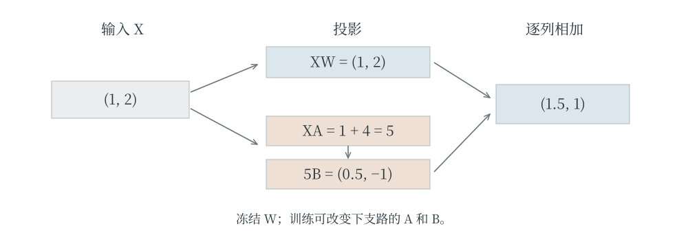
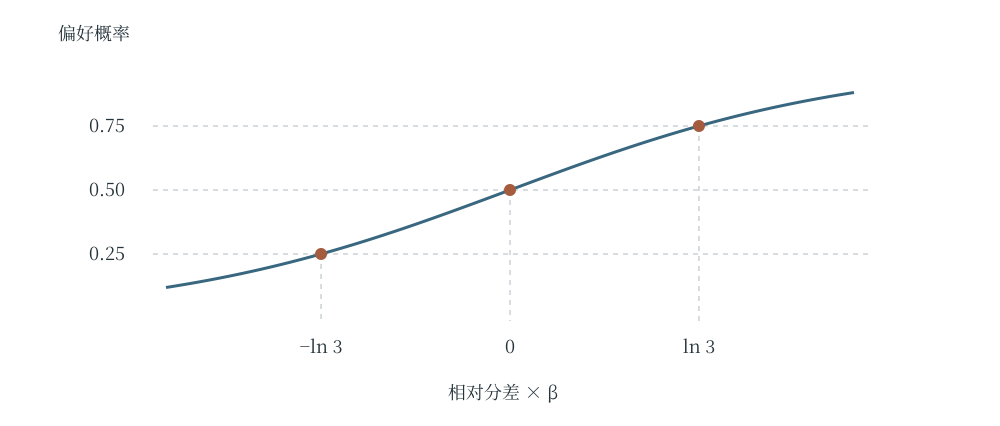

# 第 27 章　后训练数据、微调与偏好学习

交接单上出现了一个原记录里没有的箱号。先把完整记录直接交给模型，确认问题没有出在录像采样或检索。如果证据已经齐全，模型仍爱把空格填满，我们该给它看什么样的样本？本章从正确填写与正确留空这两种答案出发，沿数据的选择走到一次参数更新。

## 27.1　监督、偏好与奖励信号

假设记录和标准答案都已切成词元。继续预训练时，可以直接用大批交接日志做下一词预测，模型在许多位置学习仓库里的词汇与用法。做监督微调（SFT）时，则把样本排成“观察记录、问题、标准交接单”。输入仍然全部穿过模型；本例只在答案位置及约定的结束符上计算损失。因此，同样包含“绿箱”的文字，作为提示时提供上下文，作为答案时还直接参与监督损失。掩去提示上的损失，并不会切断答案通过注意力对提示表示的依赖。

假设标准答案只有两个词元“2”“绿”，暂不计结束符。当前模型在给定问题后给“2”的概率为 0.8，在给定问题和正确的“2”之后给“绿”的概率为 0.5。整条答案概率是 $`0.8\times0.5=0.4`$，平均每个答案词元的负对数似然是 $`-\log(0.4)/2\approx0.4581`$。训练时两个正确词元都已知，可以使用第四章介绍的因果掩码并行计算这两个概率分布。推理时，如果第一步生成了“3”，第二步面对的上下文便与训练示例不同。监督损失降低，要通过真正让模型作答的保留集检验。

另一批记录只有比较结果：质检员看了两个完整回答，认为如实留空比编一个箱号好。这里知道相对偏好，却没有每一个位置唯一正确的下一词。再换一种条件，有一份可靠的标签表或可执行检查器，能给新生成的交接单打分。这时可以让当前模型自己尝试，读完得分再更新。三种数据能用于不同训练目标。选哪种先看能得到什么反馈，然后才决定用全参数更新还是适配器。

## 27.2　后训练中的参数与状态

回到第五篇的投影 $`Y=XW`$。在冻结的 $`W`$ 旁增加两个较窄的矩阵，写成 $`Y=XW+(XA)B`$，这就是 LoRA 的基本构造，此处将缩放系数取为 1。令 $`W`$ 为二阶单位阵，输入 $`X=(1,2)`$，令 $`A=(1,2)^\top`$、$`B=(0.1,-0.2)`$。内积 $`XA=5`$，新增输出为 $`(0.5,-1)`$，总输出为 $`(1.5,1)`$。这个秩一更新把所有输入沿 $`A`$ 投影成一个数，再沿 $`B`$ 指定的方向修正输出。增大秩可以容纳更多方向，同时增加可训练状态和计算。[LoRA](https://arxiv.org/abs/2106.09685)



*图 27-1　一行输入的两条计算路径。下方支路先算出标量 5，再计算两个修正分量。两条路径在输出处相加，共用同一份输入。*

把矩阵放大到 $`4096\times4096`$，取秩 8。全矩阵有 16777216 个元素，两个因子共有 $`2\times4096\times8=65536`$ 个，正好是前者的 1/256。只数这一层、每个可训练参数的两份 FP32 Adam 矩共 8 字节，便由 128 MiB 降至 0.5 MiB。冻结矩阵的前向仍要读，只要前面的层需要梯度，反向仍要把信号传过来；中间激活、其他层、通信缓冲还占空间。用 1/256 去缩放整机显存会大幅高估收益。

QLoRA 进一步压缩冻结的基座权重，典型实现用 4 位表示存储基座，按块用尺度等元数据解释数值，计算时转换到适合乘法的精度。理想紧密打包下，这个方阵的基座载荷从 BF16 的 32 MiB 变为 8 MiB，另加量化元数据和必要的工作区。低秩因子仍接收较高精度的训练信号。若已有适配器专门修正领域偏差，还应分别测基座量化误差和任务质量；参数文件小，不能单独说明训练步更快。[QLoRA](https://arxiv.org/abs/2305.14314)

## 27.3　成对偏好与损失函数

换一条摄像头被箱沿挡住的记录。把这个问题 $`x`$ 下的“据实留空”记作 $`w`$，把“凭空填绿”记作 $`l`$。以冻结的参考策略为起点，考察训练策略把某个完整回答的概率提高了多少。定义 $`s(y)=\log\pi_\theta(y|x)-\log\pi_{\rm ref}(y|x)`$。这里每个整句的对数概率都要沿**该回答自己**的历史把答案词元的对数概率相加，掩掉提示和填充。参考策略为这个比值提供基准。

为何看两个这样的差？设给定一个奖励函数 $`r(y)`$，在固定问题上最大化期望奖励，同时按系数 $`\beta\gt 0`$ 惩罚策略偏离参考的 KL 散度。对各候选概率求导、加上总和为一的约束，最优解满足 $`\pi^*(y)\propto\pi_{\rm ref}(y)\exp(r(y)/\beta)`$。于是奖励可以写成 $`\beta\log(\pi^*/\pi_{\rm ref})`$ 加一个只依赖问题的常数。若把两个答案的偏好概率建模为奖励差的 sigmoid，那个未知常数恰好相消。DPO 用待训练的策略代入，得到一对数据的负对数似然

```math
L=-\log\sigma\bigl(\beta[s(w)-s(l)]\bigr).
```

把式子从里向外读：$`s(w)-s(l)`$ 衡量训练策略相对参考策略对优选回答和劣选回答的倾斜，$`\beta`$ 控制这一差值进入 sigmoid 时的尺度。两者差值越大，优选项的预测概率越接近 1，负对数损失越小。如果训练策略与参考策略完全相同，两项 $`s`$ 都为零，损失为 $`\ln 2`$。这说明参考策略给出了比较基准，而样本中哪一个回答更好仍由偏好标签提供。

设参考对两个回答的概率都是 $`1/2`$，训练策略变成 $`3/4,1/4`$，并令 $`\beta=1`$。差值为 $`\log3`$，偏好概率为 $`3/4`$，损失从 $`\log2\approx0.6931`$ 降到 $`-\log0.75\approx0.2877`$。还可以算出一次真实的更新方向。把模型简化为只有一个参数 $`z`$ 的二选一策略，令 $`\pi(w)=\sigma(z)`$。在两项参考概率相等时，上述损失对 $`z`$ 的导数为 $`\sigma(z)-1`$。从 $`z=\log3`$ 起步，导数为 $`-0.25`$，学习率取 0.4，梯度下降使 $`z`$ 增加 0.10，下一次选 $`w`$ 的概率约为 0.7683。标注员的一次选择就这样改变了未来采样的倾向。

若只知道好回答概率上升，而坏回答相对参考的增幅更大，差值反而可能变小。这解释了为什么训练器要同时读两个回答。它还能解释系统的一项优化：数据、参考权重、模板及词元边界固定时，可预先算好这两份参考对数概率，省去每个训练步再跑参考模型。换模板或截断位置就要重算。[DPO](https://arxiv.org/abs/2305.18290)



*图 27-2　横轴是乘过系数的相对分差，纵轴是模型赋给“更偏好 w”的概率。中心点表示策略尚未相对参考拉开两者。训练拉高观察到的偏好事件的概率。*

也可以改变一对答案的概率，观察损失对相对偏好的响应。以下四个输入都是完整答案的概率，实际程序可直接使用各词元对数概率的和，以避免长序列连乘下溢。

```python
from math import exp, log
policy, reference = (0.75, 0.25), (0.5, 0.5)
margin = log(policy[0] / reference[0]) - log(policy[1] / reference[1])
loss = log(1 + exp(-margin))
assert round(loss, 4) == 0.2877
```

## 27.4　老师答对的题，为什么不能一股脑全收

假设有 100 道容易判断的题和 100 道难题，各让教师模型独立生成四次。为隔离筛选的影响，暂设判分器完全可靠，各次独立，单次正确率分别为 0.8 和 0.2。若把所有正确轨迹全收，容易题期望留下 320 条，难题 80 条。训练集原有一半难题，到这里按轨迹计数只占五分之一。若每道题至多留一条，容易题留下的期望题数为 100 × (1 − 0.2⁴) = 99.84，难题约为 100 × (1 − 0.8⁴) = 59.04。规则换了，教师、候选和总生成开销一个都没有换，学生看到的难度分布却不一样。

要判断哪批数据更有价值，不能在同一批被筛选过的回答上再向同一个判分器要一个总分。保留按原始题目和来源隔离的测试集，分别检查容易题、难题、正确留空与误填。对最难组手工抽查未通过轨迹，区分真的缺少证据、模型不会做，以及判分器误判。有的失败回答可以组成偏好对，有的只适合拿来校正判分器。若四次采样错误高度相关，“至少一次正确”的上述独立近似会偏乐观。观察实际每题命中次数的分布，比只报训练集有多少条更接近读者关心的问题。

监督蒸馏还能保留教师在多个候选间的偏好，成本是额外存储或查询教师分数。沿字段“箱号”手算，对同一条记录，一位教师给“绿箱”和“留空”的概率分别是 0.51、0.49，另一位是 0.99、0.01。若只留下首选字符串，两条监督在该位置完全相同。保留软分布，则学生会受到不同强度的梯度。给数据附上教师版本、取样温度、判断依据和来源，比事后用文件名猜训练目标可靠。下一章会把判分接回采样过程，让模型自己的新回答再改变下一次更新。

## 练习与解答

### 1. 选哪些位置计损失

两条样本分别有 2、6 个有效答案词元，总负对数似然为 1、6。按所有词元平均与先按每条平均再按两条平均，各是多少？

**解答。** 前者是 $`7/8=0.875`$。后者为 $`(1/2+6/6)/2=0.75`$。若同批大部分是长答案，两种约定会产生不同的更新。

### 2. 偏好标签互换

沿图 27-2 的右侧点，标注员若改选原来的坏回答，损失是多少？

**解答。** 两回答交换后分差变成 $`-\log3`$，新标签的概率为 0.25，损失约 1.3863。若两位标注员独立给出相反标签，在同一对样本上应保存两份观察或约定聚合方式。

[全书目录](../../README.md) · [上一章 · 端侧计算与弱网协作](ch26.md) · [下一章 · 强化学习的采样与训练系统](ch28.md)
