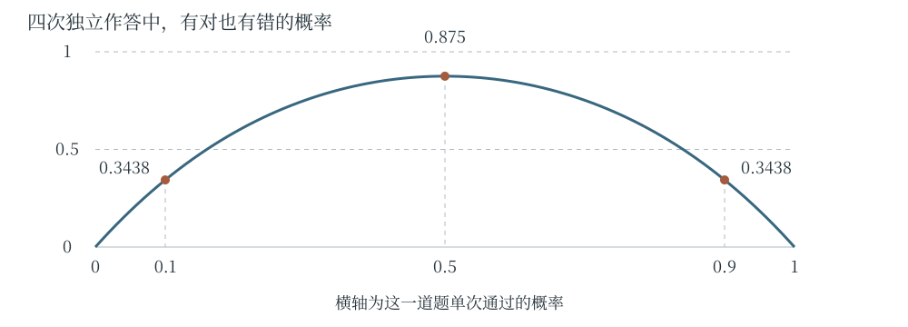
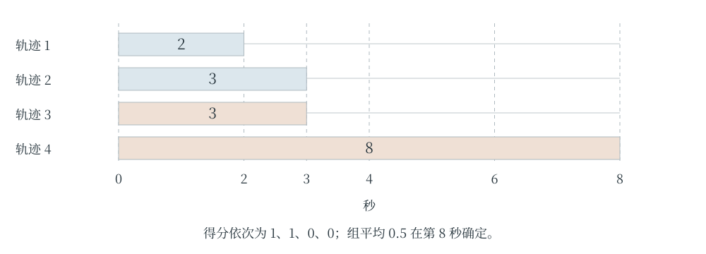
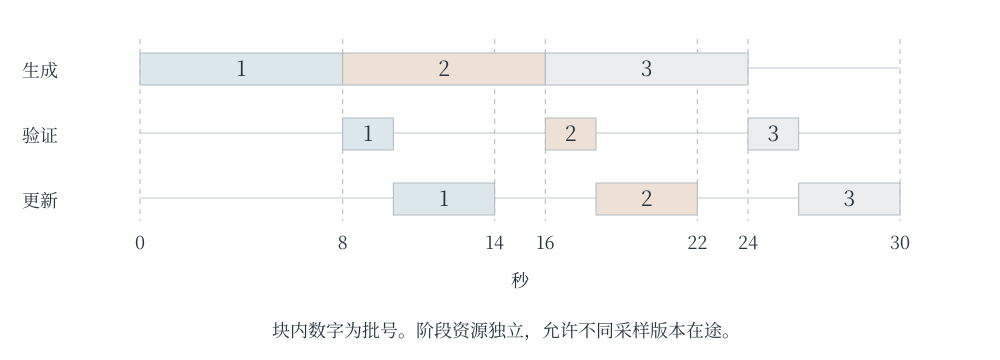
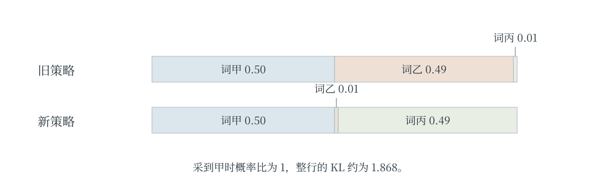
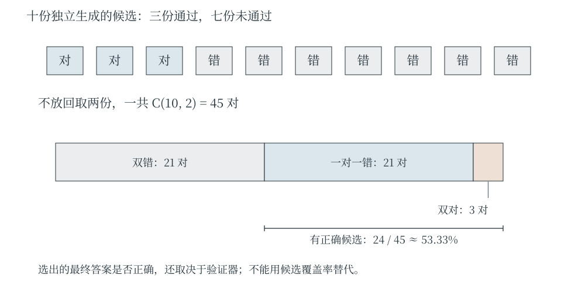

# 第 28 章　强化学习的采样与训练协同

上一章选择好示范与偏好对，训练时可以反复从文件读取。现在每更新一版模型，下一批答案都要由这个新模型亲自生成，交给判分器再用于学习。若训练设备已经准备好了，最长的一条回答还没生成完，训练究竟该等谁？要回答这个问题，先看一条轨迹通过何种信号影响参数，再画三台机器之间的时间线。

## 28.1　采样、奖励与策略更新

成对偏好训练使用已经收集好的回答。另一种训练方式让当前模型生成回答，再根据这些回答的得分更新参数。这样可以针对模型当前的错误继续提供反馈，但训练系统也必须运行生成和评分过程。下面先计算一组回答的学习信号，再讨论如何利用它更新策略。

现在取同一提示，冻结一份行为策略，让它独立生成四张交接单。一次从提示开始直到结束的尝试称为一条轨迹（rollout）。检查器核对箱号和时间，四条得分依次为 1、1、0、0。只用这四个奖励的平均数 0.5 作基线，减去它便得 $`0.5,0.5,-0.5,-0.5`$；再除以组内总体标准差 0.5，得到优势 $`1,1,-1,-1`$。优势表示这条回答的奖励相对同组平均值是高还是低；在后面的目标中，它决定提高还是降低该回答所选词元的概率。这里选总体标准差，实际实现的方差分母、小常数和归一化范围都会影响数值。

为什么能把一句话的结果作用到词元上？对期望奖励求导，可把对概率的导数写成概率乘对数概率的导数。固定环境和采样策略的一次估计于是含有 $`A\nabla\log\pi(y|x)`$。整句的对数概率是词元对数概率之和，奖励因此能沿回答中每个被采样的位置提供信号。终局奖励不能指出究竟错在哪个词，梯度方差可能很大；若四条全对或全错，中心化后的组内信号为零。可验证的奖项也可能只鼓励“格式像交接单”，留下错误的箱号。应把格式、证据准确性和留空的正确性分别统计。

更新器可能在同一批数据上走不止一步。记生成时选中某词的概率为 $`p_{\rm old}`$，当前在同一前缀下的概率为 $`p_{\rm now}`$，比值 $`\rho=p_{\rm now}/p_{\rm old}`$。一种常用的裁剪代理目标在该位置取以下两项中较小者，再对有效位置聚合，训练时将其最大化。

```math
\min\{\rho A,\ \mathrm{clip}(\rho,1-\epsilon,1+\epsilon)A\}.
```

取 $`\epsilon=0.2`$。正优势位置从 0.25 升至 0.35，比值 1.4，贡献从未经裁剪的 1.4 被限制为 1.2。负优势位置若从 0.25 降到 0.15，比值 0.6，贡献取 $`-0.6`$ 与 $`-0.8`$ 的较小者，得到 $`-0.8`$。若负优势词的概率反倒增大，两项中更差的一项仍会产生纠正信号。裁剪并不保证实际策略变化落在这个区间，更不能把任意陈旧数据变成新策略的样本。

PPO 常用价值模型估计从某个位置往后能得到的回报，配合实际回报构造优势；有学习得到的奖励模型时，它和价值模型承担不同工作。GRPO 使用同题的一组完成结果构造相对优势，可省去单独的价值模型。两者均可在相应实现中引入参考策略的 KL 约束。**参考策略**给出偏离的基准，**行为策略**记录轨迹从何而来。前者可以长时间冻结，后者随发布的新采样权重变化。若奖励由代码直接验证，热路径上也可以没有神经奖励模型。[PPO](https://arxiv.org/abs/1707.06347) · [DeepSeekMath 中的 GRPO](https://arxiv.org/abs/2402.03300)

现在来决定，一台生成服务器一晚产出的答案究竟有多少能教会模型东西。设检查器只返回通过或未通过，同一道题每次独立通过的概率为 $`p`$，每组抽四次。全对的概率是 $`p^4`$，全错是 $`(1-p)^4`$。两种情况下，减去组均值后，每个答案对应的这项优势均为零。留下有对有错的组，其概率便是

```math
q=1-p^4-(1-p)^4.
```

这里先用 1 表示四次采样所有可能的结果，再减去全通过和全失败两种互斥情况。在二值组内相对奖励下，全对组没有组内差异可供学习，这与答案本身的质量是两回事。独立同分布只是这里便于手算的假设，真实轨迹的相关性会改变比例。

中等难度题取 $`p=0.5`$，每 16 组中平均有 14 组可用。若模型已把这道题学到 $`p=0.9`$，可用比例只剩 0.3438。在题目难度固定、独立重抽的假设下，凑齐一组合格轨迹，平均要抽 $`1/q`$ 组，即生成约 11.63 条回答。改用大量极难题也会出现相同现象。实际应按题分层统计可用比例，同组共享的提示与生成策略可能使独立假设失准。



*图 28-1　单次成功率为 0.1 和 0.9 时，两点关于 0.5 对称，均只有约三分之一的样本组能提供奖励差异。*

这正是读 DAPO 的一个入口。它为奖励没有组内差异的提示补采，以便更新时有足够的有效组。还有一个容易漏掉的变化藏在分母里。设一条正确回答有两个有效位置，一条错误回答有六个，优势分别为 $`+1`$ 和 $`-1`$。先对每条回答内的位置取平均，再平均两条，每个正确位置的系数为 $`+1/4`$，每个错误位置为 $`-1/12`$。若把八个位置一起平均，系数变为 $`+1/8`$ 与 $`-1/8`$。设某个参数只改变错误回答第六处所选词的对数概率，其局部导数为 1，当概率比为 1、裁剪未激活时，这个参数从该处得到的目标梯度就从 $`-1/12`$ 变成 $`-1/8`$。两种更新即便吃进逐字相同的数据，也会得到不同的权重。论文还一起考察了裁剪范围与超长回答的奖励，复现实验时应逐项控制这些选择。[DAPO，§3.2–3.4](https://arxiv.org/html/2503.14476v1)

据此，生成集群应同时记录已采样词元、通过筛选的组数、进入更新的有效位置和留出题质量。若只报每秒生成量，盲目增大容易题的比例可能看起来很划算。若只报优化器步数，重新采样花掉的卡时就消失了。

上述目标依赖采样时的概率、奖励和分组信息。采样与更新分开运行后，这些数据需要跨进程传递，模型版本也可能在等待期间改变。系统设计必须让训练器知道每条记录是在什么条件下产生的，才能正确计算概率比和优势。

## 28.2　采样系统与训练系统的协作

一次可复核的提交至少包含提示、真实词元及结束原因、行为策略版本、旧对数概率、奖励及其版本、组号和掩码。若生成端改用了 top-p 截断，训练端却以未经截断的概率作行为分母，重要性比值的含义就变了；某些候选的采样概率甚至成为零。还要说明每条轨迹先按长度取平均，还是把全批有效词元放在一起归一。前者让每条回答得到相同总权重，后者让长回答贡献更多位置。把这些选择写进数据契约，才能判断改造调度以后是否仍在优化同一个目标。

四条轨迹完成的时刻若为 2、3、3、8 秒，按组计算奖励基线最早要等到 8 秒。用四个独占槽同起步，槽位共预留 32 槽秒，真正生成只用 16 槽秒。迭代级调度可用空槽接别的组，第一组的优势仍要等最后一个成员。若直接丢掉慢轨迹，就可能系统性地忽略长推理，也会改变前三个成员的奖励基线。合理做法是为无效样本、超时和训练可消费的完整组分别计数。



*图 28-2　同一列表示同一时刻。浅色空段可以用于处理其他组；到虚线右侧时，这组的四份分数才全部就绪。高槽位利用率与尽快得到一组完整轨迹是两个可分别测量的量。*

训练与生成共用设备时，可以按阶段复用显存，却要为切换布局、同步新权重和准备 KV 留时间。分为两个设备池则可以流水工作。举一个只比较时间的例子：每批生成 8 秒、验证 2 秒、更新 4 秒，同布局的三批严格顺序执行共需 42 秒。若三者有独立资源，队列足够、允许下一批在上一批更新前采样，理想流水为 $`8+2+4+2\times8=30`$ 秒。省下的 12 秒伴随着额外资源和版本滞后。若算法要求每批都由刚完成更新的策略采样，就不能使用这条三批流水线。



*图 28-3　三种颜色表示三个批次，每行是一种资源。同色块展示一个批次的阶段依赖，同一行展示资源占用。第二批在 8 秒开始采样，此时第一批更新后的权重尚未产生。*

这 12 秒值多少钱，取决于设备怎样计费。假如三个阶段各占一台同价设备，并从开工一直为这三批保留到第 30 秒，账单就是 90 台秒。其中生成占 24 台秒，验证占 6 台秒，更新占 12 台秒，合计真正工作 42 台秒。若三个阶段可以依次使用同一台设备，忽略切换时间，顺序执行的账单才是 42 台秒。把空闲时段借给别的任务还能改变分摊结果。比较两种训练布局时，墙钟记到最后一批完成，费用按实际保留的设备和时段计算；采样策略落后引起的质量差异，还要留给同一组验证题去检验。

同步一次 60 亿参数的 BF16 权重，单份逻辑数据为 12 GB，独占有效 40 GB/s 的单通道也至少要 0.30 秒。若只训练若干 LoRA 参数，且采样端持有完全相同的基座并支持热切换，可以只传版本化的增量。切换时要让在途轨迹保留原版本，或按明确的截断规则重新入队。verl 的 HybridFlow 把角色间数据流和每个角色内部的分布式执行连接起来，训练与生成的并行布局可以不同，变换布局和同步都属于实际成本。[HybridFlow](https://arxiv.org/abs/2409.19256)

### 异步采样与策略版本差异

把交接单简化成只有两种结尾的回答。在同一条提示上，旧采样器以 0.9 的概率选甲、0.1 的概率选乙，当前训练器却给两者各 0.5。为了单独检查分布偏差，设奖励恰好只有乙得 1，暂且只求当前策略的期望奖励。直接枚举会得到 0.5。若旧采样器的十条记录恰好九甲一乙，直接平均奖励却是 0.1。把十条记录都贴上新版本号，当然也只会读到这一个乙。

两种策略都给每个候选非零概率时，可以从期望的定义推回一种校正方法。用 $`b(a)`$ 表示行为策略抽到回答 $`a`$ 的概率，用 $`\pi(a)`$ 表示目标策略的概率。每条旧记录乘权重 $`w(a)=\pi(a)/b(a)`$，就有

```math
E_b[w r]=\sum_a b(a)\frac{\pi(a)}{b(a)}r(a)=E_\pi[r].
```

于是九条甲各乘 $`5/9`$，一条乙乘 5，平均加权奖励为 $`5/10=0.5`$。这次记录恰好符合行为策略的比例。再独立抽十条，完全抽不到乙的概率仍是 $`0.9^{10}\approx35\%`$，这时候估计值就是零。为了知道结果靠几条记录支撑，可以看权重的有效样本量 $`(\sum_i w_i)^2/\sum_i w_i^2`$。所有权重相等时它等于样本条数，而这份九甲一乙的记录只得到 $`100/(9\times(5/9)^2+25)=3.6`$。这个估算反映权重的集中程度，系统仍实际花钱生成了十条回答。

现在试两项工程改动。若只把每条重要性权重限制到不超过 2，这批记录的平均加权奖励变为 0.2，且在该抽样分布下期望也是 0.2。上限压住了单条轨迹的影响，同时引入可以算出的偏差。如果采样端更早就在截断采样时彻底删去乙，行为概率变成零，旧记录中永远找不到乙的奖励，前面的除法便失去条件。对一段多词回答，完整轨迹的概率比还要沿同一历史乘起每一步的条件概率比，权重集中可能进一步加剧。PPO 的逐词裁剪代理目标另有优势项与取小操作；上面这个简化实验只检验估计奖励时的换分布。

AReaL 允许生成和训练异步工作，用调度限制样本的陈旧程度，并为旧策略产生的轨迹调整训练目标。在自己的系统里，可以按采样版本和答案长度分组，检查实际采样规则、奖励分布、概率比及权重集中度，再比较相同留出题到达目标质量所用的墙钟时间。同样落后一版，有的提示在两版策略下几乎没变，有的提示可能已经出现上面的九比一。只有权重版本号和平均生成速度，还不足以区分这两种情况。[AReaL 原论文](https://arxiv.org/abs/2505.24298)

### 结果奖励与过程奖励

一个验证器只看最后的数值，另一个检查中间等式。假设两条解题轨迹都写出正确答案 6：甲从 $`2\times3`$ 得到 6；乙先写 $`2\times3=8`$，再碰巧把答案改为 6。只验证终点时两条轨迹都得 1，这个反馈没有提供哪个中间动作可靠的信息。过程奖励模型（PRM）可以给每一步单独评分；只看结果的奖励模型常写作 ORM，可程序验证的终点则未必需要训练一个模型。它们都提供评分，但监督的粒度、评分依据和计算开销不同。[过程与结果监督的对照实验](https://arxiv.org/abs/2305.20050)

设每秒有 8 条待验轨迹，每条 5 个可检查步骤，一个验证进程稳定处理 24 次等成本检查/秒。只核验终点，每秒需要 8 次，一个进程足够；每步都验则需要每秒 40 次，一个进程每秒会积压 16 次。两个进程可以处理平均到达量，但不能保证突发时的尾延迟。一个折中是全验终点，再对四分之一的轨迹补验前四步，平均每条做 $`1+4/4=2`$ 次，每秒共 16 次。若抽查只针对“已经成功”的样本，收集到的过程错误率就不能当全体轨迹的错误率。比较训练配方应同时保留抽样规则、步骤标签版本、验证队列时间和独立测试集表现。让更详细的反馈进入流水线，既改变统计证据，也可能使验证进程成为新的瓶颈。

### 采样截断与重要性权重

用旧策略的数据评价新策略，首先要问旧采样器有没有机会产出新策略会采取的动作。设一个位置可选甲、乙，采样器在截断后只出甲；新策略各用一半概率。若甲的奖励总为 0，我们即使看过一万次甲，仍无法分辨乙的奖励为 0 的环境和乙的奖励为 1 的环境。两种环境给这批日志完全相同，却分别让新策略的期望奖励为 0 与 0.5。在乙上，重要性比率的分母为零，无法从已有样本补回这份信息。

即使保留百分之一的概率探索乙，新策略给乙一半概率，出现一次乙时权重也达 50，有限样本的估计会不稳定。裁剪权重可减小方差，同时引入偏差。训练平台应保留实际采样分布的版本和采样参数，区分截断前的模型概率与生成所用的概率；若线上不能探索某动作，就明确把评价范围限在可观测的动作上。

### 奖励模型与真实正确率

假设一次采样得到 1000 条轨迹。独立复核发现其中 100 条真的解对、900 条解错。自动验证器给 90 条正确解打了正分，也错给了 90 条错误解正分。平台报告的正分率是 18%，实际正确率是 10%；更值得训练者注意的是，收到正分的 180 条里只有一半是真的。即便错误解的误报率仅为 $`90/900=10\%`$，只要错误解远多于正确解，用于参数更新的正分样本中仍可能有大量错误解。用正分率连续画一条上升曲线，并不能区分模型进步和模型学会迎合判分器。

若用严格规则把误报从 90 条降到 9 条，却也把正确通过数从 90 降到 72，正分样本的准确比例会上升到 $`72/81\approx89\%`$，每千条中可交付的正确正例则由 90 降到 72。验证器吞吐、采样预算和错奖代价共同决定这项交换是否划算。任务允许执行答案时，用独立测试或不同实现抽查判分；需要模型当裁判时，可交换答案顺序、盲去模型名，对同一批数据抽样人工复核。分别统计正确解和错误解，才能判断问题主要来自采样器、奖励模型还是策略更新。

### 样本概率与完整分布的变化

前面按优势的正负算过概率比率的裁剪。但一个已采样词元的比率，不能反映整个候选分布的变化。下面同时观察一个位置上的三个候选词。旧策略为 $`(0.50,0.49,0.01)`$，这次恰好采到第一个词。一次更新后，新策略变为 $`(0.50,0.01,0.49)`$。被采词的比率是 $`0.50/0.50=1`$，这个样本的裁剪分支不会触发。第二、三项的概率却从 0.49 和 0.01 变成了 0.01 和 0.49。如果只记录“这条样本有没有触发裁剪”，这次变化在面板上完全看不见。

用从旧策略到新策略的 KL 散度来量这件事，定义为 $`\sum_i p_i\log(p_i/q_i)`$，这里用自然对数。第一项为零，后两项合计 $`0.49\log49+0.01\log(1/49)=0.48\log49\approx1.868`$。从旧分布抽取很多动作，再对每个被采动作的对数概率差取平均，可估计这个量；只碰巧取到第一项时，单次观测恰好为零。改变 KL 的方向、换成固定参考模型或使用截断后的采样分布，测到的对象也会改变。[PPO 原论文](https://arxiv.org/abs/1707.06347)



*图 28-4　横条长度为 1。只比较两条横条的左半段，甲的概率比是 1；右半段的两块交换大小，贡献了全部 KL。*

计算整个词表上的分布也需要资源。若已有新旧两份词表分布，每份有 128,000 项 FP32，逐位置把两份都读一次，逻辑上需 1,024,000 B；若保留的是 logits，还需归一化。许多系统只保存被采词的旧对数概率，用实际采样估计来降低存储和传输。还可以抽少量位置做精确分布检查，对照估计的均值与波动。训练监控应分别记录比率裁剪比例、KL 的方向和参照分布，以及抽样位置数。要定位一次训练突然失稳，这三项记录提供的信息各不相同。[运行三词分布的精确复算](../../experiments/part06/policy_distribution.py)

### 词元级与序列级策略比较

取一个恰有两个有效回答词的样本，两个词的条件概率在旧策略下都是 0.4，新策略下分别为 0.5、0.32。逐词比率是 1.25 与 0.8，相乘恰为 1。序列实际被选中的总概率都为 0.16，但逐词信号已经一增一减。令这一回答的优势为正 1，夹紧区间取 $`[0.9,1.1]`$ 以便手算。若对每个位置使用 PPO 式的较小项，第一词贡献 1.1，第二词贡献 0.8，逐词平均为 0.95。GSPO 先求有效回答位置上对数比率的平均，再取指数，相当于各词比率的几何平均，这里是 $`\sqrt{1.25\times0.8}=1`$；对序列作一次夹紧，贡献仍为 1。长度归一化改变了比率的尺度，隔离了简单连乘随长度扩大或缩小的效应。这个序列上的相互抵消也说明，要诊断究竟哪个位置出了问题，仍须保留逐词对数概率和掩码。打包了若干回答的矩阵要先按原回答归组，提示和补齐位置不能混进长度分母。[GSPO 的序列目标与长度归一化](https://arxiv.org/abs/2507.18071)

概率还可能被计算路径改变。考虑第二十一章的 top-1 专家路由。某个词元在生成端给 E、F 的路由分数为 0.5001、0.4999，低精度训练内核可能把两者舍入到相同值，再用不同的并列规则选到 F。设两条专家路径给实际采到的词分配的概率分别为 0.6、0.3。即使还没有进行任何参数更新，重跑所得的比率也会是 $`0.3/0.6=0.5`$。若误把它解释成“策略已经落后了一版”，可能给这条样本错误的权重。路由重放在生成时记下实际选中的专家 ID，训练重算同一词元、同一层时用该 ID 选专家，训练端仍按采用的算法计算门控权重与梯度。

预算可以落到一条回答上。若需记录 256 个位置、32 层、每层 top-4、每个 ID 用两字节，单条就是 $`256\times32\times4\times2=65536`$ B。它们必须带有能恢复位置、层和模型版本的标识；打包、分片和重计算时与对应词元一起置换。只重放 ID 还不能消除参数陈旧、采样温度不同或专家内部数值舍入。验收可以先固定同一版本权重、词元、温度，隔离比较重放开关两侧的专家命中和对数概率差，再计每更新耗时以及固定题集上的奖励。只发布一次训练损失，无法区分路由对齐和策略真正变好。[vLLM 生成端路由记录与使用边界](https://docs.vllm.ai/en/latest/training/routed_experts/)

## 28.3　采样更快以后，哪些样本还能用于更新

假设一台采样机每秒交出 12 组回答，更新机每秒只吃下 10 组，且每 2 秒发布一版新策略。两机持续满速、没有丢弃时，一分钟积下 120 组。按每秒 10 组，队尾新来的样本要等约 12 秒才轮到，可能落后约六个发布间隔。只看生成速率会觉得采样充足，实际更新可能越来越依赖旧策略。把每条轨迹的生成版本、分词版本、判分器版本与消费时刻放在一起，才知道旧了多久。

一种做法是给生产队列设上限，队列快满就停止新采样。这能限制滞后，但一些设备将空闲。另一种是用旧策略概率与新策略概率校正，前提是旧策略在实际采样规则下对相应事件有足够支持，方差也须能接受。若截断采样从不产生某类回答，单纯重新加权无法恢复这部分经验。还可以只接纳版本差不超过阈值的样本，损失一部分已花费的生成卡时。对比三种策略时，统一在独立留出任务达到同一可靠性门槛处停表，记录一共生成多少、实际更新用掉多少、总设备小时多少。设备最忙的一组未必最早到达门槛。

## 28.4　后训练的收益如何评估

第二十四章已经区分了“候选中有正确答案”和“最终交付正确答案”。若每次独立生成的正确概率为 $`p`$，同样规则下试 $`k`$ 次，前一事件的概率是 $`1-(1-p)^k`$。它描述候选集合，不要求系统已经会选答案；要把这个机会变成用户拿到正确结果的概率，还必须检验判分器和选择过程。现在的问题是，实际评测只看到有限次生成，怎样据此估计这种机会，并公平比较后训练前后的模型？

评测中并不知道 $`p`$。一种做法是每题先生成 $`n`$ 份，其中 $`c`$ 份通过测试，考察从这 $`n`$ 份中等概率抽取 $`k`$ 份而不放回时至少一份通过的比例。全部组合有 $`\binom nk`$ 种，全错组合有 $`\binom{n-c}k`$ 种，因此

```math
\widehat{\mathrm{pass@}k}
=1-\frac{\binom{n-c}k}{\binom nk},\qquad 1\le k\le n.
```

当 $`n-c\lt k`$ 时，分子的全错组合数为零。取 $`n=10,c=3,k=2`$，共 45 对，其中全错有 21 对，至少一份正确的有 24 对，结果为 $`24/45\approx53.33\%`$。直接把 $`c/n=0.3`$ 代进 $`1-(1-p)^2`$ 会得到 51%，它不是这组不放回组合的比例。在题目固定、原始生成独立同分布等条件下，组合式可用作相应 pass@k 的无偏估计；同一份答案复制十次不满足这种抽样含义。[代码生成评测中的 pass@k](https://arxiv.org/html/2107.03374v2)



*图 28-5　无需枚举 45 对的全部文本，只需数出三类组合。不同题目的正确率不同时，应先逐题计算，再按既定题目权重汇总。*

对于交接班任务，有些候选会正确提取记录，有些会漏填，有些则生成没有证据的字段。增加候选数能否提高最终可靠性，取决于验证器能否识别这些错误。把隐藏的标准答案交给验证器选出正确候选，可用于分析候选集合的潜力，却不是可上线的选择办法。应另测真实验证器的最终准确率、误拒绝率和额外耗时，并固定候选数、总生成词元、工具调用与超时预算。

质量验证本身也会占用训练资源。MLPerf Training 在 2026 年的后训练基准中，把生成、训练和工具执行纳入一项达到固定质量的任务；其一轮验证对 251 题各生成四份，共 1004 次轨迹。这说明一次验证可能比一次参数更新昂贵得多，调低验证频率虽会省时间，却会推迟发现已达标或已经退化的时刻。[MLPerf 后训练基准的执行与验证安排](https://mlcommons.org/2026/09/mlperf-training-llm-post-training/)

一个训练方案应同时给出训练时间轴和验证时间轴。保留所测权重的版本、生成参数、题目集合、判定器版本及未完成轨迹数量。比较两个方法时，验证不应偷偷获得不同的采样次数或更长工具预算。训练奖励更高、验证 pass@k 更高、用户最终成功率更高，可能是三个不同的结果；用固定预算下未参与训练的任务，才能检查模型是否真正改善了目标能力。

[枚举候选组合并核对 pass@k](../../experiments/part06/evaluation_protocol.py)

## 练习与解答

### 1. 四次都没有得分

检查器返回四个零。用本章归一化，加一个小的正数防止除零，奖励优势是多少？还能怎样知道问题出在哪里？

**解答。** 减均值后的四个分子全为零，除以有限正数后仍全零。另列格式失败、错误箱号、证据不足和验证器故障的计数，并在不同难度题上检查组内差异。若训练目标还有独立的 KL 项，整次更新仍可能产生梯度。

### 2. 增加验证器的收益

沿图 28-3 的条件只把验证耗时从 2 秒降到 1 秒，三批最早何时全部完成？若要求上一批更新完才能生成下一批呢？

**解答。** 可流水时首批需 13 秒，后面两批以 8 秒为间隔，合计 29 秒。严格串行时每批 13 秒，三批为 39 秒。降低同一个局部耗时，两种依赖下省下的墙钟时间分别是 1 秒和 3 秒。

[复算偏好损失、组优势和三批执行时刻](../../experiments/part06/verify.py)

[全书目录](../../README.md) · [上一章 · 监督微调与偏好优化](ch27.md) · [下一章 · 多模态表示与生成模型](ch29.md)
