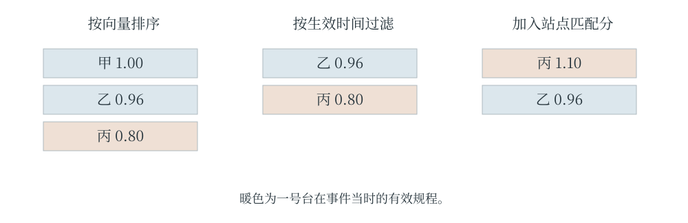
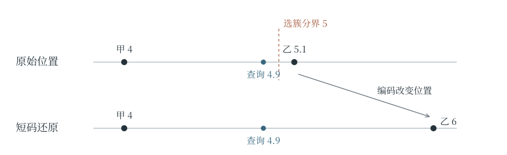
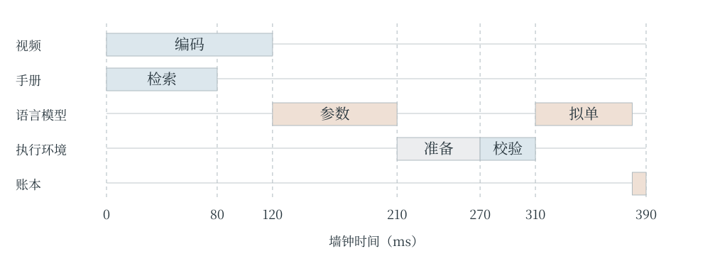
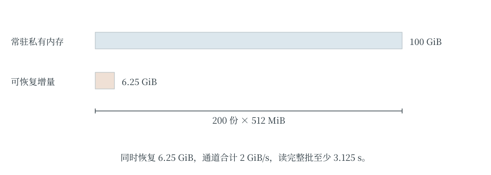
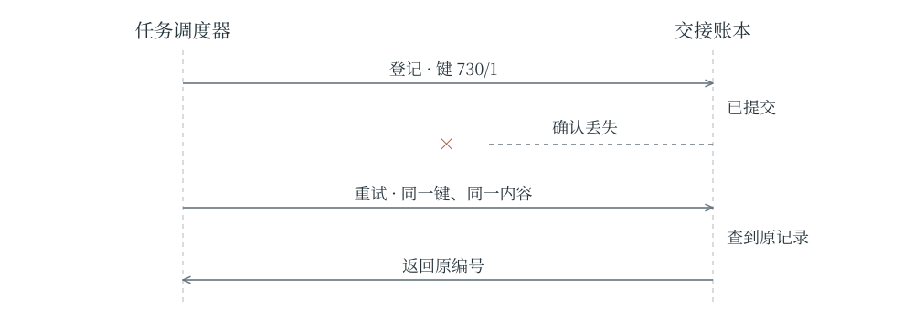

# 第 31 章　检索、智能体与可靠执行

模型从视频中识别出“第 2 秒，绿箱”后，仍需要查阅当时适用的仓库规程，才能填写并登记交接单。同一颜色在不同班次可能代表不同类别，因此规程版本和事件时间都应进入查询条件。语言模型可以生成工具调用请求，查询索引、提交数据库事务以及确认结果，则由模型之外的系统执行。

下文以编号为 730 的任务为例，依次讨论证据检索、工具调用、等待期间的状态保存，以及写入失败后的重试。

## 31.1　检索增强生成与证据

把长手册按段落切开，每段保存文本、文档和版本标识、适用站点与时间范围。编码器把每段转成固定维数的向量；问题也经相容的编码器映到相同空间。若向量已归一化，余弦相似度就是内积。取一个二维例子，查询 $`q=(1,0)`$，三个段落的单位向量及元数据为：

| 段落 | 向量 | 站点与生效状态 | 与查询的内积 |
|---|---|---|---:|
| 甲 | (1, 0) | 一号台，事件发生前已作废 | 1.00 |
| 乙 | (0.96, 0.28) | 二号台，生效 | 0.96 |
| 丙 | (0.80, 0.60) | 一号台，生效 | 0.80 |

只取最相似的两段，会把真正需要的丙排在候选之外。假设先按事件发生时间排除过期段落，再召回两个候选；为说明重排方法，给站点完全匹配的段落再加 0.30 分。乙仍为 0.96，丙变成 1.10，于是丙排第一。若站点是绝对条件，应直接作为过滤条件。真实重排器也可以将问题与候选段落一起输入模型，计算两者的相关程度。重排器只能处理已经召回的候选。候选数从二增加到二十，可能找回原先漏掉的文档，同时也会增加读取和重排开销。重排后是否将全部二十个段落送入生成器，还需要另行决定。



*图 31-1　比较丙在三列中的位置。如果首次截断没有保留丙，后续重排就无法找回它。最后一列的分数包含站点加分，可以大于 1。*

这条路径叫检索增强生成（RAG）。对固定基准问题，应分别量三件事：候选集包含正确证据的比例，选出的证据是否相关，以及回答是否忠实于这些证据。整句答对不一定意味着查到了规程，模型也可能凭训练记忆猜中。相反，召回了正确记录却把另一个站点的日期写进交接单，故障点已转移到生成或上下文组织。需要保留段落标识和使用的版本才能分别验证。[RAG](https://arxiv.org/abs/2005.11401)

为什么正确规程会在第一轮丢掉？一种可能是把整段压成一个方向时，丢掉了“分别匹配了哪几个词”的信息。暂时用平面上的横、纵两个单位向量表示查询中的“绿箱”和“夜班”，记为 $`e_1=(1,0)`$、$`e_2=(0,1)`$。段落甲的两个词向量恰为 $`e_1,e_2`$，段落乙的两个词向量都是对角线方向 $`u=(1,1)/\sqrt{2}`$。若先把每段的两个词向量平均，再把结果归一为单位向量，甲乙都变成了 $`u`$。用同法得到的查询去比较，两个余弦相似度都为 1。无论检索索引多精确，它都无法从这个分数找回原来的区别。

ColBERT 把最后一次比较推迟到查询到来时。查询中的每个词各找段落里与它内积最大的词，再将这些最大值相加。这种“晚交互”保留了提前计算文档词向量的机会。逐个查询词计算：

| 查询的一个词 | 甲的两个内积 | 甲行最大 | 乙的两个内积 | 乙行最大 |
|---|---|---:|---|---:|
| 绿箱 | 1，0 | 1 | 0.707，0.707 | 0.707 |
| 夜班 | 0，1 | 1 | 0.707，0.707 | 0.707 |

甲得 2 分，乙约 1.414 分。两行最大值可以落在不同条款上，甚至可以都来自同一个词。这个分数本身并不要求“夜班”恰好修饰“绿箱”，也不能检查规程是否生效。真实方法使用上下文化的词表示；多保留一些局部信息，要多付存储和比较的代价。[ColBERT，§3](https://arxiv.org/abs/2004.12832)

下面估算这种表示占用的空间和比较次数。十万段手册，若每段保留 64 行、每行 128 个双字节元素，单是数值就占 1.6384 GB。若先召回 100 段，为两个查询位置做精确晚交互，需比较 $`100\times2\times64=12800`$ 对 128 维向量。ColBERTv2 通过保存代表向量的编号与量化残差来缩小表示。重新评估时，把“正确规程是否在前 100 段中”和“进入前 100 后能否排第一”分开统计；两项中的任一项变差，都可能在最终交接单上表现为同一个错箱号。[ColBERTv2，§3](https://arxiv.org/abs/2112.01488)

## 31.2　索引、上下文与版本管理

有一百万段，每个向量 768 维，BF16 两字节，向量本身就有 1.536 GB。若精确扫描一次、每个元素做一次乘加，约有 7.68 亿次乘加，并需读全部向量；批量查询可共用读取。倒排聚类索引先找近邻中心，再只扫描若干簇，少探测几个簇能少读很多行，也可能漏掉中心边界另一侧的好段落。图索引从入口沿近邻边搜索，扩展得越广通常越有机会找到近邻，却会引入图边存储和不连续访问。还可以将向量编码成短码，用小表近似计算距离，再对少数候选读取原始向量精算。评测须和**相同版本、相同过滤条件**下的精确检索比较，才能把近似搜索带来的损失单列出来。[Faiss 索引说明](https://github.com/facebookresearch/faiss/wiki/Faiss-indexes)

### 选簇与打分中的召回损失

把四段规程投到纸面上，位置为甲 $`(4,0)`$、乙 $`(5.1,0)`$、丙 $`(1,3)`$、丁 $`(9,3)`$。这次用平方欧氏距离衡量相似，越小越靠前。查询向量为 $`(4.9,0)`$。甲与乙的距离平方分别为 0.81 与 0.04，其余两段都在第二个坐标相距 3。精确检索应返回乙。为了少读几行，先根据最近的中心将段落分入两个列表，中心取 $`(0,0)`$ 与 $`(10,0)`$。甲丙属于左表，乙丁属于右表。查询点比起右中心离左中心近 0.2，只探测左表会返回甲。即使左表内使用完全精确的距离，乙也进不了候选。把探测的列表数从一改成二，才能使乙进入候选。

即使把两表都打开，省字节的打分方法还能第二次漏掉乙。用一个极小的乘积量化器，把向量分成两个一维段，各用最近的代表值编码。第一段只许用 4 或 6，第二段只许用 0 或 2。甲的编码还原为 $`(4,0)`$，乙只能还原为 $`(6,0)`$。查询保留原始精度，可预先算出第一段到两个代表值的平方距离为 0.81 与 1.21，第二段为 0 与 4。扫描一条编码时，按两个编号各查一次表、相加即可。于是乙的近似得分变成 1.21，输给甲的 0.81。此时若将前两名的原向量取回精排，就能纠正次序；若只保留第一名，再精确的重排器也看不到乙。这组数分别展示选簇和近似打分的误差。工程上的 IVF-PQ 还可以对相对于所属中心的残差编码，此时查表要使用相应中心的坐标系。[Faiss 各类索引的搜索与存储方式](https://github.com/facebookresearch/faiss/wiki/Faiss-indexes)



*图 31-2　只放大第二个坐标都为零的甲和乙。指向同一查询点，第一排在选簇时跨不过分界，第二排读取编码后又高估了乙的距离。*

回到一百万个 768 维向量。把每条切成 96 段，每段八维，每段从 256 个代表值中挑一个，一个编号正好一字节。扫描全部短码共读 96 MB，原先 BF16 向量载荷为 1536 MB。用 FP32 存所有码本需 $`96\times256\times8\times4=786432`$ B，而一次查询对应的 96 张距离表合计 96 KiB。它们的成本分别按整份索引和每次查询承担。这个 16 倍只比较逐行数据的大小，尚有文档编号、倒排表、查表和精排回读；原向量若需供精排使用，仍要存放在可取回的位置。可从一次答错的问题倒查：精确搜索能否找到证据，选中的列表是否包含它，短码排序把它排第几，构造提示时是否仍保留它。四处保留同一段落编号，比调大最终提示长度更能定位一次漏召回。

从排序结果到模型的提示还有一次资源选择。若每段占 128 个词元，取两段是 256 个位置，取八段是 1024 个位置。按每位置 128 KiB，仅 KV 便由 32 MiB 增至 128 MiB，还增加预填充和每个后续词对历史的读取。给定有效证据已在前两段，多给六段未必有质量收益；但若回答要综合两处规程，盲目压到一段必然损失信息。用带证据标注的问题分别扫候选数、重排数、进入提示的段数，才能把近邻召回的瓶颈和上下文长度的瓶颈区分开。

版本还有时间语义。今天上线的新版手册，未必适用于昨天的视频。更新时应先生成新段落和相应向量，构成可查询的一致索引，再切换新请求看到的快照。若先删旧段落再逐台补新向量，检索可能在中间状态漏掉全部证据。一次任务固定索引快照，同时按事件时间选择业务生效版本。索引可以随时重建，已提交交接单仍应能按文档版本和段落标识找回证据。更换嵌入模型时，新旧向量空间可能不兼容；不能只替换查询端就继续沿用旧库的相似度阈值。

### 向量索引与存储访问

检索要从一批候选中找相近者；推荐模型还有另一种负载：给定离散编号，直接去嵌入表取行。再看图神经网络，节点更新常需要邻居特征的加和，此时**邻接关系决定了编号**。三种工作都可能卡在内存，却不能用同一条“向量检索每秒多少次”来定容量。

设有四个节点，其邻居依次为 $`(1,3),(0),(3),(0,2)`$。把邻居列表首尾相接，得到编号流 $`(1,3,0,3,0,2)`$，再记下每行的起止边界 $`(0,2,3,4,6)`$。这就是压缩稀疏行（CSR）的基本思想。取节点 0 时，只读编号流下标 0 和 1，随后去特征表的第 1 和第 3 行取数。若四个标量特征依次为 $`(2,5,7,11)`$，求和聚合分别得 $`(16,2,11,9)`$。与返回有序的文档编号相比，任务变成了根据索引搬运并归约。机器遇到的是很不规则的短读，而不是一次巨大的点积。[图卷积网络的传播算子](https://arxiv.org/abs/1609.02907) · [推荐模型中的嵌入表和稠密交互](https://arxiv.org/abs/1906.00091)

现在把标量换成每行 128 个 BF16 特征。六次逐边读取共请求 1536 B，但只有四个不同的特征行，若一批内冷启动且每行能留到最后一次使用，则唯一行载荷为 1024 B。后一数字不是带宽计数器应有的读数：还要读边界、编号，写聚合结果，跨设备分片时还得发远端请求。编号若集中到一台分片，平均字节再小也会被最慢分片拖住。这与第二十二章的专家路由有相同的一问：先画每个目的地的频数，再决定是否把热点复制一份。

### 候选截断与权限过滤的顺序

假设某次查询的精确相似度排序为 A、B、C、D，用户只能读 C、D。如果索引先取全局前两项再过滤，结果为空。此时即使重排器完美，也救不回本应排第一的 C。若能在允许的子集内搜索，前两项就是 C、D。若索引只支持先检索后过滤，取前四项再过滤在此例中能找全，但当无权文档更多时，同一个固定扩展倍数仍可能给不出两项。

离线验收时，把“在允许集合内精确搜索”的结果当作参考，用命中的条数除以参考结果数。分母要随用户权限与快照版本而变，权限库更新后还要重新校验缓存。先过滤可能失去索引原有的高效遍历，扩大检索范围又要多读候选、增加尾延迟。无论哪种执行路径，只有通过授权检查的内容才能进入后续模型的上下文。

## 31.3　工具调用的关键路径

调度器收到模型建议的工具名和参数后，要解析参数、核对调用者和资源范围，再调用相应服务，把真实返回值作为下一次模型调用的输入。如果缺少证据，可以查另一份手册；若已经提交成功，应返回已有记录。允许哪些动作、何时停止、失败能否重试，这些是应用控制流。把每一轮模型输出直接当作“任务成功”会漏掉工具的执行结果。对这个仓库任务，写入权限仅需覆盖对应账本，外来文档的内容作为证据处理。

下面逐项记录这个任务的执行时间。假定该任务的问句和站点在入口已经给出，于是视觉编码（120 ms）与手册检索（80 ms）可以同时开始。拼齐两份结果后，模型花 90 ms 生成工具参数，创建执行环境需 60 ms，工具校验用 40 ms，随后模型用 70 ms 拟好交接单，最后持久化并确认需 10 ms。把会合之后的时间记为 $`T_{\rm tail}`$，以毫秒为单位，客户端等待时间为

```math
\begin{aligned}
T_{\rm tail}&=90+60+40+70+10=270,\\[0pt]
T&=\max(120,80)+270=390.
\end{aligned}
```

视觉编码和检索同时启动，后续步骤要等两者都完成，所以并行部分的耗时由较慢的 120 ms 决定。接下来的五项依次依赖上一步，耗时相加得到 270 ms。如果只把检索从 80 ms 降到 50 ms，总时长仍为 390 ms；把视觉编码从 120 ms 降到 100 ms，则总时长降为 370 ms。这一判断以图中任务可并行、其他耗时不变为前提，若检索需要先取得视觉结果，就必须重新排列依赖。

若问题里的站点必须先看视频才能知道，最前面的两段就要相加，延迟会增到 470 ms。依赖图由业务输入决定，监控面板上两个服务同时存在，不等于这条请求的两个调用能够重叠。反过来，若所需环境类型在入口已经确定，提前启动，60 ms 可以藏在前面的 120 ms 内，得到 330 ms。预热提前占用了 CPU 和内存，有些请求最后根本不会调用这个工具，需同时统计浪费。



*图 31-3　横轴表示同一任务经过的时间。80 ms 的检索已被视频准备覆盖。只把两次语言模型调用各加速一倍，共节省 80 ms，任务从 390 ms 降到 310 ms。*

一个带循环的任务还要限制步数与总预算。若检索接口暂时无结果，模型反复换一种问法，单次首词时延完全可能达标，用户却一直等不到登记编号。每轮记录输入证据、被选动作、返回状态、剩余预算和终止原因。超过预算时可以返回“需人工复核”的状态，并保留已有证据。这样才能区分“可靠地发现证据不足”和“静默丢掉任务”。

在关键路径上，只需要把一项的最早启动时刻写成它所有前置条件完成时刻的最大值。下式可以分别模拟按需启动与入口预热。两次都使用同样的工具。

```python
def finish(environment_start):
    arguments_ready = max(120, 80) + 90
    tool_start = max(arguments_ready, environment_start + 60)
    return tool_start + 40 + 70 + 10

assert (finish(210), finish(0)) == (390, 330)
```

### 大小模型的分级处理

假设选取 100 个有标注的任务用于回放。每次调用小模型用 1 个计费单位，大模型用 5 个。直接给大模型，92 个任务正确并成功提交，共花 500 个单位。接着考虑级联方案：先让小模型生成草稿，再根据接受规则判断是否需要由大模型重新处理。回放时，小模型有 70 份草稿通过检查，其中 65 份确实正确；余下 30 份交给大模型，大模型在这个较难的子集里完成 24 份。于是共交付 89 份正确结果，模型成本为 $`100+30\times5=250`$，每份正确结果耗费约 2.81 个单位。大模型单独运行约为 $`500/92=5.43`$。如果要求至少 90% 的任务正确完成，这个成本较低的方案仍未达标。此处假设检查本身足够便宜，两种模型看到相同证据，外部写入只在最后提交一次。[FrugalGPT 的模型级联与成本目标](https://arxiv.org/abs/2305.05176)

为什么不能把升级的 30 份直接乘上大模型的总体正确率 92%？因为会被升级的，是检查规则挑出来的一组任务。歧义、长上下文和证据缺失可能使两个模型同时犯错。可以给同一批任务保留两套模型的结果、检查分数、延迟和提交证据。假设在原先通过的 70 份中，另有 10 份刚好靠近阈值。原来这 10 份正确 7 份，若交给大模型则正确 9 份，改变接受阈值后总正确数升到 91，花费升到 300，每份正确结果约 3.30 个单位。换一组阈值附近的任务，这项净收益就会不同。

费用表无法直接给出时延。如果小模型加检查耗时 40 ms，大模型另需 90 ms，原方案中，70 个任务耗时 40 ms，30 个任务耗时 130 ms；调整阈值后，耗时 130 ms 的任务增加到 40 个。若每份交接单限时 100 ms，而且只能顺序升级，那 40 份即使答对也不能计入按时成功。给困难请求直接选择大模型可以少一次试探，但要求入口的难度估计已足够好。上线前应按原始到达顺序重放，不同路由会改变后续排队、前缀命中和工具调用频率。检查一条路由是否值得，应由完整任务的成功、时间与费用共同决定。

关键路径上还可能出现外部工具的长时间等待。此时模型虽然不在计算，任务所需的证据、环境和生成状态仍可能占用资源。是否保留这些状态，取决于恢复代价以及任务是否还能从同一位置继续。

## 31.4　工具等待与状态管理

任务 730 至少有四种状态：对话与已经返回给用户的输出、可以重算的模型 KV、检索证据版本、工具执行环境里的文件和进程。前两者又有不同寿命。把模型请求从 GPU 上移出，可以只保存词元，在工具返回后重算；但环境中尚未归档的文件、已执行的操作和打开的远端会话，通常不能靠重播一串词元完整恢复。

进程有自己的地址空间，容器可利用操作系统的隔离和配额组织一组进程，通常与宿主共享内核。虚拟机提供独立客户机内核和不同的隔离边界，也带来镜像、启动和状态恢复的开销。沙箱一词表达的是“在规定的权限与资源范围内执行”，具体可以采用不同实现。选择时要明确需要保存的是可写文件层，还是还包括内存、进程和虚拟设备。磁盘快照能恢复文件内容，不会自动续上已经中断的远端事务。

先计算等待期间的内存占用。设 200 个任务各等待外部工具 10 秒，每个环境的私有常驻内存为 512 MiB，同时保留便占 100 GiB，即 1000 GiB·s 的内存时间。若每个任务只需保存 32 MiB 的可恢复增量，就只需 6.25 GiB 快照载荷，但恢复时每个任务都要重新装入增量、重建其余状态。200 个同时恢复会在共享存储形成 6.25 GiB 的读突发。若总有效带宽为 2 GiB/s，即使没有启动延迟，也至少需 3.125 秒才能读完。只看一台孤立环境的平均唤醒时间会错过这个尾部。若主机还能回收显存中的私有 KV，按队列预计等待比较保留、换出和重算的时间即可；共享前缀仍要遵守第二十四章的引用计数。



*图 31-4　两条横带按相同比例画常驻内存和快照载荷。右侧恢复时间取决于共享带宽；只有快照足以复原所需状态时，才能选择下排方案。*

DSec 的技术报告讨论了面向智能体训练和评测的大量有状态环境。模型采样在加速器池中进行，任务环境则需要不同的镜像、隔离和生命周期，环境可以长时间等工具，又会随一批轨迹同时启动。它为函数、容器、微型虚拟机和完整虚拟机提供统一入口，环境由可独立版本化的层组合，并从 3FS 按需加载镜像数据。保留哪些状态、何时真正把镜像读进节点，都会影响一组轨迹的完成时刻。把它接回第二十九章，如果最后一条轨迹卡在环境恢复上，继续增加生成 GPU 不能让这组奖励提前到齐。报告描述的是特定部署的系统设计，容量规划仍应测量自己任务的启动突发、镜像复用和活跃工作集。[DSec 技术报告](https://arxiv.org/abs/2609.22978)

环境能够恢复，并不意味着外部操作可以安全重放。尤其是登记、支付或修改记录等写操作，执行结果保存在另一套系统里，必须单独确认操作是否已经提交。下面以交接单登记为例。

## 31.5　工具调用的重试与幂等

最难恢复的时刻只有几毫秒。工具已经给任务 730 写入一张交接单，数据库提交成功，回复却没有抵达调度器。调度器看到超时，无法区分“操作未执行”和“已执行、仅回复丢失”。重新生成一次答案，既不能判断是哪种情况，还可能把第二张略有不同的交接单也写进去。

可以在首次发起写操作前确定一个操作键，例如“任务 730／登记步骤 1”，并保存待提交内容的摘要。账本在**同一个事务**中验证键、登记效果和返回编号。以同一个键、相同摘要重试时，从账本读出已有编号；若摘要不同，报告冲突并交给上层决定。若去重表和实际写入分两次独立提交，二者之间仍有崩溃窗口。对不能与本地日志一起提交的远端工具，需要远端也支持操作键或查询已经产生的效果，否则只能标为待确认，不能宣称已实现恰好一次。这里保护的是用户可见的登记效果，底层调用仍可能发送两次。



*图 31-5　消息按从上到下的时间顺序排列。确认消息在持久化后丢失；恢复方通过稳定的操作键找到已有编号，因此数据库只新增一行。*

可以用一个 SQLite 数据库重现图中的故障。第一次连接提交绿箱记录，程序故意丢掉返回值；第二次连接仍用 `730/1` 登记绿箱，读回编号 1。如果把箱号改成蓝箱，代码会报告内容冲突。验收时查的是最后的表：只有编号 1 的一行，颜色仍是绿。实验用进程内共享的数据库模拟回复丢失；若要检验断电后的恢复，还得换成持久化存储，在提交前后分别中断服务再查账。

多分支推理也要保留这条边界。可以让两个候选各自读取同一份不可变证据并生成草稿，各分支的缓存和临时文件写入独立区域。选中的版本由唯一有提交权的一方写入。若任一分支在评分之前就向外部写入，丢弃该分支的 KV 并不能撤销它已经登记的事实。保留索引版本、工具输入输出、规范化的操作参数和提交结果，能在失败后恢复任务，而不必假定模型在另一次采样会做出同样的选择。

## 31.6　固定轨迹与完整任务的两种测量

同一条问题进入 Agent，两次运行未必经过相同的检索、工具和生成步骤。直接比较完成时间，难以判断变化来自执行变快还是决策改变。可以先保存每个阶段的输入、所用版本和依赖关系，固定轨迹重放，测同一批工作在另一套系统上的时间；然后允许 Agent 自己决定后续步骤，检查完整任务的质量与成本。

沿用任务 730，先只计从问题到有证据的回答这一段，暂不包含随后登记交接单的写操作。给它一条不含重叠的教学轨迹：生成检索词 200 ms、检索 100 ms、重排 50 ms、根据证据生成答案 300 ms，共 650 ms。新推理引擎让两次生成都快一倍，固定轨迹变为 400 ms，整体速度比为 1.625，而非 2。如果它同时换了一份模型，该模型会额外进行一次检索和一次 150 ms 的分析；即使新引擎把这次分析也减至 75 ms，这一段仍要 $`400+100+75=575`$ ms。再看最终正确率，才能判断这次增加步骤是否值得。

固定轨迹回答的是“这些已知工作能否执行得更高效”。它可隔离模型选择与控制流差异，但不能证明新系统在开放任务上会选择同样的证据、相同步数或同样正确的答案。完整执行回答的是“从原始问题出发能交付什么”，需要保留失败、循环、工具超时及轨迹长度分布。若两者结果相反，查看额外步骤和输出长度，比把所有时间归到模型 TPS 更有帮助。

MLPerf 的端到端 RAG 基准将质量执行与性能回放分开，性能阶段使用固定的阶段输入和跳数来控制工作量；这一设计有利于比较系统执行，但其首个离线场景不能直接代表在线到达与排队。应用自己的评测也应明确是在复现一条已知轨迹，还是测量真实闭环中的行为。[端到端 RAG 基准的质量与性能执行](https://mlcommons.org/2026/08/endtoend-inference/)

实际验收可将同一批任务分成按时且正确、正确但超时、按时但错误、失败或未决几类，逐类检查原始轨迹。对存在写操作的任务，还要核对最终外部效果。一个重复写入两张交接单的快速轨迹，不能因为语言答案正确就计为成功。

用这条标准验收任务 730：输入视频有时间戳，答案指出证据段落，登记只产生一条记录，任务在预算内返回可查询的编号。模型调用、检索和工具耗时仍有诊断价值，但真正交付的是这份可追踪的结果。第三十六章要把这样的请求与仍在更新权重的训练作业放进同一座机房，讨论资源如何分配，以及训练进度、服务时延和故障恢复之间怎样取舍。

## 练习与解答

### 1. 再加多少重排分才够

图 31-1 排除过期项后，乙为 0.96，丙为 0.80。只给正确站点加分，若要求丙严格排第一，最少应满足什么条件？

**解答。** 加分要严格大于 $`0.96-0.80=0.16`$。恰好相等还依赖并列处理。若一号台是不可放宽的业务条件，在候选构造时过滤更直接。

### 2. 让检索更快

把 80 ms 的检索减为 20 ms。分别在站点已知、站点依赖视频的两种路径上算总时间。

**解答。** 可并行时仍由 120 ms 的视觉编码决定，端到端仍为 390 ms。串行时从 $`120+80+270=470`$ ms 降为 410 ms。任务之间的依赖决定了这 60 ms 的节省能否体现在端到端时延中。

### 3. 给恢复流量设上限

共享通道只有 2 GiB/s，希望一批快照在 0.5 秒内全部读回。按每个 32 MiB，理想至多允许同时恢复多少个？还缺哪些实测量？

**解答。** 此窗口能读 1 GiB，至多 32 个。还应测索引与元数据读取、随机 I/O、解压、启动开销及并发时的带宽分配，按用户的实际期限留余量。

### 4. 相同的键收到不同内容

重试沿用操作键，却把原来的绿箱改成蓝箱。可以直接返回成功或覆盖原记录吗？

**解答。** 应通过摘要或等价的规范化参数比较识别冲突。相同操作键承诺重放同一动作，两份内容却不同。保留原提交并报告冲突，若业务确需更正，用独立的更正操作引用原记录，保留更正证据和版本。

[复算检索和关键路径，并在本地数据库回放丢失确认后的重试](../../experiments/part06/verify.py)

[全书目录](../../README.md) · [上一章 · 多模态表示与生成计算](ch30.md) · [下一章 · 推荐系统的召回、排序与在线特征](ch32.md)
