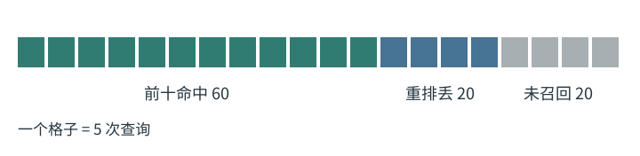
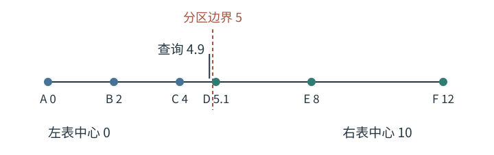

# 第 31 章　推荐系统的检索、排序与特征

一位读者从书店首页点进一本分布式系统教材，返回时却看不到同系列的下一册。负责首页的工程师检查了排序模型，在离线重放中，它给那一册打了很高的分。问题出在哪儿？先查一件比打分更早的事，这本书有没有进入本次排序的候选清单。一次语言生成通常在词表上选择输出，一次商品推荐可能面对上亿个随时变化的商品、地域限制和库存。许多商品连进入完整模型求分的机会都没有。

给首页 18 毫秒，从上亿件商品里选出十件。每把更多时间花在找候选上，就少一些时间仔细排它们。本章在同一批查询上同时记两件事：相关商品第一次出现在哪份候选清单里，以及读者打开页面时它是否已经排进前十。这样才能把遗漏归到召回、排序或特征更新的具体环节。

## 31.1　跟一次请求从候选走到首页

让离线测试有 100 次查询，每次有一个已知相关商品。一个快速检索器从整个商品库选出每次的 100 个候选，有 80 次把相关商品选了进来。较贵的排序模型逐个打分，首页只展示前十位，最后命中了 60 次。在这一套单相关目标、无后置过滤的设定里，候选召回率为 80/100，条件命中率为 60/80，端到端命中率就是两者的乘积 0.60。再好的排序器也捞不回前面丢掉的 20 个目标。另有 20 个已入围却排到十名以后，改召回也未必能救它们。

*图 31-1　面积相同的格子各代表五次查询。先丢 20，再丢 20，最后 60 次命中。只在入围集合里评估排序，会得到 75%，分母与全链路不同。*

把候选数扩大到 200。假设这次召回找回了 90 个目标，重排保住其中 63 个。端到端命中率升到 63%，条件命中率反而从 75% 降到 70%。性能上，假定每次请求有 12 ms 固定开销，排序一项耗 0.04 ms，且近似串行，两种端到端用时分别约 16 和 20 ms。在这里，18 ms 的时限扣去固定开销，只给重排留了 6 ms，最多够排 150 个候选。200 个都排完要 20 ms，63 次命中都会迟到。可以先试 150 个，数前 150 名实际找回了谁。只给了 100 和 200 两点的结果，无法插值得到中间那一次的命中率。批量打分、硬件并行与上游排队会改写时间，这些数字只描述教学模型。实际系统应给同一个请求留下召回结果、排序分数、过滤理由和最后曝光列表。商品缺失时，沿这四份记录找第一次消失的地方。

## 31.2　向量检索为什么能省计算

先把一个用户和一个商品各表示为两个数。设用户向量 q = (1, 0.5)，甲书的向量 v = (0.8, 0.2)，乙书为 (0.4, 1)。两项内积恰好都是 0.9。这个快速打分已经丢掉了区分它们所需的信息。重排阶段再考虑“刚看过同系列的前一册”“今天可送达”等交互特征，两本书便可能分出高下。前一阶段可以离线计算商品向量，在线只做一次用户向量和近邻查找。后面的模型可以看每一对用户与商品的细节，代价是每个候选都要花计算。YouTube 的 Paul Covington、Jay Adams 和 Emre Sargin 在生产推荐系统里让候选生成先从海量视频中选出一个小集合，再让排序模型用更丰富的特征处理它。搬到这间书店，架构给了我们两处可分配的预算，究竟给多少候选仍要用自己的时限和命中数据求。[两阶段推荐的原始论文](https://research.google/pubs/deep-neural-networks-for-youtube-recommendations/)

如果商品塔刚更新，旧索引里的 v 仍来自旧权重，而在线 q 已换成新坐标，内积就失去训练时的含义。用一个极小的例子验证。旧用户和真正相关商品同为 (1, 0)，另一个商品是 (0, 1)。把训练好的两座塔都作九十度旋转，原先两项得分 1、0 都应保持。只切换用户塔后，它输出 (0, 1)，对旧索引的分数会变成 0、1，顺序恰好倒过来。发布时可以同时保留匹配的塔与索引版本，把一小部分完整流量切去新版本。仅检查两个向量的维度相同，无法发现这种错配。

### 少查一张表，哪本书会漏掉

把向量暂时缩成一个数，用距离越小表示越接近。六本书 A 至 F 的位置依次为 0、2、4、5.1、8、12。离线先选两个分区中心 0 和 10，让每本书登记到最近中心的表里。于是左表保存 A、B、C，右表保存 D、E、F。现在来了一个位于 4.9 的查询。如果先挑最近的中心，只查它那一张表，哪本书会排第一？

*图 31-2　虚线是离两个中心同样远的位置。查询离 C 为 0.9，离 D 只有 0.2，但 D 存在右表。只查左表时，后续排序模型根本收不到 D。*

查询离两个中心分别是 4.9、5.1，故先取左表。比较三本书，最近的是 C。查两张表则要比较六本，真正最近的是 D。这里先查中心、再查表内元素，正是倒排文件索引的一种简化。忽略中心选择与访问表本身的开销，比较书的工作量减半，这一次查询却遗漏了最近邻。现实中可以选取一批查询做全库精确搜索作为对照，再改变探测分区数，逐项记录相对这个基准的 top-k 召回率和分位时延。这个召回率衡量**索引近似误差**。上一节用已知相关商品作分母，衡量的是**用户目标是否入围**。两个分母可以给出完全不同的诊断。

若改用图索引，访问次序又变了。HNSW 为部分向量建立高层连接，查询先在较稀的层跨过较远距离，再到低层扩展邻居。扩大候选搜索范围可能找回遗漏的书，也会增加随机访存和比较次数。建图用的空间、商品更新后的维护成本与线上搜索预算需要一起测。随书程序可以精确重放上面的两张表，也会核对下一节曝光时能读到哪一版库存。[Faiss 的索引与精度取舍](https://faiss.ai/) · [HNSW 论文](https://arxiv.org/abs/1603.09320) · [运行六本书的检索实验](../../experiments/worked/recommend_replay.py)

## 31.3　一张比显存大的表，每次却只读几十行

推荐模型常用用户、商品和类别编号去查嵌入表。每个编号对应一行可学习的数，随后把这些行和连续特征组合起来。取一亿行、每行 128 个 BF16 数，仅表值就是 25.6 GB，约 23.84 GiB。一次请求若查 64 个互不相同的编号，有效载荷只有 64 × 128 × 2 = 16 KiB。此时把 25.6 GB 除以一张卡的带宽来估计单次时延，会高估几个数量级。反过来，用 16 KiB 除以峰值，又忽略了 64 个地址何时可知、位于哪块设备、请求能否合并及事务的固定代价。[DLRM 的稀疏与稠密计算](https://arxiv.org/abs/1906.00091)

若把这张表按行分到四台机器，入口可以先按目标把 64 个编号分组，再向各个节点并发请求。理想均匀时每台取 16 行，每个响应约 4 KiB。首页仍须等最慢的那份。假如一个热门系列引来一半请求，哈希能摊开许多不同编号，却无法把**同一个**最热编号拆成四份独立读取。复制热行可以降低远端请求，训练中的更新则要有版本和同步办法。再看一个量级。若本地缓存恰好命中这 64 行中的 48 行，远端有效响应由 16 KiB 降为 4 KiB，响应字节减少了四分之三。剩下的 16 行若仍散在四台机器上，请求次数和最大等待不会自动缩成四分之一。

## 31.4　在当时可知的数据上训练

一次曝光在 10:00 发生，用户 10:02 点击，订单 10:15 确认。离线训练把“最终是否购买”当作标签完全合理，但若把 10:15 才计算出的“本次会话已购买”拿去预测 10:00 的点击，就把答案的一部分塞进了输入。应按事件发生时间定位样本，再按特征真正可用的时间挑版本。某条库存记录在 09:58 发生变化，10:03 才同步到线上，10:00 的模型就只能读此前那版。离线按事件时间简单向前查，即使所有时间戳单调，也可能拿到当时根本取不到的值。

“没点”还分两种。首页确实给用户展示了，用户没点，可以按选定任务构造负样本。候选被第一个阶段遗漏，用户从未看见，把它直接当成不喜欢，会把旧系统的遗漏教给新模型。做回放时先保留曝光位置、候选来源与当时采用的策略版本。随机探索或受控在线实验可以提供不同的曝光分布；若用曝光概率作校正，需记录实际概率，并对罕见曝光造成的大权重检查方差。历史策略完全从不展示的商品，单靠它留下的点击记录很难判断展示后会怎样。

## 31.5　一次可以下结论的上线对照

先用固定查询和商品库复算召回与重排两段的结果。再影子运行新系统，对齐同一请求、可用库存、特征的时点以及索引版本；影子结果没有真正曝光给用户，因此这一阶段能比候选、延迟和资源，不能凭空得知用户会点哪一本。最后按用户或其他适合业务的独立单位分流，避免同一会话来回切换。同步记录曝光、点击、后续购买、每次成功展示的费用和时延分布。冷门类别的样本很少，单独报告其数量和不确定性。若收入升而重复曝光也升，选择哪一个目标优先，须回到最初约定的首页体验。

回到开头的丢书问题。若旧模型已经给它高分却始终没有曝光，查召回清单、库存过滤与页面去重。若上线后大量同系列图书排反，重放同一请求并核对双塔和索引版本。若离线曲线突然变好、线上一切如常，则挑出几次曝光，逐字段还原模型在那个时刻实际拿到的输入。这也是本篇从交接单走到推荐首页的原因。交接单可能少了一帧证据、少了一段规程，首页可能少了一个候选。先在真实交付记录里找出哪一步首次漏掉了必要的信息，再决定设备预算该给数据、模型还是检索。如果两种服务恰好共用一批设备，它们各自在实验室里算出的时间都还少了一项。下一章看多个租户同时争用内存、网络和计算位置时，平台怎样兑现各自的期限。[复算两阶段命中与查表字节](../../experiments/worked/edition_cases.py)

## 练习与解答

### 1. 候选数变大，首页收益是多少

100 次查询各有一个目标，A 召回 80 个、前十命中 60 个，B 召回 90 个、前十命中 63 个。给出两者端到端收益和条件命中率。

**解答。** B 多命中三次，绝对收益三个百分点。条件命中从 60/80 = 75% 变成 63/90 = 70%。要确定是否上线，还需同一批查询在时限内完成的命中数及算力开销。

### 2. 一次只查一张热表

每行 96 个 FP32 数，一次查 40 个不同编号，30 个命中本地。若仅统计返回向量的有效载荷，远端需读回多少？

**解答。** 每行 384 B，十个未命中共 3,840 B。还未计请求编号、协议开销、对齐与尾节点等待，不能据此直接得出毫秒数。

### 3. 哪个版本能进训练样本

特征在 12:01 发生变化，12:04 发布到在线系统。预测时刻是 12:03，购买标签在 12:16 才确定。离线样本怎样取值？

**解答。** 输入要取 12:03 时已发布的旧特征。12:16 的购买结果可作为预测未来购买的标签，但不能混入输入，且须等待规定的观察窗口结束后再标记负样本。

[全书目录](../../README.md) · [上一章 · 检索增强与智能体执行](ch30.md) · [下一章 · 多租户调度与资源隔离](ch32.md)
