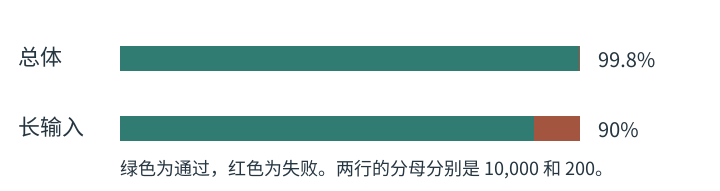
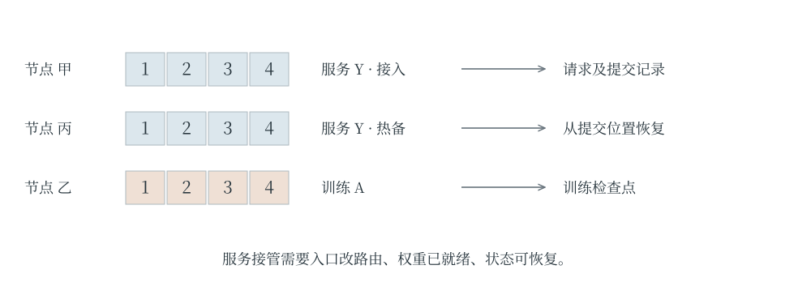
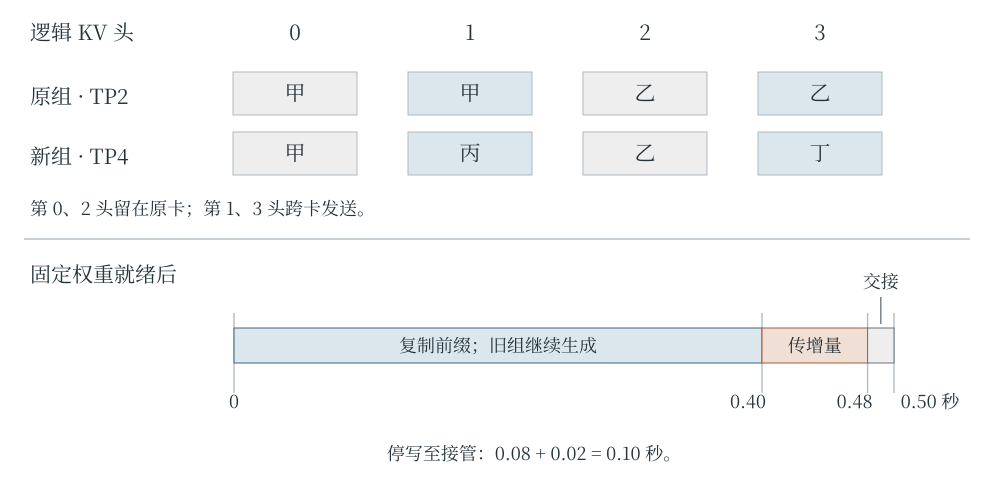
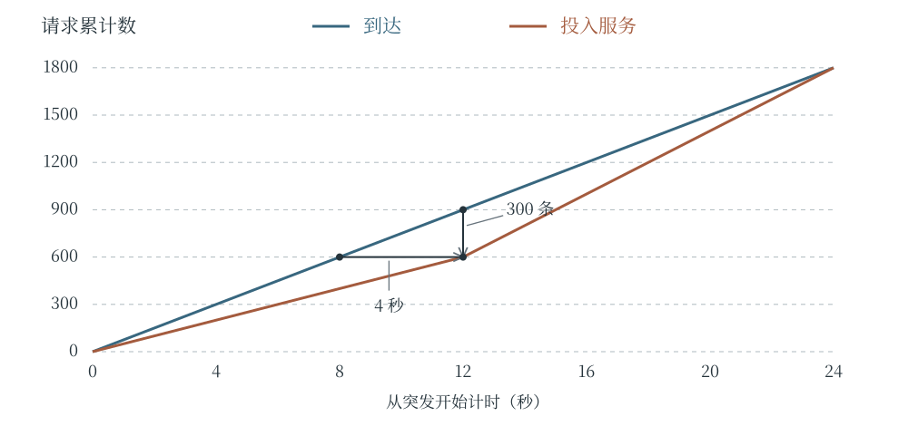

# 第 33 章　模型发布与线上故障诊断

第 22 章在一组固定输入上确认过，新权重能从模型包中正确装回。今天要做的是让它接替旧版，为真实用户持续服务。整个测试集通过 99.8%，值班工程师为什么还会按住发布按钮？他要弄清的第一件事，是失败的二十条请求究竟长什么样。

## 33.1　摊开分母再决定放量

设验证流中 9,800 条短输入全部通过，200 条长输入只有 180 条通过。加起来 9,980 条正确，总体通过率确为 99.8%，长输入组却只有 90%。若长输入恰好占自然流量的 2%，随机独立抽 100 条去做小流量验证，一条长输入都抽不到的概率为 0.98¹⁰⁰，约 13.3%。即便抽到了两条长输入，它们恰好都成功，也无法排除长输入上的退化。发布前可以刻意多抽长请求，分别报告各组成功率，再按真实流量占比还原总体。把加权总分与分组统计同时保存，才能在用户组成改变后重新判断。

*图 33-1　每万条里有 200 条长输入，其中 20 条失败。上方总体几乎全通过，下面放大长输入的分母，能看见每十条有一条失败。*

为了把粗略门槛变成诊断，让同一批长输入同时经旧版和新版运行，保留相同的会话前缀、分词编号、生成规则和请求时限。若逐层数值已经在固定输入上分歧，查模型包或低精度内核。若单请求正常，只有混合负载会超时，则先比较调度、KV 容量和预填充分块。若输出正确却重复写入，查登记事务的版本和幂等键。影子服务会消耗算力，还可能影响正式服务共享的链路。会产生外部效果的操作需要指向隔离的测试记录或仅记录拟执行动作，否则一次回放可能真的登记两遍。

Google 的 SRE 工程师在发布实践中采用小流量对照：让候选版本先接一部分请求，和同时段运行的旧版本比较，再决定是否扩大覆盖。对上面的模型，抽多少流量才可能看见问题？假设请求独立，长输入占 2%，其中恰有 10% 会触发这类错误，那么任意一条请求暴露问题的概率只有 0.002。即使新版本已经处理 100 条，全部没撞上这种错误的概率仍约为 0.998 的 100 次方，即 82%。发布验证可以有意补入长请求来复现错误，再按真实流量占比估计影响范围。这两次评估各有自己的分母。用户流量若成批到达，独立抽样的概率也得重新估计。[Google SRE 的金丝雀发布实践](https://sre.google/workbook/canarying-releases/)

## 33.2　双版本同时驻留要多少空间

设实例可用 24 GiB，每版权重占 10 GiB，两版本共用运行时需要 2 GiB。旧版若已有 5 GiB 活跃 KV，加载新版会需要 27 GiB，超出 3 GiB。若旧会话自然结束到只剩 2 GiB，再加载刚好占满 24 GiB，这仍未给新版留请求缓存。把“模型文件可以加载”当作副本已能接单，会把等待从部署队列转嫁给第一批用户。更稳妥的办法可以是先在独立副本预热，验过固定探针后才接新会话，让旧会话沿原路排空。安排时要把临时双份权重、缓存与峰时流量一起算进去。

已经给用户发送的前缀很难收回。如果更新切换时把正在生成的请求强行迁过去，缓存格式、状态位置或权重版本可能不兼容。可以保留原副本直到会话结束，或保留已确认前缀，按新版本明确重算并遵守产品约定。流式输出还要保存哪一个片段已经送到、外部写入是否已经提交。回滚测试应包含“一条新请求能正确进入旧版本”和“一条老请求能否只完成一次”，否则通过健康检查的只是入口。

## 33.3　用第一处分歧组织事故记录

当班只看到长输入超时突然增加时，可以给一个具体请求连接四种记录：它实际路由到的模型版本，排队与各阶段的墙钟，页表或有效缓存水位，以及最终提交的结果。先对齐请求标识和时钟来源。跨主机若时钟误差约 2 ms，两事件只差 1 ms 时，单凭时间戳不足以判断谁先谁后，可以用发送接收对应关系或同设备区间确认依赖。聚合曲线用来发现不寻常的群体，单条时间线用来提出可推翻的原因，两者互补。

给发布过程写出可以执行的停止规则。例如长请求的错误类别在固定复现集上重现，或连续两个足量观测窗口中首词未达标率超出预算，就停止扩大新流量；证据不足则继续积累该组样本。无固定停止规则而在许多细分和时刻反复挑一个好看的结果，会夸大把握。回滚之后用相同负载再测一轮，同时查下游是否还有待清理的重复副作用。事故记录应留下哪个指标在何时恢复、还有哪个请求尚未得到唯一回执。

## 33.4　故障恢复与可观测性

设服务有两套配置 X 和 Y。某天两者的首词同时变慢。设备监控说 GPU 利用率从 80% 降到 55%。这既可能是编码器等视频解码，也可能是模型空等恢复中的 KV，更可能是上游检索超时而任务还没有送入模型。**指标**提供聚合和分位数，帮助定位哪个池、哪个时段异常；**追踪**用任务与尝试标识串起一次任务的队列和执行区间；**日志**记录特定操作、版本和错误细节。把租户或任务号作为每一条聚合指标的标签会引入过多时间序列，个体诊断更适合放进可关联的追踪与日志。[OpenTelemetry 对追踪的说明](https://opentelemetry.io/docs/concepts/signals/traces/)

例如一条慢任务在同一入口时钟上，入队后等待 180 ms，设备处理 90 ms，确认 10 ms；另一条等待 20 ms、处理 250 ms、确认 10 ms，二者都是 280 ms。先看队列再看设备区间，下一步实验完全不同。前者可在固定输入下增减准入或增加副本，看等待是否变化；后者可固定批形状，测算子读写、缓存命中和链路。跨机追踪要考虑时钟偏差，不能拿两台未对时机器的绝对时间戳直接相减去解释几十微秒的等待。抽样还应能见到失败任务与长尾。

上线一个新版本时，可以先做离线回放，再将少量真实流量按可追踪的规则交给新版本。在同一到达形状下比较任务质量、达标率和错误类型，观察足够样本后扩量。若“双跑”用于对照，两路都可以算答案，只有一路能真正登记交接单。回滚需一起处理模型、分词、检索快照、工具协议与进行中的状态。让旧模型直接继承新版的 KV，或者回退服务却继续使用已不兼容的表结构，都可能产生接口成功但记录错误的结果。先停止向问题版本接新任务，按版本排空或按已提交内容重建，才能检验回滚是否真正恢复了业务。

验收再加一项条件。设训练 A 必须同机用四张卡，服务 Y 在四卡上刚够应付目标流量。要求单个服务节点离线后整个服务仍能接单，同时训练要继续。仅凭原有的四卡测试，无法推断服务少两卡还能守住时限。一个保守的起点是三台各四卡，乙专供训练 A，甲和丙各能运行完整四卡 Y，分属独立节点，预装相容权重。可以一主一备，须用真实故障切换检验备用节点的缓存冷启动、依赖存储、流量转移和未提交任务的恢复。两个节点若共用同一交换机或供电域，这个设计只覆盖单节点故障。即便有热备，探测和接管通常仍有空窗，不能单凭节点数保证每条在途请求达标。

*图 33-2　每行是独立节点，右侧的状态由相应服务负责恢复。训练检查点与请求提交位置解决不同问题。验收时应真的下线一个服务节点，计入失败、重放、冷缓存与接管后的长尾。*

可靠性承诺须写出分母。例如按时间评估、30 天可用率目标 99.9%，则允许不可用 $`30\times24\times60\times0.001=43.2`$ 分钟；若按请求成功比例评估，额度对应失败请求个数，繁忙时段的一分钟会消耗更多。逐请求检查首词和后续间隔，又是另一项验收。先定义用户看到什么，才谈得上用多少预算做一次有风险的切换。

### 运行中的并行组调整

扩一个新副本可以只给它派新请求。但如果旧组需要释放设备，就必须迁移仍在生成中的会话。举一层小注意力为例，四个 KV 头编号 0 至 3。旧 TP2 组的甲持头 0、1，乙持头 2、3；新 TP4 组的甲、乙、丙、丁各持头 0、1、2、3。保持甲乙原设备，可以留下甲的头 0；乙的头 3 要去丁，甲的头 1 要去乙，乙的头 2 要去丙。这样四个头里有三个换卡。若允许改变新组的设备次序，把逻辑秩 2 给乙，逻辑秩 1 给丙，则甲乙各留一头，只需搬另外两个。每层执行的数学运算相同，相差的一份流量来自物理卡与逻辑秩的对应。实际模型还要检查 GQA 的 KV 头数能否整除目标并行度。若运行库选择复制某些头，目标所需容量也要随复制数重算。

把这次重排放大。假设权重共 8 GiB，缓存共 2 GiB，两者都能按上述四份均分。最初甲乙各有 4 GiB 权重和 1 GiB 缓存。采用每张旧卡留一份的布局，甲乙各外发 2 GiB 权重和 0.5 GiB 缓存，两张新卡各接收 2.5 GiB。如果所有外发都经过同一条有效 10 GiB/s 上行，5 GiB 载荷的传输下界是 0.5 s。若两条独立上行各有同样速率，每张旧卡的下界是 0.25 s。前者若按四张卡的接口带宽相加，会低估四倍。再看显存。假如保留原张量并在甲乙上另建连续目标缓冲，旧卡峰值至少是 $`5+2.5=7.5`$ GiB；若目标内核可直接用原张量的连续切片，旧卡才有机会少分配这 2.5 GiB。接收卡则要实际留出对应空间。执行图、通信工作区和下一个生成步的增量都还得另算。

能否边搬边生成？设 4 GiB 固定权重已经送完，此时需要送去新卡的历史还有 1 GiB。旧组按现有负载每秒又产生 0.5 GiB **需要跨出旧卡的**新历史。若有效搬运能力是 2.5 GiB/s，积压的净减少速度是 2 GiB/s，理想连续复制要 0.5 s 才能追上。另一种做法是先把 1 GiB 的不可变前缀用 0.4 s 搬完，再暂停旧组。此时还欠 $`0.4\times0.5=0.2`$ GiB，停写后用 0.08 s 搬完。接管若再串行花 0.02 s，已经在服务的请求看到约 0.10 s 的停顿。两种方案的最后一次采样时刻不同。带宽降到增量产生速率或更低时，一边增长一边追就没有有限的追平时刻。实际还可能有滑动窗口覆写、部分填充的页或递归状态，后台只能复制可冻结的快照，对后来改写的部分须重新记录和复制。Llumnix 为请求迁移实现了多阶段状态搬移。上面的 TP 切换是本节构造的布局实验。[Llumnix 的迁移设计](https://www.usenix.org/conference/osdi24/presentation/sun-biao)

*图 33-3　按逻辑头号追一份数据。上半中可留在同卡的两头用灰色标出，丙、丁各接一头。下半从固定权重已经就位开始计时；系统到 0.40 s 才停写，输出暂停时间从这里开始数。*

最后把“谁有权输出”作为一次提交。旧组在词元边界停写，提交游标、采样器状态和状态版本；新组核对每个层、头、有效长度及两端的模型版本，建好新通信组，完成一次就绪检查。路由服务随后以条件更新把会话从旧代号切到新代号，输出端只认当前代号。若新组凑不齐或校验失败且尚未切换，仍由完整旧组继续；若已切换而旧组迟到的包又到了，以代号丢弃，并用已提交游标恢复。旧副本要等相关读者和传输完成后才回收。否则在两套图各自验证正确的情况下，用户也可能收到两次第 37 个词，或永远收不到它。[并行组布局与预复制复算](../../experiments/part06/reconfigure.py)

有一种容易混淆的运行中切换。ArcticInference 的 Shift Parallelism 在固定的设备组里选用不同的 TP 与序列并行组合，满足两者乘积等于固定总并行度，并为受支持模型安排兼容的 KV 布局。这样可以避开刚才换卡造成的跨卡 KV 重排。它解决的是同一组设备上的阶段切换。若设备成员变了，或新执行图所读的页布局不相容，仍要检查数据归属、容量和就绪边界。[Shift Parallelism 的并行度与布局条件](https://github.com/snowflakedb/ArcticInference/blob/main/docs/shift-parallel.rst)

### 流式输出的恢复与去重

把一条交接单的输出流编号为 1、2、3……。服务器在发送之前，将请求身份、位置和已选词号写入可恢复的日志。设日志已记到第 6 项，客户端已展示第 5 项，最近一份完整 KV 快照却只覆盖到第 3 项。这三个位置可以同时正确。日志决定恢复哪串词，KV 记录已经替它们算过哪些前缀，客户端进度决定从哪一项重新交付。运行中的张量并行组故障后，如果只根据快照续写，就可能从第 4 项开始改写用户已经看到的句子。

让接管副本装入相同权重、适配器和位置配置，取回恰好包含前 3 项的 KV 快照。按日志里固定的词号把第 4、5、6 项作为已知输入送入模型，把缓存推进到含第 6 项的前缀，再计算第 7 项的预测。此时第 6 项可以直接从日志发给客户端，无须等这三次状态推进完成。假如客户端其实已经读到第 6 项，只是确认丢了，接管方可能重发它。给每次事件使用稳定的“请求编号、输出序号”，让客户端保留并去重最后已应用的事件，才能把一次网络重发与界面上的两次展示分开。Server-Sent Events 的事件 ID 和重连时的 Last-Event-ID 提供了传递游标的机制；事件日志保留多久、客户端是否持久记录了实际展示进度，仍是应用的约定。[HTML 对事件 ID 与重连的规定](https://html.spec.whatwg.org/multipage/server-sent-events.html)

词号能省多少空间？沿用每位置 128 KiB 的 KV 教学配置。上述 3 个词若各记 4 B，新增词号载荷共 12 B；多存三份位置状态则要 384 KiB。日志还要带上版本和序号，也不能替代在接管设备上重跑已知前缀的工作。若承诺只是保持已展示前缀，并从正确的条件分布继续采样，新的随机后缀可以与故障前本来会产生的不同。要复现同一次未完成的采样轨迹，还需保存相容的生成配置、随机数生成器位置和必要的采样器状态；使用推测解码时甚至可能在一个交付词之前就作过多次随机选择。只保存随机种子无法保证跨软件版本与硬件还原相同的轨迹。流里若含有已经提交的工具调用，恢复输出游标也不能充当外部系统的提交凭据，须对照第三十章的操作键。[PyTorch 的可复现性说明](https://docs.pytorch.org/docs/stable/notes/randomness.html)

### 扩容延迟与排队

设交接服务有一个热副本，能稳定处理每秒 50 条等长请求。零时刻遇到持续每秒 75 条的流量。监控采样与下发扩容指令共用 2 秒，随后分配设备、加载权重、预热并通过就绪检查共用 10 秒。第二个副本在第 12 秒才首次具备接流量的条件。先假设队列先进先出、两份算力可立即合用、没有取消，按连续流量估算，只计排队。前 12 秒每秒积下 25 条，共 300 条；此后每秒能处理 100 条，还有 75 条持续到达，每秒只能处理 25 条积压请求。队列到第 24 秒才排空。给副本发指令、能接第一条、排队恢复正常，是三个不同的时间点。

*图 33-4　纵轴是请求的累计条数。在同一个时刻竖着量，读到还在等的请求数；跟同一批请求横着量，从它的到达到获得服务，读到等待时间。两个指标的最大值发生在不同的时刻。*

谁等得最久？画出累计到达数 $`A(t)=75t`$。前 12 秒最多把 $`50t`$ 条投入服务，所以第 600 条要到第 12 秒才轮到。它约在第 $`600/75=8`$ 秒就来了，等待约 4 秒。第 12 秒才来的第 900 条，看见队里人最多，此时两副本已经能接单，前面约 300 条用 3 秒便可处理。沿图中同一条水平线从左量到右：就绪前投入服务的那些请求，越晚到达、等待时间越长；第 12 秒后投入服务的请求，累计服务曲线斜率超过到达，等待逐渐变短。因此峰值排队延迟是 4 秒。直接拿最大积压去除原副本的速率，会报出 6 秒，错过了中途发生的容量变化。

再为这个设计增加一项要求：突发期间排队至多 1 秒。若第二个副本在第 $`H`$ 秒就绪，同理，最晚赶在旧速率末尾投入服务的请求于 $`50H/75`$ 秒到达，最大等待是 $`H/3`$。因此，新增容量必须在 3 秒以内可用。若采样和下发已经耗去 2 秒，留给设备和模型的时间只剩 1 秒。于是可以拿具体方案来试：预留已经加载权重的副本、根据已知换班时刻提前启动，或者在超载时限流并把拒绝计入服务目标。只缩短监控周期，即使把 2 秒全省掉，也弥补不了后面 10 秒的冷启动。Kubernetes HPA 的控制循环、指标采样与就绪处理解释了为何副本目标数和可用服务率会暂时分开。实际推理还应从首个成功批次测出冷缓存时的服务曲线，按输入长度与输出长度重放忙期；若到达长期高于两副本容量，靠等候无法排空积压。[Horizontal Pod Autoscaler 的运行机制](https://kubernetes.io/docs/concepts/workloads/autoscaling/horizontal-pod-autoscale/) [用到达与就绪记录复算](../../experiments/part06/scale_queue.py)

回看发布按钮，工程师要作的决定已经很具体了。长输入的退化有没有复现，旧会话能否排空，一旦退回旧版，正在输出的那条回答能否接着读？只有这些问题都有可观察的答案，额外预留的副本才能真正缩短用户受影响的时间。可预留几份还要看另一项很少出现在模型基准里的限制——机器所在机架能否同时给它们供电。

## 练习与解答

### 1. 小流量没有发现慢请求

长请求独立出现的概率为 2%。要让至少碰到一条长请求的概率达到 95%，随机样本量至少是多少？

**解答。** 需使 0.98 的 n 次方不超过 0.05。取对数再向上取整，至少 149 条。碰到一个长输入只是看到该类样本，还不足以精确估计其失败率。

### 2. 还能接几条新会话

24 GiB 中双份权重占 20 GiB，共用运行时 2 GiB，旧会话共占 1 GiB，新会话各需 256 MiB，另预留 512 MiB。按给定上限能新接多少条？

**解答。** 新会话可用 0.5 GiB，即 512 MiB，可接两条。若预热时还需要临时分配，必须先扣掉预热峰值。

### 3. 影子流量能证明什么

新版在影子流量上把首页生成耗时降低一成。可以直接说用户点击率提高了吗？

**解答。** 可以说明在所测负载和计时边界内生成更快。影子结果没有展示给用户，没有产生相应的真实点击。要判断业务效果，应在适当分流和保护条件下记录真实曝光及后续行为。

[全书目录](../../README.md) · [上一章 · 多租户调度与资源隔离](ch32.md) · [下一章 · 数据中心的供电、冷却与容错](ch34.md)
