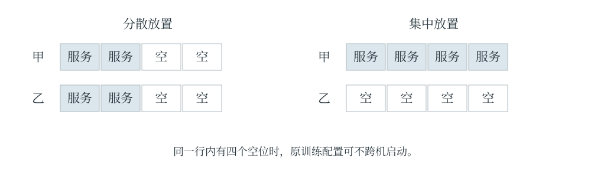
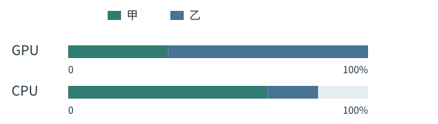

# 第 33 章　多租户集群调度与资源隔离

同一集群里，训练团队在等四张卡，首页推荐服务却只在晚上特别忙。平台面板上明明显示还空着四张卡，训练作业依然起不来。要理解这个现象，先把设备编号画在机架和服务器里，再看另一种更隐蔽的限制：有卡的地方可能没有足够 CPU、内存或网卡带宽。

## 33.1　资源调度与拓扑约束

先有两台服务器，每台四张 GPU，机内互联快，跨机走较慢的出口。训练配置 A 的步时是在同机四卡上量得的。若甲有两个在线请求副本各占一卡，乙也有两个，集群总共空四卡，两台机器却各只有两张空卡。即使调度器统计到“可用 GPU = 4”，也无法按这份配置启动。若把四个服务实例预先放在甲，就能将乙的四张卡全部留给训练；但甲一旦宕机，四个服务实例也会同时不可用。

*图 33-1　每格是一张物理卡，同一行属于同一故障域。两种放置方式使用同样的四张卡，但每台机器的剩余卡数和服务副本数不同，影响训练准入与单机故障后的服务能力。*

平台先发现设备型号、可用显存、节点与互联拓扑，区分健康设备和待维护设备，再依据任务的形状准入。承诺了租户四卡的**配额**，表示在一定规则下可以申请到这个份额；要实际运行，还需要满足同机、显存、网络或其他需求。分布式训练常要求一组进程一起就绪（gang scheduling）。如果两个四进程作业各先占了两张、然后都等另外两张，有用工作可能一步也做不了。可以先为完整组作可撤销的资源预留，满足约束后再一起放行；若启动中有节点失效，需取消预留、释放部分进程并重新排队。

在 Kubernetes 环境中，可结合工作负载队列、配额准入、拓扑信息与节点上的实际调度完成这些步骤。Kueue 的拓扑感知调度把设备所在拓扑域纳入分配。Slurm 将 GPU 等作为通用资源描述，作业申请、设备绑定和节点布局要彼此匹配。仅仅写下“四张 GPU”，并不会自动得到某条特定的快速通信路径。[Kueue 拓扑感知调度](https://kueue.sigs.k8s.io/docs/concepts/topology_aware_scheduling/) · [Slurm 的 GPU 资源管理](https://slurm.schedmd.com/gres.html)

优先级能让线上故障恢复先拿资源，但被抢占的训练也有损失。若距离上次可恢复提交已过 12 分钟，四卡训练被强停会浪费约 48 卡分钟，还要重新排队。为短作业填补预留前的空档，需要估计完成时间并考虑提前收回时的代价。多租户还得限制显存、主机内存、I/O 与网络份额，否则给了同样多的卡，两项任务仍可能互相拖慢。受支持 GPU 上的 MIG 可提供具有独立计算和显存资源的实例，不同实例规格有实际放置限制。时间片共享则允许任务轮流用计算资源；要兑现延迟和内存隔离目标，还需测各工作负载的争用及各自的内存限制。[NVIDIA MIG](https://docs.nvidia.com/datacenter/tesla/mig-user-guide/introduction.html)

除了 GPU 的拓扑位置，容器的 CPU 额度也可能决定 GPU 何时收到下一批。假设输入侧有四个独立的解码线程，宿主有四个空闲核心，四者在某一批各需 22 ms 的 CPU 时间。Linux cgroup v2 若设定 cpu.max 为每 100 ms 周期允许使用 80 ms CPU 时间，额度是整组线程共享的。假设从周期开头完整额度起步、没有突发额度、线程可均匀并行，四核跑满 20 ms 就用光 80 ms。仍各欠 2 ms，须等到第 100 ms 才能继续，第 102 ms 数据才齐。把准备时间简单写成“88 核毫秒除以四核等于 22 ms”，会漏掉中间 80 ms 的节流。改成单线程串行，在同一额度下先跑 80 ms、等 20 ms、再跑 8 ms，到第 108 ms 才完成。这也解释了为什么容器中有四个可用 CPU，不能据此承诺每批 22 ms。

实际 Linux 调度器分发配额的粒度和线程抢占会改变精确时刻。现场先同时记输入队列变空的时刻、GPU 设备时间线、容器 cpu.stat 在窗口内的节流次数与节流时间，并区分 cpuset 允许在哪些核上跑和 cpu.max 最多能用多少核时。为验证瓶颈，可以在相同输入与机器放置下仅改变额度，观察设备空洞是否随之移动。若瓶颈本来是存储解压前的 I/O，单纯提高额度可能只留下更宽松的空闲预算。[cgroup v2 CPU 限额](https://docs.kernel.org/admin-guide/cgroup-v2.html)

### 训练与服务的拓扑要求

给平台两个机架，各有四张空卡。若四卡训练每步都同步，放在同一机架能减少跨架流量，单架故障时则整组中断。另一项任务是四份互相独立的推理副本，每份每秒能稳定接 30 条请求。全压在甲架时正常容量为 120 条/秒，甲架断电时立即降为零；两架各两份时正常容量未变，失去任一架后还能接 60 条/秒。若合同要求在单架故障后仍服务每秒 80 条，平均分散本身也不够：剩下的一架至少要三份，两架都要准备三份或有经验证能按期接管的备用容量。故障相关性改变了该买多少冗余，单副本利用率看不到这一层。

Kubernetes 的拓扑分布约束把同一组 Pod 在指定拓扑域的数量差纳入调度，可按节点或正确设置的机架标签来衡量；它检查的是副本的分布条件。四个训练进程必须成组取得资源、GPU 之间的物理路径够快、故障时另两份副本能立即装好权重，这些条件需要分别验证，不能仅由副本分散放置推断。上线前可把一个机架的可用容量在回放中置零，重新计算流量、队列和冷启动；只有各项仍满足目标，“跨架”才意味着可交付的容灾能力。[Kubernetes 的拓扑分布约束](https://kubernetes.io/docs/concepts/scheduling-eviction/topology-spread-constraints/)

## 33.2　两种资源怎样分给两个租户

设集群有 12 张相同 GPU 和 96 个 CPU 核。租户甲做样本准备，每个任务需要 1 张卡加 16 核；租户乙跑较大的矩阵，每个任务需要 2 张卡加 4 核。按卡各分六张，甲可提六项，乙可提三项，CPU 合计要 6 × 16 + 3 × 4 = 108 核。即使每张卡都空着，平台也兑现不了这个决定。

把一个租户占用的每种资源除以全站同种资源的容量，再取较大的比例，这就是该租户的主导份额。甲每任务的两项为 1/12 和 16/96，主导在 CPU；乙每任务为 2/12 和 4/96，主导在 GPU。各运行四项，甲占 4 张卡和 64 核，乙占 8 张卡和 16 核。总计恰好 12 张卡、80 核，两人的主导份额都为 2/3。还空 16 核，任何一方想再起一项都没有空卡。在这个例子中，让剩下的 CPU 核闲着并不表示调度器算错了。单独允许一种只需 CPU 的数据清洗任务使用它，才有机会多做工作。[多资源分配的主导份额方法](https://www.usenix.org/conference/nsdi11/dominant-resource-fairness-fair-allocation-multiple-resource-types)

*图 33-2　甲的限制来自 64/96 的 CPU，乙的限制来自 8/12 的 GPU。两人的最大占比相同，两条资源轴上的剩余位置却不同。*

主导份额是一个分配准则，还没有回答何时能凑齐四张同机卡。若甲必须四项同时启动，零散的三个位置可能短期借给乙，第四个位置释放时则须能及时收回。若乙最后一步还要做不可中断的提交，强制撤下会使它重跑。实践中可以给低优先级任务标出可暂停的边界，给交互任务预留最低服务能力，再根据长期实际消费权衡谁先走。分配公平和完成日期都应由实际等待与交付来检验。

## 33.3　把抢占的成本摊到剩余工作

训练作业预计还要 20 分钟。突然来的服务负载可从抢来的两张卡获益，每分钟多交付 120 条达标请求，持续五分钟。训练在当前边界暂停需 40 秒，稍后恢复读回状态需 50 秒。假定原计算速度恢复后相同，训练交付会推迟 5 分钟加 90 秒，换来 600 条额外达标请求。若 SLA 只允许训练晚 4 分钟，就算云账单上总 GPU 小时没变，这份配置仍不满足委托。若能迁到同一网络域内的备用卡，取决于复制字节和重建通信组的时间是否短于等待。

还有一种慢法根本不需要抢卡。两个租户用独立的计算切片，却共用主机内存通路或机间出口，乙的大批检查点写入把甲的请求拖慢。归因时，对齐到达流，分别回放甲单独、乙单独和两者共存，再改变一个共享资源限制。若只在共存时长尾增长，监控应进一步定位是 CPU 被节流、页迁移还是出口排队。隔离单位小到没有覆盖的资源，仍会在用户等待里显示出来。

## 练习与解答

### 1. 分散的四卡能否替代一台四卡

设把 A 跨机拆成两卡加两卡，等质量下训练段增加 25%，其他预算保持不变。还能按 48 小时交付吗？

**解答。** 训练段从 33 小时 20 分变为 41 小时 40 分。再加排队 2、验证 2、恢复 3 小时，总计 48 小时 40 分，超期 40 分钟。应重新测跨机步时和训练质量，或调整预留与排队安排。

### 2. 为什么按卡平分会超卖

若甲只运行五项，乙三项，两方分到多少卡与核？剩余资源能否再接受一项甲？

**解答。** 甲用 5 卡 80 核，乙用 6 卡 12 核，总计 11 卡 92 核。余一张卡、四个核，容不下还需要 16 核的一项甲。

### 3. 暂停多久才值得

抢占前暂停和恢复各需 30 秒。训练最多可推迟四分钟，恢复后剩余工作速度相同。一次连续借用的时间上限是多少？

**解答。** 总推迟为借用时间加一分钟，故最多借三分钟。若期间释放的卡也要预热才能提供服务，可以从这三分钟中再扣有效服务前的等待。

[全书目录](../../README.md) · [上一章 · 推荐系统的召回、排序与在线特征](ch32.md) · [下一章 · 模型发布、可观测性与事故处置](ch34.md)
