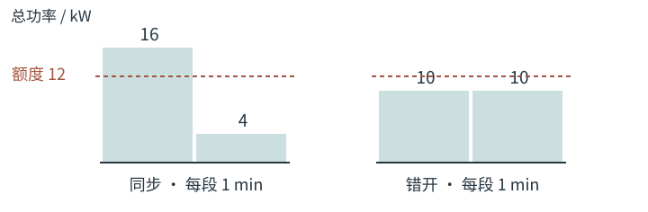
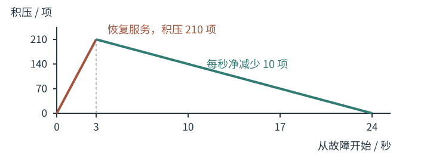

# 第 34 章　数据中心的供电、冷却与容错

服务已经能按版本切流。容量会上有人建议再买四台机器，机架也有空位。电力工程师打开的是另一张图，上面画着各台机器**同一时刻**的取电功率。一台服务器能单独跑满，八台搭在一起是否还能同时跑满？这次限制模型的量从每秒乘加变成了千瓦。

## 34.1　平均电量相同，同时峰值可以差一倍

先用两台教学服务器做实验，每台第一分钟用 8 kW，第二分钟用 2 kW。两台都从第一分钟开始，机架的两个读数是 16 和 4 kW。如果第二台的高低顺序对调，两个读数变成 10 和 10 kW。两种情形在两分钟都用 (16 + 4)/60 = 1/3 kWh，平均也都是 10 kW。若这两分钟内各段功率稳定而供电额度为 12 kW，前一种安排第一分钟超过限制，后一种全程在额度内。不能用月度总电量替实时峰值做决定。

*图 34-1　两条曲线下方面积相同，水平线为 12 kW 额度。供电判断看同时峰值，电费判断再按时间积分。*

把例子放回同步训练。各卡刚完成集合通信，常常一起进入下一层矩阵乘法。想靠简单错峰把曲线削平，可能只会让领先的卡在下一次集合前空等。反过来，各自独立到达的推理请求有时能摊开功率，但突发流量或相同调度周期又会使峰值重合。比较限功率方案，应在相同目标质量或相同服务时限下同时测总电量、可持续吞吐和最热时刻的余量。论文中基于测量构造的容量模拟需要保留负载条件。[微软团队的云端 LLM 功率研究](https://www.microsoft.com/en-us/research/publication/characterizing-power-management-opportunities-for-llms-in-the-cloud/)

## 34.2　热量从芯片怎样离开机架

机器持续取走的电能大部分最终成为热。考虑一个教学水冷回路，仅做热量账，忽略损失、泵功与瞬态蓄热。要带走 40 kW 热功率，若允许冷却液升温 5 K，取水的比热容约 4.18 kJ/(kg·K)，所需质量流量为 40 / (4.18 × 5) ≈ 1.91 kg/s。若实测只有 1.2 kg/s，在同一个允许温差下只能持续带走约 25.1 kW。提高设备算力不会改变这条能量守恒。真实系统还受进水温度、冷板热阻、散热器能力和并联支路不均影响，芯片结温须按具体设备实测。

芯片温度超过控制目标时可能降频。于是整机面板仍显示在忙，每个训练步却逐渐拉长。实验时把进出水温、GPU 温度和功率、工作频率、每步有效词元按时间对齐，等热状态稳定后再比较，不能只取开跑一分钟的漂亮数字。若想把机房电耗换算到每个任务，还要分清 IT 设备耗电和设施总耗电。假设同一统计窗口 IT 用了 100 kWh、配电和制冷等额外用了 20 kWh，则窗口内总量与 IT 之比为 1.20。只有在边界和时期相符时，拿这个比值放大任务的设备用电才是一种有根据的分摊。

## 34.3　机房功率、成本与方案选择

再算三台服务器、每台四张 GPU 的例子。设持续负载时每卡平均功率 0.50 kW，CPU、网络和内存合计 2 kW，则 IT 负载为 8 kW。若机房总能耗与 IT 能耗的比值 PUE 在这个窗口为 1.25，对应机房侧平均 10 kW，48 小时约 480 kWh。机柜电路和散热设计还需看瞬时峰值及功率分布；PUE 用来估整设施消耗，不能把机房侧的 10 kW 直接当作各机柜设备的输入读数。若限功率使每步变慢，48 小时内能完成的更新就会变少。比较功率方案时还要带上实测步时。

把采购与租用放进同一单位。假设每月摊销及固定运营成本为 12000 个单位，自有设备每个实际使用卡时的变动成本为 0.5，按需租用为每卡时 2。令 $`H`$ 为两种方式提供同等服务需付费的可比卡时，简化的持平点来自 $`12000+0.5H=2H`$，即每月 8000 卡时。十二卡在 30 天最多有 8640 卡时，要用到约 92.6% 才过持平点。若要求持续保留热备，自建端的供电与折旧和租用端的预留时间必须按同一履约口径计。不同交付期、硬件代际和故障支持也会改变比较，这些数是教学报价。

### 机架功率约束

假设机架在预留网络与冷却相关预算后，留给八台训练节点的供电额度共 48 kW。每台在计算峰段取 7 kW，若同步进入该段便要 56 kW，超过额度 8 kW。即使每台在通信阶段都只取 4 kW，不能把不同时刻的低值拿来抵消同一时刻的峰值。限制每台到 6 kW 可以守住整架预算，是否有利于整个训练任务，则要检查限功率后每步的运行时间。

若教学测量显示，原方案用 1.0 s 完成一步，平均每节点 5.8 kW，每步整架能耗为 46.4 kJ。封顶后变成 1.12 s 与 5.1 kW，每步约 45.7 kJ，能耗略降，吞吐却下降约 10.7%。两批硬件错峰执行也可能减少瞬时功率，但同步集合会让提前到达的节点等候。验收应同时报告电力上限下可持续步率、每个有效训练词元的能量，以及功率采样窗口是否足以看见同步峰。

## 34.4　拔掉一个故障域再做容量预算

三个机架各能在时限内交付每秒 40 项任务，平时合计 120。若约定失去任意一个机架仍要维持原时限，在流量能够均匀重路由、上下游也有余量的前提下，可承诺的上限是 80 项。若承诺 90，平时的利用率只有 75%，故障后却缺 10 项每秒。两个副本若恰好接同一配电支路，共因故障还可能让名义冗余同时失效。先画服务副本、交换机和供电支路的映射，再数一次故障后可用的能力。

最后检查排空积压。设到达为每秒 70 项，故障切流期间服务完全中断 3 秒，积压 210 项。随后两架一共可处理 80 项/秒，扣掉持续到达的 70 项，每秒只能额外清掉 10 项，至少再需 21 秒才能清空。机器恢复“健康”的那一刻，上一批用户未必已经拿到结果。容量表既要列稳定期，也要给切换期间的时限违约留记录。下一章会用真实到达时间和模型配置来检验这种纸面预算。

*图 34-2　在第 3 秒开始接单后，队列还要 21 秒才降为零。读竖轴能看到积压条数，读斜率能分清是在按每秒 80 项处理，还是按每秒 10 项清掉旧账。*

还可以在图上验证一个补救办法。假设有一台临时副本，切流后立即多提供每秒 20 项能力，净排空速度便从 10 升到 30，积压只需 7 秒便能清完。若副本要预热 9 秒，原来的两架在这段时间已清掉 90 项，剩下 120 项还要 4 秒。排清时刻从故障后的第 24 秒提到第 16 秒。热备与临时扩容即使最终的额定能力相同，也会给这一批用户留下不同的等待经历。

## 练习与解答

### 1. 同时峰值与电量

两台机器各运行一小时，分为前后两个半小时，各有一段取 6 kW、一段取 2 kW。总电量是多少？同相、反相下各需多大的机架峰值能力？

**解答。** 每台用 6 × 0.5 + 2 × 0.5 = 4 kWh，两台共 8 kWh。同相峰值 12 kW，反相峰值 8 kW，假定两段内功率均恒定。

### 2. 冷却余量

流量维持 1.5 kg/s，允许升温 4 K，沿用正文比热。忽略其他散热路径，能持续移走 30 kW 吗？

**解答。** 近似可移走 1.5 × 4.18 × 4 = 25.08 kW，少约 4.92 kW。还要测实际设备和冷却系统，不能据此直接给出运行设定。

### 3. 故障后为什么一直排不空

两个剩余机架合计每秒可处理 80 项，流量同为每秒 80 项，此前已有 160 项积压。按流体近似，需要多久排清？

**解答。** 净排空速度为零，积压持续存在。需要增加能力、降低新到达量或显式放弃一部分任务，并把过期与放弃计入服务统计。

[全书目录](../../README.md) · [上一章 · 模型发布与线上故障诊断](ch33.md) · [下一章 · AI 系统性能评估与容量规划](ch35.md)
