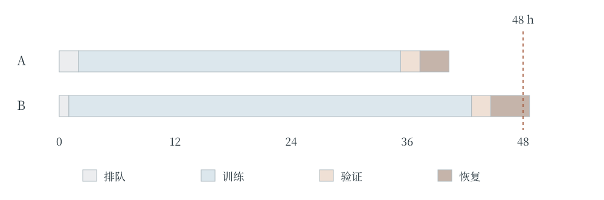
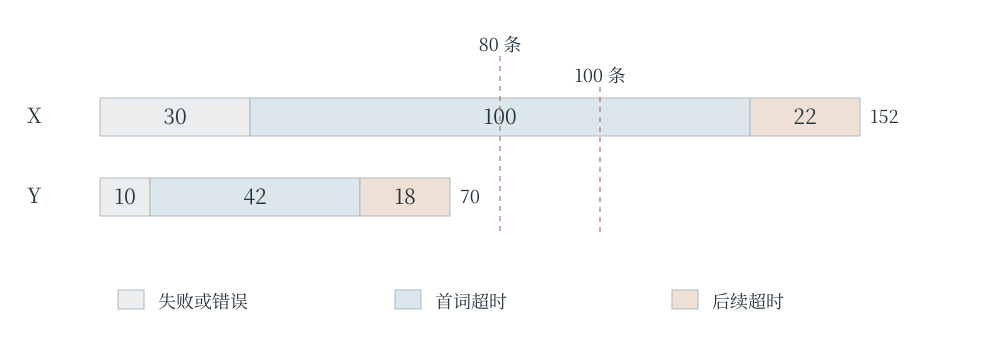
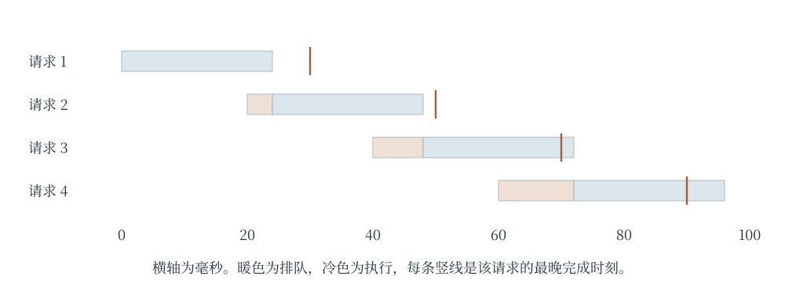
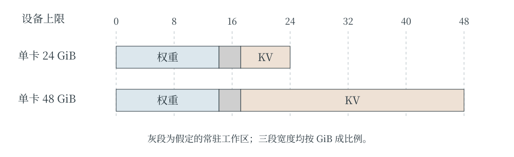
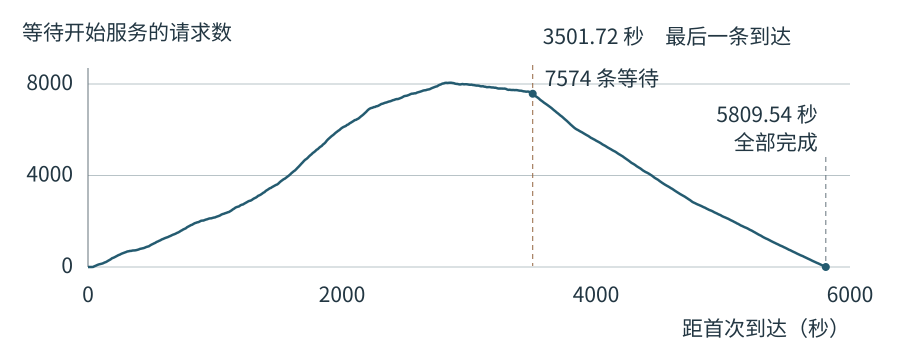
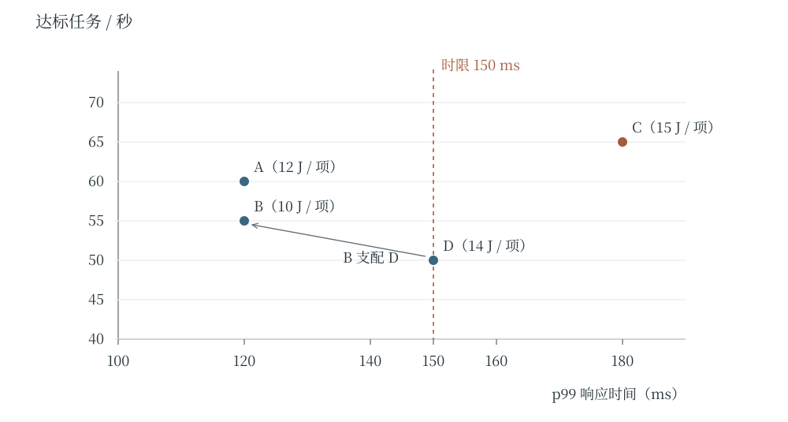

# 第 36 章　AI 系统的性能评估与容量决策

假设你能为一项对话服务争取一笔预算，目标是让九成请求在一秒内看到首词、四秒内得到完整回答。候选方案有三个：买显存更大的卡、增加副本、把时间花在改推理引擎。哪一个应当先做？下面先把第一章的训练期限和仓库交接单的用户承诺放到同一张账上，再用一个公开模型的配置和一段独立的真实请求轨迹算这道选型题。模型、轨迹和假设的设备速度分别列出，让读者看到每种证据能够支持哪一步决定。

## 36.1　训练时间、质量与成本

回到第一章表 1-1。A 平均每秒处理一万个有效词元，12 亿个词元达到约定质量，训练段为 33 小时 20 分。B 提高批量，每秒处理 1.6 万个，却要到 24 亿个词元才达到同样质量，训练段为 41 小时 40 分。为把它们放进平台预算，设两配置都占四张卡，排队分别为 2 小时和 1 小时，独立的发布前验证各为 2 小时。本次故障情景另给 A 留 3 小时、B 留 4 小时恢复及补算。这些是教学条件；实际应从检查点间隔、恢复记录及排队分布估计它们。

| 方案 | 排队 | 训练至达标 | 验证 | 恢复与补算 | 预计完成 | 距 48 小时 |
|---|---:|---:|---:|---:|---:|---:|
| A | 2 h | 33 h 20 min | 2 h | 3 h | 40 h 20 min | 提前 7 h 40 min |
| B | 1 h | 41 h 40 min | 2 h | 4 h | 48 h 40 min | 超过 40 min |

若排队期间没有占卡，其他三段全程占四卡，A 用 153 小时 20 分的卡时，B 用 190 小时 40 分。按每卡时 2 个成本单位计，分别约 306.67 和 381.33。给 A 的 3 小时恢复是本情景中额外花去的时间；若从日志取到的训练段已包括重放，就不能再加。只缩短 B 的排队到零，它也只有 20 分钟余量。质量阈值、用于作判断的数据切分和随机波动仍须复查；一条训练曲线不足以给未来所有运行承诺 48 小时。



*图 36-1　从用户提交任务起计时。细线标记 48 小时，B 的末段超过期限 40 分钟。算租卡费用时应去掉无设备占用的排队段；算交付时间时应保留它。*

这份交付还要能被别人重复部署。把训练数据快照和划分、分词器、模型配置、基础权重与适配器、优化器配置、软件镜像和必要的数值设置一起写入产物清单。验证任务同样带版本。对需要恢复训练的作业再保存数据游标、可恢复参数和优化器的一致切面；给推理端的包则应说明兼容的缓存格式和运行环境。固定随机种子有助于重做比较，跨硬件的归约顺序和低精度实现仍可能带来差异。验收时可以先约定允许的数值误差和任务质量范围。

如果还要给下一项训练分卡，调度器用哪一个速度作依据？先用训练结束后可查的数反推。以 A 达标所需的 12 亿词元为一份标准工作量，B 平均要读两倍的词元才能交出同一份工作。把原始速度折成这份工作的进展，A 每秒前进 10000 个基准词元，B 只有 $`16000\times12/24=8000`$ 个。这也给出了交叉点：B 要与 A 同时达标，最多能消耗 $`12\times1.6=19.2`$ 亿词元。若新的一组独立运行中 B 只需 18 亿，这个排序就会反转。不能只凭批量较大便认定训练一定更慢。

然而作业还在运行时，调度器并不知道最后一个数。Pollux 把每秒处理的样本数和每个样本带来的统计进展分开建模，用两者的乘积估计训练有效吞吐，再调整资源和批量。上面的折算是已知终点后的检验办法。在线预测要用已经观测的步时、梯度统计等信息，跨节点加卡后，通信比例也会变化。一种可负担的验证是从相同检查点用两种批量分别短跑，保持验证集、优化器策略与质量门槛的口径一致，记录时间和验证曲线；曲线差小于随机波动时，应保留两个候选。若改配要重分片，再从预期节省的训练时间中扣除迁移和预热。假定未来尚有 100 分钟，重配一次需 8 分钟，即便新配置的**有效进展速度**提高 5%，新总用时也会是 $`8+100/1.05\approx103.24`$ 分钟。相同的迁移动作，作业越接近结束，越难收回成本。[Pollux，OSDI 2021](https://www.usenix.org/conference/osdi21/presentation/qiao)

## 36.2　服务目标与有效吞吐

训练产物送达后，固定同一份权重和任务质量，比较两种在四卡上运行的服务配置。X 以整段长提示入批，Y 给预填充分块、限制在途状态，同时保留热点规程的可验证前缀。给两者重放同样的 40 秒开放到达流，共 2000 条请求，跟踪到每条结束；本例两组均在窗末前完成或判定失败。约定用户收到首词不晚于 600 ms，后续任一可见词元间隔不超过 80 ms，最终登记正确且唯一。服务需满足至少 95% 的请求全部达标，且每秒至少交付 48 个达标请求。下面是为验收构造的一组结果；互斥计数按“失败或错误、首词超时、后续超时、达标”的顺序归类。

| 配置 | 失败或登记错误 | 首词超时 | 后续间隔超时 | 全部达标 | 达标请求/秒 |
|---|---:|---:|---:|---:|---:|
| X | 30 | 100 | 22 | 1848 | 46.20 |
| Y | 10 | 42 | 18 | 1930 | 48.25 |

Y 的达标比例为 96.5%，X 为 92.4%。Y 在这条负载上同时越过两道门槛，但若到达率仍为每秒 50 条，48 条/秒本身就要求至少 96% 达标。Y 只比更严的门槛多了十条交付。即便把请求粗略看成独立的通过／未通过试验，达标比例的标准误也约为 0.41 个百分点，已接近这 0.5 个百分点的余量。共享队列还会使连续请求的结果相关。因此要跨多个独立时窗复测，观察不同班次和突发负载中有多少窗口真正守住承诺。若为了宣称更低尾延迟而从统计中去掉被拒的用户，或在超时重试后把两次尝试算成两个成功任务，这十条余量会失去意义。按任务标识统计一次，另报重试与各阶段耗时，才看得清改进在哪里。

若两配置独占四卡的时间和单价相同，每千条达标交付的设备成本分别为 $`4\times(40/3600)\times2\times1000/1848\approx0.0481`$ 和约 0.0461 个单位。若还为服务独占四张热备，两者的服务卡时都翻倍，Y 变成约 0.0921。这个数字只包括设备成本，持久化、检索、CPU 环境、视频预处理和机房运营还需另行计算。在短窗里观察到通过，还应换班次、长视频、低命中前缀、批量恢复和突发到达重复验证，再决定日常准入线。



*图 36-2　横轴只画未达标的请求数。40 秒内需交付 1920 条，因此容许至多 80 条未达标。另一项 95% 目标容许 100 条，两条线的位置不同。*

将各项验收条件合并为一次通过或未通过的判断，任何一项未通过都应在报告中留下。只把一项变好的配置发布出去，可能刚好耗光另一项的余量。

```python
def accepted(delivered, arrivals, seconds):
    return delivered / arrivals >= 0.95 and delivered / seconds >= 48

assert accepted(1930, 2000, 40)
assert not accepted(1919, 2000, 40)
```

交付报告还应能说出，换成 Y 后哪些人原本拿得到的结果反而丢了。X、Y 在同一批请求上达标 1848、1930 条，净增 82。若逐条对齐任务编号，下面两种结果都能得到这张汇总表。

| 同一任务在 X、Y 的结果 | 情形一 | 情形二 |
|---|---:|---:|
| 两者都达标 | 1838 | 1778 |
| 仅 X 达标 | 10 | 70 |
| 仅 Y 达标 | 92 | 152 |
| 两者都失约 | 60 | 0 |

第一种情形中，新配置帮助 92 条请求、损失 10 条；第二种情形中，帮助 152 条、损失 70 条。净增量相同，回退任务的数量却相差七倍。若这些回退集中在需要跨节点接管的长请求，继续提高短请求吞吐很难弥补这项服务缺口。可以从“仅 X 达标”组逐条取出证据，检查第二十四章的等待时间、第二十六章的状态交接和最终账本的提交时刻。两种配置重放的应是同一组完整的到达窗口，并各自从约定的缓存状态起步。保留忙期里原有的请求次序，才能区分单条请求执行时间的变化，以及其他请求造成的排队变化。

把两份验收结果放回同一集群。训练采用已验证质量门槛下的 A，按同机四卡预留；在线采用四卡 Y，若必须承受单节点故障则另设独立备用节点。所依据的训练情景预计 40 小时 20 分钟完成；健康状态下的 40 秒服务样本有 1930 条请求达标。第一项的余量是 7 小时 40 分，第二项的余量只有十条达标记录。参照第三十四章的接管条件，下一轮优先在高峰流量下触发单节点接管，重放同一批带任务标识的请求，对每一份交接单核对最终内容、次数、首词和间隔。如果接管后不达标，应检查排队和状态读取造成的延迟，再比较预热前缀、增加带宽或改变准入策略的代价。此时给平台多买一张卡，只是众多可检验假设中的一个。

## 36.3　端到端任务验收

下面用一组合成任务检验这个方案。取 125 个四秒钟的合成片段，每段都有一次持续 80 毫秒的入箱动作。编号从 0 到 124，第 $`i`$ 段在第 $`2000+i`$ 毫秒发生。用等间隔抽帧记录动作，再从第 31 章的两个候选段落中选规程。偶数号把正确段放前，奇数号把它放后，借此检查系统在相似度打平时是否只认输入顺序。一次交付必须同时取得动作画面、选对规程、在到达后 30 ms 内完成。在所有配置上重放同一批任务，可以逐条检查证据在哪个环节丢失。

从低负载开始，每隔 32 ms 提交一段。暂设一个串行工作槽，处理一单固定花 4 ms，每取一帧另花 0.25 ms，池化检索花 2 ms，逐词比较（MaxSim）花 4 ms。整段视频在请求到达时已录好。这些是用来控制变量的服务时间，程序实际执行的是抽帧判断、向量打分及队列回放。

| 抽帧与检索 | 看到动作 | 选对规程 | 按时返回 | 同时满足三项 |
|---|---:|---:|---:|---:|
| 8 fps，池化 | 80 | 63 | 125 | 41 |
| 8 fps，逐词比较 | 80 | 125 | 125 | 80 |
| 16 fps，池化 | 125 | 63 | 125 | 63 |
| 16 fps，逐词比较 | 125 | 125 | 125 | 125 |

第一行的 41 条可以通过逐一计数验证。8 fps 下，第 2000 和 2125 毫秒各有一帧。用左闭右开的时间区间记录动作，编号 0 在第一帧出现，编号 46 至 124 在第二帧出现，共 80 单。池化检索在每单都打平，排在前面的正确段落只在偶数号上获选。上面这 80 个编号中有 41 个偶数。用两个总体成功率相乘来估计交付数会给出 40.32 单，需要逐任务取交集，才能得到实际达标数量。读者可以运行[交接单回放程序](../../experiments/part06/evidence_replay.py)得到这张表。

把到达间隔缩到 20 ms，再运行一次。最后一行中每个任务需要 $`4+64\times0.25+4=24`$ ms。第一个请求耗时 24 ms，第二个 28 ms，第三个 32 ms，随后每来一单就积下 4 ms 等待。仍有 125 单看清动作、125 单选对规程，只有两单达到了时限。8 fps 加逐词比较每单用 16 ms，仍可交付 80 单。怎样改善最后一行？若保留单槽和每单 30 ms 的承诺，长期稳定需要服务时间至多等于平均到达间隔，在这个严格等间隔例子中至少得省 4 ms；真实到达有突发，还需留出可量化的余量。另一个候选是让两条独立工作槽轮流接单，此时同一槽每隔 40 ms 才接到新任务。若两个槽共享已饱和的媒体解码器，就必须重新测每槽的 24 ms 是否仍成立。

```sh
python experiments/part06/evidence_replay.py
python experiments/part06/evidence_replay.py --arrival-ms 20
```



*图 36-3　第三个请求在第 40 毫秒到达，等待 8 毫秒、执行 24 毫秒，于第 72 毫秒完成，超过期限 2 毫秒。*

实际部署时，需要记录源视频时间戳、召回的段落版本、各阶段的开始与结束时刻，以及账本最终写入的编号。发生失败后，这些信息可以帮助定位问题：系统是否捕捉到动作、检索到了哪条规程，以及时延来自计算还是排队。第一章提出的交付要求，至此可以按具体任务逐项验收。

## 36.4　基于公开模型配置和请求轨迹的容量评估

再看一个容量评估案例。第一份资料是 Qwen2.5-7B-Instruct 的模型配置与权重索引；第二份是微软公开的一段对话服务负载，只含到达时刻、输入与输出长度。假设现在配一套机器，目标是至少九成请求在 1 秒内拿到首词，且在 4 秒内拿到完整回答。应该先加显存，加副本，还是先改执行速度？组合这两份独立资料是一次反事实选型。线上记录没有披露其服务使用这份 Qwen 权重，也没有给出测试机器的推理速度。[模型配置](https://huggingface.co/Qwen/Qwen2.5-7B-Instruct/blob/main/config.json) · [Splitwise 数据说明与许可](https://github.com/Azure/AzurePublicDataset/blob/master/AzureLLMInferenceDataset2023.md)

**计算参数量。** 配置给出隐藏宽度 $`d=3584`$、28 个查询头、4 个 KV 头、28 层和前馈宽度 $`f=18944`$。每个头宽 $`3584/28=128`$，因此全部键头合起来宽 $`k=512`$。一层的 Q 和输出投影共 $`2d^2`$ 个权重，K 和 V 共 $`2dk`$ 个。前馈有门控、上投影和下投影三张矩阵，共 $`3df`$ 个。再数两个归一化向量和 Q、K、V 的偏置。最后，词表大小 $`v=152064`$，输入及输出嵌入未绑权，应计两张 $`v\times d`$ 表，另有最终的归一化向量。合计为

```math
\begin{aligned}
N_{\rm layer} &= 2d^2+2dk+3df+3d+2k,\\[0pt]
N &= 28N_{\rm layer}+2vd+d\\[0pt]
  &= 7\,615\,616\,512.
\end{aligned}
```

式中 $`3d+2k`$ 包括每层两个归一化向量及 Q、K、V 的偏置，最后一项 $`d`$ 是模型末尾的归一化向量。代入形状后，单层的三张前馈矩阵共有 203,685,888 个权重，两张词表矩阵合计 1,089,994,752 个权重。不同模型可能使用绑定嵌入、不同偏置或不同前馈结构，替换配置时需要重新核对张量清单。

BF16 权重恰为 15,231,233,024 B，与公开索引的总张量字节相符。只从“7B”估 14 GB，或者看到词表形状相同就少数一张表，都过不了这道核对。每个历史位置的 BF16 KV 用 $`28\times2\times4\times128\times2=57344`$ B，即 56 KiB。这里用配置中关闭滑动窗口的执行方式。[权重索引与张量清单](https://huggingface.co/Qwen/Qwen2.5-7B-Instruct/blob/main/model.safetensors.index.json)

假定模型在每张卡上完整复制，除权重、KV 外，每卡固定留 3 GiB 给工作区及其他已计入的开销。按每页 16 个位置，每页是 896 KiB；在 24 GiB 与 48 GiB 卡上分别能放 7975 和 36062 页。负载里最长提示有 14050 个位置，若准入时为每条请求保守预留 1024 个输出位置，这条请求需向上取整到 943 页。最坏长度同时驻留的请求数分别为 8 和 38。实际可用空间要在引擎完成预热和图捕获之后复测，变长批次和按需分配也会改变准入结果。



*图 36-4　扣除权重和工作区后，GPU 显存容量翻倍使 KV 可用空间从约 6.81 增至 30.81 GiB，增长超过四倍。该空间决定可同时保存多少状态；请求吞吐量还需另行计算。*

**重放请求到达过程。** 随书保存了公开 Conversation CSV 的全部 19366 条记录，保留原顺序和时间差。它跨约 3501.72 秒，共有 22361870 个输入词元、4088665 个输出词元，最长输出是 1000。CSV 的日期字段与数据集说明页所述的采集日期不同；实验只取文件内的相对时间。数据已经是生产分词后的长度，未提供原始文本，若在这个例子里换分词器，只能沿用长度作负载代理，不能据此复原任务质量。[原始 CSV](https://github.com/Azure/AzurePublicDataset/blob/master/data/AzureLLMInferenceTrace_conv.csv)

为使读者能审查所有假设，先假设每个副本同一时间只处理一个请求。规定预填充速率为每秒 4000 个输入词元，解码为每秒 100 个输出词元，首个词由预填充结束时给出，所以长为 $`P`$、输出 $`O`$ 的请求占用副本 $`P/4000+(O-1)/100`$ 秒。将下一条到达的请求分配给最早空闲的副本，开始时刻取到达与该副本空闲时刻的较晚者。总服务工作约 46283.46 副本秒，均摊到整个到达窗口相当于 13.22 个一直工作的副本。但平均工作量无法反映各请求的排队时间。

| 独立副本 | 首词等待 p95 | 请求完成 p95 | 两项都达标的请求 |
|---:|---:|---:|---:|
| 8 | 2191.24 秒 | 2193.96 秒 | 71 / 19366 |
| 16 | 2.92 秒 | 6.37 秒 | 9301 / 19366 |
| 24 | 1.02 秒 | 4.79 秒 | 11522 / 19366 |
| 到达即服务，排队为零 | 由各请求输入长度决定 | 由各请求输入、输出长度共同决定 | 11530 / 19366 |

负载窗口结束之后仍跟踪全部请求直到完成。前两列的 p95 各自按最近秩取数，最后一列逐请求比较两个条件再计数。二十四个副本只比零排队的理想情况少通过八单；继续按同样速度加副本，即使能消除所有排队，也只会达到约 59.54%。可以从最长的一条输出看到原因：1000 个输出词元只算首词后的 999 步就需 9.99 秒。额外显存解决了可驻留长度，无法改写这条服务时间下界。

同一份输出里，还有三个很容易读混的数。假如监控面板告诉你“8 个副本承受了 165% 的负荷”，多出来的 65% 到哪儿去了？把第一次到达记为 0，最后一次到达记为 $`T=3501.721937`$ 秒。8 个副本在这段时间一共能提供 $`8T\approx28013.78`$ 副本秒。这批请求从开始服务到全部完成需要 46283.46 副本秒，两者相除为 1.6522。分子把窗末积压的工作也算进来了。

若想知道窗内的副本究竟有多少时间在忙，对每条请求只取其服务区间与 $`[0,T)`$ 重合的部分。比如某条请求在 $`T-1`$ 秒开始，在 $`T+2`$ 秒完成，窗内计 1 副本秒，窗后另计 2 副本秒。把这批请求的窗内时间加起来，共 27831.71 副本秒，忙碌占比为 99.35%。余下的工作在最后一次到达以后继续做，直到第 5809.54 秒最后一条服务完成，排空耗时 2307.81 秒。

| 副本数 | 全批工作量 / 到达窗容量 | 到达窗内副本忙碌占比 | 窗末仍在等待的请求 | 排空耗时 |
|---:|---:|---:|---:|---:|
| 8 | 165.22% | 99.35% | 7574 | 2307.81 秒 |
| 16 | 82.61% | 82.60% | 0 | 3.93 秒 |
| 24 | 55.07% | 55.06% | 0 | 3.93 秒 |

窗末队列按最后一条到达及同一时刻的开工事件都处理完以后统计，只数还没开始服务的请求。16 个副本的那一行很能说明问题：队列已经空了，正在执行的请求仍需 3.93 秒才能全部结束。这里的忙碌占比来自串行副本的调度模型；要知道设备在其中有多少时间执行矩阵乘、搬运数据或等待同步，需要另外采集设备事件。



*图 36-5　8 个副本按到达顺序接单。曲线每 10 秒采样，并补入最后到达、最后开工及全部完成时刻。窗末有 7574 条仍在等、8 条正在执行。第 5806.17 秒最后一条开始服务，等待数降至零，到第 5809.54 秒全部完成。*

若只能先改一个阶段，值得先测哪一个？先固定 24 个副本和同一批到达。用随书程序加 `--workers 24 --prefill 8000`，只把预填充速度加倍，首词达标的有 19365 条，两项都达标的只有 13806 条，占 71.29%。恢复原有预填充速度，改用 `--workers 24 --decode 200`，两项都达标的增至 17707 条，占 91.43%。前一项修改对首词最有效，后一项在这批长短混合的请求上才跨过九成门槛。这给出了下一次上机实验的优先级：选取这批请求中的长短输出，在相同负载下检查每个副本能否把解码速率从 100 提到 200 词元/秒，同时维持原有预填充速率和答案质量。两次回放中的加倍都是假设值。

原先的 4000/100 速率组合达不到九成请求满足时限的目标。下一次试验应取得分开的预填充与解码服务曲线，沿最长输入查首词，沿长输出查请求内的间隔，再在相同的到达窗口重放候选方案。连续批处理会改变并发和服务曲线，推测解码会改变每轮交付数，改用小模型还要重验回答质量。将设备实测的输入、输出速率和批次形状代入模型后，才能重新判断方案是否达标。随书程序可变更两个阶段的速率与副本数，重算整张表。[离线复算程序](../../experiments/part06/service_budget.py) · [带归属信息的到达及长度记录](../../experiments/part06/conversation_lengths.json)

## 36.5　汇总实验结果并选择优化方案

第十章按实际形状出现的频率比较内核，第二十一章把训练步时换算成达到同等质量的时间，第二十四章逐请求保留超时和未完成记录，第三十一章又核验工具调用后的实际结果。这些比较都先确定任务，再测量完成它的时间与资源。现在将各章的证据合在一起，还剩两件事：判断收益是否稳定，以及在质量、时限和成本约束下选择最终方案。

### 把比较条件写在运行之前

设准备替换服务中的一个投影内核。它应该完成同样的数学运算，在规定误差内给出同样的输出。此时可固定权重、输入分布、精度、计时范围与设备，比较执行时间。若改用量化模型、另一种优化器或更小的词表，数学过程已经改变，需要先重新验证任务质量。若改的是服务调度，则要固定到达及长度分布、缓存规则和时限，再检查哪些请求因此变快或变慢。

| 层次 | 需要固定或明确记录的条件 | 判断结果 | 用来解释结果的测量 |
|---|---|---|---|
| 算子编译 | 数学运算、形状分布、类型、布局、误差、冷热状态、完整调用范围 | 正确前提下的加权耗时与尾部退化 | 实际读写、执行指令、资源占用、同步与启动 |
| 模型训练 | 数据版本、目标质量、验证规则、有效批量、调参预算、硬件范围 | 达到质量的墙钟、设备小时与能耗 | 收敛曲线、MFU、通信尾部、输入等待与恢复 |
| 推理服务 | 模型质量、输入输出长度、到达方式、SLO、拒绝规则 | 达标比例、达标吞吐、请求成本 | 首词、间隔、排队、缓存、预填充与解码曲线 |
| 应用平台 | 外部任务、工具权限、最终效果、可用性及观察范围 | 按时正确的任务、期限、总成本 | 阶段时间、重试、资源排队、故障与迁移 |

一份实验记录应能让另一位工程师重建比较。除了代码提交和容器，还要记录权重及数据摘要、设备型号和数量、驱动与编译器、功率上限、拓扑、输入生成规则、随机种子、预热方式、原始观测文件与失败计数。模型权重相同不保证分词器相同；GPU 型号相同也不保证 NUMA 位置和功率设置相同。修改的条件越多，越需要分阶段试验，否则无法知道收益来自哪一项。

### 小幅收益需要多大的证据

假设想判断一次优化是否减少完成同等工作的时间。选取五个有代表性的独立运行窗口，每个窗口都运行旧方案和新方案，交替或随机安排先后次序。分别计算相对节省 $`r_j=1-t_{\rm new,j}/t_{\rm old,j}`$，得到 $`8\%,12\%,10\%,6\%,14\%`$。这里比较相同窗口，避免把某天的低负载新方案与另一天的高负载旧方案混在一起。

五个节省率的均值为 $`\bar r=10\%`$，样本标准差为

```math
s=\sqrt{\frac{\sum_{j=1}^{5}(r_j-\bar r)^2}{5-1}}
\approx3.162\%,\qquad
\mathrm{SE}(\bar r)=\frac{s}{\sqrt5}\approx1.414\%.
```

在窗口近似独立、节省率可用正态模型描述的前提下，用自由度 4 的 $`t`$ 分布系数 2.776，均值的近似 95% 区间为 $`10\%\pm3.93\%`$，即约 $`[6.07\%,13.93\%]`$。这支持在这些条件下有正向收益，却不支持精确宣称“任何负载都快 10%”。五个窗口很少，分布异常或相关性强时，这个区间也可能不可靠。

服务日志里的一百万条请求不一定是一百万次独立试验。同一突发流量中的请求共享队列、频率与缓存，误差可能一起偏高。可以以独立运行或足够长的时间块为重采样单位，在旧、新方案之间保持配对，再用块自助法估计差异区间；块长度本身也需要考虑相关持续时间。若比较尾延迟，应在每次重采样中重新求分位数差，不能把平均时间的区间贴到 p99 上。观察窗边界未完成的请求，仍按第二十四章的规则处理。

还有一种偏差来自反复挑选。试了五十种配置，只发布其中最快一次，很可能选中了正好处于有利噪声中的方案。调参阶段保留全部成本，在未用于选择的输入和独立轮次上重新比较候选。若结果仍不稳定，就报告区间与适用负载，继续寻找能解释波动的证据。一次计数器采样显示缓存命中更高，只能支持一个待验证的解释；对照相同缓存条件、测完整时间后，才能检查这个解释是否成立。

### 在质量与时限约束下比较效率

假设四种部署已经通过相同的任务质量要求，得到下表。每项都采用足够长的同口径运行窗口，能耗按整节点实测、包括窗口内失败工作，除以按时正确的任务数。数字仍是教学示例。

| 方案 | 达标任务/秒 | p99 响应时间 | 每项达标任务能耗 |
|---|---:|---:|---:|
| A | 60 | 120 ms | 12 J |
| B | 55 | 120 ms | 10 J |
| C | 65 | 180 ms | 15 J |
| D | 50 | 150 ms | 14 J |

如果 p99 不能超过 150 ms，C 首先不合格。D 比 B 更慢、吞吐更低、每项任务还更费电，在这三项测量及相同约束下被 B 支配。A 与 B 则各有优势：需要每秒 58 项时只有 A 达到容量要求；每秒 50 项已经够用时，B 的单位任务能耗更低。不能先给吞吐、延迟和能耗随意加权成一个分数，再让高吞吐抵消已经违反的硬性时限。



*图 36-6　向左表示延迟更短，向上表示达标吞吐更高。括号中的能耗是第三个维度；只画二维位置不足以判断所有取舍，也没有在未经测量的位置画出连续性能曲线。*

这里比较的是一组条件下的候选，仍需检查测量区间是否重叠、负载变化后是否稳定，以及不同方案是否占用了同等数量和成本的资源。若 B 使用的硬件更多，单位任务能耗较低也未必意味着采购成本更低。工程结论应包含推荐方案、约束、证据和重新评估的触发条件，而不只是名次。

能耗的单位也可以逐步检查。记录功率 $`P(t)`$，则窗口能量为 $`E=\int P(t)\,dt`$，瓦乘秒得到焦耳。某节点运行 60 秒、平均总功率 600 W，共消耗 36000 J；若交付 3000 项达标任务，便是每项 12 J。把失败请求消耗的能量丢掉，或用总请求数替换达标数，都会改变结果。若只采到 GPU 板卡功率，就称为板卡能耗，不把它写成整机能耗。额定或配置功率归一化的吞吐可用于另一类容量比较，但不能冒充积分测得的能量；MLPerf Endpoints 的配置功率口径便需要单独阅读其定义。

随书的评测算例程序把这些判断连起来：按原请求编号核对观察对象，检查失败和未决记录，分别计算注入窗口与排空范围的达标速率，复算配对区间，并筛选满足约束的候选。输入文件明确标为教学数据，读者可以替换为自己的记录；字段和计数检查不能证明真实测量没有偏差，但能先阻止分母漏项、单位混用和直接删掉失败样本。[评测输入与复算程序](../../experiments/part06/evaluation_protocol.py) · [可修改的运行记录](../../experiments/part06/evaluation_case.json)

到这里，各层的指标有了明确的用途。模型质量确定任务是否完成，整体时间和资源消耗决定方案是否合用，形状、字节、队列与计数器帮助解释原因。发现瓶颈后只改变相关条件，保留正确性和质量检查，再回到原任务重测，才完成了一次有依据的优化。不同岗位可以从自己熟悉的一层开始，但结论最终应能沿这条依赖关系向上解释交付结果，向下定位下一项可验证的改进。

### 换一段到达流再签字

容量试验若只用一段轨迹调参，又在原轨迹上报最佳结果，很容易选中恰好适合那段高峰的配置。留出另一段完全未参与选择的时间窗，使用相同的质量、首词、末词和失败口径，重放同一个候选方案。先看任务组成是否变化，再解释结果。例如取两个独立教学窗口，各有 1,000 条，时长均为 100 秒。方案甲对短、长两类请求的达标率为 99%、60%，乙分别为 96%、85%。第一段长请求占 5%，预期达标比例甲为 97.05%，乙为 95.45%。第二段长请求占 30%，甲降至 87.3%，乙为 92.7%。把两类请求的比例记作 p，则乙相对甲的优势为 −0.03 + 0.28p。长请求超过约 10.7% 时，两个方案反转。这是依据给定条件率的推算，实际回放还要检验组内达标率会不会也随负载而变。

现在加上90%服务门槛。第二段里甲即使账面单价较低也不合格。若乙的 100 秒实耗 1.8 kWh，按期望 927 件达标任务分摊，约 1.94 Wh/件。分母若用发来的全部 1,000 件，会把未交付的任务也算作产出。这样的决策记录应该和模型、输入轨迹、原始结果与采样窗口存放在一起。下次价格、请求构成或质量目标变化，有了原始分组数据，通常无须把整本账从头猜一遍。

## 练习与解答

### 1. 达标请求减少十一条以后

Y 的达标数从 1930 降到 1919。是否还能符合两项服务要求？回到原先的 1930 条，仅凭 X、Y 的达标数，能确定多少原先在 X 上达标的任务改到 Y 后失约吗？

**解答。** 达标率为 95.95%，仍高于 95%；有效吞吐为 $`1919/40=47.975`$ 条每秒，低于 48。回到原先的两组配置，Y 共有 70 条失约，故单凭两个总数，回退可以从 0 到 70 条。若 X 的 1848 条都在 Y 的达标集合中，回退为 0。若 Y 失约的 70 条全由 X 交付，回退就达到 70。中间情形需要用任务编号配对求出。

### 2. 停机对两种预算的影响

某月只有一次 10 分钟不可用，发生时每分钟到达 1000 条、全部失败，全月总请求五百万。按时间和按请求分别达到 99.9% 吗？

**解答。** 30 天有 43200 分钟，时间可用率约 99.977%，达标。请求可用率是 $`1-10000/5000000=99.8\%`$，未达标。把维护移到低谷会改变后一项。

### 3. 一张追加的采购申请

可比卡时只有 6000，沿用第 35 章的报价，自建每月固定 12,000、每个使用卡时 0.5，同等服务按需租用每卡时 2。两种方式成本相差多少？若业务承诺要求租满十二卡整月，自建只在实际工作时产生变动成本，还能直接代入同一个 6000 吗？

**解答。** 在同口径简化模型中，自建为 15000，租用为 12000，相差 3000。若租约按 8640 卡时付费，租用侧应按 8640 算；自建侧也应纳入保持热备、待机及恢复所需的真实变动成本，再用同等可用性和交付质量比较。

[复算全书最后的训练期限、服务目标与平台预算](../../experiments/part06/verify.py)

[全书目录](../../README.md) · [上一章 · 数据中心的供电、散热与故障域](ch35.md) · [附录 · 查阅与复算](../appendices/全书查阅与复算.md)
