# AI Infra 由浅入深

**CQY 著**


[分章阅读](../README.md) · [离线 HTML](AI-Infra-全书.html) · [印刷版 PDF](AI-Infra-由浅入深-CQY.pdf)

<a name="contents"></a>

## 目录

[前言](#foreword) · [附录](#appendix)

**第一篇　模型表示与学习原理**

- [第 1 章　AI Infra 解决什么问题](#ch01)
- [第 2 章　数学表达怎样变成程序](#ch02)
- [第 3 章　神经网络怎样学会一项任务](#ch03)
- [第 4 章　一个 Transformer 的两种运行方式](#ch04)
- [第 5 章　长上下文：模型怎样记住过去](#ch05)

**第二篇　计算架构与存储系统**

- [第 6 章　从 CPU 到 GPU：怎样让许多计算同时进行](#ch06)
- [第 7 章　GPU 存储系统：数据如何到达计算单元](#ch07)
- [第 8 章　从 GPU 到 TPU 与 NPU：架构的取舍和性能边界](#ch08)

**第三篇　算子优化与模型编译**

- [第 9 章　矩阵乘法：从三重循环到高性能算子](#ch09)
- [第 10 章　注意力计算与归约优化](#ch10)
- [第 11 章　少用几个比特：低精度计算与量化](#ch11)
- [第 12 章　框架与运行时：一个张量的生命周期](#ch12)
- [第 13 章　编译器：把通用模型变成适合机器的程序](#ch13)

**第四篇　分布式训练系统**

- [第 14 章　从服务器到集群：数据怎样跨设备移动](#ch14)
- [第 15 章　集合通信：让每张卡得到恰好需要的数据](#ch15)
- [第 16 章　大模型并行训练：容量、通信与气泡的交换](#ch16)
- [第 17 章　混合专家：条件计算与系统协同设计](#ch17)
- [第 18 章　数据与容错：从最快一步到可靠地完成训练](#ch18)

**第五篇　大模型推理与在线服务**

- [第 19 章　推理引擎：变长请求怎样共享设备](#ch19)
- [第 20 章　生成策略：额外计算何时换来更快或更好的回答](#ch20)
- [第 21 章　分布式推理：计算与状态应该放在哪里](#ch21)

**第六篇　后训练、模型应用与平台工程**

- [第 22 章　后训练：训练系统与生成系统怎样形成闭环](#ch22)
- [第 23 章　当输入输出不再只是文字：多模态与生成式计算](#ch23)
- [第 24 章　智能体、检索与执行环境：模型之外的时间和状态](#ch24)
- [第 25 章　建设一套 AI 平台：资源、可靠性与成本的共同设计](#ch25)

<a name="foreword"></a>

## 前言

一张新 GPU 的标称算力翻了一倍，部署在上面的模型能快多少？这个问题很难只靠硬件手册回答。模型可能受限于显存带宽，也可能在等待网络通信。即使模型运行得更快，用户还可能要在队列里等待。

在大型科技公司从事 AI Infra 工作时，我经常遇到这样的问题。负责模型的同事关注计算和模型效果，负责内核的同事关注访存和指令，负责服务的同事则要考虑并发、延迟和故障。每个人都能从自己的位置看到问题的一部分。要做出可靠的判断，往往需要把这些信息放在一起。

我写这本书，是想梳理 AI Infra 中相互关联的知识，让不同背景的读者都能找到理解问题的入口。书从数学模型讲起，逐步介绍神经网络、Transformer、GPU、算子与编译、分布式训练、推理服务，最后讨论模型应用和平台建设。很多章节会使用具体的计算和系统案例，帮助读者理解一项技术为什么出现、在什么条件下有效，又会带来哪些开销。

读这些内容时，可以留意同一个问题在不同层面上的变化。例如，模型需要读取更长的上下文，最初的问题是怎样保存历史；历史变长以后，显存容量和读取时间成为限制。把模型分到多张卡上可以缓解单卡容量不足，却要付出通信和同步的代价。书中会从已有方案的限制出发介绍下一种方案，再用算例检查它实际解决了什么问题。公式也会尽量从需要计算的量和具体假设讲起，让符号与它所表示的操作对应起来。

### 谁适合读这本书

如果你有线性代数、微积分和概率论的基础，还没有系统学习过计算机或深度学习，可以从第一章开始。第二章介绍矩阵如何存储、程序如何访问数据，第三章用一个小网络手算前向、反向和参数更新。遇到较陌生的系统概念时，不必一次记住所有术语，可以先理解例子中的数据从哪里来、经过什么计算、结果要送到哪里。

如果你已经从事模型、内核、网络或平台工作，也可以从自己关心的章节读起。比如，熟悉注意力公式，希望理解长上下文对服务延迟的影响，可以结合第四、十、十九章阅读。想分析分布式训练中的等待，可以从第十四、十五章开始，再看第十七章的专家负载和第十八章的训练进度。附录还整理了按问题查找章节的索引。

### 怎样使用图和实验

书中的插图配合正文推导。阅读时间线时，可以先看每项工作何时开始、何时结束，再检查它依赖的计算或传输。阅读存储布局图时，可以选一个元素，沿着图中的地址、缓存行和设备位置追踪它的访问过程。

算例中的数字通常经过简化，便于手算。章末练习都附有解答，不少章节还提供可以在普通电脑上运行的 Python 实验。读者可以改变输入尺寸、到达时间或分配方式，比较结果和自己的预期。论文与真实系统的性能数据则需要结合设备、软件版本、工作负载和测量方法理解。正文会尽量说明这些条件。

我希望读者读完后，面对一张训练曲线、一段执行轨迹或一份芯片规格表，能够提出有依据的判断，也知道还需要哪些测量。更重要的是，当问题跨越模型、硬件和系统边界时，能与不同领域的工程师一起找到原因。

**CQY**  
2026 年 11 月

[全书目录](#contents) · [从第一章开始](#ch01)

## 第一篇　模型表示与学习原理

<a name="ch01"></a>

### 第 1 章　AI Infra 解决什么问题

下载模型权重、启动程序、输入一句话，屏幕上便出现了回答。模型能回答问题，只是把它用于实际服务的第一步。接下来还需要考虑请求同时到达、用户等待、设备容量和运行成本。

当第二位用户提交一篇很长的文档时，第一位用户还在接收回答，两人的输出都变慢了。再增加几位用户，程序便报告显存不足。换一张算力更强的卡，速度却没有按规格表上的比例提高。团队决定用自己的数据继续训练，结果同一份权重在推理时可以加载，训练时却连第一步都走不完。

这些现象说明，要让模型在实际负载下稳定运行，还需要解决一系列系统问题。

**AI Infra 是组织计算设备、存储、网络及其软件，让模型训练和推理能够有效运行的基础设施。** 理解 AI Infra 需要认识各个部件，也需要了解模型产生的计算任务及其数据依赖、数据的存储和传输，以及并发任务如何竞争资源。

判断这套基础设施是否有效，需要把“完成了什么”与“花了多少资源”放在一起看。训练多处理了一倍词元，却没有更早达到验证标准，不能仅凭吞吐量宣布方案更好；推理每秒生成更多词元，却让长请求频繁超时，也没有完成同一项服务承诺。后面会逐层计算运算量、访存量和通信量，用它们解释时间花在哪里；最终仍要回到质量要求、用户负载和资源预算，检查优化是否改善了交付结果。

本章考察两项任务。第一项是训练：在两天内，用领域数据继续训练一个已有的模型，达到事先约定的验证标准。第二项是在线服务：把通过验证的模型交给用户，既及时开始回答，也尽量平稳地输出后续内容。二者使用同一种模型结构，但它们对系统的要求并不一样。

为了把讨论落到数字上，我们约定这是一个包含 **60 亿个参数的稠密语言模型**。这里的“稠密”暂时只表示：主要的矩阵计算会使用这一层的全部权重，而不是只挑少数专家参与。推理服务器有一张可供本进程使用的 **24 GiB 显存**的加速卡。训练服务器该怎样配置，留给后面的预算来判断。

本章的容量、带宽、运行记录和质量曲线都是为说明原理而设定的教学数据，不对应某个具体产品或真实模型的测试成绩。我们会始终区分三种数字：从配置算出的存储量、根据硬件能力估计的时间下限，以及假定已由运行记录获得的实际耗时。混淆它们，往往比某一次乘法算错更容易导致错误的系统设计。

#### 1.1　模型训练与权重

##### 从一个可调的函数开始

先把神经网络看成一个带有许多可调数值的函数：

$$
y=f_\theta(x).
$$

$x$ 是输入，$y$ 是模型产生的输出，$\theta$ 表示所有可调参数。对一个最简单的线性模型，可以写成 $y=wx+b$，参数只有 $w$ 和 $b$；对语言模型，参数通常被排成许多矩阵和向量，分布在不同层中。层的连接方式和各次运算构成模型结构，参数的具体取值则保存在权重文件里。

因此，同样的结构可以有不同的权重。修改权重文件不会自动修改模型结构；只有文件而没有能够解释这些矩阵的程序，也不能完成一次推理。

训练时，模型根据样本计算输出，再与训练目标比较，得到一个衡量偏差的数值，称为损失。训练程序计算每个参数发生微小变化时损失的变化率，这些变化率组成梯度。优化器根据梯度和更新规则，计算下一组参数。

例如，只有一个参数的模型 $y=wx$，遇到样本 $x=2$、目标值 $6$，当前 $w=1$，输出就是 $2$。若用平方损失

$$
L(w)=\frac{1}{2}(2w-6)^2,
$$

那么 $L'(w)=2(2w-6)$，在 $w=1$ 时等于 $-8$。用学习率 $0.1$ 做一次最简单的梯度下降，得到

$$
w_{\mathrm{new}}=1-0.1\times(-8)=1.8.
$$

新输出是 $3.6$，损失从 $8$ 降为 $2.88$。这个例子很小，但已经出现了训练系统必须承担的几类工作：读样本、计算输出、计算梯度、修改参数。真实语言模型还需要保存大量中间计算结果，才能把梯度沿多层网络传回去。第三章会详细介绍这一过程。

推理时则不同。我们通常固定一组参数，让它处理许多新输入。输入变了，计算过程中产生的中间数据也会变，但服务不会因为刚刚回答了一位用户，就自动修改模型权重。若应用把先前的对话再次放入输入，模型可以利用这些信息；这仍然不同于通过训练改变参数。

##### 训练与推理中的参数和状态

图 1-1 把同一组权重的经历画在一条时间线上。训练期间，参数随着更新逐步变化；通过验证后，选定的版本进入服务。服务中的两条请求可以共用权重，却不能随意共用各自的输入和计算状态。

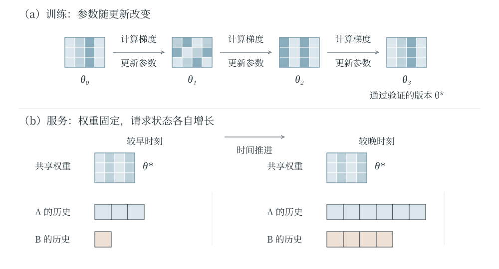

*图 1-1　权重的变化与复用。上半图中每次更新产生新版本，标在两次更新之间的箭头表示参数变化，不表示把所有版本同时保存在显存。下半图把时间上的两个时刻展开：服务权重保持不变，请求 A 和 B 的历史状态却分别增长。矩形面积不代表实际容量。*

这幅图里有一个容易忽略的区别。权重回答的是“模型学会了怎样变换输入”，请求状态回答的是“这一次计算已经进行到了哪里”。参数相同，不意味着两个请求的历史相同。

语言模型往往把先前输入经过部分计算得到的结果保存下来，以便生成下一个词时复用。我们把这类逐位置保存的历史称为 **KV 缓存**。它属于一次具体上下文，通常随上下文变长而增大，并在后续生成过程中被读取。第四章会结合注意力计算解释 K、V 的含义和缓存的复用条件。

于是，磁盘上的权重文件大小，只回答了“这一组参数保存下来有多大”。它没有计入训练中的梯度、优化器状态，也没有计入服务中每位用户的缓存。开头那个“能推理却不能训练”的现象，已经有了线索。

训练结束后，还不能把最后一次更新的权重直接视为合格产品。训练损失变低，可能只是更好地拟合了见过的样本。我们需要用未参与参数更新的验证数据，检查约定任务的效果，必要时还要确认原有能力没有明显退化。把这一检查通过的参数版本交给服务，训练和推理才在这里接上。

#### 1.2　一次推理请求的执行过程

##### 文本输入与词元

计算设备处理的不是屏幕上的汉字本身。程序首先把文字转换成一串编号，每个编号对应一个 **token，亦称词元**。一个 token 可以是一个字、一个词的一部分，也可能覆盖多个字符，取决于采用的分词器。因此，输入有多少字和模型要处理多少个 token，是两个不同的问题。

本文用 $n$ 表示输入 token 数，用 $m$ 表示实际返回的输出 token 数。除非明确说明，讨论输出速度时都按 token 计数，而不是按汉字计数。同一句文本换一种分词方式，token 数可能改变；不同模型的 token/s 不能不看这一差异就直接等同于用户的阅读速度。

一条请求进入服务后，程序需要把文字转换成编号，安排它何时执行，把输入放到设备可访问的位置。模型随后处理整段提示词，形成用于预测下一个 token 的输出，同时建立后续生成需要的历史状态。这一阶段通常称为 **prefill，预填充**。

语言模型输出的往往是一组候选 token 的分数。程序将这些分数转成概率，再根据规则选择一个 token；选择可以是取最大概率，也可以是按照概率采样。这个 token 返回给用户后，还要作为新的输入参与下一步计算，模型才能继续产生后续 token。这个逐步推进的阶段称为 **decode，逐步解码**。

这里“逐步”有实际的数据依赖：没有选定前一个 token，通常就还不知道下一次该输入什么。同一条自回归生成不能像处理一堆彼此独立的图片那样，任意把所有未来步骤同时开始。系统可以寻找更好的执行和验证方法，但必须解释它怎样满足或改写了这项依赖。

##### 请求延迟的组成

图 1-2 给出一条教学请求的记录。我们把客户端发出请求的时刻记为零；为了单独观察服务内部，先忽略请求上传时间，把它与服务接收时刻视为相同。

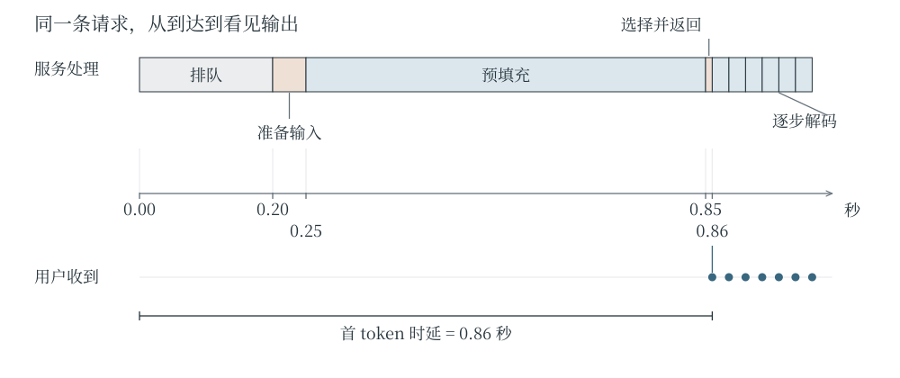

*图 1-2　同一条请求的不同时间。横轴为秒，纵向对齐表示同一时刻。请求前 0.20 秒在等执行机会，0.20–0.25 秒准备输入，0.25–0.85 秒执行预填充；选择并返回第一个 token 再花 0.01 秒。下方圆点是用户可见的返回事件，不能把它们误认为整个模型只在这些瞬间计算。*

从用户角度看，第一次看到输出是在 $0.86$ 秒。若只给预填充的设备运算计时，会得到 $0.60$ 秒。两个数字都可以正确，但它们回答的不是同一个问题。用户不能跳过前面的排队和准备，也不能在 token 还没有返回时看到它。

首个 token 返回以后，后续步骤继续计算，并不断扩大这条请求的历史状态。按图中的设定，相邻输出间隔是 $0.025$ 秒，即 $25$ 毫秒。如果请求一共输出 $256$ 个 token，首个 token 之后还有 $255$ 个间隔，最后一个 token 的到达时刻是

$$
T_{\mathrm{end}}=0.86+(256-1)\times0.025
=7.235\ \mathrm{s}.
$$

减去的这个 $1$ 很重要。预填充结束后的选择已经给出了第一个输出，并不是还需要再做 $256$ 次逐步解码才得到 $256$ 个输出。以后估计解码工作量和缓存长度时，我们还会遇到同样的边界。

现在把另一条请求放到同一台服务器上。它可能在当前请求计算时到达，但到达并不等于立刻开始。服务程序要决定：让它等当前请求完全结束，还是把两条请求组织到同一次设备执行中？如果新请求的提示词特别长，先处理它会不会推迟已有用户的下一个 token？这些都是调度问题。模型结构本身并没有替我们作出这些决定。

##### 应用、模型与硬件的分工

从这条时间线往下追，就能看见 AI Infra 各层的分工。

应用组织输入并决定何时返回结果。服务系统接收请求，管理队列、运行中的请求及其状态。模型程序规定需要执行的矩阵乘法、归一化等运算；框架和运行时将这些运算提交给设备。设备从存储中读取数据，执行计算，并写回结果，供后续运算使用。如果计算分布在多台机器上，还需要通过互联网络传输数据。

这些分工之间存在可以改变的接口。例如，相邻的两次运算可以由两个独立程序完成，中间结果写回显存；也可以组合成一个设备程序，让结果在靠近计算单元的位置直接使用。又例如，两位用户可以分别执行模型，也可以一起执行，让同一块刚读入的权重同时服务两组输入。选择变了，数学结果未必改变，数据移动的次数却可能大不相同。

训练作业也要经过这些层，其运行由训练循环推动。数据读取程序准备下一批样本；设备完成前向和反向；多设备之间可能交换梯度；优化器更新参数，然后开始下一步。样本没准备好、梯度没汇齐或更新还没完成，都会阻止后面的工作。要缩短训练时间，首先要找到下一步迟迟无法开始的原因。

因此，AI Infra 的工作范围不能只用“GPU 优化”或“部署框架”概括。它研究的是这些部件怎样配合完成任务。后文每进入一层，都会沿着具体数据和依赖走下去，而不是把层名当作已经解释过的原理。

#### 1.3　训练与推理的性能目标

训练和服务共用模型，却有不同的完成条件。训练需要得到一份通过验证的权重，中间快的一步只有在能够持续推进训练时才有价值。服务需要对每条请求作出响应，同一秒处理的总量和某个用户等待的时间也可能朝不同方向变化。下面先为这两项工作分别选定评价指标。

##### 训练：尽早得到一份达到要求的权重

训练团队最容易获得的数字，是一步用了多久，或者每秒处理了多少 token。这些指标有助于诊断问题，却不能直接说明训练任务能否在两天内完成。

设达到约定验证标准之前，总共处理了 $D$ 个有效训练 token，训练阶段平均每秒处理 $r$ 个，则这一部分耗时近似为

$$
T_{\mathrm{train}}=\frac{D}{r}.
$$

这里的“有效”排除了仅用于补齐形状、没有计入训练目标的填充位置。如果训练反复遍历同一批数据，$D$ 计算的是实际参加训练的 token 次数，不是磁盘上去重后的数据大小。

提高 $r$ 固然有帮助，但 $D$ 不一定保持不变。一次使用更多样本进行更新，可能让设备更有效率，也会改变参数更新的频率和优化过程。不能只根据每秒处理量，就认定达到同等质量的日期一定提前。

假设对同一个模型做两组训练试验，使用相同的验证任务和达标规则，获得表 1-1。方案 B 增大了每次更新使用的全局批量；表中的达标 token 数是假定由完整试验观察到的结果，不是根据批量大小推算出来的规律。

| 配置 | 训练阶段吞吐 | 达到相同验证标准的 token 数 | 训练阶段耗时 |
|---|---:|---:|---:|
| A | 10,000 token/s | 12 亿 | 120,000 s，即 33 小时 20 分 |
| B | 16,000 token/s | 24 亿 | 150,000 s，即 41 小时 40 分 |

*表 1-1　吞吐提高而达标更晚的一种可能情形。数字用于教学；增大批量不一定产生这种结果，是否发生要由质量曲线验证。*

方案 B 的吞吐高了 $60\%$，但达标所需处理量翻倍，最终训练阶段反而多用了 8 小时 20 分。图 1-3 的左图按处理过的数据量比较，右图按经过的时间比较。同一组质量曲线换了横轴，才回答了系统交付问题。

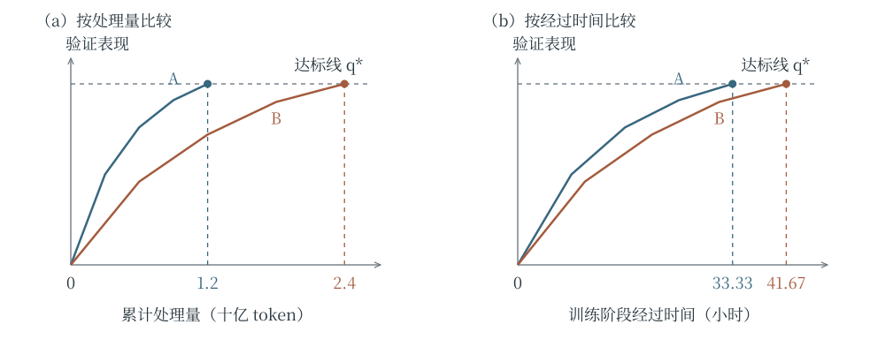

*图 1-3　把质量曲线换算到时间轴。左图的横轴是处理过的 token 数，右图除以各配置的吞吐，换算成小时；纵轴是同一个约定的验证指标。曲线形状为示意，达标点对应表 1-1。它说明需要同时测量质量进展和执行速度，不说明大批量必然更慢。*

真实的交付时间还包含排队获得训练资源、验证、保存检查点以及故障恢复。检查点是供以后恢复训练的状态快照；除了权重，通常还需要优化器状态及训练进度等信息。如果作业中断后只能从很早的快照继续，一段已经花过的钱和时间就要再花一次。

这里也不能简单把所有计时器相加。验证如果独占同一组设备，确实可能暂停训练；保存若部分与计算重叠，只应计算它真正推迟完成时刻的部分。最终应在一条从开始到达标的时间线上，计入那些延长交付的等待。

训练任务的优化目标由此明确了：在质量标准成立的前提下，缩短交付时间、减少所需资源。若某项改动使吞吐变好却改变了训练质量，就必须连同质量一起评价。

##### 服务：让到来的请求按时完成

服务没有一个所有用户共同等待的训练终点。请求会不断到来，评价时需要分别记录每条请求的到达和完成时刻。

对一条输出了 $m$ 个 token 的请求，记发出时刻为 $t_0$，各输出到达客户端的时刻为 $t_1,t_2,\ldots,t_m$。三个直观的量是：

$$
T_{\mathrm{first}}=t_1-t_0,
\qquad
\Delta_i=t_i-t_{i-1}\quad(i=2,\ldots,m),
\qquad
T_{\mathrm{all}}=t_m-t_0.
$$

它们分别是**首 token 时延**、每一步的**输出间隔**和完整请求时延。首 token 时延常写为 TTFT。输出间隔反映用户是否觉得回答卡顿；完整请求时延则关乎等待完整答案后才能开始的后续工作。

还可以把首 token 后的全部时间平均到其余输出上：

$$
\overline{\Delta}=\frac{t_m-t_1}{m-1},\qquad m>1.
$$

这个平均值常称为 TPOT，即平均每个后续输出 token 的耗时。不同工具对 ITL、TPOT 的命名和聚合方式并不完全一致，读报告时应检查定义；本文始终把单个间隔与它们的平均值分开。若只输出一个 token，这个平均值没有定义，不应填成零。

图 1-4 给出两个各返回十个 token 的短片段。两者首 token 都在 $0.60$ 秒到达，随后总共都花 $0.40$ 秒，平均输出间隔同为约 $44.4$ 毫秒。上面一条平稳输出；下面一条有八个 $25$ 毫秒间隔，中间却停顿了 $200$ 毫秒。

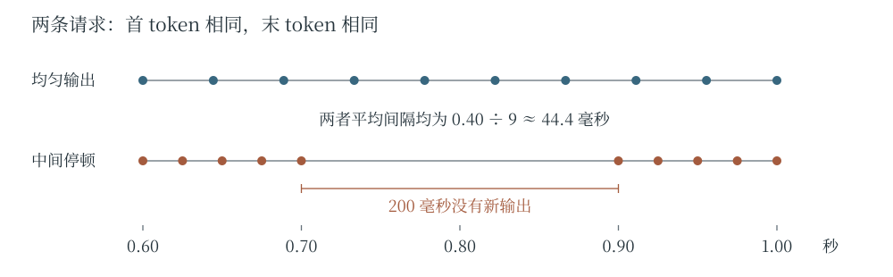

*图 1-4　平均值没有展示出来的停顿。圆点是十个可见输出事件，横向距离按实际时间绘制。下行八个短间隔共 200 毫秒，加上一个 200 毫秒长间隔，与上行的总时长相同。只保留首末时刻，会丢掉中间这次停顿。*

在真实接口中，一个返回的数据块还可能包含多个 token。若测量工具只能观察块到达时刻，就不能把同一块内所有 token 都解释成设备同时算出的结果；客户端缓冲和网络传输也会改变可见间隔。因此，“用户看见的时间”和“设备完成计算的时间”都值得测，但不能混用。有关首词、整体时延和吞吐的常见测量口径，可对照 [NVIDIA 的推理基准说明](https://developer.nvidia.com/blog/llm-benchmarking-fundamental-concepts/)。

服务吞吐则是对一段时间内所有请求计数：每秒完成多少条请求，或返回多少个输出 token。假如一台机器每秒返回 1,000 个 token，可能是二十位用户各得到 50 个，也可能是一百位各得到 10 个。总量相同，个体体验可能完全不同。

##### 负载与服务目标

现在为在线服务设定具体要求。假设目标负载平均每秒到来 $0.5$ 条请求，典型输入为 $4,096$ 个 token，典型输出为 $256$ 个。我们希望至少 $95\%$ 的请求能在一秒内返回首个 token，并对持续输出的停顿另设约束。这些约束称为服务等级目标，常缩写为 SLO。

“平均每秒 $0.5$ 条”还没有描述完整负载。每两秒均匀来一条，与每二十秒同时来十条，平均到达率相同，排队却不同。真实压测还要保留输入长度、输出长度、突发程度和请求之间的间隔。按要求本来该到来的请求，不能因为测试程序正在等上一条完成就悄悄推迟，否则系统产生的等待会被隐藏。

说“95% 的请求首词不超过一秒”，也不能只报平均首词时延。应把每条请求的首词时延从小到大排列，查看相应分位位置。失败和超时请求同样需要计入约定口径，不能删除后只统计成功者，再宣布系统满足目标。

对逐步输出的约束也要交代聚合方式。例如，“95% 的请求没有出现超过 200 毫秒的停顿”，与“汇总全部输出间隔，其中 95% 不超过 200 毫秒”不是同一要求。后一种口径会让长回答贡献更多样本。本章的容量推算不依赖某一种具体选择，但做方案比较前必须固定它。

因此，服务系统需要在明确的输入分布、质量和时延要求下，确定能够持续处理多少请求。只看 token/s 的峰值，可能忽略排队对用户等待时间的影响。

##### 用户延迟与优化空间

设用户从发出问题到拿到首词花了 200 ms。按一条不重叠的时间线量得，等队列 80 ms，准备输入 20 ms，设备计算 100 ms。若把设备计算加速四倍，新的首词时间是 $80+20+25=125$ ms，用户看到的加速为 1.6 倍。即使计算瞬间完成，上限也只有两倍。这是 Amdahl 定律在一条请求上的写法，先找出能改变的那段，再算它占整条路径多少。

不过，若许多请求排在同一设备前面，服务变快也可能让后来的请求少等。这时直接把每次排队固定为 80 ms 会低估收益。可以做两次对照，先让设备空闲、一次只送一条，确定省下的执行时间；随后按相同到达时刻重放一组请求，把队列长度一起量出来。前一次测量设备执行时间，后一次测量排队变化对用户的影响。在第二十五章做容量决策时，我们还会用到这两个口径。

#### 1.4　单卡推理与训练的资源预算

确定交付标准后，才能判断一套配置是否够用。我们先估计它能存下多少状态，再估计每一步至少要做多少计算和数据传输。这些数字可以帮助排除明显不可行的方案；具体速度仍要通过运行测量。

现在回到那份 60 亿参数的权重。先做一个最简单的实现：模型常驻一张卡，收到一条请求后完成它的全部输出，再处理下一条。缓存按完整历史保存，权重使用每个数值占 2 字节的格式；我们暂不引入压缩、跨卡切分或复杂调度。

这个基线不一定适合上线，但容易说明白，也容易查出错误。优化之前，先弄清它在哪里受到限制。

##### 模型权重与缓存占用

记参数量为 $N$，每个参数的存储字节数为 $b$，权重占用是

$$
M_{\mathrm{weights}}=Nb.
$$

本例 $N=6\times10^9$、$b=2$，因此权重占 $12\times10^9$ 字节，即 $12$ GB。但本章给定的显存用 GiB 表示，必须先统一单位：

$$
1\ \mathrm{GB}=10^9\ \mathrm{bytes},\qquad
1\ \mathrm{GiB}=2^{30}\ \mathrm{bytes},
$$

$$
M_{\mathrm{weights}}=\frac{12\times10^9}{2^{30}}
\approx11.18\ \mathrm{GiB}.
$$

不是名称相近的单位都能直接相减。通信链路还常使用 bit/s，8 bit 才组成 1 byte；后面涉及网络时，我们会继续明确这些换算。

加载权重后，24 GiB 中还剩约 12.82 GiB。它不能全给用户缓存：程序自身、运算所需的临时空间、其他中间数据及余量也占显存。为把第一次预算算得清楚，先给这些用途统一保留 4 GiB，并假定它在本例讨论的批量范围内足够。这只是待后续测量验证的预算假设，真实临时空间会随形状和实现变化。

于是，能分给所有请求历史的预算为

$$
M_{\mathrm{history}}=24-11.1759-4
\approx8.8241\ \mathrm{GiB}.
$$

再给模型一个明确的状态参数：**全模型每保存一个历史 token，需要 128 KiB**。这是本章设定的模型属性，不由“60 亿参数”自动推出。第四章会根据层数、头数和向量维度计算它。参数量接近的两个模型，历史状态完全可能不同。

一条输入长为 $4,096$ 的请求，仅输入部分的历史就占

$$
4,096\times128\ \mathrm{KiB}
=512\ \mathrm{MiB}=0.5\ \mathrm{GiB}.
$$

但回答还会继续增长。如果要为最多 $256$ 个输出 token 留足空间，按 $4,096+256=4,352$ 个位置作保守预留，每条请求占

$$
4,352\times128\ \mathrm{KiB}
=544\ \mathrm{MiB}=0.53125\ \mathrm{GiB}.
$$

在标准逐步生成中，刚返回的最后一个输出可能还没有再次送入模型，因此还未写入缓存；在仅生成这 256 个输出的边界，实际位置数可为 4,351。本例多留一个位置以简化容量预算，并明确这不是对实际写入时刻的描述。

用历史预算除以每条请求预留量，得到最多同时容纳

$$
C_{\mathrm{memory}}=
\left\lfloor\frac{8.8241}{0.53125}\right\rfloor
=16
$$

条这样的请求。向下取整是因为第十七条的状态不会只保存一个零头。

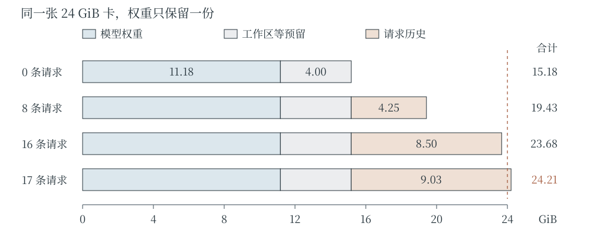

*图 1-5　同一份权重，加上不同数量的请求状态。各段长度按 GiB 比例绘制，虚线为 24 GiB 容量。16 条请求共需约 23.68 GiB，17 条需约 24.21 GiB。这里给出的是假定工作区足够时的容量限制，不是服务吞吐，也不是可直接上线的并发配置。*

图 1-5 的每一行只放一份权重。没有必要因为同时处理十六位用户，就在同一进程中复制十六份参数；但在没有可复用前缀的假设下，十六份请求历史确实要分别保留。

如果输入从 4,096 增到 8,192 个 token，输出上限不变，每条预留状态变为 $1.03125$ GiB，可容纳数量降为 8。模型权重一个字节都没有增加，系统的并发容量却几乎减半。这说明负载形状是容量预算的一部分，单看模型参数量不够。

另一方面，缓存放得下也不代表能及时回答。十六条请求可以一起占着显存等待，用户依然可能很不满意。容量和速度需要分别核算。

##### 训练所需的额外显存

假设继续训练时要更新全部 60 亿个参数，采用一种常见的混合精度 Adam 存储布局：低精度权重每参数 2 字节，梯度每参数 2 字节，高精度主权重每参数 4 字节，优化器还为每个参数保存两个各 4 字节的统计量。

保留高精度主权重，是为了让微小更新更可靠地累计；两个优化器统计量分别跟踪梯度的一阶和二阶信息，用来组织后续更新。此处不需要记住 Adam 的公式，但需要知道：它的更新规则本身会产生跨训练步保留的数据。

| 常驻状态 | 每参数字节数 | 60 亿参数对应容量 |
|---|---:|---:|
| 参与低精度计算的权重 | 2 | 12 GB |
| 梯度 | 2 | 12 GB |
| 高精度主权重 | 4 | 24 GB |
| 第一份优化器统计量 | 4 | 24 GB |
| 第二份优化器统计量 | 4 | 24 GB |
| 合计 | 16 | 96 GB，约 89.41 GiB |

*表 1-2　一种明确的训练状态布局。不同优化器、精度与实现可能采用不同存储方式，梯度转换还可能产生临时峰值；16 字节不是所有训练程序的固定常数。*

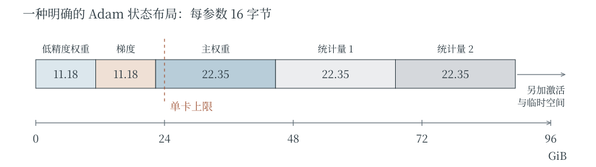

*图 1-6　训练状态和推理权重不能按同一个文件大小估计。横轴仍为 GiB，五段合计约 89.41 GiB，竖虚线标出一张卡的 24 GiB。右侧箭头表示还需要加入随输入与批量变化的激活和临时空间，没有给它们虚构一个固定数值。*

还没算前向中间结果，这些状态就已远超单卡容量。这里的限制不能靠“让计算再快一点”解决：需要同时存在的数据没有地方放。

增加到八张同样的卡，总显存达到 192 GiB，程序也不一定能运行。如果采用最直接的数据并行方式，每张卡仍需保存一整份 89.41 GiB 状态，单卡容量依然不足。要利用全部显存，需要明确状态如何分片、何时读取，以及更新后的数据保存在哪些设备上。后续章节将讨论这些分片方式及其通信开销。[DeepSpeed 的内存估算文档](https://deepspeed.readthedocs.io/en/stable/memory.html)也分别计算模型状态、分片及实现相关的峰值，实际套用时应采用所用配置的口径。

##### 生成时间的理论下界

存储容量回答“能否同时放下”，接着要问“运行时必须做多少工作”。

先看稠密层中的矩阵与向量相乘。若权重矩阵有 $a\times b$ 个元素，把一个长度为 $b$ 的向量变换成长度为 $a$ 的输出，需要计算 $a$ 个内积。每个内积做约 $b$ 次乘法和 $b$ 次加法，因此共约 $2ab$ 次浮点运算。我们按乘法一次、加法一次计数，一次乘加算两次 FLOPs。

将模型主要线性层的权重数量合计为近似的 $N$，处理一个新 token 的线性计算量约为 $2N$。这是一个用于第一轮估算的近似：它没有精确计入词嵌入查表、注意力中的位置交互及各种逐元素运算，也不声称所有参数在每一步都以完全相同的方式读取。对本例，先把主要矩阵权重近似为全部 60 亿个参数，得到每一步约 $12$ GFLOPs。

设教学设备对我们采用的数值格式和稠密计算，峰值算力为 $120$ TFLOP/s，显存数据接口的带宽上限为 $1$ TB/s。两者都是十进制单位，其中算力每秒可完成 $120\times10^{12}$ 次浮点运算，带宽每秒最多传输 $10^{12}$ 字节。

如果单看计算，理想耗时只有

$$
T_{\mathrm{compute}}=
\frac{12\times10^9}{120\times10^{12}}
=0.0001\ \mathrm{s}=0.1\ \mathrm{ms}.
$$

可是，这些乘法的操作数从哪里来？设权重远大于片上缓存，逐个请求执行时，一步需要从显存读取近似整份 $12$ GB 权重；暂且假定每份权重只读一次，没有额外重复读取，那么仅搬权重就至少需要

$$
T_{\mathrm{weights}}=
\frac{12\times10^9}{10^{12}}
=12\ \mathrm{ms}.
$$

计算单元即使有能力在 $0.1$ 毫秒完成那些乘加，也要等操作数抵达。把算力翻倍，只把前一个数降到 $0.05$ 毫秒，没有改变这 $12$ 毫秒的数据供给约束。

再考虑本例 4,096 个历史位置的 KV 缓存，它占 $512$ MiB，即 $536,870,912$ 字节。对采用完整历史注意力的这个基线，粗略按每步至少读取全部历史一次计，权重和历史合计读取时间约为

$$
T_{\mathrm{read}}=
\frac{12\times10^9+536,870,912}{10^{12}}
\approx12.537\ \mathrm{ms}.
$$

这是特定实现假设下的理想读带宽限制，还没有计入全部写回、临时张量、其他运算和启动开销。若缓存命中、表示方式或访问算法改变，就要重新计算读量；不能把它当成所有语言模型的物理常数。

通常应把两种限制先写成

$$
T\ \geq\ \max\left(\frac{F}{P},\frac{V}{B}\right),
$$

其中 $F$ 是操作次数，$P$ 是对应精度和运算类型下的计算能力，$V$ 是经过所考察接口的数据量，$B$ 是该接口带宽。把多种精度的运算一概除以某个最高峰值，或把片上读取误计成显存读取，都会破坏这个估计。

这里取最大值而不是直接相加，是因为计算和搬运可能重叠：一块数据正在计算，另一块已经开始读取。取最大值表达“无论重叠做得多好，也不能短于更慢的那一项”。它不保证两项能完全重叠，更不保证程序会达到该时间。若实际数据依赖迫使两段串行，时间还会增加。

##### 批处理中的权重复用

现在同时考虑八条独立请求，每条都处于历史长为 4,096 的解码阶段。最简单的方法是分别做八次模型计算。按刚才的读取假设，权重读八遍，历史各读一遍，总读量约为

$$
V_{\mathrm{separate}}=8\times(12+0.53687)
\approx100.295\ \mathrm{GB}.
$$

另一种方法是把八个输入向量并成一小块矩阵。读取一块权重后，先用它与八条请求对应的输入计算，再读取下一块权重。假如实现能做到这些权重在这一批中只从显存读取一次，则总读量成为

$$
V_{\mathrm{batch}}=12+8\times0.53687
\approx16.295\ \mathrm{GB}.
$$

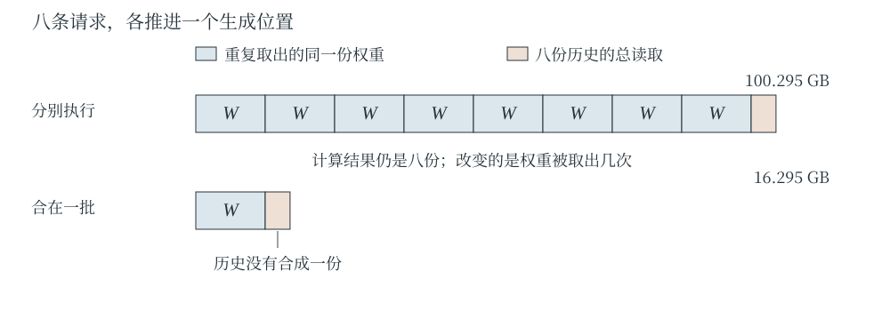

*图 1-7　批处理可以减少权重的重复读取。上方八段等长的蓝灰色块表示分别处理八个请求时的权重读取量，下方表示合批后读取一次。暖色段表示八份请求历史的总读取量。条长按 GB 比例绘制；图中仅比较这两类读取，其他流量和执行开销未列出。*

八条请求仍然各自计算了应有的结果，主要线性乘加总量仍约为 $8\times12=96$ GFLOPs；变化的是同一份数据的使用次数与从显存取出的次数之间的关系。这就是批处理能够提高效率的一个根本原因。

在假定带宽下，两种读量分别对应约 $100.295$ 毫秒和 $16.295$ 毫秒的理想传输时间。两数之比约为 $6.15$，是这部分读量减少的比例，不是我们已经测出的端到端加速比。实际矩阵布局、缓存、执行效率与其他开销还会改变结果。

同时，批中一次执行的理想读时间 $16.295$ 毫秒，比只算一条请求时的 $12.537$ 毫秒更长。系统在同一批中推进了更多请求，但不能据此断言每个用户的输出间隔都更短。如果为了凑齐八条而让第一条久等，首词时延还可能恶化。吞吐与个体时延的区别，在这个很小的算例中已经出现。

把视角换回预填充，也就容易理解两阶段为何不同。4,096 个提示位置让主要线性层有机会一次处理许多输入，其计算量粗估为 $4,096\times12$ GFLOPs，即 $49.152$ TFLOPs。即使线性计算达到上述峰值，仅这一部分也需要约 $0.4096$ 秒，此外还有注意力等工作。预填充可以在多个位置之间复用权重，因此不能机械地把单 token 解码耗时乘以 4,096 来预测它的耗时；也不能从一条解码请求受带宽限制，就推出所有预填充都一定受算力限制。需要重算计算量、数据量和依赖。

##### 并发请求与排队延迟

预算最后要回到“请求不断到来”。先假设基线的单请求记录是：预填充连同首 token 产生共 $0.60$ 秒，之后 $255$ 次解码各 $25$ 毫秒。为突出排队，这里暂时忽略第 1.2 节单列的输入准备、返回和网络时间。总服务时间为

$$
S=0.60+255\times0.025=6.975\ \mathrm{s}.
$$

这是算例另外给定的运行记录，量级上与先前估算的理论下限相容。

一条请求独占服务器时，$0.60$ 秒就看到首词，符合一秒目标。但我们的基线要把当前请求完整做完，才开始下一条。因此它每秒最多完成约

$$
\mu=\frac{1}{6.975}\approx0.143
$$

条这样的请求。目标到达率却是 $0.5$ 条每秒，超过它能持续处理的速度。

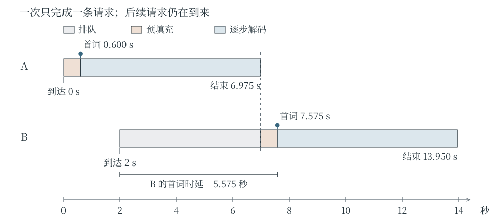

*图 1-8　单请求测得快，不能推出持续服务合格。横轴是同一台服务器上的时间。A 在 0 秒到达，6.975 秒结束；B 在 2 秒到达，等到 6.975 秒才能开始，7.575 秒才产生首词。B 的首词时延是 7.575−2=5.575 秒，其中 4.975 秒纯粹在排队。图中只画两条请求，后续请求没有消失，而是继续积在队列里。*

在图 1-8 中，第二条请求进入设备后的计算一点没有变慢。它失败在开始之前。若请求继续每两秒来一条，第 $j$ 条的开始时刻是 $(j-1)S$，到达时刻是 $2(j-1)$，等待时间便是

$$
W_j=(j-1)(S-2).
$$

因为 $S>2$，等待随请求序号持续增长。这个结论不需要复杂的排队论，就足以否决当前上线方案。

若把平均到达率写作 $\lambda$，对这种每次只处理一条、服务时间固定的简单系统，至少要满足 $\lambda S<1$，才留有稳定服务的余地。本例 $\lambda S=3.4875$，显然超过能力。即便满足这一条件，突发到达也可能造成很长的等待，所以它只是基本容量检查，不是尾时延保证。对能动态合批、服务时间随并发改变的系统，则应重新建立模型，不能拿单请求的 $S$ 原样套用。

基线明确了接下来要检验的问题。可以尝试合并多个请求，测量持续处理能力、首词时间和输出间隔。如果一台设备仍不足，再考虑增加服务副本并调整请求分配。

##### 平均在途请求数

假如换上可以合批的实现，日志中几条请求的完成时间已经互相穿插。只看每秒完成几条，怎样知道服务里同时大约有几条请求？先拿一段完整的小记录试算。A 在第 0 秒到达、第 3 秒结束，B 的起止时刻是 1 和 5，C 的是 4 和 6。观察从空系统开始，又在系统变空时结束。

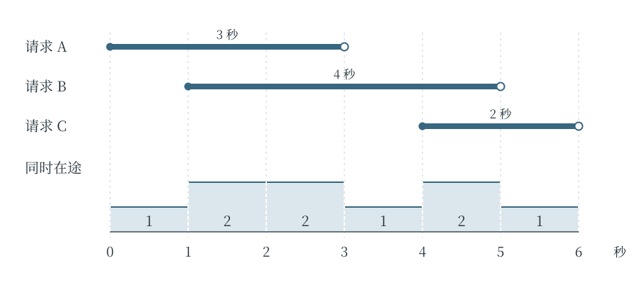

*图 1-9　两种数法给出同一块面积。沿上半图的每一行数，得到每条请求的停留时间。沿下半图每一列数，得到那一秒里同时在系统中的请求数。*

沿行相加是 $3+4+2=9$ 请求·秒，沿列相加是 $1+2+2+1+2+1=9$ 请求·秒。同一块面积除以 6 秒，得到时间平均在途数 1.5。也可以先用 9 除以三条请求，得到每条平均停留 3 秒，再乘上平均每秒进入的 $3/6=0.5$ 条，仍是 1.5。这就是排队论里 Little 定律的来由。实际系统通常截不出两端恰好都空的窗口。直接用短窗口内已完成请求的时延，可能会漏掉仍在等待的长请求。在系统长期稳定、统计的请求集合及进入和离开边界一致时，才适合用吞吐乘平均停留时间估算平均在途数。

这个等式可以帮助定位合批的收益。把边界设在用户到达和收到末词，等待调度也算在途。把边界缩到取得 KV 缓存和释放缓存，这次算出的平均数才描述占用缓存的请求。两次的差距很大，意味着相当多请求停在模型之外。要估显存峰值，还得回到每一时刻，按各请求当时已经写入的词元数求和。同样是两个在途请求，两段 128 词元的历史与两段 32,768 词元的历史给出的容量相差 256 倍。

##### 确定计时范围

我们已经使用了三个不同的“时间”：硬件给出的理想下限、设备完成一段工作的执行时间、用户从发出请求到收到输出的等待时间。实际实验应让它们能够相互对照。

设备执行往往是异步的。CPU 提交一项 GPU 工作之后可以先返回，GPU 还在队列中等待或执行。如果只在提交函数前后读取 CPU 时钟，可能只量到提交的时间。测量一段独立设备工作时，需要采用设备侧事件并等待其完成，或者在正确的边界同步；[PyTorch 的 CUDA 语义文档](https://docs.pytorch.org/docs/stable/notes/cuda.html#asynchronous-execution)明确说明了这个问题。

但这不意味着在真实服务的每一步都插入全局同步。过多同步会拆掉原来存在的并发，使被测程序本身变慢。检查设备工作量和记录用户时延，是两种相互补充的测量：前者帮助解释时间去了哪里，后者确认用户最终得到了什么。

同样，第一次运行可能需要加载权重、分配空间或编译程序。若要研究稳定运行，就应说明预热过程；若要研究扩容后的首批请求，这些开销又必须包含在内。不能一面排除冷启动，一面用所得数字承诺新实例立刻提供同等能力。

两个任务还有不少细节需要解决，但主要限制已经清楚。训练状态放不进单卡，增加设备时就要安排状态怎样分担。服务能够加载权重、单条请求首词时间合格，也仍需验证目标到达率下的表现。评价方案时，模型、负载、资源和指标都需要写明。

接下来的章节先介绍模型各层的计算和状态，再讨论设备如何执行这些计算、数据如何在存储层次和设备之间传输。了解单卡执行后，我们会研究分布式训练和推理服务，并通过完整任务评估各项优化的收益和代价。

#### 练习与解答

本章保留三道题。它们分别改变容量、速度和交付条件，检验的是判断能否跟着条件一起改变。

##### 1. 输入翻倍以后

沿用本章 24 GiB 显存、12 GB 权重、4 GiB 其他预留、每 token 128 KiB 历史状态。若输入变成 8,192 个 token，输出仍最多 256 个，按保守预留最多可容纳多少条？如果把输出上限再改成 2,048 个，结果如何？这些数字能否直接作为服务并发配置？

**解答。** 历史预算仍为约 $8.8241$ GiB。第一种情况每条占 $(8,192+256)\times128\ \mathrm{KiB}=1.03125$ GiB，向下取整得到 8 条。第二种情况每条占 $(8,192+2,048)\times128\ \mathrm{KiB}=1.25$ GiB，只能容纳 7 条。二者只是当前预留假设下的容量界限。要用于上线，还需验证工作区峰值、分配开销与安全余量，并测试该并发下的首词、输出间隔和持续处理能力。容量允许 8 条，不代表第八条能按时得到回答。

##### 2. 换一张算力翻倍的卡

对本章单请求的一步解码，只比较 12 GFLOPs 线性计算和 12 GB 权重读取。原卡是 120 TFLOP/s、1 TB/s。方案 A 只把算力翻倍；方案 B 只把显存带宽翻倍。各自的理想下限是多少？若原程序实际每步 25 毫秒，能否据此断言方案 B 会变成 12.5 毫秒？

**解答。** 原来的两项时间为 0.1 和 12 毫秒，下限取两者较大值，即 12 毫秒。A 把计算时间降为 0.05 毫秒，较大项仍是 12 毫秒。B 保持计算时间 0.1 毫秒，读取时间降为 6 毫秒，下限变为 6 毫秒。不能断言实测耗时减半：题目尚未计入 KV 读取、其他算子、调度和同步等工作，其中有的受带宽影响，有的不受影响。下限变化给出了试验方向，没有替代测量。

##### 3. 步速更快，什么时候值得？

表 1-1 中 B 采用更大的全局批量，吞吐为每秒 16,000 token。若先不计其他开销，它达到相同质量所需的 token 数必须小于多少，才会比 A 更早完成？如果 A、B 分别使用 4 张和 8 张相同的卡，仅比较原表中的训练阶段 GPU 时，哪个更省？

**解答。** A 的训练阶段耗时为 120,000 秒。因此 B 要更早，必须满足 $D_B/16,000<120,000$，即 $D_B<19.2$ 亿 token。等于 19.2 亿时两者同时完成，原表中的 24 亿则超出了这个界限。按原表耗时，A 消耗 $4\times(33+20/60)\approx133.33$ GPU·小时，B 消耗 $8\times(41+40/60)\approx333.33$ GPU·小时，A 更省。GPU·小时还不是完整货币成本，真实比较也需计入设备价格、网络、存储和其他资源；这道题已经足以说明“每秒更多 token”与“更早、更省地得到模型”不是同一判断。

#### 资料说明

本章的小模型梯度计算、容量预算、训练比较和请求时间线均为独立教学算例。为便于核查，算例条件集中保存在 [本章数据文件](../experiments/ch01/cases.json)，复算程序见 [本章复算脚本](../experiments/ch01/verify.py)。脚本只检验算术和教学假设之间是否一致，不声称在 GPU 上复现了上述运行时间。

正文中引用的官方资料分别用于核对测量口径、训练内存布局和异步计时。关于多请求共享权重、历史状态管理与推理吞吐的系统联系，还可参见 [PagedAttention 原始论文](https://arxiv.org/abs/2309.06180)；分页机制留到推理章节推导，本章的容量数字不依赖读者提前理解该论文。

<a name="ch02"></a>

### 第 2 章　数学表达怎样变成程序

第一章计算过模型的参数量、状态大小和执行时间。要理解这些估算，还需要回答一个问题：当我们写下“两个向量做内积”时，计算机究竟做了什么？

在纸上，向量已经在那里，加号和乘号给出了关系，写下等号就可以继续推导。机器则必须知道每个数保存在哪里，按什么顺序读它们，把哪两个数送去相乘，以及中间结果写到什么地方。读者熟悉的线性代数决定了应当得到的结果，但它没有唯一规定这些执行细节。

细节一旦不同，同一个数学表达就可能有不同的运行时间和存储需求。更微妙的是，有些看起来只是“少复制一份数据”的改写，还会悄悄改变结果。

本章用一个小算例说明公式怎样落实为计算步骤。令

$$
\begin{aligned}
A&=\begin{bmatrix}1&2&3\\4&5&6\end{bmatrix},\\[4pt]
x&=\begin{bmatrix}2\\-1\\1\end{bmatrix},\qquad
b=\begin{bmatrix}-4\\1\end{bmatrix}.
\end{aligned}
$$

先计算 $z=Ax$，再加上 $b$，最后把负数变成零：

$$
\begin{aligned}
z&=Ax=\begin{bmatrix}3\\9\end{bmatrix},\\[4pt]
u&=z+b=\begin{bmatrix}-1\\10\end{bmatrix},\\[4pt]
y&=\max(u,0)=\begin{bmatrix}0\\10\end{bmatrix}.
\end{aligned}
$$

这里的最大值运算逐元素进行。后面会把它叫作 ReLU 激活函数；现在把它当作“遇到负数就输出零，否则保留原值”即可。这段计算已经包含神经网络中常见的线性变换、偏置和非线性操作，不过我们暂时固定 $A$ 和 $b$，只研究怎样执行它。第三章将介绍这些参数如何通过训练得到。

本章的程序很短，即使从未写过代码，也可以对照表格逐步执行。读的时候留意两件事：公式中的对象对应内存里的哪些数值，公式中的依赖又对执行顺序提出什么要求。

#### 2.1　一个求和号怎样变成一段程序

##### 计算一个输出元素

$A$ 的第一行与 $x$ 做内积，结果是

$$
z_0=1\times2+2\times(-1)+3\times1=3.
$$

从本章开始，程序中的下标采用从零开始的约定：第一项编号为 0，第二项编号为 1。于是 $A_{0,2}$ 表示第一行第三列，值为 3。这只是编号习惯，并没有修改矩阵运算。

下面是一段可以直接运行的 Python 程序。Python 是一种用文本描述计算步骤的编程语言；此处只用到列表、变量和重复执行。

```python
a = [1, 2, 3]
x = [2, -1, 1]
s = 0
for j in range(3):
    s = s + a[j] * x[j]
```

方括号中的三个数组成一个有序序列。`a[0]` 取第一个数，`a[1]` 取第二个数。`range(3)` 依次给出 0、1、2；`for` 让缩进的那一行对这三个编号分别执行一次。`*` 表示乘法。

最值得停下来理解的是 `s = s + ...`。它不是要求解数学方程 $s=s+c$。程序中的等号在这里表示**赋值**：先用当前数值算出右边，再让左边的变量保存新结果。因此，`s` 在不同执行时刻可以代表不同的数。

若想用纯数学方式消除这个歧义，可以给每个时刻的累加结果加上编号：

$$
s_0=0,\qquad s_{j+1}=s_j+a_jx_j,
\quad j=0,1,2.
$$

程序只用了一个名字 `s`，其实依次表示这里的 $s_0,s_1,s_2,s_3$。图 2-1 把每一次更新展开了。

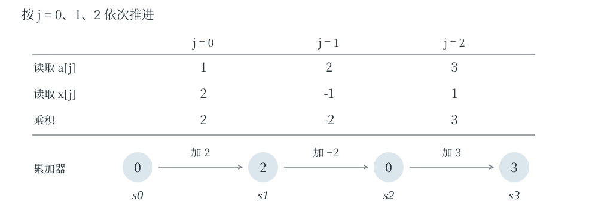

*图 2-1　从求和式到状态变化。每一列代表一次循环，先读该位置的两个数，再更新累加值。下行的四个数是同一个变量在不同时刻的值，不是程序必须同时保存四份累加器。*

现在把 `s = 0` 移到循环内部，会怎样？每次累加前都把先前结果清掉，最后只剩 $3\times1=3$。这个输入恰好掩盖了错误：前两项互相抵消，正确结果也等于 3。但若把 $x$ 的第二项从 $-1$ 改成 $0$，正确答案就应为 5，而错误程序仍返回 3。

这个小细节说明，只检查一个输入上的答案还不够。一段程序的正确性，是它在约定的输入范围内是否实现了数学定义。碰巧通过一个算例，不等于循环的状态更新写对了。

##### 从一行扩展到整个矩阵

矩阵乘向量只需对每一行重复同样的工作。下面把这段工作装进一个函数。

```python
def matvec(A, x):
    result = []
    for i in range(len(A)):
        s = 0
        for j in range(len(x)):
            s = s + A[i][j] * x[j]
        result.append(s)
    return result

A = [[1, 2, 3], [4, 5, 6]]
b = [-4, 1]
z = matvec(A, x)
```

`def` 定义一段可以调用的程序，括号中的 `A` 和 `x` 是它接收的输入。`len` 取得序列长度；`result` 从空序列开始，`append` 把一行的计算结果添到末尾；`return` 把最终结果交给调用者。最后一行调用函数，得到 `z = [3, 9]`。

缩进决定重复范围。每进入一行，先把累加器清零，再累加这一行的三个乘积。`append` 在内层循环外，因此每行只保存一个最终内积，而不是把每一步的部分和都当作输出。

这段代码默认输入尺寸相容。对一般的 $A\in\mathbb{R}^{m\times n}$ 和 $x\in\mathbb{R}^n$，输出长度为 $m$。若一行有三个元素，输入却只有两个，缺失第三项就无法计算原来定义的运算。正式接口应检查形状和其他约定。

函数提供的是复用程序的方法。调用两次 `matvec`，通常就执行两次计算，并不会因为函数名字相同而自动复用上次答案。库则把许多这类可调用实现组织起来；框架可以选择调用哪个库，也可以改变几次调用的组织方式。后面研究算子库和编译器时，我们会再次回到这些调用。

##### 计算需要多少次运算

长度为 $n$ 的内积需要 $n$ 次乘法，把它们相加至少需要 $n-1$ 次加法。上面的写法从零开始累加，额外包含一次与零相加；编译器可能消除这项工作。在数量级估算中，常把一个内积记作约 $2n$ 次浮点运算，把矩阵乘向量记作约 $2mn$ 次。

对本例，直接相加三个乘积，每行是三次乘法、两次加法；再加偏置，是一次加法。两行一共十二次这样的算术操作，此外还有两次与零比较。比较也需要执行，但不能因为它消耗时间，就在 FLOPs 统计里一律把它算成浮点乘加。

数清运算次数之后，还没有回答它们需要多久。程序还要取得输入和保存结果，而且并非所有运算可以同时开始。下一步先看输入究竟放在哪里。

#### 2.2　矩阵在内存中的表示

##### 内存地址与元素排列

可以先把内存理解为许多按地址编号的字节位置。程序需要保存一个数时，为它安排若干连续字节；读取时，用地址找到这些字节，并按照约定的数值格式解释它们。

一个字节包含八个比特，每个比特取 0 或 1。比特组合本身不会声明“我是整数”或“我是浮点数”；同一组比特按不同规则解释，可能得到不同含义。**数据类型**说明采用什么表示规则，也决定一个元素占多少字节。类型名 FP32 通常表示 32 位浮点格式，即每个元素占四字节。

本章把矩阵元素按四字节浮点数存放。数值都是小整数，能够在这种格式里精确表示；这不意味着它们只能用整数类型保存。第十一章会详细讨论不能精确表示的数值和舍入问题。

Python 的普通列表实际还包含对象引用等组织开销，不能直接当作紧密排列的 FP32 数组。上一节用列表是为了让循环容易阅读。下面研究的是数值库和 AI 框架中常见的、按明确元素类型组织的连续存储，两种表示不要混为一谈。

设 $A$ 的存储从示意地址 1000 开始，按第一行、第二行的顺序排列。六个元素占 $6\times4=24$ 字节：

$$
\underbrace{1,2,3}_{\text{第一行}},\quad
\underbrace{4,5,6}_{\text{第二行}}.
$$

图 2-2 将纸面上的矩阵与内存中的顺序对齐。这里的地址是用于推导的字节编号，不是某台机器上真实分配的地址，更没有指定物理内存芯片的位置。

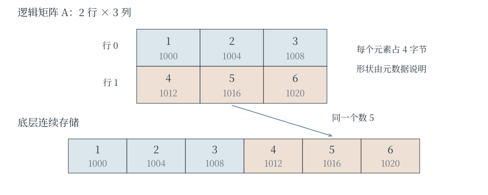

*图 2-2　逻辑位置与字节地址。上方每个格子标出元素及其起始地址，下方将同一组格子按存储顺序展开。一个数占四字节，例如元素 5 占用 1016—1019；图中只标起始地址。行的边界来自程序对形状的解释。*

为什么地址每次增加 4，而不是 1？因为横跨的是一个完整元素，不是一个字节。若同样六个数改用每个两字节的格式，元素起始地址之间的距离会改变；矩阵的形状却仍然是 $2\times3$。

##### 用步长把下标换成地址

对于这种按行连续存储的矩阵，从 $(i,j)$ 移到 $(i,j+1)$，跨过一个元素；从 $(i,j)$ 移到 $(i+1,j)$，跨过三个元素。这两个移动距离称为两个维度的**步长**，本章记为 $(3,1)$，单位为元素。

因此，元素 $A_{i,j}$ 的地址是

$$
\operatorname{addr}(A_{i,j})
=1000+4(3i+j).
$$

代入 $i=1,j=1$，得到 $1000+4(3+1)=1016$，正好指向值为 5 的元素。形状限制哪些下标合法：这里 $i$ 只能取 0、1，$j$ 只能取 0、1、2。越过这个范围，地址即使可以被算出来，也不是这个矩阵定义中的元素。

一般地，若一个 $d$ 维数组的下标为 $(i_0,\ldots,i_{d-1})$，按元素计的步长为 $(s_0,\ldots,s_{d-1})$，元素字节数为 $q$，在底层存储中的起始偏移为 $o$，则

$$
\operatorname{addr}(i_0,\ldots,i_{d-1})
=p+q\left(o+\sum_{k=0}^{d-1}i_ks_k\right).
$$

$p$ 是底层存储的起始字节地址。括号内先算出元素偏移，再乘 $q$ 转成字节，因而不会把字节和元素混加。对本例，$d=2$、$o=0$、$s=(3,1)$、$q=4$。

这看似只是一个地址公式，却会贯穿后面的 GPU 访存、转置、分块与算子布局。如果不清楚相邻线程实际读了哪些地址，就无法仅凭“它们在读一个矩阵”判断访问是否连续。

不同接口对 stride 的单位约定不同。例如 NumPy 的 `strides` 以字节计，上例会写成 $(12,4)$；PyTorch 常用的 stride 接口按元素计，写成 $(3,1)$。使用 API 前必须检查单位，不能看到两个数字不一样就认定布局不同。[NumPy 的步长定义](https://numpy.org/doc/stable/reference/generated/numpy.ndarray.strides.html)给出了相应的地址解释。

##### 张量的形状与步长

在 AI 程序里，多维数值数组通常称为**张量**。本书使用这个工程含义，不要求读者先掌握微分几何中的张量变换理论。

要把一片存储解释成可计算的张量，至少需要知道以下信息。

| 信息 | 本例中的值 | 它回答的问题 |
|---|---|---|
| 底层存储 | 六个数所在的存储区 | 数值实际放在哪里 |
| 形状 | $(2,3)$ | 有几个维度，每维多长 |
| 步长 | $(3,1)$ 个元素 | 每个下标增加 1，地址移动多少 |
| 起始偏移 | 0 个元素 | 第一个逻辑元素从底层存储哪里开始 |
| 数据类型 | 四字节浮点数 | 每个数怎样解释，占多少字节 |
| 设备 | 例如 CPU | 哪个设备能够按什么方式使用这份数据 |

这些用于解释数据的信息称为元数据。一个张量对象可以持有这些信息，而底层数值保存在另一片存储中。多个张量对象也可能描述同一片存储的不同部分。

设备这一项尤其不能省略。CPU 和 GPU 使用的地址即使数值相同，也不一定指向同一份可直接访问的数据；是否共享地址空间、是否允许远程访问、是否需要迁移，要看具体系统。因此，描述数据时需要同时注明存储位置和可以直接访问它的设备。第七章会进一步解释存储层次。

#### 2.3　张量视图与数据复制

现在矩阵有了明确的存储位置。接下来考虑一个常见操作：把同一组数改按另一种行列顺序使用。若每次都复制数据，程序会多花时间和空间；若只修改访问方式，又必须弄清新旧对象是否仍指向同一份数据。

##### 视图与底层存储

把 $A$ 转置，数学上得到

$$
T=A^\mathsf{T}
=\begin{bmatrix}1&4\\2&5\\3&6\end{bmatrix}.
$$

我们可以真的创建一片新存储，依次写入 $1,4,2,5,3,6$。不过，地址公式还提供了另一种方法：保留原来的六个数不动，只把形状改成 $(3,2)$、步长改成 $(1,3)$。

此时

$$
\operatorname{addr}(T_{i,j})=1000+4(i+3j).
$$

例如 $T_{0,1}$ 的地址是 1012，读取原来的数 4；$T_{1,0}$ 的地址是 1004，读取原来的数 2。逻辑上已经得到了转置矩阵，底层排列仍然是 $1,2,3,4,5,6$。

这种共享底层数值、主要改变解释方式的张量称为**视图**。图 2-3 的左边是转置视图，右边则是把原数组重新解释为三行两列。

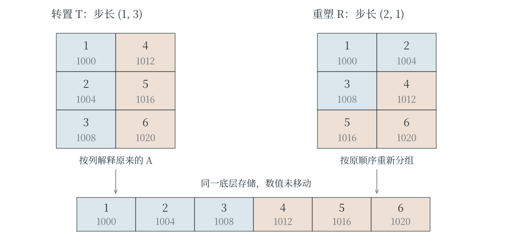

*图 2-3　转置与重新分组不是同一件事。两边都可共享原始连续存储，但步长不同：转置是 $(1,3)$，按原顺序重排形状是 $(2,1)$。格子下方的地址说明每个逻辑位置究竟指向哪个数。相同的输出形状 $(3,2)$，不能决定元素的对应关系。*

右侧的操作通常称为 reshape，即重塑形状。它保持这里约定的按行遍历元素的顺序，再按新形状分组：

$$
R=\begin{bmatrix}1&2\\3&4\\5&6\end{bmatrix}.
$$

因此，`transpose` 和 `reshape` 不能仅凭结果形状相同就互换。一个交换维度的意义，另一个改变同一顺序下的分组方式。

而且 reshape 也不保证总能只修改元数据。如果现在想把转置后的 $T$ 按其逻辑行顺序展平成一个长度为 6 的向量，所需顺序是 $1,4,2,5,3,6$。这些数在原存储中的起始地址依次为

$$
1000,\ 1012,\ 1004,\ 1016,\ 1008,\ 1020.
$$

相邻地址差交替变化，不能用这个简单一维步长模型中的一个固定 stride 表达。若要求返回普通的连续一维数组，就需要重新排列并复制。实际框架中，有的接口会在必要时复制，有的只允许满足条件的视图而在不满足时报告错误。[PyTorch 的张量视图说明](https://docs.pytorch.org/docs/stable/tensor_view.html)明确区分了共享存储、连续性与可能发生复制的操作。

##### 切片与连续存储

从 $A$ 中取最后两列，得到

$$
S=\begin{bmatrix}2&3\\5&6\end{bmatrix}.
$$

只需把起始偏移改成 1，形状改成 $(2,2)$，步长仍保留 $(3,1)$，就能构造这个切片视图。其地址为

$$
\operatorname{addr}(S_{i,j})=1000+4(1+3i+j).
$$

第一行的两个数在 1004、1008，第二行在 1016、1020。中间的地址 1012 存着原数组的数 4，它并不属于切片。纸面上 $S$ 是一个整齐的 $2\times2$ 方阵，按行读它时，内存中的两行却隔着一个不需要的元素。

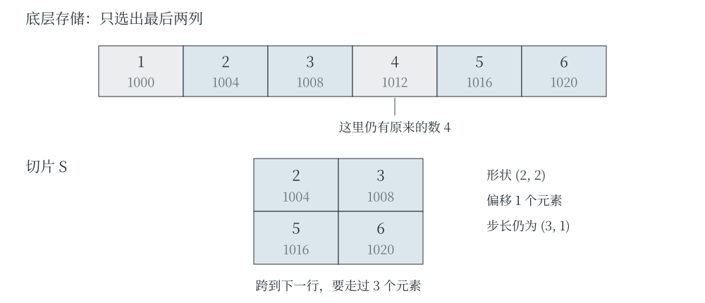

*图 2-4　切片保留原来的行步长。选中的四个元素以色块表示，其他位置仍属于原存储。若把它复制成一个新的连续 $2\times2$ 数组，行步长才会变成 2；创建视图本身没有做这次复制。*

这就是**连续性**要解决的问题：相邻逻辑元素是否按所要求的遍历顺序紧密排列。连续性与具体维度顺序有关。有的算子可以直接接受一般步长，有的实现只适合一种紧凑布局，框架也可能先做布局转换，再调用后者。

于是，一次转置视图本身几乎不搬数据，并不代表它后面的计算也没有成本。后继算子可能因此采用不利的访问顺序，也可能额外生成一份连续副本。观察程序速度时，应沿着后续使用追踪，而不只给视图创建那一行计时。

以 $4096\times4096$ 的四字节矩阵为例，数值存储为 64 MiB。创建一个转置视图可以不复制这 64 MiB；若确实要把转置顺序写进新的连续存储，理想情况下也至少要读 64 MiB、写 64 MiB。必要传输量是 128 MiB，而不是 64 MiB。算法公式没有新增矩阵乘法，这次布局变换却已经产生了实在的工作。

##### 广播与数据复用

现在让同一个矩阵同时处理三组输入。把输入列向量并成一个矩阵 $X\in\mathbb{R}^{3\times3}$，得到 $Z=AX\in\mathbb{R}^{2\times3}$。每一列都需要加上原来同一个偏置 $b=(-4,1)^\mathsf{T}$。

在纸上可以写出

$$
B=\begin{bmatrix}-4&-4&-4\\1&1&1\end{bmatrix},
\qquad U=Z+B.
$$

但是没有必要为了三个输入复制三份偏置。只需让逻辑上同一行的三个位置都读取同一个存储元素。若偏置存储从 3000 开始，广播视图形状为 $(2,3)$、步长为 $(1,0)$，则

$$
\operatorname{addr}(B_{i,j})=3000+4(i+0j).
$$

无论 $j$ 为多少，第一行读的都是 3000，第二行读的都是 3004。第二维步长为零，就是这里“扩展了形状但没有复制数值”的具体实现方法。

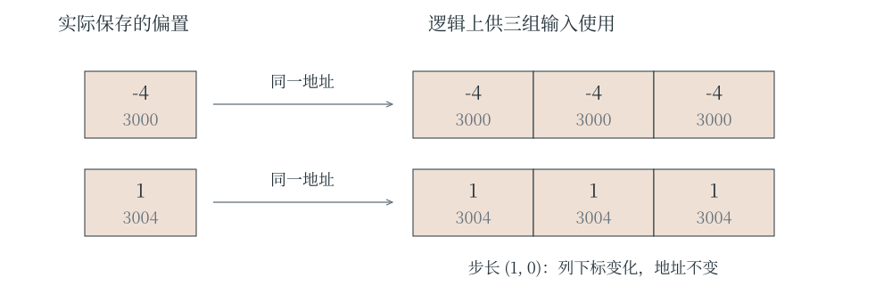

*图 2-5　广播中的共享。右边六个位置并不是六份独立存储，连到同一个左侧格子的逻辑位置具有相同地址。不同框架可以用不同内部方式实现广播，图中给出的是便于理解的一种步长表示。*

广播也受形状约束。对本例，偏置应解释为 $(2,1)$，再沿第二维扩展到 $(2,3)$。若接口采用尾维对齐规则，直接传入形状为 $(2,)$ 的向量时，长度 2 会与最后一维的长度 3 对齐，因而无法匹配。要得到预期结果，需要明确指定偏置所在的维度。[NumPy 的广播规则](https://numpy.org/doc/stable/user/basics.broadcasting.html)采用从尾维对齐、各维相等或其中一方为 1 的条件。

广播省掉的是偏置的重复存储，并没有让输出 $U$ 的六个结果自动只占两个位置。如果后续要求保留全部输出，仍要安排对应空间。而且共享的广播位置不能被当作彼此独立的可写单元：若给第一行三个位置分别写不同的数，它们会争用同一个底层元素。许多框架会限制这类写入，或者要求先生成独立副本。

##### 重叠视图的读写限制

长度为 4 的向量 $(2,3,5,7)$ 可以提供三个长度为 2 的窗口。把窗口编号记为 $i$，窗口内位置记为 $j$，读地址就是 $i+j$。从这个二维视图看到的是三行 $(2,3),(3,5),(5,7)$。六个逻辑格只占四个物理位置，两条轴的步长都是 1。若只求每个窗口的和，可以依次得到 5、8、12，完全不必先复制六项。

现在要求各窗口第二格加 10，第一格清零。视图的第 $(0,1)$ 格要求把原来的 3 改成 13，第 $(1,0)$ 格却要求把同一个位置改成 0。即使只有一个线程，写入顺序也会影响结果。需要六个彼此独立的输出时，就另分配六格；若本意是给每个原位置累加所有窗口的贡献，就显式规定求和。第二十三章把图像窗口展开成矩阵时，还会遇到这一层区别。

#### 2.4　计算依赖与内存复用

视图使多个对象可能共享存储。于是，仅知道某个计算在数学上已经有了结果，还不足以决定能否覆盖它：其他计算可能仍要读取旧值。先确定读取与写入之间的依赖，再讨论并行，才能在加速时保住原有结果。

##### 把数学依赖展开

回到单个输入，计算 $y=\max(Ax+b,0)$。假设输入已经就绪，第一行的三个乘积 $2,-2,3$ 互不依赖，可以分别计算；但加法必须等它的输入乘积产生。加偏置要等内积，取最大值又要等加偏置的结果。

第二行有同样的依赖结构，但它不需要先取得第一行的输出。因此，两行之间存在并行机会。

把操作画成节点，把“后者需要前者的结果”画成有向边，就得到**计算图**。它描述的是值的依赖，不是说每个节点必须变成一次独立函数调用，也不规定每条边都要搬运一整份数据。图 2-6 为了便于逐步检查，展开了第一行的每次运算。

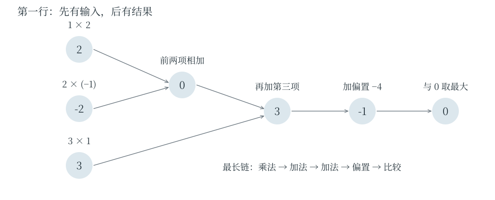

*图 2-6　一次输出中的依赖。乘法节点产生 2、−2、3，两次求和得到内积 3，加偏置 −4 后为 −1，最后输出 0。路径长度按节点数计算，最深的一条经过五个动作。第二行的结构相同，最后输出 10。箭头表示必须先获得哪个数，不表示固定的物理传输线路。*

任何执行顺序都必须满足图中的依赖。依赖已经满足的两个节点，原则上可以交换先后；一个节点不能因为设备空闲，就在输入还不存在时使用它。

从这个角度看，源程序的书写顺序只是众多合法顺序中的一种。有时编译器能够重新安排执行，让可独立进行的工作同时发生；但它必须知道中间对象是否互相影响。稍后会看到，共享存储会增加仅凭公式看不出的约束。

##### 工作量与最长依赖链

为了看清并行限制，先采用一个极简时间模型：每次乘法、加法或比较都花一个时间单位，输入读取免费，没有提交和同步开销。这不是任何 CPU 或 GPU 的实测性能模型，只用于观察依赖。

每行有三次乘法、两次求和、一次加偏置和一次比较，共七个动作；两行共十四个动作。一位执行者逐个做，花十四个单位。两位执行者分别负责一行，可以用图 2-7 的安排在七个单位内完成。

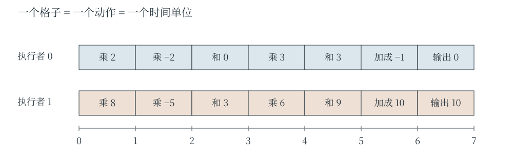

*图 2-7　两个执行者的一种合法安排。每格代表一个动作，单位时长相同；格内直接标注产生的数值。部分乘法稍后才执行，并不破坏依赖。两条轨迹同时结束于第七个单位，不能把图中的单位当作微秒。*

把可用执行者数量记为 $p$，总工作量记为 $W$，最长依赖链的时间记为 $L$，在这个理想模型中，完成时间至少满足

$$
T\geq\max\left(\frac{W}{p},L\right).
$$

第一项来自总工作量：$p$ 位执行者每个单位最多做 $p$ 个动作。第二项来自依赖：一条链上的动作不能通过增加执行者全部同时完成。

本例 $W=14$、$L=5$。两位执行者时，$T\geq\max(7,5)=7$，图中的安排恰好达到这个下界。即使有十四位执行者，也不能在一个单位内完成；链上仍有五个阶段要依次通过。若只增加算力，不改变这条依赖，额外执行者就可能空闲。

这个下界也不是任意任务都能达到的排程。任务分布、资源种类和数据到达会进一步限制执行。第六章研究硬件时，要把“图上允许并行”和“设备上能够并行”区分开来。

##### 浮点求和顺序

在实数代数中，加法满足结合律，$(a+b)+c=a+(b+c)$。这使求和可以组织为链，也可以组织成树。然而，机器保存的浮点数是有限精度的，每一步都可能舍入。代数上相等的两种安排，不保证逐位相同。

例如，在采用就近舍入、平局取偶数的 32 位二进制浮点运算中，令

$$
\begin{aligned}
a&=33,554,432,\\
b&=-33,554,432,\\
c&=1.
\end{aligned}
$$

先算 $a+b$，两者抵消为零，再加 1，得到 1。若先算 $b+c$，精确结果 $-33,554,431$ 不能在这种格式中精确保存。这一位置的两个相邻可表示值是 $-33,554,432$ 和 $-33,554,430$，间距为 2，精确结果恰好落在中点。所谓“平局取偶数”，比较的是保留精度下的末位有效二进制位，并非这两个十进制整数的奇偶：前者的末位为 0，后者为 1，因此选择前者。随后与 $a$ 相加，得到 0。

这并不意味着并行归约不能用，而是要求我们明确正确性标准：要求逐位一致，还是在指定误差范围内保持结果和模型质量？最初的 $2\times3$ 矩阵算例中，中间整数都足够小，可以精确表示；这里新增的大整数反例已经不再满足这一条件。后面的大规模归约必须考虑舍入差异，第十一章会把浮点表示、累加精度和误差界完整展开。

##### 内存何时可以复用

计算图还告诉我们何时可以不再保存某个结果。对于单链 $z\rightarrow u\rightarrow y$，如果 $z$ 除了生成 $u$ 没有别的用途，$u$ 已经算完后，原来的 $z$ 就不再需要。于是，某些实现可以把 $u$ 写回 $z$ 原来的位置，接着把 $y$ 写在同一片空间。

但现在给程序增加一个输出：还要报告原始线性结果的平方和

$$
E=z_0^2+z_1^2=3^2+9^2=90.
$$

$z$ 多了一位使用者。若生成 $u$ 后就覆盖它，而 $E$ 这一分支还没有读完原始 $z$，保存的就不再是后者需要的数了。

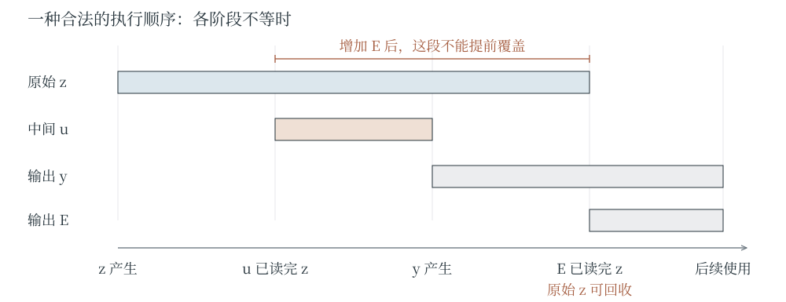

*图 2-8　存储生命周期由所有使用者共同决定。时间线按事件先后排列，不表示各阶段等时。只有两条分支都完成对原始 z 的读取后，原始值才不再需要；若某个读操作仍在异步执行，发出了调用也不能当作已经读完。*

这里的关键是**最后一次使用**，而不是“源代码已经写到下一行”。引用、别名、异步任务或反向传播都可能延长一个值的生命周期。内存规划需要确认所有依赖原值的操作已完成，才能重用其空间。

##### 别名与原地操作

一种常见错误是以为给对象换个名字，就复制了它。下面使用上一节的 Python 列表来复现。代码中的 `u = z` 让两个变量引用同一个列表，并没有复制两个元素。

```python
z = matvec(A, x)
u = z
u[0] = max(u[0] + b[0], 0)
u[1] = max(u[1] + b[1], 0)
bad_energy = z[0] ** 2 + z[1] ** 2
```

`** 2` 表示平方。程序本来想用 `u` 保存最终输出，用 `z` 保留原始线性结果。实际写入后，二者都看到了 `[0, 10]`，`bad_energy` 变成 100，而不是 90。

这种“两个访问入口指向同一片存储”的关系叫作**别名**。转置和切片视图也会产生别名：如果通过 $T$ 改写 $T_{0,1}$，原矩阵的 $A_{1,0}$ 也随之改变，因为地址相同。

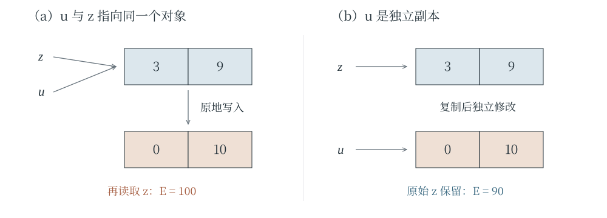

*图 2-9　别名与独立副本。左边两个名称连到同一份数值，写入后原始结果消失；右边多分配一份存储，让输出和原始线性结果分别存在。箭头表示引用关系，两个名称不代表两份内存。*

最直观的修正是创建一个独立副本：

```python
z = matvec(A, x)
u = z.copy()
u[0] = max(u[0] + b[0], 0)
u[1] = max(u[1] + b[1], 0)
good_energy = z[0] ** 2 + z[1] ** 2
```

此时 `u` 为 `[0, 10]`，`z` 仍为 `[3, 9]`，`good_energy` 为 90。这里列表元素都是不可变的数值，浅复制足以让两份列表的元素槽位独立；如果复制的是嵌套容器，就不能假定所有内部对象也被深复制。对张量应使用所选框架中保证生成独立副本的接口。

还有另一种合法修正：先用原始 $z$ 算完 $E$，再原地改写 $z$。这减少一份副本，却改变了允许的执行顺序。两种方案都能正确完成任务，各自有不同的空间与并行机会。**少分配一点内存，有时要用减少并行来交换。**

第三章会看到，训练中的反向传播也需要使用前向产生的一些值。如果在反向开始前偷偷把它们改掉，算出的可能不是原函数的梯度。很多框架会记录修改或直接阻止某些操作；理解原因比记住某条报错更有用。

#### 2.5　程序的并发与异步执行

前面画出的依赖说明哪些操作可以同时进行，机器还需要实际安排执行。程序、进程和线程是描述这件事的不同对象。先分清它们各自保存什么、共享什么，后面讨论 CPU 提交工作和 GPU 异步执行才不会混淆。

##### 程序、进程与线程

保存下来的程序文本，描述的是一套操作规则。启动它之后，系统还要为这次运行准备输入、内存、打开的文件等资源。这个有独立运行上下文的实例，通常称为**进程**。同一份程序可以启动多个进程，处理不同输入。

进程中的**线程**表示一条正在推进的执行序列：当前执行到哪里，接下来读哪个值、做哪个操作。一个进程可以有多条线程，它们通常共享进程里的许多内存对象，各自保留执行位置和局部状态。线程不等于物理 CPU 核心；操作系统会把可运行线程安排到可用执行资源上，线程也可能被暂停后再继续。

例如，可以让一个线程读取下一批输入，另一个线程处理已经准备好的数据。但二者共享缓冲区时，必须明确哪个缓冲区已经填好、哪个仍在使用。创建第二条线程本身不会解决同步问题。

并发和并行也应区分。两件工作交替推进，即使某一时刻只有一个执行资源，也可以是并发；只有它们实际同时执行，才存在这段时间上的并行。第一章讨论的许多同时在途请求，不意味着每个请求都正在占用一个独立计算单元。

GPU 中也使用“线程”一词，但它的组织和调度方式与 CPU 操作系统线程不同。现在不需要把两者强行一一对应。先记住：应用程序提供工作，运行系统和设备决定具体如何安排；第六章会打开 GPU 的执行结构。

##### 异步调用与设备同步

有些函数在工作完成后才返回结果；另一些函数提交工作后便立即返回一个标记，供调用者跟踪完成情况。后一种方式称为**异步执行**。

设 CPU 向设备提交本章的矩阵计算。提交花了 0.1 毫秒，设备到 0.4 毫秒才有机会开始，计算结束于 1.4 毫秒，结果复制到 CPU 可读的位置又花 0.2 毫秒。图 2-10 在同一时间轴上标出这些时刻。

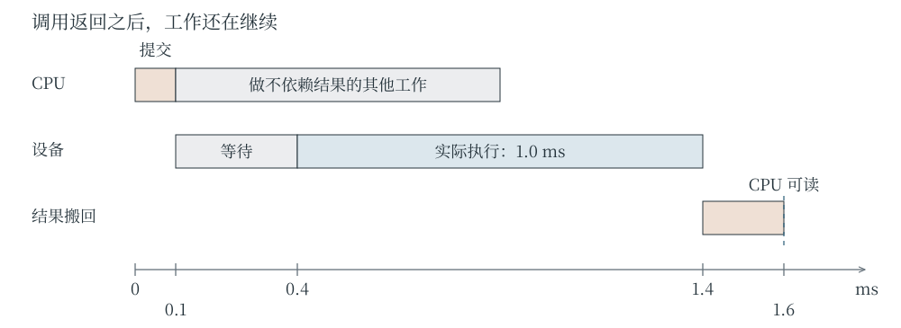

*图 2-10　提交、执行与结果可用。单位为毫秒，数据为教学设定。CPU 提交后可以做不依赖该结果的其他工作；GPU 执行和结果搬回分别占据后续阶段。图中专门选择了需要复制回 CPU 的情形，不代表所有任务都必须搬回结果。*

若只在提交函数前后计时，会得到 0.1 毫秒；若研究设备计算，会得到 1.0 毫秒；若问 CPU 从发起到能读取结果要等多久，则是 1.6 毫秒。数字不同，首先要检查测量边界，而不是立刻判断哪一个测错了。

一个抽象接口可以写成下面的顺序。它只说明语义，不对应某个现成库的 API：

```text
标记 = 提交计算(A, x, b)
完成与此结果无关的其他工作
等待这个标记所代表的结果可用
读取结果
```

“等待”要等待到什么程度，必须由接口约定。有的事件只表示设备内运算结束；如果之后还有复制，CPU 侧读取还需要等待那次复制完成。某些高层框架会在读取时自动同步，因此用户未必需要手写等待，但不能据此假定底层所有调用都同步。[PyTorch 的 CUDA 语义文档](https://docs.pytorch.org/docs/stable/notes/cuda.html#asynchronous-execution)解释了异步执行与计时之间的关系。

需要输入的一方不应早于输入可用时刻开始。与此同时，过早等待也会浪费可并行时间：CPU 原本可以在设备计算期间准备下一份数据，如果提交后立即阻塞，就可能失去这段重叠。正确的同步既不能漏，也不应无条件加在所有位置。

##### 并发更新与数据竞争

第 2.4 节已经说明三个乘积可以独立计算。于是，我们可能尝试让不同执行者算乘积后，都执行“把自己的乘积加到共享的 `s`”。看起来每个人只加一个数，最终应该一样。

问题在于，普通的 `s = s + p` 可以拆成读旧值、做加法、写新值三个动作。如果两个执行者都先读到了旧值零，再分别写回自己的结果，后写入者就可能覆盖前者的更新。

图 2-11 规定了一种明确的读写交错。第一位要加 2，第二位要加 −2；它们都先读到 0。第一位写回 2，第二位随后写回 −2，第一项更新丢失。最后再加第三个乘积 3，得到 1，而正确内积是 3。

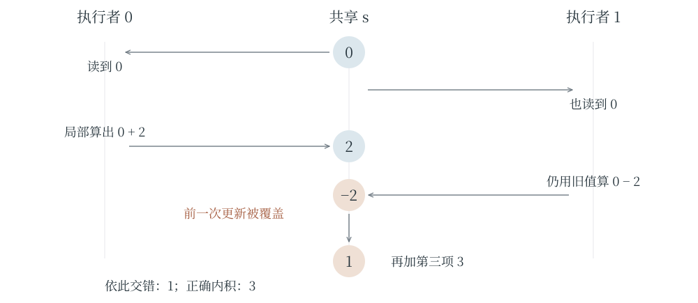

*图 2-11　一次被明确规定的交错执行。中列是共享存储的值，左右两列是各执行者已经读入的局部值。后者不会因为共享存储变化而自动更新。真实语言和设备对无同步冲突访问还有各自规则，不能把图中的 1 当作所有错误程序必然产生的结果。*

这类结果取决于并发访问次序的问题，属于数据竞争需要处理的范畴。解决方法之一，是先让每个执行者写自己的独立结果，再按明确次序归约。另一种是用接口提供的原子更新，使一次读—改—写在其他参与者看来不可被冲突更新插入；或者使用锁，把相关访问组织为受保护的区域。

这些方法仍有代价。独立结果需要临时存储与后续归约；共享原子更新可能形成竞争。原子加法还能防止更新丢失，但对浮点数而言，如果多个加数的顺序仍不固定，并不自动保证每次逐位一致。

因此，并行化的判断至少要问两件事：操作的输入是否都已准备好，以及不同操作是否会读写互相重叠的存储。只看数学公式里有多少个乘号，还不足以决定安全的执行方式。

#### 2.6　算子融合与中间结果

现在回到最初只需要输出 $y$ 的任务，不再额外计算 $E$。我们已经知道怎样逐项算对，也知道什么时候可以覆盖旧值。可以问一个具体的优化问题：是否有必要把 $z$ 和 $u$ 都完整写成两个独立数组？

##### 是否保存完整中间结果

最直接的组织方式是先执行矩阵乘向量，产生并保存 $z$；再逐元素加偏置，产生并保存 $u$；最后逐元素取最大值，保存 $y$。这样的接口清楚，容易单独检查每一步，但多了中间数组的写入和重读。

另一种组织方式，是算完一行内积后，马上给这一个结果加偏置、取最大值，再写出最终输出：

```python
def fused_layer(A, x, b):
    result = []
    for i in range(len(A)):
        s = 0
        for j in range(len(x)):
            s = s + A[i][j] * x[j]
        value = max(s + b[i], 0)
        result.append(value)
    return result

fused_output = fused_layer(A, x, b)
```

这段程序仍然需要累加器 `s`，仍然做了乘法、求和、偏置和比较。它省掉的是完整的中间数组，而不是使中间数值从计算中消失。在底层设备实现中，希望尽可能把这种短暂使用的值保留在寄存器等靠近计算的位置；Python 示例表达的是组织方式，本身不是高性能 GPU 程序。

把相邻操作组合起来执行，常称为**融合**。融合是否能做，要看下一项操作需要哪些输入，以及是否有其他使用者需要保留原始中间结果。第 2.4 节添加的 $E$ 就会改变这一判断。

即使需要 $E$，也不代表必然要写出整个 $z$。例如，每行内积算出后，可以先把它的平方加到 $E$ 的累加器，再产生该行最终输出。这样又得到一种合法组织，但 $E$ 的跨行归约和并行安排需要重新处理。选择实现方式时，需要考虑这些数据依赖及其并行开销。

##### 中间数组的读写开销

为了只比较中间数组的影响，我们指定同一条被观察的存储接口，并作以下理想化假设：$A$ 的六个元素只读一次，$x$ 的三个元素读入后能被两行共用，$b$ 读一次，每个元素四字节；被单独保存的中间数组要经过该接口写出，并由下一阶段读回。不计元数据和缓存行等额外开销。

在分开执行的方案中：

| 阶段 | 经过该接口的数据 | 字节数 |
|---|---|---:|
| $z=Ax$ | 读 $A$ 的 6 个元素，读 $x$ 的 3 个元素，写 $z$ 的 2 个元素 | 44 |
| $u=z+b$ | 读 $z$ 的 2 个元素，读 $b$ 的 2 个元素，写 $u$ 的 2 个元素 | 24 |
| $y=\max(u,0)$ | 读 $u$ 的 2 个元素，写 $y$ 的 2 个元素 | 16 |
| 总计 | | 84 |

融合后，经过接口的只有输入和最终输出：

$$
V_{\mathrm{fused}}=(6+3+2+2)\times4=52\ \mathrm{bytes}.
$$

省下的 $84-52=32$ 字节，正好是 $z$ 和 $u$ 各自的一次写出与重读。两个中间数组，每个两个元素，每个元素四字节，分别经过写出和读回两次传输：

$$
2\times2\times4\times2=32\ \mathrm{bytes}.
$$

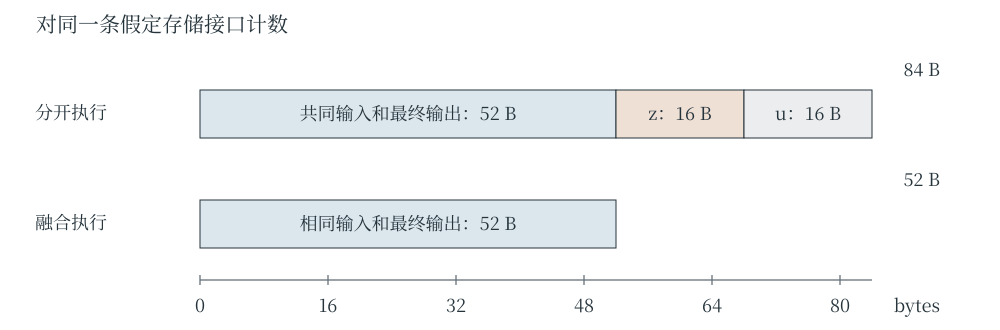

*图 2-12　省下的流量恰好对应被取消的中间存储。横轴按字节比例绘制，所有段都相对于同一条假定接口计数。真实小数组可能留在缓存中，因此这张图不是在宣称实际 HBM 流量一定为 84 或 52 字节，更不是实测加速比。*

对六个元素的小例子，实际运行时间往往被函数调用、解释执行等开销主导，不能期待测出与字节比例一致的提速。它的价值是让每一个被节省的字节都能找到出处。以后把这套推导扩展到很大的激活矩阵，并明确是哪一级存储接口，才可能得到有用的性能解释。

融合也可能让一个设备程序同时需要更多寄存器，减少可并行驻留的工作，或者失去一个更合适的专用实现。最终是否更快，需要结合第六、七章的执行与存储约束。现在已经足以确认：**计算量相同，不意味着数据流量和执行时间相同；数学结果正确，也不意味着所有重排都安全。**

##### 布局转换的收益与成本

设下一层需要沿归约维连续读取权重，而现有的转置视图使相邻两个归约项在内存中相隔一整行。一种实现按照步长读取，另一种先将数据复制成所需布局，后续计算读取新副本。两者的数学运算相同。选择时需要考虑，在权重下次更新之前，这份副本能够复用多少次。

用一组假设的设备计时来算。复制与重排一次用 0.80 ms，按原步长投影每次用 0.32 ms，准备好连续权重后每次投影用 0.20 ms。用 $r$ 次，两个方案分别花 $0.32r$ 和 $0.80+0.20r$ 毫秒。每次投影节省 0.12 ms，前六次共节省 0.72 ms，仍小于最初重排花费的 0.80 ms。到第七次，直接读取共需 2.24 ms，先重排再计算共需 2.20 ms，总时间才开始减少。若训练更新了源权重，就需要重新生成副本，并重新计算这次重排之后还能复用多少次。

在自己的机器上做这个对照时，先验证两种投影的输出，再分别测量准备阶段和连续调用阶段。计时结束前应确保工作已经完成，并记录是否预热以及额外副本的大小。若底层矩阵库已经能把这个转置当作参数处理，重排后的每次投影甚至可能没有变快。这一结果本身就解释了为何只看数组名称或“连续”标志还不足以决定是否复制。

##### 从线性层到神经网络

本章始终计算同一层，却需要同时观察三个不同对象。

首先是数学定义，即输入 $A,x,b$ 应当产生什么结果。其次是数据表示，包括数值的存储位置，以及形状、步长和别名。最后是执行安排，需要确定操作之间的依赖、执行位置，以及何时可以改写或释放状态。

把其中一个对象误当成另一个，错误就会出现。形状正确不保证元素顺序正确；创建了新名称不保证分配了新存储；函数已经返回不保证设备工作结束；图上没有数值依赖，也不保证两个写操作没有存储冲突。

而把三者连接起来，第一章的资源预算就有了程序层面的依据。权重和请求状态为什么需要单独计数，中间数组为何可以减少，某段操作为什么必须等待，都可以沿着明确的数据和依赖找到原因。

下一章继续使用小网络，但允许参数变化。除了算出输出，程序还要知道每个参数怎样影响损失。我们将从熟悉的微分开始，解释梯度怎样沿计算图返回，以及为什么训练需要保留某些在推理中已经可以释放的值。

#### 练习与解答

##### 1. 同一形状，是否就是同一批元素？

对本章的 $A$，令 $S$ 为最后两列的切片视图。写出它的形状、起始偏移和步长，计算 $S_{1,0}$ 的地址。若通过 $S$ 把这个元素改成 50，原矩阵变成什么？如果先把 $S$ 复制到独立存储，再修改副本，原矩阵是否变化？

**解答。** $S$ 的形状为 $(2,2)$，起始偏移为 1 个元素，步长为 $(3,1)$ 个元素。地址是 $1000+4(1+1\times3+0)=1016$，对应 $A_{1,1}=5$。通过视图改写后，原矩阵第二行变为 $(4,50,6)$，第一行不变。如果使用真正独立的副本，写入发生在新存储中，原矩阵保持不变。关键是地址是否共享，不是两个变量的名称是否不同。

##### 2. 转置只改元数据，为什么还会耗时间？

一个 $4096\times4096$ 的 FP32 矩阵，已有按行连续存储。后继接口明确要求转置结果也是按行连续的独立存储。至少要经过多少字节的读写？如果唯一限制是该接口总带宽 1 TB/s，理想传输时间下限是多少？为什么不能用“转置视图没有复制”回答它没有代价？

**解答。** 数组包含 $4096^2$ 个元素，大小为 $4096^2\times4=67,108,864$ 字节，即 64 MiB。读源数据、写目标数据，各一次，总计 $134,217,728$ 字节，即 128 MiB。在明确给定的同一接口总带宽下，下限为 $134,217,728/10^{12}$ 秒，约 $0.1342$ 毫秒。这个下限没有包含额外寻址、非理想访问与启动等开销。创建视图可以只修改描述方式，但题目要求新的紧凑存储顺序，必须完成数据重排。若硬件读写有独立通道，则需按那个体系重新建模，不能直接沿用本题的总带宽假设。

##### 3. 增加执行者，能否再快一倍？

在本章每个动作一个单位的理想模型里，两行一共十四个动作，最长依赖链为五个单位。两位执行者已经用七个单位完成。若增加到四位，能否在 3.5 个单位完成？如果单独输出平方和 $E=90$，能否在 $E$ 尚未读取原始 $z$ 时原地生成 $y$？

**解答。** 四位执行者的下限为 $\max(14/4,5)=5$，因此不可能在 3.5 个单位完成。这个下限确实能够达到：第一个单位计算两行各自的前两个乘积，共四次乘法；第二个单位计算每行的第三个乘积，并把每行已经得到的前两个乘积相加，共四个动作；第三个单位得到两个内积 $z_0,z_1$；第四个单位分别加偏置；第五个单位分别与零比较，得到两个输出。每一步都没有超过四位执行者，也没有提前使用尚未得到的结果。后面三个单位各有两位执行者空闲，原因正是等待依赖链向前推进。

新增 $E$ 后，不能在它尚未使用原始 $z$ 时覆盖这些元素。可以保留副本，或改变顺序先计算 $E$，或重新组织融合，让每个原始元素在被覆盖前完成全部必要用途。每一种都要重新检查依赖与资源。

##### 4. 能否用原子加法解决全部并行问题？

图 2-11 中共享累加器出现更新丢失。若改成正确的原子加法，是否必然消除这个问题？是否也必然保证浮点结果与固定顺序的串行程序逐位相同？

**解答。** 在参与者均遵守接口规定、使用兼容的原子操作且初始化与最终读取正确同步的前提下，原子加法能够避免图中的读—改—写更新丢失。但不同参与者的加法仍可能以不同顺序发生，有限精度加法又不满足精确结合律，所以它不自动保证与某个固定串行顺序逐位一致。若需要这种可重复性，必须控制归约顺序或采用符合目标的数值方法，并检查相应代价。读者应同时区分并发访问正确性和数值误差标准。

#### 算例与资料说明

本章的矩阵、地址、任务图、访问交错与传输预算为独立教学设计。时间线中的毫秒和单位时长都不是硬件实测。原始条件在 [本章数据文件](../experiments/ch02/cases.json) 中；[复算程序](../experiments/ch02/verify.py) 仅依赖 Python 标准库，核对矩阵结果、地址、任务顺序、别名、副本、浮点结合次序以及正文中的五段 Python 示例。

正文引用官方文档，是为了核对不同接口的步长、视图、广播和异步语义。概念不依赖某一版本的函数名称；真正编程时，仍应使用所选框架对独立存储、同步与可写性的明确约定。

<a name="ch03"></a>

### 第 3 章　神经网络怎样学会一项任务

第二章把数学表达写成了程序。给定矩阵、输入和偏置，程序便能读取数值、执行乘加并产生输出。不过，例子中的矩阵由我们预先指定。在需要学习的任务中，这些参数通常要从数据中求得。

设我们收集了一些样本。每条样本有两项数值特征，以及一个已经确认的类别：属于目标类别，记为 1；不属于，记为 0。特征可以来自测量或预处理；本章只研究它们已经变成两个数之后的计算。我们希望程序看到没有遇到过的新样本时，也能作出有依据的预测。

“学会”不能只解释成把训练样本的答案保存下来。我们要选择一类可调整的函数，用已知样本确定其中的参数，再检查这套参数对新样本是否仍然有用。函数能表达什么、样本提供了什么信息、参数怎样被调整，是三个相互关联的问题。

本章用一个只有九个参数的小网络，完整计算一次训练：从输入得到预测，计算损失，将梯度传回参数，再观察更新后的预测。接下来以同一个网络为例，讨论批训练、参数共享、深层网络和优化器，也解释训练为什么需要保存更多中间结果。

#### 3.1　从线性模型到神经网络

##### 参数描述函数，样本约束参数

最简单的学习模型，可以从熟悉的直线拟合开始：

$$
\hat y=wx+b.
$$

输入是 $x$，预测是 $\hat y$，可以调整的是斜率 $w$ 和截距 $b$。给定多个观测点，我们可以用最小二乘法选择参数，使预测与观测之间的平方误差尽量小。这里已经有学习的基本结构：并非改变“乘法怎么计算”，而是改变函数中的数值。

输入扩展为向量后，$w^\mathsf{T}x+b$ 描述一个仿射函数。日常讨论中常把这类层简称为线性层，但有偏置时，严格说是仿射变换。它只能表达一种固定的线性组合。

把这样的层多接几层，会自动变得更有表达能力吗？如果层之间没有非线性，那么

$$
\begin{aligned}
&W_2(W_1x+b_1)+b_2\\
&\quad=(W_2W_1)x+(W_2b_1+b_2).
\end{aligned}
$$

右边仍是一个仿射函数。中间层增加了参数和计算步骤，却没有让最后的函数超出这个函数族。想描述随输入区域而改变的关系，需要在层之间加入非线性。

第二章已经使用过 ReLU：

$$
\operatorname{ReLU}(a)=\max(a,0).
$$

它在正半轴保留输入，在负半轴输出零。这个折点使不同输入区域可以采用不同的有效线性关系。若一个单元计算 $\max(w^\mathsf{T}x+b,0)$，那么 $w^\mathsf{T}x+b=0$ 就是它切换状态的边界。参数变化，也会改变这条边界的位置和方向。

##### 本章始终使用的九个参数

我们的输入是一个两维列向量。先计算两个隐藏单元，再把它们组合成一个标量分数：

$$
\begin{aligned}
a&=Wx+b,\\
h&=\operatorname{ReLU}(a),\\
z&=v^\mathsf{T}h+c.
\end{aligned}
$$

$W$ 为 $2\times2$ 矩阵，$b$ 和 $v$ 各有两个元素，$c$ 是一个数，总共有 $4+2+2+1=9$ 个可调整参数。将它们合起来记为 $\theta$。$a$ 是激活前的值，$h$ 是激活后的值，$z$ 是最后的分数。所谓隐藏层，是说样本没有直接给出 $h$ 应当取什么值；这些中间表示要通过最终任务的要求学习出来。

为了手算清楚，我们从以下参数开始：

$$
\begin{aligned}
W&=\begin{bmatrix}1&0\\0&1\end{bmatrix},
&b&=\begin{bmatrix}0\\0\end{bmatrix},\\[4pt]
v&=\begin{bmatrix}1\\-1\end{bmatrix},
&c&=1.
\end{aligned}
$$

这组初值用于教学，不是实际训练时推荐的初始化方案。采用它时，分数函数为

$$
z=\max(x_0,0)-\max(x_1,0)+1.
$$

若暂以 $z=0$ 为分类边界，那么边界满足 $x_1=1+\max(x_0,0)$：左侧是一段水平线，右侧是一段斜线。图 3-1 给出了这个具体函数的弯折，而不只是一个“神经元连线图”。

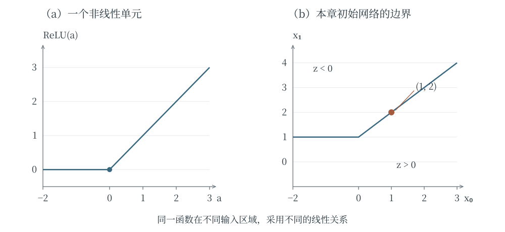

*图 3-1　非线性带来的具体变化。右图的横纵坐标分别是输入 $x_0,x_1$，分界线由本章初始参数直接算出。标出的样本 $(1,2)$ 恰好落在边界上。弯折说明网络能采用不同区域的线性关系，不代表初始边界已经符合数据。*

增加隐藏单元，能够产生更多划分；叠加多个带非线性的层，能够组合这些划分。但“能表达”并不等于“能从有限数据中学出来”，更不等于“对没见过的输入都正确”。参数规模、训练数据和优化方法缺一不可。

#### 3.2　前向计算与损失函数

##### 先完整算出预测

取一条训练样本

$$
x=\begin{bmatrix}1\\2\end{bmatrix},\qquad y=1.
$$

本章用 $y$ 表示已知标签，用 $p$ 表示模型预测的正类概率。下标继续从零开始，因此第一项是 $x_0=1$，第二项是 $x_1=2$。

代入初始参数：

$$
\begin{aligned}
a&=Wx+b=\begin{bmatrix}1\\2\end{bmatrix},\\[4pt]
h&=\operatorname{ReLU}(a)=\begin{bmatrix}1\\2\end{bmatrix},\\[4pt]
z&=1\times1+(-1)\times2+1=0.
\end{aligned}
$$

$z$ 可以取任意实数，不能直接当作概率。我们通过 sigmoid 函数把它映射到 0 与 1 之间：

$$
p=\sigma(z)=\frac{1}{1+e^{-z}}.
$$

当 $z=0$ 时，$p=1/2$；$z$ 越大，$p$ 越接近 1；$z$ 越小，$p$ 越接近 0。反过来，$z=\ln[p/(1-p)]$，因此 $z$ 也叫 logit，可以理解为正类与负类概率之比的对数。这个数学关系解释了分数与概率之间的对应。

此时模型给正类和负类各分配一半概率，而样本标签是正类。我们需要一个数，衡量这种预测与已知标签的吻合程度。

##### 为什么损失里出现了对数

对标签 $y\in\{0,1\}$，模型赋予实际观测标签的概率是

$$
P_\theta(y\mid x)=p^y(1-p)^{1-y}.
$$

若 $y=1$，这个式子就是 $p$；若 $y=0$，就是 $1-p$。它把两个分支写进同一个表达式。

希望模型为观测到的标签分配更高概率，可以转化为最小化负对数概率：

$$
\ell(p,y)=-y\ln p-(1-y)\ln(1-p).
$$

这就是二分类交叉熵。所有对数均使用自然对数。对本条正类样本，损失简化为 $-\ln p$，因此

$$
\ell=-\ln(1/2)=\ln2\approx0.693147.
$$

为什么选择对数？在给定输入与参数、将样本标签的条件似然相乘的建模方式下，多条样本的联合似然是多个概率的乘积。取对数后，乘积变成各条样本对数似然之和，便于计算、求导和按批累加。最大化似然与最小化负对数似然给出同一优化目标。

它还有直观含义。真实标签为 1 时，预测 $p=0.9$ 的损失约为 0.105，$p=0.5$ 的损失约为 0.693，$p=0.1$ 的损失约为 2.303。非常确信地预测错了，会受到更大的惩罚。准确率则只看离散类别是否正确，不能细致反映这些概率差别。

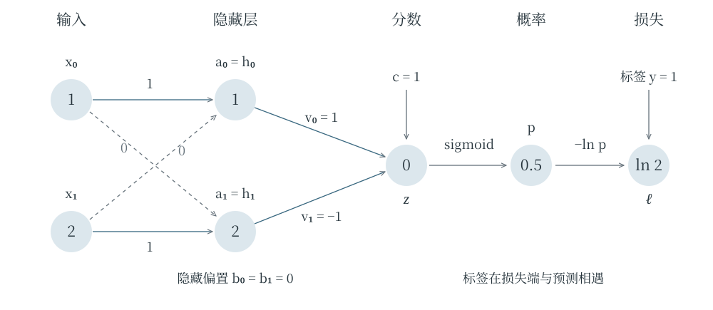

*图 3-2　一条样本的完整前向计算。连线上的数是权重，节点内是本次计算产生的值；零权重用浅色虚线表示。偏置分别是两个隐藏单元的零和输出端的 1。标签只进入损失计算，不作为网络预测时的输入。*

概率也不能被误读成“模型知道自己有百分之多少把握”。它首先是模型定义的输出；这种数值与真实发生频率是否匹配，还需要用独立数据检查校准情况。损失给出了训练信号，不替我们完成全部质量评价。

##### 损失计算的数值稳定性

如果先算 $p$，再算 $\ln p$，极端分数可能造成数值问题。例如很大的正数会让有限精度中的 $p$ 舍入为 1，此时再计算 $\ln(1-p)$ 就会遇到零的对数。

把 sigmoid 代入损失，可以直接用分数表示：

$$
\ell(z,y)=\ln(1+e^z)-yz.
$$

但直接算 $e^z$ 仍可能溢出。把较大的指数项提出后，得到更适合实现的形式：

$$
\ell(z,y)=\max(z,0)-yz
+\ln(1+e^{-|z|}).
$$

现在指数的输入不大于零，不会因为 $z$ 很大而计算一个巨大的指数。程序还可以用 `log1p(t)` 计算 $\ln(1+t)$，减少 $t$ 很小时直接相加带来的精度损失。这里改变的是计算组织，数学目标保持相同。实际框架中的 [BCEWithLogitsLoss](https://docs.pytorch.org/docs/stable/generated/torch.nn.BCEWithLogitsLoss.html) 就把分数到损失的计算合在一起，以改善数值稳定性。

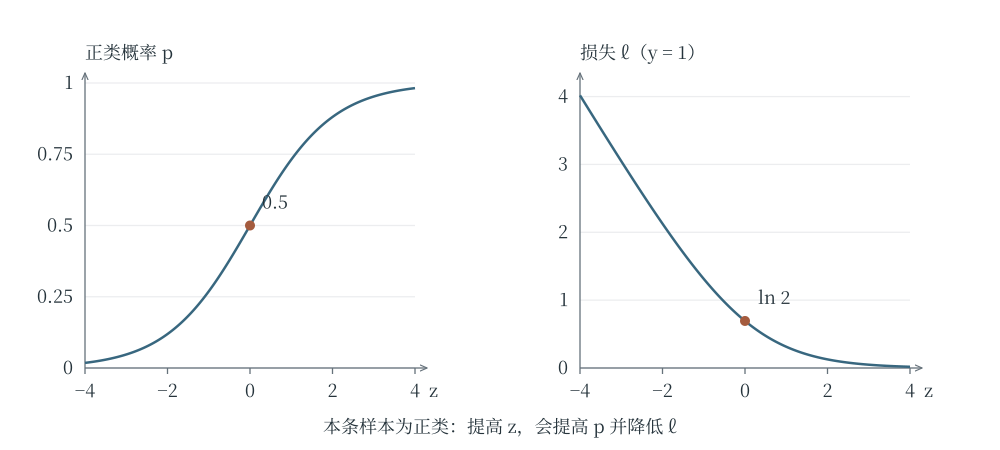

*图 3-3　同一个分数的两种观察方式。横轴均为 $z$，右图固定标签 $y=1$。提高分数会提高正类概率、降低这条样本的损失；若标签换成 0，损失随分数变化的方向也会改变。*

若任务有 $K$ 个互斥类别，网络可以输出 $K$ 个分数，用 softmax 形成概率：

$$
p_k=\frac{e^{z_k}}{\sum_j e^{z_j}},\qquad
\ell=-\ln p_y.
$$

这里的 $y$ 变为正确类别的编号。令 $m=\max_jz_j$，同时从每个分数中减去 $m$，概率不变，却能够避免对最大分数计算过大的指数。下一章预测词元时会使用这一结构。当前二分类算例已经足以看清损失怎样把任务要求变成一个可求导的量。

#### 3.3　反向传播与参数更新

现在有了一个衡量预测的标量，但我们需要调整九个参数。逐个猜测参数该增大还是减小没有利用网络内部的结构。链式法则提供了一种办法：先看损失随分数如何变化，再逐层计算分数随中间值和参数如何变化。

##### 梯度的含义

损失为 0.693，并不会直接告诉我们九个参数应该改成多少。真正需要的是局部变化率。例如，$\partial\ell/\partial W_{0,1}$ 表示其他独立参数固定时，$W_{0,1}$ 增加一个很小的量，会使损失产生怎样的一阶变化。

这个导数是负数，说明向增大的方向稍微移动会降低损失；是正数，说明应当考虑反方向。梯度大小不等于参数的重要性，也不能说明沿这个方向任意增大步长都能降低损失。导数描述的是当前参数附近的局部关系。

先从离损失最近的量开始。对概率求导：

$$
\frac{\partial\ell}{\partial p}
=-\frac{y}{p}+\frac{1-y}{1-p}.
$$

sigmoid 的导数为

$$
\frac{\partial p}{\partial z}=p(1-p).
$$

沿链式法则相乘并整理：

$$
\frac{\partial\ell}{\partial z}
=\left(-\frac{y}{p}+\frac{1-y}{1-p}\right)p(1-p)
=p-y.
$$

这是一个值得亲自化简的结果。正类样本当前只有一半概率，因此

$$
\delta\equiv\frac{\partial\ell}{\partial z}
=0.5-1=-0.5.
$$

也可以分两步核对：损失对概率的导数为 $-2$，概率对分数的导数为 $1/4$，两者相乘得到 $-1/2$。这个负号说明，提高当前分数有助于降低损失。

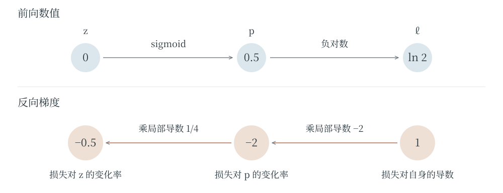

*图 3-4　反向传播首先是一遍链式法则。正向传的是当前数值，反向传的是最终损失对相应数值的变化率。图中 $\bar q$ 表示 $\partial\ell/\partial q$；下方的乘法不是把前向数值倒着运算。*

对 softmax 与多分类交叉熵，同样可以得到 $\partial\ell/\partial z_k=p_k-\mathbf{1}_{k=y}$。它与二分类的 $p-y$ 有相同的结构：把当前概率与目标分配之间的差异，传给产生分数的网络。这里 $\mathbf{1}_{k=y}$ 在正确类别处为 1，其他位置为 0。

##### 先经过输出层，再经过隐藏层

为避免重复书写很长的偏导数，后面记 $\bar q=\partial\ell/\partial q$。对于向量，$\bar q$ 收集损失对它各分量的偏导；它的形状与 $q$ 相同。

输出分数为 $z=v_0h_0+v_1h_1+c$。只改变 $v_i$，分数的变化率是 $h_i$；只改变 $h_i$，变化率是 $v_i$。因此

$$
\bar v=\delta h,\qquad
\bar c=\delta,\qquad
\bar h=\delta v.
$$

代入本例：

$$
\begin{aligned}
\bar v&=\begin{bmatrix}-0.5\\-1\end{bmatrix},\qquad \bar c=-0.5,\\[4pt]
\bar h&=\begin{bmatrix}-0.5\\0.5\end{bmatrix}.
\end{aligned}
$$

两个隐藏单元收到的梯度符号不同，是因为第二个单元的输出权重为 $-1$。提高 $h_1$ 会降低分数，从而增加这条正类样本的损失。反向传播必须把这种作用方向一并传回去。

接着经过 ReLU。只要 $a_i>0$，$h_i=a_i$，局部导数为 1；若 $a_i<0$，附近一小段范围内输出保持为零，局部导数为 0。因此

$$
\bar a_i=\bar h_i\mathbf{1}_{a_i>0}.
$$

本例 $a=(1,2)^\mathsf{T}$，两个单元都在正半轴，于是 $\bar a=(-0.5,0.5)^\mathsf{T}$。在 $a_i=0$ 的折点，普通导数不存在；本章程序约定返回零。这个约定要与具体实现一致，不能把折点处的数值差分当作普通光滑函数的导数检查。

##### 矩阵参数的梯度

隐藏层的第 $i$ 个分量是

$$
a_i=\sum_jW_{i,j}x_j+b_i.
$$

仅改变 $W_{i,j}$，只有 $a_i$ 直接变化，变化率为 $x_j$。所以

$$
\bar W_{i,j}=\bar a_i x_j,\qquad
\bar b_i=\bar a_i.
$$

第一行梯度为 $(-0.5)\times(1,2)=(-0.5,-1)$；第二行为 $0.5\times(1,2)=(0.5,1)$。整理成矩阵：

$$
\bar W=\bar a x^\mathsf{T}
=\begin{bmatrix}-0.5&-1\\0.5&1\end{bmatrix},
\qquad
\bar b=\begin{bmatrix}-0.5\\0.5\end{bmatrix}.
$$

这里是一个列向量与一个行向量的外积，结果为 $2\times2$，恰好与 $W$ 同形。形状相同不只是方便存储：每个位置都对应“这个具体参数变化时，损失怎样变化”。

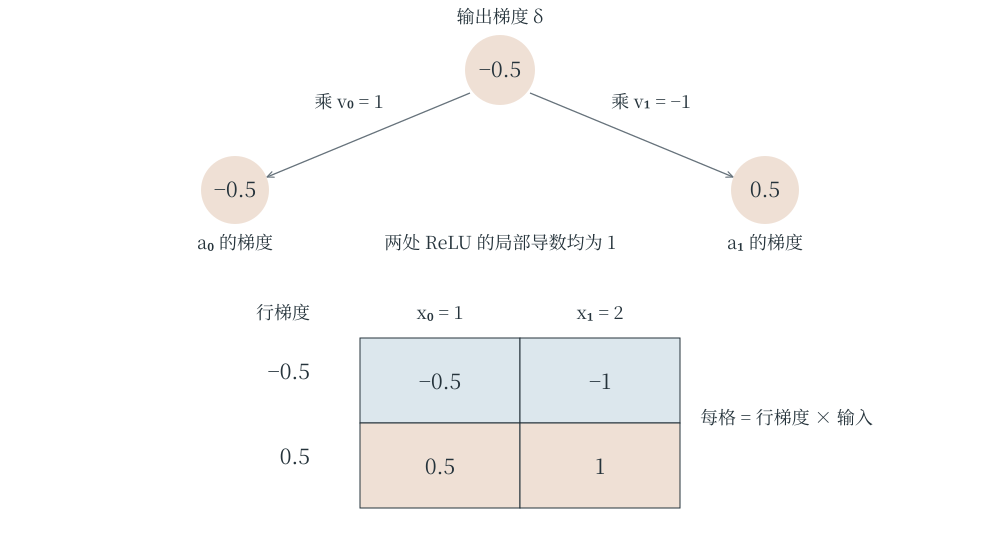

*图 3-5　梯度的符号与大小都有出处。上半图解释两个隐藏梯度为什么方向相反；下半图逐格展开外积。每格由行上的 $\bar a_i$ 与列上的 $x_j$ 相乘，不能遗漏输入因子。*

如果还要继续向更前面的层传播，就需要输入梯度。一个输入 $x_j$ 同时影响两个隐藏单元，所以各条路径的贡献相加：

$$
\bar x_j=\sum_iW_{i,j}\bar a_i,
\qquad \bar x=W^\mathsf{T}\bar a.
$$

本例 $W$ 为单位矩阵，得到 $\bar x=(-0.5,0.5)^\mathsf{T}$。输入样本通常不是这里要更新的参数，所以可以不据此修改 $x$；但当 $x$ 是前一层的输出时，这个梯度正是前一层继续学习所需要的信息。

至此，九个参数的梯度都已求出。反向传播从一个标量损失出发，依次经过局部运算，并复用共同的中间结果，因此无需为每个参数单独运行一遍网络。

##### 完成一次更新，然后重新计算

最简单的梯度下降更新是

$$
\theta^{\mathrm{new}}=\theta-\eta\nabla_\theta\ell.
$$

$\eta$ 叫学习率，决定沿这个方向走多远。本次取 $\eta=0.1$，所有梯度均由刚才那一组旧参数计算。得到

$$
\begin{aligned}
W^{\mathrm{new}}&=\begin{bmatrix}1.05&0.10\\-0.05&0.90\end{bmatrix},\\[4pt]
b^{\mathrm{new}}&=\begin{bmatrix}0.05\\-0.05\end{bmatrix},\\[4pt]
v^{\mathrm{new}}&=\begin{bmatrix}1.05\\-0.90\end{bmatrix},
\qquad c^{\mathrm{new}}=1.05.
\end{aligned}
$$

不能在算出 $\bar v$ 后就更新 $v$，再用更新后的 $v$ 计算本次的 $\bar h$。那样拼接的导数既不对应完整的旧网络，也不对应完整的新网络。**一次更新所使用的梯度，必须对应它宣称求导的那次前向计算。**

用新参数重新运行同一条样本：

$$
\begin{aligned}
a^{\mathrm{new}}&=h^{\mathrm{new}}
=\begin{bmatrix}1.3\\1.7\end{bmatrix},\\[4pt]
z^{\mathrm{new}}&=1.05\times1.3-0.90\times1.7+1.05\\
&=0.885,\\
p^{\mathrm{new}}&\approx0.707857,\\
\ell^{\mathrm{new}}&\approx0.345513.
\end{aligned}
$$

损失从约 0.693 降到了约 0.346。这个结果是重新前向算出来的，不是把梯度的大小直接当成损失下降量。泰勒展开中的 $\Delta\ell\approx\nabla\ell^\mathsf{T}\Delta\theta$ 只是一阶近似，步子变大后，高阶项就不能忽略。

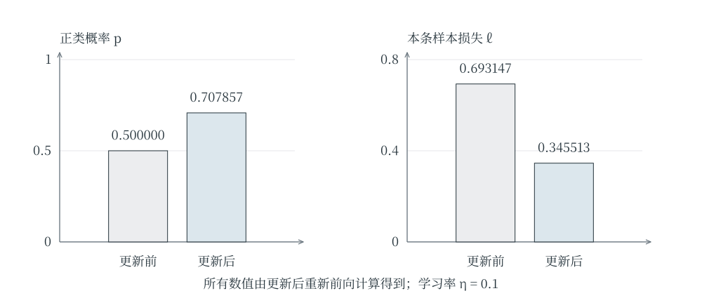

*图 3-6　一次完整训练更新的结果。左图比较概率，右图比较损失，纵轴含义不同。所有数值来自更新后重新执行网络；这只能证明本条样本在这一步有所改善，还不能证明整个任务已经学会。*

##### 用程序复现手算过程

下面的程序按刚才的顺序计算前向。`exp` 是指数函数，`log1p` 用来稳定计算 $\ln(1+t)$。函数一次返回五项结果，调用者用五个变量按顺序接收。循环的含义与第二章相同。

```python
from math import exp, log1p

def forward(W, b, v, c, x, y):
    a = [0.0, 0.0]
    h = [0.0, 0.0]
    for i in range(2):
        a[i] = b[i]
        for j in range(2):
            a[i] += W[i][j] * x[j]
        h[i] = max(a[i], 0.0)
    z = v[0] * h[0] + v[1] * h[1] + c
    if z >= 0:
        p = 1 / (1 + exp(-z))
    else:
        p = exp(z) / (1 + exp(z))
    loss = max(z, 0) - y * z
    loss += log1p(exp(-abs(z)))
    return a, h, z, p, loss

W = [[1.0, 0.0], [0.0, 1.0]]
b, v, c = [0.0, 0.0], [1.0, -1.0], 1.0
x, y = [1.0, 2.0], 1.0
a, h, z, p, loss = forward(W, b, v, c, x, y)
```

其中 `+=` 是“用原值加上右边，再保存”的简写。接下来的反向代码逐项使用已经推导出的局部导数：

```python
delta = p - y
grad_v = [delta * h[0], delta * h[1]]
grad_c = delta
grad_b = [0.0, 0.0]
grad_W = [[0.0, 0.0], [0.0, 0.0]]
for i in range(2):
    grad_h = delta * v[i]
    if a[i] > 0:
        grad_b[i] = grad_h
    for j in range(2):
        grad_W[i][j] = grad_b[i] * x[j]
```

变量前缀 `grad_` 只是提醒读者：这里保存的是损失对相应参数的梯度。所有梯度准备好之后，再生成新参数。下面方括号里的 `for` 叫列表推导式，它逐项产生一个新列表；外层套一层，就逐行产生一个新矩阵。

```python
eta = 0.1
new_W = [[W[i][j] - eta * grad_W[i][j]
          for j in range(2)] for i in range(2)]
new_b = [b[i] - eta * grad_b[i] for i in range(2)]
new_v = [v[i] - eta * grad_v[i] for i in range(2)]
new_c = c - eta * grad_c
_, _, _, new_p, new_loss = forward(
    new_W, new_b, new_v, new_c, x, y)
```

最后的 `_` 表示这里不打算继续使用相应返回值。程序得到的 `new_p` 与 `new_loss` 分别约为 0.707857 和 0.345513，与手算一致。这里使用的是便于检查的 Python 数值运算；现代框架会自动组织反向计算，但应当实现相同的数学关系。

#### 3.4　链式法则与自动微分

##### 从标量链式法则到向量的局部变化

刚才的网络很小，写出每一项偏导并不困难。如果一层有几千个输入、几千个输出，难道需要把所有偏导组成的大表完整写出来，再相乘吗？

设一个局部运算是 $a=f(x)$，输入 $x\in\mathbb{R}^n$，输出 $a\in\mathbb{R}^m$。在当前输入附近，微小变化满足

$$
\mathrm{d}a=J_f\,\mathrm{d}x,
\qquad (J_f)_{i,j}=\frac{\partial a_i}{\partial x_j}.
$$

$J_f$ 是 $m\times n$ 的雅可比矩阵。它把输入的局部变化映射到输出的局部变化。假设后面的计算已经告诉我们 $\bar a=\nabla_a\ell$，那么损失的微小变化为

$$
\begin{aligned}
\mathrm{d}\ell
&=\bar a^\mathsf{T}\mathrm{d}a\\
&=\bar a^\mathsf{T}J_f\,\mathrm{d}x\\
&=(J_f^\mathsf{T}\bar a)^\mathsf{T}\mathrm{d}x.
\end{aligned}
$$

比较输入变化前面的系数，得到

$$
\bar x=J_f^\mathsf{T}\bar a.
$$

这正是反向传播在一个局部运算上要做的事情。若把梯度写成行向量，它是 $\bar a^\mathsf{T}J_f$，通常称为**向量—雅可比积**，简称 VJP。本书使用列向量，所以写成其转置形式。名称和排版不同，传递的导数相同。

重要的是：我们只需要这个乘积，不必一定构造完整的 $J_f$。对 $a=Wx+b$，输入的雅可比就是 $W$，直接计算 $W^\mathsf{T}\bar a$ 即可。对逐元素 ReLU，雅可比是由零和一构成的对角矩阵，直接按位置乘掩码即可；没有理由分配一张巨大对角表。

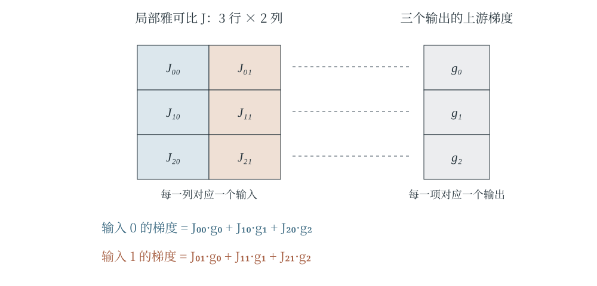

*图 3-7　VJP 的含义。为使输入和输出尺寸容易区分，图中把局部层推广为两输入、三输出。每个输入梯度汇总它对所有输出的影响；它不是沿一条任选的路径返回。实际算子可以直接实现这些加权与求和，而不显式保存图中的雅可比。*

权重梯度也能用同样的微分观点得到。对 $a=Wx+b$，同时允许三类输入变化，有

$$
\mathrm{d}a=(\mathrm{d}W)x+W\mathrm{d}x+\mathrm{d}b.
$$

把它代入 $\mathrm{d}\ell=\bar a^\mathsf{T}\mathrm{d}a$，分别收集每个 $\mathrm{d}W_{i,j}$、$\mathrm{d}x_j$、$\mathrm{d}b_i$ 前面的系数，便重新得到

$$
\bar W=\bar a x^\mathsf{T},\qquad
\bar x=W^\mathsf{T}\bar a,\qquad
\bar b=\bar a.
$$

这套方法把“一串看起来要背的公式”变成了可以检查的局部推导。只要前向定义和形状清楚，反向公式就能从损失的微小变化中推出来。

也可以从输入端发起一次求导。把层缩成 $f(u,v)=(uv,u+v)$，在 $(2,3)$ 处，问“把 $u$ 略增一份、同时把 $v$ 略减一份，会发生什么？”给两个输入各附一个方向分量 $(1,-1)$。经过乘法时同时传播乘积法则，得到 $3\times1+2\times(-1)=1$；经过加法得到 $1-1=0$。前向模式让程序沿原来的执行顺序既算出值 $(6,5)$，也算出切向量 $(1,0)$。这就是 $J(1,-1)^\mathsf{T}$。沿该方向实际走一小步 $\epsilon$，乘积变为 $(2+\epsilon)(3-\epsilon)=6+\epsilon-\epsilon^2$，线性项恰为 1。

再考虑反向求导。设损失对两个输出的偏导数分别为 2 和 4，我们要求的是损失对两个输入的偏导数。沿反向走，乘法贡献 $(6,4)$，加法贡献 $(4,4)$，相加得 $(10,8)$。上面那次微调让损失的一阶改变量既可从输出端算成 $2\times1+4\times0=2$，也可从输入端算成 $10-8=2$。这种内积核对能检验自定义算子的前后向是否相容。需要雅可比的所有列时，一般可逐个输入基方向做前向传播；需要所有行时，可以逐个输出基方向做反向传播。训练常有数以百万计的参数而最后只汇成一个损失，一次反向就能给出所有参数的梯度。若只想试一个扰动方向，无须先保存整套反向中间量。[PyTorch 函数变换与雅可比乘积](https://docs.pytorch.org/tutorials/intermediate/jacobians_hessians.html)

##### 共享参数的梯度累加

第二章强调，两个名字可能指向同一份存储。学习中还有一种更强的约定：**同一个可训练参数，在函数的不同位置反复使用。** 这时要对同一个变量求导，不能把不同使用位置当作彼此独立的变量。

仍用当前小网络，但增加一个约束：让 $W_{0,0}$ 与 $v_0$ 共享同一个标量 $w$，它们当前都为 1。其他参数保持初值。对当前样本，第一隐藏单元为 $h_0=w$，最后分数为

$$
z=w h_0-2+1=w^2-1.
$$

$w$ 有两条影响损失的路径。一条改变输出层乘数 $v_0$，另一条改变隐藏层的 $h_0$。在 $w=1$ 时，这两条贡献分别为 $-0.5$，相加得到

$$
\frac{\mathrm{d}\ell}{\mathrm{d}w}
=\delta(h_0+w x_0)=-1.
$$

直接对 $z=w^2-1$ 求导，再乘 $\delta=-0.5$，也得到 $-1$。如果反向程序每次都用赋值覆盖原梯度，最后可能只留下其中一条路径。这就是梯度通常需要“累加”的数学原因之一。

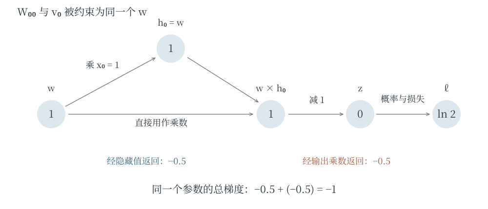

*图 3-8　共享参数的两条贡献。图中的两个使用位置引用同一个 $w$，因此只有一次参数更新。本例加上共享约束后只有八个独立参数；它是用来解释共享的变体，后续批量训练继续使用原来的九参数网络。*

同理，一个中间值被两条后续分支使用时，返回到该值的梯度也要相加。反向传播不是简单地把正向箭头反过来画：还要保证所有使用者的贡献都被合并，并且没有重复累计。

##### 自动微分的计算过程

自动微分把程序拆成具有已知局部导数的基本运算，记录或恢复反向需要的信息，再按依赖关系执行局部 VJP。它不需要把整个网络先化简成一个巨大的符号表达式，也不是靠给每个参数加一点扰动来近似导数。关于这些方法的区别，可以参照[自动微分综述](https://www.jmlr.org/papers/v18/17-468.html)。

对常见神经网络算子，反向工作量通常与前向处于相同数量级，但常数、内存需求和通信模式各不相同。第十二章将讨论框架为反向传播保留哪些对象，以及何时可以释放它们占用的存储。

##### 用有限差分找出一处遗漏

尽管不适合作为大模型的常规求导方法，有限差分很适合检查我们自己写的反向。对一个标量参数 $w$，中心差分为

$$
g_{\mathrm{num}}
=\frac{\ell(w+\varepsilon)-\ell(w-\varepsilon)}{2\varepsilon}.
$$

仍在初始参数处，检查 $W_{0,1}$。解析梯度为 $\bar a_0x_1=(-0.5)\times2=-1$。把 $W_{0,1}$ 分别改成 $10^{-5}$ 和 $-10^{-5}$，其他参数固定，各运行一次完整前向，得到的中心差分约为 $-1$。

```python
eps = 1e-5
W_plus = [row.copy() for row in W]
W_minus = [row.copy() for row in W]
W_plus[0][1] += eps
W_minus[0][1] -= eps
loss_plus = forward(W_plus, b, v, c, x, y)[4]
loss_minus = forward(W_minus, b, v, c, x, y)[4]
numeric_gradient = (loss_plus - loss_minus) / (2 * eps)
```

这里复制了每一行，避免第二章讨论过的嵌套共享存储问题。`[4]` 取前向返回的第五项，也就是损失。前面的更新使用了 `new_W` 等新名字，所以此处的 `W,b,v,c` 仍是初始参数。

若反向中漏乘 $x_1$，错误答案会变成 $-0.5$，这个检查就能发现它。若检查共享参数，则必须同时扰动它的所有使用位置；只改一个位置，检查的是另一个函数。

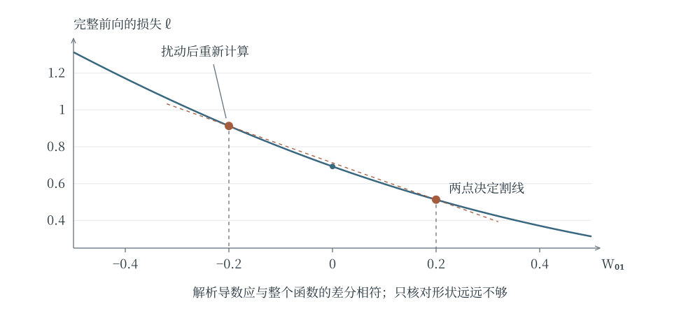

*图 3-9　有限差分检查的是整个函数。图为便于观察使用较大的取点间距，程序核验使用 $\varepsilon=10^{-5}$。这里其他参数均固定在初值。靠近 ReLU 折点、发生随机变化或使用低精度时，必须重新检查差分的适用条件。*

差分步长并非越小越好。太大时，高阶项可能影响近似；太小时，两个接近的浮点数相减会放大舍入误差。核验通常使用较高精度、固定输入和随机状态，避开不光滑点，并尝试几个步长。本章复算程序在初值与更新后两个位置检查全部九个参数，最大绝对误差小于 $10^{-8}$。这种核验能发现实现错误，但有限个测试点仍不是对所有输入的形式化证明。

#### 3.5　小批量训练

单条样本告诉我们如何计算一次更新，却不能代表任务中的全部情况。同一个参数可能受到不同样本的相反影响。把样本损失按约定合并，再求共同参数的梯度，才能明确一批数据究竟推动模型向哪里更新。

##### 批次损失与梯度

一个任务由很多样本约束。设训练集有 $N$ 条样本，经验平均损失为

$$
L_{\mathrm{train}}(\theta)
=\frac{1}{N}\sum_{n=0}^{N-1}
\ell(f_\theta(x^{(n)}),y^{(n)}).
$$

上标 $(n)$ 表示样本编号，不是乘方。由于求导对加法满足线性关系，平均损失的梯度，就是每条样本梯度的平均。

现在回到原来的九个独立参数，并恢复初值。除了第一条样本 $(1,2)^\mathsf{T},y=1$，再加入第二条训练样本 $(2,3)^\mathsf{T},y=0$。两条样本的分数都恰好为零，但标签相反，所以输出梯度分别为 $-0.5$ 和 $0.5$。

第二条样本经过同样的反向，得到

$$
\begin{aligned}
\bar W^{(1)}&=\begin{bmatrix}1&1.5\\-1&-1.5\end{bmatrix},\\[4pt]
\bar b^{(1)}&=\begin{bmatrix}0.5\\-0.5\end{bmatrix},\\[4pt]
\bar v^{(1)}&=\begin{bmatrix}1\\1.5\end{bmatrix},\qquad
\bar c^{(1)}=0.5.
\end{aligned}
$$

把它与第一条样本的梯度相加、除以 2：

$$
\begin{aligned}
\nabla_W L&=\begin{bmatrix}0.25&0.25\\-0.25&-0.25\end{bmatrix},\\[4pt]
\nabla_b L&=\begin{bmatrix}0\\0\end{bmatrix},\\[4pt]
\nabla_v L&=\begin{bmatrix}0.25\\0.25\end{bmatrix},\qquad
\nabla_c L=0.
\end{aligned}
$$

输出偏置的梯度抵消了，权重的梯度却没有全部抵消，因为输入和隐藏值不同。两条样本不只是投票决定“增加还是减小一个总分数”，还在要求模型改变输入特征与分数之间的关系。

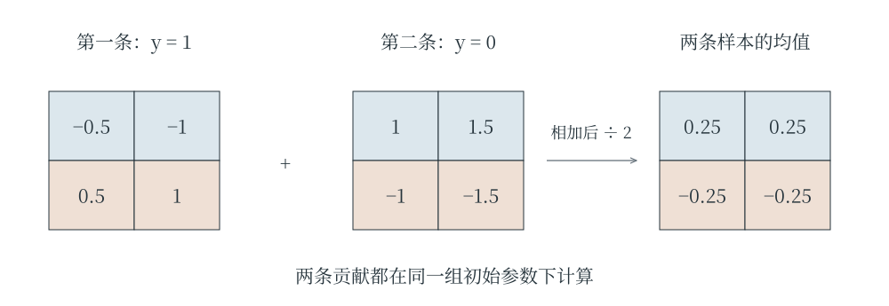

*图 3-10　批量梯度是同一参数版本下的逐样本贡献之和或均值。图中两份梯度均由初始参数产生。若处理第一条样本后就更新参数，第二条梯度便来自另一个位置，不再是这里定义的两样本平均梯度。*

实际训练通常不在每次更新前遍历整个训练集，而是选取一个较小的批次，称为 mini-batch。它的平均梯度用于更新参数，这就是常见的小批量随机梯度下降。若样本从训练集均匀抽取，这个平均可以作为全训练集梯度的估计；在独立抽样等假设下，平均能减小抽样噪声。

但噪声较小不自动意味着达到同等质量的总时间更短。更大的批次需要处理更多样本，更新次数、学习率安排和硬件利用率也会改变。我们要比较的是完成任务所需的整体训练过程，而不只是某一步是否更平稳。

##### 批量计算与矩阵运算

把 $B$ 条样本作为列组成 $X\in\mathbb{R}^{n\times B}$，一层可以统一写成

$$
A=WX+b\mathbf{1}^\mathsf{T}.
$$

$\mathbf{1}$ 是长度为 $B$ 的全一向量，偏置因此被广播给每一列。若上游已经给出最终平均损失对 $A$ 的梯度 $G=\nabla_A L$，则

$$
\begin{aligned}
\nabla_W L&=GX^\mathsf{T},\\
\nabla_X L&=W^\mathsf{T}G,\\
\nabla_b L&=G\mathbf{1}.
\end{aligned}
$$

$G$ 的形状是 $m\times B$，因此 $GX^\mathsf{T}$ 的形状是 $m\times n$。其中每一项都是跨样本的乘积求和。前面逐条算出的权重梯度平均，在批量程序里可以变成一次矩阵乘法。

要注意平均因子的位置：这里 $G$ 已经是平均损失的梯度，包含了 $1/B$，不能在矩阵乘法后再除一次。若传入的是每条样本未经平均的梯度，则应在约定的位置除以 $B$。许多训练结果不对，并非反向公式错了，而是不同层对“求和还是求平均”的约定没有对齐。

一大批数据也可以拆成几个小批，先累积梯度，最后更新一次，称为梯度累积。若各小批返回自己的平均梯度，样本数不同时，应按各自样本数加权，而不是把几个均值简单平均。等价性还要求参数保持同一版本，损失能按相应样本项相加；随机操作、跨样本归一化以及不同的归约顺序，都可能带来额外差异。

因此，梯度缓冲区通常在这一轮累积开始前清零，每个小批将贡献加进去，全部完成后再更新。每个小批都清零会丢掉先前贡献，跨越不相关更新一直不清零又会混入旧梯度。这个生命周期与第二章的存储和依赖问题直接相连。

##### 把这些步骤组成训练循环

现在可以看清“不断训练”实际重复的是什么。最简单、不使用梯度累积的过程如下：

```text
初始化参数与优化器状态
重复若干轮：
    按约定顺序将训练样本组成批次
    对每个批次：
        清空本次参数梯度
        前向计算预测与批次损失
        反向计算并汇总参数梯度
        用优化器更新参数与历史状态
    在验证集上评估当前参数
```

遍历一遍训练集通常称为一个 epoch；执行一次优化器更新通常称为一个 step。一个批次包含多少样本、是否进行梯度累积，会改变一轮中更新步数与数据读取次数的关系。数据流不一定能够自然分成有限的轮次，但“看过多少数据”和“更新了多少次参数”仍是两个不同的计数。

上面重复执行的是同一套计算规则，逐步改变的是参数和优化器状态。验证阶段不据其损失做本次反向更新；是否继续训练、怎样选择一个版本，则依据预先约定的评价方式。一个训练损失不再明显下降的状态，也不必然是全局最优，更不直接说明它已经满足任务要求。

##### 训练损失下降，为什么仍要单独验证

我们已经看到，一条样本的损失下降可以被精确复算。但学习的目的，是对将来的输入作出有用预测，而不是只把已经使用过的样本解释得更好。

取一条未参与前面单样本更新的验证样本：

$$
x_{\mathrm{val}}=\begin{bmatrix}1\\3\end{bmatrix},
\qquad y_{\mathrm{val}}=0.
$$

初始网络给出 $z=-1$，正类概率约为 0.268941，负类标签的损失约为 0.313262。用第 3.3 节那次只针对正类训练样本的更新后，新网络对它给出

$$
h_{\mathrm{val}}^{\mathrm{new}}
=\begin{bmatrix}1.4\\2.6\end{bmatrix},\qquad
z_{\mathrm{val}}^{\mathrm{new}}=0.18.
$$

正类概率升到约 0.544879，损失升到约 0.787192。对训练样本有利的那一步，对这条验证样本反而不利。

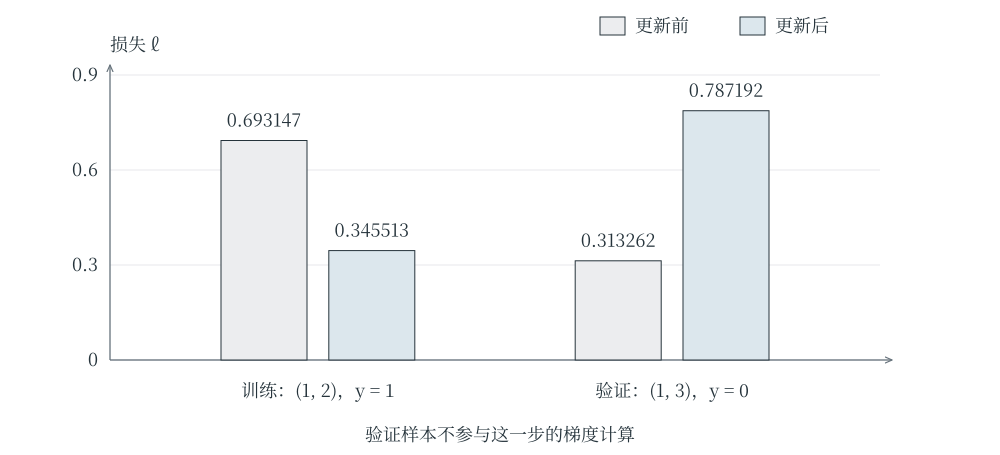

*图 3-11　优化目标与未见样本的表现需要分别检查。两组数值来自同一次更新，验证样本没有用于计算梯度。这一条反例说明下降不能自动推广；它不是凭两个点就诊断某个实际模型过拟合。*

实际工作会把数据分为训练、验证和测试等用途。训练集参与参数更新；验证集帮助选择模型、超参数和停止时机；测试集用于最终评估，尽量避免在反复选择过程中泄漏信息。若输入的均值、方差等预处理统计量由数据估计，也应在允许的训练范围内拟合，再应用到验证和测试数据。

当模型逐渐利用了训练数据中特有的噪声或偶然关系，而这些关系不适用于新数据，就可能发生过拟合。增加有代表性的数据、限制不必要的模型复杂度、正则化和根据验证表现停止训练，都可能帮助控制这一问题。没有一种措施能替代对数据来源和目标分布的检查。

损失函数本身也是一种选择。当前二分类似然不包含业务上不同错误的代价；标签质量和样本选择也会影响学到的函数。AI Infra 需要维持数值与执行的正确性，同时保持对这些上层约定的认识：把一个有偏差的目标算得更快，并不会自动得到更合适的任务结果。

##### 两种看似相同的“小批平均”

若损失的单位是一个有效词元，分批时就要让每个有效词元在更新中占同样的份额。设短句只有 1 个参与损失的词元，某参数的梯度是 6；长句有 3 个，梯度各为 2。拼在一起再取平均，梯度为 $(6+3\times2)/4=3$。分别对每句求均值，再对两个均值取一半，梯度却是 $(6+2)/2=4$。学习率相同时，这一步移动的距离相差三分之一。

两种计算都可以对应合理的学习目标。若每份标注是一句且要求每句等权，4 就是所选目标的梯度。若目标按词元定义，想用两次小批等价地执行一次大批，应累加损失之和或梯度之和，同时累加有效项数，最后除一次。填充位不进入分子、分母；若整批有效项数为零，要跳过这次归一化和相应的更新。到第十六章，数据分到不同机器后，这个分母也得跨机器传递。

##### 不同训练阶段的目标

下一章会将分类任务扩展到语言模型：根据已有词元预测下一个词元。为先说明训练目标的区别，假设词表只有两个候选，三个预测位置都可以使用本章的二分类损失。接下来三个正确词的预测概率依次为 $1/2,1/4,1/2$。若把整段都当作语言材料，平均负对数概率为 $4\ln2/3$。若前两个位置属于用户的问题，第三个位置才是要模仿的回答，训练配置可只对回答计损失，此时平均是 $\ln2$。前两个位置仍然要走前向，为回答提供上下文；沿回答位置反传的梯度仍可经过它们的表示。变化的是哪些预测直接收到监督，以及分母计了多少个有效位置。

预训练通常从大语料的预测任务起步。**继续预训练**从已有权重接着做语言建模，可以提高某领域或某种长度材料的采样比重；有些训练方案把通用预训练与指令微调之间的这段叫作中期训练。若把三份通用样本和一份领域样本，从按样本均匀抽取改为各域等概率，再在域内均匀抽取，每份领域样本被抽中的机会从 $1/4$ 升到 $1/2$。数据、上下文长度和学习率可以换，反向传播依然是刚刚推过的同一条链。监督微调则常把提示与示范回答成对组织，按任务约定决定监督哪些位置。衡量两次更新时宜同时记录实际处理的词元数、进入损失的词元数，以及通用域和目标域各自的验证误差。样本长度、掩码或域的配比一变，原来那一条总损失曲线就可能失去可比性。

#### 3.6　深层网络的梯度与训练稳定性

##### 反复相乘会改变信号的尺度

两层网络的链式法则并不复杂，但很多层连接之后，局部变化率要沿路径反复相乘。考虑最简单的标量链 $h_{l+1}=\alpha h_l$。经过 $L$ 层，输出对最初输入的导数为 $\alpha^L$。

若每层局部导数为 0.5，十层后只剩 $0.5^{10}\approx0.000977$；若为 1.5，十层后变成 $1.5^{10}\approx57.665$。前者使早期层收到的变化率很小，后者可能使微小变化被大幅放大。深层网络中的梯度消失与爆炸，具有这样的基本来源。

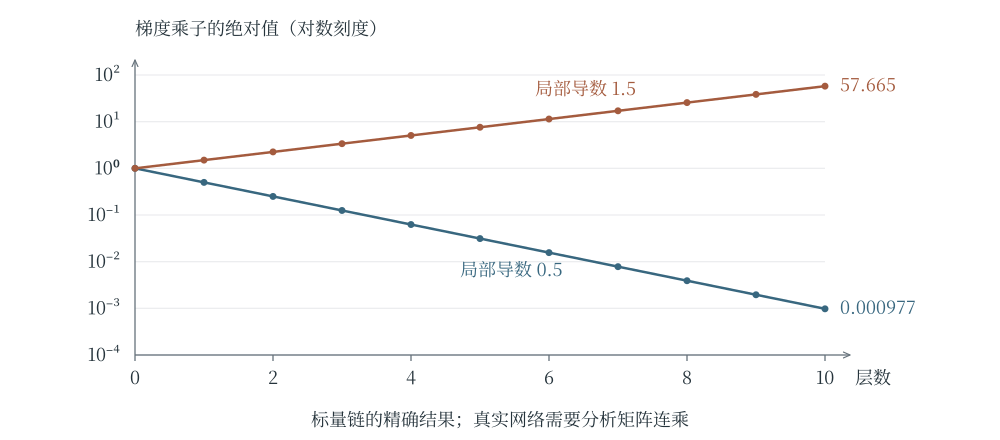

*图 3-12　梯度尺度随深度积累。纵轴采用对数刻度，表示梯度乘子绝对值，零层处均为 1。真实网络对应雅可比矩阵的连乘，不是把某个平均数简单乘十次；方向、奇异值和各层的相关性都会影响结果。*

sigmoid 的局部导数不超过 $1/4$，在两端饱和时还会更小。但也不能据此断言“包含 sigmoid 的网络就必然训练不了”：输出层与交叉熵组合后已经出现了 $p-y$ 的简化，完整梯度还要结合所有路径与权重分析。

ReLU 在正半轴的导数为 1，避免了这一位置的持续压缩；负半轴则阻断该样本经过这个单元的局部梯度。如果一个单元对所有训练输入长期处于负半轴，就可能难以通过常规梯度重新激活。某一条样本上的零梯度，仍不意味着参数永远不会变化：其他样本、其他使用路径或优化器中的历史状态都可能影响后续更新。

##### 初始化既要打破对称，也要控制尺度

如果同一层的两个隐藏单元具有相同的输入权重、偏置和对称的输出连接，它们在同样的训练规则下可能一直收到相同的更新。两个单元就不能自然分工成不同的特征。随机初始化的一个作用，是打破这种对称性，而不是简单地“给训练加一点噪声”。

随机数的尺度同样重要。设一个单元有 $n$ 个输入，计算 $a=\sum_{j=1}^{n}w_jh_j$。在权重零均值、相互独立并与输入近似独立等初始化假设下，若权重方差为 $\sigma_w^2$，各输入二阶矩相近，则

$$
\mathbb{E}[a^2]\approx n\sigma_w^2\mathbb{E}[h_j^2].
$$

若 $a$ 的分布关于零对称，ReLU 丢掉负半轴后有

$$
\mathbb{E}[\operatorname{ReLU}(a)^2]
=\frac12\mathbb{E}[a^2].
$$

因此，选择 $\sigma_w^2\approx2/n$，可以在这组假设下保持前向信号的二阶矩尺度。这是 [He 初始化](https://arxiv.org/abs/1502.01852) 的基本出发点之一。

这里有两个容易被省略的细节。第一，ReLU 输出通常有正均值，所以这里控制的是二阶矩，不能不加说明地把它等同于方差。第二，这是一种初始化时的统计近似，不是训练全过程中的稳定性保证；激活函数、残差结构、宽度和权重相关性改变时，需要重新分析。

初值的尺度如果导致激活或梯度过大，有限精度中的溢出风险也会增加。算法稳定性与数值格式因此不是两件完全分开的事。第十一章讨论低精度时，会继续使用这些尺度判断。

##### 归一化怎样改变一个向量

即便初值合适，训练中的中间表示仍会变化。以 LayerNorm 为例，它对一条表示向量内部的 $d$ 个分量计算均值和方差：

$$
\mu=\frac1d\sum_i a_i,\qquad
\sigma^2=\frac1d\sum_i(a_i-\mu)^2.
$$

再计算

$$
\hat a_i=\frac{a_i-\mu}{\sqrt{\sigma^2+\epsilon}},
\qquad r_i=\gamma_i\hat a_i+\beta_i.
$$

$\epsilon$ 是防止分母过小的稳定项；$\gamma$ 和 $\beta$ 是可学习的缩放与平移，使网络能够进一步选择合适的表示。与输入数据的预处理不同，这些统计量是在网络内部、对当前表示计算的。[Layer Normalization 原论文](https://arxiv.org/abs/1607.06450)说明了这种按单个样本的特征维度统计的组织方式。

为了直观看到变换，把向量宽度暂时扩为 3，取 $a=(1,3,5)^\mathsf{T}$。其均值为 3，方差为 $8/3$。只在这个非零方差的手算例子中令 $\epsilon=0$，并取 $\gamma_i=1,\beta_i=0$，得到

$$
\hat a=
\begin{bmatrix}-\sqrt{3/2}\\0\\\sqrt{3/2}\end{bmatrix}
\approx\begin{bmatrix}-1.224745\\0\\1.224745\end{bmatrix}.
$$

三个数相对于均值的位置被保留，整体平移和尺度则被重新组织。若 $\epsilon>0$，归一化结果的经验方差为 $\sigma^2/(\sigma^2+\epsilon)$，并非严格等于 1；再经过 $\gamma,\beta$ 后，更不能要求输出必然零均值、单位方差。

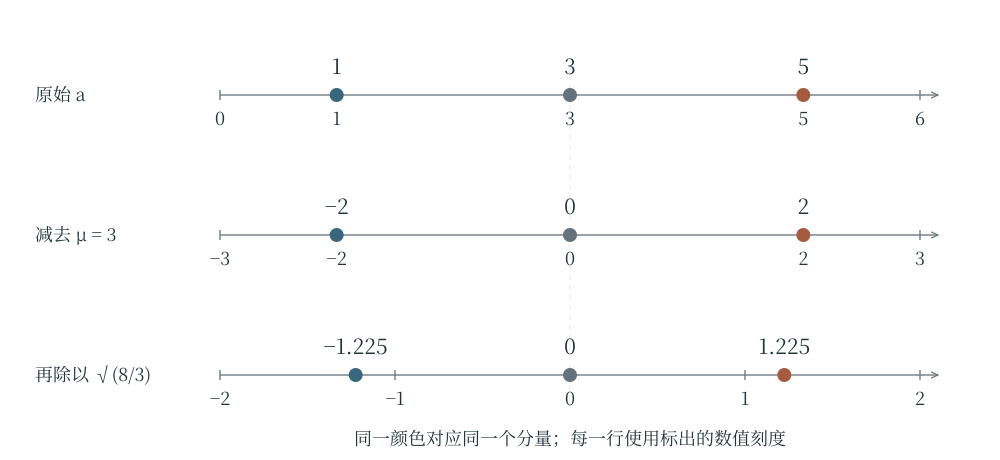

*图 3-13　归一化怎样重新确定中心与尺度。三个阶段分别使用各自标明的数值坐标，点的对应关系保持不变。本例标准差为 $\sqrt{8/3}$，暂不加入稳定项和可学习仿射变换。*

归一化也会改变反向依赖。一个 $a_i$ 不只影响自己的分子，还影响所有位置共同使用的均值和方差。若把它们当作常数，简单地把上游梯度除以标准差，得到的反向就是错的。

可以沿刚才的微分方法检查。记 $s=\sqrt{\sigma^2+\epsilon}$，并令 $q_i=\partial\ell/\partial\hat a_i$；若有仿射变换，先将其上游梯度逐项乘以 $\gamma_i$，即可得到 $q_i$。对于输入扰动，

$$
\begin{aligned}
\mathrm{d}\mu&=\frac1d\sum_j\mathrm{d}a_j,\\[4pt]
\mathrm{d}s&=\frac{1}{ds}\sum_j(a_j-\mu)\mathrm{d}a_j.
\end{aligned}
$$

第二式利用了 $\sum_j(a_j-\mu)=0$。将这两个变化代入 $\mathrm{d}\hat a_i$，再把 $\sum_iq_i\mathrm{d}\hat a_i$ 中每个 $\mathrm{d}a_j$ 的系数收集起来，得到

$$
\bar a_i=\frac1s
\left(q_i-\operatorname{mean}(q)
-\hat a_i\operatorname{mean}(q\hat a)\right).
$$

其中 $q\hat a$ 表示逐元素乘积。式中的两个均值，分别体现了共同中心与共同尺度带来的耦合。它也解释了为什么归一化的反向需要归约，而不只是一次逐元素乘法。章末练习会用三个数把这个式子算完。

加入归一化会改变模型的计算。统计维度尤其重要：跨一个样本的特征统计和跨批次统计，会产生不同的数据依赖。批大小、分布式切分、训练与推理阶段的统计约定，都必须与模型定义一致。

##### 残差连接为何提供另一条梯度路径

另一种深层结构是让一层学习对输入的改变量：

$$
r=h+F(h).
$$

若后面返回梯度 $\bar r$，链式法则给出

$$
\bar h=\bar r+J_F^\mathsf{T}\bar r.
$$

其中第一项来自直接相加的恒等路径，第二项来自变换分支。网络可以在保留输入的基础上学习修正，而不必每一层都重新实现完整映射。这是[残差学习](https://arxiv.org/abs/1512.03385)的重要结构思想。

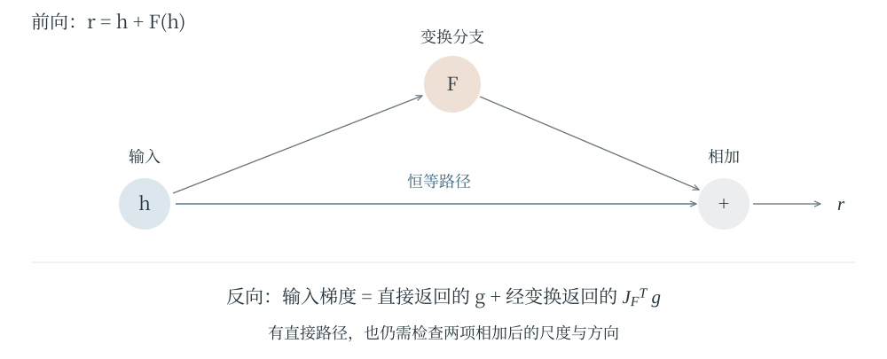

*图 3-14　残差的前向与反向都存在两条路径。反向相加来自链式法则，与第 3.4 节的分支汇合一致。若维度不同，直接相加需要改为带投影等约定的结构，不能沿用未经调整的恒等路径。*

但有恒等路径，不等于梯度永远不会消失或爆炸。例如若局部 $J_F=-I$，两条贡献仍可能抵消。残差、初始化、归一化和学习率要共同作用；它们分别改变表示、尺度和更新过程，不能彼此替代。

这也给基础设施实现提出了明确要求。残差的两条分支要正确合并，归一化要沿正确维度归约，初始化与参数装载要保留约定的数值尺度。只要其中一处语义发生变化，即使代码能够运行、张量形状也对得上，训练过程仍可能走向另一个模型。

#### 3.7　优化器与训练状态

##### 学习率决定局部信息怎样被使用

梯度给出局部方向，学习率决定步长。对一个可微损失，在足够小的移动范围内，

$$
L(\theta-\eta g)
\approx L(\theta)-\eta\|g\|^2,
\qquad g=\nabla_\theta L.
$$

这个近似解释了为什么通常沿负梯度移动，但并不保证任意大的 $\eta$ 都能下降。一个简单的反例是 $L(w)=w^2/2$，其更新为 $w^{\mathrm{new}}=(1-\eta)w$。只有 $0<\eta<2$ 时，非零 $w$ 的损失才会严格降低；若 $\eta=3$，$w$ 的绝对值翻倍，损失反而变成四倍。

神经网络的不同方向具有不同曲率，且批次梯度还带有抽样噪声。实际训练可能采用逐渐增加学习率的预热、后期降低学习率的调度，以及限制梯度范数的裁剪。它们都在控制更新过程，但不存在一个不看模型、批次和目标就通用的设置。

例如全局范数裁剪将非零梯度 $g$ 改为 $g\min(1,\tau/\|g\|)$，当范数超过正阈值 $\tau$ 时整体缩小这一梯度向量；零梯度直接保持为零。它与分别截断每个坐标不同，也不能修复错误梯度、错误标签或已经产生的非有限数值。改变更新规则时，需要知道自己限制的到底是哪一个对象。

可以用本章的小网络检查裁剪发生的时刻。先固定其他八个参数，只更新 $W_{0,0}$。在 3.5 节那两条样本上，这个坐标的梯度分别为 $-0.5$ 和 $1$。设阈值为 $0.5$。整批取平均得到 $0.25$，落在阈值内。用学习率 $0.1$ 从初值 1 更新，权重会变成 $0.975$。若分别裁剪两条样本，第二条的梯度会先变成 $0.5$，再取平均恰好为零，权重仍为 1。这已经给出了一个调试办法：用相同数据，比对完整批与两个微批更新后的参数。若只有打开裁剪时两者才出现上述分歧，去找训练循环中裁剪与累积的先后次序。

再把一个梯度向量的两个坐标分开存放。假设更新前的梯度为 $(3,4)$，阈值为 $2.5$。第一台机器可以先算出本地平方和 9，第二台得到 16。合起来再开方，全局范数是 5，两台都乘 $2.5/5$，更新器收到 $(1.5,2)$。若每台都拿阈值裁自己保存的那一份，拼回来的向量为 $(2.5,2.5)$，范数约 3.54，方向也变了。若两台各自持有完整的同一梯度，则两个 25 再相加又会把每个坐标数两次。到了第十六章，判断要不要为这次开方发起通信，就要先问每张卡持有不同坐标、不同样本的贡献，还是已经同步的副本。PyTorch 的分片接口因此专门提供了跨进程计算梯度范数的入口。[FSDP 的梯度裁剪](https://docs.pytorch.org/docs/stable/fsdp.html#torch.distributed.fsdp.FullyShardedDataParallel.clip_grad_norm_)

##### 增大批次，究竟减少了什么

3.5 节用样本梯度的平均值完成一次更新。现在把批量与学习率一起考虑：同一个平均梯度，既决定参数往哪里走，也决定这一步要等多少样本算完。增加样本是否值得，要看它减少了多少更新的不确定性。

可以把抽样噪声放进一个能算到底的例子。暂时只训练一个数 $\theta$，真实目标为 $L(\theta)=(\theta-\theta_*)^2/2$。记它与最优值的距离为 $d=\theta-\theta_*$，真实梯度就是 $d$。单条样本给出的梯度围绕 $d$ 波动，设误差均值为零、方差为 $\sigma^2$。独立抽取 $B$ 条再平均，批次梯度为

$$
g_B=d+\varepsilon_B,\qquad
E[\varepsilon_B]=0,\qquad
\operatorname{Var}(\varepsilon_B)=\frac{\sigma^2}{B}.
$$

这里的方差相加后还要除以 $B^2$，所以最终是 $1/B$，而标准差只按 $1/\sqrt B$ 缩小。按学习率 $\eta$ 更新后，距离变成 $(1-\eta)d-\eta\varepsilon_B$。把它平方并取期望，交叉项因噪声均值为零而消失，得到

$$
E[L(\theta-\eta g_B)]
=\frac12\left[(1-\eta)^2d^2+\eta^2\frac{\sigma^2}{B}\right].
$$

第一项是仍未走完的距离，第二项是抽样给本次移动增加的不确定性。取 $d=1,\sigma^2=4,\eta=1/2$，更新前损失为 $0.5$。当 $B$ 依次为 1、4、16 时，更新后的期望损失分别为 $0.625,0.25,0.15625$。第一种甚至平均变差：方向估计的波动使这个步长过大。后两种都下降，但增加同样的样本数不再带来同样的改善。

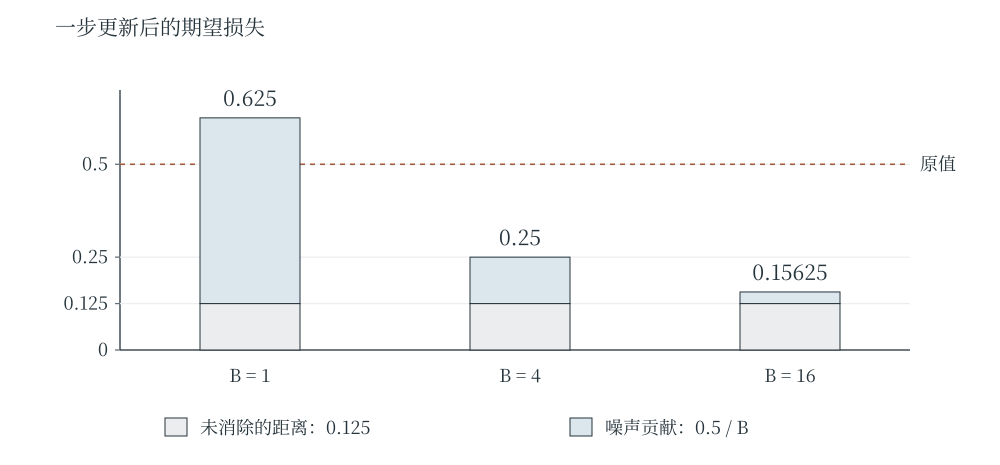

*图 3-15　柱子的总高度是更新后的期望损失，虚线为更新前的 0.5。灰色部分始终为 0.125；本例增大批次不能消除这一部分，改变学习率才会同时改变两项。*

对上式关于 $\eta$ 求导，可得到这个局部模型下使下一步期望损失最小的

$$
\eta_* = \frac{d^2}{d^2+\sigma^2/B}.
$$

因此批量大小和学习率需要一起考虑。靠近最优点、$d$ 变小时，同样的噪声会更显著。真实网络有许多方向、不同曲率和不断变化的数据分布，这个一维结论不能直接变成通用学习率公式。梯度噪声尺度研究的意义，是尝试估计哪些训练阶段仍值得增加批量，而不是给所有模型指定一个固定的最大批次。[大批量训练的噪声尺度分析](https://arxiv.org/abs/1812.06162)

独立性也值得检查。若每条梯度误差的方差都是 $\sigma^2$，任意两条之间相关系数都是 $\rho$，平均误差方差就变为 $\sigma^2[1+(B-1)\rho]/B$。$B=4,\sigma^2=4,\rho=1/2$ 时结果为 2.5，明显高于独立情况下的 1。重复相同样本不能换来四份独立信息；第十八章的数据去重因此也影响训练效率。

再给上述数学比较补上时间。假设一次实测中，批量 128 的方案需要 2000 次更新达到约定质量，每步 4 ms；批量 1024 的方案需要 700 次更新，每步 15 ms。前者每秒处理 32000 条样本，8 秒达到目标；后者每秒约 68267 条，却要 10.5 秒。这组教学数据说明，样本吞吐翻倍与训练完成更快是两项不同的结论。比较时还应固定验证方法，并把数据准备、验证与恢复计入完整时间。梯度累积可以用多个微批形成一个大批次，但在同一组参数上累积完再更新，与每个微批后立即更新，并非同一个算法。

##### 从当前梯度，到保留历史的更新

最简单的 SGD 只用当前批次梯度。动量方法则保留一个随时间更新的历史量。例如采用

$$
\begin{aligned}
m_t&=\beta m_{t-1}+(1-\beta)g_t,\\
\theta_{t+1}&=\theta_t-\eta m_t.
\end{aligned}
$$

这里 $t$ 表示更新步，$m_0=0$，$\beta$ 决定历史衰减速度。不同实现也可能使用不含 $1-\beta$ 的动量定义，因此相同数字的学习率不能脱离公式比较。持续同向的梯度会逐渐积累；方向短暂反转时，历史不会立刻完全消失。

[Adam](https://arxiv.org/abs/1412.6980) 在此基础上，为每个参数维护一阶矩和平方梯度的二阶矩估计。本章用 $s_t$ 表示第二个状态，避免与输出权重 $v$ 混淆：

$$
\begin{aligned}
m_t&=\beta_1m_{t-1}+(1-\beta_1)g_t,\\
s_t&=\beta_2s_{t-1}+(1-\beta_2)g_t^2.
\end{aligned}
$$

平方、除法和开方均按参数坐标逐项进行。因为状态从零开始，初期估计会受零初值影响，使用

$$
\hat m_t=\frac{m_t}{1-\beta_1^t},\qquad
\hat s_t=\frac{s_t}{1-\beta_2^t}
$$

进行偏差校正，再更新

$$
\theta_{t+1}
=\theta_t-\eta\frac{\hat m_t}{\sqrt{\hat s_t}+\epsilon}.
$$

$s_t$ 是未中心化的二阶矩估计，不是已经减去均值平方的方差；分母也不是精确的 Hessian 或曲率。它根据近期梯度尺度调整各坐标的更新幅度，同时仍受到学习率、历史方向和稳定项影响。

用本章初始 $W_{0,0}=1$ 的梯度 $g_1=-0.5$ 演示第一步。取 $\beta_1=0.9,\beta_2=0.999$，有

$$
\begin{aligned}
m_1&=-0.05,&s_1&=0.00025,\\
\hat m_1&=-0.5,&\hat s_1&=0.25.
\end{aligned}
$$

当 $\eta=0.1$、$\epsilon$ 很小时，Adam 使该参数增加约 0.1，而前面的 SGD 使它增加 0.05。两者都使用同一梯度，但更新并不相同。若想比较训练结果，必须固定其他条件并明确优化器规则，不能只说“学习率都是 0.1”。

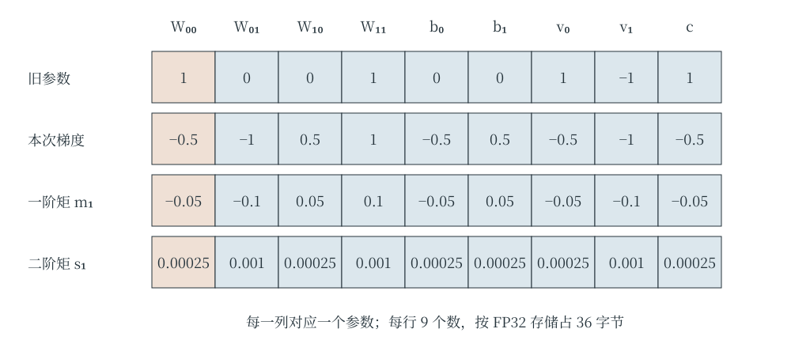

*图 3-16　优化器状态与参数逐坐标对应。以第一列的 $W_{0,0}$ 为例，第一步的两个历史状态分别为 $-0.05$ 与 $0.00025$，经过校正后参与更新。图中参数行仍是更新前的值；下一步需要继续读取历史状态，因此只保存参数不能完整恢复同一训练过程。*

为了限制参数规模，可以把 $\lambda\|\theta\|^2/2$ 加到目标中，使梯度增加 $\lambda\theta$。对普通 SGD，这与一次相应的参数收缩存在直接对应；对 Adam，把这项混入梯度，会同时改变一阶与二阶矩状态，因此通常不等同于独立收缩参数。[AdamW](https://arxiv.org/abs/1711.05101) 的基本做法是把权重衰减与自适应梯度更新分开。采用哪种规则、哪些参数参与衰减，都属于训练配置的一部分。

##### 矩阵参数能否采用不同的更新方向

Adam 为各坐标分别调整尺度，但一层权重本来就是一个矩阵。矩阵的一整行或一整列共同表示一个变换方向，逐坐标缩放未必能表达这种结构。Muon 采用的思路是：先保留梯度的动量，再用近似矩阵正交化改变这份更新。为了看清它做了什么，暂时省略动量、衰减和额外的尺度系数，直接看一份 $2\times2$ 梯度

$$
G=\begin{bmatrix}3&0\\0&1\end{bmatrix}.
$$

除以它的 Frobenius 范数 $\sqrt{10}$，两个方向的强弱比仍是 $3:1$。若只保留非零奇异值对应的列，将矩阵写成 $G=U\Sigma V^\top$，再把这些正的奇异值变为 1，就得到方向因子 $Q=UV^\top$。这里的 $U,V$ 都只包含上述列；这个约定使零奇异值对应的方向仍为零。本例 $Q$ 是单位阵，两个方向的更新幅度相同。这不是把原梯度乘以一个标量：优化器改变了各个奇异方向之间的相对尺度。对于非满秩矩阵，零奇异值方向还要按实现约定处理，不能凭空补出梯度没有提供的方向。

完整分解的代价不小。一个用于理解近似过程的经典 Newton–Schulz 迭代为

$$
X_{k+1}=\frac12 X_k(3I-X_k^\top X_k).
$$

先把非零奇异值缩放到适当的收敛区间。例如 $X_0=G/3=\operatorname{diag}(1,1/3)$，一次迭代后得到 $\operatorname{diag}(1,13/27)$。第二个值从约 0.333 增至约 0.481，逐渐接近 1；每次迭代用的是矩阵乘法。在奇异值为 $x$ 的方向，上式相当于 $x\mapsto(3x-x^3)/2$，读者可以直接检查 $x=1$ 为不动点。有限步只给近似结果，而且缩放与数值精度会影响稳定性。

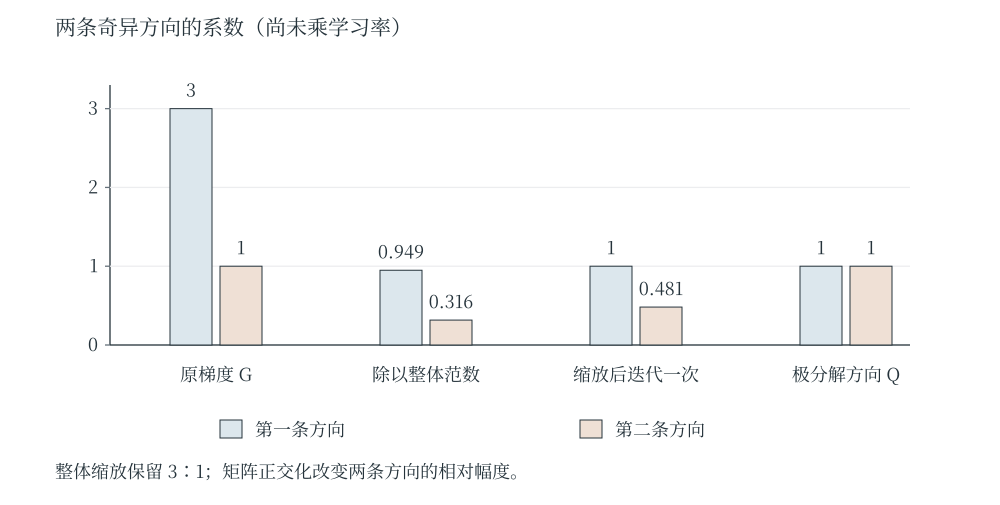

*图 3-17　纵轴为该方向的更新系数，尚未乘学习率。前两组仅缩放整体，后两组改变方向之间的相对幅度。这里的三次迭代多项式只用于解释原理，不是生产实现的逐行复刻。*

实际 Muon 还涉及动量形式、经过设计的迭代多项式、矩阵形状对应的更新尺度，以及哪些参数继续采用 AdamW。不能把所有向量、归一化参数和嵌入表任意拼成一张大矩阵，再声称实现了同一优化器。它增加了更新阶段的矩阵运算；参数分片后，还要决定在哪里取得完成这种运算所需的信息。是否值得，需要比较达到同等验证质量的时间与设备小时。某篇论文在特定模型上的 FLOPs 收益，不能直接当作另一套集群上的墙钟收益。[Muon 的原始实现说明](https://kellerjordan.github.io/posts/muon/) · [大规模语言模型中的 Muon](https://arxiv.org/abs/2502.16982)

##### 能够恢复训练，需要保存什么

假如训练在某一步停止，只保存了 $W,b,v,c$，再次启动后把 Adam 状态全部清零，接下来即使读到同样的样本，也未必走出相同的一步。因为动量、平方梯度历史和步数都改变了。

因此，可恢复的训练检查点通常还需要优化器状态、更新步数和学习率调度状态；若追求更完整的继续执行，还要考虑随机数状态、数据读取位置及分布式一致性。参数文件足以执行很多推理任务，却不一定足以接续原来的训练轨迹。

精确复现还受数值精度、归约顺序和运行环境影响。这里先建立状态层面的区别，第十八章再讨论检查点怎样一致地写出、如何处理故障，以及恢复成本怎样影响完成一次训练的总时间。

[复算批量噪声、矩阵更新与分词计分的例子](../experiments/ch03/learning_efficiency.py)

#### 3.8　训练的计算量与内存占用

更新规则已经确定后，还要让程序有能力执行它。前向计算得到预测，反向计算需要用到部分前向结果，优化器又可能保存跨步的历史。下面分别检查这些对象需要保存多久、占用多少内存，解释训练与只做一次预测为何需要不同的内存。

##### 前向激活与反向重算

回看本章的反向公式。输出权重梯度 $\bar v=\delta h$ 需要前向的 $h$；ReLU 反向需要知道 $a$ 哪些位置大于零；隐藏权重梯度 $\bar W=\bar a x^\mathsf{T}$ 需要输入 $x$。如果前向一结束就把这些信息覆盖，后面的反向不能凭空恢复相应导数。

同时，也不必机械地把每个中间值都保存一份。对 ReLU，可能保存掩码，也可能利用足以判断状态的输出；有些信息可以重算。具体保存什么，要由反向所需信息和实现方式决定。自动微分并不意味着所有中间张量都必须长期原样保存。

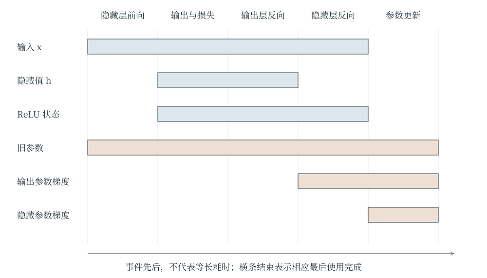

*图 3-18　训练数据的寿命由反向使用决定。横轴只表示合法执行次序，不表示各阶段等时。旧参数要与本次求导保持一致；输入和激活在相应的最后使用之后才可复用。图示采用保存信息的方式，重计算会形成另一种时间与空间安排。*

这正是激活检查点等方法能够成立的原因：前向少保存一些值，反向需要时重新计算，拿额外计算交换存储。它不是改变链式法则，也不是让反向不再需要那些信息。数据和随机操作能否按要求重建，还需要单独保证。

把“需要时重算”具体到八个首尾相接的层。第 $i$ 层将 $x_{i-1}$ 映为 $x_i$。为看清存取顺序，假定八层激活等大，每层反向除上游梯度和参数外只需该层输入。先只数为反向留存的输入，最终输出、梯度、运算时的临时空间另记。直接保存会留下 $x_0,\ldots,x_7$，共八份。若每份 16 MiB，这一项就是 128 MiB。

现在只把 $x_0$ 和 $x_4$ 留作分段的起点。损失给出 $x_8$ 的上游梯度以后，从 $x_4$ 重走三步得到 $x_5,x_6,x_7$。此时需要保留 $x_0,x_4,x_5,x_6,x_7$，五份共 80 MiB。从第八层倒推到第五层，每用完一份就释放一份。拿到 $x_4$ 的梯度以后，它的值也可以释放。再从 $x_0$ 重走三步，构造前半段需要的输入。这样峰值少了 48 MiB，代价是多做六次单层前向计算。优化器状态和已有梯度从头到尾都在原处，因此整张卡的峰值不会按 $5/8$ 等比缩小。

推广到 $n$ 个等宽、代价相近的链状层，每隔 $k$ 层保存一份，长期占着的起点约有 $n/k$ 个，同时恢复的一段约要 $k$ 份，二者之和在 $k$ 接近 $\sqrt n$ 时最小。这是早期亚线性内存训练工作的一个能手算的特例。真实残差支路可能跨越分段，昂贵算子与廉价算子的重算代价也相差很远，实际切点要从依赖和时间重新选。[Training Deep Nets with Sublinear Memory Cost](https://arxiv.org/abs/1604.06174)

还有一个比时间更要紧的条件。若重算区间里有随机丢弃，某个输入在第一次前向刚好被遮掉，重跑时却刚好保留，那么反向会沿另一条路径传回梯度。复现实验可固定权重、输入和随机数状态，把两种保存策略所得的**每个参数梯度**逐项比对，再记录峰值与一步耗时。框架如何保存和恢复随机数状态、跨设备有哪些限制，也属于这次比较的条件。[PyTorch 激活检查点](https://docs.pytorch.org/docs/stable/checkpoint.html) [八层链的存活计数与梯度检验](../experiments/ch03/checkpoint_chain.py)

##### 反向中的矩阵乘法从哪里来

对一个批量线性层 $A=WX+b\mathbf{1}^\mathsf{T}$，前向主项是一次矩阵乘法，约有 $2Bmn$ 次浮点运算。若反向既需要权重梯度又需要输入梯度，$GX^\mathsf{T}$ 与 $W^\mathsf{T}G$ 各自也约为 $2Bmn$ 次。因此这三个矩阵乘法的总量约为

$$
2Bmn+2Bmn+2Bmn=6Bmn.
$$

例如 $B=32,n=1024,m=2048$，前向主项为 134,217,728 FLOPs，三次乘法合计 402,653,184 FLOPs。这就是“训练某些层的主计算约为前向的三倍”这一估算的来源，而不是适用于所有模型的固定倍数。

如果第一层不需要输入梯度，可以省去相应乘法；冻结参数也可能省掉部分参数梯度；激活、归一化、注意力、重计算和优化器又有自己的开销。实际执行时间还受形状、数据布局、存储与通信约束影响，不能把 FLOPs 比例直接当作耗时比例。

##### 训练状态的内存占用

本章小网络有九个参数。假设参数、梯度、Adam 的两个矩状态均使用 FP32，各占 $9\times4=36$ 字节，四类数值存储合计 144 字节。

| 对象 | 本例数值存储 | 为什么存在 |
|---|---:|---|
| 参数 | 36 字节 | 定义当前预测函数 |
| 参数梯度 | 36 字节 | 汇总本次更新的变化率 |
| Adam 一阶矩 | 36 字节 | 保存梯度方向的历史 |
| Adam 二阶矩 | 36 字节 | 保存平方梯度的历史 |

这还没有计入输入、激活、临时工作区和程序对象开销，也没有假定混合精度中存在或不存在额外主权重。16 字节每参数只是这里明确配置下四类数值的合计，不能不检查实际训练方案就当作通用显存公式。

激活则随批次、层宽和序列长度等变化。刚才的大线性层输出有 $32\times2048$ 个 FP32 数，即 262,144 字节，也就是 256 KiB。层数增加后，多个仍需用于反向的激活可能同时存在。参数量相同的模型，输入形状和保存策略不同，也可能有完全不同的训练内存需求。

##### 规模、数据与计算预算需要一起选择

更多参数扩大了可表达函数的范围，也增加了更新与存储成本；更多有用数据提供更多约束，也要求花计算处理它们。若固定总计算预算，把大部分预算用在一个过大的模型上，可能留下很少训练步数；把预算全部用于反复学习有限数据，又未必持续改善新样本表现。

[计算最优语言模型训练研究](https://arxiv.org/abs/2203.15556)把模型规模与训练数据量放在同一计算预算下比较，展示了这种联合选择的重要性。具体比例是特定数据、模型和实验范围中的经验结果，不是所有任务都必须遵守的常数。数据质量、重复使用、部署成本和模型架构改变时，需要重新评估。

上面的预算数出了激活和训练状态，但网络结构还会改变哪些量必须同时保留。接下来回到残差连接，看一项稳定训练的改动怎样增加存储和数据依赖。

#### 3.9　多路残差的稳定性与存储代价

第 3.6 节用残差连接保留了一条恒等映射。进一步增加残差分支，可以让网络同时保留多组表示，再在层间交换信息。不过，新增的混合运算也可能放大或削弱原本希望保留的信号。先把每条支路缩成一个数，写成列向量 $x=(3,1)^{\mathsf T}$。只观察层与层之间的直通项，暂时关掉非线性分支。给两条路各写一行混合系数，得到下一层的状态 $Mx$。若 $M$ 是对角元为 1.2、非对角元为 0 的矩阵，两层后就变成 $(4.32,1.44)$。这么叠十层，连原本想保留的共同信号也会放大约 6.19 倍。

换一组系数。让每条路留下自己的四分之三、接收邻居的四分之一，即 $M=\left(\begin{smallmatrix}3/4&1/4\\1/4&3/4\end{smallmatrix}\right)$。第一层得到 $(2.5,1.5)$，第二层得到 $(2.25,1.75)$。两路之和一直为 4，差值却从 2 变成 1、再变成 0.5。为什么这两个量走向不同？把输入拆成共同方向 $(2,2)$ 和差异方向 $(1,-1)$。这个矩阵在共同方向的倍率是 1，在差异方向的倍率是 0.5。这一混合虽然没有放大共同分量，却会让两条支路的表示逐渐趋同。

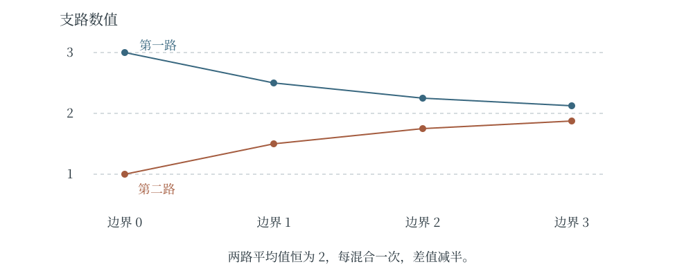

*图 3-19　每个圆点代表一条支路在层边界上的标量。沿中线看共同分量，沿上下点之间的距离看差异分量。图中没有加入层内新计算。*

这就是 mHC（manifold-constrained hyper-connections）约束残差混合矩阵的一个切入口。元素非负且每行和为 1，使每个新值是原有值的加权平均，无法跑出它们的范围；若每列和也为 1，把所有新值加起来，每个旧值的总贡献又恰好各占一份。这类矩阵称为**双随机矩阵**。一层接一层相乘仍满足这两种约束。论文用有限轮行列交替归一化近似实现所需约束；有限轮以后究竟差多少，可以直接量最大行和、列和偏差。即便直通项满足约束，完整网络还有输入、输出映射和非线性分支，整层的梯度未必保持长度。[mHC 原论文及实现设计](https://arxiv.org/abs/2512.24880)

额外的路也要存储。若一个位置的隐藏向量有 4096 个两字节数，一个常驻残差向量是 8 KiB，两路是 16 KiB；4096 个位置的这一个层边界多出 32 MiB。混合若单独写成“读两路、写两路”，至少有四个向量的逻辑读写。实现可以融合操作，降低中间值的搬运。核对训练收益时，应把新增残差状态、实际显存流量和能否用同一批量训练一起量出来。

至此，我们已经能够把“训练”展开成一系列有具体含义的工作：用参数计算预测，用损失表达任务要求，用局部导数传递梯度，用优化器状态更新参数，再用未参与更新的数据检查效果。每一步都产生相应的数据、依赖和资源需求。

下一章把这个两层小网络换成 Transformer，输入也从两个数变成一串词元。维数会增大，注意力会引入位置之间的交互，但本章建立的前向、损失、反向和状态规则仍然适用。理解这些规则后，模型结构图中的每一条边，都可以继续追问它传递的是什么、反向需要什么，以及执行它要花多少代价。

#### 练习与解答

##### 1. 一个隐藏单元关闭后，哪些梯度为零？

使用九参数网络的初始参数，把样本换成 $x=(1,-2)^\mathsf{T},y=0$。计算 $h,z,p$，然后写出所有参数梯度。第二个隐藏单元对这条样本没有激活，是否意味着它的参数从此都不会变化？

**解答。** $a=(1,-2)^\mathsf{T}$，所以 $h=(1,0)^\mathsf{T}$；$z=1+1=2$，$p=\sigma(2)\approx0.880797$。记 $q=p-y=p$，有

$$
\begin{aligned}
\bar W&=\begin{bmatrix}q&-2q\\0&0\end{bmatrix},\\[4pt]
\bar b&=\begin{bmatrix}q\\0\end{bmatrix},\qquad
\bar v=\begin{bmatrix}q\\0\end{bmatrix},\qquad\bar c=q.
\end{aligned}
$$

第二个隐藏单元虽然从输出层收到 $\bar h_1=-q$，但经过 ReLU 的零导数后，$\bar a_1=0$；它对隐藏参数的本条样本贡献因此为零。$\bar v_1=0$ 则来自 $h_1=0$，两种零值的直接原因不同。其他样本可能激活该单元，优化器历史或衰减也可能继续影响参数，因此不能据此断言参数以后不变。

##### 2. 反向途中更新参数，会产生什么错误？

在最初的正类样本上，若先将输出权重更新成 $(1.05,-0.90)^\mathsf{T}$，随后仍拿旧前向的 $\delta=-0.5$ 和 ReLU 状态计算隐藏权重梯度，会得到什么矩阵？它是否等于旧网络或完整新网络的梯度？

**解答。** 错误程序先得到隐藏梯度 $(-0.525,0.45)^\mathsf{T}$，再与 $x^\mathsf{T}=(1,2)$ 做外积：

$$
\bar W_{\mathrm{wrong}}
=\begin{bmatrix}-0.525&-1.05\\0.45&0.90\end{bmatrix}.
$$

旧网络的正确梯度是 $[(-0.5,-1);(0.5,1)]$。完整新网络的分数为 0.885，输出梯度约为 $0.707857-1=-0.292143$，也不再是 $-0.5$。因此错误矩阵不对应这两次完整前向中的任何一次。应先按一致的参数版本求完所需梯度，再执行更新；用有限差分检查时也必须扰动同一版本的完整函数。

##### 3. 不同大小的小批，梯度均值怎样合并？

三条样本分成两个小批，第一个有两条，其某参数的平均梯度为 1；第二个有一条，平均梯度为 4。三样本平均损失的正确梯度是多少？若将两个均值相加后除以二，错在何处？

**解答。** 第一个小批的梯度和为 2，第二个为 4，因此全部样本的平均梯度为 $(2+4)/3=2$。简单平均两份均值得到 2.5，相当于给两个小批相同权重，却给其中每条样本不同权重。一般地，应计算 $\sum_k B_k g_k/\sum_kB_k$。这些贡献必须在同一参数版本上获得；如果目标按有效词元而非样本平均，权重也应改为相应的有效词元数。

##### 4. Adam 的历史在梯度变号后怎样起作用？

为单独研究更新规则，给一个初值为 1 的标量参数预先指定两步梯度 $g_1=-0.5,g_2=0.5$。这不是小网络重新运行产生的真实两步梯度。取 $\beta_1=0.9,\beta_2=0.999,\eta=0.1$，初始状态为零，手算时忽略很小的 $\epsilon$。求两步后的状态和参数。

**解答。** 第一步 $m_1=-0.05,s_1=0.00025$，校正后为 $\hat m_1=-0.5,\hat s_1=0.25$，参数变为 1.1。第二步

$$
\begin{aligned}
m_2&=0.9(-0.05)+0.1(0.5)=0.005,\\
s_2&=0.999(0.00025)+0.001(0.25)\\
&=0.00049975.
\end{aligned}
$$

于是 $\hat m_2=0.005/0.19=1/38$，$\hat s_2=0.00049975/0.001999=0.25$。第二次更新使参数减少 $0.1(1/38)/0.5\approx0.005263$，得到约 1.094737。当前梯度已经变号，但前一步的负向历史仍使一阶矩较小。若只用同一组指定梯度做 SGD，两步的改变量会正负抵消；这再次说明优化器状态参与了更新定义。

##### 5. 归一化的梯度为什么不能逐项除以标准差？

使用 $a=(1,3,5)^\mathsf{T}$，令 $\epsilon=0,\gamma_i=1,\beta_i=0$，上游梯度为 $q=(1,2,0)^\mathsf{T}$。计算 $\bar a$，并检查三个输入梯度之和为何为零。

**解答。** 令 $s=\sqrt{8/3}$，$r=\sqrt{3/2}$，则 $\hat a=(-r,0,r)^\mathsf{T}$。有 $\operatorname{mean}(q)=1$，$\operatorname{mean}(q\hat a)=-r/3$。代入正文公式，得到

$$
\bar a=\frac1s
\begin{bmatrix}-1/2\\1\\-1/2\end{bmatrix}
\approx\begin{bmatrix}-0.306186\\0.612372\\-0.306186\end{bmatrix}.
$$

三项之和为零，因为给所有输入同时加上同一个小常数，会被均值相减消去，归一化输出不变；损失在这个共同平移方向上的导数应为零。若错误地将 $q$ 直接除以 $s$，三项之和为 $3/s$，违背了这个性质。这个例子把不变量检查和数值差分结合起来，比只核对梯度形状更有辨别力。

#### 算例与资料说明

本章小网络、参数、样本、图示与练习均为独立教学设计。初始网络、一次更新、两样本梯度、独立验证样本和归一化反向均可复算，不使用示意曲线冒充训练实测。图中的梯度深度曲线来自明确给定的标量链，时间线只表示依赖次序。

[原始数据](../experiments/ch03/cases.json)给出全部算例条件；[复算程序](../experiments/ch03/verify.py)仅依赖 Python 标准库，执行正文四段代码，对初始与更新后的九个参数做中心差分检查，并核对共享参数、归一化反向、Adam 状态和练习答案。初始参数与更新结果分开保存，避免验证时混用不同版本。

文中的论文与官方文档用于明确算法来源及实现约定。完整自动微分框架、低精度训练、激活重计算和分布式一致性会在后续相应章节展开；本章建立的是理解这些系统设计所必需的计算与学习语义。

<a name="ch04"></a>

### 第 4 章　一个 Transformer 的两种运行方式

第三章已经说明，一个网络怎样把输入变成预测，又怎样根据损失调整参数。现在把输入从两个数换成一段文字。除了每个位置自己的变换，模型还需要回答一个新问题：当前这个位置应该从前面的哪些位置取得信息？

处理“我爱茶”时，三个词元之间存在上下文关系。读到“爱”以后，要预测的内容与前面的“我”有关；读到“茶”以后，模型还需要判断是否结束生成。Transformer 使用注意力计算不同位置之间的关联，再通过逐位置的网络变换所得表示。

本章使用同一段三个词元的输入，完整算出一层带有 RMSNorm、旋转位置编码、残差和门控前馈网络的 Transformer。随后让它分别执行训练与生成。我们会看到：数学定义可以保持相同，但已知输入、可并行的位置以及值得保留的状态，发生了很大变化。

本章选择的是**仅解码器、自回归语言模型**：每个位置只使用当前位置及之前的信息，预测下一个词元。Transformer 并不都必须如此。[原始 Transformer 论文](https://arxiv.org/abs/1706.03762)还包含编码器与编码器—解码器注意力；双向编码模型也有不同的可见性约定。先把这里的一种结构算清楚，才能知道哪些结论能够推广，哪些依赖于因果约束。

#### 4.1　从一段文字到下一词分布

##### 词元编号不是数值特征

分词器先把文本变成词元编号。词元可能覆盖一个字、多个字符或一个词的一部分，具体由分词规则决定。本章为了手算，只设定四项词表，不把它当作真实中文分词器：

| 编号 | 词元 | 本章的作用 |
|---|---|---|
| 0 | 我 | 输入中的第一个词元 |
| 1 | 爱 | 输入中的第二个词元 |
| 2 | 茶 | 输入中的第三个词元 |
| 3 | `<eos>` | 表示序列结束的特殊词元 |

编号 2 并不表示“茶的语义是我的两倍”。编号只是查找入口。模型用一个可学习的嵌入矩阵 $E$，把每个编号映射为一个向量。我们的矩阵为

$$
E=\begin{bmatrix}
1&1\\
1&-1\\
-1&1\\
-1&-1
\end{bmatrix}.
$$

四行对应四个词元，两个列对应两维数值表示。输入“我、爱、茶”查出前三行，得到

$$
X=\begin{bmatrix}1&1\\1&-1\\-1&1\end{bmatrix}.
$$

从本章起，批量公式统一约定**每行是一个位置，每列是一个特征**。若序列长度为 $T$、表示宽度为 $d$，则 $X$ 的形状为 $T\times d$。这与第三章把样本按列排放的写法不同，只是为了让注意力的行、列分别对应“读取位置”和“被读取位置”；转置约定改变后，矩阵乘法的方向也要一起改变。

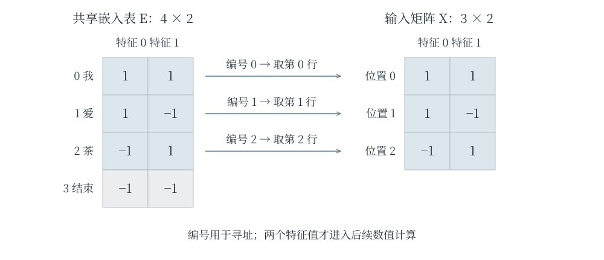

*图 4-1　嵌入是按编号取行。图中两列没有被人为命名为某种语言属性；这些数值只是本章的教学参数。不同位置使用同一张嵌入表，同一个编号会先取出相同的向量，后续上下文计算再使其表示发生变化。*

这些参数是为了方便验证而人工选定的，并不是训练好的中文模型。即使后面的几个预测碰巧符合这句话，也不能据此认为它已经掌握了语言。

图 4-1 从编号开始。编号本身怎样来？设一台分词器以单个字母为起点，训练语料是三个 abc 和两个 ab，每个词单独计数。相邻的 a、b 出现五次，b、c 只出现三次。先把 a 与 b 合成新符号 ab，再数相邻对，ab 与 c 出现三次，于是第二条规则可以把它们合成 abc。这是字节对编码（BPE）学习合并次序的一个小例子。实际系统还要指定起始符号、文本规范化、预切分和特殊符号。这里先固定这些条件，只看合并带来的长度变化。[BPE 子词模型的原始论文](https://aclanthology.org/P16-1162/)

现在输入一段未参与计数的 abcab，把它作为一段连续字符。先做第一条合并，得到 ab、c、ab，再做第二条，得到 abc、ab，共两个词元。如果词表只学了第一条规则，同一段文本就有三个词元。短词元表可以表示这段文字，却要多走一个模型位置。在这个例子里，完整因果注意力允许的位置对从 3 对增加到 6 对，若逐位置保存 KV，缓存行数从 2 增到 3。反过来，扩大词表又会增加嵌入表和输出头的行数。比较两套模型的每秒词元数时，用同一批原始文本再报一次每秒完成的请求和字符数，才能知道用户到底等了多久。同理，想让两个请求共用一段 KV，首先就要核对它们实际送入模型的编号序列。

##### 一个位置的输出，监督的是下一个位置

我们以“我”为已知开头，希望学习接下来的“爱、茶、结束”。训练输入和目标分别是

$$
\begin{aligned}
\text{输入}&=[\text{我},\text{爱},\text{茶}],\\
\text{目标}&=[\text{爱},\text{茶},\text{<eos>}].
\end{aligned}
$$

输入位置 0 的输出用来预测“爱”，位置 1 的输出用来预测“茶”，位置 2 的输出用来预测结束。不能在同一位置直接以已经输入的那个词元作为这里的预测目标，否则就换了任务。

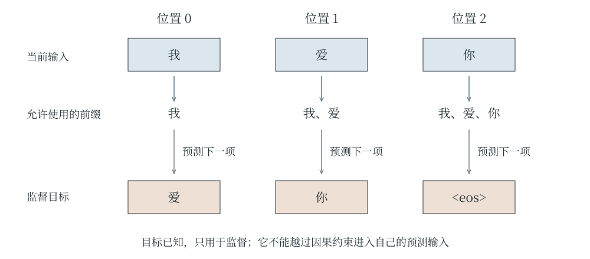

*图 4-2　下一词预测的错位。第一列允许看到“我”，第二列允许看到“我、爱”，第三列允许看到“我、爱、茶”。目标虽然在训练数据中已经给出，却不能通过同一列的注意力读取路径泄漏进去。*

这个模型描述的条件概率分解为

$$
\begin{aligned}
&P(\text{爱},\text{茶},\text{结束}\mid\text{我})\\
&=P(\text{爱}\mid\text{我})\,
P(\text{茶}\mid\text{我},\text{爱})\\
&\quad\times P(\text{结束}\mid\text{我},\text{爱},\text{茶}).
\end{aligned}
$$

每个条件分布由同一个网络、同一组参数产生。如果还要学习整段的第一个词元，通常要引入相应的起始上下文或起始符号。本章已经把“我”作为给定条件，因此不额外计算它的概率。

接下来的关键是：怎样让每个位置取得它允许使用的上下文，又让三个位置能够放进同一次计算？

#### 4.2　一个词元怎样成为查询、键和值

词元嵌入为每个位置提供了起始表示，但单独读取一行嵌入还不能利用其他位置的内容。注意力通过查询、键和值建立位置之间的数据通路：先决定从哪里读取，再组合读到的信息。下面从投影矩阵开始，把这条通路中的数一项项算出来。

##### 三种投影承担三种计算角色

注意力可以理解为一次依赖当前输入的加权读取。当前位置先提出一个数值上的查询，历史位置提供用来匹配的键，以及实际参与加权求和的值。它们分别记为 Q、K、V。

这三个名字不是对语言成分的预先分类。“查询”不必对应问句，“键”也不必对应名词。它们是不同的可学习投影，各自承担比较或传递内容的角色。

设进入注意力的表示为 $N$，单个头的投影为

$$
Q=NW_Q,\qquad K=NW_K,\qquad V=NW_V.
$$

若 $N$ 为 $T\times d$，$W_Q,W_K$ 为 $d\times d_h$，那么 $Q,K$ 都有 $T$ 行，每行 $d_h$ 个分量。本章令值的宽度也为 $d_h$，因此 $W_V$ 具有相同形状。查询与键的内积形成匹配分数，值则用于产生输出；只计算相似度还没有完成一次注意力。

注意这三个投影作用于同一份输入，但矩阵参数可以分别学习。设一个查询和两个键的分数都是 0，softmax 会给两个位置各一半权重；若对应的值分别是 2 和 6，读出的标量就是 4。这个小例子里，分数决定比例，值决定被组合的内容。后面的位置编码可能改变分数，本章的值则不做这种旋转。

在本章的预归一化结构中，$N$ 先由 $X$ 经过 RMSNorm 得到。对一行 $x$，其定义为

$$
\operatorname{RMSNorm}(x)_j
=\gamma_j\frac{x_j}
{\sqrt{\frac1d\sum_kx_k^2+\epsilon}}.
$$

它按该位置的特征维度计算均方根，不先减去均值；这与第三章的 LayerNorm 不同。$\gamma$ 是可学习的逐维缩放。RMSNorm 的统计量来自当前这一行，不需要为了处理一个位置而重新统计其他位置。[RMSNorm 原论文](https://arxiv.org/abs/1910.07467)给出了这种归一化方式。

本章各处 $\gamma=(1,1)$。为了得到简洁的手算数值，在所有被归一化向量均非零的这个例子中暂取 $\epsilon=0$；真实实现需要约定适当的稳定项。三个输入向量的均方根都是 1，因此第一次归一化后 $N=X$。

取

$$
\begin{aligned}
W_Q&=cI,\qquad c=\frac{\ln2}{\sqrt2},\\
W_K&=I,\qquad W_V=I.
\end{aligned}
$$

$I$ 是二维单位矩阵。这些矩阵当前数值相同或成比例，不表示它们共享可训练参数。暂不考虑位置时，查询是输入的 $c$ 倍，键和值都等于输入。选择这个常数，是为了让后面的 softmax 得到简单分数，并不代表通常应当这样初始化模型。

##### 位置信息与注意力

只有内容投影时，相同向量会得到相同的 Q、K、V。如果既没有位置信息也没有结构掩码，把一组输入位置一起重排，普通自注意力只会随之重排输出。因果掩码会引入“哪些位置在前”的结构，但它并不等于给出了丰富的相对距离信息。

一种方法是把位置向量加进输入；另一种方法是直接改变查询与键的比较方式。本章采用后者中的 RoPE，即旋转位置编码。它把查询和键的分量两两配对，按所在位置旋转。[RoFormer 论文](https://arxiv.org/abs/2104.09864)提出了这一构造。

先看一对分量。把它临时写为列向量，则旋转角度 $\phi$ 后是

$$
\begin{bmatrix}u'_0\\u'_1\end{bmatrix}
=\begin{bmatrix}
\cos\phi&-\sin\phi\\
\sin\phi&\cos\phi
\end{bmatrix}
\begin{bmatrix}u_0\\u_1\end{bmatrix}.
$$

位置 $i$ 使用角度 $i\omega$。本章取 $\omega=\pi/2$，于是三个位置分别旋转 $0^\circ,90^\circ,180^\circ$。这是方便手算的频率，不是某个真实模型的默认配置。高维 RoPE 对不同分量对使用不同频率，例如按模型配置取 $\omega_r=b^{-2r/d_h}$，使不同分量对具有不同变化尺度。

我们只旋转 Q 和 K，不对本例的 V 作这一旋转。按行存储时，旋转后的行可写为 $\tilde q_i=q_iR(i\omega)^\mathsf{T}$。于是两个位置的分数包含

$$
\begin{aligned}
\tilde q_i\tilde k_j^\mathsf{T}
&=q_iR(i\omega)^\mathsf{T}R(j\omega)k_j^\mathsf{T}\\
&=q_iR((j-i)\omega)k_j^\mathsf{T}.
\end{aligned}
$$

两个绝对位置的旋转，在内积里变成了与相对位移 $j-i$ 有关的旋转。这解释了位置信息怎样进入匹配分数。它并不保证模型能够无代价地外推到任意长度；频率、训练长度与后续扩展方法还会影响实际表现。

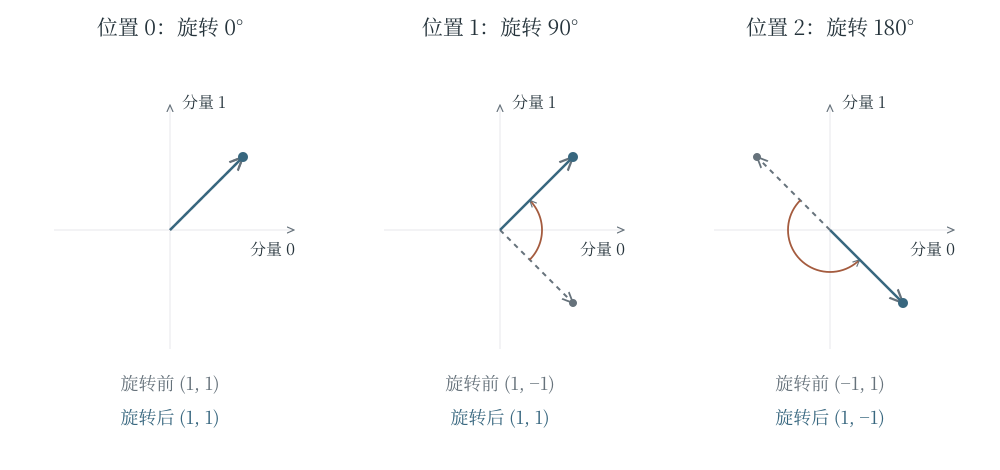

*图 4-3　RoPE 是实际作用在分量上的旋转。虚线为原向量，实线为旋转后向量；位置 0 两者重合。Q 按相同规则旋转，但数值再乘以 $c$；V 在这个例子中保持原值。旋转保持向量长度，却改变不同位置之间的内积。*

完整列出投影和旋转后的结果：

| 位置与词元 | $\tilde q_i$ | $\tilde k_i$ | $v_i$ |
|---|---|---|---|
| 0，我 | $(c,c)$ | $(1,1)$ | $(1,1)$ |
| 1，爱 | $(c,c)$ | $(1,1)$ | $(1,-1)$ |
| 2，茶 | $(c,-c)$ | $(1,-1)$ | $(-1,1)$ |

注意前两个位置的键在这个刻意选取的算例中恰好相同，值却不同。匹配到怎样的权重，与按这些权重读出怎样的内容，是两件事。

下面的短程序可以核对第二个位置的旋转。位置编号从零开始。

```python
from math import cos, sin, pi

def rotate_pair(vector, position):
    angle = position * pi / 2
    a, b = vector
    return [a * cos(angle) - b * sin(angle),
            a * sin(angle) + b * cos(angle)]

rotated_key = rotate_pair([1.0, -1.0], 1)
```

得到的两个分量都约为 1。计算机用浮点数计算三角函数时，结果可能带有很小的舍入差异；正文使用的是相应的精确数学值。

#### 4.3　注意力计算

##### 查询与键的分数矩阵

查询位置 $i$ 与键位置 $j$ 的分数为

$$
S_{i,j}=\frac{\tilde q_i\tilde k_j^\mathsf{T}}{\sqrt{d_h}}.
$$

每一行对应一个查询位置，每一列对应一个被比较的位置。把全部行写在一起，得到 $S=\tilde Q\tilde K^\mathsf{T}/\sqrt{d_h}$，形状为 $T\times T$，表示序列中各位置之间的分数。

为什么除以 $\sqrt{d_h}$？在查询与键的各分量近似独立、零均值、单位方差等假设下，$d_h$ 项乘积的和具有约 $d_h$ 的方差，宽度增加会放大分数尺度，使 softmax 更容易集中到很少的位置。这个缩放在该模型下把分数尺度稳定到相近量级。训练后的实际分布不必满足这些假设，因此应把它理解为有依据的尺度选择，而不是任意数据都具有方差 1 的恒等式。

本例 $d_h=2$。例如位置 1 与位置 0 的内积为 $2c$，除以 $\sqrt2$ 得到 $\ln2$；位置 2 与位置 0 的内积为 $c-c=0$。所以未加掩码的分数矩阵为

$$
S=\ln2\begin{bmatrix}1&1&0\\1&1&0\\0&0&1\end{bmatrix}.
$$

这个内积不是自动等于余弦相似度，也不是人类可直接解释的“语义相关性百分数”。它是模型用来形成读取权重的可学习数值。

##### 因果掩码

位置 0 要预测“爱”，不能在做出预测前就读到输入位置 1 的“爱”。位置 1 要预测“茶”，同样不能读到位置 2。允许读取当前位置，是因为当前位置的输入已经给出，而要预测的是下一个词元。

因此定义加性掩码

$$
M_{i,j}=\begin{cases}
0,&j\le i,\\
-\infty,&j>i.
\end{cases}
$$

对 $S+M$ 的每行做 softmax：

$$
A_{i,j}=\frac{\exp(S_{i,j}+M_{i,j})}
{\sum_k\exp(S_{i,k}+M_{i,k})}.
$$

这里的 $-\infty$ 表示被禁止的位置不参与分母，其权重严格为零。不是把它的原始分数改成零：零分数的指数是 1，仍会参与读取。实现中也不能在 softmax 后随便把几个概率清零、却忘记重新归一化，否则允许位置的权重和将不再为 1。

逐行计算就很简单了。位置 0 只有自己一个候选，权重为 1。位置 1 的两个允许分数都是 $\ln2$，指数都为 2，归一化得到 $1/2,1/2$。位置 2 的三个分数为 $0,0,\ln2$，指数为 $1,1,2$，得到 $1/4,1/4,1/2$。

$$
A=\begin{bmatrix}
1&0&0\\
1/2&1/2&0\\
1/4&1/4&1/2
\end{bmatrix}.
$$

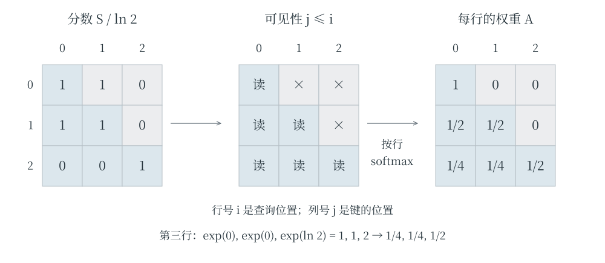

*图 4-4　分数、可见性与权重是三个不同对象。左图用 $\ln2$ 为单位表示分数；中图叉号表示禁止读取，不表示零分数；右图每个有效行的概率和为 1。分母只汇总该行允许的位置。*

稳定实现同样需要先减去该行允许分数的最大值，再计算指数。对于没有任何允许位置的行，softmax 没有正常的归一化分母，需要由具体接口处理；本章有效词元至少允许读自己，不会遇到这种空行。

##### 从注意力权重得到输出

注意力输出为

$$
O=AV.
$$

我们把三行都算出来：

$$
\begin{aligned}
o_0&=(1,1),\\
o_1&=\tfrac12(1,1)+\tfrac12(1,-1)=(1,0),\\
o_2&=\tfrac14(1,1)+\tfrac14(1,-1)+\tfrac12(-1,1)\\
&=(0,1/2).
\end{aligned}
$$

注意最后一行：权重都是正数，但值向量有正有负，第一分量恰好抵消为零。不能把注意力权重理解为直接输出，也不能认为“权重更大”必然使所有输出分量都增大。

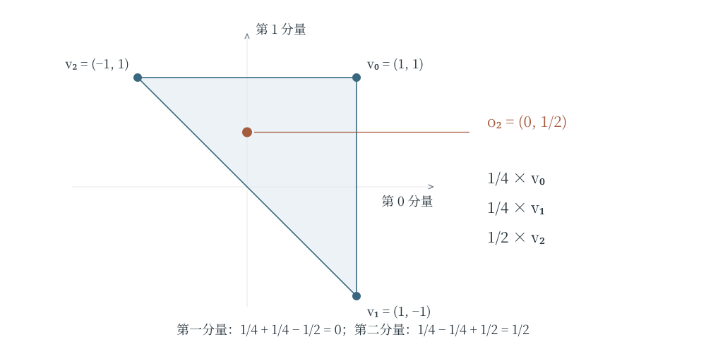

*图 4-5　加权读取的几何含义。一个头在 softmax 后、未做其他变换或丢弃操作时，输出是这些值向量的凸组合。图中三个点与内部结果都使用真实坐标；后续输出投影和残差相加不再受这个三角形范围限制。*

用下面几行代码可以独立核对最后一行。`zip` 将同一位置的权重和值配成一对，两个特征分别求和。

```python
from math import exp, log, sqrt

def softmax(scores):
    largest = max(scores)
    terms = [exp(s - largest) for s in scores]
    total = sum(terms)
    return [t / total for t in terms]

weights = softmax([0.0, 0.0, log(2)])
values = [[1.0, 1.0], [1.0, -1.0], [-1.0, 1.0]]
weighted_value = [
    sum(w * v[j] for w, v in zip(weights, values))
    for j in range(2)
]
```

这里没有调用任何注意力库。矩阵写法与逐行循环计算的是同一个函数；矩阵形式使这些相似操作可以使用适合批量计算的实现。

##### 多头注意力

真实模型通常不只使用一个头。每个头有自己的查询、键和值投影，在各自空间中形成权重，再把各头输出沿特征维度拼接，用 $W_O$ 投影回模型宽度：

$$
Y=\operatorname{Concat}(O^{(0)},\ldots,O^{(H-1)})W_O.
$$

当每头宽度为 $d_h$、$Hd_h=d$ 时，各头合起来仍是每个位置 $d$ 个分量。不是让每个头都产生一份宽度为 $d$ 的完整输出，再无条件增加 $H$ 倍。

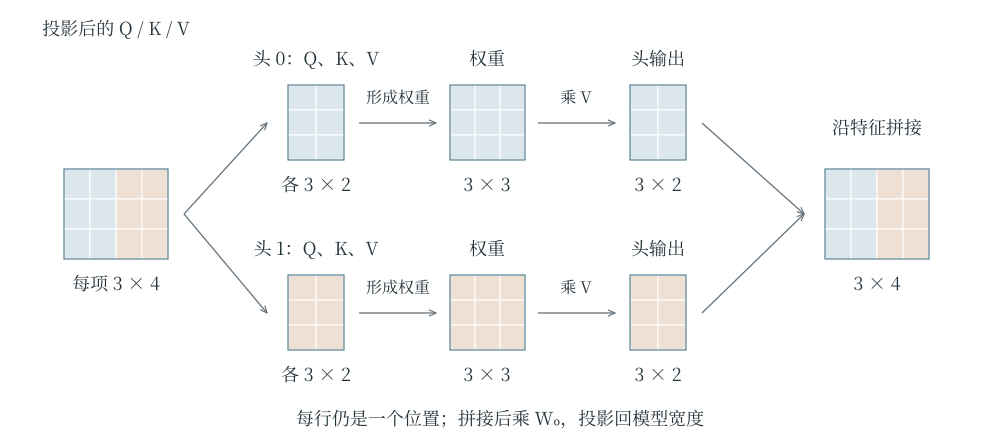

*图 4-6　多头中的形状变化。为区分头与特征，图中将宽度推广为 4、头数取 2，每头宽度为 2；数值主算例仍使用单头。按头拆分、改变维度顺序和最后拼接，必须与投影权重的布局一致。*

多头使模型能够用不同子空间组织读取，但不会预先保证“某头负责语法、某头负责事实”。不同头也可能学到相近的功能。其收益需要由任务表现检验，系统侧则必须准确记录每头的维度和状态。

至此，我们算完了注意力：由输入产生 Q、K、V，加上位置信息，计算分数和可见位置，再归一化、读取值并做输出投影。一个 Transformer 层还有其他部分。

#### 4.4　Transformer 层的完整计算

注意力已经让每个位置读取了允许范围内的信息。若只算到这里，还没有完成本章定义的 Transformer 层：读取结果需要与原有表示相加，前馈网络也要继续对每个位置做变换。接下来把这两部分接起来，得到可供下一层使用的输出。

##### 残差流保留当前位置自己的表示

本章采用预归一化结构，先归一化，再计算子层，最后与原表示相加。注意力子层的结果为

$$
R=X+OW_O.
$$

本例 $W_O=I$，所以

$$
R=\begin{bmatrix}
2&2\\
2&-1\\
-1&3/2
\end{bmatrix}.
$$

例如“茶”所在位置原来是 $(-1,1)$，从上下文读出的增量为 $(0,1/2)$，相加得到 $(-1,3/2)$。注意力输出没有替换掉全部原信息，而是向残差流加入了一次变换结果。

前置归一化使用的是残差流的一个变换分支；直接相加的另一条路径仍是原来的 $X$。如果把相加对象也误换成归一化后的表示，就已经改变了网络。

##### 前馈网络在每个位置独立改变特征

接下来再次对 $R$ 的每行做独立的 RMSNorm，记为 $F$，然后进入前馈网络。普通前馈层可以写成两次线性变换中间加激活函数。本章采用带门控的 SwiGLU：

$$
\begin{aligned}
G&=FW_g,\qquad U=FW_u,\\
B&=\operatorname{SiLU}(G)\odot U,\\
\operatorname{FFN}(F)&=BW_d,\\
H&=R+\operatorname{FFN}(F).
\end{aligned}
$$

这里 $\odot$ 表示逐元素乘法，$\operatorname{SiLU}(g)=g\sigma(g)$。两个投影分支的结果逐项相乘，因而一个分支可以随输入改变另一个分支的贡献。这与在不同位置之间做 softmax 加权不同，也不要求门控值位于 0 到 1 之间。[GLU 变体论文](https://arxiv.org/abs/2002.05202)讨论了包括 SwiGLU 在内的这种组织方式。

若前馈内部宽度为 $m$，则 $W_g,W_u$ 为 $d\times m$，$W_d$ 为 $m\times d$。真实模型经常取 $m>d$，先形成更宽的中间特征再投影回来。本章为手算取 $m=d=2$，并令

$$
W_g=I,\qquad W_u=I,\qquad W_d=\tfrac12I.
$$

这些权重仍是三个独立参数矩阵。两次输入投影当前恰好相同，不等于训练时只能一起变化。

仍以位置 2 为例，$R$ 的该行为 $(-1,3/2)$，均方根为 $\sqrt{13/8}$，因此

$$
\begin{aligned}
F_2&=\left(-\sqrt{8/13},\;3\sqrt{2/13}\right)\\
&\approx(-0.784465,1.176697).
\end{aligned}
$$

两个分支都得到这个向量。逐项计算 $\operatorname{SiLU}(f_j)f_j=f_j^2\sigma(f_j)$，再乘以 $1/2$，得到

$$
\operatorname{FFN}(F_2)
\approx(0.096418,0.529168).
$$

第二次残差相加给出

$$
H_2\approx(-0.903582,2.029168).
$$

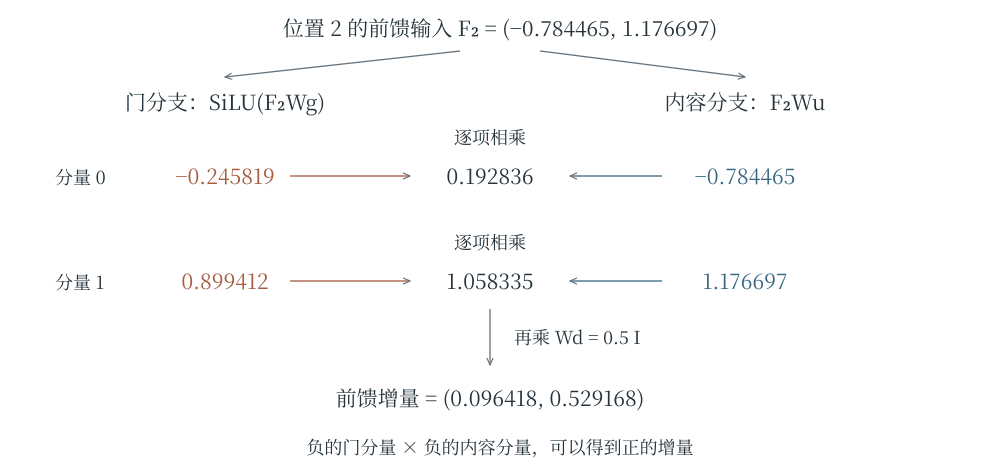

*图 4-7　一个位置内部的门控计算。所有数值来自“茶”所在位置。第一个门控分量与内容分量均为负，乘积反而为正；不能把门控机械地解释成只会在零与一之间开关的概率。*

把三个位置的结果列在一起，可以核对整个前馈阶段。数值保留六位小数，后续复算使用未舍入值。

| 位置 | 第二次归一化后的 $F_i$ | 前馈增量 | 层输出 $H_i$ |
|---|---|---|---|
| 0 | $(1,1)$ | $(0.365529,0.365529)$ | $(2.365529,2.365529)$ |
| 1 | $(1.264911,-0.632456)$ | $(0.623896,0.069391)$ | $(2.623896,-0.930609)$ |
| 2 | $(-0.784465,1.176697)$ | $(0.096418,0.529168)$ | $(-0.903582,2.029168)$ |

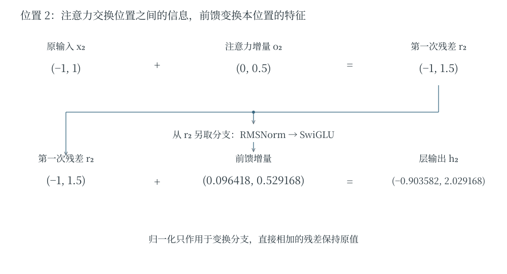

*图 4-8　“茶”所在位置的两次残差相加。注意力通过其他位置取得信息，前馈网络在本位置内变换特征。两次增量都回到同一宽度的残差流，不能遗漏其中一条直接相加路径。*

本章一个完整块因此为

$$
\begin{aligned}
R&=X+\operatorname{Attention}(\mathcal N_1(X)),\\
H&=R+\operatorname{FFN}(\mathcal N_2(R)).
\end{aligned}
$$

这里 Attention 已经包含位置处理和输出投影。堆叠多个块时，上一块的 $H$ 成为下一块的 $X$，每块通常拥有自己的权重。更高层同一位置的 K、V 已经来自吸收过上下文的表示，不再只是最初词元嵌入的简单变换。

##### 层输出还不是词表概率

最后一个块输出后，本章再做一次 RMSNorm，得到 $Z$。然后用词表投影 $W_{\mathrm{vocab}}$ 产生四个候选分数：

$$
\begin{aligned}
W_{\mathrm{vocab}}
&=\begin{bmatrix}-1&1&1&-1\\-1&1&-1&1\end{bmatrix},\\
C&=ZW_{\mathrm{vocab}}.
\end{aligned}
$$

四列仍按“我、爱、茶、结束”的顺序排列。这里的输出矩阵没有与输入嵌入共享参数。有的模型会将二者绑定以减少参数量；那需要同时改变参数计数和共享梯度的处理。

例如位置 0 的层输出两分量相等，最终归一化为 $(1,1)$，词表分数为 $(-2,2,0,0)$。对四个分数做 softmax，预测“爱”的概率约为 0.775803。

另外两个位置最终归一化后的向量分别约为 $(1.332866,-0.472724)$、$(-0.575286,1.291916)$。以位置 2 为例，乘第一列 $(-1,-1)$ 得到约 $-0.716630$，乘第四列 $(-1,1)$ 得到约 $1.867202$。这与前面每一次投影一样，仍是向量与权重列的内积。把各位置的结果列在一起：

| 位置 | 四个词表分数，依词表顺序 | 正确下一词元的概率 |
|---|---|---:|
| 0 | $(-2,2,0,0)$ | 爱：0.775803 |
| 1 | $(-0.860143,0.860143,1.805590,-1.805590)$ | 茶：0.673367 |
| 2 | $(-0.716630,0.716630,-1.867202,1.867202)$ | 结束：0.706301 |

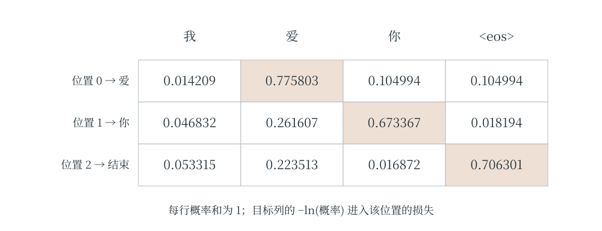

*图 4-9　输出概率的列是词表项，注意力权重的列则是输入位置，两者不能混为一谈。每行四个词表概率之和为 1；高亮的是该输入位置的下一词元目标。图中模型仅有人工选择的教学参数。*

至此，这个层没有留下未解释的“大盒子”：嵌入、三种投影、位置、因果注意力、输出投影、两条残差、两次块内归一化、门控前馈、最终归一化和词表输出，都已经具体算过。主例不包含随机丢弃操作，也不包含投影偏置；这些是本章明确选定的结构，而不是对所有 Transformer 的要求。

#### 4.5　训练：让所有已知位置一起学习

##### 训练中的位置并行

训练样本中的“我、爱、茶、结束”已经给出。三个输入位置可以一次组成 $X$，同一层的 Q、K、V 可以通过批量矩阵乘法一起产生。每行的可见范围由因果掩码限制，不需要真的等位置 0 先选出“爱”，才知道位置 1 的输入是什么。

这种用真实前缀预测下一项的训练方式通常称为 teacher forcing。它并没有让模型从未来位置读取答案：虽然设备里同时保存着所有输入，模型定义中的读取关系仍然受到掩码限制。一个数据已经存在于内存，与一个计算被允许使用它，是不同的事情。

层与层之间仍有依赖。第二层要使用第一层输出，不能因为所有词元已知就无条件跳过这项依赖。“训练可以并行处理位置”，不等于整个模型所有操作都能同时完成。

与之相对，生成时未来词元尚未选定。在普通的逐词元自回归方式中，必须先得到当前分布并选择下一个词元，才能知道下一步输入。训练时沿位置维度的大矩阵计算，在生成时会变成较短的新增输入和不断增长的历史读取。

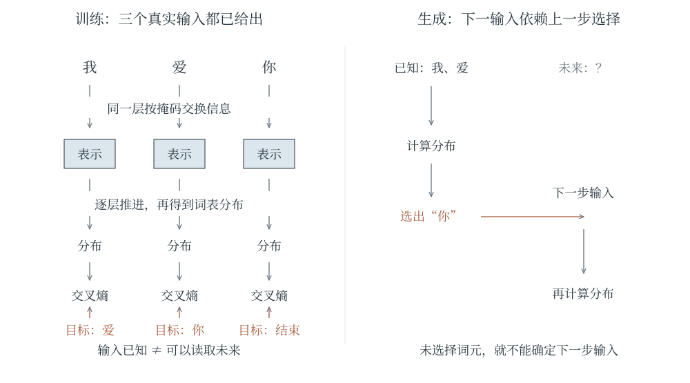

*图 4-10　两种运行方式的可用数据不同。每一行代表一个层级或一次选择，图只表达依赖，不表达耗时比例。训练中的同时处理始终受因果掩码约束；生成侧未来输入并非简单地从已知矩阵中取下一行。*

##### 逐位置损失与平均

本章三个目标位置都参与训练。其平均交叉熵为

$$
L=-\frac13\sum_{i=0}^{2}\ln P_{i,y_i}.
$$

$P$ 是词表概率矩阵，$y_i$ 是该位置的目标编号。三个损失约为

$$
\begin{gathered}
(0.253856,\;0.395465,\;0.347714),\\
L\approx0.332345.
\end{gathered}
$$

如果直接对词表分数 $C$ 求导，那么

$$
\bar C_{i,k}=\frac13
\left(P_{i,k}-\mathbf 1_{k=y_i}\right).
$$

这与第三章的 softmax 交叉熵完全一致，只是现在有多个位置共用同一组参数。各位置对投影矩阵、嵌入与其他权重的贡献需要合并，不能在算完一个位置后就提前更新权重，再拿它计算另一个位置的本次梯度。

本章小模型有 50 个独立参数：嵌入 8 个，Q/K/V/O 四个投影合计 16 个，三个前馈矩阵合计 12 个，三处 RMSNorm 的缩放合计 6 个，词表投影 8 个。虽然某些矩阵当前取了相同数值，仍按独立参数计数。

复算程序对这 50 个参数逐一核对完整损失的导数。用学习率 0.1 做一次普通梯度下降，损失从约 0.332345 变为约 0.309575。这里的改进同样需要重新前向计算才能确认，并不因为这是 Transformer 就改变了第三章的训练逻辑。

##### 注意力的反向传播

注意力也可以逐个局部运算求导。先看 $O=AV$，若后面已经返回 $\bar O$，矩阵微分给出

$$
\bar V=A^\mathsf{T}\bar O,
\qquad \bar A=\bar O V^\mathsf{T}.
$$

对于 softmax 的第 $i$ 行，记它的输入为掩码后的有效分数。该行梯度为

$$
\bar S_{i,j}=A_{i,j}
\left(\bar A_{i,j}-\sum_k A_{i,k}\bar A_{i,k}\right).
$$

这个式子值得与第三章的归一化反向对照：一个候选概率变化，会通过共同分母影响同一行的其他候选，因此不是每个位置独立乘一个导数就结束。被掩码禁止的分数没有参与这个函数，梯度为零。

为看清数值，暂时给第三行输出一个**测试用上游梯度** $\bar o_2=(1,0)$。这只用于检查局部算子，不是假定完整语言模型的损失恰好返回这个梯度。它关心输出的第一分量，因此对三个权重的梯度为三个值的第一分量：

$$
\bar a=(1,1,-1).
$$

按权重 $(1/4,1/4,1/2)$ 加权，其均值为零，所以分数梯度是

$$
\bar s=(1/4,1/4,-1/2).
$$

三项之和为零，可以独立检查：给同一行所有有效分数加一个常数，softmax 不变，该共同平移方向上的导数也应为零。


*图 4-11　一个注意力行的反向。图中使用的是局部测试梯度，完整训练会由后续层自动给出实际 $\bar O$。分数梯度先减去共同的加权均值，再乘对应权重；这个共同项体现了同一行各候选之间的耦合。*

继续回到缩放内积，有

$$
\begin{aligned}
\overline{\tilde Q}&=\bar S\tilde K/\sqrt{d_h},\\
\overline{\tilde K}&=\bar S^\mathsf{T}\tilde Q/\sqrt{d_h}.
\end{aligned}
$$

再经过旋转的转置映射，梯度回到未旋转的查询、键，随后回到相应投影矩阵和输入表示。旋转角度在本章是固定配置；若模型定义包含可学习的位置参数，还需要对那些参数求导。

这些式子说明，反向需要前向中的哪些信息。例如值梯度涉及注意力权重，查询梯度涉及键，权重投影梯度涉及其输入。并不因此推断必须把完整 $T\times T$ 权重矩阵一直保存：可以通过重计算或其他等价组织恢复需要的信息。第十章讨论 FlashAttention 时，会从这个需要出发推导怎样减少存取。

##### 注意力掩码与损失掩码不能混用

若一个批次中有不同长度的序列，常需补齐形状；填充位置不能被当成正常上下文读取。将多个独立样本拼接到一段张量中时，也不能仅使用一个覆盖全部位置的下三角掩码，否则后一条样本会读取前一条样本的信息。它们需要符合任务边界的可见性约定。

损失掩码回答的是另一个问题：哪些位置参与目标。设 $m_i\in\{0,1\}$ 表示是否监督该位置，则

$$
L=-\frac{\sum_i m_i\ln P_{i,y_i}}{\sum_i m_i},
$$

其中分母需要非零。对只监督回答部分的样本，提示词位置可以不计算直接的预测损失，但仍然被回答位置读取。它们的表示与相关参数，也可能通过这些读取路径收到梯度。

因此，“这个位置没有损失”不等于“这个位置不参加计算”，也不等于“可以切断它的梯度”。跨设备或跨小批合并梯度时，应按约定的有效目标数加权，不能把不同长度的均值不加区分地再平均一次。

##### 多文档拼接与掩码

设这次要训练两篇独立短文，A 有三个词元，B 有两个。把它们紧挨着摆成五行，可以省去矩形批里的填充。第三行和第四行在内存里紧挨着，语义上却隔着一篇文章。假设训练目标要求两个文档独立，每个查询可读的键必须同时满足“在同一文档内”和“不在未来”。下表逐格画出这个约定。

| 查询所在行 | 键 A₁ | 键 A₂ | 键 A₃ | 键 B₁ | 键 B₂ |
|---|---|---|---|---|---|
| A₁ | 可见 | — | — | — | — |
| A₂ | 可见 | 可见 | — | — | — |
| A₃ | 可见 | 可见 | 可见 | — | — |
| B₁ | — | — | — | 可见 | — |
| B₂ | — | — | — | 可见 | 可见 |

让所有查询和键都为零，值依次取 $2,4,6,10,20$。所有可见分数相同，所以每行输出就是可见值的平均。B 的两行应得到 $10$ 和 $15$。若只画一个覆盖五行的大因果三角，B 的第一行变成 $(2+4+6+10)/4=5.5$，第二行变成 $42/5=8.4$。即使程序把 A 的末位置损失设为零，B 仍读到了 A，前向已经改变。反过来，只隔开注意力，同时用整段平移后的词元创建标签，又会误让 A 的末位置预测 B 的首词。两处边界要分别检查。若课程特意训练跨文档连续预测，则应另行规定这一目标。

五行的大三角有 15 个允许的位置对，两个小三角只需 $3\times4/2+2\times3/2=9$ 对。若底层仍按整张稠密矩阵计算，改掩码只保证结果正确。变长注意力接口可以接收各段的累积边界 $[0,3,5]$，据此在每段内部安排工作。实际设备还按块对齐，节约的时间要实测。测试这类路径时，分别单算 A、B，再把两份输出与拼在一起的五行逐项对齐，比检查矩阵尺寸更容易抓出一次越界读取。[FlashAttention 变长接口](https://github.com/Dao-AILab/flash-attention/blob/main/flash_attn/flash_attn_interface.py) [逐位置复算程序](../experiments/ch05/trace_attention.py)

#### 4.6　生成：从预填充走到逐步解码

训练时整段样本已经给定，因此可以在因果约束下同时处理多个位置。生成时，未来选择的词元尚不存在，下一步依赖当前输出。即使模型参数相同，两种运行方式可用的输入和执行形状也不同。

##### 预填充与首个生成词元

现在固定同一组参数，只把“我、爱”作为提示词。模型先处理这两个已知输入位置，这一步称为预填充。由于因果约束，前两个位置的计算与之前三词元前向中的前两行一致；删去未来的“茶”，不会改变它们能够读取的前缀。

我们需要的是最后一个提示位置，也就是“爱”所在位置给出的下一词分布。它预测“茶”的概率约为 0.673367，是四个候选中最大的。因此采用贪心选择时，预填充结束后的分布已经可以选出“茶”。

这时不需要为了得到第一个输出，再执行一次相同意义的解码前向。预填充的最后一行已经完成了这次预测。实现也可以只把最后一行送入词表输出头，而不为提示词的所有位置保留完整词表概率。

如果要继续生成，刚选出的“茶”才作为新输入进入下一步。它现在位于位置 2，使用“我、爱、茶”的上下文，产生下一个分布。这个分布应与完整三词元前向的最后一行一致，本例最大概率项为结束，约为 0.706301。

结束词元通常不作为普通文字显示给用户。若它触发停止，就不会再把它送入下一次模型前向。本例的生成过程因此包含一次两词元预填充、一次新增词元的解码前向，以及两次词元选择。


*图 4-12　被选出的词元与已被模型处理的词元，存在一个步骤的边界。刚选出“茶”时，它还没有自己的 K、V；送入下一次前向后才产生它们。横轴按事件排列，不代表等长耗时。结束符计入选择次数，但不显示为普通文字。*

一般地，若提示有 $n$ 个词元，之后恰好选出 $M$ 个词元并停止，最后一个不再送回模型，那么通常执行一次预填充、$M-1$ 次新增词元前向。若系统报告的输出计数不包含结束符，还要单独对齐这个统计边界，不能把用户看见的字数直接代进模型调用次数。

##### 选择规则也会影响后面的输入

贪心选择取当前最大分数的词元。采样则按照一个约定的分布抽取结果。常见温度变换将分数改为 $C_k/\tau$ 后再归一化；$\tau>0$ 时不会改变最大分数的顺序，却会改变采样分布的集中程度。

贪心选择不保证整段序列的联合概率最大，更不保证输出满足实际任务要求。选出的不同词元会进入下一步，改变后续上下文。第二十章再讨论更完整的生成策略及额外计算的作用；当前需要先分清模型前向、词元选择和下一步输入三个事件。

比较训练前向与生成前向时，也要固定条件。两者在同一参数、同一前缀、同一位置与掩码约定下，可以实现同一个确定性函数；若训练中启用了随机丢弃等操作，逐次输出就不必相同。关闭训练中的随机行为，与关闭梯度记录又是两项不同的运行设置。

##### 逐步生成中的重复计算

一种最直接的生成实现，是每得到一个新词元，就把完整前缀重新送入模型。处理“我、爱”后生成“茶”，下一次再处理“我、爱、茶”。这样当然能够得到正确结果，但前两个位置的多层计算被重做了。

在因果模型中，这些旧位置看不到新加入的未来位置。既然它们的输入前缀没有改变，为什么还要重新计算它们的表示、投影和前馈结果？KV Cache 正是从这个问题产生的。

#### 4.7　KV Cache 保存什么，为什么能够复用

朴素生成会在每一步重新处理整个前缀，其中许多旧位置已经计算过。我们需要先证明旧结果在追加词元后是否改变，才能决定哪些数据可以缓存。这个证明依赖因果可见性和确定的模型状态，不能直接推广到所有注意力结构。

##### 旧位置的计算结果为何可以复用

先假设参数固定，采用本章的确定性因果结构，归一化和前馈都只在各位置内部计算，位置配置保持一致。

在最底层，旧位置的词元嵌入没有改变。假设某层输入中所有旧位置已经保持不变，那么这些位置的 Q、K、V 也不变；每个旧查询仍只读取不晚于自己的键和值，新增的未来位置被掩码禁止，因此该位置的注意力输出也不变。后续残差、逐位置归一化和前馈结果随之不变。

逐层使用这个推理，可以得到：**追加未来词元，不会改变各层旧位置的表示，也不会改变由这些表示产生的 K、V。** 这不是仅凭“模型权重没变”就得出的结论；因果可见性和其他运算的依赖范围同样重要。双向注意力等结构就不能不加检查地照搬这个证明。

新位置的查询却需要读取历史 K、V。于是我们为每一层保留历史键和值；下一步只计算新位置在这一层的 Q、K、V，把新的 K、V 接到历史后面，再执行新查询的读取。

旧 Q 通常没有必要继续保存在这种生成缓存中，因为以后要计算的是新位置的输出，不再重做旧查询的输出。它不表示当前 Q 可以不算，也不表示训练反向永远不需要 Q。

##### KV Cache 的内容

本章选择缓存**已经应用 RoPE 的键**，以及没有应用该旋转的值。预填充“我、爱”之后，唯一一层的缓存为

$$
K_{\mathrm{past}}=\begin{bmatrix}1&1\\1&1\end{bmatrix},
\qquad
V_{\mathrm{past}}=\begin{bmatrix}1&1\\1&-1\end{bmatrix}.
$$

接下来将“茶”送入位置 2。新查询为 $(c,-c)$，新键为 $(1,-1)$，新值为 $(-1,1)$。把后两项追加后，新查询得到的三个分数仍为 $0,0,\ln2$，权重仍为 $1/4,1/4,1/2$，输出仍为 $(0,1/2)$。


*图 4-13　缓存复用的是旧行，新查询仍要读历史。图中 K 的前两行相同，V 的前两行不同，因此只保存其中一类无法完成同一个函数。高亮的第三行在“茶”实际进入模型后才产生。*

对应的短程序如下。它沿用前面定义的 `softmax`，直接展示本层追加一行后的读取；完整模型的逐层版本在本章复算程序中。

```python
keys = [[1.0, 1.0], [1.0, 1.0]]
values = [[1.0, 1.0], [1.0, -1.0]]
c = log(2) / sqrt(2)
query = [c, -c]
keys.append([1.0, -1.0])
values.append([-1.0, 1.0])
scores = [
    sum(q * k for q, k in zip(query, key)) / sqrt(2)
    for key in keys
]
new_weights = softmax(scores)
new_output = [
    sum(w * v[j] for w, v in zip(new_weights, values))
    for j in range(2)
]
```

这里的 `append` 表达增加一个逻辑位置，不规定生产实现必须重新拼接或复制整片存储。实际缓存如何预分配、分页、复用和回收，会在推理引擎章节继续讨论。

多层模型需要每层自己的缓存。新词元先在第一层计算，得到当前新位置的层输出，再进入第二层；第二层的新查询读取第二层历史缓存。不能拿第一层的 K、V 去替代第二层的缓存，也不能认为“同一个词元”在所有层都对应同样的状态。

##### 只有一行查询时，掩码仍要使用正确的位置

预填充三个位置时，注意力矩阵是 $3\times3$。已有两个缓存位置，再送入一个新词元时，查询长度只有 1，键长度却是 3。这个查询的全局位置为 2，应该允许读取列 0、1、2。

如果不看位置偏移，只对一个 $1\times3$ 数组机械地取普通下三角，就可能只留下第一列。这不是性能差异，而是在计算另一个函数。

一般地，已有 $P$ 个历史位置，本次输入 $C$ 个新位置，新查询的局部行号为 $i$，则它的全局位置为 $P+i$。当缓存列按原顺序排列时，允许条件是

$$
j\le P+i.
$$

例如 $P=2,C=2$，四列包含两个历史位置和两个新增位置，正确的允许矩阵为

$$
\begin{bmatrix}
1&1&1&0\\
1&1&1&1
\end{bmatrix}.
$$


*图 4-14　矩形注意力的对角边界由全局位置决定。图中“读”对应允许项 1，叉号对应禁止项 0；这是数学上的可见性约定。具体 API 的布尔值是表示“保留”还是“屏蔽”，需要另按接口约定转换。*

RoPE 也必须使用相应位置，不能因为一次调用只输入一行，就每次重新从位置 0 开始旋转。存在填充、分块处理或缓存重排时，还要分清存储槽位、有效序列位置和模型的位置编号。它们在简单例子里相同，不代表所有运行方式都相同。

##### 复用条件与不能省掉的读取

完整前缀重算和缓存执行应该在同一条件下产生等价结果。本章程序逐前缀进行比较，还检查了两层网络、非零归一化稳定项，以及改变未来词元不影响较早输出等情况。实际硬件上的浮点归约顺序可能不同，因此通常还要约定数值容差；不能把一次逐位相等当作所有后端的承诺。

不同请求若要共享前缀缓存，需要模型及相关配置相同、已处理前缀相同、位置与可见性语义一致，或者存在已经验证的等价变换。只是最后一个词元相同远远不够，因为高层 K、V 包含前面的上下文。权重或适配器发生变化后，也不能直接把旧缓存当成新模型的状态。

训练中的前向激活与生成中的 KV Cache 都属于中间数据，却具有不同的使用目的。生成缓存用来避免重复前向；训练要保留求导需要的依赖。若把历史 K、V 脱离计算图后用于普通训练，历史分支上的梯度就可能被切断。专门设计的训练分块或截断方法需要自己的数学约定，不能仅把推理缓存开关打开就认为训练仍然等价。

缓存节省了旧位置的重复投影和层内计算，但新的查询仍需与历史键比较，并读取相应值。对完整历史注意力，一个新增位置的读取工作仍随历史长度增长。KV Cache 没有把长上下文变成常数成本，只是把“重新执行整个前缀”改成了“计算新位置并读取已保存的历史”。

##### 缓存容量怎样从结构算出来

设模型有 $L$ 层，每层保存 $H_{kv}$ 组键和值，每组宽度为 $d_h$，每元素占 $b$ 字节，当前缓存有 $T$ 个位置。当 K、V 维度与格式相同时，一个请求的逻辑数值存储为

$$
M_{KV}=2LTH_{kv}d_hb.
$$

开头的 2 分别对应 K 和 V，$L$ 表示每层都有自己的状态。这个公式计算的是数值本身，不包含分页空洞、预留容量、对齐、元数据等开销，也不自动适用于采用其他压缩状态表示的架构。

普通多头注意力中，查询头数与 KV 头数相同。有些模型让多个查询头共用一组 K、V，即分组查询注意力 GQA。例如 32 个查询头共用 8 组 K、V，每组服务 4 个查询头。每个查询头仍形成自己的权重，但保存的键和值只有 8 组。下一章会进一步讨论这种共享为什么可行、改变了什么，以及它与其他历史表示方法的区别。


*图 4-15　缓存公式中的每个因子都有对象。这里使用的 32 层、8 组 KV、128 维和 2 字节，将每词元状态展开为 128 KiB。查询头数影响计算方式，但不能不加区分地替换缓存公式中的 KV 头数。*

用图中的配置，单个位置占

$$
\begin{aligned}
&2\times32\times8\times128\times2\\
&=131{,}072\ \mathrm{bytes}=128\ \mathrm{KiB}.
\end{aligned}
$$

4096 个位置因此占 512 MiB。这正是第一章曾独立给出的每词元状态预算的一种具体结构来源。模型有多少参数，并不能单独决定这个数。

如果提示长度为 4096，之后选出 256 个词元便停止，最后一个不再送回模型，那么结束时已经处理的位置数为 $4096+255=4351$，缓存约为 543.875 MiB。这里再次需要区分“已经选出的输出”与“已经生成了 K、V 的输入位置”。

#### 4.8　模型规模与资源开销

前面逐项计算了一个位置经过的操作。接下来扩大模型和序列，估算一次请求需要多少计算、保存多少状态，以及训练和生成的资源需求有何不同。

##### 参数来自哪些矩阵

考虑一个结构上延续本章、采用分组查询注意力的示例模型。以下数字用于说明计算方法，并非某个产品的实测配置：

| 结构量 | 符号 | 数值 |
|---|---|---:|
| 层数 | $L$ | 32 |
| 每个位置的表示宽度 | $d$ | 4096 |
| 查询头数 | $H_q$ | 32 |
| KV 头数 | $H_{kv}$ | 8 |
| 每个头的宽度 | $d_h$ | 128 |
| 门控前馈网络的中间宽度 | $m$ | 11008 |
| 词表大小 | $V$ | 32000 |

这里 $H_qd_h=d$，但 $H_{kv}d_h=1024$。因此，Q 投影和输出投影各有 $d^2$ 个参数，K、V 投影各有 $d\times1024$ 个参数。令 $d_{kv}=H_{kv}d_h$，一层中注意力投影的参数数目为

$$
P_{\mathrm{attn}}=2d^2+2dd_{kv}
=41{,}943{,}040.
$$

SwiGLU 的两个向上投影分别为 $d\times m$，向下投影为 $m\times d$，所以

$$
P_{\mathrm{ffn}}=3dm=135{,}266{,}304.
$$

记一层这些线性变换的参数总数为 $P_b$，则

$$
P_b=P_{\mathrm{attn}}+P_{\mathrm{ffn}}
=177{,}209{,}344.
$$

每层两个 RMSNorm 再提供 $2d$ 个缩放参数。采用独立的输入嵌入与输出词表矩阵，加上最后一次 RMSNorm，总参数量为

$$
\begin{aligned}
P&=L(P_b+2d)+2Vd+d\\
 &=5{,}933{,}109{,}248.
\end{aligned}
$$

这是一个约 59.3 亿参数的示例，接近第一章为了建立预算而采用的约 60 亿参数模型。第一章的预算仍是近似预算；这里展示的是一种能够同时解释参数规模与每词元 128 KiB 缓存的具体结构。若输入输出共享词表矩阵，或引入偏置、其他归一化、专家分支，参数公式也要相应改变。

把本章小模型的 $L=1,d=2,d_{kv}=2,m=2,V=4$ 代回同一个式子，得到 50。小模型与大模型的计数逻辑没有变化，变化的是矩阵尺寸。

##### 预填充的计算量

第二章约定，一次乘法和一次加法分别算一次浮点运算，因此计算一个长为 $k$ 的内积通常近似计为 $2k$ FLOPs。按此约定，把一个位置送过一层所有线性变换，约需 $2P_b$ FLOPs。长度为 $T$ 的输入，经过全部层需要

$$
C_{\mathrm{linear}}\approx2TLP_b.
$$

它随 $T$ 线性增长。每个位置都要做自己的投影与前馈计算，但该位置的线性变换不因前面多了多少位置而变宽。

注意力读取不同。完整因果注意力里，第 0 行读 1 个位置，第 1 行读 2 个，最后一行读 $T$ 个，有效的查询—键配对数为

$$
1+2+\cdots+T=\frac{T(T+1)}{2}.
$$

每个配对、每个查询头要计算一次宽度为 $d_h$ 的分数内积，并为值的加权求和贡献约同样多的运算。忽略 softmax 等额外操作，全部层的有效工作为

$$
\begin{aligned}
C_{\mathrm{causal\ attention}}
&\approx4LH_qd_h\frac{T(T+1)}{2}\\
&=2LdT(T+1).
\end{aligned}
$$

这里仍然出现查询头数，而不是 KV 头数：每个查询头都形成自己的分数与输出，共享 K、V 并没有让这几组查询变成同一个查询。

如果实现先计算整个方阵，再遮掉上三角，那么这部分的计算量约为 $4LdT^2$。这是**完整方阵的计算量**；前面的公式是**有效因果配对的计算量**。实际算子按块跳过多少无效区域，决定执行量更接近哪一个。不能拿一种口径的估算与另一种口径的测量直接比较。

在 $T=4096$ 时，32 层线性变换合计约需 46.454 TFLOPs，有效因果注意力约需 4.399 TFLOPs；若算整个注意力方阵，则约为 8.796 TFLOPs。这里的 TFLOPs 表示万亿次运算，是工作量；TFLOP/s 才是每秒吞吐率。


*图 4-16　短序列中占比小的工作，可能在长序列中成为主要工作。曲线只比较示例结构的理论运算量，不是性能测试，也不表示该模型已经训练到或支持这些上下文长度。*

把两个公式相等，可得这部分注意力工作与层内线性工作相当的位置：

$$
T+1\approx\frac{P_b}{d},\qquad T\approx43{,}263.
$$

这个交点不等于实际耗时的交点。两类算子的并行性、数据复用、内存访问和实现效率不同，设备可能早在运算量相当之前就暴露出其他瓶颈。第二篇会建立判断这些差异所需要的硬件知识。

##### 解码的计算量与历史读取

有了 KV Cache，一次普通逐词元解码只为新位置执行层内线性变换，其工作量约为 $2LP_b$。本例约为 11.341 GFLOPs，不再乘整个前缀长度。

但新查询仍要读取历史。若把刚追加的新位置计入后，共有 $T$ 个键，那么注意力工作约为

$$
C_{\mathrm{decode\ attention}}\approx4LdT.
$$

在 $T=4096$ 时，它约为 2.147 GFLOPs。这里的 $T$ 每生成并处理一个位置就增长一次。因此，不能把“只执行一行”误读为“每一步都只接触一行数据”。

还要加上输出词表投影。本例每个被要求产生分布的位置需要 $2dV$，约 0.262 GFLOPs。普通生成的预填充只需最后一行的下一词分布，输出词表投影通常可以只做这一行；训练需要每个有效监督位置的分布。输入嵌入则是按编号取行，不是对整张嵌入矩阵做一次稠密乘法。因此，精确估算时不能总对全部参数统一套用 $2P$。

以上数字主要计矩阵乘法，尚未把归一化、旋转、激活、softmax、采样和数据搬运都折为时间。它们的作用是帮助定位需要继续调查的工作，而不是直接预测延迟。

##### 分别计算参数、激活和缓存

参数由模型结构决定；激活是执行某段计算时产生的数据；KV Cache 是为了后续位置读取而延长寿命的一部分状态。相同的字节数，可能具有完全不同的产生时机和保存期限。

例如在 $T=4096$、每元素 2 字节时：

| 单个对象 | 元素形状 | 数值本身的容量 |
|---|---|---:|
| 一层的一份残差表示 | $T\times d$ | 32 MiB |
| 一层的一份前馈展开结果 | $T\times m$ | 86 MiB |
| 一层的一份完整注意力方阵 | $H_q\times T\times T$ | 1024 MiB |
| 所有层的 K、V 缓存 | $2L\times T\times H_{kv}d_h$ | 512 MiB |

前馈的门分支、上投影分支、逐元素乘积不一定同时存在，也不一定都必须保存。类似地，训练的峰值内存还取决于哪些层的激活留给反向、哪些会重算，不能把表中几项机械相加就称为完整训练显存。


*图 4-17　同在一层内，中间对象也可能相差几十倍。第三条假定把所有头的完整注意力方阵显式保存下来；它展示了一种执行方式的存储代价。*

数学上定义了 $A$，并不意味着程序一定要把整个 $A$ 同时写入内存。可以分块计算分数、维护归一化统计量、逐步累计输出，在保持结果的条件下改变中间量的保存方式。第十章讲的 FlashAttention 正是从这里切入。它减少的是一种执行方式的中间存储与访问，不能因此把完整注意力的配对数从平方改成线性。

##### 分词器改变之后，损失和吞吐还可比吗

上面的计算量与缓存量都按词元位置计算，4.5 节的交叉熵也按有效预测位置求平均。要比较两个模型，这个共同的计数单位需要先核对。这在固定分词器、固定计分范围时很清楚；换了分词器，分母本身也变了。设完全相同的 100 字节 UTF-8 文本，在方案甲中被编码为 10 个计分词元，总负对数似然为 40；在方案乙中被编码为 25 个词元，总负对数似然为 50。这里两个总量都用自然对数，并采用相同的条件上下文及文本范围。

平均每词元损失分别为 4 和 2。困惑度是这个平均值的指数，因而分别约为 54.60 和 7.39。仅看这一列会觉得乙好得多，但乙实际上把同一段文本拆成了更多预测事件。若将规范编码序列的总负对数似然换算到每个原始字节，得到

$$
\text{bits per byte}=\frac{-\sum_i\ln p(x_i\mid x_{<i})}{N_{\rm byte}\ln2}.
$$

本例甲为 0.577，乙为 0.721，排序反过来了。这个换算消除了计分词元个数不同造成的一种混淆，但不能代替任务正确率：需固定原始文本、规范化方式、计分掩码、上下文窗口和边界符号；规范编码序列的概率也不等于把所有可能解码成同一文本的词元序列概率全部求和。若采用滑窗，应避免重叠窗口重复计分，也应说明每个预测位置实际看见多长的历史。[固定上下文模型的困惑度计算](https://huggingface.co/docs/transformers/perplexity)

系统比较也会受到同一变化影响。假设甲每秒输出 100 个词元、平均每词元对应 4 字节，乙每秒输出 160 个词元、平均对应 2 字节，分别只相当于每秒 400 与 320 字节。这还没有计入文本内容及质量差异。分词更细既改变吞吐单位，也增加注意力位置、KV 容量与逐步解码次数。对同一应用，应该同时保留原始输入输出、计分质量、词元数和实际完成时间，才能分辨模型改变与系统提速各贡献了多少。

[复算同一文本的两种计分单位](../experiments/ch03/learning_efficiency.py)

#### 4.9　计算规则与模型结构的取舍

前面保持模型定义不变，通过缓存减少了重复计算。如果进一步改变注意力的约束、层的参数共享方式或训练目标，会出现哪些新的收益和代价？下面分别讨论这三种改动，并区分数学等价的重写与模型本身的变化。

##### softmax 权重的优化解释

注意力为各历史位置分配权重。这个分配还可以写成一个优化问题。取两个允许读取的位置，得分分别为 $\ln 3$ 和 0。给第一个位置分配 $p$，第二个便剩 $1-p$，加权得到的分数是 $p\ln 3$。只追求分数会把所有权重压在第一个位置。给分布再计入熵 $H(p)=-p\ln p-(1-p)\ln(1-p)$，它在两项一样多时最大。把两种倾向放进同一目标 $J(p)=p\ln 3+T H(p)$，正数 $T$ 表示我们给分散程度多大权重。这里约定 $0\ln0=0$。

对 $0<p<1$，令导数为零，得到 $\ln 3+T\ln((1-p)/p)=0$，也就是 $p/(1-p)=3^{1/T}$。二阶导数为 $-T/[p(1-p)]<0$，所以该点是唯一最大值。$T=1$ 时得到 $(3/4,1/4)$，恰好就是温度为 1 的 softmax；把 $T$ 加到 2，首项降到 $\sqrt3/(1+\sqrt3)\approx0.634$。推广到多个位置，给“概率和为 1”添一个乘子，各项一阶条件给出 $p_j\propto\exp(s_j/T)$。这个推导说明固定一行分数时，分数差与熵怎样共同决定读取比例。


*图 4-18　横轴是第一个键对应的注意力权重。两条曲线分别减去各自的最大值，因此峰都在零线；比较峰的横坐标，就能读出温度升高后权重怎样移向二分之一。*

这也给更宏观的解释划出一条可检验的边界。假设两个查询都面对上述两个得分，每行概率都是 $(0.75,0.25)$，列和就成了 1.5 与 0.5。逐行 softmax 只要求每一行的权重之和为 1；如果再要求每一列的权重之和也为 1，上述矩阵就不满足条件。带有行、列两边指定边际的熵正则最优传输求解的是另一个约束问题，实践中可交替缩放行列来逼近所需边际。这里的“质量”是最优传输中的数学用语，指待分配的非负权重。增加列约束会改变注意力的定义，是否采用它需要由任务效果来判断。[熵正则最优传输与矩阵缩放](https://arxiv.org/abs/1306.0895)

类似地，把两个层看作可复合的映射，能提醒我们检查前一个输出的空间能否作为后一个输入。若把隐藏空间换一套正交坐标，同时变换查询和键，$qR(kR)^{\mathsf T}=qRR^{\mathsf T}k^{\mathsf T}=qk^{\mathsf T}$，所以本层的这些分数不变。这是可逐项验证的几何对称性。若后面有按坐标施加的 ReLU，一般没有 $\operatorname{ReLU}(xR)=\operatorname{ReLU}(x)R$，取一维 $x=1,R=-1$，两边就是 0 与 −1。沿网络复合这些映射时，必须逐层检验对称性。因此，即使一种变换保持了查询与键的内积，也不能直接推断整个网络输出不变。还要逐层检查后续运算；这个一维反例就足以说明 ReLU 会破坏一般的正交变换等价性。

##### 参数共享与缓存复用

一种增加计算深度的办法，是让同一层程序和权重对隐藏状态连续作用两遍。先把层简化成标量函数 $f(x)=2x+1$。输入 3，第一次得到 7，第二次得到 15。内存里可以只有一份系数 2 和偏置 1，但从 3 到 15 仍有两次串行依赖。若每遍都要延迟一拍，输出最早在第二拍之后产生。在时间线上，相同颜色的两个块可以表示复用同一份权重，长度还得分别计入。[共享深度参数的 Universal Transformer](https://arxiv.org/abs/1807.03819)

回到自回归注意力。设某个旧位置第一次进入共享层的表示为 3，第二次为 7，键投影为了手算取恒等映射。对下一词元的第一遍，旧位置的键是 3；对第二遍，旧位置的键是 7。即使给两个查询都暂取 2，对应未缩放内积也分别是 6 和 14。把第一遍的键当作第二遍的键会改变权重。朴素的精确实现可以按“位置、循环深度”保留两份 KV，也可以从兼容的边界状态重算。两遍每遍需 8 MiB 历史时，前者共需 16 MiB。若模型明确定义共享同一份历史、或该投影对两次输入确实相同，预算才会不同。读一个循环深度方案时，把共享的参数名和每次调用产生的激活画成不同对象，就能看清究竟省掉了什么。

还可以让路由器为词元决定要走几遍。设同一句话的四个位置依次走 1、2、1、3 遍共享块，第一遍做四行，第二遍做第 2、4 行，第三遍只剩第 4 行，共七次行计算。假设每个深度只允许活跃位置之间做因果注意力，三个深度的可见位置对分别有 $4\times5/2=10$、3 和 1，共 14 对。若四行一律走三遍，就是 12 次行计算、30 对。节省多少取决于路由语义。若深层的第 4 行仍要读四个旧位置，就不能直接用第三遍的一对来估算。Mixture-of-Recursions 的研究区分了按递归深度缓存活跃位置与复用首遍 KV 的设计；它们让深层查询读到的内容也不同。[MoR 的动态递归与缓存策略](https://arxiv.org/abs/2507.10524)

设备上的代价可以用最后一遍看清：若矩阵核以四行为最小块并填满尾部，三遍的实际行槽都可能仍是四个。要把七次有效行计算变成时间收益，需要把稀疏活跃行压紧，保存原位置和逆映射，或者把同深度、互相隔离的多个请求一起执行。路由本身、跨请求等待和额外索引会消耗这部分收益。参数共享、算术量降低和用户等待缩短，各自需要不同的证据。

##### 多词元预测

回到“我、爱、茶、结束”。主模型在“我”这行预测“爱”，在“爱”这行预测“茶”，在“茶”这行预测“结束”。现在给主模型接一个多词元预测（MTP）模块，让它在训练时把主模型位置 $i$ 的隐藏状态和真实词元 $i+1$ 的嵌入结合，继续预测 $i+2$。它在“我”这行额外学习“茶”，在“爱”这行额外学习“结束”；最后一行没有第二个未来目标，要从这一项损失的分母中排除。真实的“爱”可以送给预测“茶”的附加模块，但绝不能沿共享计算图回流成主模型在“我”处预测“爱”时可读的输入。DeepSeek-V3 的 MTP 让延伸预测按深度串接，并让多个深度使用共同的嵌入表和输出头。[DeepSeek-V3 技术报告 §2.2](https://arxiv.org/abs/2412.19437)


*图 4-19　横向对齐主模型已经读到的前缀。沿第一列向下，“爱”先是主头要预测的目标，到附加模块才成为允许使用的输入。空格不参加这个预测深度的平均损失。*

设主头给三个正确词的概率都是 $1/2$，附加模块给两个正确词的概率分别为 $1/4$ 和 $1/2$。取自然对数，主损失为 $\ln 2$，辅助损失为 $3\ln 2/2$。若规定总目标为主损失加上 0.2 倍辅助损失，就是 $1.3\ln 2$。可以共享词表权重，仍得为额外两个位置算隐藏状态、概率及相应梯度。预测深度和网络层数也不是一个单位，多算一次未来目标不会自动多交付一个词。

在线生成时，模型需要自己选出“爱”。部署时可以去掉附加模块，只使用训练过的主模型；也可以让模块根据刚选出的“爱”提出“茶”作为草稿，再由目标模型检验。若要求保持原采样分布，接受和拒绝须遵守第二十章的校正规则。辅助损失、草稿命中率和用户收到完整回答的时间需要分别测量。最后一项还要计入草稿计算、验证和拒绝后的回退。

至此，训练与生成的差别已经能沿着实际对象说明。训练拿到已知序列，对许多位置并行求预测和损失，再沿整个依赖关系求导；生成先处理提示，再由前一步的选择确定下一步输入，利用每层历史 K、V 避免重复计算。两者使用同一套学到的变换，但数据的可用时间、每次执行的形状以及状态的寿命不同。

下一个问题也随之出现：既然历史读取和状态容量会持续增长，模型是否一定要为每个历史位置保留这样的 K、V，并在每一步读取全部历史？下一章从这个问题出发，讨论不同模型怎样表示、筛选和压缩过去。

#### 练习与解答

下面五题沿用本章的参数与符号。它们分别检查注意力的归一化、缓存位置、容量估计、训练监督和反向传播；每题都可以独立核对。

##### 1. 遮住未来以后，剩下的权重还对吗

位置 1 对三个键的原始分数为 $[\ln2,\ln2,0]$，三个值依次为 $[1,1]$、$[1,-1]$、$[-1,1]$。请分别计算：先正确施加因果掩码再做 softmax 的输出；先对三项做 softmax，再把未来位置的权重清零的输出。为什么两者不同？

**解答。** 正确做法把第三项分数设为负无穷，权重为 $[1/2,1/2,0]$，输出是 $[1,0]$。先做三项 softmax 得到 $[2/5,2/5,1/5]$，清零后变成 $[2/5,2/5,0]$，输出是 $[4/5,0]$。后者的权重和只有 $4/5$，因为归一化分母仍包含未来那一项。若再次对保留权重做正确归一化，数学上能够恢复本题结果，但直接在分数端屏蔽禁止项，更明确地表达了允许参与归一化的集合。

##### 2. 一个新查询应该从第几列开始可见

缓存已经包含位置 0、1，现在一次提交位置 2、3。写出这两行查询对四个键的可见性矩阵。如果只提交位置 2，那么 $1\times3$ 的局部矩阵应当是什么？旋转位置编码应使用局部行号 0，还是序列位置 2？

**解答。** 两行查询的全局位置是 2、3，因此可见性为

$$
\begin{bmatrix}1&1&1&0\\1&1&1&1\end{bmatrix}.
$$

只提交位置 2 时，正确形状是 $[1,1,1]$；它允许读取两个历史位置和自己。如果对这个局部矩阵不加偏移地使用下三角，会错误地得到 $[1,0,0]$。RoPE 也要使用与完整前缀一致的位置 2，不能因为当前提交只有一行就重新编号为 0。实际系统可以采用其他位置约定，但完整执行和缓存执行必须遵守同一约定。

##### 3. 专门留给缓存的 4 GiB 可以容纳多少请求

沿用 32 层、8 个 KV 头、每头 128 维、每元素 2 字节。只考虑数值本身，若每个请求已经处理 4096 个位置，4 GiB 缓存空间最多容纳多少个同长度请求？上下文长度翻倍后呢？能否因此直接宣布这台设备的服务并发数？

**解答。** 每位置缓存为 128 KiB，每请求为 512 MiB，所以理论上限为 $4096/512=8$ 个。长度变为 8192 后，每请求为 1 GiB，上限变为 4 个。这里的 4 GiB 已明确是专门留给缓存的空间；若把整个设备容量代入，还必须先扣除权重、工作区和其他对象。分页、对齐、长度变化、未来增长预留会进一步影响可用量，吞吐和延迟约束也未被考虑。因此它是这个简化容量模型的上限，不能直接作为服务并发承诺。查询头虽然有 32 个，缓存公式中仍应使用 8 个 KV 头。

##### 4. 不计算某个位置的损失，它就不参与学习了吗

本章三处目标的损失分别约为 0.253856、0.395465、0.347714。现在只监督后两处，第一处的损失权重为 0。求新的平均损失，并说明第一处输出分数的直接梯度，以及第一个输入词元的嵌入是否必然得到零梯度。

**解答。** 平均时应除以两个有效监督位置，而不是仍除以 3，因此

$$
\mathcal L=\frac{0.395465+0.347714}{2}
\approx0.371589.
$$

第一处输出分数不再直接进入损失，其直接梯度为零；后两处的分数梯度分别为 $\tfrac12(p-y)$。但第一个输入的表示仍会生成 K、V，被后两个位置读取。损失可以沿这些路径反向传播到第一个输入的嵌入，因此它的总梯度不必为零。损失掩码屏蔽了一个监督项，并没有自动切断这个输入与其他预测的关系。

##### 5. 换一个上游方向，重算注意力反向

对位置 2，沿用 $a=[1/4,1/4,1/2]$ 与本章的三个值，但把注意力输出的上游梯度改为 $g=[0,1]$。求各注意力权重的梯度、分数梯度，以及三个值向量的梯度。

**解答。** 每个权重的梯度是 $g$ 与对应值的内积，所以

$$
\bar a=[1,-1,1].
$$

其按 $a$ 加权的均值为 $1/4-1/4+1/2=1/2$。利用 softmax 的反向公式，得到

$$
\begin{aligned}
\bar s
&=a\odot(\bar a-1/2)\\
&=[1/8,-3/8,1/4].
\end{aligned}
$$

三个分数梯度之和为零，可以用作检查。值向量的梯度则分别为

$$
\begin{aligned}
\bar v_0&=[0,1/4],\\
\bar v_1&=[0,1/4],\\
\bar v_2&=[0,1/2].
\end{aligned}
$$

注意力权重的梯度与值向量的梯度不是同一对象：前者回答“多取一点这个位置会怎样”，后者回答“这个位置提供的内容变一点会怎样”。二者再分别沿 Q/K 和 V 的投影路径继续传回。

#### 复算与延伸阅读

本章的[参数与配置](../experiments/ch04/cases.json)、[完整复算程序](../experiments/ch04/verify.py)使用同一份数据。程序只依赖 Python 标准库，包含完整前向、一个小型自动微分实现、50 个参数的有限差分检查、一次参数更新，以及预填充和缓存逐步执行的对照。运行 `python experiments/ch04/verify.py`，还会执行正文三段代码，核对掩码与练习中的数值。

图中小数按显示需要舍入，后续计算始终使用未舍入值。所有性能规模图都是按给定结构计算的工作量或容量，不是硬件测量结果。

若希望沿原始资料继续阅读，可从 [Transformer](https://arxiv.org/abs/1706.03762)、[RMSNorm](https://arxiv.org/abs/1910.07467)、[RoPE](https://arxiv.org/abs/2104.09864) 与 [GLU 变体](https://arxiv.org/abs/2002.05202)的论文了解各部分的提出背景；[LLaMA 论文](https://arxiv.org/abs/2302.13971)展示了预归一化、RoPE 和 SwiGLU 组合成语言模型的一种实践。缓存实现与位置管理也可对照 [Transformers 官方缓存说明](https://huggingface.co/docs/transformers/v5.3.0/en/cache_explanation)。本章的二维参数和计算过程是独立构造的教学算例，不是这些模型的缩小训练结果。

<a name="ch05"></a>

### 第 5 章　长上下文：模型怎样记住过去

第四章末尾，我们已经能够把“我、爱、茶”放进一个完整的 Transformer，也能够解释：为什么新词元只需计算自己这一行，却仍然要读取历史 K、V。现在把三个词元换成一份长合同、一个代码仓库，或者持续许多轮的工作记录。公式中的矩阵乘法没有变，历史的长度却让原先不起眼的状态成为系统中的大对象。

最容易产生的误解，是把“已经缓存”理解成“以后不用再花成本”。缓存只是避免旧位置的重复前向。每当模型提出一个新查询，它仍需要找到与查询有关的信息，并把信息取出来。保存了多少、读取了多少、读出的信息够不够，是三个需要分别回答的问题。

本章沿这三个问题展开。先让多个查询共享历史，再让每个位置用更短的表示保存历史；随后讨论能否少读一些位置，最后尝试不再逐位置保存，而把历史写入一个不断更新的状态。每一步都用小例子检查：究竟省掉了哪个对象，哪个运算还在，原来能够区分的信息是否仍然能够区分。

本章继续把单个向量写成行向量。矩阵的行通常对应位置，列对应特征；进入递归状态时，我们会重新说明状态的两条轴。下面的算例只打开注意力与状态部分，归一化、前馈、残差及词表输出仍按第四章的方式接在外围。

#### 5.1　KV Cache 的容量与读取量

##### 缓存容量与读取流量

沿用第四章的示例：32 层、8 个 KV 头、每头 128 维，K、V 每个元素都占 2 字节。一个位置跨全部层的缓存为

$$
\begin{aligned}
m_{\mathrm{token}}
&=2\times32\times8\times128\times2\\
&=128\ \mathrm{KiB}.
\end{aligned}
$$

式子中的第一个 2 表示每个位置都要保存键和值；32 是层数，8 是每层的 KV 头数，128 是每个头的分量数，最后一个 2 是每个分量占用的字节。先把一个位置的各项乘起来，再乘以序列位置数，就得到该请求的逻辑缓存大小。这里没有包含分页尾部浪费或其他运行时开销。

长度为 4096 时，一条请求的缓存是 512 MiB。把长度增加到 131072，也就是这里所说的 128K，缓存变为 16 GiB。后一个数字不是权重，也不是训练用的梯度，而仅仅是一条请求已经处理过的历史状态。

如果再处理一个词元，逻辑上只新增 128 KiB。但为了完成完整历史注意力，新查询要读取已有位置的键和值。在一个理想化的读取预算中，假定各查询头充分复用共享的 K、V，每个历史元素从显存读取一次，则这一步接触的历史数据约为 16 GiB。

新增量与读取量相差约十三万倍。这就是长上下文生成容易受数据移动限制的原因之一：每一步写得不多，却要反复看前面留下的大量内容。

这里的“读取一次”是明确的执行假设，不是所有实现的实际流量。片上驻留、重复加载、分页、量化、批处理以及跨层共享都可能改变显存流量。若这些数据确实需要从显存搬出，且假设可用带宽为每秒 $3\times10^{12}$ 字节，那么仅这 16 GiB 的搬运时间尺度为

$$
\frac{16\times2^{30}}{3\times10^{12}}
\approx5.73\ \mathrm{ms}.
$$

这是按假定带宽计算的结果，并非某块 GPU 的实测延迟。它还没有加入权重读取、计算、同步和输出选择。后面的硬件章节会解释，为什么实际可用带宽也不能直接等同于标称带宽。

##### 生成过程的累计读取量

假设提示长度为 $T$，预填充后选出第一个新词元，最终一共选出 $M$ 个词元便停止。按照第四章的边界，之后执行 $M-1$ 次新增词元前向；最后一个选出的词元不再送回模型。

令 $n=M-1$。若第 $j$ 次解码处理后共有 $T+j$ 个位置，并按上面的完整扫描预算读取 K、V，那么这些解码步骤的总读取量为

$$
\begin{aligned}
B_{\mathrm{read}}
&\approx m_{\mathrm{token}}\sum_{j=1}^{n}(T+j)\\
&=m_{\mathrm{token}}
\left(nT+\frac{n(n+1)}2\right).
\end{aligned}
$$

式中的 $nT$ 表示每一步都要访问原始提示的 $T$ 个位置；后面的 $n(n+1)/2$ 来自逐步增加的生成位置，也就是 $1+2+\cdots+n$。只统计结束时保存的缓存会漏掉前面多次读取。这里沿用每步完整扫描一次、最后一个选出的词元不再送回模型的约定。

以 128K 提示、256 次词元选择为例，255 次解码的累计读取量约为 3.99 TiB。结束时的缓存却只有约 16.03 GiB。缓存是某个时刻占住的空间，读取量是许多步骤搬运数据的累积，二者不能混用。


*图 5-1　历史状态占用的容量与反复读取它产生的流量需要分别计算。右图按每步完整读取一次逻辑缓存估算，不包含预填充、模型权重或硬件缓存带来的流量变化。*

预填充也需要读取历史，但它拥有许多已知查询，可以把数据组织成矩阵块并复用。因此，不能把刚才逐步解码的显存扫描公式直接套给预填充。完整因果注意力的有效配对数依然是 $T(T+1)/2$，可实际搬运量还取决于分块方式。把 4096 个位置增加到 128K，缓存增长 32 倍，配对数则约增长 1024 倍。

训练还要沿这些读取关系反向传播，并管理激活、梯度与优化器状态。某种方法降低了生成缓存，不表示它把训练的所有中间量也按同样比例降低了。

##### 降低缓存开销的几种思路

在完整历史注意力中，成本可以沿三条方向改变。第一，减少每个位置保存的数：共享 K、V，或保存能够生成 K、V 的更短表示。第二，减少新查询实际读取的位置：只访问一部分历史。第三，改变历史的保存方式：不再保留每个位置的独立条目，而维护可供查询的汇总状态。

这些方法可以组合，但各自保留的信息不同。模型需要回查哪些细节、任务允许多大误差，决定了能否采用相应的压缩或筛选方法。

#### 5.2　GQA：分组查询与 KV 共享

上一节发现，每一步都要访问历史；历史里的键和值又按头保存。因此可以先从每个位置保存多少组 K、V 入手。减少组数会改变各头可使用的表示方式，实施后既要验证模型质量，也要检查实现能否实际复用共享数据。

##### 查询头与 KV 头的分组

在普通多头注意力 MHA 中，假设有 $H_q$ 个查询头，每个头分别产生自己的 K、V。一个位置需要缓存 $2H_qd_h$ 个元素。不同头的历史表示允许不同，代价是每个头都留下了一份。

多查询注意力 MQA 保留多组查询，但所有查询头共用一组 K、V。分组查询注意力 GQA 则取中间方案：有 $H_{kv}$ 组 K、V，每组服务若干查询头。若各组大小相等，每组有 $H_q/H_{kv}$ 个查询头。GQA 的提出及从多头模型继续训练得到分组模型的方法，可参看 [GQA 原论文](https://arxiv.org/abs/2305.13245)。

定义 $g(h)$ 为查询头 $h$ 所属的 KV 组，则该头的读取为

$$
\begin{aligned}
a_{t,j}^{(h)}
&=\operatorname{softmax}_{j}
\left(\frac{q_t^{(h)}(k_j^{(g(h))})^{\mathsf T}}
{\sqrt{d_h}}\right),\\
o_t^{(h)}&=\sum_{j\le t}a_{t,j}^{(h)}v_j^{(g(h))}.
\end{aligned}
$$

式中 $t$ 是当前查询的位置，$j$ 是能够读取的历史位置，$h$ 是查询头。$g(h)$ 先把查询头映射到所属的 KV 组，再取该组在位置 $j$ 的键和值。softmax 在所有允许的 $j$ 上归一化，接着按得到的权重求和值。

共享的是用于比较的键和被读取的值，查询及权重仍按头区分。不能把 GQA 想成“几组输出都变成同一个输出”。


*图 5-2　保持四个查询头，改变历史有多少份。图中的每个 KV 条目代表一组键和值，不表示整个组只存一个数。共享不改变因果可见性。*

##### 共享 KV 下的多个查询头

从第四章的二维向量继续出发，另外构造三条容易手算的历史。为使后面能比较不同保存方式，我们固定以下 K、V：

$$
K=\begin{bmatrix}1&0\\0&1\\1&1\end{bmatrix},
\qquad
V=\begin{bmatrix}2&0\\0&4\\2&4\end{bmatrix}.
$$

两个查询头共用它们。令 $a=\sqrt2\ln2$，查询分别为

$$
q^{(0)}=(a,0),\qquad q^{(1)}=(0,a).
$$

本例仍除以 $\sqrt2$。第一个头的分数为 $(\ln2,0,\ln2)$，指数为 $(2,1,2)$，权重为 $(2/5,1/5,2/5)$。第二个头的分数为 $(0,\ln2,\ln2)$，权重为 $(1/5,2/5,2/5)$。

分别读取同一个 V，得到

$$
\begin{aligned}
o^{(0)}&=\tfrac25(2,0)+\tfrac15(0,4)+\tfrac25(2,4)\\
&=(8/5,12/5),\\
o^{(1)}&=\tfrac15(2,0)+\tfrac25(0,4)+\tfrac25(2,4)\\
&=(6/5,16/5).
\end{aligned}
$$


*图 5-3　共享历史不等于共享读取结果。第一个查询更看重第 0 个位置，第二个更看重第 1 个位置；两个头都可以使用第 2 个位置。*

这里没有要求两个头在一切任务上表达相同内容。限制在于：它们必须通过同一组键来比较同一组值。原本两个 MHA 头如果需要完全不同的键值表示，直接把它们强行合并，通常会改变函数。

因此，把一个现成 MHA 模型的 K、V 简单平均，不是无损的缓存优化。模型需要以相应结构训练，或经过合适的转换与继续训练，并重新验证质量。精确的部分是：对一个已经定义好的 GQA 模型，共享的数值只保存一份，就能够计算它本来定义的结果。

##### 缓存节省与计算开销

回到 32 层、32 个查询头、每头 128 维、每元素 2 字节的预算，只改变 KV 头数：

| 组织方式 | KV 头数 | 每位置跨全部层 | 128K 历史 |
|---|---:|---:|---:|
| MHA | 32 | 512 KiB | 64 GiB |
| GQA | 8 | 128 KiB | 16 GiB |
| MQA | 1 | 16 KiB | 2 GiB |

以上只比较状态数量，不声称三种模型在相同训练条件下具有相同质量。

查询仍有 32 个头。完整历史的每个头都要算自己的分数和加权输出，所以这部分工作仍近似为 $4LH_qd_hT$，不会仅因 KV 头数降到四分之一，就整体变成四分之一。本例在 128K 历史下约为 68.72 GFLOPs，还没有计入 Q/K/V 投影与其他子层。

另一方面，共享确实为数据复用创造了机会：一组 K、V 被取到计算单元附近后，可以服务多个查询头。但若实现先把共享 K、V 复制成许多份，或者不同头反复从显存独立加载，实际显存读取量就可能没有随缓存容量同比减少。模型结构提供了复用条件，算子还需要安排好读取和计算顺序。

#### 5.3　MLA：压缩 KV 表示

##### 联合低维表示是什么

GQA 的共享方式很直接：一组头读取同样的 K、V。另一条路线是允许各头有不同的 K、V，但要求它们能够由一个较短的共同向量生成。这个共同向量称为潜在表示，记为 $c_j$。它仍然对应某一个具体历史位置，不是整段历史的摘要。

设进入注意力的表示为 $x_j$，宽度为 $d$。先用一个学习到的矩阵降到宽度 $r$：

$$
c_j=x_jW_D,\qquad W_D\in\mathbb R^{d\times r}.
$$

再为各头生成键和值：

$$
k_j^{(h)}=c_jU_K^{(h)},\qquad
v_j^{(h)}=c_jU_V^{(h)}.
$$

其中 $U_K^{(h)}$ 的形状为 $r\times d_k$，$U_V^{(h)}$ 为 $r\times d_v$。所有头、所有键和值合起来，仍由同一行 $c_j$ 决定。若 $r$ 远小于展开后的总宽度，保存 $c_j$ 就比保存全部展开结果短得多。这是 [DeepSeek-V2 中 MLA 的核心构造](https://arxiv.org/html/2405.04434v5#S2.SS1)。

“低秩”在这里有具体含义。把所有上投影矩阵沿列拼起来，总映射为 $W_D[U_K^{(0)},U_V^{(0)},\ldots]$，它的秩至多为 $r$。各头的展开向量可以不同，但不是彼此完全无约束的任意向量。

这也划清了一个边界：MLA 不是找到一个通用算法，能把任意训练好的完整 K、V 无损塞进更少的数。模型本身采用了共同低维表示。对这个模型而言，保存潜在表示、推迟线性展开，可以是精确的执行变换；与另一个没有低秩约束的模型相比，则已经改变了结构。

##### 从低维表示还原多头键值

让三条历史的潜在表示仍为

$$
C=\begin{bmatrix}1&0\\0&1\\1&1\end{bmatrix}.
$$

设置两个头。第 0 头沿用上一节的键和值；第 1 头使用不同的上投影：

$$
\begin{aligned}
U_K^{(0)}&=I,&U_V^{(0)}&=\begin{bmatrix}2&0\\0&4\end{bmatrix},\\
U_K^{(1)}&=\begin{bmatrix}1&1\\0&1\end{bmatrix},&
U_V^{(1)}&=\begin{bmatrix}1&-1\\2&1\end{bmatrix}.
\end{aligned}
$$

例如位置 2 的 $c_2=(1,1)$，在第 0 头生成 $k_2^{(0)}=(1,1)$、$v_2^{(0)}=(2,4)$；在第 1 头生成 $k_2^{(1)}=(1,2)$、$v_2^{(1)}=(3,0)$。缓存中的两个数，对应展开后的八个数。


*图 5-4　MLA 的共享比 GQA 更间接。各头不必拥有相同 K、V，但它们来自同一份位置表示。图中只画内容分支；稍后加入的位置分支也要计入缓存。*

与逐步读取相配合，缓存增长时只需追加新的 $c_j$。问题是：如果每来一个新查询，都把全部历史重新展开一次，是否又制造了大量计算和临时数据？

##### 改变乘法次序，避免把全部历史展开

先看一个头。忽略位置项，分数的内积为

$$
\begin{aligned}
q_t(k_j)^{\mathsf T}
&=q_t(c_jU_K)^{\mathsf T}\\
&=(q_tU_K^{\mathsf T})c_j^{\mathsf T}.
\end{aligned}
$$

可以先把新查询变成宽度为 $r$ 的 $\hat q_t=q_tU_K^{\mathsf T}$，再直接与历史 $c_j$ 比较。这个变换只对新查询做一次，不随历史位置逐个展开键。

再看值的加权和。注意力权重为 $a_{t,j}$，则

$$
\begin{aligned}
o_t&=\sum_j a_{t,j}(c_jU_V)\\
&=\left(\sum_j a_{t,j}c_j\right)U_V.
\end{aligned}
$$

可以先在潜在空间里读出 $r_t=\sum_j a_{t,j}c_j$，最后只对这个结果做一次值上投影。若后面还有线性的输出投影，其相应部分也可以与 $U_V$ 合并。每个头的权重仍不同，因此各头的潜在加权结果仍须分别计算；不能先把所有头平均掉。

这两次变形使用矩阵乘法的结合律，以及固定线性变换能够移到求和外面。若在被移动的两个矩阵之间插入了不满足这些条件的操作，就不能照搬。

把第 0 头查询取为上一节的 $(a,0)$，权重仍是 $(2/5,1/5,2/5)$。潜在空间中先得到

$$
\begin{aligned}
r^{(0)}&=\tfrac25(1,0)+\tfrac15(0,1)+\tfrac25(1,1)\\
&=(4/5,3/5).
\end{aligned}
$$

再乘 $U_V^{(0)}$，得到 $(8/5,12/5)$，与先展开 V 再加权完全相同。

第 1 头查询为 $(0,a)$。由于 $U_K^{(1)}$ 不同，吸收后的查询为 $(a,a)$，分数变成 $(\ln2,\ln2,2\ln2)$，权重为 $(1/4,1/4,1/2)$。于是

$$
\begin{aligned}
r^{(1)}&=(3/4,3/4),\\
o^{(1)}&=(3/4,3/4)U_V^{(1)}=(9/4,0).
\end{aligned}
$$

若本例的输出投影把两个头逐分量相加，最终就是 $(77/20,12/5)$。完整复算程序同时执行展开与吸收两条路径，比较分数、权重和输出。


*图 5-5　节省存储不必意味着每步重新展开全部历史。图中比较的是同一个 MLA 头的两种等价执行方式；它没有证明任意 MHA 与 MLA 等价。*

下面的短程序核对第 0 头的潜在读取。`latent_result` 是最终二维输出。

```python
from math import exp, log

latent_rows = [[1.0, 0.0], [0.0, 1.0], [1.0, 1.0]]
scores = [log(2), 0.0, log(2)]
terms = [exp(s - max(scores)) for s in scores]
weights = [t / sum(terms) for t in terms]
pooled = [sum(w * row[j] for w, row in zip(weights, latent_rows))
          for j in range(2)]
latent_result = [2 * pooled[0], 4 * pooled[1]]
```

##### 位置编码对矩阵吸收的影响

第四章的 RoPE 会根据位置旋转查询与键。设 $R_i$ 为位置 $i$ 的旋转矩阵。如果先把内容键展开，再旋转，那么行向量约定下的内积为

$$
\begin{aligned}
&(q_iR_i^{\mathsf T})
(c_jU_KR_j^{\mathsf T})^{\mathsf T}\\
&=q_iR_i^{\mathsf T}R_jU_K^{\mathsf T}c_j^{\mathsf T}.
\end{aligned}
$$

这里的 $R_j$ 随历史位置变化。原来只依赖当前查询的变换，现在夹进了一个与 $j$ 有关的矩阵，通常无法一次性吸收到当前查询中。矩阵乘法一般不可交换；把旋转随意挪到另一个空间，会改变函数。

MLA 的一种解决办法是把内容比较与位置比较分开。内容部分继续使用可吸收的低维构造，另外保留较窄的旋转位置键。若内容宽度为 $d_c$、位置分支宽度为 $d_R$，分数为

$$
s_{i,j}^{(h)}=
\frac{
q_i^{C,(h)}(k_j^{C,(h)})^{\mathsf T}
+q_i^{R,(h)}(k_j^R)^{\mathsf T}
}{\sqrt{d_c+d_R}}.
$$

这里 $d_c$ 是展开后的单头内容键宽度，不是潜在宽度 $r$；二者必须区分。$q^R,k^R$ 已经施加对应位置的旋转。位置键可由各头共享，仍需缓存；内容键则通过吸收直接在潜在空间中比较。

再算一个含位置项的例子。取内容查询 $(2\ln2,0)$，三个内容键仍为 C 的三行。另设位置键依次为 $(1,0),(0,1),(-1,0)$，这是同一个向量按位置旋转 $0^\circ,90^\circ,180^\circ$ 的结果。位置 2 的已旋转查询为 $(-2\ln2,0)$。

内容项与位置项相加，再除以 $\sqrt{2+2}=2$，三个分数分别为

$$
(0,0,2\ln2).
$$

权重因此为 $(1/6,1/6,4/6)$，潜在加权结果为 $(5/6,5/6)$，经第 0 头的值投影得到 $(5/3,10/3)$。位置关系实际改变了读取权重，同时内容分支仍可以采用吸收路径。


*图 5-6　位置分支不是一个可以漏算的附注。图中两类分数都已经除以共同的尺度 2，再相加；最终按同一行做一次 softmax。不能分别对两类分数归一化后相加。*

##### 压缩缓存的读取开销

若每层每位置缓存一份宽度 $r$ 的联合潜在表示，以及宽度 $d_R$ 的位置键，元素字节数同为 $b$，则

$$
M_{\mathrm{MLA}}=LT(r+d_R)b.
$$

这里没有额外乘 2，因为 $c_j$ 同时服务于内容 K 与 V。若选用 $r=512,d_R=64$，仍按 32 层、每元素 2 字节计，每位置为 36 KiB，128K 历史为 4.5 GiB。它小于前面的 8 组 GQA 的 16 GiB，却大于单组 MQA 的 2 GiB。缓存大小本身不能排出模型质量的高低。

MLA 也没有消除历史位置这个维度。完整读取时，潜在序列仍有 $T$ 行，每个查询头仍需建立对这些行的权重。吸收后比较的宽度可能从单头内容宽度变为潜在宽度 $r$；若 $r$ 较大，计算量可能增加，值聚合也转到这个空间。再加上共享数据怎样被算子复用，预填充与单词元解码可能适合不同的执行路径。

因此，MLA 的设计与执行要分两层看：结构规定可以保存什么，执行规定在哪个空间比较与聚合。只看到缓存缩小，就宣布所有阶段同比加速，会漏掉这笔交换。

#### 5.4　稀疏注意力：选择历史位置

GQA 和 MLA 主要减少每个位置需要保存的内容。序列继续增长时，逐位置扫描仍会增加工作量。另一种选择是保留历史，却只读取其中一部分；这时新问题是如何挑选位置，以及被跳过的信息是否会影响答案。

##### 稀疏掩码与可见位置

GQA 和 MLA 都可以保留对全部历史位置的读取。稀疏注意力进一步问：一个查询是否需要把所有位置都放进本次归一化？

记本次允许读取的集合为 $\mathcal S_i$，它必须服从因果约束。稀疏读取定义为

$$
\begin{aligned}
a_{i,j}&=\frac{\exp(s_{i,j})}
{\sum_{k\in\mathcal S_i}\exp(s_{i,k})},
\quad j\in\mathcal S_i,\\
o_i&=\sum_{j\in\mathcal S_i}a_{i,j}v_j.
\end{aligned}
$$

集合外的位置不参与这次分母。与第四章的因果掩码一样，它不是先对全体做 softmax 再随意清零；只不过这里除了“未来不能看”，还主动限制了部分历史。

最简单的集合是最近 $w$ 个位置。滑动窗口注意力每行只访问一个邻近区域，访问规则容易预测，也容易连续搬运。另一种方法按块选择：先把历史分成连续区间，再为查询选择若干块。动态选择则让读取集合随当前内容变化，可能选中很远、很零散的位置。


*图 5-7　不同稀疏模式改变哪些位置能够直接交换信息。色块代表允许的查询—键配对，不代表这些配对最终具有相同权重。所有模式都屏蔽未来。*

多层局部注意力可以间接传递较远信息。若每层窗口包含当前位置及前面 $w-1$ 个位置，经过 $L$ 层，沿计算图可能到达的最远范围约为 $1+L(w-1)$ 个位置。但“存在信息传递路径”不等于某个遥远细节已经被完整保存。中间表示仍有有限宽度，也受训练影响。

##### 局部窗口的信息遗漏

延长我们的历史读取任务到八个位置。为把注意力本身看清，暂取标量值，并直接列出当前查询的分数指数 $e^{s_j}$：

| 位置 $j$ | 0 | 1 | 2 | 3 | 4 | 5 | 6 | 7 |
|---|---:|---:|---:|---:|---:|---:|---:|---:|
| $e^{s_j}$ | 1 | 8 | 1 | 1 | 1 | 1 | 2 | 2 |
| 值 $v_j$ | 0 | 10 | 0 | 0 | 0 | 0 | 1 | 1 |

例如分数依次为 $0,\ln8,0,0,0,0,\ln2,\ln2$，就会产生这一行指数。位置 1 是一条较早、与当前查询高度匹配的记录。

完整读取的分母为 17，输出为

$$
\begin{aligned}
o_{\mathrm{full}}&=\frac{8\times10+2\times1+2\times1}{17}\\
&=\frac{84}{17}\approx4.9412.
\end{aligned}
$$

若只读最近三个位置 $\{5,6,7\}$，分母为 5，输出变成 $4/5=0.8$。节省读取的同时，模型已经失去对那条远端记录的直接访问。

如果一个理想选择器找到了分数最大的三个位置 $\{1,6,7\}$，输出则是 $84/12=7$。这也不等于完整输出。虽然保留了最大的几项，删除其他项仍改变了分母，因此所有保留位置的权重都会重新分配。


*图 5-8　读得少与算得相同是两回事。理想选择器只用来检查数学效果；若为了选择它们已经算过所有完整分数，就还没有解决选择成本。*

这并不表示稀疏输出“必然更差”。完整模型和稀疏模型可以通过训练形成不同表示，最后比较的是任务效果。这里做的是受控实验：固定同一行分数和值，只改变读取集合，观察函数在哪里发生变化。

下面直接计算不同集合，避免掩码与分母在实现时脱节：

```python
score_exp = [1, 8, 1, 1, 1, 1, 2, 2]
history_values = [0, 10, 0, 0, 0, 0, 1, 1]

def selected_read(indices):
    denominator = sum(score_exp[j] for j in indices)
    return sum(score_exp[j] * history_values[j] for j in indices) / denominator

window_result = selected_read([5, 6, 7])
```

##### 被忽略位置对输出的影响

设完整注意力在保留集合上的概率质量为 $1-\delta$，遗漏集合上的质量为 $\delta$。分别在两个集合内重新归一化，得到 $o_{\mathrm{keep}}$ 与 $o_{\mathrm{drop}}$，则

$$
\begin{aligned}
o_{\mathrm{full}}
&=(1-\delta)o_{\mathrm{keep}}+\delta o_{\mathrm{drop}},\\
o_{\mathrm{keep}}-o_{\mathrm{full}}
&=\delta(o_{\mathrm{keep}}-o_{\mathrm{drop}}).
\end{aligned}
$$

这给出一个直观判断：若遗漏概率很小，而且遗漏值与保留值相近，输出变化可能很小；若遗漏的位置提供了不同内容，变化就可能明显。

当所有值向量的范数不超过 $B$ 时，可以得到

$$
\|o_{\mathrm{keep}}-o_{\mathrm{full}}\|\le2B\delta.
$$

本例的值是 0 到 10 之间的标量，因此两个集合的平均值之差最多为 10，可以使用更紧的 $10\delta$ 上界。最近三项漏掉的质量为 $12/17$；最大三项漏掉的质量为 $5/17$。两种方法实际输出误差分别约为 4.1412 和 2.0588，都落在各自的上界以内。


*图 5-9　这是固定分数和值下的单层输出误差界。它不是整段语言模型准确率的界；后续层、值的尺度以及训练适应都会影响最终表现。*

还有一个容易忽略的条件：选择器通常不知道完整注意力的真实概率质量，否则可能已经完成了想要省掉的大部分工作。它是在用较便宜的信号预测哪些位置值得读。因此应当分别检查选择器的遗漏，以及在选中集合内计算注意力的误差。

##### 索引与位置选择的成本

一种动态方案为历史维护较短的索引键。新查询先在索引空间评分，选出候选，再读取完整 K、V 或潜在表示。索引维度可以比主体注意力小，头数可以更少，数值格式也可以更紧凑，但它仍然需要计算、存储和搬运。

如果索引阶段扫描全部 $T$ 个位置，解码中的选择成本仍随 $T$ 增长；对全部查询进行训练或预填充时，索引的配对数甚至仍可能随 $T^2$ 增长，只是每次配对更便宜。主体注意力每行只读固定 $k$ 项，不能据此宣布整个算法的时间已经与历史长度无关。

下面估算一个教学例子的存储和读取量。在每层为每个位置额外保存 64 个、每个 2 字节的索引数。128K 历史的索引是 16 MiB。如果主体注意力采用前面的 GQA，每位置每层是 4096 字节，选出 2048 个位置后，主体数据约需读 8 MiB。

这一层完整读取原本约为 512 MiB；加入索引后，本次扫描预算约为 $16+8=24$ MiB，还不包括选取最大项、索引写回、寻址与重复加载。主体读取减少了 64 倍，总扫描却只减少约 21.3 倍。这个例子是教学假设。比较方案的流量时，需要一并计算选择器的开销。

按块读取还有另一种交换。假设希望取位置 $\{0,4,7\}$，底层按两个位置一块搬运，就可能实际取回 $\{0,1,4,5,6,7\}$，搬了六个位置。额外数据可能换来更规整的地址、更少的索引和更高效的矩阵运算；也可能浪费带宽，取决于模式与实现。


*图 5-10　逻辑上选择三个位置，不保证物理上只搬三个位置。块大小是一项模型与算子共同承担的设计选择。*

已有研究提供了不同的组合。[Native Sparse Attention](https://arxiv.org/html/2502.11089v1)把压缩概览、重要块选择和局部窗口组织成不同分支；[DeepSeek-V3.2 的 DSA](https://arxiv.org/html/2512.02556v1#S2.SS1)使用轻量索引器选出词元，再在选中集合上执行主体注意力，并通过相应训练让选择与主体模型适应彼此。这两种机制不能仅因为都叫“稀疏”就视为同一个算法。

##### 稀疏读取与缓存保留

纯滑动窗口有一个很有用的性质：若后续每一层、每一步都只需要自己的固定窗口，且没有其他使用者，那么离开窗口的旧缓存可以回收。其缓存长度因此可以有固定上限。

动态选择不同。位置 1 这次没有选中，下一个查询可能突然需要它。如果要支持未来任意查询对历史的重新选择，就仍需保留相关内容或一种足够的替代表示。稀疏读取减少本次访问集合，不自动减少全部历史的保留容量。

主动淘汰缓存、压缩旧块、把冷数据移到其他存储层，都需要额外策略。删除可能损失信息，迁移可能增加访问时延，压缩可能增加恢复成本。只有把这些代价写出来，才能判断方案是否真正解决了原来的瓶颈。

##### 用页摘要筛选键

想找高分的位置，通常要先读键；如果筛选者也读遍所有键，省掉的究竟是哪一趟访存？一种办法是写入缓存时，为一小页键按坐标记录最小值和最大值。设当前查询 $q=(2,-1)$，暂不缩放，给键 $k=(x,y)$ 的分数就是 $2x-y$。已知一页内最大的 $x$ 和最小的 $y$，任何真实键的分数都不会超过 $2x_{\max}-y_{\min}$。查询分量的符号决定取哪一端；翻转查询，不能照抄原来的排序。[Quest 论文](https://arxiv.org/abs/2406.10774)

页甲有 $(3,5),(0,0)$，页乙有 $(2,1),(1,1)$。两页的上界分别为 6 和 3，只按上界挑一页会选甲。但逐键算一次：甲的最高分为 1，乙的最高分反而为 3。原因是甲的最大 $x$ 与最小 $y$ 属于两个不同的键，因而不存在能得 6 分的键。上界可用于**有证明的剪枝**：若要找最大分且已有一个实得 7 分的候选，甲就不用读；只预算读取一页而直接取上界最大的页，是另一种带误差的策略。即使保证找到了最大分，也不等于找齐了 softmax 输出需要的概率质量。

划算与否也能先算。假设一页有 64 个键，键宽 128，每个分量 2 B。一页完整键是 16 KiB，逐维上下界共 512 B。64 页的摘要占 32 KiB；若本步选中 4 页，先扫摘要再读这四页的键，共 96 KiB，全部键则占 1 MiB。这里还没有计入值向量、选择器计算、缓存更新和随机访问页产生的事务。若页里只有两个键，上下界已经与两个键一样大：此时用刚才的正确推导，得到的工程选择却可能完全相反。

#### 5.5　线性注意力与递归状态

如果不想让读取量随历史长度逐步增长，可以考虑把过去的信息汇总成固定大小的状态。改变保存方式也改变了可检索的信息，因此先从公式推导可行的重排，再检查哪些内容在汇总时丢失。

##### softmax 与计算次序

先从一个简化的矩阵乘法开始，看看如何用历史的统计量得到输出。

若没有 softmax，一个矩阵乘法表达式存在熟悉的结合律：

$$
(QK^{\mathsf T})V=Q(K^{\mathsf T}V).
$$

左侧先形成位置之间的关系，右侧先形成特征之间的统计量。如果 K 有 $T$ 行、$f$ 列，V 有 $T$ 行、$d_v$ 列，$K^{\mathsf T}V$ 只有 $f\times d_v$ 个数，不随 $T$ 增加尺寸。

但第四章计算的是 $\operatorname{softmax}(QK^{\mathsf T}/\sqrt{d_h})V$。指数与逐行分母插在乘法中间，不能直接删去 softmax 再使用上式。这样做会得到另一个函数。

一种线性注意力明确换用可分解的相似度：

$$
\kappa(q,k)=\phi(q)\phi(k)^{\mathsf T}.
$$

$\phi$ 把查询与键映射为宽度 $f$ 的特征。若希望得到非负加权平均，就需要确保这些相似度非负，并且参与读取的分母为正。特征映射可以是固定的非线性函数，也可以在模型中学习；不同选择对应不同的相似度。相关的因果状态形式见 [Linear Transformer 原论文](https://proceedings.mlr.press/v119/katharopoulos20a.html)。

定义归一化读取为

$$
o_t=
\frac{\sum_{j\le t}\kappa(q_t,k_j)v_j}
{\sum_{j\le t}\kappa(q_t,k_j)}.
$$

把公共的 $\phi(q_t)$ 提到求和外面：

$$
\begin{aligned}
S_t&=\sum_{j\le t}\phi(k_j)^{\mathsf T}v_j,\\
z_t&=\sum_{j\le t}\phi(k_j),\\
o_t&=\frac{\phi(q_t)S_t}{\phi(q_t)z_t^{\mathsf T}}.
\end{aligned}
$$

尺寸也说明了节省发生在哪里。若 $f=64$、$d_v=128$，状态 $S_t$ 始终有 $64\times128=8192$ 个元素，额外的 $z_t$ 有 64 个元素；序列增加一个位置时只更新这些状态，状态的形状不随位置数增长。这种固定大小来自更换后的可分解相似度，模型能否用它保留任务所需的信息，还需要用后面的例子检查。

现在 S 的行是键特征，列是值特征；它不再按历史位置分行。$z_t$ 保存归一化所需的特征和。这里的向量除以一个标量，表示每个输出分量都除以同一个分母。

##### 外积状态与增量更新

当新位置到来，无需重新求和全部历史：

$$
\begin{aligned}
S_t&=S_{t-1}+\phi(k_t)^{\mathsf T}v_t,\\
z_t&=z_{t-1}+\phi(k_t).
\end{aligned}
$$

外积 $\phi(k_t)^{\mathsf T}v_t$ 把“怎样的键特征对应怎样的值”写进一个矩阵。这与前几章权重梯度的外积在形状上相似，但这里更新的是当前序列的状态，不是模型的全局权重。

继续使用三行 $K=[(1,0),(0,1),(1,1)]$ 和 $V=[(2,0),(0,4),(2,4)]$。只在这个非负教学例子中取 $\phi$ 为恒等映射，从全零状态开始。

第一条记录产生

$$
S_0=\begin{bmatrix}2&0\\0&0\end{bmatrix},\qquad z_0=(1,0).
$$

第二条记录只写入第二行，得到

$$
S_1=\begin{bmatrix}2&0\\0&4\end{bmatrix},\qquad z_1=(1,1).
$$

第三条的外积为

$$
\begin{bmatrix}1\\1\end{bmatrix}
\begin{bmatrix}2&4\end{bmatrix}
=\begin{bmatrix}2&4\\2&4\end{bmatrix}.
$$

因此最终状态为

$$
S_2=\begin{bmatrix}4&4\\2&8\end{bmatrix},\qquad z_2=(2,2).
$$

查询 $\phi(q)=(1,0)$ 取出 S 的第一行，分母为 2，输出 $(2,2)$；查询 $(0,1)$ 则得到 $(1,4)$。


*图 5-11　状态中的一行对应一个键特征方向，不对应某个历史词元。一个新位置可以同时改写多行，因此以后不能通过“第几行”找回那个位置。*

直接按新相似度逐位置读取，也会得到相同答案。以查询 $(1,0)$ 为例，三个相似度为 $(1,0,1)$，归一化后是 $(1/2,0,1/2)$，输出恰为 $(2,2)$。

前面 GQA 的第 0 头则使用指数相似度，权重为 $(2/5,1/5,2/5)$，输出 $(8/5,12/5)$。两个查询方向相同，输出仍然不同，原因正是相似度定义不同。对恒等线性核把查询乘以一个正标量，分子分母会抵消；对 softmax 缩放分数，却会改变分布的集中程度。


*图 5-12　线性状态计算可以精确实现它自己的核，但不自动精确实现 softmax。高效的结合律成立之前，需要先说清楚换成了哪个函数。*

某些方法选择特征映射来近似指数内积核。此时近似误差与特征维度、输入分布和数值条件有关。有限维特征矩阵的秩受 $f$ 限制，不能把固定宽度状态当成对任意长、任意输入的 softmax 注意力的通用精确表示。

下面按状态更新复算，无需构造位置之间的完整矩阵：

```python
keys = [[1, 0], [0, 1], [1, 1]]
values = [[2, 0], [0, 4], [2, 4]]
state = [[0.0, 0.0], [0.0, 0.0]]
normalizer = [0.0, 0.0]
for key, value in zip(keys, values):
    for i in range(2):
        normalizer[i] += key[i]
        for j in range(2):
            state[i][j] += key[i] * value[j]
linear_result = [x / normalizer[0] for x in state[0]]
```

##### 固定状态的信息容量

如果尺寸固定，一次写入、读取的主要工作约为 $O(fd_v)$，一条长度为 T 的序列合计为 $O(Tfd_v)$。这就是此处“线性”的含义：固定模型宽度后，工作量随序列长度线性增长。它不是说整个网络都是线性函数。

归一化状态需要 $fd_v+f$ 个数。它可以在生成时覆盖更新，不必随着位置数增长。但状态宽度本身可能很大，而且累加状态常采用比缓存更高的精度。常数大小不保证短序列时占用更少，后面会实际算一次。

更深的问题是信息是否仍然可区分。保留相同的三行 K，构造两段可能的值历史，只用第一分量表示一个数：

$$
V_A=\begin{bmatrix}2&0\\4&0\\6&0\end{bmatrix},\qquad
V_B=\begin{bmatrix}3&0\\5&0\\5&0\end{bmatrix}.
$$

它们都得到

$$
S=\begin{bmatrix}8&0\\10&0\end{bmatrix},\qquad z=(2,2).
$$

只看这个状态，以后任何合法查询都会给两段历史相同的结果。第一分量的变化量为 $(1,1,-1)$，它在 K 的两个特征方向上恰好相互抵消，状态没有留下可供区分的痕迹。

而若仍保留逐位置的 V，用前面 softmax 的权重 $(2/5,1/5,2/5)$ 读取，A 的输出为 $(4,0)$，B 为 $(4.2,0)$。同一组键之下，这两段历史的区别确实可能被另一个读取函数使用。


*图 5-13　两个不同输入历史落入同一个状态，称为这里的状态碰撞。这个反例针对给定特征映射和汇总规则，不能据此推断所有递归模型在所有任务上表现相同。*

增加状态宽度、学习更合适的特征、引入门控，都可以改善任务所需信息的保存，但不能从“可以持续接收输入”推出“能够精确记住无限多独立细节”。对实际有限精度的固定状态，能够区分的状态数也是有限的。长序列学习始终要决定哪些信息值得占据这份有限容量。

#### 5.6　DeltaNet 与 KDA 的状态更新

前面的状态把新信息直接累加进去。相同键多次对应不同的值时，旧内容可能干扰新内容。下面先算出这种干扰，再讨论如何根据当前预测和新值的差异修正状态。

##### 重复键与状态更新

上一节的状态把键值关联不断相加。如果任务是在算所有记录的平均，这可能正合适；如果任务是“查询最新价格”，旧值和新值平均起来就不是想要的答案。

设两个正交键 $(1,0)$、$(0,1)$ 分别表示两类项目。先写入值 2、4，状态为

$$
S=\begin{bmatrix}2\\4\end{bmatrix}.
$$

现在第一类项目更新为 6。若直接加入 $k^{\mathsf T}v$，状态变为 $(8,4)^{\mathsf T}$；若再按出现次数归一化，第一类的读取结果是 4。这两种读取都没有表达“用 6 替代 2”。

另一种思路是用新信息纠正状态中已有的关联。当前状态对该键的预测为 $kS$，新值为 $v$，差值是 $v-kS$。沿该键的方向写入差值：

$$
S_{\mathrm{new}}=S+\beta k^{\mathsf T}(v-kS).
$$

这就是这里讨论的 delta 更新。$\beta$ 决定纠正多少。在当前例子中取 $k=(1,0),v=6,\beta=1$，旧预测为 2，纠错量为 4，于是新状态为 $(6,4)^{\mathsf T}$。第二个正交方向保持不变。


*图 5-14　更新规则应当与任务的记忆要求相配。图中目标是最新值，所以保留均值不是正确目标；若问题改为历史平均，判断也会改变。*

代码也可以直接写成先读取、再纠正：

```python
state = [2.0, 4.0]  # 两个键特征、一个值特征
key = [1.0, 0.0]
new_value = 6.0
beta = 1.0
prediction = sum(k * s for k, s in zip(key, state))
delta_result = [s + beta * k * (new_value - prediction)
                for k, s in zip(key, state)]
```

这段计算已不再使用上一节的 $z$ 做概率归一化。它定义的是可纠错的关联状态，输出可写为 $o=qS$。它不要求读出的结果是历史值的凸组合；不能因为都被称为线性注意力，就把不同变体的分母、门控和输出规则混在一起。

##### 从损失函数推导更新规则

把状态看成临时的键值映射，希望新键的读取结果接近新值。定义重建损失

$$
\ell(S)=\frac12\|kS-v\|^2.
$$

按第三章的矩阵求导，梯度为

$$
\nabla_S\ell=k^{\mathsf T}(kS-v).
$$

做一步步长为 $\beta$ 的下降，就得到刚才的 delta 更新。这个推导给“纠错”一个精确定义：本次写入针对的是当前关联的预测残差。

此处的 S 是每条请求的快速状态；模型的投影矩阵与产生 $\beta$ 的参数，在一次普通推理中仍然固定。这个状态更新可以直接实现为乘加，不要求服务时调用自动微分或对语言模型权重重新训练。训练整个网络时，则仍需沿状态更新求导，学习怎样产生有用的键、值和门控。

若 $\|k\|=1$，左乘 k 可得

$$
kS_{\mathrm{new}}=(1-\beta)kS+\beta v.
$$

在本章选用的 $0\le\beta\le1$ 范围内，它恰好在旧预测与新值之间插值；$\beta=1$ 时精确写入新值。若 k 未归一化，上式中的有效步长变成 $\beta\|k\|^2$，就不能再不加检查地说“步长 1 一定覆盖正确”。沿键方向的误差乘子为 $1-\beta\|k\|^2$，其绝对值是否小于 1，直接影响这个局部纠错是否收敛。

##### 状态更新中的干扰

对另一个查询 q，这次更新造成的变化为

$$
\Delta o=\beta(qk^{\mathsf T})(v-kS).
$$

当 q 与 k 正交时，变化为零；不正交时，新关联会影响它的读取。这说明 delta 更新并没有创造无穷多个独立槽位，它只把更新方向组织得更有目的。

例如仍从 $S=(2,4)^{\mathsf T}$ 开始，但新键换成 $k=(1,1)/\sqrt2$，目标值为 6、$\beta=1$。旧预测为 $3\sqrt2$，两行各增加 $3\sqrt2-3$，新状态为

$$
S_{\mathrm{new}}=
\begin{bmatrix}3\sqrt2-1\\3\sqrt2+1\end{bmatrix}
\approx\begin{bmatrix}3.2426\\5.2426\end{bmatrix}.
$$

新的归一化键能够读出 6，但原来两个坐标方向读出的 2、4 都发生了变化。任务若需要同时保持这些关联，模型就必须学习更合适的表示，使用更多状态容量，或借助其他历史读取路径。

即使第一种正交例子成功覆盖成 6，“第一条旧记录曾经是多少”也不再能仅凭这个覆盖后的状态恢复。纠错规则解决的是如何管理有限记忆，不是无损历史归档。

##### 按方向调整遗忘程度

还可以在写入前先衰减旧状态。[Gated DeltaNet](https://arxiv.org/abs/2412.06464)把遗忘与 delta 更新结合起来。先用一个标量 $\alpha_t$ 缩放旧状态，再计算针对新关联的纠错，就得到一种头内统一衰减：

$$
\begin{aligned}
\bar S_{t-1}&=\alpha_tS_{t-1},\\
S_t&=\bar S_{t-1}
+\beta_tk_t^{\mathsf T}(v_t-k_t\bar S_{t-1}).
\end{aligned}
$$

但同一个头中，有些特征方向可能需要保留更久，另一些应该更快清除。Kimi Delta Attention，也就是 KDA，将这里的衰减推广为按键特征方向变化的对角矩阵 $D_t$。按本章的行向量约定，其核心状态更新为

$$
\begin{aligned}
D_t&=\operatorname{diag}(\alpha_{t,1},\ldots,\alpha_{t,f}),\\
\bar S_{t-1}&=D_tS_{t-1},\\
S_t&=\bar S_{t-1}
+\beta_tk_t^{\mathsf T}(v_t-k_t\bar S_{t-1}).
\end{aligned}
$$

等价地，

$$
S_t=(I-\beta_tk_t^{\mathsf T}k_t)D_tS_{t-1}
+\beta_tk_t^{\mathsf T}v_t.
$$

这与 [Kimi Linear 报告中的 KDA 更新](https://arxiv.org/html/2510.26692v1#S3)一致，只是将单个向量写为行。D 左乘 S，因此衰减的是状态的键特征行；把它随意换成右乘，会改变被衰减的轴。先衰减再依据衰减后的状态纠错，也不能任意交换次序。

用一组两行一列的数看区别。旧状态为 $(4,8)^{\mathsf T}$，新键为 $(1,0)$，新值为 6，$\beta=1/2$。

- 统一衰减取 $\alpha=1/2$，先得到 $(2,4)^{\mathsf T}$，再纠错为 $(4,4)^{\mathsf T}$。
- 按方向衰减取 $D=\operatorname{diag}(1,1/4)$，先得到 $(4,2)^{\mathsf T}$，再纠错为 $(5,2)^{\mathsf T}$。

后一种规则能够保留第一方向的较多旧状态，同时更快衰减第二方向。实际门值可以由输入经学习到的变换产生，而不是由程序员为每句话手工指定。


*图 5-15　更细的门控增加了选择记忆寿命的能力。特征方向仍是学出来的数值方向，不能预先把某一行解释成“事实槽位”或“语法槽位”。*

遗忘与纠错会改善很多任务中的状态利用方式，却仍不能逆转所有信息丢失。连续小衰减可能使长期信息逐渐消失，重复非正交写入可能造成干扰；状态精度、键归一化、门的参数化和实现中的舍入也会影响稳定性。

状态空间模型提供了另一种理解递归记忆的语言。把状态展平成向量，可以写成 $s_t=A_ts_{t-1}+b_t$，再从状态读取输出。不同模型约束 A 的结构，并决定哪些量依赖当前输入。[Mamba](https://arxiv.org/abs/2312.00752)强调依赖输入的选择性状态更新。它与这里的方法都在管理有限状态，但具体的状态结构、参数化和输出函数不同，不能仅凭“都是递归”就认定算法等价。

#### 5.7　递归状态的训练与混合结构

##### 状态按时间递推，不等于训练必须逐词元串行

生成时，新增词元按时间到来，逐步维护状态很自然。训练和预填充时，一段输入已经全部已知，可以重新组织运算，只要保持每个位置正确的前缀状态。

先回到最容易推导的加法状态。把一段输入分成长度为 C 的块。在一个块内，记已经映射到核特征的查询、键为 Q、K，值为 V，块开始前的状态为 $S_{\mathrm{in}}$、$z_{\mathrm{in}}$。令 M 为包含对角线的下三角掩码，则块内所有位置的分子可以写成

$$
N=QS_{\mathrm{in}}
+\bigl((QK^{\mathsf T})\odot M\bigr)V.
$$

第一项读取以前各块留下的状态；第二项只读取本块中不晚于自己的位置。分母向量为

$$
d=Qz_{\mathrm{in}}^{\mathsf T}
+\bigl((QK^{\mathsf T})\odot M\bigr)\mathbf1.
$$

每一行用自己的 $d_i$ 除 N 的对应行。块结束时再更新

$$
\begin{aligned}
S_{\mathrm{out}}&=S_{\mathrm{in}}+K^{\mathsf T}V,\\
z_{\mathrm{out}}&=z_{\mathrm{in}}+\sum_{j\in\mathrm{block}}k_j.
\end{aligned}
$$

因此，一部分逐位置工作被组织为块内矩阵乘法。C 是执行时的块长，不是承诺只记住 C 个位置；以前的块已经通过状态参与了读取。

在三条历史的例子中，把前两项分为第一块，第三项为第二块。第二块开始时 $S_{\mathrm{in}}=\operatorname{diag}(2,4)$、$z_{\mathrm{in}}=(1,1)$。查询 $(1,0)$ 从历史状态得到分子 $(2,0)$，从本块新增项得到 $(2,4)$；总分子 $(4,4)$，总分母 2，输出仍为 $(2,2)$。


*图 5-16　并行化保留的是前缀语义。若给第 0 个位置直接使用三条记录汇总后的最终状态，就把未来信息漏进了早期输出。*

对 delta 或 KDA，不能直接用一个 $K^{\mathsf T}V$ 代替所有写入，因为每一步还依赖写入前的预测。不过，它们的状态转移可以表示为

$$
S_t=A_tS_{t-1}+B_t.
$$

两步转移可以组合：

$$
\begin{aligned}
S_2&=A_2(A_1S_0+B_1)+B_2\\
&=(A_2A_1)S_0+(A_2B_1+B_2).
\end{aligned}
$$

组合满足结合律，因此允许先计算局部块的转移摘要，再按正确顺序组合。它通常不满足交换律：把两次写入前后交换，状态可能不同。KDA 等方法进一步利用对角与低秩结构组织分块运算，避免把所有转移都当作普通稠密矩阵相乘。

结合律提供了并行化的数学入口，却不自动保证最快的实现。块长、状态宽度、临时矩阵、数值稳定性和设备的矩阵乘法效率都参与取舍。这也解释了为什么相同的递归公式，逐步解码与预填充常需要不同算子。

##### 训练与推理的状态开销

在普通生成中，维护一个当前状态便足以继续前向；旧状态可以覆盖。但反向传播要知道中间依赖。训练可以保存部分状态与激活，也可以在反向时重算；选择保存块边界还是每个位置，会改变存储与计算的交换。

即便一层递归状态尺寸与 T 无关，整段训练的激活、块内工作区和损失相关数据仍可能随 T 增长。模型还可能包含短卷积所需的尾部状态，以及其他辅助张量。不能把“单请求的持久推理状态”当成“整个训练过程的峰值显存”。

长链状态更新也有自己的数值问题。简单累加可能让状态与分母不断变大，较小的新贡献可能因舍入而无法保留；带遗忘的长期乘积可能变得很小。使用较高精度状态、稳定的分块公式或重算，都会影响成本，且必须验证输出与梯度。

把上面的仿射更新缩到一个连续的状态，可以看清选择性从哪里来。设状态追随输入 $x$ 的规律是 $\mathrm{d}s/\mathrm{d}t=-s+x$。在长为 $\Delta$ 的一步里把 $x$ 保持不变，直接积分得到 $s_{\rm new}=a s_{\rm old}+(1-a)x$，其中 $a=e^{-\Delta}$。输入决定步长时，较短的一步让旧状态保留得多，较长的一步更接近当前输入。以 $s_0=0$ 开始，先读 $x=8$、取 $\Delta=\ln2$，得到 4。下一项为 0，若取 $\Delta=\ln 2$，旧值只剩 2；若取 $\Delta=\ln(4/3)$，旧值还剩 3。这里的时长是模型内部学到的更新尺度，与用户等待的毫秒数无关。

Mamba 的选择性状态空间层允许输入影响离散步长以及写入、读出状态的系数。上式是一个标量的零阶保持例，只演示连续衰减怎样走成一次离散乘加。工程上可把每步整理成一对系数 $(a,b)$，前后两步合成为 $(a_2a_1,a_2b_1+b_2)$。这个运算满足结合律，刚好能接上前面的并行前缀扫描。训练时若把每个位置、每个通道的全部内部状态都写到显存，再读回来执行下一步，就丢掉了很大一部分收益。因此论文把离散化、扫描和输出组织在一起，并在反向重算部分中间值。稠密注意力随序列增长的历史可以换成固定宽度的状态，但训练的每个位置仍需得到自己的输出，状态能保留哪些信息也由更新规律和训练任务决定。[Mamba 的选择性状态与硬件感知扫描](https://arxiv.org/abs/2312.00752)

##### 递归状态与注意力的混合

逐位置缓存适合保留可供重新查询的细节，递归状态适合以固定尺寸持续汇总。一个模型可以在不同层采用不同机制，让两类信息经残差表示相互作用。[Kimi Linear](https://arxiv.org/abs/2510.26692)就将 KDA 与 MLA 层组合起来。这里不把这种组合视为对所有任务都成立的固定配方。

沿用 32 层的教学预算，假设其中 24 层换成递归层，另 8 层保留前述 GQA。为单独算清状态，设每个递归层有 32 个头，每头状态为 $128\times128$，每元素用 4 字节，采用不含归一化向量 z 的 delta 类状态。

一层的状态为

$$
32\times128\times128\times4=2\ \mathrm{MiB},
$$

24 层共 48 MiB。注意这里状态用 4 字节，GQA 缓存仍用 2 字节，不能只比较元素数。

在 4096 个位置时，8 层 GQA 的缓存为 128 MiB，合计 176 MiB；在 128K 时，8 层缓存为 4 GiB，合计 4144 MiB，约 4.05 GiB。后者明显低于 32 层 GQA 的 16 GiB，却仍随长度增长，因为模型仍保留 8 层逐位置历史。


*图 5-17　混合模型的容量是各类状态之和，不是给模型贴一个“线性”标签后就整体变成常数。曲线只比较所定义的推理状态，不表示这些结构质量相同，也不对应 Kimi Linear 的实际尺寸。*

这个例子还有一个反直觉的短序列结果：每层 GQA 每位置为 4 KiB，要到 512 个位置才等于递归层的 2 MiB。更短的序列里，固定递归状态可能反而更大。归一化线性注意力若还保存 z，或实现需要其他状态，也应继续加上。

运行系统同时面对两种寿命：KV 按位置追加，递归状态通常覆盖更新。请求分叉时，可以共享只读的历史页，但两个分支后续修改的递归状态需要分别维护；若要撤回多个生成步骤，也不能假定递归状态一定可逆。保留检查点、复制或重新执行，是实现可能采用的不同办法。

#### 5.8　历史表示的组合与评估

前一节让递归状态与逐位置缓存共同工作。沿着这个思路，还可以让不同层共用历史、把经常出现的特征放进参数表，或让多个生成分支共用前缀。先分别追踪它们保存和读取的数据，再用同一组检索任务检查信息是否还够用。

##### 跨层共享缓存与索引

回到第四章那句“每层保存自己的键和值”。它来自当时的计算定义。DeepSeek-V4.1-Flash 的 CSA2 在训练时就给部分层换了约定。Full 层写自己的全局主缓存，从中投影出索引用的键，并为当前查询打分选位置。Reindex 层沿用这份主缓存和索引键，用自己的索引查询重新选位置。Reuse 层连位置名单也沿用。三种层仍然各算自己的注意力查询和局部滑窗 KV，所以即使读同一份远处历史，输出也可以不同。[技术报告 §2.3 与图 4、5](https://arxiv.org/html/2609.19969v1#S2.SS3)

拿一个新查询试一遍。只看远处的八条全局记录，编号从 1 到 8，每两条分成一块。设第一层对八条记录的分数依次是 $1,9,2,3,8,0,4,5$。这一层自己读取分数最高的 2、5 号记录。为了让后面的层还有选择余地，再取每块内部的最高分 $9,3,8,5$，留下最高的第一、三块。后面能重新选择的是 $1,2,5,6$ 这四个位置。候选池比本层读出的名单多了两个位置。


*图 5-18　格子里是索引打分。青色底纹标出传给下一层的候选范围，红圈标出本层读的两条主缓存。第二行的短横线表示这个位置根本没有打分。第三行沿用圈出的位置。*

假定第二层若能看全八条，会给出 $6,3,10,1,5,4,0,2$。在四个允许位置中，它实际选的是 1、5 号。倘若能全范围搜索，它会选 3、1 号。3 号早已随整个块被排除，第二层再强也无法在候选内将它找回。第三层直接拿 1、5 号做注意力，连第二次排序也省下。这里一共做 $8+4+0=12$ 次索引打分。若三层各自扫八条，会做 24 次。两种安排仍各有三次注意力，每次读两条选中的主记录。同一份缓存省的是常驻空间，再次计算候选花的是索引时间，而遗漏高分项的风险源自选块。

论文在解码器中让第一个 Full 层建立候选池。其示例从 2,048 个块、每块 8 个位置组成最多 16,384 个候选，后续重新索引的层可在这个范围内选 Top-512。第一层仍需扫描可见范围。候选限制也进入训练，让模型有机会学会在限制内检索。在自己的长文任务上验证时，可以分别测新查询给全局历史打分的次数、缓存高水位、长距离证据的命中率，再检查最终答案是否正确。图 5-18 的整数刻意构造了一次漏选，未使用该模型的参数或实测输出。 [逐位置复算程序](../experiments/ch05/trace_attention.py)

##### 压缩历史的可见范围

共享整份缓存之外，还可以压缩较远的历史、保留最近的原始记录。两路数据何时可见，需要先在时间轴上说清。设一种教学压缩器每 4 个位置做完才发布一条摘要，另有包含当前输入的最近 3 个位置可直接读取。位置从 0 开始，处理完位置 9 时，已发布的只有 [0,3] 和 [4,7] 两块，当前窗口是 [7,9]。8、9 仍属未完成块，不能让位置 9 提前读到包含 10、11 的摘要。位置 7 同时出现在原始窗口和一条摘要的覆盖区；若设计要求两路不重复计权，应规定是过滤重叠的块、屏蔽重叠位置，还是在模型训练时就使用这种重叠。三种定义可能给出不同输出。计算 KV 容量时应同时列出已发布的压缩历史、当前窗口和生成下一摘要所需的临时状态，只有明确共享同一份数据时才能扣除重叠的存储。

##### 参数表与请求上下文

文本中有些词元组合反复出现。模型可以每次通过多层计算提取这些组合的特征，也可以根据最近几个词元的编号查询一张可训练的表，再将查到的向量与当前隐藏状态结合。Engram 属于后一种设计。词组合决定去哪里读，隐藏状态可以影响读到的内容怎样参与这一层。表随训练而改变，冻结模型提供服务时，本次请求里的新事实不会自动写入这张参数表。[Engram 条件记忆论文](https://arxiv.org/abs/2601.07372)

画一张只有五行的小表。把相邻两个编号 $u,v$ 映到 $h=(2u+v)\bmod5$。词元 1、3、2、1 产生三个相邻对，它们依次读第 0、3、0 行。最后一个组合 $(2,1)$ 和第一个 $(1,3)$ 撞到了同一行。如果它们该产生不同的意思，单靠这个地址无法判别。实际设计可用多组哈希、多个阶数和上下文门控增加区分能力。这个四词元例只保留一次查表，方便读者追踪字节。


*图 5-19　沿地址 0 读两次。训练学得的同一行可供任意请求查找，而这一行无法表明两个组合中的哪一个刚在当前请求里出现。*

若表有 $2^{24}$ 行，每行 128 个 BF16 分量，参数载荷为 4 GiB。三个词对共请求 $3\times256=768$ B；若首行在第三次读取时还留在近端，远端只需提供两个不同的行，即 512 B 有用载荷。映射表、传输粒度和缓存行填充另计。由于地址依赖输入编号，可以在含有该词元的前序层开始执行时预取。假设查一行从发起到可用需 18 µs，消费者之前有 12 µs 可重叠的计算，孤立一次命中远端的额外等待仍至少有 6 µs；并发请求挤满传输队列时，还要加排队。生成的下一个词尚未选出之前，它所决定的地址也还未知。

若问题要求指出“这条记录在本次对话中首次出现的位置”，就必须保存本次请求的信息。常见词组合的参数表不会随请求写入，无法独立回答；逐位置注意力能回查当时的键与值，递归状态则要在读过那句话时把线索编码进有限个分量。三种机制可以同层或跨层并用。部署混合模型时，分别列出跨请求共享的参数表、随请求长度增长的缓存、随请求数增长的递归状态，才能决定究竟该扩哪一层存储。

##### 分叉生成与前缀共享

两个回答共享已经处理的 100 个位置，各自又写入 4 个。若每个位置的 KV 占 2 KiB，简单复制整段历史要 $2\times104\times2=416$ KiB；允许按位置共享不可变的前缀，只需 $(100+4+4)\times2=216$ KiB。这里按有效位置计算；实际按整页分配时还会有页尾空位。每个分支可用自己的后缀查旧的键和值，共享缓存必须保留到最后一个使用它的分支也不再需要它为止。

把历史换成一张会被更新的递归状态，分叉的代价变了。设一维状态当前为 3，两个候选各要求“旧状态乘 2，再加 1 或 4”。它们各自应得到 7 和 10。若两条路径原地共用唯一的状态，后者可能算出 $2\times7+4=18$。分叉时可以留住旧状态并各自写新值，也可以保存一个检查点、以后重放其中一路。前者多占状态空间，后者多算若干步。第十九章对共享页做引用计数，第二十章对落选草稿撤销状态，处理的是这个分叉在不同运行时中的后果。

##### 用检索任务检验有限状态

把长文检索缩成一道小题。先让模型依次读取三个编号各自对应的二进制值，读完后再指定一个编号，要求返回对应的值。若要求对任何赋值、任何查询编号都能精确回答，有 $2^3=8$ 种历史需要区分。假设读完后唯一留下的是两位状态，它只有 4 种取值。至少两段不同历史会落在同一状态；选择它们取值不同的那个编号再查询，模型面对同一状态和同一问题，只能给出同一个答案，至少错一次。这项论证不依赖用什么公式更新状态。

也可以手算一种具体的失败。令状态只保留“前两位异或、第三位”，则 001 和 111 都留下 01。问第三位时它两次都答对，问第一位就无法兼顾。这解释了为什么只做一种检索测试容易高估记忆能力。推广到 $n$ 枚独立比特，要求所有位置零错误时，保留状态至少要能区分 $2^n$ 种可能。实际用有限精度存储；若另有外部 KV 或索引，外部状态也要计入；若数据有关联或任务允许错误，则这个最坏情况不直接给出平均效果。

稀疏读取提供的是另一种交换。把三枚比特保存在原处，查询告诉我们该读哪一项，一次就够；若查询只给语义线索，定位到正确记录本身就有成本。递归状态可能把两段历史写成同一个状态，稀疏读取可能仍留着答案却没选到。可以用同一组反事实输入做诊断：只翻转某一个位置，依次观察递归终态是否可区分、索引候选是否包含该位置、强制读入正确块后答案能否恢复。这三个观察对应写入、寻找、使用三处不同的失败。

##### 在同一任务上比较历史表示

某个服务允许提交 128K 个词元，只能说明输入格式与资源限制允许这个长度。要判断模型是否利用了远端内容，还要看位置表示、训练分布以及任务本身。

例如 RoPE 在更大位置处仍能算出三角函数，但这不保证模型学会了相应距离上的匹配关系。改变位置尺度可以让角度变化更慢，同时也会改变近距离分辨方式。模型需要相应训练与验证，不能仅修改一个最大长度配置，就认定长期检索能力随之得到保证。

类似地，把窗口调宽可能改善远端直接访问，但增加成本；把递归状态做宽可能减少某些碰撞，但增加每步工作；增加候选数量可能提高稀疏选择覆盖率，却使它逐渐接近完整读取。每个调整都应回到同一任务与同一资源口径上比较。

本章的手算历史已经提供了几种不同测试：

| 任务要求 | 需要检查的问题 |
|---|---|
| 找到很久以前的一条记录 | 它还被保存吗，当前选择器能找到吗，位置关系是否可辨认？ |
| 读出同一项目的最新值 | 新旧记录是否被区分，更新会不会只是把它们平均？ |
| 回答旧值后来改了几次 | 覆盖式状态是否保留了修改过程？ |
| 同时结合多处证据 | 候选预算是否容得下多条相关记录，汇总是否保留它们之间的区别？ |
| 在许多相似键中精确检索 | 低维表示或有限状态中是否发生了干扰与碰撞？ |

因此，只做一条记录的简单检索，还不足以证明模型掌握了全部长上下文能力。应改变记录位置、干扰数量、相似程度、修改次数和需要同时读取的条目数。在实际应用里，还要检查回答是否引用了正确证据，而不仅仅是生成了看起来合理的文字。

性能比较也要匹配输入长度、输出长度、并发、精度与质量要求。一次长提示后只生成几个词，与长提示后持续生成几千个词，可能偏好不同设计；输入侧的分块效率与输出侧反复读取的收益，权重并不一样。

表中的要求还需要落实到模型的最终输出上。线上回答变了，怎样查清变化来自“没找到要读的记录”，还是“读到了，后面的决策仍然变了”？沿用 5.4 节的八条历史，假定阅读器将注意力输出 $o$ 交给二分类头，两个分数取 $o-c$ 和 0。前一项较大就选甲，后一项较大就选乙。令 $c=6$，完整读取给出 $84/17-6=-18/17$，选乙。改用三个分数最高的位置以后，阅读器仍然看见最重要的远端记录，分差却变成 $7-6=1$，改选甲。仅检查“证据有没有进入候选”会让这次回归漏过去。同一组输出若用于 $c=8$ 的决策，二者都会选乙。此时完整读出的分差绝对值为 $52/17$，比读出向量的实际变化 $35/17$ 更大。

这个比较可以推广到一个线性输出头。令两候选的分差为 $m=w^\mathsf{T}o+b$。读出若变化 $e$，分差只移动 $w^\mathsf{T}e$。因此当 $|m|>\|w\|_2\|e\|_2$ 时，决策一定保留。靠近分界的请求更容易因同样的数值扰动改答。多层网络还会经过其他层，实际诊断时可在一批固定提示上做三次前向：先用完整读取留下基准，再给受测层强制送入基准打分最高的若干位置，最后改用服务自己的索引挑出同样多的位置。每次从相同权重、输入和历史起步，记录候选编号、遗漏的概率质量、最终两个答案的分差，并分别记下索引与主体读取的用时。第一次到第二次观察截断对答案的影响，第二次到第三次观察选择器额外引入的变化。完整读取与基准排名在这项离线诊断里也要花算力。通过比较三份记录，可以判断扩大候选范围、改进索引或增加后续网络计算是否值得。

还要单独排除位置表示的影响。即使保留所有候选，扩展位置范围本身也可能改变注意力分数。沿用第四章的旋转定义，只看一对分量，令查询和键在旋转前都是 $(1,0)$，频率为每位置 $\pi/2$。相距 $\delta$ 的两个位置，其旋转后内积就是 $\cos(\delta\pi/2)$。若训练用过位置 0 到 3，而现在想处理位置 0 到 6，一种位置插值办法是把新位置 $p$ 送成 $p/2$。两端的距离在旋转坐标里又落回 3，邻居之间的距离也同时变成 $1/2$。原来相邻两项的内积为 0，现在为 $\cos(\pi/4)\approx0.707$。同一对权重面对相邻词时就会产生不同的分数。一个频率还会周期性重合，真实模型使用多组频率，不能从这一个数判断整网是否合用。

把词元位置压回旧范围是一个模型改动，可以用较长样本继续训练适应它。验证时可固定总长度，把同一条证据依次放在开头、中间和末尾，再把干扰项从远处移到证据旁边。远端找回、近邻分辨和短提示质量应分别记分。内存方面，仍按实际的 7 个位置写缓存，不会因为送给旋转函数的最大坐标只有 3 就只存四行。若历史键已经按旧的旋转配置缓存，切换配置后也要使键与新查询使用相容的位置表示。[位置插值论文](https://arxiv.org/abs/2306.15595)

第一篇讨论了模型的学习和执行：训练调整参数，计算产生激活，连续请求还需要维护状态。历史的表示方式决定了计算、数据搬运和存储的需求。下一章从这些工作出发，讨论 CPU 与 GPU 的执行方式和并行条件。

#### 练习与解答

##### 1. 缓存减半了，注意力计算也减半了吗

沿用 32 层、32 查询头、每头 128 维、每元素 2 字节的例子，把 KV 头数由 8 改为 4。求每位置缓存及 128K 历史的总容量。若仍做完整历史注意力，查询与历史配对的主要计算是否减半？

**解答。** 每位置为 $2\times32\times4\times128\times2=65536$ 字节，即 64 KiB；128K 历史为 8 GiB。缓存减半，K/V 投影规模也减小，但查询头仍有 32 个，每个头仍计算自己的权重和输出。因此这部分约为 $4LH_qd_hT$ 的工作不会仅因 KV 头数减半而减半。真实流量还取决于共享 K、V 是否被充分复用。

##### 2. MLA 追加一个位置以后，还能用吸收路径吗

对第 0 头，在三条潜在表示后追加 $c_3=(2,0)$。查询、上投影与分数尺度都保持本章设定。求四个权重、潜在加权结果与最终输出。

**解答。** 四个分数为 $(\ln2,0,\ln2,2\ln2)$，指数为 $(2,1,2,4)$，权重为 $(2/9,1/9,2/9,4/9)$。潜在加权结果为

$$
\begin{aligned}
r&=\tfrac29(1,0)+\tfrac19(0,1)\\
&\quad+\tfrac29(1,1)+\tfrac49(2,0)\\
&=(4/3,1/3).
\end{aligned}
$$

乘 $U_V^{(0)}=\operatorname{diag}(2,4)$ 得到 $(8/3,4/3)$。若先展开第四个值为 $(4,0)$ 再做加权，得到相同结果。新位置只增加一行潜在缓存，没有破坏固定线性变换的结合律。

##### 3. 保留最高三项，为什么还会改变结果

使用八位置稀疏例子。保留 $\{1,6,7\}$ 时，求遗漏质量、实际输出误差及利用值范围得到的误差上界。若一次读入位置 $\{0,1,6,7\}$，输出是多少？

**解答。** 保留质量为 $12/17$，遗漏质量为 $5/17$。稀疏输出为 7，完整输出为 $84/17$，误差为 $35/17\approx2.0588$。值在 0 到 10 之间，故误差上界为 $50/17\approx2.9412$。多读位置 0 后，分子仍为 84，分母变为 13，输出为 $84/13\approx6.4615$。即使新增位置的值是零，也会通过分母改变输出。

##### 4. 找到一次无法恢复的状态碰撞

保留本章三行 K，比较 $V_A=[(2,0),(4,0),(6,0)]$ 与 $V_B=[(3,0),(5,0),(5,0)]$。证明两者形成相同的归一化线性状态，并说明只依赖该状态的后续查询能否区分它们。

**解答。** 第一状态行分别为 $(2+6,0)$、$(3+5,0)$，都等于 $(8,0)$；第二行分别为 $(4+6,0)$、$(5+5,0)$，都等于 $(10,0)$。归一化向量都为 $(2,2)$。对任意分母为正的 q，$qS/(qz^{\mathsf T})$ 完全相同，因此任何只使用该状态的读取都无法区分。需要区分时，必须改变状态表示、保存额外信息或保留逐位置访问路径；换一个查询向量本身不能把已经丢失的区别找回来。

##### 5. 纠正四分之一，究竟改变了哪些方向

旧状态 $S=(2,4)^{\mathsf T}$，键 $k=(1,0)$，新值为 6，取 $\beta=1/4$、无衰减。求新状态，以及两个坐标查询的读取结果。如果以后问第一类项目的最初值，仅凭新状态是否足够？

**解答。** 旧预测为 2，残差为 4，实际写入为 $(1,0)^{\mathsf T}$，所以新状态是 $(3,4)^{\mathsf T}$。两个坐标查询分别读出 3、4。第一个结果是向新值移动四分之一，并不是旧值或新值的完整记录。一般不能仅凭这个状态恢复最初值，因为不同旧值、更新目标与更新序列可能产生同一状态；若额外保存完整更新信息，那已经引入了题目之外的历史。

##### 6. 固定状态一定更省吗，分块时又能否直接用最终状态

在本章容量设定下，比较 32 层全 GQA、32 层全递归、24 层递归加 8 层 GQA，在 512 和 4096 个位置时的状态容量。再解释：能否为了并行，直接用完整三条记录的最终线性状态，计算第 0 个位置的输出？

**解答。** 每个递归层为 2 MiB，32 层为 64 MiB。每个 GQA 层每位置为 4 KiB，因此在 512 个位置时每层也是 2 MiB，三种组织都是 64 MiB。在 4096 个位置时，全 GQA 为 512 MiB，全递归为 64 MiB，混合为 $24\times2+8\times16=176$ MiB。这只是所定义的状态容量，不代表质量或运行时间相同。

不能让早期位置直接读取最终状态。本章第 0 个位置若查询 $(1,0)$，正确前缀状态只包含第一条记录，应输出 $(2,0)$；三条记录汇总后的状态却输出 $(2,2)$，其中第二分量来自未来记录。分块执行必须保留块内因果掩码，并区分块前状态与块后状态。

#### 复算与延伸阅读

本章的[数据与配置](../experiments/ch05/cases.json)、[复算程序](../experiments/ch05/verify.py)只依赖 Python 标准库。在项目根目录运行 `python experiments/ch05/verify.py`，可核对共享头读取、MLA 展开与吸收、位置分支、稀疏重归一化、状态碰撞、delta 更新和全部练习，并执行正文四段代码。

程序还使用不同形状的确定性随机样本，比较逐位置、逐步状态与分块计算；对状态重建损失做有限差分检查；比较逐步门控更新与仿射转移的组合。图示依据同一组数据绘制，小数只在显示时舍入。容量与流量曲线都是按假设计算的预算，未用它们代替硬件性能测试。

正文引用分别对应 [GQA](https://arxiv.org/abs/2305.13245)、[MLA](https://arxiv.org/abs/2405.04434)、[NSA](https://arxiv.org/abs/2502.11089)、[DSA](https://arxiv.org/abs/2512.02556)、[Linear Transformer](https://proceedings.mlr.press/v119/katharopoulos20a.html)、[Gated DeltaNet](https://arxiv.org/abs/2412.06464)、[KDA](https://arxiv.org/abs/2510.26692)和 [Mamba](https://arxiv.org/abs/2312.00752)的原始资料。组合案例核验至 2026 年 11 月 12 日，采用 [DeepSeek-V4.1-Flash 报告 v1](https://arxiv.org/html/2609.19969v1)讨论机制，不把其中特定实验的收益推广为所有负载的结论。

## 第二篇　计算架构与存储系统

<a name="ch06"></a>

### 第 6 章　从 CPU 到 GPU：怎样让许多计算同时进行

第五章中，模型每生成一个词元，都要用新查询读取历史。在读取之前，需要先把当前层输入乘以权重矩阵，得到查询向量。训练时，同一张权重矩阵还会与多个位置的输入相乘。本章从这次乘法出发，考察输入行数如何影响机器上的并行方式。

把输入记作 $X$，权重记作 $W$，输出为 $Y=XW$。缩小到纸面上，三章都使用下面这组数。

$$
X=\begin{bmatrix}1&2\\3&4\end{bmatrix},
\qquad
W=\begin{bmatrix}2&-1\\1&3\end{bmatrix}.
$$

第一行可以看成一个词元的两项特征。权重第一列要求把第一项乘 2、第二项乘 1，再求和。第二列的系数为 −1 和 3，因此用第二项的三倍减去第一项。于是第一个词元得到 $(4,5)$，第二个得到 $(10,9)$。真实模型中下标会大得多，数据依赖仍可在这四个数上看清。

#### 6.1　一个核心如何执行计算

先只算左上角。假设数据已经存好，核心要完成的事情包括取得数的地址、从地址读出数、做乘加、保存结果。一条**指令**约定机器应执行的操作以及从哪里取得操作数。**寄存器**是核心里能被指令直接命名的一小组存储位置。将地址处的数装入寄存器叫加载，将结果从寄存器写到一个地址叫存储。下面用一段简化指令说明这个过程，可以逐步手算检查；两个下标均从 0 开始。

```python
x = [[1, 2], [3, 4]]
w = [[2, -1], [1, 3]]
y = [[0, 0], [0, 0]]
for i in range(2):
    for j in range(2):
        acc = 0
        for k in range(2):
            acc += x[i][k] * w[k][j]
        y[i][j] = acc
assert y == [[4, 5], [10, 9]]
```

执行第一个 `acc += ...`。两个输入只要都准备好，就可以送到乘加单元，计算 $a\times b+c$。左上格先从 0 变为 2，再从 2 变为 4。两条乘加若共用这个累加器，第二条必须取得第一条的结果。右上格用自己的累加器，可以同时从 0 变为 $-1$。这份独立性在公式里本来就有，写成嵌套循环只规定了一种求值顺序。

把每条乘加当作一个结点，把“后一条要用前一条的结果”画成边。图 6-1 中每行沿水平方向读，竖着看则有四个独立输出。让输入事先就绪，以乘加结果依赖为唯一限制，图里共有八个单位工作，最长依赖链只有两个单位长。若机器每拍能完成两个单位工作，至少需要四拍。若有八个位置可安排工作，仍要等第二层依赖。一般地，若总工作为 $F$ 个同价任务，最长依赖链为 $D$ 个时隙，每个时隙至多完成 $p$ 个任务，完成时间满足

$$
T\geq\max\left(D,\left\lceil F/p\right\rceil\right).
$$


*图 6-1　同一行的箭头代表真实的数据依赖。沿着一列能找到四条可同时推进的链，行内的数字是每次乘加后的累加器值。*

##### 指令延迟与并行执行

一台现代 CPU 的一个核心内部也有许多个电路可以同时工作。取指与译码把程序变成后端可以处理的操作。加载单元向存储系统发出请求，算术单元处理已经就绪的输入。**流水线**把一项工作拆成连续的阶段，后一项可以在前一项离开某个阶段后进入该阶段。

假设有一条每拍能接收一项乘加、结果在发射后第 4 拍可用的教学流水线。时钟从 0 开始。如果一条链上有八项，最早发射时刻为 $0,4,\ldots,28$，最后结果在时刻 32 可用。换成图 6-1 的四条链，每条两项，就能在时刻 0 至 3 依次发射四条链的第一项，再在 4 至 7 发射第二项，最后结果在 11 可用。前后都执行八项，各项的延迟都是四拍，完成时间却差了近三倍。


*图 6-2　格子表示能否开始一条指令。末次发射以后仍要等待结果产生。最后一个格子的位置与最后一个结果可用的时刻之间相差流水线延迟。*

一个**乱序执行**核心会检查一小段已进入核心的指令。当前一条由于输入未到而受阻，后面的独立指令有机会先执行。寄存器重命名给独立的临时结果分配不同的物理位置，避免短小的指令编码反复使用同一个名字而平添依赖。最终提交程序可观察的结果时，核心仍遵守其体系结构规定的顺序和内存语义。如果后一条加载的地址本身就来自前一次加载的结果，重命名也推不出地址。数据结构的组织能直接决定核心能看到多少独立工作。

程序还经常要根据输入跳到不同位置。**分支预测**让前端在条件计算完之前沿预测路径取指。预测成功，执行窗口里提前摆好了下一批工作。预测失败，错误路径上的推测结果要被撤销，重新取指花掉的时间进入单次请求延迟。反复取相邻数据则可能让加载命中近处的缓存。CPU 为分支、短依赖链和局部访问花的这些资源，在词元切分、构造请求和不规则索引里都可能用上。[Intel 处理器优化参考资料](https://www.intel.com/content/www/us/en/developer/articles/technical/intel64-and-ia32-architectures-optimization.html)

#### 6.2　向量指令与数据并行

对我们的输出按 $(0,0),(0,1),(1,0),(1,1)$ 排列，四个累加器在 $k=0$ 时分别需要四对数。可以把它们放进有四个位置的向量寄存器，执行一次逐位置乘加。每个位置叫一个通道（lane）。第一步的左操作数为 $(1,1,3,3)$，右操作数为 $(2,-1,2,-1)$，得到 $(2,-1,6,-3)$。第二步改用 $(2,2,4,4)$ 和 $(1,3,1,3)$，四个通道的结果正好回到 $(4,5,10,9)$。

这就是 SIMD 的编程视角，一条指令显式地操作一组元素。上例还暗含了工作。输入中的 1 要送给两个通道，权重中的 2 也要送给两个通道。实现可用广播、重排或合适的内存布局，并要为这些操作支付相应的指令和搬运成本。若数已经按照所需顺序排好，整段读取会更容易。下一章会把这一步按地址计数。

GPU 常见的接口允许写另一种程序，只描述“编号为 $i,j$ 的我，怎样算出自己的那一格”。每个执行实例叫一个**线程**，拥有自己的编号、寄存器值和控制状态。大量线程执行相同的程序时，硬件把可共同发射相同指令的线程组织起来，这个执行组织称为 SIMT。程序员在一个线程里可以写标量算式，底层多个通道仍在共同执行工作。矩阵的索引怎样分给线程，决定哪些数会在同一条指令里一起出现。

在 CUDA 的模型中，主机可以启动一次设备函数，这样的一次计算通常称为一个 kernel。一次启动建立一个 grid，其中有许多 **block**。同一 block 内的线程可以用块内共享存储交换数据，并在一个约定的屏障处会合。在常规执行模型下，一个 block 会放在一个流式多处理器（**SM**）上，SM 可以同时容纳多个 block。NVIDIA 将 block 内连续编号的线程以 32 个为一组，称为一个 **warp**。文中的数字 32 专指这里的 warp 宽度。一个 SM 能有多个调度器，每拍能发射的指令又取决于指令种类和架构。[CUDA 编程模型](https://docs.nvidia.com/cuda/cuda-programming-guide/01-introduction/programming-model.html)

##### 尾部元素与掩码

为了看清编号，先把输出扩为一条 70 项的向量，每项独立做一次相同的运算。设一个 block 启动 64 个线程，第 $b$ 块内编号 $t$ 的线程负责全局编号 $64b+t$。第一块的两个 warp 处理 0 至 63。第二块里，负责 64 至 69 的六个线程有有效输出，其余线程在边界判断后退出。若只数真正执行该条算术指令的 warp，共三条 warp 指令，有用通道占 $70/(3\times32)=72.9\%$。若数整次启动分配的线程，则有 128 个，只有 70 个有输出。两个分母回答不同的工程问题。


*图 6-3　按从左到右的线程编号读。蓝格要写一个有效元素，白格对应越过数组边界的线程。最后一组仍包含在块的线程配置中。*

同一 warp 内部也可能因数据而走向不同路径。设其中 8 个线程要执行昂贵路径上的三条算术指令，另 24 个只执行便宜路径上的一条。在两条路径各自发射、用活跃掩码挑选相应通道的模型中，四次发射提供了 $4\times32$ 个通道位置，实际工作为 $8\times3+24\times1=48$，利用比例为 37.5%。如果按输入类型把大量元素预先分组，同一 warp 有机会只走一种路径。分组本身要读类别、排列索引、再把结果放回原位置。只有分支节省的时间超过这些附加工作，重排才值得做。

实际短分支有时会被编译成带谓词的指令，只有满足谓词的通道提交结果。较新的 NVIDIA GPU 还维护更细的线程执行状态。对于交换数据的代码，应使用规定的同步原语表达参与者和可见性。靠猜测“邻居应该刚好执行到了这里”会使结果依赖具体调度。[CUDA 并行线程执行规范](https://docs.nvidia.com/cuda/parallel-thread-execution/)

少见的分支也可能占掉许多发射机会。例如平均每 32 个输入只有一个要走慢路。若这些输入独立散落，某个 warp 的 32 个通道全都避开慢路的概率只有 $(31/32)^{32}\approx0.362$，所以大约 64% 的 warp 至少要发一次慢路指令。若相邻 32 个输入总是同类，而总数中仍有 $1/32$ 属于慢类，只有约 3.1% 的 warp 走那条路。两种负载需完成的有用算术一样，索引的排列却能改变发射指令的数量。要在服务里验证这种差别，可以对同一批输入先随机打散，再按类分组，在返回端恢复原序，同时比较算子本身与包含重排在内的总时长。

#### 6.3　SM 的线程调度

向量指令让多个通道一起执行，但单组线程仍可能等待数据或前一次计算。把多组彼此独立的工作放到同一个计算单元，能给调度器更多选择；这些工作同时占用寄存器和共享存储，因此驻留数量也有上限。

把一个 block 放进 SM 时，要先给它留出本地工作空间。每个线程要用的寄存器、整个 block 要用的共享存储和线程位置，在 block 结束前都占用资源。已经得到位置的 warp 叫**驻留**。驻留的 warp 中，有些在等地址返回，有些在等先前的乘加，有些已经具备执行下一条指令的条件。调度器从已就绪且当前能发射的 warp 里选择工作。多养几组独立的 warp，意味着当一组等待时可能还有另一组可选。

让我们为一台教学 SM 配置 65536 个 32 位寄存器、64 KiB 共享存储、2048 个线程位置和最多 16 个常驻 block。设块大小为 256 个线程，每线程用 64 个寄存器，每块用 16 KiB 共享存储。从寄存器看最多能容下 $65536/(256\times64)=4$ 块。从共享存储看能容下 4 块，从线程位置看能容下 8 块。各限制必须同时满足，故最多驻留 4 块，即 32 个 warp。如果该 SM 的 warp 上限为 64，这个配置的理论占用率为 50%。


*图 6-4　每条横线的长度是单独考虑该项资源时的块数上限。工作块需要整块分配，所有上限取最小值。图示模型忽略硬件资源分配的取整粒度。*

现在把寄存器用量增加到每线程 65 个。一块需要 16640 个，四块合计 66560，超出了寄存器文件。只多一个寄存器，驻留却降到 3 块、24 个 warp，即 37.5%。现实芯片还会按粒度分配，并可能把 SM 划为若干子分区，实际阶梯要用目标机器的占用率工具核对。手算的意义在于看见阶梯产生的原因。[CUDA 占用率与资源限制](https://docs.nvidia.com/cuda/cuda-c-best-practices-guide/index.html#occupancy)

为什么工程师有时仍愿意多用寄存器？回想图 6-2，让一个线程同时维护数个独立的累加器可以覆盖乘加延迟，权重和输入也有机会复用。若寄存器刚好容得下四个结果，一轮加载能产生更多有用工作。反过来，为了容纳更多 warp 而强迫编译器少用寄存器，部分中间值可能被写到内存、随后又读回来。到底哪种安排好，要看多出的就绪指令与增加的访存。

##### 用多个 warp 隐藏延迟

仍用一台每拍只发射一条 warp 指令的教学调度器。一组 warp 在时刻 $t$ 发出加载，依赖它的计算到 $t+6$ 才能发射。若只有两个 warp，依次在 0、1 加载，2 至 5 四个槽找不到这两组的后继工作。若有六个独立 warp，可以在 0 至 5 先发六条加载，从 6 开始依次计算。这样改善的是一段时间内完成的总工作，第一组的加载仍要等到时刻 6。

如果六组都在同一个缺失的数据到来以后才能继续，或者六组都想占用一个已饱和的单元，光看“驻留六组”就会高估可用并行度。在性能分析器里应沿三个问题向下找。一共驻留多少 warp？每个调度器平均有多少 warp 符合发射条件？有机会发射时，目标管线是否已经繁忙？看到占用率偏低，可以尝试减少资源占用。看到占用率高且就绪组很少，应优先看依赖和访问延迟。看到发射充足但完成得慢，则去检查每条指令到底做了多少有效工作。[Nsight Compute 调度与 warp 状态指标](https://docs.nvidia.com/nsight-compute/ProfilingGuide/index.html)

##### 用线程编号确定分工

现在把章首的两列权重放大，考虑按行存放的 $M\times K$ 和 $K\times N$ 两张表。下面是一种直接的 CUDA C++ 写法。`__global__` 表示这个函数可由主机启动到设备，`threadIdx` 给出线程在块内的坐标，`blockIdx` 给出块在 grid 中的坐标。这里让坐标 $x$ 沿输出的列增长。启动时配置二维线程块，每个有效线程最终写一个独享的地址。

```cpp
__global__ void project(const float* x, const float* w, float* y,
                        int rows, int inner, int cols) {
    int col = blockIdx.x * blockDim.x + threadIdx.x;
    int row = blockIdx.y * blockDim.y + threadIdx.y;
    if (row >= rows || col >= cols) return;
    float acc = 0.0f;
    for (int k = 0; k < inner; ++k) {
        acc = fmaf(x[row * inner + k], w[k * cols + col], acc);
    }
    y[row * cols + col] = acc;
}
```

用 $2\times2$ 的块在纸上执行一次。块 $(0,0)$ 内的线程 $(1,0)$ 算第 0 行、第 1 列，输入地址的元素下标依次是 0、1，权重下标是 1、3，输出下标是 1。它算出 $1\times(-1)+2\times3=5$。紧邻的线程 $(0,0)$ 在同一次循环读相同的 $x$ 下标，却读相邻的 $w$ 下标 0、2。每个线程显式写出同一段标量代码，合起来就形成图 6-1 的四条链。矩阵放大时，主机沿两个输出方向分别做向上取整，获得所需的块数。只要输出空间足够且输入分配独立，块以任意顺序到达不同 SM 都会得到相同结果。

也可以提议按 $k$ 再切一层，把每个输出格的前半段和后半段交给不同块。若把两段都改成对同一输出地址普通地“读旧值、加上本段、写回”，两个块可能都先读到 0，再分别写回自己的半段，最后一份写覆盖另一份。数学上的加法具有交换律，程序里的三个动作却可能被穿插。让每块先写自己的部分和再归约，可以消除写者之间的竞态。另一种做法是用硬件提供的原子加，将对同一地址的读改写纳入其原子性保证。大量块争用同一个地址时，仍会付出争用代价，浮点相加的先后次序也要另行考虑。

##### 常驻资源与可用并行度

即使一个 SM 有足够的就绪 warp，整颗芯片仍可能闲着。设有 6 个 SM，每个能同时放两块，各块一旦开始都运行 10 个时间单位。12 块恰好铺满第一批，可以在 10 个单位结束。13 块时第一批仍要花 10，最后一块单独再花 10，完成时间接近翻倍。用全部 12 个位置的可用时间作分母，13 块的占用比例只有 $130/(12\times20)=54.2\%$。把任务增至 24 块却仍只需这两批时间。这里按相同块时长建立理想模型，真实调度在某块提前结束后就可补入下一块。


*图 6-5　每行对应一个可以常驻块的位置，格宽为一个块的执行时间。第十三块延长的是整次调用的尾部，和单个 SM 的理论占用率用了不同分母。*

工程上可尝试把输出切细，产生足够多的块来平衡尾部。但每块越小，可在其中共享的数据和局部计算可能越少。另一条路线是把独立的小问题打成一批，保留原块形状，同时给调度器更多块可分。如果用户分别等待各自的结果，就要连同等待成批的时间一起核算。到这里，从寄存器、warp 一路数到整颗设备，已经出现了三个截然不同的问题：这个输出有几条独立的链，一个 SM 能容纳几组链，整台设备有没有足够多的块去占那些位置。

#### 6.4　内积的并行切分

到目前为止，每个输出格由一个线程负责。当只有一个格而内积很长时，也可以沿内积的 $k$ 方向切分。设一个查询与键的逐元素乘积恰好是 $(1,2,3,4,5,6,7,8)$。要得到分数 36，可以先算相邻两项的和 $(3,7,11,15)$，再算 $(10,26)$，最后得 36。这种把许多值合成一个值的过程叫**归约**。共有七次加法，沿最长路径只经过三次加法。若按书写顺序让一个累加器逐项接收八个数，除去把第一项当初值的赋值，则七次加法都在同一条链上。


*图 6-6　一次相加需要同一条边两端的数据会合。横跨线程划分之后，图上的每条边都要求有传递数据的办法。*

这样可以把依赖深度从七降到三，但原本可由一个寄存器保存的中间和也被分散到不同线程，需要额外合并。同一 warp 内可以按指令规定在通道之间交换寄存器值，再进行相加。跨 warp 时，通常将各组小计写入共享内存，在线程同步后继续求和。跨 block 的一种实现是先将各块小计写入全局内存，再启动第二个 kernel 完成最终求和。这些方法需要额外传输数据，还要为边界位置提供加法的单位元 0。如果已有大量彼此独立的输出元素，继续沿 $k$ 切分会为每个元素增加合并开销。

实数加法的结合律允许重新括号化，浮点加法每一步都有舍入。用只有几位有效数字的十进制机器，把 $10^8$、$-10^8$ 和 1 按不同顺序相加，先抵消前两项得到 1，先把后两项相加则可能丢掉 1，最后得到 0。实际程序验证并行归约时，应确认累加精度、绝对误差与相对误差的容限，以及是否要求逐位可重复。第三篇还会讨论计算精度。

##### 让一组线程执行两个分支

把一个 warp 先缩成八个通道。偶数通道需要算两条加法，奇数通道需要算一条乘法，各自的结果最后都要写回。假设机器对同一组只能一次发出一种算术指令，条件通过掩码生效。执行两个加法时各有四个位置做有效工作，执行乘法时也只有四个。三次共提供 24 个通道位置，真正执行有用算术的共 12 个。分歧的损失取决于每条路径的长度和同一组里的分布，即使每个输入最终只选一条路径也会出现。

如果能把八个偶数任务放一组、八个奇数任务放另一组，同量的 16 个输入在此模型中只需三次满宽发射，原先两组混合需六次。重排要读写索引，短任务未必值得搬。还有一个更重要的边界，遇到需要同组线程交换数据的步骤，即使大家稍后执行同一行代码，也得按指令约定明确哪些通道参与、何时同步。第七章将进一步讨论不同架构的同步要求。

#### 6.5　Tensor Core 与矩阵乘法

前面的划分主要决定由哪些线程计算输出。矩阵乘还有另一种可利用的结构：同一个输入元素会参与多个输出的乘加。如果硬件能在一条矩阵运算中重复使用这些数据，就有机会减少反复取数和标量指令的开销。

在这个例子里，$X$ 的第一行要与 $W$ 的所有列相乘，$W$ 的第一列也会被所有输入行使用。若指令直接接受两小块矩阵以及一个累加块，硬件就有机会以规则的数据路径在片上重复使用这些值。这样的指令语义常写为

$$
D=A B+C.
$$

$A$ 有 $m$ 行 $k$ 列，$B$ 有 $k$ 行 $n$ 列，$C,D$ 都有 $m$ 行 $n$ 列。它代表 $mnk$ 次乘加。按每次乘加计两个浮点运算，共 $2mnk$ FLOPs。在我们的两行例子中，可以从全零 $C$ 出发，先让 $k=0$ 的列和行形成外积，再加上 $k=1$ 的外积。

$$
\begin{aligned}
Y &=
\begin{bmatrix}2&-1\\6&-3\end{bmatrix}
+\begin{bmatrix}2&6\\4&12\end{bmatrix}\\
&=\begin{bmatrix}4&5\\10&9\end{bmatrix}.
\end{aligned}
$$


*图 6-7　用两层截面读矩阵乘法。沿着任一格追踪，看到的是一个内积。一次观察整块，则同一输入分量可影响多个输出。*

GPU 中的 Tensor Core 提供矩阵乘加能力。一种具体的 warp 级 PTX 指令形状是 `mma.sync.aligned.m16n8k16`，还需指定布局和操作数类型。在支持相应变体的目标上，整个 warp 协作计算一个 $16\times8$ 输出块的一段长度 16 的归约，因此这一条 warp 级操作覆盖 2048 次乘加。**矩阵片段**（fragment）表示一个参与线程持有的那部分输入或累加数据。读入时要把数据放到约定的位置，组内线程必须按指令的参与要求执行。新版架构还有采用不同参与范围及异步完成协议的矩阵指令，具体参与范围应随指令一起读。[PTX 矩阵片段与矩阵乘加指令](https://docs.nvidia.com/cuda/parallel-thread-execution/#warp-level-matrix-instructions-mma)

一段正确的实现先把某个 $K$ 区间对应的两块输入备齐，执行矩阵乘加，将部分和保留下来，然后转入下一个 $K$ 区间。最后再将累加值变为输出格式并存储。例如可用半精度输入和单精度累加，降低取数成本，同时给许多项相加留出更多有效位。实际允许哪些组合、遇到次正规数和中间舍入怎样处理，要按目标指令规范选择。上面的整数算例可以精确相加，真实模型还需用参考精度对比结果。

在较新的矩阵引擎上，部分和的存储位置也会影响实现方式。以 Blackwell 的 SM100 教学内核为例，第五代 Tensor Core 的矩阵乘加把累加结果写入专用片上存储 Tensor Memory（TMEM）。一个 128 行、128 列的 FP32 累加块，仅数值就占 64 KiB。沿归约维更新时，部分和可以持续保存在这块专用空间。最后需要缩放并与旧输出相加时，示例将累加结果从 TMEM 读入线程寄存器，完成处理后写到全局输出。这样，通用寄存器无需在整个归约期间保存这 64 KiB 的部分和，额外开销包括 TMEM 分配、异步矩阵运算的完成等待和尾段读取。比较不同代际的内核时，可以追踪部分和的存储位置及最终读取方式。[NVIDIA CUTLASS 的 SM100 矩阵乘示例](https://github.com/NVIDIA/cutlass/blob/main/examples/cute/tutorial/blackwell/01_mma_sm100.cu)

设输入只有一行，却把实现固定为上述 $m=16$ 的形状，其他十五行全部填零。在 $n,k$ 整除时，仅 $1/16$ 的输出行服务了真实词元。将 16 条拥有相同权重的输入行合在一起，可能填满这个维度，但各请求要能在同一时刻准备就绪，且读写自己的状态。也可以选用另一种适合窄矩阵的计算路径。第五章的单词元解码与许多位置一起做预填充，在这里第一次变成硬件可以看见的形状差异。

#### 6.6　测量算子执行时间

设备的并行能力只有在工作足够多、数据及时就绪时才容易发挥。面对一次实际调用，还要考虑启动、传输和等待。先看任务的依赖链和可并行规模，才能判断 CPU 或 GPU 哪种执行方式更合适。

设有两项工作。一项是给大量已到齐的词元做同一张权重表的投影，另一项是在一条记录中按“下一项编号”连走四次才得到结果。第一项可以把许多行的乘加摆进执行窗口，第二项的下一次访问地址必须等上一次返回。如果同时来了很多独立记录，仍能沿记录数并行。如果只处理一条小记录，而数据已经在 CPU 缓存里，主机直接完成可能更快。

可以把这个问题量化。假设同一组短向量已同时备在两台设备各自所需的位置，CPU 批量处理需要每项 80 ns，GPU 需要先花固定的 8 µs 提交和启动，随后有效处理成本为每项 5 ns，两侧完成时间都量到结果可用。忽略离散块和排队，$N$ 项的时间分别为 $80N$ ns 和 $8000+5N$ ns。第一个使后者严格更小的整数是 107。若结果必须回主机、每批再增加 4 µs，边界就移到 161 项。两条直线的截距和斜率都来自这个教学设定。换机器、算子或输入位置，应重测两项而非沿用边界数值。

真实 GPU 调用通常允许主机只把工作放入队列就返回。若只计调用前后两次主机时钟，读到的可能只是提交耗时。测单次依赖延迟时，先执行预热，在同一条设备执行流两端记录事件，等终点事件完成后读取间隔。测一次业务请求时，在主机侧从输入可用量到输出真的可用，包括必要的传输与同步。测连续吞吐时，可以将多项工作排队，等整批完成，用工作量除以总时间。反复在每一小步强制全设备等待，会改变原本可重叠的执行方式。

##### 从调度指标分析等待

把图 6-2 的问题带到机器上，先区分三个时刻。一组 warp 已分到调度器，称为 active。它的下一条指令操作数已就绪、可以争取发射，称为 eligible。调度器实际选中它执行，才是 issued。设一个教学调度器每拍最多选一组，六拍中始终驻留四组。逐拍数可发射的组数，得到 $0,0,0,2,2,2$。前三拍四组都在等待输入，后三拍有两个候选，各能选一组。平均每拍恰有一组就绪，但只有三拍真正发射。空槽比例为 $3/6$。平均就绪组数相同的另一段时间线若是 $1,1,1,1,1,1$，六拍都能利用。候选集中到同一拍出现，无法补上之前已经过去的空拍。

在一台已装 Nsight Compute 的 NVIDIA 机器上，可以对自己已有的单算子程序运行下面的命令。将程序路径换成实际可执行文件，令它重复同一形状，先在普通运行中确认输出。报告中的 Scheduler Statistics 用来区分驻留、就绪和实际发射的数量，Memory Workload Analysis 用来判断发射不足是否伴随显存接口繁忙。[Nsight Compute 指标定义](https://docs.nvidia.com/nsight-compute/ProfilingGuide/index.html#sections-and-rules)

```sh
ncu --section SchedulerStats --section MemoryWorkloadAnalysis ./projection
```

若常有空发射槽，HBM 字节率又低，可将一个长内积拆成两个独立部分和，只改这一件事。若就绪组增加、空槽减少且设备时间下降，结果支持原先受依赖链限制。若寄存器用量上升、驻留组反而变少，独立累加的收益可能被抵消。若发射几乎从未停顿，但各 warp 只用几个通道，则应回头查看输出块尾部与掩码。收集多组性能指标时分析器可能重放 kernel，业务耗时应另用普通执行测量。

##### SM 分区与资源争用

前面的调度分析还可以用于多个任务共用一张卡的情形。已有请求正在逐词元生成，此时又到来一条长提示；两者都需要计算资源。为了减少长提示对输出间隔的影响，可以考虑为解码任务保留一部分 SM。CUDA Green Context 提供一种空间分配方法。程序查询设备能划分的 SM 资源，按设备支持的粒度拆成集合，生成资源描述符，创建相应的上下文，再让各自的流提交工作。应读取实际得到的集合大小；产品支持的最小分区和对齐要求会改变请求的分法。[CUDA Driver API 对资源划分与并发边界的说明](https://docs.nvidia.com/cuda/cuda-driver-api/cuda_driver_api/group__CUDA__GREEN__CONTEXTS.html)

在一台假想的 16 SM 设备上，设划成 12 与 4 两组是合法的。每个工作块恰好独占一个 SM，每块执行 2 微秒，先忽略访存与调度开销。长任务和会话各有 48 与 8 个块。串行独占全卡时，先来的长任务用三轮即 6 微秒，会话再用一轮，8 微秒才完成。两组同时开工时长任务四轮、会话两轮，会话在第 4 微秒就能交付，长任务推迟到第 8 微秒。这次分区直接改变了两个任务各自能同时驻留的工作块数。

再换一组输入，让两个任务各须从 HBM 读取 12 MB。当共享接口持续带宽只有 1 TB/s，即使任何 SM 都没等到过另一组的块，两项读取合计也至少需要 24 微秒。相同芯片上的 L2 命中与 DRAM 排队还会随工作集改变。指定 SM 子集本身没有给会话预订链路带宽，也不能凭它推导百分位延迟。可以依次测独占、只划分 SM、划分后让干扰者连续读取大数组三组情况，同时记录块就绪时间、内存读量及会话的最慢间隔。从第六章数工作块，到第七章数实际越过存储层级的字节，两个预算缺一不可。

回看整个投影，算子速度慢可能有多种原因。块数太少时，有些 SM 分不到工作；独立累加器太少时，已有工作也可能因数据依赖而停顿；分支和尾部过多时，连续发射的指令仍可能只有少数通道在处理有效数据。为任务分配 SM 可以调整计算资源，却不能消除共享存储带宽上的竞争。下一章进一步讨论数据地址和存储访问如何限制执行速度。

#### 练习与解答

##### 1. 只有两条独立链时要等多久

沿用延迟 4 拍、每拍至多发射一项的单流水线。八项乘加分成两条等长依赖链，最早何时拿到全部结果？

**解答。** 两条链分别在 0、4、8、12 和 1、5、9、13 发射，两项末结果在 16、17 就绪。第二条链最早只能从时刻 1 开始，在它的四项之间必须间隔四拍，所以 17 同时也是这个排法能达到的下界。

##### 2. 细数一次分支的通道

一个完整 warp 中 12 个线程走两条算术指令，20 个线程走另一条路径上的五条。各路径按活跃掩码各自发射，忽略控制指令。有用通道比例是多少？把两个分支的语句交换书写顺序会改变这个比例吗？

**解答。** 共 $12\times2+20\times5=124$ 个有效通道操作，七次发射提供 224 个位置，比例为 $124/224\approx55.36\%$。两组成员和每条路径的指令数都相同，更换书写顺序不会改变这个结果。让更多使用同一路径的元素进入同一 warp，才可能改变掩码的分布。

##### 3. 该先减哪一项资源

在本章教学 SM 上，每块 256 线程，每线程 64 个寄存器，每块共享存储改为 24 KiB。先把寄存器用量减半，再比较把共享存储降到 16 KiB 的情况。

**解答。** 初始上限为 $\min(4,2,8,16)=2$ 块，即 16 个 warp、25% 占用率。只减寄存器，上限变为 $\min(8,2,8,16)=2$。若两个改动都做，则上限为 $\min(8,4,8,16)=4$ 块、50%。只把共享存储降到 16 KiB 也能达到 4 块，此时寄存器与共享存储同时限制驻留。实际要再检查节约共享空间是否增加加载或降低数据复用。

##### 4. 为八个输出选择分工

一次投影有八个输出，各需要一个八项内积。如果给每个输出分配一个线程，和给每个输出分配八个线程，有哪些依赖和交换？后一种必定更快吗？

**解答。** 第一种用八个线程，各自维护一个本地累加器，八个输出互不交换部分和。第二种先让 64 个线程各算一个乘积，再为每个输出做图 6-6 的三层归约，每个输出有七次合并。它缩短了每个内积的累加路径，也带来跨线程通信、参与通道和同步要求。对少量长内积，这种切分可能提供稀缺的并行工作。已有大量输出或内积很短时，本地累加可能更便宜。两种方案都能算出同一实数结果。

##### 5. 能把一次启动摊给多少项

把固定启动改为 12 µs，CPU 和 GPU 仍分别是 80 和 5 ns/项，数据就地可用。在 160 和 200 项时，各用多久？如果每项的下一项都依赖刚产生且必须回主机的结果，还能用同一个模型吗？

**解答。** 160 项时两者都是 12.8 µs。200 项时 CPU 为 16 µs，GPU 为 13 µs。原式假定所有项目一次提交并摊销启动。若每项有主机参与的串行依赖，就要画出多轮提交、传输和等待，逐段计入关键路径。把依赖放到设备上的同一个程序里可以减少往返，仍要保留计算本身的先后顺序。

本章的时间线、通道数、驻留限制和矩阵算例可以在普通电脑上复算。[第二篇复算程序](../experiments/part02/verify.py)

<a name="ch07"></a>

### 第 7 章　GPU 存储系统：数据如何到达计算单元

上章的四个累加器可以同时工作。计算左上角元素时，先要读取 $X_{00}=1$ 和 $W_{00}=2$，下一步还要读取 $X_{01}=2$ 和 $W_{10}=1$。计算右上角元素也需要 $X_{00}$。这个数可能只从显存进入片上一次，在块内被读取两次，再在寄存器中参与运算。分析数据流量时，需要说清楚统计的是哪一层存储之间的传输。

先建立一个可以自己检查的场景。一个 block 计算一块输出，每个线程负责其中一格，点积期间把自己的部分和放在寄存器里。输入和权重起初在设备全局内存，输出最后也要写回那里。第五章计算 KV Cache 的 16 GiB 是同一时刻占用的空间。本章要数的是请求执行期间，具体哪些字节从哪里到了哪里。

#### 7.1　存储层次与数据副本

GPU 常用 HBM（高带宽存储器）作为设备的大容量显存。数值以字节存储，程序用地址找到数据。HBM 通过许多并行通道传送数据，为大量同时发生的访问提供较高的总带宽。从一条具体指令的角度，一次未命中的访问仍可能等待很久。机器把几种更小的存储放在计算单元附近，以便接下来能更快、更频繁地使用同一个数。

| 位置 | 可以复用数据的范围 | 投影中的数据 |
|---|---|---|
| 线程寄存器 | 线程指令直接读写自己的值，指令允许时可在线程间交换 | 自己负责的输出格的部分和 |
| 块内共享存储（shared memory） | 同一 block 的线程按地址读写，程序负责写入、同步和复用 | 同一输出块都要用到的一个输入面板 |
| 一级数据缓存 L1 | 同一 SM 上按相应缓存策略发起访问的工作 | 近期加载过的地址所处的缓存数据 |
| 二级缓存 L2 | 通过设备相应缓存路径访问相同地址的多个 SM | 不同输出块重复使用的部分权重 |
| 设备全局内存的显存后备 | 有相应映射和访问权的执行者 | 权重、输入、最终输出和跨 kernel 保留的状态 |

这几行表格描绘的是可见范围和管理方式。在一些 NVIDIA 架构上，L1 与共享存储使用统一片上容量的一部分，两者可配置的空间会互相影响。缓存由硬件按访问保留与替换，程序可通过布局、访问次序和适用的提示影响命中。共享存储由程序显式安排地址和生命周期，即使两者使用临近的物理资源，编写 kernel 时仍需分别推理。现代设备还提供跨块集群等额外的共享能力，下面的手算只使用一个普通 block 能依赖的机制。[CUDA 存储层次](https://docs.nvidia.com/cuda/cuda-programming-guide/01-introduction/programming-model.html)


*图 7-1　从左向右追踪输入的第一个 1。中央是块内线程共同载入的面板，右侧是两个输出格各自的第一项乘加。这个输入元素入片一次，在片内供两格使用。缓存命中可进一步改变更远一层的流量。*

“全局”描述地址空间和访问范围。发出一条普通全局加载之后，数据可能在 L2 就被找到。反过来，CUDA 的 **local memory** 拥有线程私有的逻辑地址，却可能由设备内存系统提供后备。一个直接后果是寄存器溢出（spill）。本来可以接着使用的临时值被存到该线程的内存位置，以后再加载。缓存命中也会消耗加载指令和片上带宽，未命中还会触及更远的存储。要判断寄存器节省是否合算，应同时看编译后的寄存器数、局部加载和存储，以及真实运行中的事务数。

#### 7.2　线程访存与地址合并

第二章的行优先数组中，若每行有 $N$ 列，每个元素 4 字节，第 $(i,j)$ 项的地址为

$$
a(i,j)=a_0+4(iN+j).
$$

同一个 warp 执行一条加载指令时，不同通道可以请求不同的地址。内存系统把它们需要的字节归入对齐的区段，一起发出能够覆盖这些请求的事务，这就是合并访存。在以下计算中，用现代 NVIDIA 所描述的一种常见口径，以 **32 字节 sector** 计数。每个通道读一个对齐 4 字节的数，基地址是 32 的整数倍，所有 32 个通道都活跃。每个数完全落在一个 sector 中，地址 $a$ 对应的 sector 编号是 $\lfloor a/32\rfloor$。一个 sector 可以属于更大的缓存行，指令触及多少 sector、整个缓存保留多少行、最终从 HBM 搬多少字节需要分别计数。[CUDA 合并访问示例](https://docs.nvidia.com/cuda/cuda-c-best-practices-guide/index.html#coalesced-access-to-global-memory)

令基地址为 0，第 $l$ 个通道取 $4l$。编号 0 至 7 的通道分享 sector 0，8 至 15 分享 sector 1，整组恰好覆盖四个 sector。总共请求 128 个互不重复的字节，四段也正好 128 字节。现在让每个通道多走一个元素，地址变成 $4(l+1)$。从第一个 sector 只取编号 1 至 7，到第五个区段才取到最后一个数，一共五段、160 字节。同样是连续读取，因为起始位置改变，这条指令对所取区段的有用覆盖率从 100% 降到 80%。

把步长增大到 8 个元素，每个通道读 $32l$。这次每个 sector 都只用到开头的一个数，需要 32 段，覆盖率 $128/1024=12.5\%$。若这些恰好是行宽为 8 的矩阵中的同一列，线程计算的数学目标完全合理，差别出在线程编号被映射到了哪一个下标。改变分工，让相邻通道沿列编号增加，就有机会让它们读到同一段。


*图 7-2　为看清边界，图只展开前八个通道。纵向每行是一个 32 字节区段，每点一个 4 字节字。把同样的编号规律延到 32 个通道，对应 4、5、32 个区段。*

```python
def sectors(addresses, sector_bytes=32):
    return {a // sector_bytes for a in addresses}

assert [len(sectors([4 * (offset + step * t) for t in range(32)]))
        for offset, step in [(0, 1), (1, 1), (0, 8)]] == [4, 5, 32]
```

上面按单条指令数 sector。如果后一组接着读编号 33 至 64，上一组多取得的那一段中恰有它要用的数据，缓存可能命中。程序达到的带宽损失取决于相邻组和缓存状态。还有一个极端，32 个通道一起取同一个 4 字节权重。按每个通道的语义相加是 128 字节，唯一需要的内容只有 4 字节，落在一个 sector 里。这正是应分清**通道请求量、唯一地址量、区段传输量**的地方。使用相同硬件计数器比较两种实现时，也要确认分子取的是其中哪一个量。

##### 线程映射与数据布局

上一章权重为两行两列，$W_{00}$ 紧挨 $W_{01}$。安排两个输出列的线程一起执行 $k=0$ 的加载，两个地址就相邻了。安排两个输出行的线程执行同一个输出列，则两者都要 $W_{00}$，有广播复用的机会，另一方面两个输入行却可能相距很远。一个线程映射会同时改变 $X$、$W$ 和 $Y$ 的访问形状。选择布局之前把三组地址都列出来，常能解释为什么加速其中一次加载后，总时间反而增加。

有时后续运算需要另一种布局。交换数组的两个步长，可以让程序按转置视图解释数据，但数值的物理位置不变，后续加载访问的仍是原有地址。实际转置则需要读写整个数组，多个后续运算可以共同分担这次开销。在算子内部逐块读入、重排数据，也可以只处理当前需要的数据块。

##### 缓存容量与重复读取

缓存每次接收一行数据，空间有限时要决定替换哪一行。为了把容量效应与合并访问分开，考虑一个只能容纳两条缓存行的简化缓存，用 A、B、C、D 表示四条不同的缓存行。每次未命中就读入整行，满时替换最久未使用的那一行，初始为空。若按 A、B、A、B、C、D、C、D 的次序读取，一共只有四次未命中。若按 A、B、C、D、A、B、C、D 读取，每一行再次轮到时它已被挤出，共八次未命中。两种程序的唯一工作集都是四行，每行都恰好使用两次，区别只在两次使用之间夹了多少其他行。


*图 7-3　方格内是当步请求的行，深浅区分需要远处取数与可以从缓存取数。上排的第三、四、七、八次访问复用了近处副本。*

实际缓存还会限制一条地址能放入哪些位置。称这些可选位置组成一个组，每组可容纳的缓存行数叫组相联度。即使整个缓存还有空间，若许多活跃的行恰好竞争同一组，还是会出现替换。具体 GPU 的地址映射、替换和预取策略各有实现。上面的模型用来预测访问次序可能带来的差异，可再通过计数器和冷、热两组运行检查。对于大权重投影，这也是为什么只改输出块的遍历次序，算出来的数和全局加载指令数不动，HBM 读流量却可能改变。

#### 7.3　共享内存与 bank 冲突

前一节讨论了怎样把线程的请求合并，减少经过显存接口的数据事务。数据即使已经进入片上，许多线程同时读取时仍可能竞争同一存储资源。下面用 bank 模型分析这种竞争。

共享存储要在一个时刻服务许多线程，内部被划为多个可以并行工作的 **bank**。用一个便于推算的 NVIDIA 模型，32 个 bank，每个 4 字节字占一个位置，相邻字轮流分配。按字编号 $u=a/4$，bank 编号为 $u\bmod32$。考虑一个 warp 的一次标量 32 位读取。若每个线程落在不同 bank，可同时供给。若多个线程要从同一 bank 读不同字，对该 bank 的工作要拆开服务。如果它们读取相同的字，则可广播。更宽指令、跨事务及其他平台的 bank 组织要另算。[CUDA 共享存储与 bank](https://docs.nvidia.com/cuda/cuda-c-best-practices-guide/index.html#shared-memory-and-memory-banks)

让 32 个线程先按行把一个 $32\times32$ 面板写入共享存储，再让第 $l$ 个通道读第 $l$ 行的第 0 列。其字号为 $32l$。所有编号模 32 都是 0，但字号各不相同，于是某个 bank 要服务 32 个不同的字。若在每行末尾留一个不用的字，使物理行距（leading dimension）为 33，则这一列的字号变为 $33l$，模 32 的结果恰是 $l$。列里的数值、矩阵的数学形状、线程读到的顺序都保持一致，只改变了每行起点的位置。


*图 7-4　图把模 32 缩小为模 4，便于把所有字画出来。数字是 bank 编号，色框指出一次列读。32 行版本中多出的一列要占 $32\times4=128$ 字节。*

读者也可以直接从模运算推出一般结论。设线程 $l$ 读取字号 $c+sl$，步长 $s$ 为正整数。32 个线程将访问 $32/\gcd(s,32)$ 个不同 bank，每个被触及的 bank 承担 $\gcd(s,32)$ 个不同字。步长 2 是二路冲突，步长 8 是八路冲突，步长 31 或 33 可以分散到所有 bank。$s=0$ 时每个线程都读同一个字，应单独按广播处理。指令若因宽度而被分解，要分别检查可在同一事务内服务的那组地址。

全局存储的合并与共享存储的 bank 是连续的两道题。让线程先连续读全局内存，再在片上按转置位置存取，可能解决第一道题却制造第二道题。多出来的填充可消除这一例中的冲突，又会增加块内资源占用。倘若它让一个 SM 从常驻四块降为三块，还要回第六章估计少一块并发工作的影响。

还有一种布局可以保留全部 32 列，同时将按列读取的请求分散到 32 个 bank。设共享面板的行列号 $r,c$ 都从 0 数到 31，把逻辑上的第 $c$ 列放到物理列 $c\mathbin{\oplus}r$，其中 $\oplus$ 表示按位异或。异或两次同一个数会得到原值，所以每行都是一一对应的重排。第 3 行、第 1 列实际存入第 $1\mathbin{\oplus}3=2$ 列，读取时也要按同一规则访问第 2 列。行固定时，32 个列号遍历全部 bank；列固定时，随着行号增长，bank 编号 $c\mathbin{\oplus}r$ 同样遍历全部 32 种取值。两种方向的标量读取都只需一轮。

下面在第六章那台有 64 KiB 共享空间的教学 SM 上比较这几种布局。若每块有四个这样的 FP32 面板，其余资源容许四块同时驻留，原布局每块恰好 16 KiB。每行填一个字后，每块变成 $4\times32\times33\times4=16896$ 字节，只容三块。异或布局仍为 16 KiB，容得下四块。三种方案各有代价：原布局存在列读取冲突，填充减少了可驻留块数，重排则要求生产者与消费者按新的地址规则读写。实际核对时，先用每格各不相同的输入检查转置结果，再观察共享存储请求拆成的服务轮数、可常驻的块数和运行时间。若标量计数符合预期而向量内核仍慢，应回到具体指令，看一轮请求包含多少字、哪些通道共同参与。CUDA 的 TMA（张量内存加速器）也支持按规则重排共享存储，文档中示范的是以 16 字节元素搬运的转置，读写双方还要满足指定的对齐与分块条件。上面的逐字异或用于手算这项取舍。[CUDA 的 TMA 共享存储重排](https://docs.nvidia.com/cuda/cuda-programming-guide/04-special-topics/async-copies.html) · [Nsight Compute 共享存储指标](https://docs.nvidia.com/nsight-compute/ProfilingGuide/)

#### 7.4　矩阵分块的访存量

把手算投影扩成 $4\times4$ 乘 $4\times4$。为便于计数，输入和输出均为 4 字节，输出从零开始，不读旧的 $Y$。一共有 16 个输出格，每格执行四次乘加，共 64 次乘加、128 FLOPs。选一个明确的边界，只数要通过这个边界提交的输入字与最终输出字，暂假定更远层没有缓存复用。

**第一种安排。** 每个输出格独自读四对输入，部分和一直保留在寄存器。每格读 8 个字，16 格共 128 个输入字，最后写 16 个输出字，合计 576 字节。这里的朴素模型让每次标量请求各自通过计数边界。在有合并和缓存的真实实现中，同一个表达式产生的 HBM 字节数会不同。

**第二种安排。** 用一个 block 负责一个 $2\times2$ 输出块，四个 block 覆盖完整输出。沿 $k$ 分成两段，每段长度 2。算左上块且处理第一段 $k$ 时，只需把 $X$ 的左上 $2\times2$ 和 $W$ 的左上 $2\times2$ 各读进一次，共 8 个字。四个线程从这两块中各取两对数，形成四个部分和。下一段改读 $X$ 的右上块与 $W$ 的左下块，各 4 个字，继续加到原来的四个寄存器中。于是每个输出块读 16 个字，共读 64 个字，再写 16 个字，合计 320 字节。


*图 7-5　按色框定位每一段的左、右操作数。两次相遇都更新同一个左上输出块。邻近输出块还会需要其中一侧面板，如果可在更近的缓存命中，它们可以继续复用。*

**第三种安排。** 若整个问题的两个输入都能在通过计数边界后保留到最后一次使用，$X$ 的 16 个字、$W$ 的 16 个字各读一次，再写 16 个输出，合计 192 字节。这给出了冷输入、完整写回、无重复传输且忽略事务取整的理想有效载荷。三种安排都完成 128 FLOPs。每字节对应的有用浮点运算从 $128/576$ 增到 $128/320$，再到 $128/192$。这个比值叫算术强度，第八章将给它配上带宽，换算成时间。

| 计数边界与安排 | 输入字 | 输出字 | 输入在边界以内怎样重用 |
|---|---:|---:|---|
| 每次标量操作数都跨边界 | 128 | 16 | 一个线程只保留自己的累加器 |
| 每个输出块的每段面板各进一次 | 64 | 16 | 同一面板给两行或两列输出使用 |
| 两张完整输入各进一次 | 32 | 16 | 最后一个消费者用完前都保留 |

沿着第二种安排再往里数一层。如果每次标量乘加从共享面板显式读两个字，块内仍有 $64\times2=128$ 次输入字读取，和 64 次累加器更新。让单个线程同时负责多个输出后，某个共享加载的字又可以在寄存器中被重复使用。于是一次“减少读数”的优化可以只减少共享存储访问，而 HBM 流量几乎不动。以后看性能分析器，先找计数器对应哪条边，再决定要改变哪一层的复用。

#### 7.5　带宽、延迟与并发请求

分块复用减少了需要跨边界搬运的数据，但剩下的数据仍要及时送到。接口的带宽是持续传输能力，单次请求的等待时间则决定了要同时保留多少个请求，才能接近这个能力。

一次未命中的请求从发出到返回需要 $L$ 秒，一次请求能带回 $s$ 字节。只有一个请求可在途时，即使接口支持很高峰值，长期平均仍至多得到 $s/L$。若平均同时有 $q$ 个独立请求在途，稳态下“在途数 = 每秒完成数 × 平均停留时间”。以字节表示，要支撑有效带宽 $B$，平均在途数据至少需要达到

$$
D_{\mathrm{flight}}=BL,\qquad q=BL/s.
$$

这里 $B$ 的单位是字节每秒，乘以以秒计的 $L$，得到在一次往返期间接口能够传输的字节数；再除以每个请求的字节数 $s$，得到需要维持的平均请求数。结果通常不是整数，规划数量时应向上取整。这个估算假设请求足够独立且系统达到稳定状态。

假设一个教学接口能传 $1.5\times10^{12}$ B/s，一段固定请求往返 400 ns，则要平均保持 600000 字节在途。如果这里的独立请求按 128 字节计，至少要有约 4688 个并发请求才能达到目标。该数字按整个给定接口计，它可以由许多 SM、warp 和每条指令的多个请求共同提供。这里的 128 是为这笔在途预算选定的服务单位，与 7.2 节统计的 32 字节 sector 可处在不同事务层次。


*图 7-6　在固定延迟的教学模型中，4096 个在途请求支撑约 1.31 TB/s。水平线表示接口的传送上限。真实高负载下排队会使平均经历时间变化。*

例如读一张指针表，每条记录只告诉你下一条的地址。单条链的下一次请求无法提前发出，即使每次都装入 128 字节且都算有用，400 ns 一次也只有 0.32 GB/s。若一次只使用返回的 4 字节索引，其有用带宽更小。改为同时跟踪很多条彼此独立的链，可以增加在途数，代价包括保存每条链的当前状态和使不同请求及时就绪。第五章动态稀疏注意力的一次读取就可能出现类似的两段依赖，索引阶段先选出位置，主体阶段才能使用这些地址取值。

怎样区分并发访存不足与带宽已经饱和？可以设计一次控制实验。先固定数据规模大于目标缓存的容量、地址模式、每次加载的字节数以及总有用工作。只改变同时跟踪的独立链数，记录每步实际处理的元素数和时间，并观察 HBM 字节与带宽。当吞吐随并发明显上升、HBM 带宽还低时，继续暴露独立访问可能有益。当带宽已接近同设备、同读写方向的可持续水平，增加在途数主要使排队加深，应把注意力移到能否少读、读得更规整。一条耗时数字本身无法作此区分。

#### 7.6　双缓冲与同步

增加在途请求可以提高传输并发，计算和传输之间还存在另一种等待：当前块算完后，下一块可能尚未到达。预先搬运可以缩短等待，但必须确保缓冲里的数据已经写完、也没有被正在使用它的线程覆盖。

考虑前面的 $2\times2$ 输出块。处理第 0 段 $k$ 时，线程已经知道下一段两块面板的地址。如果搬运引擎可以与算术单元同时工作，就可以准备 A、B 两套共享面板，在计算当前段时预取下一段。计算完成后，两套面板交换用途。这种**双缓冲**需要满足两个同步条件。

首先，计算线程读取面板前，必须确认异步复制已完成，并按照所用 API 建立块内可见性。发起复制的指令返回，并不表示数据已经到达。其次，搬运线程覆盖缓冲区 A 前，必须确认所有使用 A 的计算线程都已完成读取。屏障用于协调参与线程的执行位置，事件或流水线原语还可以标记异步操作的完成。具体实现可以采用集体复制、等待和块内屏障，也可以使用带阶段标记的生产者—消费者协议。使用普通块级屏障时，参与线程的执行路径须遵守一致到达的约定。[CUDA 异步数据复制](https://docs.nvidia.com/cuda/cuda-c-best-practices-guide/index.html#asynchronous-copy-from-global-memory-to-shared-memory)

下面用一个数值例子检查第二个条件。如果 A 保存 $k=0$ 面板，计算右上角输出时需要读取 $X_{00}=1,W_{01}=-1$。假如计算线程还没读到 1，搬运操作已用下一段的 2 覆盖同一位置，计算结果就可能变成 $2\times(-1)=-2$，与正确的 $-1$ 相差 1。如果新旧值恰好相同，这组输入可能无法暴露错误。因此，同步协议必须保证所有读取完成后才开始覆盖。


*图 7-7　每次复制耗 3，计算耗 5。观察 A 的两次写入之间何时完成第一次读取。时间轴假设复制和计算各有独立资源，且已计入必要的先后关系。*

设共处理 $n$ 段，复制耗时 $c$，计算耗时 $u$，每类资源各次操作串行，两类可完全重叠。单缓冲依次完成两项，共 $n(c+u)$。双缓冲的第一段先复制，之后的段间间隔至少为 $\max(c,u)$，最后一次计算还须结束，总时长为

$$
T=c+(n-1)\max(c,u)+u.
$$

取 $n=4,c=3,u=5$，串行耗时 32，理想双缓冲耗时 23。第一段在 0 至 3 复制，3 至 8 计算，第二段的复制在 3 至 6 完成并等到时刻 8 开算。第三段复用 A 时，必须等时刻 8。若只处理一段，总时长仍是 8。如果两套面板使每块共享存储翻倍、常驻块数下降，或者复制和计算同时争用片上通路，实际收益还要扣除这些代价。这正是即便有异步复制指令，也应实测单缓冲版本与双缓冲版本的原因。

再考虑一种搬运接口。一段面板从发出到可读需要 9 拍，但接口每隔 2 拍就能接收下一段，允许多段同时传输。计算每段需要 3 拍。这里的传输延迟是 9 拍，连续发起请求的最小间隔是 2 拍；分析流水线时需要分别考虑这两个数。

仍按面板序号顺次计算，一段算完才归还它的槽。用两个槽准备八段，前两段在第 0、2 拍发出，第 9、11 拍就绪，计算占据 $[9,12)$、$[12,15)$。第三段最早第 12 拍才能占回第一个槽，到第 21 拍才可读。于是计算单元在第 15 至 21 拍空等。用四个槽时，另外两段已在第 4、6 拍发出，计算可以连续做到第 21 拍。第五段复用第一个槽，恰好从第 12 拍搬到第 21 拍，赶上下一个计算位置。

| 面板槽数 | 前四段的发出时刻（拍） | 八段全部完成（拍） |
|---:|---|---:|
| 1 | 0，12，24，36 | 96 |
| 2 | 0，2，12，15 | 51 |
| 3 | 0，2，4，12 | 39 |
| 4 | 0，2，4，6 | 33 |


*图 7-8　点是发起搬运的时刻，九拍后才能使用。沿上排的 2 号点向后数九拍，双槽的第三段要等到第 21 拍才能开算。下排提前发起同一段，填上了计算行的空白。*

表中最后一行已经达到这台教学机器的极限。第一段最早第 9 拍就绪，之后八段共需 24 拍计算。稳态下若希望每 3 拍开始一段计算，一个槽从发起搬运到消费者读完至少被占 $9+3=12$ 拍，需要的槽数至少是 $12/3=4$。如果接口改为每 5 拍才能接一段，加槽也达不到每 3 拍一段的供应率。把这里的四个槽落实为每槽 16 KiB 的面板，单个块便占满那台教学 SM 的 64 KiB。实际还可以让几个块各自维持较浅的流水，共同把接口中的请求数提上去。比较两种设计，要同时记下整个 SM 的在途工作和每个块自己的等待。

#### 7.7　主机内存与扩展内存

上一章让输入事先就位。现实中词元通常先在 CPU 侧整理，再传到设备。主机主存和独立 GPU 的本地显存具有不同的容量和访问路径。**统一虚拟地址空间**允许系统用统一的地址体系识别不同种类的分配。是否能在某一处理器直接解引用某个具体地址，仍取决于分配类型、映射和访问权。**统一内存**则进一步提供管理放置、映射或迁移的机制，具体行为随硬件、系统与提示而异。于是一个指针值可以持续有效，而服务它的数据此刻可能在链路另一端。

显式复制时，常先在主机准备一块页锁定（pinned）缓冲。操作系统保证这些页在传输期间维持可供设备直接访问的后备，让 DMA 引擎能按约定完成复制。普通可分页缓冲的传输在一些路径中要先经过临时的页锁定缓冲。页锁定内存是有限的系统资源，要按队列深度管理其生命周期。异步提交之后，主机若马上改写输入缓冲，可能与仍在读取它的 DMA 冲突。这里的“最后一个消费者”已经从块内线程换成了一个设备引擎。[CUDA 主机与设备间的数据传输](https://docs.nvidia.com/cuda/cuda-c-best-practices-guide/index.html#data-transfer-between-host-and-device)

举一个预算。16 MiB 的输入经过一条单向有效带宽 32 GB/s 的教学链路，光传输有效载荷就需约 0.524 ms。若设备计算恰耗 0.20 ms，输出很小，且必须先传完整块再算，则这一批至少约 0.724 ms。连续来两批时，若使用两个互不覆盖的主机和设备缓冲、独立的复制与计算引擎，并用事件让第二次计算等它自己的复制完成，可以让第二次输入复制和第一次计算重叠。理想总时间约为 $2\times0.524+0.20=1.248$ ms，直接串行约为 1.448 ms。如果下一批输入依赖第一批输出，这种提前复制的机会就会消失。

主机到 GPU 的数据传输也可能经过不同路径。双插槽服务器的物理内存分布在不同 NUMA 节点。假定 GPU 连接第一个 CPU 插槽的 PCIe 根端口，输入页却分配在第二个插槽，那么读取还要经过插槽间互连。进程中的指针本身不能反映这条物理路径。Linux 的默认本地分配策略通常在首次实际分配物理页时选择执行线程所在节点；显式策略、可用容量与 cpuset 约束都可能改变放置结果。[Linux NUMA 内存策略](https://docs.kernel.org/admin-guide/mm/numa_memory_policy.html)

怎样证实慢发生在哪里？先查 GPU 与两个 NUMA 节点的拓扑，分配两块等大的主机缓冲，让预期节点的线程先写满各自的页，并核对实际放置。两块都登记为页锁定缓冲，按相同方向传给同一 GPU，比较预热后的完成时间。假设在该大小下两条路径分别量到 24 与 12 GB/s 有效载荷吞吐，那么 64 MiB 单向复制分别需要约 2.80 与 5.59 ms。这里的两个带宽是教学输入。页数、页锁定方式、设备计算以及另一条传输是否同时占链路，都要保持一致。若差异随放置互换而反转，就有了定位证据。这样的差异发生在算子启动以前，调整片上分块不会使这些字节提前到达。[CUDA Best Practices Guide](https://docs.nvidia.com/cuda/cuda-c-best-practices-guide/index.html#numa-best-practices)

最后回到那份 16 GiB 的 KV Cache。把它从显存迁到主机可能让请求放得下，但如果下一个词元要经一条有效 32 GB/s 的链路重新取回全部 16 GiB，仅单方向就约需 537 ms。第五章用 3 TB/s 设备侧读带宽预算得到约 5.73 ms。两次估算读取的是同样的逻辑历史，传输路径不同，所需时间相差近两个数量级。若只迁移稀疏选择后的少数页，要重新数索引、实际页数和预取能隐藏的部分。这些数字说明，容量扩展解决了存储空间的问题，访问路径仍可能限制运行速度。下面继续考察扩展内存的访问方式，以及多个处理单元共享数据时的同步要求。

##### 容量扩展与访问带宽

沿着一次缺失继续往外走。进程若拿到一段可寻址的扩展内存，指令表面上仍然是“读这个地址”，底层却可能要跨过主机的互连。CXL.mem 为主机访问设备侧内存提供协议；能否从 GPU 使用、通过哪条路径以及能否缓存，要看具体主机、设备和软件配置。本例只讨论主机读扩展内存。**地址能被访问、多个处理者能否看到一致的数据、请求能以多高的速率完成，是三个不同的问题。** [CXL 规范](https://computeexpresslink.org/cxl-specification/)

假设一批特征占 64 MiB，本地内存不够，把其中冷的 16 MiB 放到扩展层。设本地有效读取速率 100 GB/s，远端链路 16 GB/s；一次扫描每个特征都恰好用到且首次不命中。逐段串行读的理想时间为 $48\times2^{20}/10^{11}+16\times2^{20}/(16\times10^9)$ 秒，即约 1.55 ms；若两种读取真能完全重叠且没有共享瓶颈，下界约 1.05 ms。把总字节除以两种带宽之和会得到约 0.58 ms，连必经远端链路的 1.05 ms 都没有付足。若工作负载实际只访问 1 MiB 冷数据，则要按实际流量重新计算。放置时常用访问频率而非分配容量来定义冷热，原因就在这里。

再把访问改成追指针：一个返回值指定下一个地址。即使总量很小，单个请求也无法预先发出整串读取，此时要算每跳延迟，不能只除以流式带宽。做测量时分别跑顺序扫描、独立并发随机读、单链依赖读，记录数据位置和缺失率；前两者很快而第三者很慢，是判断“搬得慢”还是“下一次地址来得晚”的有用反例。

#### 7.8　缓存一致性与内存可见性

回到矩阵乘。设第一个工作块把一格部分和 7 写到全局地址 `value`，再把地址 `ready` 中的标志位从 0 改成 1。另一个块在另一台 SM 上计算后半段。它若读到 1 就去取 7。这里有两个独立地址。即使硬件能让所有观察者最终同意每个地址各自的值，也还要规定两次写与两次读之间的先后。前一个问题叫**缓存一致性**（coherence），后一个问题属于**内存一致性模型**（memory consistency model）。一次实验恰好读到 7，对下一次调用没有约束力。

可以把通信写成一份只用一次的合同。初始化在 kernel 启动前完成，只有一个写者，发布以后没人再覆盖这格数据。下面的两列在不同线程执行，`ready` 是双方共享的设备范围原子对象。读者只尝试领取一次；尚未就绪时由外层稍后安排工作。

```text
生产者                              消费者
value = 7                           if ready.load(acquire) == 1:
ready.store(1, release)                 use(value)
```

左列的 release 把此前的写排在发布之前。右列的 acquire 若读到本次发布的 1，就把随后读取 `value` 的操作排在这次原子读取之后。沿图 7-9 从左上走到右下，四个事件连成一条 *happens-before* 关系，此时读取线程必须取得 7。若两端只用 relaxed 操作，标志位自身的读写仍是原子的，普通载荷的跨线程读写却缺少同步，可构成数据竞争。把作用域缩到各自线程块，也无法连接两个不同的块。把载荷改成 `volatile` 或要求某一次读绕过 L1，都补不出那条关系。[CUDA C++ 内存模型及线程作用域](https://nvidia.github.io/cccl/libcudacxx/extended_api/memory_model.html) [PTX 内存一致性模型](https://docs.nvidia.com/cuda/parallel-thread-execution/index.html#memory-consistency-model)


*图 7-9　竖向表示同一线程内的先后。横边只在领取读到对应发布、且作用域包含双方时成立。删除横边，虽然两列各有顺序，却再也走不到对面的载荷读取。*

为什么这项区分对跨代移植重要？沿全局加载走一遍，靠近执行单元的 L1 可随型号、指令和配置改变。PTX 对普通全局数据描述了在 L2 层的一致性，并明确说缓存操作符属于性能提示。它们允许程序表示想把一次访问缓存在何处。它们不替程序员定义跨地址、跨线程的发布关系。[PTX 缓存操作符与全局加载](https://docs.nvidia.com/cuda/parallel-thread-execution/index.html#cache-operators)

| 代际与代表器件 | 顺着一次访问看到的变化 | 移植上面的通信时要检查什么 |
|---|---|---|
| Fermi、Kepler | Fermi 的普通全局加载可经 L1、L2。Kepler 的常见默认全局路径在 L2 缓存，GK110 另有只读路径，部分后期型号允许选择 L1。 | 只读路径要求数据在相应执行期间满足只读条件。不能用它读取其他线程正在改写的标志位。 |
| Maxwell、Pascal | GM204 提供启用全局 L1 缓存的选择。即使同属 Pascal，GP100 普通全局加载默认经 L1，GP104 的默认行为也不同。 | 相同工作集，换卡后 L2 请求数可能改变。观察命中率前记录具体芯片和编译选项。 |
| Volta、Turing | 共享内存与 L1 使用统一的片上资源。Volta 起支持独立线程调度。 | 同一 warp 中通过共享内存交换数据，也要用包含参与线程的同步。另一块的读者仍需跨块协议。 |
| Ampere | 可对合适的全局访问设置 L2 驻留策略，也可发起从全局到共享的异步复制。 | 前者改变逐出倾向。后者要等复制完成，并在共享缓冲被其他线程使用或复用处交接。 |
| Ada | 延续统一的 L1／共享内存组织，部分产品大幅扩大 L2。较大的工作集可能在设备端缓存中留得更久。 | 容量改变的是命中机会。独立线程块之间继续使用覆盖双方的同步。 |
| Hopper | 线程块簇允许簇内寻址分布式共享内存；某些异步引擎通过单独的访问代理读写。 | 簇内线程块的生命周期、簇同步和异步代理的可见性都有明确条件；跨簇全局数据仍要选覆盖双方的范围。 |
| Blackwell 数据中心 GPU | 一颗 B200 中的两个裸片对软件呈现为一个 GPU。其他 Blackwell 产品的物理组织要按型号核对。 | 设备范围以逻辑设备为界。跨两颗设备或让主机参与，还要核对系统范围原子和相应内存分配的支持。 |

沿这张表纵向读，增加缓存、增加可协作的线程范围、引入新的搬运者，是三类不同的改进。以 Hopper 为例，普通线程先写共享缓冲，随后异步引擎从中读取。即使同一个线程已经走到发起指令处，仍应按该指令规范建立普通访问与异步代理之间要求的 fence。反方向从引擎取结果，又要按操作指定的完成机制等待。把新机器的搬运指令替换进旧循环时，原有两个线程间的屏障只证明了其中一段。[Kepler 指南](https://docs.nvidia.com/cuda/archive/11.1.1/kepler-tuning-guide/index.html) [Maxwell 指南](https://docs.nvidia.com/cuda/archive/11.1.1/maxwell-tuning-guide/index.html) [Pascal 指南](https://docs.nvidia.com/cuda/archive/12.9.0/pascal-tuning-guide/index.html) [Volta 指南](https://docs.nvidia.com/cuda/volta-tuning-guide/index.html) [Ampere 指南](https://docs.nvidia.com/cuda/ampere-tuning-guide/index.html) [Ada 指南](https://docs.nvidia.com/cuda/ada-tuning-guide/index.html) [Hopper 指南](https://docs.nvidia.com/cuda/hopper-tuning-guide/index.html) [Blackwell 架构](https://www.nvidia.com/en-us/data-center/technologies/blackwell-architecture/)

再看一个流量计算。四个 SM 各读同一段对齐的 128 B 系数八次。一共消费 $4\times8\times128=4096$ B。若各自的 L1 在首次读后都留住这段系数，L1 向下只请求 $4\times128=512$ B 有效载荷。若绕过 L1 且每次请求都到 L2，则是 4096 B。假定 L2 初次填入后一直命中、没有并发重复取回，两种情形都可能只从 HBM 取 128 B。这里数的是理想载荷；实际事务粒度、合并、逐出和计数器口径都会改变测量。要检验该解释，可固定访问序列，同时比较 L1、L2、显存三处的请求或字节。只盯显存带宽会错过一次八倍的片上流量变化。


*图 7-10　每个刻度按两倍递增。最上排写程序消费的载荷，中排写向 L2 的请求，底排写理想显存填充。两端数字相同、唯独中排不同，正是只看显存计数器会漏掉的性能差别。*

再看 CPU 和 GPU 之间的数据共享。传统离散卡上的主机缓冲与设备副本是两份存储，CPU 修改原数据不会自动修改设备副本。Grace Hopper 的 NVLink-C2C 提供有硬件一致性支持的处理器间访问路径，可让双方在受支持的配置中访问同一份数据。这样可以减少一份副本，但仍需明确读写顺序，并选择覆盖 CPU 和 GPU 的同步作用域及支持相应原子操作的内存。如果两个处理器交替修改同一小块数据，每次交接都可能产生跨链路通信。将多个元素合批处理，可以减少交接次数：一次处理一个或十六个元素，即使每次传输的有效载荷都只有 64 B，协议往返次数也可能从十六次降到一次。实际收益取决于业务是否允许等待批次凑齐。[Grace Hopper 的一致性互连与内存访问](https://developer.nvidia.com/blog/nvidia-grace-hopper-superchip-architecture-in-depth/)

最后检查进度。若让已经占满设备的消费者块一直自旋，而生产者块还没被调度，正确的原子指令也不能保证生产者取得执行机会。可以把这两个阶段拆为同一流中依次提交的两个 kernel，交接更容易证明，代价是阶段边界与启动开销。若需多轮复用同一槽，还要给每一轮编号，并在所有消费者读完后通知生产者该槽可以重新写入；上一轮留下的 1 不能证明下一轮的部分和已经写好。

本章从地址排列、缓存复用和并发访存解释了数据如何送到计算单元，也说明了何时可以安全地读取或改写它。下一章把这些存储约束与计算能力放在同一个性能模型中，比较不同设备适合的工作负载。

#### 练习与解答

##### 1. 一条未对齐读取会放大多少

32 个通道各读一个 4 字节字。第 $l$ 个读字号 $7+l$，初始地址按 32 字节对齐。求这条指令覆盖的 sector 数。若下一条读字号 $39+l$，两条合起来最少覆盖多少不同 sector？

**解答。** 第一条读字号 7 至 38，对应 sector 0 至 4，共五段。第二条读 39 至 70，对应 4 至 8，共五段。按指令相加为十段，取并集只有九段。若共享的第 4 段在第二次访问时命中，就不必再次从更远一层取回。这两个数字分别用于不同的计数边界。

##### 2. 共享面板该加几列

32 个线程读一列不同的字，物理行距分别为 32、34、35 个 4 字节字。分别有多少 bank 被用到，每个被用到的 bank 要提供几个不同字？一行填充到 35 总比 33 好吗？

**解答。** 与 32 的最大公约数分别为 32、2、1。三种情况依次是一个 bank 提供 32 字，16 个 bank 各提供两字，32 个 bank 各提供一字。33 和 35 的行距对此列访问都能均匀分散，35 会占更多空间，还需检查别的访问和对齐要求。

##### 3. 改变输出块的长宽

仍算 $4\times4$ 投影，用 $1\times2$ 输出块，$k$ 段长仍为 2，每块每段的两张小面板各读一次。求总字节数。

**解答。** 一共有八个输出块。每块每段读 $1\times2$ 个 $X$ 字和 $2\times2$ 个 $W$ 字，共 6 字，两段 12 字。八块读 96 字，加最终 16 个输出字，合计 448 字节。和 320 字节方案相比，$W$ 面板在同一个块内沿输出行方向的复用减少了。

##### 4. 哪一套缓冲先被覆盖

三个区间都要复制 5 拍、计算 2 拍，用双缓冲 A、B、A。写出最早的复制与计算时间。第三次复制开始时，A 安全吗？

**解答。** 复制依次占 $[0,5),[5,10),[10,15)$，计算依次占 $[5,7),[10,12),[15,17)$。第一次对 A 的计算在时刻 7 已结束，第三次复制从 10 开始，满足复用条件。总时长 17，对应 $5+2\times5+2$。这次受复制节奏限制，加快本就较短的计算对稳态间隔帮助较小。

##### 5. 同一次访问经过的三种带宽

某 kernel 用 2 ms 完成 3 GB 的通道逻辑读取，L2 至计算侧计到 2 GB，HBM 侧实际读 1 GB，暂不计写。三个层次对应的速率是多少？如果 HBM 实测可持续上限为 1 TB/s，能断定它已经满带宽吗？

**解答。** 采用十进制单位，分别是 1.5、1.0、0.5 TB/s。只有 0.5 TB/s 能与给定的 HBM 上限直接相比。平均值约为该上限的一半，还需按阶段检查是否有短时间饱和、是否缺少在途请求，以及近处通路或执行依赖是否限制了进度。

##### 6. 怎样区分缓冲区的不同使用轮次

一个设备范围的原子标志位从 0 变为 1 后再也不复位。生产者随后准备复用缓冲写 9。消费者用 acquire 读到 1，能把这次读取当作“9 已经就绪”吗？

**解答。** 不能。这个 1 可以来自发布 7 的第一轮，不能证明第二轮写 9 已经完成。若读者还在读，覆盖普通载荷还可能构成数据竞争。一种解法是让消费者在读完后发布归还通知，生产者领取后才能覆盖，再用新的轮次号发布 9。队列若允许多个读者，还须等本轮最后一个读者交还。

本章的地址枚举、逐块读写计数和流水线时间均可直接复算。[第二篇复算程序](../experiments/part02/verify.py)

<a name="ch08"></a>

### 第 8 章　从 GPU 到 TPU 与 NPU：架构的取舍和性能边界

设有两台教学设备可供选择。甲每秒能做 120 万亿次指定精度的稠密浮点运算，可持续显存带宽为 1.5 TB/s。乙的相应数字为 80 万亿次和 3 TB/s。服务收到的第一项工作，是给一个新词元乘上一张 $4096\times4096$ 权重矩阵。第二项工作使用同一份权重，一次处理 128 个词元。如果要分别安排这两项工作，应把它们交给哪台机器？

例子只给出了两项设备能力。我们先用它们估算计算和传输时间的下界，再结合前两章讨论的指令发射、数据依赖与片上通路分析实际情况。最后再考虑服务器的容量、时延和能耗。

#### 8.1　用 Roofline 模型估算性能上限

设一次调用有 $F$ 个有用浮点运算，有 $D$ 字节需要通过选定的存储边界。按本书惯例，一次乘加算两个 FLOPs。令 $P$ 为匹配数据类型和指令的计算速率上限，$B$ 为该边界可提供的带宽上限。即使所有乘法和搬运都安排得恰到好处，计算所需时间仍至少为 $F/P$，搬运所需时间至少为 $D/B$。整个过程必须容纳这两段工作，故

$$
t\geq \max(F/P,\ D/B).
$$

这里先采用两类工作的时间可以交叠的乐观模型。若一项操作必须先把数据搬完才能启动，串行的那部分还要在关键路径上相加。将上式改写为速率，定义算术强度 $I=F/D$，得到

$$
F/t\leq \min(P,\ B I).
$$

将 $F/t$ 看成实际平均计算速率。计算能力本身给出上限 $P$；另一方面，若每搬一个字节只能完成 $I$ 次有用运算，带宽 $B$ 最多每秒提供 $BI$ 次运算所需的数据。因此实际速率同时受两项限制，取其中较小者。这个推导假设 $F,D$ 和选定边界的 $B$ 使用一致的统计口径。

以 FLOP/字节为横轴、FLOP/s 为纵轴，$BI$ 是斜线，$P$ 是水平线。在每个算术强度下，两条线中较低的一条给出性能上限。这种分析方法称为 Roofline 模型。交点 $I_*=P/B$ 给出一个有单位的分界。甲的分界为 $120/1.5=80$ FLOP/B。若强度为 4，只看这两个资源，甲的性能上界为 6 TFLOP/s。若强度达到 120，算得带宽侧允许到 180 TFLOP/s，计算侧把上界限制到 120。乙的分界为 $80/3\approx26.67$ FLOP/B，斜坡更陡，平台更低。[Williams、Waterman 与 Patterson 的 Roofline 原始报告](https://www2.eecs.berkeley.edu/Pubs/TechRpts/2008/EECS-2008-134.html)


*图 8-1　从某个强度向上找到各设备曲线，就能比较该处的乐观速率。比较两项请求各自的延迟，还要用各自的总工作量除以对应速率。*

如何得到 $D$，决定了图能回答什么。若用“所有输入各读一次、结果写一次”的字节数，就在分析给定数据起点和终点时理想实现能做到什么。若用性能计数器测得的实际 HBM 读写量，就在分析这一次实现的 HBM 强度。有足够缓存复用时，单次调用的输入甚至可能已在片上，冷启动的字节数也会变。若用实测可持续带宽绘制经验上限，要给出测量的访问方向与模式，某一段更容易合并的访问可能超过这条经验线。只有物理上限与严格的工作量下限配在一起时，得出的才是硬下界。

#### 8.2　单词元与批量投影的性能

令输入为 $M\times K$，权重为 $K\times N$，输出为 $M\times N$。这里 $K=N=4096$。采用 2 字节输入和权重、片上高精度累加、最终写 2 字节输出。单算稠密投影，输入与权重起初在显存，结果必须写回显存，无偏置、无旧输出，假设每项只通过这条边界一次。于是

$$
\begin{aligned}
F &= 2MKN,\\
D &=2(MK+KN+MN).
\end{aligned}
$$

只取 $M=1$，这一行产生 4096 个输出，每个输出需要 4096 次乘加。权重本身就占 32 MiB，而输入和输出各 8 KiB。要搬 33570816 字节，只做 33554432 FLOPs，约 1 FLOP/B。把 128 行放到一起时，权重仍只取一份。尽管输入和输出扩大 128 倍，总有效载荷只从约 32 MiB 增到 34 MiB，工作量却到了 42.95 亿 FLOPs。这种强度的增长来自不同输入行复用同一张权重表。若把 128 次乘法各自启动，且权重每次都要重新进入片上，就要为那些加载另算。

表中甲、乙两列给出设备完成这个投影所需时间的理想下界。载荷按输入与权重各读一次、输出写一次计算。

| 行数 | 载荷（MiB） | 运算（GFLOPs） | 强度（FLOP/B） | 甲（µs） | 乙（µs） |
|---:|---:|---:|---:|---:|---:|
| 1 | 32.016 | 0.03355 | 1.00 | 22.38 | 11.19 |
| 64 | 33 | 2.147 | 62.06 | 23.07 | 26.84 |
| 128 | 34 | 4.295 | 120.47 | 35.79 | 53.69 |

例如 128 行在甲的计算时间为 $4294967296/(120\times10^{12})$ 秒，约 35.79 µs。搬运时间为 23.77 µs，取较大者。乙做一个词元的下界较短，甲做 128 行的下界较短。正好在某台机器上跨过它自己的分界，和改变两台机器的相对快慢，是两件不同的事。表中 64 行已经体现了这一点，甲还在自己的带宽斜坡上，却已比乙的计算平台给出更短时间。


*图 8-2　横轴逐步增大 $M$，纵轴是同一投影的理想 HBM 算术强度。甲的 80 FLOP/B 水平线落在整数 83 与 84 之间。*

代入正方权重，强度可进一步写为

$$
I(M)=\frac{M}{1+2M/4096}.
$$

小时近似等于 $M$，大到权重成本摊薄以后，极限为 2048 FLOP/B，因为输入仍要多读，输出仍要多写。求 $I(M)\ge80$ 得 $M\ge 83.25\ldots$，因此 84 行才首次走到甲的计算平台。若关注交互式请求，凑够 84 行所用的等待时间也要算在用户的时钟里。预填充已经给出一批已知输入，容易获得这些行。解码时可以跨请求组批，但要等各请求的历史状态和当前词元就绪。

回看第五章的另一项工作。32 层、32 个查询头、8 组 KV、每头 128 维，在 128K 历史上解码一行。历史打分及值加权约做 68.72 GFLOPs，按共享的 KV 在各层每位置只读一次，则跨显存读取 16 GiB，强度约为 4。仅历史搬运在甲、乙分别约需 11.45 和 5.73 ms，比刚才一个投影的微秒数量级大得多。共享权重投影可以随批量增加复用，不同请求的私有 KV 通常仍需逐份读取。整层模型的瓶颈会随上下文长度、批量以及共享前缀的条件一起移动。

#### 8.3　脉动阵列的矩阵乘法

CPU 和 GPU 的章节里我们从一条指令出发，现在换个方向，从数据要相遇的地点设计线路。排出 $2\times2$ 个处理单元，每个单元有一个保留部分和的寄存器。每拍可以接收左侧送来的一个 $X$ 值、上方送来的一个 $W$ 值，做一次乘加，再把 $X$ 传给右邻、把 $W$ 传给下邻。这样的局部规则组成一个**脉动阵列**。下文例子把部分和留在对应输出的位置，是一种输出驻留的数据流。实际矩阵引擎可采用其他驻留与装载方式。

目标是让单元 $(i,j)$ 在同一拍收到 $X_{ik}$ 与 $W_{kj}$。第 $i$ 行从左边界输入数据的时间比第 0 行晚 $i$ 拍；第 $j$ 列从上边界输入数据的时间比第 0 列晚 $j$ 拍。进入阵列后，$X$ 到第 $j$ 列还要经过 $j$ 步，$W$ 到第 $i$ 行还要经过 $i$ 步。这样两个元素恰好在 $t=i+j+k$ 相遇。如果不对输入时间做相应错位，行元素可能与不属于同一个 $k$ 的列元素相乘。


*图 8-3　从左到右依次过四拍。深色格子在这一拍做有效乘加，浅色格子保留旧部分和。格内数字为这一拍结束后的寄存器值。沿任一格看，最后与第六章得到同一个输出。*

- 第 0 拍，左上格遇到 1 和 2，部分和为 2。第 0 行的 1 下一拍还会送到右邻，第 0 列的 2 下一拍还会送到下邻。
- 第 1 拍，左上格又加 $2\times1$，先完成 4。右上第一次遇到 $1,-1$，得 $-1$。左下第一次遇到 $3,2$，得 6。
- 第 2 拍，右上加 $2\times3$ 得 5，左下加 $4\times1$ 得 10。右下开始，加 $3\times(-1)$，为 $-3$。
- 第 3 拍，右下加 $4\times3$ 得 9，四个输出全部完成。

四拍里每个单元最多各做一次乘加，总共 16 个位置，做了 8 次有效乘加，利用率 50%。单元间只传给邻居，让一个输入能依次服务多个乘法，同时要付出波头进入与波尾离开的时间。如果同样四个单元沿 $K=8$ 维连续累加，最后一项在 $t=1+1+7=9$ 相遇，共十拍，有效利用率 $32/40=80\%$。阵列边长为 $r,c$、内积长度为 $k$ 时，孤立且尺寸正好占满的一块，按此注入规则共需 $r+c+k-2$ 拍，利用率为

$$
U=\frac{k}{r+c+k-2}.
$$

该式的前提是一块从空阵列开始，按上述节拍送数，最后一项算完才结束计时。实际设备可以流水衔接多块，也可能先要变换布局或等写回。若输出只有一行，映射到四格阵列的下方两格就找不到有用行，填满边长同样会成为问题。于是第 6 章的矩阵片段、第 7 章的片上面板，在这张图上有了共同的解释，每个乘法位置都要在正确时刻拿到配对的数据。

#### 8.4　同一个投影在四种设备上的实现

将我们的算子稍加扩展，用 $Y=\max(0,XW+b)$ 表示一层，偏置 $b$ 对每一行广播，最后对每一格取与 0 的较大者。给四格例子的两列分别加 $(-6,1)$，投影得到 $(4,5),(10,9)$，加偏置成 $(-2,6),(4,10)$，截去负数得到 $(0,6),(4,10)$。矩阵乘法需要大量规则重复的乘加，偏置与激活只需逐元素处理。比较不同机器时，我们重点看这 8 次乘加由什么单元完成，以及四个累加值如何送往后续的逐元素计算单元。

**在 NVIDIA GPU 上**，block 可以分到 SM，协作线程将 $X,W$ 的面板放在约定位置，以目标架构支持的矩阵指令作乘加。输出阶段可以让线程直接在片上处理累加块，做偏置、激活与格式转换，再一次性把结果写出。若将矩阵乘和激活拆成两个 kernel，前一项通常要提供可供后一项读取的全局结果，中间张量可能在 L2 命中，也可能经过 HBM。融合省去一次全局中间值交接的机会，要与额外寄存器压力及实现支持的形状一起评估。CUDA 软件栈中，库负责提供常用算法变体，PTX/机器指令和调度约束决定每种变体到底能够做什么。[CUDA 矩阵库的输出处理接口](https://docs.nvidia.com/cuda/cublas/index.html#cublasltmatmuldesc-attributes-t)

以 Blackwell Ultra 的 B300 系统为实物参照，NVIDIA 的 DGX B300 用户指南列出八颗 B300，每颗配 288 GB GPU 内存，总量按该文档口径约 2.3 TB。这个配置向我们的算子提供多个各自带本地存储的计算设备。放在一颗 GPU 上的 block 不能靠另外七颗的容量自动扩大自己的本地工作区。如果权重或 KV 需要分片，设备间移动的部分要另外画边。读取规格时还应注明是单 GPU、一个 HGX 基板还是一台 DGX，低精度峰值是否带结构化稀疏条件，以及本地 HBM 和 NVLink 分别连接哪两端。[DGX B300 系统配置](https://docs.nvidia.com/dgx/dgxb300-user-guide/introduction-to-dgxb300.html) [HGX 参考架构](https://docs.nvidia.com/enterprise-reference-architectures/hgx-ai-factory/latest/components.html)

**在 Google TPU 上**，矩阵乘可以落到矩阵计算单元 MXU。Google 的 TPU 架构文档列明，v6e 和 TPU7x 的 MXU 包含 $256\times256$ 规模的脉动乘加阵列，TensorCore 还含向量和标量处理能力。因而“芯片会怎样做偏置和激活”是有实际落点的问题。进入加速器前，编译器须确定布局、分块与哪些逐元素操作可合并。相邻操作所需布局不同，额外转置或填充会改变实际工作量。读图 8-3 可以理解局部传递与填充的成因，将它用于预测某颗 TPU 的逐拍时序还需要该代实现的数据流和指令细节。[Google TPU 架构](https://docs.cloud.google.com/tpu/docs/system-architecture-tpu-vm) [Cloud TPU 性能指南](https://docs.cloud.google.com/tpu/docs/performance-guide)

Google 对 TPU7x（Ironwood）的公开说明还区分 HBM 和更接近计算单元的向量存储 VMEM。按公布的单芯片规格，Ironwood 有 192 GiB HBM 和 7380 GB/s HBM 带宽。若只取第五章的 16 GiB 缓存，理想单次搬运尺度约为 $16\times2^{30}/(7380\times10^9)=2.33$ ms。这个除法要求整份数据在该芯片可用，且能以给定速率流过 HBM，计算、布局转换和其他流量还要进入实际程序的时间。整组 TPU 的芯片间互联 ICI 有自己的端点和带宽，切分以后的数组需要按实际通信路线再计数。[TPU7x 规格与存储系统](https://docs.cloud.google.com/tpu/docs/tpu7x)

**在昇腾 AI Core 上**，Ascend C 把任务组织为搬入、计算、搬出，CANN 提供对应的软件栈。可按目标产品的硬件抽象把矩阵计算交给 Cube，把逐元素运算交给 Vector，让搬运引擎在全局内存和本地存储之间送数据。在暴露这些存储层次的实现上，矩阵操作数可经 L1、L0A/L0B 进入矩阵计算，L0C 存放累加结果，向量计算会用到统一缓冲区 UB。具体怎样把 Cube 输出交给向量侧，取决于产品、数据类型、布局和实现支持的路径。有些目标的矩阵与向量资源组织不同，写算子时需先选定目标，再使用支持的搬运和同步协议。[Ascend C 硬件抽象](https://www.hiascend.com/document/detail/en/canncommercial/800/opdevg/Ascendcopdevg/atlas_ascendc_10_0015.html) [CANN AI Core 与搬运单元](https://www.hiascend.com/doc_center/source/en/CANNCommunityEdition/900/programug/Ascendcopdevg/atlas_ascendc_10_0008.html)

以本层为例，如果计划并行处理两个 tile，要分别核对 Cube 消费的输入、Vector 消费的结果以及输出缓冲何时可以复用。上章双缓冲的两个条件仍然适用：读取前要确认数据就绪，覆盖前要确认原数据已被全部使用完毕。矩阵本身算得足够快以后，输出格式转换、队列等待和下一次搬入都可能出现在最长依赖链上。软件能让开发者显式控制这些阶段，同时也要求开发者对局部容量和数据就绪负责。

**在 AMD Instinct GPU 上**，可以仍然采用分块矩阵乘、片上面板和寄存器累加的思路，在 ROCm 生态中映射到 CU、LDS 和矩阵指令。以 MI350 系列的 CDNA 4 为例，AMD 给出的每 CU 的 LDS 容量为 160 KB。程序如何使用这些空间，还要和每个工作组的资源、目标指令与 wavefront 的协作方式一起决定。把另一个平台的 32 通道映射或 bank 编号公式原封不动地写入代码，等于提前假定了这些硬件条件。可移植实现应保留矩阵、作用域和同步的语义，为目标选择对应的局部布局。[AMD Instinct MI350 微架构](https://rocm.docs.amd.com/en/docs-10.1.0/reference/gpu-arch/mi350.html)


*图 8-4　沿输出块的生命周期看几种平台的共同问题。图中两种交接是可供比较的执行方案，每种方案是否能在目标机器上实现，要由指令、局部存储和编译结果确认。*

因此做设备移植，最有信息量的第一份对照是同一组输入、同一精度约定下的输出，随后再问生成了哪些矩阵和向量操作，面板布局怎样改变，中间结果在哪里落地，哪两个阶段能重叠。这样更换后端时，就能把差异定位到一个可验证的环节。一次芯片比较如果只保留整模型吞吐，往往很难知道应改排列、分块、库的调用方式还是模型本身。

##### 一条逻辑运算怎样成为不同的设备程序

继续追 $Y=\max(0,XW+b)$。前端只须给出五项信息，输入和权重的形状、数值类型、矩阵乘的归约维、偏置与哪一轴对齐、激活对每个元素做什么。对两行样例，可以先算出一个单元测试，再去看设备程序把哪些节点放到一起。下面的参考程序特意逐元素写出后处理，便于与设备输出逐项比较。

```python
projected = [[4, 5], [10, 9]]
bias = [-6, 1]
activated = [[max(0, value + bias[col])
              for col, value in enumerate(row)] for row in projected]
assert activated == [[0, 6], [4, 10]]
```

假设一个后端选中有融合输出阶段的矩阵库，输出就在写回前完成偏置和激活。另一个后端先生成形状恰好的矩阵乘，再生成一次逐元素 kernel。对 $128\times4096$ 个两字节结果，中间张量恰为 1 MiB。若两种布局相同、两个 kernel 之间数据全部要通过 HBM，后一方案多写这 1 MiB 又读回 1 MiB。在 1.5 TB/s 的教学带宽下，多出的有效载荷对应约 1.40 µs，还有提交与两阶段交接开销。若中间张量留在 L2，同样的逻辑边界可能主要消耗片上带宽。若融合迫使矩阵乘换用明显较慢的形状，整次运行也可能变慢。分析时可以先列出两种结果各需满足的条件，再对照性能记录核实。

在 XLA 一类编译器里，可以观察高层算子怎样变成带形状、布局的中间表示，以及目标后端最终交给库或生成代码的部分。在 CUDA 上可以检查矩阵实现与输出阶段的配置，在 Ascend C 上可以检查各级缓冲和队列的生命周期。追踪同一个 $Y_{01}=6$ 会提出同样的三个问题：它以什么精度累加到 5，何时取得偏置 1，什么时候转成最终的两字节输出？若后端允许在加偏置前先舍入到低精度，而参考程序在较高精度加完才舍入，靠近零的值可能得到不同的符号或激活结果。移植验收时应把这些边界也放进测试输入。[OpenXLA 编译架构](https://openxla.org/xla/architecture)

##### 通道分块与存储填充

再沿着 Ascend 后端追一步。模型中的特征可以用四个坐标表示：样本号 $n$、通道号 $c$、高度 $h$、宽度 $w$。连续 NCHW 布局把 $w$ 放在最内层。取一个样本、一行、两个位置，每个位置有 17 个 FP16 通道。若要在位置 1 读取相邻通道，每次跨两个元素。某些算子希望把同一位置的一组通道连续装入，因此使用 NC1HWC0，将 $c$ 拆为组号与组内序号。选取文档所述的 $C_0=16$ 路径，组号是 $\lfloor c/16\rfloor$，组内序号是 $c\bmod16$，宽度坐标排在两者之间。[CANN 数据格式转换的类型和通道约定](https://www.hiascend.com/doc_center/source/en/CANNCommunityEdition/900/API/ascendcopapi/atlasascendc_api_07_0200.html)

先检查最后一个通道。在原布局里，$c=16,w=1$ 的元素偏移为 $16\times2+1=33$。新布局顺次放第一组的两个位置，再放第二组的两个位置。该元素位于第四段 16 格的首位，偏移为 $3\times16=48$。这次转换只移动数值，却让逻辑上的 34 个元素占用 64 格，FP16 占用从 68 B 增到 128 B。如果转格式单独运行，且每个原始值从显存读一次、所有填充位置也写入显存，输入和输出载荷合计为 196 B。相邻算子能沿用分块布局，或者上一算子直接按目标格式写出，才能把这笔搬运分摊或省掉。只有在目标算子接受的类型、布局与芯片上比较两条完整路径，才知道额外的 30 格是否值得。


*图 8-5　每行十六格在存储中连续，依次接到下一行。同一物理格的编号按元素计。下方两段共有 30 个填充位置，模型的有效通道仍只有 17 个。*

#### 8.5　从性能上限到实际运行时间

Roofline 给出了指定工作量和带宽条件下的上限，不能单独指出每次执行中损失发生在哪一层。接下来把显存、片上通路和计算能力分别纳入分析，再用计数器与运行时间判断应该检查哪一处。

假设观察到一个投影只达到甲计算峰值的四分之一。至少有两种截然不同的可能。它可能是算术强度为 20 的算子，在 1.5 TB/s 下恰好得到 30 TFLOP/s，已经把可用 HBM 流量用足。也可能是强度为 160 的算子，片上从共享存储取数的指令存在 bank 冲突，矩阵单元频繁空等。两者得到同一个 FLOP/s，却需要完全不同的改动。

把 7.4 节的办法写一般些。如果一次调用在显存、L2、共享存储等边界的流量分别为 $D_h,D_2,D_s$，相应可用带宽为 $B_h,B_2,B_s$，则每个比值都给出一项资源时间。再加上矩阵乘、特殊函数和串行依赖本身，可用

$$
t\geq\max(t_\mathrm{matrix},\,D_h/B_h,\,
D_2/B_2,\,D_s/B_s)
$$

作为几项约束同时满足的必要条件。这里每个 $D$ 按对应边界统计，命中 L2 的访问仍会消耗 L2 路径的资源。对含指数、倒数或归约的算子，还应为相应管线估算能力，否则把一项指数算成“一次普通浮点加法”会误导判断。若多个操作都争用同一资源，应在该资源上累计它们的工作。如果多个阶段由于先后关系无法重叠，则应沿最长依赖链相加。

看一份构造出来的计数记录。某段程序做 24 GFLOPs 的矩阵工作，HBM 流量 120 MB，某片上边界流量 1.8 GB，测量窗口为 200 µs。给它匹配甲的 120 TFLOP/s 和 1.5 TB/s，再设片上带宽 12 TB/s。对应下界分别是 **200、80、150 µs**。这份记录恰好达到计算能力上限，HBM 的平均读写速率只需达到 0.6 TB/s。如果有人声称只对共享布局作调整、保持 $F$ 和计算速率不变就能把它缩到 120 µs，新的时间已经比计算下界还短。应先检查 FLOP 口径、精度、计数窗口以及是否删掉了有用工作。

换一份同工作量的现场，时间为 400 µs，HBM 字节仍为 120 MB，但片上实际传输为 4.8 GB，则该边界单独就需要 400 µs。若改布局后把片上字节降至 1.8 GB，其他下界不变，乐观时间才回到 200 µs。这两份记录是逆推瓶颈的教学数据。实际调查时，可以用性能工具取得 HBM 读写、缓存命中、各单元活跃周期、就绪 warp 与等待原因，再设计一次只改变某个因素的实验。[Nsight Compute 层次化 Roofline 与指标说明](https://docs.nvidia.com/nsight-compute/ProfilingGuide/index.html)


*图 8-6　三条分别按各自资源折算，横轴统一为微秒。可重叠时读最长条，若要相加则必须另有串行依赖依据。*

设计这样的实验，首先固定张量内容、形状、布局、数值精度与允许误差。预热库选择和编译后，把计时起止对准设备实际工作。可以只改变共享面板的行距，再比较 bank 冲突和耗时。也可以只放大独立任务数，观察就绪 warp、HBM 负载与延迟。为了分清权重是否驻留缓存，可以用重复访问同一对象和轮转多个大于缓存容量的对象做对照，并清楚记录预热状态。验证工具本身有开销，分别采样计数器和干净运行的时间更容易解释。实验完成时应能写出哪项数量按预期变化，以及哪项观察足以推翻原先猜测。

##### 用同一个库测量三种输入形状

在有 BF16 支持的 GPU 和 CUDA 版 PyTorch 的环境里，可以实际测量第 8.2 节的三种投影。下面两行命令在项目根目录运行。第一行重复使用同一张 32 MiB 权重表。第二行轮流使用八张地址不同、内容相同的权重表，让这一组权重的存储占用扩大到 256 MiB。[投影实测脚本](../experiments/part02/measure_projection.py)

```sh
python experiments/part02/measure_projection.py --rows 1 64 128
python experiments/part02/measure_projection.py --rows 1 64 128 --copies 8
```

输入已驻留设备，输出缓冲预先分配。程序预热矩阵库，并取少量输出与用相同 BF16 输入值计算的双精度参考作对照，再用同一设备流中的事件记录七组时间。每组包含 32 次连续调用，先除以 32，再取七组的中位数。输出同时保留各组原值、设备型号、PyTorch 和 CUDA 版本、有效 TFLOP/s 及数值误差。这个计时窗口回答“这些连续提交的投影平均隔多久能完成一个”，持续提交跟不上设备时窗口中也会有空闲间隔。[PyTorch 矩阵乘接口](https://docs.pytorch.org/docs/stable/generated/torch.mm.html) [PyTorch CUDA 事件](https://docs.pytorch.org/docs/stable/generated/torch.cuda.Event.html)

第一次读结果，可以先把每种形状的理想载荷除以时间。若由此算出的“每秒逻辑字节”超过标称 HBM 带宽，可以检验一个具体解释：同一份权重的一部分在 L2 被复用。比较两次运行，若轮换权重后小行数更慢且实际 HBM 读取增加，这个解释就多了一项支持。若时间变化很小，可能仍能缓存，也可能有主机提交、形状利用率或其他单元限制。这时再采样 HBM 字节与设备时间线。八张表是否足以改变缓存行为取决于设备，脚本中根据公式打印的理想载荷也要和计数器报告的真实流量分开记录。

性能分析器怎样准备缓存，也会改变上面的实验。设 L2 足以完整留住刚读过的 32 MiB 权重，四次调用紧挨着执行，其他数据不会将它挤走，单算这份权重的 HBM 读量就可能是 32 MiB。若每次调用前都清空缓存，相同的四次矩阵乘要读 128 MiB。此时拿后一种运行给出的 128 MiB，除以前一种运行的时间，会算出从未同时发生过的字节率。Nsight Compute 收集一组指标时可能需要重放内核，缓存控制选项 `--cache-control all` 会在每次内核重放之前清理缓存，`none` 则保留先前工作的影响。用同一套预热次序、重放方式和缓存策略比较两个内核，再用独立的应用计时检查它们在真实调用序列中的收益。遇到一个超过标称带宽的结果，首先对齐的就是这两段运行的边界。[Nsight Compute 缓存控制选项](https://docs.nvidia.com/nsight-compute/NsightComputeCli/index.html)

#### 8.6　服务器中的互联与资源限制

性能比较还有一个前提：模型及其运行状态必须能放进可用的存储。单芯片参数表描述的是设备能力，服务器还决定了可用容量、设备之间的传输路径和资源共享方式。

第一章的教学模型有 60 亿个两字节参数，权重为 $12\times10^9$ B，约 11.18 GiB。第五章的一条 128K 请求另有 16 GiB 的 KV。仅这两项已达约 27.18 GiB，超过第一章留给本进程的 24 GiB。如果权重与状态都必须常驻单卡，这个配置就无法执行前面假定的单卡解码，时间估算也失去了适用前提。预留工作区、框架和碎片后只会更紧。在忽略一切其他分配的乐观条件下，能放下的历史位置最多为

$$
\left\lfloor
\frac{24\times2^{30}-12\times10^9}{128\times2^{10}}
\right\rfloor=105055.
$$

扩容、压缩、跨设备切分和分层存储分别改变了不同条件。增加本地 HBM 容量可以保留原来的访问路径，改变 KV 表示则要重新确认模型质量或数值语义。跨设备切分能利用多片 HBM，但可能引入同步或集合通信。把冷页放到主机，则在下一次命中冷页时支付链路时间。该选哪种取决于历史有多少真的会被读到、传输能否提前、以及关键路径的预算。第五章的选择性读取与本章的设备放置就是在这里相遇的。

为什么不能简单地在每块计算芯片旁放任意多 HBM？高带宽依赖大量近距离并行连接。堆叠内存和先进封装缩短连线，也消耗封装边缘、走线、面积与供电预算。计算单元持续活动产生热量，需要通过封装与冷却系统传走。功率上限会约束可持续时钟，温度、供电配置以及是否同时压满多个单元都可能让实测持续性能变化。芯片内部、封装内、板内和跨主机是一组不同的距离，带宽、延迟和每搬一字节的能量都可能换一个量级。DGX、TPU slice 等系统的拓扑图应沿着一次真实切分后的通信路径阅读。

设把工作切到两台设备，某个阶段每步必须传 64 MiB 中间结果。在有效单向 100 GB/s 的链路上传完至少约需 0.671 ms。若此前单设备该段计算 1 ms，即使均分后降为 0.5 ms，且两段严格串行，总和也约 1.171 ms。若通信可以在计算中分块发起，则应画出最早可发送和最迟必须收到的时刻，只有落在两个时刻之间的那部分可以隐藏。第二篇到这里已经提供判断互联是否会改变结论的工具，具体怎样切分张量与集合通信留到第四篇。

再把功耗换为每次输出的能量。假设相同质量和服务目标下，某整机以平均 600 W 完成每秒 300 个有效输出词元，能耗为 2 J/词元。另一配置为 900 W、600 个/秒，对应 1.5 J/词元。如果机房只能给这组作业 800 W，后一种配置即使每词元用能较低也无法按该功率运行。比较测得的能耗应约定是否计入主机、互联、空闲功耗与冷却，以及吞吐是否满足同样的延迟约束。单 GPU 额定功率不能直接代入整机实际测量的分子。

互联链路还可以向软件提供不同的访问方式。华为在超节点架构中介绍了 UnifiedBus 的统一寻址与内存语义；Ascend 算子里用于本地暂存的 Unified Buffer 是另一项资源。假设某个映射支持远端读取，一个计算单元先写入一张 4 KiB 的表，另一个计算单元随后读取。同一个地址可以解析，只说明能够定位数据。如果写入尚未完成、读取方没有访问权限，或者程序仍在读取上一轮的数据，仅有地址映射并不能保证读到新表。因此，应核对具体 API 对访问权限、同步范围和写入可见性的规定，不能仅凭互联名称推断所有处理器都满足第七章介绍的发布条件。

假定这条教学路径每次发起至首字节返回耗 2 µs，此后有效载荷带宽为 250 GB/s。整表一次搬运约需 $2+4096/250000=2.016$ µs。把相同字节拆成 64 笔 64 B 读，并且每笔都由上一笔返回的指针决定，光等首字节就有 128 µs。如果 64 个地址预先可知，可以发起多笔未完成事务，等待可能重叠，实际收益取决于并发上限、远端队列和链路流量。将数据放到同一地址空间以后，访问模式仍决定能否接近带宽上限。另一类系统用光交换重新选择芯片之间的连接；第十四章会沿一条 TPU v4 的通信切面计算它能承载多少流量。[UnifiedBus 超节点架构](https://www.huawei.com/en/news/2025/9/hc-superpod-innovation)

##### 稀疏峰值与实际工作量

想比较两台设备的矩阵峰值，得先看分子怎样数。以支持 2:4 结构化稀疏的一条矩阵路径为例，在规定分组方向上，四个权重里只保留两个，并记录其位置。对输入 $(1,2,3,4)$，权重 $(5,0,0,7)$ 的点积为 33，设备只需取有用的 5 与 7 及其位置。若分子沿用稠密的四次乘加，就计八次浮点操作；数实际有用的两次乘加就只有四次。同一耗时能得出相差两倍的数字。

代价先落在权重上。原来的权重若是 $(5,1,0,7)$，删掉 1 后输出从 35 变成 33，准确性还要验证。若四个权重原本各占 2 B，理想数值载荷由 8 B 降到 4 B，还得加位置元数据；激活和输出也照常搬。只有分组方向、类型、形状及实际调用路径都适合，才能把这项结构带来的好处记入设备比较。[NVIDIA Ampere 结构化稀疏设计](https://developer.nvidia.com/blog/nvidia-ampere-architecture-in-depth/)

#### 8.7　用实际负载比较架构方案

8.5 节已经给出投影的工作量、流量和计时办法。下面先把这些量代入具体架构，看看换设备或换数据路径会改变哪一项限制，再把收益放回整条请求的时间线。

##### 两代 TPU 的投影性能上限

继续取 $K=N=4096$，将第 8.2 节的 FLOP 与字节相除。若权重和输入各从 HBM 读一次、输出写一次，三者均为 BF16，便得到强度 $I(M)=4096M/(4096+2M)$ FLOP/B。分母里的 $2M$ 提醒我们，批量增大以后，输入和输出也在增长。强度在小批量时接近 $M$，在批量趋于无穷时趋近 2,048，永远不会无限增加。

下面比较同一厂商的两代芯片。Google 公开的每芯片 BF16 峰值和 HBM 带宽，在 v6e 上是 918 TFLOP/s、1,638 GB/s，在 TPU7x（Ironwood）上是 2,307 TFLOP/s、7,380 GB/s。两项都采用十进制单位，带宽上限与计算上限相交时的强度分别约为 560.4 和 312.6 FLOP/B。把它们代回投影的强度公式，v6e 的交点约在第 772 行，TPU7x 在第 369 行。后者虽然计算峰值更高，但内存带宽增长得更多，填满计算单元所要求的每字节工作量反而更少。[Google TPU7x 每芯片对照表](https://docs.cloud.google.com/tpu/docs/tpu7x#system-architecture)


*图 8-7　横轴为一次投影的行数，纵轴为每搬运一个字节完成的 FLOP。曲线低于某条水平线时，该芯片在这份理想流量预算下先受到 HBM 带宽约束。*

取 $M=512$，强度恰为 409.6 FLOP/B。在 v6e 上带宽上限约给出 $1.638\times409.6=671$ TFLOP/s，低于 918。在 TPU7x 上它给出约 $7.380\times409.6=3{,}023$ TFLOP/s，高于计算能力上限，于是更紧的上界为 2,307。一个可检验的预测随之出现。按这个流量运行时，两台机器上的同一形状可能先遇到不同限制。实际若发生权重重读、布局复制或矩阵阵列填不满，测得的点就会下移。此时应拿编译器生成的形状、设备计时和 HBM 流量逐项解释偏差。[本例的可运行复算](../experiments/part02/projection_ridge.py)

##### 扩展内存与近存计算

假设一个解码步骤要在很大的表里读取 64 个数，每个 2 B。热表放在 HBM；为容纳更大的模型，设计者考虑把冷表放在高带宽闪存（HBF）。除了容量，还要计算每次查表实际读取多少数据。设想一种简化介质，最小读取单位是 4096 B，且本次查询不命中缓存，每个被选中的页只读一次。如果 64 个数恰在同一页，需要读取 4096 B；如果分散到 64 页，则需要读取 256 KiB。两种情况下计算单元需要的有效数据都是 128 B，后一种情况每取得一个有效字节，介质需要读取 2048 字节。合并排序相邻请求、集中存放常用行或缓存热页，都可能减少读取的页数。

另一种设计把选择或归约放到内存附近，称为近存计算（PNM）。假设查询还要求把这 64 个值求和。若远端只能传整页，最坏要过板间链路 256 KiB；若近端能按索引读取、累加并返回一个 FP32 和，响应仅 4 B。但请求仍要经过链路：用 32 位索引指定 64 个位置就有 256 B，此外还有命令、排队和同步。更关键的是，近存单元内部可能仍要读 64 页。若机器原本允许远端聚集读取、只返回 128 B，就应以 128 B 为响应基线，而非 256 KiB。先选定观察的接口，才能回答“究竟少搬了多少”。

两种想法可以组合，也可以分别受挫：扩大冷层解决的是放不下，把归约放近解决的是结果比输入小。自回归的下一次查询往往要等上一次结果，随机小读的启动时延可能无法被并发遮住；写入频繁的状态还得另算写放大与寿命。实验宜同时记录冷热命中率、每个有效字节触及的物理页和单请求尾延迟。HBF 与近存计算是架构研究方向，上一段的页大小与时间模型不是量产芯片规格。[推理硬件的研究问题](https://arxiv.org/abs/2601.05047) · [闪存推理中复用窗口与数据布局的实验](https://arxiv.org/abs/2312.11514)

##### 确定性张量流水

设一次投影依次经过取数、乘法和偏置相加，各阶段由不同单元执行。在这台教学设备上，取数用 2 拍、乘法用 3 拍、加法用 1 拍；各单元每拍都能接收一项新工作，操作完成后，结果立即可供下一阶段使用。若 A、B、C、D 四项输入在第 0、1、2、3 拍依次发起，编译器可安排 A 在第 2 拍开始乘法、第 5 拍开始加法、第 6 拍完成；B、C、D 的相应时刻依次后移。到第 9 拍，四个结果均已就绪。图中可以先沿 A 的执行路径阅读，再观察每个单元在连续时钟周期内处理的工作。


*图 8-8　每一个字母表示一次发起或完成事件，空白表示该行没有新事件。同一笔乘法从发起到结果可用隔了三拍。横看每行相邻的字母，又能看见单元每拍都能接新工作。*

这种组织方式由软件提前安排部分调度。如果数据能在约定时刻到达，后续单元就可以按计划读取，不必在运行时重新仲裁数据路径。Groq 早期 TSP 论文介绍了编译器安排指令与片上数据移动的架构；图中的拍数则用于说明机制。静态时间表要求数据按时就绪。假设输入 B 经过不可预测的排队，直到第 5 拍才可用，原定第 3 拍开始的乘法就无法按计划执行。实现可以在进入确定性执行区域前缓冲输入、为整批预留时间，或者设置明确的等待和重启条件。如果将后续运算统一延后两拍，已经就绪的 C、D 也需要等待。具体设计需要说明如何处理这种可变延迟。[TSP 架构论文](https://groq.com/wp-content/uploads/2024/02/2020-Isca.pdf)

还需要检查片上存储的容量。设某级有 32 MiB 可用 SRAM，要同时为输入输出和临时量保留 8 MiB，常驻权重只剩 24 MiB。一层有四个等大的 8 MiB 专家，最多同时留住三个。若下一批调用恰好轮到第四个，且需要从有效 40 GB/s 的边界补进 8 MiB，即使没有排队也要约 210 µs。一张只画乘加拍数的表就解释不了这次延迟。把权重摊到多颗芯片可免去这次重新装载，但要重新计算激活跨芯片的字节和等待。第二十一章会进一步讨论它对实际生成延迟的影响。

##### 回到完整请求的时间线

现在把章首的问题补全。假设一条请求从被服务到结果返回共 10 ms，其中主机准备 1 ms，投影 2 ms，读 KV 5 ms，其他必经阶段 2 ms。为使计算可手算，这次时间线的各段均串行。如果仅把投影加快四倍，总时长变成 $1+0.5+5+2=8.5$ ms，速度比约为 1.18。如果只把 KV 阶段减半，则变为 7.5 ms，速度比约为 1.33。局部能优化多少和它原来占了多大份额一起决定收益。


*图 8-9　所有横条共用毫秒刻度，颜色边界表示阶段完成的时刻。若队列中有多请求并发，应用于吞吐时还要画共享资源，单条串行时间线只回答这条请求的延迟。*

若某阶段占原耗时比例 $p$，能提速 $s$ 倍，其他串行时间保持原值，则总体速度比是

$$
S=\frac{1}{(1-p)+p/s}.
$$

在上例，投影即使快到不占时间，整条请求也还需 8 ms。相同设备在长提示预填充和长历史解码上的 $p$ 可以完全不同。如果用户关心首个词元，计时应从请求到达到首个可交付输出。如果关心后续词元，就测稳态生成间隔。如果比较训练交付，则还要看达到同一目标质量用了多少步。把不同负载和起止时刻写成同一个“快几倍”，会把读者想作出的决策混在一起。

遇到一份新的硬件方案，可以沿章首的程序实际做一遍。先运行固定输入和输出检查，在容量表里逐项放入权重、状态与工作区。再给投影列出 $M,K,N$ 与精度，给历史读取列出每个查询真正访问的字节，用同样口径画出两台候选设备的时间下界。最后将程序移到可用机器上，对照事件时间线、字节计数和阶段占比。若某个库对当前形状插入大块填充、回退到通用实现或需要昂贵的格式转换，其测量结果本身就是选型依据。

至此我们可以给第九章留下一项具体的工作。为了让 $M=128$ 时那 34 MiB 的理想流量接近现实，许多线程需要在局部容量内重复使用同一批权重，同时避免图 7-4 的冲突，让图 6-2 的发射槽持续有工作。下一篇将打开矩阵乘法的实现，逐步改变循环顺序、分块和流水，检查每一项改动究竟改变了哪一个下界。

#### 练习与解答

##### 1. 两台设备的性能上限何时相等

对章首甲、乙两台设备，求相同工作量、相同 HBM 流量下两条理想 Roofline 开始由甲占优的强度。对本章投影，最少需要多少行？

**解答。** 乙在 $80/3$ FLOP/B 后到达 80 TFLOP/s 平台，甲的斜线到 $1.5I=80$ 时追平，交点 $I=53\frac13$ FLOP/B。其后甲的上界较高。将 $M/(1+2M/4096)>80/1.5$ 解得 $M>54.75\ldots$，最小整数是 55。这里比较的是同一 $M$ 下两台设备的乐观时间，不能由此直接保证实测排序。

##### 2. 画一座非方形阵列

按本章输出驻留模型，让 $2\times3$ 个单元完成一块内积长度 4 的乘法。最后一次相遇发生在哪个时刻？有用单元利用率是多少？

**解答。** 从 0 计时，在 $(i,j,k)=(1,2,3)$ 相遇，时刻为 6，共七拍。六个单元各做四次有效乘加，共 24 次，利用率为 $24/(6\times7)=4/7$。若下一块能提前接续送入，长期平均利用率需要用新的边界时序重新计算。

##### 3. 检查超过性能上限的结果

有人报告用甲计算 48 GFLOPs，在 200 µs 内完成，声称使用本章 120 TFLOP/s 的稠密计算口径。即使 HBM 完全不耗时，能否成立？

**解答。** 用量除以时间为 240 TFLOP/s，所需计算时间至少 400 µs，与给定的口径不相容。应核对是否把稀疏跳过的工作也算成有效 FLOPs、是否错用不同精度的峰值、或者只量到了异步提交。核实前应保留原始形状、计数和时间，不给这个数据点解释成实际的密集计算速率。

##### 4. 留出工作区之后还能存多长历史

沿用 24 GiB 和 60 亿参数配置，为工作区另留 2 GiB，每位置跨全部层使用 128 KiB，求单请求最多能保留多少个已处理位置。

**解答。** 可用于历史的字节数为 $22\times2^{30}-12\times10^9=11622320128$，取整得 88671 个位置。与正文的 105055 相差 16384，恰好是 2 GiB 能放的历史长度。分页分配若需要向上取整，实际可用位置还可能减少。

##### 5. 共享权重带来多少收益

两条请求同时解码。把两行输入合起来，单次读取 32 MiB 投影权重就能服务两行。另设每条请求各有 16 GiB 独立的历史需要完整读取，忽略其余流量。只计算这两项流量，合批后一共少读多少？能期待解码总时间减半吗？

**解答。** 分别执行时为 32 GiB 历史加 64 MiB 权重，合批时为 32 GiB 历史加 32 MiB 权重，减少 32 MiB，约占原总量的 $32/(32768+64)\approx0.0975\%$。若这两项读取支配时间且共用同一带宽，上述节省离总时间减半很远。批处理还可能改善小矩阵利用率和启动开销，要把这些改善放回实际各阶段的占比再评价。

本篇的阵列逐拍结果、投影与容量预算、Roofline 交点及练习均可用标准 Python 复算。芯片交点按 2026 年 11 月 12 日查阅的 TPU7x 对照表计算。章首甲、乙和章末服务计时使用教学参数。[第二篇复算程序](../experiments/part02/verify.py)

## 第三篇　算子优化与模型编译

<a name="ch09"></a>

### 第 9 章　矩阵乘法：从三重循环到高性能算子

沿用第八章的 $4096\times4096$ 权重矩阵。128 个词元同时与它相乘，约需 42.95 亿次浮点运算。如果输入和权重都只从显存读入一次、输出也只写入一次，按每个元素占两字节计算，搬运量为 34 MiB。这是理想情况下的最低数据搬运量。实际执行时，片上空间放不下整张权重矩阵，不同线程块也需要分别计算输出，因此可能重复读取数据。本章从循环顺序和分块入手，讨论如何减少这些读取。

先从第二篇的两个小矩阵开始。令 $X$ 的两行为 $(1,2),(3,4)$，权重 $W$ 的两行为 $(2,-1),(1,3)$。第一行第一个输出从 $1\times2$ 得到 2，再加 $2\times1$ 得到 4。把四格做完，输出是

$$
Y=XW=\begin{bmatrix}4&5\\10&9\end{bmatrix}.
$$

本章介绍的执行方法都应得到相同的四个输出。将输入放大后，还需要计算每种方法省去了哪些读取，以及为了复用数据需要占用多少片上空间。

#### 9.1　三重循环与数据访问顺序

算子库通常把通用矩阵乘法称为 GEMM（General Matrix Multiply），常见的完整接口是 $C\leftarrow\alpha AB+\beta C$。本章先取 $\alpha=1,\beta=0$，输出从零开始。对 $M\times K$ 的输入和 $K\times N$ 的权重，输出的行号 $i$、列号 $j$ 各指定一个独立的格，$k$ 走过给该格提供贡献的所有特征。这里需要区分输出维度与归约维度。按 $i,j$ 划分后，每一份负责完整的输出元素，切开 $k$ 后得到的只是部分和。

先固定 $i,j$，让 $k$ 在最内层走。一个线程可始终在寄存器里保留一个部分和，最后才写输出。采用行优先布局，计算 $Y_{00}$ 时，读取 $X$ 的元素下标为 0、1，读取 $W$ 的下标为 0、2。换到下一列，两个输入数要再用一次。若输出列很多，权重两个相邻的内积项在地址上可以相隔数千个元素。

现在让 $k$ 在中间、$j$ 在最里面。固定 $i=0,k=0$ 时，左侧的 1 可连续乘权重第一行的 2 和 $-1$，同时更新两个输出。接着将左侧的 2 乘权重第二行的 1 和 3。这样可以连续读取权重的一行，代价是累加器需要保存一行部分和，而非一个元素。下面用小程序观察这个变化。

```python
x = [[1, 2], [3, 4]]
w = [[2, -1], [1, 3]]
y = [[0, 0], [0, 0]]
for i in range(2):
    for k in range(2):
        value = x[i][k]
        for j in range(2):
            y[i][j] += value * w[k][j]
assert y == [[4, 5], [10, 9]]
```


*图 9-1　从左向右看前四次乘加。上排依次计算每个输出，下排复用一个输入元素来计算两个输出。两排访问相同的四个权重，先后顺序不同。*

连续访问是否更快，取决于线程如何读取数据。CPU 的向量指令可以把相邻列放进同一向量。GPU 则常让同一个 warp 中相邻线程负责相邻输出列，此时即使单个线程沿 $k$ 看起来跨步很大，整组线程在同一条指令处仍然可以合并访存。只追一个线程会漏掉这一点。反过来，单线程访问次序很漂亮，整组线程却各读相距很远的一行，也可能造成浪费。

循环换序保留了每格沿 $k$ 的累加顺序。在相同乘加和舍入约定下，这一步连浮点部分和的次序都可以保持。后面把 $k$ 切给不同块并行时，数值验证就要额外考虑括号重新组合。

#### 9.2　输出分块与数据复用

循环换序改变了单次访问的先后，但输出规模扩大后，同一个输入仍会被许多输出重复使用。如果每算一个输出就重新取一次数，数据搬运量会迅速增加。分块的目的，是让一组相邻输出在数据仍留在片上时共同使用它。块越大并不总是越好，因为输入面板与部分和都要占空间。

把问题放大为四行四列，特意把原来的两张表放在左上角：

$$
X=\begin{bmatrix}1&2&1&0\\3&4&0&1\\0&1&2&1\\2&0&1&3\end{bmatrix},
$$

$$
W=\begin{bmatrix}2&-1&1&0\\1&3&0&1\\1&2&1&-1\\-1&1&2&1\end{bmatrix}.
$$

先让一个 block 只计算左上 $2\times2$ 输出。沿归约维每次前进两项。第一段加载 $X$ 的前两行前两列、$W$ 的前两行前两列，算出的部分和正好是第二篇的四个数。第二段加载 $X$ 同两行的后两列和 $W$ 后两行的前两列。此时 $X$ 的小块恰好是单位矩阵，新增贡献就是 $\left[\begin{smallmatrix}1&2\\-1&1\end{smallmatrix}\right]$。所以完整左上块为 $\left[\begin{smallmatrix}5&7\\9&10\end{smallmatrix}\right]$。第一段结束后如果提前清零，就会丢掉那四个熟悉的部分和。


*图 9-2　左上角一格的部分和依次为 $0\to4\to5$。整个块在每个归约段内读取八个输入字，完成八次乘加。输出寄存器保存部分和，直到两段计算全部完成。*

把这段手算推广。块负责 $m\times n$ 个输出，每段处理 $k_b$ 个特征。暂按完整块计，一段要输入 $mk_b+k_bn$ 个数，做 $mnk_b$ 次乘加。若每个输入占 $b$ 字节，这一段只计输入面板的算术强度为

$$
I_{\rm panel}=\frac{2mn}{b(m+n)}.
$$

这个式子来自两项计数：每个输出格需要 $k_b$ 次乘加，按一次乘加两次浮点运算计算，共有 $2mnk_b$ FLOPs；两个输入面板合起来占 $b(mk_b+k_bn)$ 字节。用前者除以后者，约去共同的 $k_b$ 就得到上式。它只计算面板输入，还没有计入输出写回、同步或跨块重读。

即使面板输入的算术强度不随 $k_b$ 变化，加大 $k_b$ 仍可能有益：循环控制和同步的开销可以由更多计算分摊，加载也更容易组合成较大的请求。代价是同时在片上保存的面板变大。与此相对，加大 $m$ 或 $n$ 可以让同一面板服务更多输出，从而改变这个边界的算术强度。

例如 $m=n=128,k_b=32$，输入为两字节。每段两个面板合计 16 KiB，做 1048576 FLOPs，输入面板边界的强度是 64 FLOP/B。如果要和第八章的 HBM Roofline 比较，还要加输出、跨块重复读取，扣除 L2 命中所服务的传输。特别是同一行输出块会反复需要同一张左面板。改变工作块的遍历次序，可以使时间上靠近的块共用 L2 中的数据，但能否留下这张面板取决于同时运行的工作和复用间隔。

第七章数过的 576、320、192 字节也能从这里重新得到。对四阶乘法，四字节输入和输出，每格独立取两条长度 4 的向量，要读 128 个字、写 16 个字。用 $2\times2$ 输出块，每个块两段各取 8 个字，四块读 64 字、写 16 字。理想地把所有输入保留到最后一个使用者，只需读 32 字、写 16 字。这些字节数都按同一指定边界计算。数学工作始终是 128 FLOPs，变好的是同一个数通过边界后的使用次数。

#### 9.3　线程块如何执行矩阵乘法

有了块级复用，还需要确定片上各线程如何读取数据。先把一个块的输出分给若干 warp，再把一个 warp 的部分和分到参与线程。线程若只算一格，每次取一个左数和一个右数只做一次乘加。若一个线程负责 $r\times c$ 个输出，在固定的一个 $k$ 上只需 $r$ 个左数和 $c$ 个右数，就能组成 $rc$ 对。称这一小片输出为寄存器微块。

取 $r=2,c=2$，还是章首那两行。第一步取左值 1、3 和右值 2、$-1$，组成四个积 $2,-1,6,-3$；第二步取左值 2、4 和右值 1、3，将四个积加到原位。两步只需八次标量操作数取入，却能完成八次乘加。若让四个线程各自为一格独立加载，每格每步取两个数，按线程请求相加则要十六次。机器可能用广播减少实际事务。微块还改变了指令层次的复用，取到寄存器里的值能直接参与后续乘加。


*图 9-3　任选一个输入，顺着行或列找它服务的两个格。把微块放大到 $8\times4$，一个归约位置取 12 个操作数、做 32 次乘加，也需要同时保留 32 个累加分量。*

微块很大时，寄存器压力会上升，可能减少 SM 可同时驻留的工作或引入溢出。采用 Tensor Core 时，矩阵片段由一组线程协作持有，实际每个通道拥有的元素与指令和数据布局有关，不能随手把逻辑上的一整行当作某线程的私有片段。第六章的 `m16n8k16` 给出了具体的协作边界。要算一个更大的输出块，程序要把它铺成这样的指令片段，同时沿 $K$ 保留累加片段。

不同存储层次对数据布局的要求并不相同。从显存读取时，相邻线程最好访问连续地址；从共享内存读取矩阵片段时，warp 内线程的访问则应尽量分散到不同 bank。写回时，分配给各线程的累加元素顺序也可能与输出的行优先顺序不同。因此，实现可能需要在片上变换布局，或在输出阶段交换元素，再合并写出。布局变换需要额外指令，但可以改善显存和共享内存两侧的访问效率。[CUTLASS 分层 GEMM 与输出阶段](https://docs.nvidia.com/cutlass/latest/media/docs/cpp/efficient_gemm.html)

##### 线程布局与存储布局

将一个 $4\times4$ 面板按行写入共享内存，第 $(r,c)$ 格放在第 $4r+c$ 个元素。现在给四个线程，每个线程各发一条读指令。线程号记为 $t$，从 0 到 3。若这一步各线程读第一行的第 $t$ 列，地址是 0、1、2、3；若各读第 $t$ 行的第一列，地址变成 0、4、8、12。两次指令读取的数据量完全相同。这两种访问可以通过两次映射说明：第一次把“线程号、在线程内取第几个数”映到面板坐标，第二次把坐标映到存储偏移。通过这两次映射，才能确定指令实际访问的地址。

为了便于计算，假设共享内存只有四个 bank（可独立服务的存储体），连续的单字元素依次归到 bank 0、1、2、3；每个 bank 每拍只能取一个不同的字。第一行读一拍完成，第一列的四个不同地址却都映射到 bank 0，需要四拍。现在给每行末尾空出一格，位置改为 $5r+c$。四个列读地址变成 0、5、10、15，除以 4 的余数恰好各不相同。若分配四个完整的五字行，空间从 16 字变成 20 字；有用数据和矩阵乘法的数学含义都没变。这里的四个 bank 是手算模型，不能用它给某款 GPU 预测四倍加速。

这个区分解释了 CuTe 为什么让布局可以组合。调大行步长改变存储偏移的映射；换一组线程负责搬运，改变的是线程到坐标的映射。若搬运线程按行写入一份带填充的面板，但计算线程仍按四字行距读它，程序甚至能正常运行，却会从第二行开始拿错乘数。检验时先写入标签 $10r+c$，让每个消费者报出取得的标签，再用相同形状检查存储体冲突与实测时间。前者验证“两种映射对上了”，后者才验证吞吐是否改善。[CuTe 的布局定义](https://docs.nvidia.com/cutlass/4.4.2/media/docs/cpp/cute/01_layout.html) · [布局的组合](https://docs.nvidia.com/cutlass/4.4.2/media/docs/cpp/cute/02_layout_algebra.html)

#### 9.4　预取与缓冲区复用

分块回答了数据如何复用，却没有保证计算单元随时有数据可用。若每段都先等待复制结束再计算，计算与搬运会轮流占用时间。预取把下一段的复制提前，与当前段计算重叠；为了不覆盖还在使用的数据，还必须规定缓冲区何时可以复用。

以一个 block 的执行过程为例。时刻 0 请求第 0 段，等它就绪才计算，然后又等第 1 段。先前已经知道下一段的地址，于是可以让复制与当前乘加重叠。对第 $j$ 段，消费者有两条依赖，自己的输入已到齐，且上一段的累加结果可用。对复用某个缓冲区的生产者，也有两条依赖，复制引擎有空位，而且旧消费者已用完该区。在那些矩阵指令异步完成的实现中，最后一条读取相关操作何时完成要按指令协议确定。

用一个偏向搬运的阶段举例。四段面板每次传 5 拍、算 3 拍，假定传、算各有一套独立资源。单缓冲顺次执行需 32 拍。双缓冲的四个复制区间是 $[0,5),[5,10),[10,15),[15,20)$，四个计算区间分别是 $[5,8),[10,13),[15,18),[20,23)$。整个块用 23 拍。末三次计算之间仍有空档，因为复制的稳态间隔比计算长。第三个缓冲可能容纳更多在途工作；在这台复制引擎每五拍完成一段、已经连续忙满的教学机器上，它不能把稳态供应提到每三拍一段。


*图 9-4　顺着计算行里的白隙往上找，会发现下一段还在搬。若白隙来自数据的固定返回延迟、而非复制资源饱和，增加在途深度才有另一种机会。*

每多保留一段，本章的 $128\times128\times32$ 例子就多占 16 KiB 面板空间。若其余共享需求为 8 KiB，一块双缓冲需 40 KiB，三缓冲需 56 KiB。在有 96 KiB 可分配共享存储的教学 SM 上，先只按这一限制计，两个双缓冲块装得下，两个三缓冲块装不下。更深的流水可能让一次复制隐藏得更好，也可能把另一个原本可供调度的块挤掉。应同时观察数据就绪等待、矩阵单元活跃时间与驻留块数。

在库代码里，反复执行数据搬运和矩阵指令的部分通常称为 mainloop；完成累加后的处理和写出称为 epilogue。上一篇的 $Y=\max(0,XW+b)$ 可以在 epilogue 中加载偏置、执行逐元素变换，再转换为输出格式。若接口要求中间乘积先舍入到特定类型，融合后仍须在相同位置进行舍入。第十三章会给出一个因舍入位置不同而改变输出的例子。

#### 9.5　不规则矩阵形状与工作分配

前面的块都能完整覆盖输入和输出。真实模型的维度未必是块尺寸的整数倍，末块既有有效元素，也有越界位置。边界处理先要保证结果正确，随后才能比较为填充和掩码付出的开销。

考虑 $M=5,N=3,K=5$ 的小问题，用 $2\times2$ 输出块、每段 $k_b=2$。覆盖输出要三行块、两列块，每块都走三段。若每一段都执行足额的 $2\times2\times2$ 次乘加，一共发出 144 次，其中只有 $5\times3\times5=75$ 次服务真实输入，约占 52.1%。在越过 $K$ 时，加载要用零填充，才不会给合法输出加入额外贡献。越过 $M,N$ 的通道还必须禁止越界存储。错误地只保护写出，而让最后一个 $k$ 读入未定义数据，连合法的最后一格都可能算错。


*图 9-5　平面中共分配 24 个输出位置，真实位置 15 个。每个位置又按 6 项归约，其中真实项 5 个。两个方向的利用比例相乘得到 $75/144$。*

把块缩小可以减少尾部，却会削弱规则矩阵指令和面板复用。另一种做法是内部大块沿原路径跑，余块交给一个专门的实现。这样要多维护路径，有时还要多启动一次 kernel。工程中的形状分布很重要，一百万次执行都落在同一种尾部，值得专门处理；偶尔出现的形状可能直接走通用掩码更划算。

若 $M,N$ 都小而 $K$ 很长，只切输出格会留下太少 block。**split-K** 沿 $K$ 分出多个独立区间并行求部分和，之后再归约。设输出有 64 格、拆成四段，每段写一份 FP32 小计，临时空间就要 $64\times4\times4=1024$ 字节。若另起一次归约，写入和读回小计共 2048 字节，另有最终输出的写出。原子累加可以换一种交接方式，却会引入同地址争用和累加顺序问题。还要看后处理是否可推到各段中。某格两段分别为 $-3$ 和 5，先求和再做 ReLU 得 2，分段都做 ReLU 后再相加则得 5。偏置也只能按约定加一次。

当模型已有许多独立的小乘法时，可以沿问题数继续并行。形状、步长相同的一批可用批量 GEMM；形状不同的可把各问题的指针、维度与偏移交给 **grouped GEMM** 的工作分配器。假设三个专家各得 1、8、3 行输入，权重各不相同。按最大行数统一填充要算 24 行，有用的只有 12 行。按组保留真实边界可以减少填充和多次独立启动，代价是调度要查元数据，每组仍可能有自己的余块，任务大小还不均衡。不同权重也阻止把这些行直接拼成一次共享同一张权重表的普通投影。

##### 常驻线程块与任务调度

把八个彼此独立的输出 tile 摆到四个能同时工作的执行位置上。按编号计算的耗时依次为 $(6,1,1,1,6,1,1,1)$ 个时隙。若每个位置固定取编号相差 4 的任务，第一组拿到 0 和 4，两个耗时最长的任务恰好分到同一组。其余三组都在第 2 个时隙结束，整个调用却要到第 12 个时隙才能完成。工作总量只有 18 个时隙，四个位置并未均分到这些工作。

可以让一组线程在 kernel 里处理完一个 tile 后继续取下一个，这叫**常驻式 kernel**（persistent kernel）。若四组各自取走前四块，轻的三组在时刻 1 空出。让它们依次从共享任务表取走编号 4、5、6，再由一个先空出的组在时刻 2 取走 7。编号 0 在时刻 6 完成，编号 4 在时刻 7 完成，整批随之结束。这里假设领号和同步都免费；实际可用原子计数器分派，也可在主机预排顺序，或在设备按固定步长计算下一块。常驻决定线程组能否接着干，领号策略才决定谁接到哪块。普通的一块一个 thread block 也能由硬件在资源空出时陆续调度。要判断常驻是否有益，应比较实际的整次执行，计入反复设置流水线的开销、可否复用片上数据，以及软件领号的争用。[CUTLASS 分组矩阵乘调度](https://docs.nvidia.com/cutlass/latest/media/docs/cpp/grouped_scheduler.html) · [Triton 的常驻矩阵乘实现](https://triton-lang.org/main/getting-started/tutorials/09-persistent-matmul.html)

若改成十个等长且不可再分的 tile，无论用什么方法分发，四个位置至少要跑三轮。末轮只剩两个有用任务，端到端的执行位置利用率至多为 $10/(4\times3)$，约 83.3%。若常驻组已把可用寄存器和共享内存占满，另一条流的小 kernel 还可能取不到驻留位置。减小常驻规模有时能给它留出空间，却会降低本批能并行处理的块数。想优化线上任务，要同时测量这一批的完成时刻，以及其他并发任务的等待时间。

##### 预先打包权重的成本

若同一份权重会被反复使用，可以在第一次乘法前将它预先转换为矩阵指令所需的布局。下面按有效带宽估算转换成本。64 MiB 权重完整读一次、写一份新排列，载荷为 128 MiB；按 200 GB/s 串行预算，需约 0.671 ms。若实测同一形状每次投影从 90 µs 降到 70 µs，使用 33 次只省 0.66 ms，到第 34 次才补回打包成本。此处时间是教学参数，计算时要把首次触发和预热后的执行分开。

若调用者仍持有原布局，峰值还会多一份 64 MiB。在训练中权重每步更新，推理中切换适配权重或设备格式，都可能使旧排列失效。反过来，固定权重长期服务、同一布局可供许多批复用，打包的成本便可以摊薄。读一段 kernel 基准时，先问计时起点是在打包之前还是之后，就能判断它适不适合自己的调用周期。

#### 9.6　矩阵乘算子的实现

读一段 CUDA、Triton 或库模板时，先找哪一行确定输出块的坐标，再找 $K$ 循环，最后找何处提交累加值。在 Triton 风格的伪代码中，一次程序实例接下整个输出 tile，可以把内核读成以下几行。这里 `load` 的掩码让非法地址不参与读取，零填充仅供边界算术使用。

```text
rows, cols = 本实例负责的输出行号、列号
acc = 一个初值为零的 FP32 输出块
for k段 in 所有归约段:
    a = load(X[rows, k段], 合法行与特征, 其余填零)
    b = load(W[k段, cols], 合法特征与列, 其余填零)
    acc = dot(a, b, acc)
store(Y[rows, cols], acc, 合法输出位置)
```

把 `load` 具体化一次。若左表是行优先，某个左操作数的元素偏移为 $iK+k$；若传入的左表是转置视图，同一个式子就可能读错格。因此内核接收行、列步长 $s_m,s_k$，组成 $i s_m+k s_k$。一个块要的是一片地址，Triton 中让 `rows[:, None]` 竖着排、`k[None, :]` 横着排，两者按广播规则相加就张成左面板。行掩码竖着排，特征掩码横着排，二者按位与，才同时保护行尾与归约尾。写回时换成行掩码和输出列掩码。完整内核用 16 阶块和 FP32 累加，附章首小表、三个方向都带余数的形状，以及权重转置视图的逐格对照。可以先在纸上把块长改成 2，追 $M=5,N=3,K=5$ 的最后一块：它只有 $(4,2)$ 一个可写位置，在最后一段只允许 $k=4$ 的那一项进入它的部分和。[可运行的 Triton 矩阵乘与参考对照](../experiments/part03/triton_projection.py)

与最初的三重循环相比，每个 $k$ 对结果的贡献都还在，但程序与编译器之间的分工发生了变化。上面的代码指定了块形状、掩码与点积，具体如何映射到硬件则由目标后端实现。Triton 的矩阵乘教程还演示了按组遍历输出块，以改善 L2 复用。TileLang 的示例使用共享缓冲分配、流水循环和 tile 级矩阵乘表达类似的调度方式。CUTLASS 则提供可组合、与硬件相关的 mainloop 和 epilogue。审查这类代码时，需要区分数值语义由哪一层保证、分块由哪一层选择，以及同步由哪一层实现。[Triton 矩阵乘教程](https://triton-lang.org/main/getting-started/tutorials/03-matrix-multiplication.html) [TileLang 官方示例](https://github.com/tile-ai/tilelang)

可以拿 9.5 节的三个专家去读 DeepGEMM 的接口。对专家前向，词元路由改变每个专家收到的行数 $M$，训练好的投影宽度 $K,N$ 仍然相同。DeepGEMM 的一种分组 GEMM 让各专家的输入段排进一张连续表，每段起点要满足行块对齐。用四行对齐作教学假设，专家依次收到 1、8、3 个词元，则三段占 4、8、4 行，起点分别是 0、4、12。权重仍是三张不同的表，算子按行的归属选专家。与先前统一填到 24 行相比只需 16 个地址槽，其中 12 行有效。若每行 4096 个 BF16 元素，那么四个空行占去 32 KiB 的输入缓冲。这是地址空间开销，是否真的从显存读了四个空行，要看掩码和具体核。真实对齐由相应接口查询。[DeepGEMM 分组矩阵乘的布局约定](https://github.com/deepseek-ai/DeepGEMM#grouped-gemms-contiguous-layout)

为什么训练反向还需要另一种分组？记某专家收到 $m_e$ 行输入 $X_e$ 和上游梯度 $G_e$。前向 $X_eW_e$ 的输出有 $m_e$ 行，而权重梯度 $X_e^{\mathsf T}G_e$ 输出始终是 $K\times N$，变化的 $m_e$ 移成了这次乘法的归约长度。库为此提供沿归约维分组的路径。读到函数名里的 grouped 时，先在纸上画出哪条轴会随路由改变，就能判断某个接口能否直接承接上一算子产生的布局。如果 FP8 输入还要转置、重排或生成尺度，这些准备也要计入一层的耗时。第十一章会用两个部分和说明缩放因子应该在哪一步参与计算。[DeepGEMM 官方实现](https://github.com/deepseek-ai/DeepGEMM)

卷积也可以改写为矩阵乘法，但需要先明确输入元素与矩阵下标的对应关系。输入序列 $(1,2,3,4)$、过滤器 $(1,-1)$，用步长 1 取连续窗口，得到三次局部内积，输出均为 $-1$。若把窗口展开成三行 $(1,2),(2,3),(3,4)$，就能直接调用矩阵乘，但展开需要存六个输入项，原来只有四个。隐式形成这些窗口可以省掉中间数组，代价是加载面板时要计算窗口地址并处理边界。与下一章的注意力一样，推导里出现的矩阵有时只须存在于索引规则里。

##### 用四次乘法算出两个卷积位置

还有一条路会改变局部乘法本身。输入四个相邻数 $d=(1,3,2,4)$，一个宽度为三的卷积核 $g=(2,1,-1)$。按深度学习常用的不翻核约定，两个相邻输出为 $1\times2+3\times1-2=3$ 和 $3\times2+2\times1-4=4$。直接计算做六次数据与权重的乘法。因为两个窗口共用中间两项，可以先对输入和权重作线性变换，再让两个输出复用变换后的乘积。

以一维 Winograd $F(2,3)$ 为例。将输入的四项换成 $(d_0-d_2,d_1+d_2,d_2-d_1,d_1-d_3)=(-1,5,-1,-1)$。对应的权重四项取 $g_0,(g_0+g_1+g_2)/2,(g_0-g_1+g_2)/2,g_2$，本例为 $(2,1,0,-1)$。依位置相乘得到 $(m_0,m_1,m_2,m_3)=(-2,5,0,1)$。取 $m_0+m_1+m_2=3$ 和 $m_1-m_2-m_3=4$ 就找回了两个输出。可以展开第一个和：来自 $d_2g_0$ 的正负项抵消，留下 $d_0g_0+d_1g_1+d_2g_2$，这解释了为什么同一个 $m_1$ 能服务两个位置。这里计四次通用乘法，某个权重恰为零属于这组输入的巧合。

沿行和列各用一次这种变换，一个 $4\times4$ 输入块可产生 $2\times2$ 个三乘三卷积输出。逐个计算这四个输出本来要做 $4\times9=36$ 次乘法，变换域内只做 16 次，代价则是三道变换的加减、中间结果和改变了的舍入误差。固定权重的变换可以在多次推理间复用，输入和输出变换仍随新块发生。通道少、块位于边缘，或者已有低精度矩阵路径足够快时，变换的额外开销可能抵消减少乘法带来的收益。一次可信的选型应让直接卷积、隐式 GEMM、Winograd 取同一形状与精度，连同布局转换、临时内存峰值和输出误差一同计入。[Winograd 小卷积的推导与实验](https://openaccess.thecvf.com/content_cvpr_2016/html/Lavin_Fast_Algorithms_for_CVPR_2016_paper.html)

##### 怎样接近 34 MiB 的理想搬运量

让一个 block 负责 $128\times128$ 个输出，再把第八章的 $M=128,K=N=4096$ 代入。恰有一行、32 列输出块。对第 0 块，整段 $K$ 走完，要读完整的 1 MiB 输入 $X$，读权重的前 128 列共 1 MiB，再写 $128\times128$ 个两字节输出，即 32 KiB。换到第 1 块，权重换为后面 128 列，$X$ 却丝毫不变。每个块都得看到 $X$；问题是它从哪里看到。

如果 32 个块彼此无从复用，每块各自从计数边界载入一份 $X$，全部输入读取需要 32 MiB，权重读取需要 32 MiB，输出写入需要 1 MiB，共 65 MiB。若第二个及以后的块都从片上取得已加载的 $X$，理想 HBM 口径只计它一次，就回到 $1+32+1=34$ MiB。两种情况下相差的 31 MiB 全部来自对输入的重复读取。如果换成许多行块、只有一列块，最希望跨块留下的则会变成右边的权重。因此，调整块的遍历顺序前，需要确定哪些数据会被不同块重复使用。


*图 9-6　各条按 MiB 共用比例尺。权重和输出的长度始终相同，只有输入段随跨块复用而变。两个数字都是给定假设下的有效载荷。*

如果线上只来了一个词元，直接按同一块形状执行，前面的 128 行里只有一行有效。此时跨行复用权重的机会已经消失。第八章算得的算术强度约为 1 FLOP/B，因而实现可以转向并行读取长向量、分担内积，再把短的部分和收回。等到请求凑出更多行，再改派给规则的矩阵乘。模型层写下的仍是同一个乘号；服务批量会改变它在算子库里走哪一条路，也会改变该看的性能计数器。

##### 剩余输出块的负载均衡

即使每个块内部已经很快，整次投影仍可能慢在收尾。设有四组能同时工作的线程块，输出分成 A 至 E 五块，每块沿 $K$ 都要读四个面板。先忽略缓存差异，把处理一个面板的时间记作一拍。如果一组独占一块输出，前四拍恰好完成 A 至 D，后四拍只有一组做 E。设备提供了 $4\times8=32$ 个工作槽，实际乘加只占 20 个。最后一轮只有一个输出块可计算。即使加强该块内部的预取，其余三组也仍然没有任务。

换一种分工。把“A 的四个面板、B 的四个面板……”依次排成 20 项，给四组各发相邻的五项。第一组算完整 A 及 B 的第一段，第二组算 B 的后三段及 C 的前两段，第三组算 C 的后两段及 D 的前三段，第四组算 D 的最后一段及整个 E。没有增加矩阵乘法，最后一组现在也在第五拍完成自己的乘加。但 B、C、D 各有一处跨组接缝，必须有人接手部分和，才可以加偏置、写最终结果。


*图 9-7　横轴每格为处理一个面板的时间，格内字母指它属于哪一块输出。下半图只画乘加阶段，跨行的同名字母对应的部分和还需要归约。*

接下来计算合并部分和的额外开销。若每个输出块是 $64\times64$，部分和用 FP32，一份小计为 16 KiB。假设每个跨组的输出块由一组写出小计、另一组读回并在自己的寄存器小计上累加，这三个输出块共多出 96 KiB 的逻辑读写和 12288 次标量加法，还要有发布和等待。若这些代价在关键路径上合计少于三拍，均分面板才有机会胜出。真实实现可只对末段工作采用这种分法，以保留前面整块的局部性。Stream-K 将工作划分单位从完整输出块细化为归约循环迭代，CUTLASS 也提供整块、split-K 与 Stream-K 的实现供同形状比较。这个算例只预测哪种形状值得试，四组五拍并非实卡耗时。[Stream-K 原论文](https://arxiv.org/abs/2301.03598) [CUTLASS 的 Blackwell GEMM 分解示例](https://github.com/NVIDIA/cutlass/blob/main/examples/74_blackwell_gemm_streamk/blackwell_gemm_streamk.cu)

在目标 GPU 上比较两个实现时，可保持形状、布局、累加和输出精度一致，先验证两者的数值结果是否一致，再查看时间线上矩阵指令期间的等待。若换大输出块后读请求少了、耗时却变长，应查驻留块数与寄存器溢出；若预取加深后耗时没动，查复制通路是否已经连续忙满。一种改动可能减少共享存储的访问，却增加寄存器或 HBM 的开销。分别测量这些资源，才能判断瓶颈是否真的改善。

##### 不同专家的矩阵乘法

前面的 128 个词元共享一张权重表。若输入先经过路由，分到四个专家的词元分别只有 1、3、8、12 行，该怎样使用同一套矩阵指令？先检查能否把这 24 行直接拼成一次普通矩阵乘。拿输入 $(1,2)$ 做试验。送到章首的权重表，它应该输出 $(4,5)$；送到单位矩阵，它应该输出 $(1,2)$。行拼接可以压紧存储，计算时仍要能从输出块找到该专家自己的 $W$。

取一个教学配置，矩阵指令每次覆盖 8 个输出行，列数与归约长度都整除。若接口要求各专家拿到相同行数，可以把四份输入都补到 16 行，一共占 64 个行槽，其中 24 个有用。换成一份任务表，让每个专家只计算自己的输出块，需要的块数依次为 1、1、1、2，共 40 个行槽，有用比例由 37.5% 升为 60%。还空着的 16 个槽全在各专家的末块里。若四个专家都换成 6 行，总词元数一样，却只需四个块、32 个行槽。仅记录“每批 24 个词元”无法复现这项优化，应同时记录每个专家的行数。

成组矩阵乘（grouped GEMM）可以让一个内核处理这一组不同的矩阵问题。把五个输出块从 0 编至 4，四个专家所占区间依次为 $[0,1)$、$[1,2)$、$[2,3)$、$[3,5)$。拿到编号 4 的工作块先找到最后一个专家，再从编号 4 减去区间起点 3，得到局部块号 1，因此只负责该专家第 8 至 11 行的实际输出。实际任务表还包含指针、形状和步长，任务也可以沿输出列进一步切分。常驻工作块能连续领取许多这样的块，节省小矩阵逐个启动的间隙；每次找所属问题、装入新权重、平衡各组剩余工作，都会占用时间。CUTLASS 的 grouped 调度器给出了在设备搜索与主机预排之间的实现选择。[CUTLASS 成组内核调度](https://docs.nvidia.com/cutlass/latest/media/docs/cpp/grouped_scheduler.html)

在真实投影里，即便一个专家只收到了 1 行，也可能要读一整张 $4096\times4096$ 的权重表。若四张 BF16 权重都冷，且完整输出都需要，单算权重的理想载荷就是 128 MiB。减少空行可以减少无用乘加，却不直接消去这四份载荷。拿两组形状做对照时，应一同看有效词元耗时、实际权重读取以及任务表准备时间。第十七章还要把这些不同行数的结果送回原来词元的位置，那一步才会遇到设备之间的互连。

##### 专用累加存储与分块预算

前面的块内核把部分和视作线程持有的寄存器。这个视角解释了寄存器压力，却不能原样套到每一代矩阵指令。以 Blackwell 的部分 `tcgen05.mma` 指令为例，结果累加在专用 Tensor Memory（TMEM）中，矩阵运算可异步推进。指令的发起者、运算完成的时刻、以及后来读走结果的线程，需要分别识别。这里仅讨论使用这条指令路径的 kernel。[PTX 的第五代 Tensor Core 指令与 Tensor Memory](https://docs.nvidia.com/cuda/parallel-thread-execution/index.html#tcgen05-instructions) [CUTLASS 的 Blackwell GEMM 示例](https://github.com/NVIDIA/cutlass/tree/main/examples/70_blackwell_gemm)

取 $128\times128$ 个 FP32 累加器。无论存放在哪里，都需要表示 $128^2\times4=65536$ B 的有效结果。若在教学机器上平均分给 128 个线程，每线程需要 128 个 32 位寄存器，地址和输入还没算。换成以 TMEM 为目的地的实现，这 64 KiB 不再以同样方式长期占用线程寄存器，却占用专用空间。程序仍须按目标指令允许的形状与粒度分配，并在完成后释放。若两个结果块的生命周期重叠，有效载荷便升至 128 KiB。按旧方法只看每线程寄存器数，会漏掉新的容量瓶颈。

顺着一次写回看代价。等待矩阵结果可读以后，可以分条带搬到线程寄存器，在那里加偏置、截断负值，再合并写出。若每次只取 16 行，则一个条带有 $16\times128\times4=8192$ B，要分八个条带处理；把条带缩小能减少同时活跃的后处理值，却可能增加指令和交接。矩阵引擎完成只表示下游可以开始读取结果；若仍有条带未读，不能因乘法已经结束就重用那块 TMEM。调优时把发起、完成、最后一次读取和释放标在同一块结果的时间线上，再区分等待来自输入流水、矩阵运算还是后处理。

#### 9.7　测量一次算子优化的收益

分块、预取和任务划分已经给出了若干计算同一矩阵乘法的实现。它们的优势依赖输入形状：9.5 节的小矩阵可能浪费块内位置，较大矩阵却能充分复用面板。延续 8.5 节按行数测量的办法，现在再把各种形状出现的频率计入。先考虑下面三类输入。所有时间都是为说明评测方法给定的微秒数，计时范围均包含取得完整输出所需的操作。

| 输入类别 | 每一百次调用中的次数 | 原实现 | 新实现 |
|---|---:|---:|---:|
| 单行投影 | 80 | 10 µs | 12 µs |
| 中等批量 | 15 | 40 µs | 32 µs |
| 大批量 | 5 | 100 µs | 60 µs |

新实现的大批量速度是原来的 $100/60\approx1.67$ 倍，但这一百次调用的原总时间是 $80\times10+15\times40+5\times100=1900$ µs，新总时间为 1740 µs，整体只快约 1.092 倍，耗时减少约 8.4%。如果上线后的调用比例变为 $95:4:1$，总时间反而从 1210 增至 1328 µs。即使对三个速度比求一个平均数，也不能回答这两种负载的总耗时问题。


*图 9-8　块的长度表示累计时间，不表示调用次数。右组只有一次大批调用，该项的大幅提速不足以抵消九十五次单行调用的退化。*

因此，测试集应来自要优化的程序，至少包含形状、类型、步幅、掩码、尾块与重复频率。单行和大批投影应分开观察；解码、预填充和训练通常给出不同的形状分布。改进了常见形状，又让某种少见的长请求严重退化，平均值仍可能变好，尾部结果却不能省略。

##### 计时器两端必须围住同一项工作

设备工作通常异步提交。CPU 发出一个乘法调用后就停止计时，可能只测到了提交耗时。CUDA 事件可以测设备流到达两个事件之间的时间；同步后的主机计时还能包含调用与等待开销。两者都可用，但回答的问题不同。多条流协作时，应让各分支在起始事件之后开始，并让终止事件等待所有必要分支，不能只围住最快完成的一条流。

也要分清“一个内核快了”与“完整算子快了”。设旧实现把偏置融合进 GEMM，共 20 µs；新 GEMM 为 14 µs，却需要额外 4 µs 转置和 5 µs 偏置处理，完整结果用了 23 µs。把后两项移出计时区，得到的 1.43 倍速度比没有对应到同一项工作。编译、分配、数据转换和首次调度是否计入，应由实际使用方式决定，并对两种实现采用相同范围。

预热用于分开首次编译、初始化与稳定执行，不能用固定重复次数保证所有机器都已稳定。保留分轮结果，观察温度、功率和频率是否随轮次漂移。反复访问同一份输入还可能测到热缓存路径。随书的投影实验可轮换多份等值权重：增加副本数后若时间明显变化，说明原来的数据复用条件值得继续检查；但轮换本身不保证每次都彻底清空缓存。[投影测量程序](../experiments/part02/measure_projection.py)

数值检查应先于速度结论，并使用独立于计时区的参考结果。除普通随机矩阵，还要测试零值、较大动态范围、归约中的抵消和不整齐的尺寸。误差阈值需要对应输入、累加和输出精度；若某元素的正确结果接近零，单独使用相对误差会失去意义。会累加到已有输出的内核，在每轮前要恢复相同初值，否则后面的重复调用已经换了问题。经过这些检查后，用不带重型分析器的运行报告耗时，再用时间线及计数器解释原因。[PyTorch 基准测量工具](https://docs.pytorch.org/tutorials/recipes/recipes/benchmark.html) · [GPU 内核测量的范围与方法](https://mlc.ai/modern-gpu-programming-for-mlsys/appendix/benchmarking_gpu_kernels.html)

最后不要把监控页的 GPU 利用率当成计算效率。NVIDIA 的 utilization.gpu 衡量采样期间至少有内核执行的时间比例。设一台教学 GPU 有 100 个 SM，在 200 ms 中有 160 ms 始终只有一个 SM 工作，该比例仍可达到 80%；按 SM 数与时间均匀计的活跃份额却只有 $160/(100\times200)=0.8\%$。这两个数都还不是 Tensor Core 达到峰值的比例。指标名相近，计数对象并不相同。[NVIDIA 的利用率定义](https://nvidia.custhelp.com/app/answers/detail/a_id/3751/kw/resolution)

[复算不同形状分布下的整体收益](../experiments/part03/kernel_workload.py)

本章的优化始终围绕同一项矩阵乘法：复用数据减少读取，分块和流水增加可并行工作，再检查资源占用及同步成本。部分和能直接相加，是这些安排成立的重要条件。下一章加入 softmax 后，各块输出还受同一个归一化分母影响，需要重新推导合并规则。

#### 练习与解答

##### 1. 单独加长归约段，强度怎样变化

取 $m=64,n=128$，输入每数两字节，比较 $k_b=16$ 和 32 的面板字节与每段 FLOPs。只按输入面板，哪一种强度更高？

**解答。** 短段占 $2(64+128)16=6144$ 字节，做 262144 FLOPs。长段占 12288 字节，做 524288 FLOPs。两者都是约 42.67 FLOP/B。长段若提速，应当去检查同步次数、指令组织或事务效率，同时看多占的空间是否改变驻留。

##### 2. 把同一个微块沿另一方向切开

每个线程独自计算 $1\times4$ 或 $2\times2$ 的输出微块。每个 $k$ 都从共享存储取齐所需操作数，线程内重复使用。各需几次标量输入，更新多少个累加器？

**解答。** 前者取一个左数与四个右数，共五个；后者取两个左数与两个右数，共四个。两者都更新四个累加器。这个计数有利于方形微块，但若横向四列能使用更规整的向量读取或更适合指令片段，仍应在目标机器上检验实际时间。

##### 3. 把 5 行换成 6 行

沿用 $N=3,K=5$ 和三个方向块长均为 2 的设定。把 $M$ 从 5 改为 6，有效乘加与发出的乘加分别变化多少？

**解答。** 仍是三行输出块、两列输出块、三段归约，发出的乘加保持 144 次。有效量从 75 增到 90 次，比例由约 52.1% 增到 62.5%。即使发出的矩阵指令数量相同，新增真实行还可能增加有效读写。

##### 4. 什么时候能提前处理一个部分和

某输出的两段小计为 $-3$ 和 5，偏置为 $-1$。依次给出先合并再做偏置和 ReLU、以及每段各自加偏置做 ReLU 再相加的结果。如何安排 split-K 的最后一步？

**解答。** 正确顺序得到 $\max(0,-3+5-1)=1$。分段处理得到 $0+4=4$。归约阶段应先取齐所有小计，再按原约定完成偏置、激活与存储类型转换。若要移动某项操作，须证明它与归约可交换并满足舍入约定。

##### 5. 行尾每次多填一个字就行吗

沿用四 bank 的单字教学模型，让四个线程读同一列的四行。行步长改为 6 字，需要几拍？步长改为 7 字呢？

**解答。** 取第 0 列，步长 6 的地址是 0、6、12、18，bank 依次是 0、2、0、2，两拍。步长 7 的地址是 0、7、14、21，bank 为 0、3、2、1，一拍。换同一块的列只会给所有 bank 编号加同一个偏移。对这个模型，一拍的条件是行步长和 4 互质；真实机器还须考虑 bank 宽度、访问字宽和指令的分组方式。

本章的块内部分和、面板流量、尾部和流水时间可以在普通电脑上复算。[第三篇复算程序](../experiments/part03/verify.py)

<a name="ch10"></a>

### 第 10 章　注意力计算与归约优化

上一章沿 $K$ 将矩阵乘法分成两段，第一段计算部分和，第二段在此基础上继续累加。现在设投影产生了查询向量，第一行仍是 $q=(4,5)$。模型用它读取历史信息。若将历史也分成两段，能否分别计算两段的注意力输出，再像矩阵部分和那样直接相加？

取四个二维键。前两个为 $(0,0)$，后两个为 $(\sqrt{2}\ln4/4,0)$。点积除以 $\sqrt{2}$，就得到分数 $(0,0,\ln4,\ln4)$。让四个位置的值是标量 $(0,2,8,10)$，暂看一个已经能看到全部四项的查询。分数取指数得到 $(1,1,4,4)$，分母为 10。因此完整输出为 $(0+2+32+40)/10=7.4$。这组便于手算的数据将用于说明，为什么计算时无需存下完整的分数矩阵。

#### 10.1　逐元素计算与行归约

给一个数加偏置、取与零的最大值，只要输入到达就能决定输出。求一行的最大值、和、均方根时，当前格还需要其他格的信息。把多个输入汇成较少结果的操作叫归约。并行归约时，各段需要保留哪些信息，取决于结果的合并方式。

举一个不涉及指数的例子。第一段 $(1,2)$ 的平均为 1.5，第二段 $(9)$ 的平均为 9。平均两个局部结果得到 5.25，全体平均却是 4。如果分别保留元素和与元素数，两段的结果是 $(3,2),(9,1)$，逐项相加后求 $12/3$ 就对了。RMSNorm 也可以按特征段计算平方和与计数，得到全行的均方根后，再把每格输入乘相应的倒数。LayerNorm 还需要均值，直接相减“平方的平均与平均的平方”在两个数接近时容易损失有效位。可合并的方差算法可以维护数量、均值和围绕均值的平方离差，合并时补上两组均值不同所产生的组间项。局部平均和局部方差各简单平均，会遗漏这些信息。

softmax 同时涉及最大值和指数和。对行内有限分数 $s_j$，从每个分数中减去同一个 $m$，分子分母的公共因子 $e^{-m}$ 会抵消。选 $m=\max s_j$，所有送进指数的数都小于等于零。即使给章首每个分数都加上 1000，正确概率也不动，稳定实现仍可得到正常结果。若先在有限精度中直接计算 $e^{1000}$，可能早在归一化之前就遇到上溢。

问题在于每段选择的最大值可以不同。让第一段包含前两个位置，第二段包含后两个位置。段内各自做 softmax，分别得到均匀权重，输出为 1 和 9。两段长度相等，可按段平均仍只有 5。完整行给两段的总概率分别是 0.2 和 0.8，因为第二段每个位置的指数是第一段的四倍。哪个位置在各自段内更大，和这一整段在全行里占多大权重，是两份不同的信息。


*图 10-1　横条长度与指数质量成正比。把左右两段的局部均值各乘它自己的总质量，再除以全部质量，得到 $(2\times1+8\times9)/10=7.4$。*

#### 10.2　用三个统计量合并分块结果

局部平均值丢掉了每段在全行中所占的权重，因此无法直接相加。要合并两段，需要知道各段的权重总量和加权值之和。为了避免指数上溢，这里取分数最大值作为计算的参考，并将它与上述两项一起记录，得到下面三个统计量。

对一组非空可见位置 $A$，计算并保存下面三项。其中 $m_A$ 是分数的参考原点，$\ell_A$ 是在该原点下的总质量，$u_A$ 是同一单位下的加权值总和。若每个值有 $d_v$ 个分量，$u_A$ 也是 $d_v$ 维向量。

$$
\begin{aligned}
m_A&=\max_{j\in A}s_j,\\
\ell_A&=\sum_{j\in A}e^{s_j-m_A},\\
u_A&=\sum_{j\in A}e^{s_j-m_A}v_j .
\end{aligned}
$$

合并另一组 $B$ 时，先把两边折算到共同的原点 $m=\max(m_A,m_B)$。对 $A$ 内的任意一格，$e^{s_j-m}=e^{s_j-m_A}e^{m_A-m}$。第二个因子与 $j$ 无关，可以在累加完后乘一次，于是

$$
\begin{aligned}
a&=e^{m_A-m},\qquad b=e^{m_B-m},\\
\ell&=a\ell_A+b\ell_B,\\
u&=a u_A+b u_B.
\end{aligned}
$$

章首两段的统计量分别为 $(0,2,2)$ 和 $(\ln4,2,18)$。以 $\ln4$ 为公共原点，左段的两个统计量都要缩为四分之一，变成 $(0.5,0.5)$；右段仍为 $(2,18)$。所以 $\ell=2.5,u=18.5$，输出 $u/\ell=7.4$。公共原点下的分母变小了，最后的比值与完整行相同。若只给分母换单位而忘了给分子同比换算，得到的会是 $20/2.5=8$。


*图 10-2　从本块的 $(\ell,u)$ 向右读，两项先同乘换算倍数，最后一列才逐项相加。最终状态还可继续合并下一块。*

还可以把最终的统计量用于恢复任一位置的概率。记

$$
L=m+\ln\ell=\ln\sum_j e^{s_j}.
$$

章首 $L=\ln4+\ln2.5=\ln10$，于是 $p_j=e^{s_j-L}$。注意这里 $L$ 是一个标量，恢复某个概率还需要重新取得对应的分数。这个细节决定了反向传播到底省掉了什么，又需要重算什么。[在线 softmax 归一化算法](https://arxiv.org/abs/1805.02867)

这些统计量既可以按顺序逐段合并，也可以用树形结构并行合并。实数运算中，只要覆盖了正确的可见集合，两种次序会得到同一组的统计量。在浮点机器上，分块和合并顺序会改变舍入，因此验证时要对照给定精度的误差要求。掩码还带来一个数学边界。如果某块对当前查询完全不可见，它不参与归一化分母和加权求和，可以直接跳过。在首块为空时直接算 $-\infty-(-\infty)$ 会得到未定义值。若整行都被屏蔽，分母为零，程序必须依据接口约定指定返回值或拒绝该输入。普通包含自己的因果行至少有一个可见位置。

#### 10.3　分块统计量与注意力计算

先用一小段程序复现图 10-2。这里传给函数的两块都非空，位置掩码已在块外处理。把传给 `combine` 的两个块对调，分母和输出仍然相同。

```python
from math import exp, log, isclose
def combine(a, b):
    m = max(a[0], b[0])
    s, t = exp(a[0] - m), exp(b[0] - m)
    return m, s*a[1] + t*b[1], s*a[2] + t*b[2]

_, den, num = combine((0, 2, 2), (log(4), 2, 18))
assert isclose(num / den, 7.4)
```

对于长度为 $T$、头宽为 $d$ 的一层，传统写法先做 $QK^{\mathsf T}/\sqrt d$，把分数矩阵 $S$ 写到全局内存，再逐行读 $S$ 做 softmax，把概率矩阵 $P$ 写回，最后读 $P$ 乘 $V$。假设 $T=8192,d=128$、单头、批为 1，两张方阵都以两字节完整物化，一张就是 128 MiB。仅这两张数组各写一次、读一次，按全局数组边界合计 512 MiB。相比之下，$Q,K,V,O$ 各为 2 MiB。分数和概率只在相邻计算步骤间使用，却需要写入全局内存再读出。

设一个线程块负责若干个查询行，先把它们装到片上，并为每行开一组 $(m,\ell,u)$。然后按键的位置从左往右扫。每次取一块 K、一块 V，用矩阵乘求一个小分数块，做掩码和行内归约，更新各查询行的三项统计量。用完这块分数以后，缓冲就可以给下一组位置。扫完后才把 $u/\ell$ 写成输出。这是理解 FlashAttention 的一种按查询块组织的执行方式；具体版本可用不同的循环次序和并行分工。[FlashAttention 原论文](https://arxiv.org/abs/2205.14135)


*图 10-3　横轴是键位置，纵轴是查询位置。高亮的一块分数只在当前迭代使用。一次扫过整行之后，跨迭代留下的是每行统计量和输出累加器。*

沿用第九章的计算方法，估算分块所需的存储和读取量。设查询块有 $r$ 行、键块有 $c$ 个位置。临时分数的规模是 $rc$，输出累加器的规模是 $rd_v$，另外还需要查询、键值面板和每行标量。增大 $r$ 能让一块 K、V 服务更多查询，也会增加寄存器与片上空间。若一个查询块独立扫一遍 K、V，而这些数据无法被其他块从缓存复用，所有查询块累计对 K、V 的读取仍可能很大。不能把完整方阵的 512 MiB 直接当作硬件一定节省的 HBM 流量。需要对照原实现实际物化了哪些矩阵、何种精度、缓存命中和新实现的块间重读。

若保留全部精确的可见配对，长序列中点积和读取值所需的主要算术量仍与 $T^2d$ 同阶。变化集中在中间矩阵的存储与传送，以及不同单元能否接上工作。因果掩码还允许整块跳过未来的位置，而穿过对角线的面板要在块内细分。若只是把未来分数算完后设成 $-\infty$，遮挡保证了结果正确，矩阵指令是否少发则是另一个问题。

把因果注意力的上界算得更接近一次实际执行。沿用 $T=8192,d=128$ 的单头预填充，Q、K、V、O 各占 2 MiB。令每个工作块负责连续 $b$ 个查询，键块也有 $b$ 行。序列长度可整除，查询只看自己及过去，整块都在未来的项直接跳过。先取 $T=8,b=2$ 在图上数。四批查询要读的键行数分别为 2、4、6、8，合计加载 20 行 K 和 20 行 V。改成 $b=4$，两批只读 4、8 行，合计各 12 行。两种切法都有 36 个有效的位置对。


*图 10-4　左列行号代表查询，上方列号代表键。带点的格参加 softmax，短斜线表示必须屏蔽的格。沿同一块行从左向右数，得到它实际要读多长的键前缀。*

设块行数 $h=T/b$。所有块行合计加载的 K 行数为 $b(1+2+\cdots+h)$，相当于全 K 表的 $(h+1)/2$ 遍。V 也一样。若单个查询块只取一次自己的 Q、最终只写一次 O，各块之间的 K/V 读取都穿过所统计的边界，流量可以这样逐项核算。

| 块边长 | 查询块数 | K 与 V 合计读取 | 再计 Q 读与 O 写 |
|---:|---:|---:|---:|
| 64 | 128 | $4\times64.5=258$ MiB | 262 MiB |
| 128 | 64 | $4\times32.5=130$ MiB | 134 MiB |

方块加大也多做了一些工作。若矩阵指令算满每个与对角线相交的块，然后施加掩码，每个对角块会算出 $b(b-1)/2$ 个未来位置的分数。把 $h$ 个这样的块相加，64 行方案多算 258048 格，128 行方案多算 520192 格。第二种方案还只剩一半数量的独立查询块。不同批量与头数会改变设备是否仍有足够的工作可发。若多个块从 L2 命中同一段 KV，134 与 262 MiB 的差会表现在片上路径上，只有实际访问 HBM 的部分消耗显存带宽。调块时可以分别核对矩阵工作量、两级读流量和运行时间，判断哪一种因素决定了实际耗时。[FlashAttention-2 的因果分块与并行分工](https://arxiv.org/abs/2307.08691)

还要检验对角上的遮挡是否真的生效。设三个位置的分数全为零，可见的值依次为 2、4、8。正确的三行输出是 $2,3,14/3$。若第二行只把未来位置的值设为零，却仍将该位置分数的指数计入分母，分子仍是 6，分母从 2 变为 3，输出便是 2。另一个常被掩盖的错误出现在数值范围。给可见分数全加 1000，数学上的输出不变；直接取指数会溢出，减掉每行最大值后再取指数仍能得到原结果。随书程序遍历不同块长，用高精度参考结果同时检查这两个反例，还可改变不能整除块长的序列长度。搬运量和计算槽位来自整数计数，读者用普通电脑即可重算。在 GPU 上验证时，再对两种实现使用相同输入和相同上游梯度，比较得到的输入梯度，并用绝对误差检查接近零的分量，以免用相对误差把舍入放大成错误报告。[因果注意力分块实验](../experiments/part03/attention_tiles.py) · [PyTorch 浮点数值说明](https://docs.pytorch.org/docs/stable/notes/numerical_accuracy.html)

##### 处理完全被掩码遮住的工作块

把一条查询分给两个工作块。第一块覆盖的所有位置都不可见，第二块有一项得分 2、值 7。按可见集合直接计算，分母只有 $e^2$，输出自然是 7。若实现机械地给第一块记最大值 $-\infty$，在块内算 $e^{-\infty-(-\infty)}$，便会出现未定义的差，接下来与第二块归约也可能污染结果。一个空块是否存在，是并行划分造成的；它不能改变原本有定义的查询。

可以给局部状态另带“有无有效项”，或用等价的受保护分支。合并时一侧为空就直接取另一侧，两侧非空才按共同的最大值重标定。若整行都为空，原始归一化出现 $0/0$，需要接口另行规定填零、屏蔽该查询或报告输入错误，并与反向保持一致。测试时把唯一可见项放在最后一块，再把它也遮去，就能区分算子正确处理空块和调用者如何定义整行。

#### 10.4　通过重计算完成反向传播

前向没有保存完整的概率矩阵，训练仍要计算对查询、键和值的梯度。一个可行的办法是保留每行归一化信息，在反向逐块重算分数和概率。这样减少了长期保存的中间结果，同时增加了重算和重新读取输入的工作。

令一行的输出为 $o=\sum_jp_jv_j$，从后续层传来的梯度为行向量 $g=\partial\mathcal L/\partial o$。先求损失对每个概率的导数，记为 $h_j=g\,v_j^{\mathsf T}$。softmax 中每个分数都会影响整行概率。由 $\partial p_i/\partial s_j=p_i(\mathbf 1_{i=j}-p_j)$，把所有概率路径的贡献相加，得到分数梯度

$$
\frac{\partial\mathcal L}{\partial s_j}
=p_j\left(h_j-\sum_i p_i h_i\right).
$$

式中要求对整行求一次加权平均，这似乎又需要保存整行概率。但利用前向已经算出的输出，这个平均恰好等于 $g(\sum_i p_i v_i)^{\mathsf T}=g\,o^{\mathsf T}$。记它为 $D$，每行只需算出一个标量。之后在各块内重算对应分数和概率，就能求出该块的分数梯度。对于章首的标量例子取 $g=1$，$D=7.4$。前向保存的 $L=\ln10$ 加上重算的块分数，恢复出概率 $(0.1,0.1,0.4,0.4)$。四个分数的梯度依次为 $-0.74,-0.54,0.24,1.04$。前两个为负，是因为让低于当前均值的值获得更多权重会拉低输出。四项之和为零，可以独立检查：给所有分数加同一个常数，损失应当不变。


*图 10-5　每根有符号横条为 $p_j(v_j-7.4)$。用 $(\ln10,s_j)$ 可以在块内恢复 $p_j$，并用正负面积抵消检查整行的一致性。*

对一般向量，按行堆叠分数梯度得到 $\bar S$，上游各行组成 $G$。块内还要计算

$$
\begin{aligned}
\bar V&=P^{\mathsf T}G,\\
\bar Q&=\bar S K/\sqrt d,\\
\bar K&=\bar S^{\mathsf T} Q/\sqrt d.
\end{aligned}
$$

计算 $\bar Q$ 时，同一查询需要汇总所有键块的贡献；计算 $\bar K,\bar V$ 时，同一键值块又需要汇总多个查询块的贡献。如果按查询块分配工作，每个工作块可以独立写入自己的 $\bar Q$，但需要合并各块对 $\bar K,\bar V$ 的贡献；如果按键块分配工作，则需要合并各块对 $\bar Q$ 的贡献。实现时可以采用额外遍历、分段归约或原子累加。前向计算省去完整的 $P$ 后，反向仍需保留或重建 $Q,K,V,O$ 和行归一化信息，还要为梯度及暂存数据分配空间。因此，估算训练显存时还要计入这些状态。

这次重算必须恢复相同的掩码、缩放与偏置。如果注意力中还有 dropout，反向须恢复前向所使用的随机选择，可以保存相应随机状态并以兼容的索引重建。在每个块上随手重抽一个掩码，就不再是这次前向计算的导数。基本手算采用无 dropout 的情形，避免把概率归一化和之后的随机缩放混为一步。

下面用一个例子说明反向传播时重新抽取随机掩码为什么会出错。只看两个可见位置，概率 $(1/4,3/4)$，值 $(2,6)$，上游梯度为 1。训练时以一半概率保留每一项，以 $1/(1/2)=2$ 放大留下的权重。设前向恰好只保留第一项，送去乘值的权重成为 $(1/2,0)$，输出为 1。softmax 此前已经归一化，dropout 之后不会把剩余项重新归一化。损失对原来两个概率的导数是 $(4,0)$，由本节的行梯度公式，两个分数的梯度为 $(3/4,-3/4)$。反向若重抽成只保留第二项，就会按另一个输出 9 和另一对概率导数 $(0,12)$，算出 $(-9/4,9/4)$。两次随机选择各自的概率都合法，优化器收到的梯度方向却完全相反。实际实现可以给逻辑上的批、头、查询和键位置分配可重现的随机数，在反向重建同一位置的选择。这样能省下整张掩码的保存，代价是维护可复现的随机状态与索引规则。[FlashAttention 原论文的 dropout 与反向重算算法](https://arxiv.org/html/2205.14135)

#### 10.5　从减少访存到优化计算流水

避免写出大方阵解决的是一项主要的访存开销。数据仍需在片上经过矩阵乘、归约和指数运算，这些阶段使用的硬件资源不同。接下来分析阶段之间的等待，以及不同的线程分工如何影响等待时间。

以负责一个查询块的 SM 为例。第一段矩阵乘算完后，要做求最大、指数、行和、重缩放以及第二段矩阵乘。矩阵乘法可以使用高吞吐的硬件单元，而标量或向量指令、warp 间交换及屏障同步则使用其他执行资源。减少分数矩阵的写回后，这些操作以及它们之间的等待就可能成为新的性能瓶颈。

例如一个查询块分给两个 warp。有两种分工。若各 warp 负责一半键位置，则两组都对同一批查询行产生局部统计，必须合并最大值、分母和输出。若各自负责一半查询行，共同读取 K、V，每一行在所属 warp 内即可完成更新。后者减少了一种合并，前提是查询行数足以让两组都得到工作，且共享加载的布局合适。FlashAttention-2 将按查询维增加并行、改变 warp 间工作分配与减少非矩阵运算结合起来，所解决的正是同一个正确公式内部的利用率问题。[FlashAttention-2](https://arxiv.org/abs/2307.08691)

另一种机会是让相邻面板的不同阶段重叠。某一块等待矩阵指令完成时，可以让生产者预取后续面板，或让另一组已就绪的查询做 softmax。Hopper 上的 FlashAttention-3 结合了异步数据搬运、矩阵指令和面向硬件的调度，也研究了低精度路径。重叠需要更多在途片段、就绪信号和缓冲，块形状过大时会反过来挤压并行度。涉及低精度的版本还要单独验证误差。[FlashAttention-3](https://arxiv.org/abs/2407.08608)


*图 10-6　同一颜色表示同一组持有的工作。横向切开查询行时，行内归一化留在组内；沿键维切开时，一行需合并两份统计。*

在 Blackwell 上，矩阵乘法进一步加快。即使图 10-3 中的矩阵乘瞬间完成，下一块仍要等待指数计算和重缩放。FlashAttention-4 让异步矩阵乘与其他阶段交错，并减少行状态重缩放的次数。回看图 10-2，若右块到来时改用 $\ln4$ 当原点，累计分子、分母依次是 18.5 与 2.5。若仍用左块的原点 0，右块指数都是 4，直接累加就得到 74 与 10。这两个比值同为 7.4。遇到稍大的分数时，立刻换原点能使最大的指数回到 1。暂时容忍较大的指数，则能省去整条输出向量的换算。论文按新最大值和旧原点之间的差设阈值，差小时保留旧原点。差过大必须换算以控制数值范围。这项优化依赖中间类型的可表示范围，并不允许始终用原点 0。反向还有另一处瓶颈，作者利用片上张量存储及两个线程块协作的矩阵指令减少共享存储流量和对查询梯度的原子累加。[FlashAttention-4 原论文，第 3 节](https://arxiv.org/html/2603.05451v1#S3)

解码时一条请求往往只有一行新查询，刚才沿查询行切分的机会急剧减少。若历史很长，可以让多个块各自扫描一段 KV 并交回 $(m,\ell,u)$，再用 10.2 节的规则合并。这样换回并行度，代价是多一批部分状态和跨块归约。批量、头数和 GQA 的共享程度也会影响这个选择。对很短的序列，额外调度和一次归约启动就可能超过节约的扫描时间。

沿用图 10-1 的四个候选，指数质量依次是 1、1、4、4。可以让两个线程块各自返回“局部输出、局部分母的对数”。左、右块的局部输出为 1 和 9，对数分母分别是 $\ln 2$ 和 $\ln 8$。最后的线程块先求全局对数分母 $L=\ln(2+8)=\ln10$，再以 $e^{\ln2-L}=0.2$ 和 $e^{\ln8-L}=0.8$ 加权，得 $0.2\times1+0.8\times9=7.4$。分母取对数是把局部最大值和归一化因子收成一个标量，真实计算用稳定的 log-sum-exp 合并。没有有效键的分片对分子、分母贡献均为零，需要避开全掩码时无定义的局部除法。

现在把标量 $V$ 扩成 128 维，设一行查询看 8192 个键，一份 K/V 均用两字节、均为 128 维。八个线程块各扫描 1024 个键，仍共需读取 4 MiB 的逻辑 KV 载荷。若每个块写出 128 个 FP32 局部输出和一个 FP32 对数分母，再由第二个 kernel 全部读回，就多 $2\times8\times129\times4=8256$ 字节。对长历史，增加少量中间数据后，便可能获得八组并发读取。若原来已有足够多请求和头把带宽占满，切得更细并不会减少那 4 MiB。Flash-Decoding 的两级归约由此有了明确的使用条件。真实 GQA 的物理流量还取决于共享同一键值头的查询是否复用已加载的数据。[Flash-Decoding 实现说明](https://pytorch.org/blog/flash-decoding/)

#### 10.6　稀疏注意力与递归状态

第五章的稀疏注意力增加了另一层约束。若一行只选少量远端位置，实际要先获得索引，并把散落的位置凑成可计算的面板。两行分别选 3 项和 17 项，硬按长度 17 补齐成一批，只用到 34 个位置槽中的 20 个。按选中块长度分组有机会减少填充，但要重排任务、保留正确位置和掩码。递归线性注意力又不同，分块时交接的是键特征与值特征之间的状态，不是 softmax 的最大值与分母。实现复用了“按块推进”的想法，块间交接的对象仍要从各自公式推导。

沿用第五章的八个历史位置。假定 KV 按 4 个位置一页存放，教学机器每次把一整页送进片上。查询甲选择位置 1、6、7，需要页 0 和页 1，搬回八份位置记录，只用到三份。查询乙选择 0、1、2，只需页 0。若两条查询各自加载且没有缓存命中，要搬 12 份位置记录；若一组工作先共用页 0，再给甲补页 1，则只搬八份。两条查询有六个有效配对，数学工作在这两种调度下完全一样。将一页搬进来之后，甲的分母仍只能积累选中的位置。随意把同页的其他键也算进去，即使那些值恰为零，也会改写归一化分母。


*图 10-7　粗线分开两页。按列读位置 1，它在一份物理记录里、被两条查询选中；按行阅读，甲和乙仍然各算自己的分母。*

再看固定状态的递推。第五章把 KDA 的一步更新写成关于旧状态的仿射变换。为看清块间传递，用一个数代表状态。某段 A 算出“把旧值乘 $1/2$，再加 1”，后面一段 B 算出“乘 $1/4$，再加 2”。在前缀还没到来时，两段就能各自准备自己的乘数与加数。A 后接 B 的总变换为

$$
s_{\rm out}=\tfrac14(\tfrac12s_{\rm in}+1)+2
            =\tfrac18s_{\rm in}+\tfrac94.
$$

所以旧状态为零时，输出为 2.25。两块若颠倒，结果却是 $1/2\times2+1=2$。与图 10-2 的可见集合不同，这些转移能按树形括号合并，却得保留时间顺序。真正模型把标量换成结构化的矩阵与状态，若为求并行把每段的转移全展开为稠密矩阵，额外存储和乘法的开销可能抵消并行带来的收益。分块算法要利用门控与低秩更新的结构，解码时还可以直接从上一步的状态继续递推。选择哪种执行路径取决于同时可见的序列长度、状态宽度和批量。[Kimi Linear 原始技术报告](https://arxiv.org/abs/2510.26692)

矩阵乘法可以合并部分和，softmax 注意力需要合并最大值、分母和加权和，递归状态则必须按时间顺序合并状态转移。分块优化能否成立，取决于这些中间量是否保留了后续计算需要的信息。第五章的稀疏选择可能改变模型读到的内容；本章的在线 softmax 则保留了原有可见集合，仍须在浮点误差范围内复现 7.4 及其梯度。只有先通过这一检查，少保存了多少中间量、减少了哪一级的访问才构成有效的性能收益。下一章进一步改变数值表示，讨论缩减位宽后如何检查误差和实际收益。

#### 练习与解答

##### 1. 换一个切点，答案还一样吗

把章首的四项改分成前三项和最后一项，给出各段的 $m,\ell,u$，再合并。

**解答。** 第一段以 $\ln4$ 为原点，三项权重为 $(1/4,1/4,1)$，故 $\ell=1.5,u=8.5$。第二段也是 $\ln4$，$\ell=1,u=10$。直接相加得 $\ell=2.5,u=18.5$，输出仍为 7.4。第一段局部输出约 5.67，单看两个局部输出仍不足以合并。

##### 2. 少读一项等于少写一个中间矩阵吗

仍用四项例子。由于选择器漏掉最后一个位置，只对前三项按 softmax 归一化，求结果。若四项都保留、只改变分块次序，结果又是多少？

**解答。** 三项指数为 $(1,1,4)$，分子 $0+2+32=34$，分母 6，输出 $17/3$。保留四个可见配对且正确合并时，实数结果始终是 $37/5$。第一项操作改变了分母的成员，第二项操作改变的是统计量的计算次序。

##### 3. 从输出重建一块反向

若上游梯度变成 2，只恢复后两个位置。求这两项的值梯度与分数梯度，说明还需从本块外得到什么。

**解答。** 概率均为 0.4，两个值梯度均为 $2\times0.4=0.8$。$D=2\times7.4=14.8$，两个分数梯度分别为 $0.4(16-14.8)=0.48$ 和 $0.4(20-14.8)=2.08$。块需要全行的归一化信息、上游梯度和全行输出或由它算出的 $D$。如果只用本块的局部均值 9，求得的会是另一项计算的梯度。

##### 4. 行统计与概率方阵相差多少

一个头有 8192 个查询位置。若概率方阵用两字节保存，对比仅为每行保存一个四字节 $L$ 的容量。能由这个比值推出整个训练过程的显存节省吗？

**解答。** 方阵为 128 MiB，行统计为 32 KiB，相差 4096 倍。比值只覆盖这两个对象。训练还需输入、输出、梯度、参数及可能的重算工作区，实际节省取决于原实现保存了什么、哪些对象同时存活以及分块反向怎样累加。

本章的复算包含稳定的逐行参考、不同分块次序以及对查询、键、值的有限差分检查。[第三篇复算程序](../experiments/part03/verify.py)

<a name="ch11"></a>

### 第 11 章　少用几个比特：低精度计算与量化

第九章让 128 行输入共用一张权重表，第十章让一小块注意力分数在片上生成、用完就腾出空间。接下来考虑量化带来的变化，也就是用更少的字节表示和传输数据。一张 $4096\times4096$ 的两字节权重表占 32 MiB，若每个权重只用 4 位，裸数据只需 8 MiB。位宽改变之后，存储、乘法和累加都可能受到影响。我们仍从两个输入、两个输出的小例子开始，逐步计算量化误差及其传播。

#### 11.1　用有限编码表示数值

只有三位编码时，最多区分八种状态。若用它表示区间内的八个等距数，小数轴一端和另一端的格距相同。提高量程会拉大格距，缩小格距又会使离原点很远的数落到边界外。整数定点量化通常就采用这种等距格，只是再附一个尺度，把“一个编码单位”等于多大的实际数值说清楚。

浮点数把一些位用作指数。对二进制正规数，可写为 $(-1)^s 2^e(1+f)$，尾数小数部分有 $p$ 位时，在 $[2^e,2^{e+1})$ 内的格距是 $2^{e-p}$。增大 $e$，同一个尾数码就能覆盖更大的数，但相邻数的绝对间隔也随之增加。这种安排适合跨度大的数据，却不能保证很小的更新加到很大的数上还能被记住。

例如 FP16 的小数部分有 10 位。在 $[1,2)$ 内格距为 $2^{-10}$，$1+2^{-11}$ 刚好在 1 与下一个数的中点，按最近、平局取偶舍入到 1。在 $[2048,4096)$ 内格距变成 2，2049 也恰在中点，舍入到 2048。若反复在 FP16 中从 2048 加 1、每次都存回，可能次次得到 2048。若在 FP32 中连续累加，再把 2050 转回 FP16，就能存下 2050。数据从哪种格式读入，和部分和以哪种格式跨越相邻乘加，必须分别约定。


*图 11-1　两段数轴都放大到能看清单格的比例。第一段相邻差约千分之一，第二段相差 2。中点是否取向左端还取决于该端的尾数最低位。*

| 格式示例 | 指数位、尾数小数位 | 用在系统中时要查哪项条件 |
|---|---|---|
| FP32 | 8、23 | 高精度参考、部分和或主权重会占用多少空间 |
| FP16 | 5、10 | 较窄的指数范围会不会让梯度上溢或下溢 |
| BF16 | 8、7 | 动态范围是否足够，较小的参数更新会不会被舍入为零 |
| FP8 E4M3、E5M2 | 4、3 或 5、2 | 目标具体变体、非有限值编码、缩放和累加指令 |
| FP4 E2M1 | 2、1 | 共享尺度能否跟上同组数据的幅度差 |
| INT8、INT4 | 整数编码 | 符号、零点、截断边界、打包与解码布局 |

表中浮点格式还各有符号位。零、次正规数和特殊编码会占用一部分位型。溢出是数太大，既可能得到无穷，也可能由转换指令饱和到最大有限值。下溢涉及零附近的处理，不同硬件路径对次正规数可能采用保留或冲零。常见 FP8 E4M3FN 的最大有限正数为 448，E5M2 则可到 57344，但后者为同一数量级里的数留下更少尾数位。格式名称、缩放方式和舍入模式要一起写在实验记录中。[FP8 格式原论文](https://arxiv.org/abs/2209.05433)

E2M1 给了一个更直观的尺度例子。常用的有限正幅值连同零只有 $0,0.5,1,1.5,2,3,4,6$。若一组共享尺度 2，能表示的正数就将这些数乘 2。要同时保存很小和很大的值时，只换一种乘法指令还不够，哪些数共用同一尺度，会影响小数值能否被保留，以及大数值是否超出范围。

#### 11.2　权重量化与数值还原

编码只有有限个取值，真实权重却可以落在任意位置。量化需要先规定怎样将实数映射到编码，以及怎样从编码近似恢复原值。有了这两个步骤，才能讨论误差来自舍入还是截断，也才能比较不同尺度。

定义一类常用的仿射量化。对实数 $w$，取正尺度 $s$、整数零点 $z$，先求最近整数、平局取偶，再夹到允许的编码区间：

$$
\begin{aligned}
q&=\operatorname{clip}(\operatorname{round}(w/s)+z),\\
\hat w&=s(q-z).
\end{aligned}
$$

这里的 clip 使用该组预先约定的上下限。对称量化常取 $z=0$。例如在整数格 $[-3,3]$ 上，若最大绝对值是 3 就取 $s=1$。第二篇的权重 $\left[\begin{smallmatrix}2&-1\\1&3\end{smallmatrix}\right]$ 全部正好落在格点上，解码后四个输出分量都精确。这组数据恰好没有量化误差。只检查它，无法发现格距过粗带来的问题。

只把右下角的 3 改为 12，构造新权重
$W'=\left[\begin{smallmatrix}2&-1\\1&12\end{smallmatrix}\right]$，输入仍用原来的 $X$。浮点参考的两行输出分别为 $(4,23)$ 与 $(10,45)$。若全表共用对称尺度 $s=12/3=4$，左上角 2 除以 4 是平局，舍入为 0，$-1$ 和 1 也舍入为 0。解码的表只剩右下角一个 12，输出变成 $(0,24),(0,48)$。右下的大数本身表示得很好，却通过共用尺度影响了与它无关的第一列。

把两个输出通道拆开，每列单独选尺度。第一列的尺度为 $2/3$，两个码是 3 和 2，解码为 $2,4/3$。第二列的尺度仍为 4，解码为 $0,12$。新输出为

$$
X\hat W'=
\begin{bmatrix}14/3&24\\34/3&48\end{bmatrix}.
$$

第一列的量化结果不再全为零，计算输出也更接近参考值；第二列的小负权重仍被量化为零。这个试算只有七种合法整数码，专为手算舍入而设。迁移到 INT8 或 INT4 时，要使用实际的端点和打包规则。


*图 11-2　沿第一列追踪，原本的 $(2,1)$ 在整表尺度下变成 $(0,0)$，改为列尺度后变为 $(2,4/3)$。按列增加了一份尺度，也改变了载入和广播尺度的方式。*

若某组在校准数据上偏向一侧，可以选非零的 $z$。设允许码为 0 至 15，要将 $[-2,4]$ 两端都映射到整数格，尺度为 $6/15=0.4$，实数 0 对应码 5。输入实数零的填充位置就该写码 5。若图像边界或 GEMM 尾块用原始整数 0 填充，解码恰是 $-2$，这个看似无害的填充值会参与乘加。超出校准区间的值会被夹到端点，误差还能远大于半个格距。[整数量化及零点的推导](https://arxiv.org/abs/1712.05877)

#### 11.3　缩放粒度与算子实现

缩放粒度同时影响数值误差和执行方式。若归约维上的乘积都共用一个尺度，可以先累加整数，再统一缩放；若不同段的尺度不同，就要在合并前处理尺度差异。为看清原因，假设两段的输入与权重都采用零点为零的量化，整数部分和均为 2，对应的输入尺度与权重尺度之积分别是 0.5 和 1，那么反量化后的结果为 $0.5\times2+1\times2=3$。先把整数加成 4，再统一乘 0.5 或 1，分别得到 2 或 4，都不等于 3。若采用非零零点，还需要计入相应补偿项。

若每行激活有一个尺度、每列权重有一个尺度，且先取零点为 0，则同一个输出格在 $K$ 维上的所有整数乘积共享两项尺度。可以先用较宽整数累加，再一次性恢复实数单位：

$$
\hat y_{ij}=s^x_i s^w_j\sum_k q^x_{ik}q^w_{kj}.
$$

若零点不为零，应对中心化后的整数相乘。展开 $\sum_k(q_x-z_x)(q_w-z_w)$，会出现原始整数内积、两项乘行和或列和的修正，以及 $Kz_xz_w$。权重固定时，某些列和可提前计算；依赖当前激活的量要在线取得。累加器也有容量上限，即使每个操作数都只有八位，很多个大乘积相加仍可能超出所选整数范围。

问题若出在同一列内的异常值，就可能沿 $K$ 再分组。此时尺度随归约段变化，每组的部分和必须先换到共同单位。让四个整数乘积全为 1，前两项的尺度乘积为 1，后两项为 4。整数小计是 2、2，实数总和应为 $2\times1+2\times4=10$。如果只拿到整数总和 4，就看不到两段各贡献多少。另一行产生小计 4、0，整数总和同为 4，实数输出却为 4。不存在一个只依赖该总和的统一事后解码可以对两行都正确。


*图 11-3　每列的数字用各自的单位计量。第九章 split-K 要合并的是同单位的部分和，分组量化先要解决单位对齐。*

再计算 32 MiB 权重的量化存储开销。按每 128 个权重存一份两字节尺度，4 位紧密打包、长度整除、对称零点不另存。每组的载荷为 64 字节，另有 2 字节尺度，因此平均每个权重 $0.5+2/128=0.515625$ 字节。整表为 8.25 MiB，压缩比约 $32/8.25=3.88$。把组长缩到 32，尺度开销变为 1 MiB，总量 9 MiB；这样可以用更细的粒度适应局部数值范围。如果每组还要补齐对齐边界、保存零点，或者设备要求重排尺度，物理载荷还得加上这些字节。

真正执行时，某些路径能让压缩权重一路到片上才拆包，再由矩阵指令使用合适的格式；另一种实现先单独生成完整两字节权重，再调用普通 GEMM。后一种针对这次调用要读 8.25 MiB、写 32 MiB，随后的 GEMM 还要再读权重，中间张量是否触及 HBM 取决于缓存。若本来只计算单行投影，一次性的解码、额外读写就可能抵消载荷减少。若解码后的权重常驻显存，多次调用可以分摊解码成本，但仍需占用未压缩权重所需的容量。选择方案前应问清节省的是模型文件、常驻容量，还是每个词元实际跨过显存边界的字节。

实际格式的存储占用也可以这样逐项计算。例如 NVIDIA 的 NVFP4 一维块缩放使用 E2M1 编码，每 16 项共享一份 E4M3 块尺度，另有张量级 FP32 尺度。沿用 $4096^2$ 个权重，忽略对齐与其他元数据，4 位载荷占 8 MiB，块尺度占 1 MiB，再加 4 字节张量尺度。恰好有相同量级的总字节，可以用不同的粒度和不同格式来实现；不能从文件大小反推出 kernel 在什么地方要读尺度。这里的 NVFP4 也与前面手算用的七级等距整数格有实质区别，4 和 6 是相邻的两个可表示幅值，两者的距离已经是 2。[NVIDIA Transformer Engine 的 NVFP4 定义](https://docs.nvidia.com/deeplearning/transformer-engine/features/low_precision_training/nvfp4/nvfp4.html)

还有一种误差，检查尺度以前就能确定它会发生。若设备接受完整的有符号 INT8，取两个输入数都为 $-128$，一个整数乘积是 16384。让同一输出有 131072 个这样的乘积，它们的精确和恰为 $2^{31}$，比有符号 INT32 的最大值多 1。单个乘积都装得下，全长累加却装不下。若把归约切成两半，每份在 INT32 中累加得到 $2^{30}$，再先转成 INT64 后合并，就能精确收回原数。两份若仍由一条 INT32 加法合并，分段本身没有解决上界。这个极值输入适合检查内核在允许的取值范围内是否会发生累加溢出。实际能否触及上界取决于编码是否允许 $-128$、零点、归约长度和实现的累加方式；测质量时，另需观察真实输入中风险出现的频率。

##### 零点怎样成为整数内积的一项补偿

若 $x=s_x(q_x-z_x)$、$w=s_w(q_w-z_w)$，点积要把整数核的结果乘回 $s_xs_w$。问题藏在括号内。以两个元素为例，输入编码 $(4,6)$、零点 3，权重编码 $(5,2)$、零点 2。中心化后点积为 $1\times3+3\times0=3$。直接用整数矩阵乘却得到 $4\times5+6\times2=32$。展开得 $32-2(4+6)-3(5+2)+2\times3\times2=3$。最后一项来自两个位置各自贡献一次零点乘积。

若权重固定，可以预先计算其列和；激活随请求改变，其行和一般还要现场计算。若采用零点为零的对称权重，含 $z_w$ 的两项消失。布局若把归约维从 2 补到 4，填充格也须编码为对应的实数零，补偿项中的计数必须跟随实际参与求和的范围。否则数值误差会系统性地偏向一侧，换更宽的累加器也修不好。

#### 11.4　量化误差的传播

固定输入，只把权重换为 $W+E_w$，输出变化精确等于 $XE_w$。在 11.2 节的整表例子里，第一列误差是 $(-2,-1)$。输入第二行 $(3,4)$ 读出误差 $3(-2)+4(-1)=-10$，恰好解释了为何 10 变成 0。若同一误差向量遇到方向不同的激活，两个误差可以相消，也可以相加。只统计权重的平均绝对误差，不能推断每个实际输出的偏差。

激活也量化时，设解码得到 $X+E_x$ 与 $W+E_w$，则

$$
\Delta Y=XE_w+E_xW+E_xE_w.
$$

例如按 $K$ 求和，逐项取绝对值就能给单个输出的偏差一个上界，但真实误差还取决于符号和共现。输出之后若接 ReLU，接近零的值只需受到很小的扰动就可能改变正负，从而改变激活结果。接 softmax 时，两个接近的分数可能交换排名。评估通常要先用逐层对齐找出误差从哪一层开始放大，再在有代表性的输入上比较任务质量、长上下文检索或生成分布。

权重在部署前固定，可以预先编码、重排并保存尺度。激活依赖当前词元，静态校准可以用一组代表性样本预先确定截断区间，推理时少一次在线归约；动态缩放会在当前块或当前行重新求范围，减轻输入分布变化带来的截断，同时增加取最大值和同步开销。取绝对最大值能覆盖离群点，取分位数可能牺牲少数离群点，换取主体数据更细的格距。决定该牺牲哪一边，需要看后续算子究竟依赖哪些值。

下面用一个例子说明校准时的取舍。假设观测到 101 个激活，100 个是 1，另一个是 12。还是用 $[-3,3]$ 七个整数码。若用尺度 4 覆盖最大值，100 个数值 1 都被量化为 0，12 精确，均方误差是 $100/101$。若用尺度 1，100 个 1 都精确，12 被限在 3，均方误差是 $81/101$，反而较小。现在让下游只读取第 101 个激活，前一种选择的输出误差为零，后一种相差 9。校准集上最小的平均误差与当前任务最关心的通道，可以指向不同决策。

KV Cache 又多了一层时间因素。一个键的量化偏差会作用于后面许多查询。只改变 $K$ 时，固定 $q$ 的分数变化为 $qE_K^{\mathsf T}/\sqrt d$，进而改变整行概率。只改变 $V$ 时，在概率不变的前提下，输出变化就是对值误差的加权和。前者改变“去哪里读”，后者改变“读到什么”。第五章越过 128K 长度时，按块分配尺度和页的收益要与每步读尺度、追加未成组的新词元、最后一个半满组的处理放在同一条时间线上。用短提示测出的准确率与容量比例，不能替代跨距离和多证据的检索实验。

考虑第十章中输出为 7.4 的注意力计算。先只改最后一个值，让它从 10 变成 11，四份概率不动，输出仅增加 $0.4\times1=0.4$。恢复原值后，改为只扰动最后一个键，使其分数从 $\ln4$ 增加到 $\ln8$。末项分数的指数从 4 增至 8，归一化分母就从 10 变成 14。新的分子是 $0+2+32+80=114$，输出 $57/7\approx8.14$，连前三项的概率也都被改写。两次扰动是为隔离传播路径而构造的，量级各有自己的单位，不能用这两个数直接判定 K 或 V 哪个更适合压缩。在真实缓存中，可以对同一批查询分三次只换 K、只换 V、两者都换，逐层观察概率与输出，定位损失更可能从哪里进入。

##### 在舍入前调整数据的数值范围

考虑一行输入 $x=(8,1)$ 和一列权重 $w=(1,8)^{\mathsf T}$，输出为 16。沿用七个对称整数码，输入、权重各用自己的绝对最大值除以 3 定尺度。两边的格距恰好都是 $8/3$。数值 1 均被舍到零。反量化以后，输入变为 $(8,0)$，权重变为 $(0,8)^{\mathsf T}$，两个本来各贡献 8 的乘积一起消失了。

矩阵乘允许我们为**输入通道**换单位。取可逆对角矩阵 $D=\operatorname{diag}(4,1/2)$，把输入换成 $xD^{-1}=(2,2)$，权重换成 $Dw=(4,4)^{\mathsf T}$。完整精度下，$D^{-1}D$ 抵消，任何输入的投影都保持原值。现在两侧分别用 $2/3$ 与 $4/3$ 作尺度，四个分量各自恰落在本侧的码 3，反量化的点积仍为 16。SmoothQuant 用校准样本观测各输入通道的激活幅度，并结合相应权重幅度选这种变换，让激活与权重共同承担有限格距的误差。权重可离线变换。输入一侧能否折入前一层的归一化参数，取决于中间是否有分支以及其他消费者是否也需要原输入。[SmoothQuant 原论文](https://arxiv.org/abs/2211.10438)

一条校准样本只演示了原理。锁定上述尺度，再输入 $x'=(1,8)$。精确点积应为 65，换单位后输入是 $(0.25,16)$，仍沿用 $2/3$ 的格距和最大值 2，解码后只剩 $(0,2)$，得到 8。缩放输入并反向缩放权重的恒等式仍然成立。误差来自后续量化：旧尺度无法覆盖第二个通道的新取值，因而发生了截断。实践中应把校准与验收样本分开，对照逐层误差、截断率和任务输出，并记录在线重选尺度会在归约及同步上花多少。可以在普通电脑上改两个输入，分别观察舍入和截断造成的误差。[量化校准实验](../experiments/part03/calibrate_projection.py)

#### 11.5　训练中的低精度数值

前面的推导说明，单次量化误差可能随输入方向和后续算子放大。如果部署所需位宽下的误差超出要求，一种选择是重新训练，让模型在优化过程中适应量化；这又引出舍入无法直接提供有用梯度的问题。

在模型训练好后直接选择尺度并编码，称为训练后量化。它可以先不改训练流程，通过校准和误差分析选择量化粒度。如果精度仍不够，可在训练前向中插入“量化再解码”，让模型经常看到将来要部署的格点，这就是量化感知训练的一种做法。舍入函数在格子内部的真实导数为零，边界又不平滑，训练中常使用直通估计器，让某段范围内的梯度近似传回高精度参数。这个近似梯度服务于优化；它同时要求部署时使用匹配的截断、舍入和尺度，否则训练适应的误差与服务时遇到的误差会不同。

另一个常见场景是混合精度训练。前向和反向中的主要矩阵运算可用较低精度输入、较高精度部分和，但参数更新可保留高精度主副本。设 FP16 权重起始为 1，每步理想更新为 $-0.0001$。1 以下紧邻的 FP16 值是 $1-2^{-11}$，两者中点为 $1-2^{-12}$。单步幅度比半格还小，若每步立即写回 FP16，会反复读回 1。若在高精度主副本中累积四步，得到约 0.9996，再供前向转成 FP16 时变为 0.99951171875。这里付出的是额外的常驻副本和转换，使小更新能够跨步累积。


*图 11-4　横轴是更新步。高精度主副本经过中点后，供前向使用的低精度副本终于跳到下一格。每步直接舍入的路径一直没有跨过中点。*

梯度过小时还可以把损失先乘一个尺度，在反向中放大梯度，更新前再除回来。这样可能使部分小梯度跨过下溢阈值，同时增大溢出风险。动态损失缩放会检查非有限梯度，并按实现规则跳过有问题的更新、调整尺度。它无法补回前向中已经丢失的权重或激活信息。梯度裁剪若按原单位定义，应在恢复原单位后比较阈值。低精度前后向、高精度主权重和损失缩放分别作用于不同位置。[混合精度训练原论文](https://arxiv.org/abs/1710.03740)

下面用一个梯度说明损失缩放的作用。以保留次正规数、最近取偶的 FP16 为例，最小正数为 $2^{-24}$。一个真实梯度 $2^{-26}$ 单独转成 FP16 会舍入到零。若在反向开始前把损失乘 $2^{13}$，且中间结果均未溢出，这个梯度在窄类型里以 $2^{-13}$ 通过，回到 FP32 后再除 $2^{13}$，原值可以恢复。反过来，若原梯度已经被舍入成零，事后乘以任何有限尺度都无法恢复。

```python
from struct import pack, unpack
def fp16(x):
    return unpack("e", pack("e", x))[0]
g, scale = 2**-26, 2**13
assert fp16(g) == 0 and fp16(g * scale) / scale == g
```

还可以删掉某些连接，或者训练一个更小的学生模型模仿教师的分布。结构化剪枝若符合硬件可以跳过的模式，会减少实际计算，但留下的布局和重训练质量要一起评估。蒸馏得到一个不同参数、可能不同结构的模型，后续成本随新模型改变。这两种路线都值得与量化一起比较，只是比较时要带上各自改动的计算和质量，不能把所有收益都归给每个数的位宽。

#### 11.6　模型压缩的质量与实际收益

设某次请求原需 10 ms，其中权重读取占 4 ms，计算、状态读取与其他串行工作占 6 ms。只对权重使用 3.88 倍压缩，乐观地按相同比例缩短该段，又为解码与尺度处理新增 0.6 ms，则总时间约为 $6+4/3.88+0.6=7.63$ ms，速度比约 1.31。若目标机器有合适的低精度矩阵指令，计算段也可能缩短，需另列该段的工作量、支持的布局和实测速率。若批量很大，本来权重加载已经充分摊销，降低读量的收益就会更小。

##### 知识蒸馏：训练更小的模型

压低位宽后，第九章投影里的行和列还在。如果部署预算要求连乘法次数也降下来，可以另训一个层数更少或宽度更窄的模型。大模型在同一前缀上给出的预测称为教师信号，小模型称为学生。两者内部形状可以不同，只要这里比较的输出指向同一组词元。部署一张更小的权重表省下多少，仍要用新模型的质量、实际批形状和端到端时间检验。

假定一个位置只有甲、乙、丙三个候选词，样本上的正确答案是甲。教师在三个词上的原始分数取 $(\ln 9,\ln 4,0)$，学生刚开始给三者同样的分数。只用正确答案，乙和丙都得到零目标。教师却认为乙比丙更接近甲。把分数 $z_i$ 除以温度 $T$，再算 $p_i=\exp(z_i/T)/\sum_j\exp(z_j/T)$。在 $T=1$ 时，教师的三个权重是 $9:4:1$；在 $T=2$ 时，开平方得到 $3:2:1$。学生的预测 $q$ 在两种温度下都还是 $(1/3,1/3,1/3)$。


*图 11-5　每行是一份总量为 1 的训练目标，每列固定一个词。硬标签让乙和丙得到相同的监督；教师给乙的份额更高。提高温度会把一部分份额从甲移给其余候选。*

可以用第三章的交叉熵分析一次更新中的差别。对学生的原始分数 $u_i$ 求导，软目标损失 $-\sum_i p_i\log q_i$ 的导数是 $(q_i-p_i)/T$，其中 $1/T$ 来自对 $u_i/T$ 的链式求导。常用做法把这项损失乘 $T^2$，再和正常温度下的硬标签损失按比例混合。高温下两份分布趋近均匀，分布之差通常也随 $1/T$ 缩小，这个因子用来调节两种监督的相对梯度尺度。这里取 $T=2$，只看乘过系数的软项，三个导数为 $(-1/3,0,1/3)$。下降一步，学生会抬高甲、暂时保持乙、压低丙。如果只用硬标签，梯度则是 $(-2/3,1/3,1/3)$，乙和丙会一起被压低。两个目标都希望甲获胜，教给学生的第二选择已经不同。[经典蒸馏的软目标与温度推导](https://arxiv.org/abs/1503.02531)

成本出现在训练数据的接口上。一个长 2048 个预测位置的样本，词表有 65536 项，每项教师分数存 2 B，整张表正好 256 MiB。若每行只存最大的 8 项及其词号，每项用 2 B 数值和 2 B 无符号词号，仅占 64 KiB。两种计算均忽略文件头。此时若只对前八项重新归一化，学生就看不见教师给其余词分配了多少，也无法反映尾部各词的相对概率。保留八项在全词表中的概率，再把余下概率合成一个“其他”类，可以监督尾部总量，却仍无法恢复每个尾部词的导数。另一条路是在线运行冻结的教师，每批即时产生目标，以教师推理和显存换掉落盘开销。若只能取得教师生成的文字，照样可以训练学生模仿回答，但每步读到的是选出的词。比较这些方案时，应连同教师能够提供的信号、学生的词表以及要保持的任务能力一起写进实验条件。

如果教师能提供中间层输出，还可以直接教学生表示样本。这里有一个容易忽略的自由度。设教师给两个样本的特征分别为 $(1,0),(0,1)$；学生给出 $(0,1),(-1,0)$，相当于把整套坐标旋转了九十度。逐样本比较对应分量，平方误差之和为 4。可是这两点之间的距离，师生都是 $\sqrt{2}$。若下一层也能相应地旋转权重，这个坐标差不必改变预测。特征蒸馏可以训练一个小投影来对齐坐标，关系蒸馏则可让学生拟合样本间的相对距离，而允许坐标系不同。后一种选择也有代价，两点之间只有一个距离，独靠它无法确定甲乙丙的输出概率。一个有 32 个样本的批，若枚举所有不同的无序样本对，就有 $32\times31/2=496$ 项。选哪一层、用什么投影、取哪些样本对，决定了需要额外保存或传输哪些教师张量。上面的软目标、特征和距离可以分别用输出梯度、坐标误差和成对距离检验。[关系蒸馏中的距离与角度监督](https://openaccess.thecvf.com/content_CVPR_2019/html/Park_Relational_Knowledge_Distillation_CVPR_2019_paper.html)

可以用一项真实分类任务检验这些不同的监督信号。ICLR 2020 的 CRD 论文表 1 固定 CIFAR-100 数据集、ResNet32×4 教师和 ResNet8×4 学生，指标是测试集预测首选类别正确的比例，表中给出五次运行的平均值。学生独立训练为 72.50%，模仿教师软输出的 KD 为 73.33%，模仿样本间几何关系的 RKD 为 71.90%，对比表示蒸馏 CRD 为 75.51%。最后一种方法把同一图像的师生表示配成正例，训练学生将它与其他样本的表示区分。由这个对照可以算出：同一学生采用 CRD 比 KD 多 2.18 个百分点；采用 RKD 却比独立训练少 0.60 个百分点。能写出关系损失，只证明有东西可学，还要验证学生的容量和这项任务是否适合这种监督。表中的学生部署架构相同，额外特征和负样本消耗的是训练预算。要把这个选择带到语言模型，应重新固定学生、训练词元预算与领域测试集，另测生成质量和服务成本。这组图像分类结果不能用于推算语言模型的质量或推理时延。[原论文表 1 及实验设置](https://arxiv.org/pdf/1910.10699)

回到本节的 10 ms 请求。量化保留了原有矩阵的行列，只改变表示、指令和转换开销；蒸馏则可能连矩阵尺寸和层数也改变。因此，不能把量化例子里的 3.88 倍压缩直接套给学生模型。先在未参与校准或蒸馏的任务上检查质量，再把各自的矩阵形状、状态容量和服务时间代回同一请求。教师生成训练信号的成本另行保留，部署收益才有可比较的含义。

评价一个候选配置时，可以先对同一输入保存参考的投影、激活与注意力输出，切换格式后逐层定位第一次显著偏差。再分别测试一行和多行投影，分开报告存储格式、指令输入、累加类型、输出格式与尺度粒度。最后在实际服务中启用该配置，检查有效容量、真实 HBM 字节、端到端延迟和质量。一次跑分的结果还应结合上下文长度和异常值分布，在不同负载下复查。

即使模型与算子已经选好，框架仍要准备输入、维护中间张量并提交设备工作。下一章沿同一个投影查看这些动作，解释为什么纸面上的读写节省还不一定等于程序的提速。

#### 练习与解答

##### 1. BF16 在不同数值范围内的间距

在 BF16 的 $[256,512)$ 内，尾数小数位为 7，紧邻 256 的下一个更大数是多少？按最近偶数舍入，从 256 直接加 1 并存回会怎样？

**解答。** 格距为 $2^{8-7}=2$，下一个是 258。257 在两者中点，256 的尾数最低位为偶，故存回 256。若先在更高精度加两次 1 再存回，258 可以表示。

##### 2. 算出按列量化的误差

沿用 $W'$、每列尺度和输入第二行 $(3,4)$。求两个输出的误差，并指出来自哪一个权重。

**解答。** 第一列只有第二个权重从 1 变成 $4/3$，故输出误差为 $4/3$。第二列只有第一个权重从 $-1$ 变成 0，故输出误差为 3。参考结果 $(10,45)$ 变成 $(34/3,48)$。同一组输入在两列以不同的单位解码。

##### 3. 裸 4 位权重之外还要多少空间

一张 $4096\times4096$ 权重表，每 64 个值共享一个两字节尺度，4 位编码紧密打包。求权重和尺度合计容量，并与两字节权重比较。

**解答。** 共有 262144 组，尺度占 524288 字节，即 0.5 MiB。编码权重占 8 MiB，总共 8.5 MiB，约缩小 3.76 倍。该数尚未计打包布局的填充、零点或解码工作区。

##### 4. 零点与填充的一个反例

激活用 $s=0.4,z=5$ 的非对称编码，权重某一项解码为 3。一个应填零的越界激活若写了整数 0，给实数内积误加多少？应填什么码？

**解答。** 整数 0 解码为 $0.4(0-5)=-2$，误加 $-6$。填码 5 解码为实数 0。若加载路径直接跳过该配对，也可避免它参与乘加。

本章的舍入、分组尺度、缓存容量和参数更新均有可执行的复算。[第三篇复算程序](../experiments/part03/verify.py)

<a name="ch12"></a>

### 第 12 章　框架与运行时：一个张量的生命周期

前面几章讨论了矩阵乘法的循环、HBM 访问量以及输入和累加格式。实际使用模型时，代码可能只有一行 `(x @ w + b).relu()`。这行代码如何变成设备上的工作？Python 变量消失后，底层存储何时能被复用？有些修改为何在前向正常，却在反向报错？这些问题涉及框架的算子派发、自动微分和内存管理。

仍以第二篇中的一层计算为例。输入 $X$ 的两行为 $(1,2),(3,4)$，权重 $W$ 的两行为 $(2,-1),(1,3)$，偏置 $b=(-6,1)$。前向依次得到

$$
\begin{aligned}
P=XW&=\begin{bmatrix}4&5\\10&9\end{bmatrix},\\
Z=P+b&=\begin{bmatrix}-2&6\\4&10\end{bmatrix},\\
Y=\operatorname{ReLU}(Z)&=\begin{bmatrix}0&6\\4&10\end{bmatrix}.
\end{aligned}
$$

为便于手算，取损失 $\mathcal L=\sum_{ij}Y_{ij}=20$。该损失对每个输出的梯度都是 1，便于观察框架如何在反向中取得前向保存的信息。它只是检查执行过程的教学目标；将所有输出压到零也能使它最小，因此不能用它判断模型是否学会了有用的任务。先按即时执行，也就是调用算子时立即交由运行时执行，跟踪一次训练。

#### 12.1　张量、元数据与底层存储

设一段连续存储里依次放着四个 FP32 数 1、2、3、4。仅凭地址，还看不出里面是两行两列，还是四行一列。张量需要描述形状、各维步长、存储偏移、类型和设备。对以元素计步长的二维张量，元素 $(i,j)$ 的字节地址为

$$
a=a_0+b_{\rm elem}(h+i s_0+j s_1).
$$

这里 $h$ 是起始元素偏移，$s_0,s_1$ 分别是行、列步长。$X$ 的形状为 $(2,2)$、步长 $(2,1)$。如果只交换形状轴和步长，构造 $X^{\mathsf T}$ 的视图，步长成为 $(1,2)$。视图坐标 $(1,0)$ 指向基底的第二个数，也就是原来 $X_{01}=2$。元数据变了，四个数仍在同一段存储里。


*图 12-1　沿着两种坐标找到同一个数 2。透过任一对象修改这个地址，另一对象下一次读取时也会看到新值。*

这种共享叫别名。`clone` 可以显式取得独立数据。`contiguous` 在布局已经满足要求时可以直接返回原对象，转置后若确需连续排列则可能分配和复制。`reshape` 能构成视图时可以共享，无法用兼容步长表示时可能复制。广播也常采用元数据来完成。偏置只有两个元素，两行输入都用它，在广播维可以用零步长描述，因此两个不同逻辑下标可能落到同一个地址。在有重叠的输出视图上并行写，必须先定义写入语义。即使张量的外观形状相同，也不足以判断同一个内核能否正确处理它们。

本章这份 FP32 的 $X$ 裸数据只有 16 字节。原张量和转置视图各指向它，张量元数据、引用和分配器管理的实际块另占空间。把两份逻辑张量的元素数相加，会把同一份存储重复计入。反过来，一个只取前两项的小视图仍可能使很大的基底存储保持存活。想知道“删掉这个变量能省多少”，需要先知道是否仍有对象引用同一块存储。

可以用一次实际分配观察这一现象。先建一张 $4096\times4096$ 的 FP16 表，只取它第一行的头两个数，并删除原表的 Python 名字。这一小段在行内连续，外观载荷只有 4 字节，但它的存储对象仍报告 33554432 字节。此时调用 `contiguous()` 允许返回已经连续的那段视图，因而不足以切断共享。把这两个元素 `clone()` 到新张量，才会得到一份 4 字节的独立后备；旧视图的最后一个引用也消失后，32 MiB 的后备才有机会回收。跟踪程序可以在 CPU 上直接比较两次 `untyped_storage().nbytes()`。这一读数只数具体存储，不含进程的其他分配。[复现小视图保留大存储](../experiments/part03/trace_layer.py)

#### 12.2　矩阵乘法的算子派发

张量的形状、步长和设备决定了它能否被某个实现直接使用。同样一个矩阵乘表达式，连续 CPU 张量与 GPU 上的转置视图可能走不同路径。框架需要根据这些信息找到合适实现，同时为需要梯度的操作记录反向依赖。

以即时 PyTorch 为例。Python 表达式 `x @ w` 进入框架的矩阵乘接口，核对输入秩、形状、类型和设备，并在相应的算子规则下选择实现。算子有名为 schema 的接口约定，描述参数、返回值，以及有关原地修改或别名的约束。派发器（dispatcher）按算子、张量相关的派发键和当前上下文，找到适用的处理路径。自动微分、自动混合精度或特定设备后端都可能参与。一条路径还可以先加工参数、记录信息，然后重新派发到底层实现。[PyTorch 算子注册与派发教程](https://docs.pytorch.org/tutorials/advanced/dispatcher.html)

对于本例的两个普通二维张量，可以在 CPU 的跟踪里看到外层矩阵乘和底层 `aten::mm`，之后还有偏置加法与 ReLU。换到 GPU，设备实现可以调用矩阵库或某个专门内核，并把所需工作放入执行流。同一个算子在形状、类型、步长不同的时候也可能先做转换、选择另一种库算法或走通用实现。一次 Python 调用、一次框架算子事件和一次 GPU kernel 启动属于不同层次。看剖析器时，应先看事件的嵌套和设备时间线，再决定能否把某个耗时算到调用者身上。父事件的包含时间和子事件相加会重复计数。

若需要梯度，框架在前向构造反向计算所需的图。`X` 和 `W` 可以是由用户创建的、需要梯度的叶子张量。`P` 有自己的数值和生成它的历史。`Z`、`Y` 在链上继续延伸。图的边回答的是反向时要把导数送给哪些前驱，保存的数据回答的是计算这些局部导数需要哪些数值。两个问题紧密相关，却有不同的内存代价。加法的局部导数只需知道形状以处理广播；矩阵乘要求输入梯度时要用权重，要求权重梯度时又要用输入。[PyTorch 自动微分原理](https://docs.pytorch.org/docs/stable/notes/autograd.html)

#### 12.3　反向传播所需的保存值

从损失发出一个标量种子 1。求和的反向将它广播到 $Y$ 的四格，得到全 1 的上游梯度。ReLU 的反向要知道哪几格在正半轴。我们的四个输入没有等于零，掩码为
$G=\left[\begin{smallmatrix}0&1\\1&1\end{smallmatrix}\right]$。某些实现可用 ReLU 输出的正值位置重建此掩码，于是保存输出便足够。若换作别的激活函数，所需的前向值会随局部导数改变。

偏置 $b$ 加到每一行，反向时同一列的贡献要汇合到同一个参数。于是 $\bar b=(1,2)$，而送给矩阵乘输出的梯度仍为 $G$。此后两条分支分别计算

$$
\begin{aligned}
\bar W=X^{\mathsf T}G&=\begin{bmatrix}3&4\\4&6\end{bmatrix},\\
\bar X=GW^{\mathsf T}&=\begin{bmatrix}-1&3\\1&4\end{bmatrix}.
\end{aligned}
$$

可以只查一个数。$W_{01}$ 在两行各被使用一次，两处上游梯度均为 1，所以它的梯度为 $1+3=4$。若模型只要求 $\bar W$，$X$ 的数值仍是反向输入，即使 $X$ 本身设置成不需要梯度。反过来，在某一支不需要梯度时，引擎可以少做相应工作。决定某个输入能否释放，应检查所有仍需执行的反向公式。


*图 12-2　沿 $\bar W$ 分支往前找，反向要读先前的 $X$；沿 $\bar X$ 分支则需要 $W$。同一份 $G$ 同时服务三项结果。*

对这个简单损失做一次步长 0.1 的梯度下降，只更新 $W,b$。新权重两行为 $(1.7,-1.4),(0.6,2.4)$，新偏置为 $(-6.1,0.8)$。同一输入再前向，输出约为 $(0,4.2),(1.4,6.2)$，损失变为 11.8。一次训练步因此至少包括三类不同的读写，前向产生输出和保存值，反向产生梯度，优化器最后修改持久参数。把更新提前到仍在读旧权重的反向分支之前，会算出另一个函数的梯度。

当一个张量在前向被两个分支共同使用，引擎需要汇总所有到达的梯度贡献，再将总梯度传给产生该张量的操作。训练里还常故意不在每个小批后清空叶子上的 `.grad`，使多个小批的贡献累积后才更新一次。若同一个上述损失用两次独立前向反传，而且始终不清空梯度、也不更新权重，$W_{01}$ 的 `.grad` 就会从 4 增至 8。若想模拟大批的平均损失，还要按样本或有效词元数给每批配正确权重，直接相加会改变梯度的尺度。

#### 12.4　为什么失去 Python 引用后，内存还在

知道反向需要哪些前向值之后，才能判断一块存储何时可以复用。Python 变量离开作用域只说明一个引用消失；如果反向计算或另一个视图仍需要这块存储，提前覆盖就会破坏计算。

考虑一种看似省内存的改法。前向结束后，立刻复用输入缓冲区装下一条请求，还通过转置视图把原来第二个数 2 改成 3。前向早已算出损失 20，看起来平安无事。等到计算 $X^{\mathsf T}G$，右下梯度本应由 $2+4=6$ 产生，如果误读新 $X$ 则得到 $3+4=7$。反向使用了与本次前向不同的输入，因此算出的梯度不再对应原来的损失。

框架可在保存张量时记录其版本，并在反向需要取回时检查是否被原地修改。实验脚本对共享存储的转置视图执行修改，PyTorch 在反向报告版本不符。把修改放进 `no_grad` 只改变是否记录这次操作的梯度历史，数据仍被写入，版本检查仍有意义。若业务确实需要提前复用原地址，可以让需要旧值的一方另存副本，付出复制与生命周期成本；也可以保留足够的输入与参数版本，在反向前重算；最简单的情形是把覆盖移到最后一个使用者之后。


*图 12-3　横条表示某个数值必须仍能取得的区间。即使前向局部变量已经离开作用域，只要反向还要用旧版本，它的值就仍须保存或能够重建。*

这也解释了保存中间值与重计算之间的交换。若一段变换 $u=f(x),v=g(u)$ 占用很大，且反向需要 $u$，可以保存边界 $x$，在反向时再执行 $f$。这样少保留的是 $u$ 的长期驻留，增加的是重算的执行时间和当时的临时峰值。若 $f$ 用了随机掩码，重算还要恢复兼容的随机状态；若 $f$ 修改了外部统计量，重复执行可能产生额外副作用。第十章重算注意力分数，是一个已经证明能够由 $Q,K$、掩码和尺度正确再生的特例。

内存观察工具还把**活跃分配**与**分配器保留的空间**分开。一块临时张量失去所有使用者后，设备分配器可以将其归还到自己的空闲池，供随后形状合适的张量复用。操作系统或驱动看到的进程占用因此可能很久不下降。即使空闲总字节很多，也可能因尺寸类、碎片或跨流等待，暂时找不到一块适用的空间。在支持相应后端的 PyTorch 中，`memory_allocated` 与 `memory_reserved` 可以帮助区分这两个层次。排查训练显存持续增长，先查是否把带图的输出不断追加到列表，再查分配器和流的复用条件。[PyTorch CUDA 内存管理](https://docs.pytorch.org/docs/stable/notes/cuda.html#memory-management)

空闲显存充足时，分配仍可能因碎片化而失败。设一个简化分配器最多向设备取得一段 128 MiB 的连续地址，不能搬移活对象。段内从低地址到高地址依次是空闲 48 MiB、某个视图还引用的基底 32 MiB、空闲 48 MiB。此时已分配给活对象的是 32 MiB，保留的是 128 MiB。接下来一块 64 MiB 的连续临时张量会申请失败。总空闲有 96 MiB，其中最大的连续空闲块却只有 48 MiB。若视图最后一次使用结束，分配器可合并三个相邻区间，仍在同一段内满足 64 MiB。这个推断以不能再申请新段、不能虚拟重映射为前提。

排查内存问题时，可以在相同批量的连续几个训练步中比较同一阶段的显存占用。如果每次反向传播完成后，活跃分配量的最低值仍在上升，应检查这些分配的创建位置，例如是否保存了仍引用整个计算图的损失记录。如果最低值稳定，只是在长短混合的批次申请较大临时区时失败，则应检查失败时各段内的空闲块和已使用块。若驱动报告的设备占用明显超出框架分配器能解释的范围，再查其他进程及绕开此分配器的分配。PyTorch 的显存快照可查看段、块、分配历史和失败事件，记录须在复现之前开启。仅凭一条峰值日志无法在这三个解释中作出选择。即使释放了所有完全空闲的缓存段，含有活跃对象的段仍不能整体释放。[PyTorch 显存快照与可见范围](https://docs.pytorch.org/docs/stable/torch_cuda_memory.html)

#### 12.5　异步提交、设备流与完成时刻

即使没有反向传播，设备工作也可能在 Python 调用返回后继续执行。张量是否仍被使用，因而不能只看主机代码执行到了哪一行，还要看各设备流中的最后一次读取是否完成。

在只有一条设备流时，同流中后来提交的依赖操作可按该流的顺序看到先前结果。主机一般无须等设备完成计算，就可以继续执行后续代码。比如矩阵乘耗 6 个时间单位，偏置与激活合计耗 2。主机快速把两项都入队后，第二条 Python 语句已返回，设备却可能刚开始乘法。若此时取一个 GPU 标量到主机决定 Python 分支，主机必须等待产生该数值所需的设备工作完成。因此，标量读取可能显示出较长的等待时间，其中包含此前已经排队的计算。

把投影移到流 A、激活移到流 B，则同一份存储会跨两个有序队列。假设流 A 在时间 0 开始写 $P$，到 6 才完成。流 B 在 1 就尝试读取 $P$，单靠两行主机代码的书写顺序，无法给两条独立流建立所需的依赖。可以在 A 写完的位置记录事件，在 B 读之前等待该事件。这样 B 最早从 6 开始，8 完成。若 A 上还有一项无关准备工作，可以与 B 的 2 单位计算重叠。过早等待整个设备，往往会把无关工作也挡住。


*图 12-4　第一次交接保证 B 能读到 A 的新数据。若别处要覆盖同一缓冲，还要等 B 的最后一次读取。一个事件连出的先后关系只覆盖它实际连接的工作。*

还需要单独处理内存复用的问题。即便 B 等到了 A 生产数据，Python 侧可能在 B 的读取实际完成之前就删掉 $P$。分配器如果只跟踪原分配流，有机会过早把该空间借给新张量。可通过 `record_stream` 让分配器知道额外使用流，或由程序显式安排最后一次使用和安全复用之间的依赖。这个操作与消费者对生产者的等待承担不同的责任，一个程序可能两者都需要。真实并发还取决于设备资源和流语义，异步提交本身不能保证在硬件上同时执行。[PyTorch CUDA 流语义](https://docs.pytorch.org/docs/stable/notes/cuda.html#cuda-streams)

##### 计算图重放时更新输入数据

一次捕获把“从地址 A 读两个数，写入地址 B”的设备工作记录下来。第一轮 A 中是 $(1,2)$，第二轮 Python 变量改为指向新分配的 C，里面是 $(3,4)$。如果录下的参数仍指 A，重放便继续读 $(1,2)$。保留一块长期存在的静态输入缓冲，每轮先把新值复制进去，再按依赖关系重放，是一种容易核验的实现。执行图支持的参数更新也可改变某些节点的参数，适用范围要按具体接口检查。[CUDA Graph 的更新机制](https://docs.nvidia.com/cuda/cuda-programming-guide/04-special-topics/cuda-graphs.html)

额外的数据复制会抵消一部分减少提交开销带来的收益。假定省了四次各 3 µs 的调度开销，额外复制 1 MiB 输入，设备路径 200 GB/s，仅有效载荷就需 5.24 µs，余下至多 6.76 µs 可覆盖其余成本。若原生产者直接把下一批写进这块地址，可省一次拷贝；有两批在途时却要保证后一批不会覆盖仍在重放的输入。这个例子把运行时的地址稳定、缓冲生命周期和编译器对形状的检查接在了同一条时间线上。 多个请求同时在途时，可以为每个在途位置保留匹配的捕获与缓冲；它也会长期占用多套存储。对照图 12-4 标出上一次读取和下一次覆写，就能检查交接是否安全。若工作结构、地址或数据依赖的主机分支变化，还需检查捕获是否继续适用。[PyTorch CUDA Graphs 的静态输入与重放示例](https://docs.pytorch.org/docs/stable/notes/cuda.html#cuda-graphs)

#### 12.6　运行轨迹与数据交接

项目中的实验建立上述三个可求导的 CPU 张量，用 profiler 记录一次前向和反向，同时用 saved-tensor hooks 观察哪些形状被保存和取回。下面是独立可运行的最小训练片段，完整脚本另外核对梯度、转置别名、版本报错和更新后的输出。

```python
import torch
x = torch.tensor([[1., 2.], [3., 4.]], requires_grad=True)
w = torch.tensor([[2., -1.], [1., 3.]], requires_grad=True)
b = torch.tensor([-6., 1.], requires_grad=True)
y = (x @ w + b).relu()
y.sum().backward()
assert w.grad.tolist() == [[3., 4.], [4., 6.]]
assert b.grad.tolist() == [1., 2.]
```

读调用轨迹时可以先预测，有一次前向矩阵乘，反向为两个需要梯度的矩阵输入各做一次矩阵乘，偏置反向还会沿广播维求和。若关掉某个输入的梯度要求，对应的部分反向工作就可能消失。捕获列表中的张量形状若碰巧相同，单看形状无法辨认是 $X$ 还是 $W$，应结合局部导数、产生位置和保存钩子的观察来判断。框架版本、设备和编译模式也会影响看到的是复合算子、库调用还是一段已经融合的设备代码。[本篇 PyTorch 跟踪实验](../experiments/part03/trace_layer.py)

在本书实际运行的 PyTorch 2.8.0+cpu 记录里，`aten::matmul` 出现 1 次，`aten::mm` 出现 3 次。可以把这份记录对回纸面：外层 `matmul` 在这次二维前向中调用了一次 `mm`，另外两次 `mm` 正好用于 $X^{\mathsf T}G$ 和 $GW^{\mathsf T}$。因此不能把 1 和 3 相加，声称执行了四次矩阵乘。`aten::sum` 出现两次，一次构造标量损失，一次把广播维上的偏置梯度收回。保存钩子记下三次形状为 $(2,2)$ 的保存和三次取回。下一次看更大的模型，也可以先从公式预测次数，再用这种父子调用关系解释剖析器给出的数字。

##### 使用共享内存环在进程间传递数据

12.5 节在同一进程内交接缓冲，调用轨迹也能沿这些数据依赖解释。若输入准备与模型执行分属两个进程，仍要回答同样两个问题：接收方从哪里读，发送方何时可以覆盖。共享内存省下复制以后，这两个约定反而更需要明确。

设输入准备程序和推理运行时是同一台机器上的两个进程。共享内存接口 memif 提供了一种传输办法：双方先建立控制连接，协商并映射数据区与队列，再通过队列中的描述符说明数据的位置和长度。设两个进程将同一片内存分别映射到虚拟地址 1000 和 9000，发送方写入区域内偏移 64 的位置。接收方应从 $9000+64$ 读取，不能直接使用发送方的地址 1064。传输协议还需要说明数据属于哪个区域、占多少字节，以及缓冲区何时可以复用。[DPDK memif 接口与环语义](https://doc.dpdk.org/guides/nics/memif.html)

设一个教学单生产者、单消费者队列有四个可用槽位。生产者连续发布序号 0 到 3，消费者只完成了序号 0 的读取。生产者现在可把序号 4 写在 $4\bmod4=0$ 号槽；若再写序号 5，就会覆盖消费者尚未读完的 1 号槽。只比较数组下标无法区分“从未写过”和“已经绕过一圈”，所以这里用单调序号记录进度。发布顺序也很重要：生产者先写好载荷和描述符，再发布可读位置；消费者完成最后一次读取后才能释放槽位。如果异步设备仍在读取这块内存，收到描述符的进程就不能提前释放它。


*图 12-5　横向查看四个物理槽，纵向跟踪每个槽位的使用状态。序号 4 回到槽 0；它与序号 0 的下标相同，但属于不同的使用周期。*

是否实现零拷贝，需要检查实际数据路径。假定 32 个输入块各为 4 KiB，逐块从共享区复制到运行时的私有缓冲，每批会多出 128 KiB 读和 128 KiB 写。若运行时能直接消费共享区，可以省掉这 256 KiB 逻辑流量，但可能使槽位的占用时间变长。若推理设备必须从另一片已登记内存接收输入，后段复制仍然存在。检查共享内存方案时，可故意放慢消费者，记录占用的槽位数和拷贝字节，分别评估数据复制和队列等待的变化。

到这里，张量的地址、最后一次使用和实际提交的工作已经可以逐项追踪。编译器还可以在这些运行时操作之前捕获更高层的计算，改变算子的分组与实现。JAX 的函数追踪体现另一种设计，函数在抽象输入上被追踪以产生可编译表示，普通 Python 副作用和依赖运行时数据的控制流需要按框架规则表达。设备提交图与高层计算图可以先后作用于同一段程序。下一章将沿当前的三步投影，看编译器在什么条件下有权合并它们，以及捕获结果什么时候可以给下一次调用继续使用。[JAX 即时编译与追踪](https://docs.jax.dev/en/latest/jit-compilation.html)

#### 练习与解答

##### 1. 同一块存储的第三个数

原 $X$ 偏移为 0、行优先，转置视图步长为 $(1,2)$。转置视图坐标 $(0,1)$ 落在原张量哪里？若只保留这个视图，原存储何时可以复用？

**解答。** 元素偏移为 $0\times1+1\times2=2$，即第三个数 3，对应原 $(1,0)$。只要视图仍可合法读取这块存储，就必须保留相应后备。异步设备上还要等已经提交的最后一次使用安全结束，或建立足以保证安全的流顺序。

##### 2. 哪一项修改会污染权重梯度

在前向结束后，把 $X_{01}$ 从 2 改成 3，假设一个没有版本检查的引擎直接使用新值。求它得到的 $\bar W$，与正确值比较。

**解答。** $G$ 仍来自原来的前向，第一行是 $(0,1)$，第二行是 $(1,1)$。新的 $X^{\mathsf T}G$ 为 $\left[\begin{smallmatrix}3&4\\4&7\end{smallmatrix}\right]$。右下项多 1，恰是修改值乘第一行第二列的上游梯度。实际引擎在需要已保存旧张量时应侦测这样的原地修改。

##### 3. 两次反向后，梯度是加还是覆盖

相同权重、相同输入，在两次独立前向上依次对 $\mathcal L$、$0.5\mathcal L$ 做反向，中间不清空梯度。$b$ 的最终梯度是多少？

**解答。** 第一次是 $(1,2)$，第二次贡献 $(0.5,1)$，累积后为 $(1.5,3)$。这里每次都有自己的前向图。要对同一个已被反向消费的图再反传，还需按框架规则保留或重新构建所需状态。

##### 4. 等到生产完成以后，谁还在用缓冲

A 在时刻 6 完成生产，B 等待事件后在 $[6,8)$ 消费。主机在时刻 7 释放最后一个 Python 引用。如果另一条流此时就覆写这块地址，会怎样？

**解答。** 生产者到消费者的边已经保证读到新值，仍缺少消费者最后使用到下一写者之间的边。时刻 7 的覆写可能与 B 的读取冲突。应让分配器跟踪 B，或通过同步安排使新写入在 B 用完之后才开始。这种问题无法由观察 Python 引用数单独判定。

<a name="ch13"></a>

### 第 13 章　编译器：把通用模型变成适合机器的程序

第十二章的模型可以写成一行 `(x @ w + b).relu()`。即时执行时，框架依次调用矩阵乘、偏置加法和激活算子。矩阵乘库通常只负责自己的运算，无法根据后续操作决定是否省去中间结果的写回。编译器可以同时分析这些操作，并在满足原有数值和接口语义时将它们融合。

接下来考虑编译器如何处理这个模型。输入仍是前面两张矩阵和偏置 $(-6,1)$，读者已知道输出应为 $(0,6),(4,10)$，训练时也知道每一份正确梯度。编译器需要在满足这些结果和梯度约束的前提下，判断哪些数据搬运可以省去。

#### 13.1　从 Python 程序捕获计算图

同一句 Python 可以带来完全不同的执行结果。`x` 可能是二维张量，也可能是带有自定义操作的对象；矩阵乘是否需要梯度取决于输入；代码还可以依据形状或张量里的真实数值分支。因此捕获一段计算时，前端需要记录这次实际看到的操作，并说明这段图在哪些前提下还能再用。在 PyTorch 的一条常见路径中，TorchDynamo 观察 Python 执行，把可捕获的张量计算整理为 FX 图，将该图和示例输入传给选定的后端。[PyTorch 编译概览](https://docs.pytorch.org/docs/stable/torch.compiler.html)

把我们的图写成便于阅读的中间表示（IR），得到如下结果。每个名字只被定义一次，使用它的操作直接引用其定义位置。编译器因此可以检查一份结果有哪些使用者，以及它最后一次被使用的时刻。

```text
p = matmul(x, w)          # [M,K] × [K,N] → [M,N]
z = add_bias(p, b)        # 第 j 列使用 b[j]
y = relu(z)               # 每个元素取 max(0, z[i,j])
return y
```

形状推导从三条关系得到约束：左表列数等于右表行数，偏置长度应匹配输出列数，ReLU 保持形状。若 $M$ 由请求给出，这些关系仍然可以成立，具体要发多少工作块则可能随 $M$ 改变。张量类型之外还要记录设备、布局、数值运算约定和可能的副作用。只保留“这是三个二维数组”，不足以安全地选择下层实现。

同一程序需要几种不同的视角。图 IR 能看到三个算子相邻，适合发现融合机会。循环或结构化算子 IR 能看到 $i,j$ 是并行轴、$k$ 是归约轴，以及偏置只索引 $j$，适合进行分块、换序和向量化。指令层则需确定实际加载、矩阵指令、寄存器和屏障。这些层次把不同的信息保留到还来得及使用的时候。太早把一切变成零散加载和标量加法，就需要重新猜测哪组循环本来表示矩阵乘。[MLIR Linalg 的迭代维度与索引映射](https://mlir.llvm.org/docs/Dialects/Linalg/)


*图 13-1　沿 $Y_{01}$ 向下看。图层给出它依赖的算子，循环层展开沿归约维读取的两个乘积，执行层还要等最后一个部分和就绪。三个视角描述同一个输出 6。*

导出给另一套推理运行时时，图需要写明调用哪个算子域、采用哪一版算子集（opset），并保留影响结果的属性。假如输入是一条只有两个采样点的线，值为 $(0,8)$，希望线性插值放大两倍。新坐标 $j=1$ 对应旧坐标的哪里？ONNX 的 Resize 采用 `half_pixel` 时，坐标是 $(j+0.5)/2-0.5=0.25$，线性插值得 2。采用 `asymmetric` 时，坐标是 $j/2=0.5$，结果为 4。两种定义都输出四个数，也都可以成功编译。若转换器只保留形状、节点名和缩放倍数，两个后端很可能在最普通的输入上就出现差异。可用这种有明确中间答案的小样本查语义，再检查目标运行时将各节点交给了哪种设备实现，最后才比较延迟。[ONNX Resize 的坐标与插值约定](https://onnx.ai/onnx/operators/onnx__Resize.html)

#### 13.2　证明算子融合的条件

有了计算图，编译器能同时看到乘法、加法和激活之间的依赖。若中间值只供下一步使用，将操作融合有机会省去全局内存的写入与读取。不过，省去中间存储之前，必须检查所有使用者以及原本的舍入语义。

数值参考中，$P_{01}=1\times(-1)+2\times3=5$，$Z_{01}=5+1=6$，ReLU 后仍为 6。如果偏置和激活只有这一个后继用途，结果采用足够精度，且原接口允许在同一精度完成这些操作，就能把写出挪到 ReLU 之后。下面的 Python 是该变换的标量参考，行循环、列循环和内积求和分别对应第九章的三个下标。

```python
def fused_layer(x, w, bias):
    result = []
    for row in x:
        output_row = []
        for j, offset in enumerate(bias):
            acc = sum(value * w[k][j] for k, value in enumerate(row))
            output_row.append(max(0, acc + offset))
        result.append(output_row)
    return result

assert fused_layer([[1, 2], [3, 4]], [[2, -1], [1, 3]], [-6, 1]) == [[0, 6], [4, 10]]
```

对每个输出元素，可以逐项验证融合条件：所有归约项都要参与计算，乘加顺序必须符合原有顺序或允许的重排约定；偏置只依赖输出列，在归约完成后恰好加一次；ReLU 只读取该元素加偏置后的结果。若 $P,Z$ 没有其他可观察用途，程序可以只留下寄存器中的临时值。如果调用者还要求返回 $P$，就必须保留该结果。若有调试钩子取走了中间结果，或另一个输出通过视图共享了将被覆盖的存储，也要保留这些语义。

可以计算纯全局数组接口的收益。三步完全分开时，乘法写 $P$、加法读 $P$ 写 $Z$、ReLU 读 $Z$ 写 $Y$。其中两个中间数组各一写一读。以 $128\times4096$ 个两字节元素计，$P,Z$ 各为 1 MiB，融合可省去 4 MiB 的中间数据读写。若基线已经把加法和激活放在一个 kernel，就只能省去 $P$ 的一次写入和一次读取，即 2 MiB；第二篇计算的正是这种情况。中间数据在 L2 命中时，省掉的仍有全局读写指令和启动，实际 HBM 变化则要由测量决定。


*图 13-2　只数中间张量 $P,Z$ 经全局数组边界的交接。三条路径最终都要写 $Y$，所以图中省略这项共同成本。*

在选择融合前，还应检查计算图中是否有运算可以提前完成或省略。设推理权重和偏置都已冻结，常量 $b=(1,-2)$，有两个分支分别写 $t_1=2b$、$t_2=2b$，结果取 $y=(x+t_1)+(x+t_2)$。导出时即可把两个纯常量乘都算出 $(2,-4)$，这叫常量折叠。即使 $b$ 在运行时才传入，只要两次读取之间没有修改、乘法无副作用、类型和舍入约定相同，第二个分支也能引用第一个结果，这叫公共子表达式消除。若只有第一分支被返回，第二条未使用且无副作用的分支可完全删去。对训练图要重查前提，下一步更新后的 $b$ 未必还是这个值，观察中间结果的钩子也算使用者。

例如把两次“以概率一半保留输入，否则输出零”交给独立随机掩码。两分支同时保留的概率原是 $1/4$。如果编译器只看两个节点同名同形，就把第二次采样替换为第一次的结果，同时保留的概率会变成 $1/2$。单独检查每一分支的平均保留率，发现不了这个错误。可用这个例子读模型交换格式中的算子版本与训练标志：导出图声明了何种语义，优化器才能据此证明消重、删除或折叠是否合法。[ONNX 的算子版本、图及推理模型语义](https://onnx.ai/onnx/repo-docs/IR.html)

##### 浮点舍入对融合结果的影响

设接口要求矩阵乘以较高精度累加，但其返回张量先舍入为 FP16，之后才加偏置。一格精确部分和为 $1+2^{-11}$，可由行 $(1,2^{-11})$ 和列 $(1,1)^{\mathsf T}$ 得到，偏置为 $-1$。在 1 上方 FP16 格距为 $2^{-10}$，中点按最近偶数舍入到 1。因此先写 FP16，再加偏置并做 ReLU，输出是 0。若融合时把全部操作保留到高精度、最后才舍入，则先得到 $2^{-11}$，ReLU 后仍为 $2^{-11}$，这个数本身能由 FP16 表示。

发生改变的是舍入边界。若接口要求前一种结果，融合的 kernel 仍可以保留一次内部转换，既满足数值语义，又省去实际写回。若框架的混合精度或近似数学设置允许另一种行为，就应明确其误差条件并做验证。并行归约次序、NaN、无穷和负零等也可能影响合法变换。验证时应放入触碰语义边界的输入，章首那组恰好全是整数的例子无法发现这个差异。

#### 13.3　从计算图到设备执行计划

改写图只确定一个候选计算，仍需回答第九章的分块问题。是调用现成矩阵库并使用它支持的 epilogue，还是生成一个专门 kernel？若库已为重要形状提供成熟路径，借用库能节约开发与调优成本。若激活更复杂、布局特殊或形状很小，专门生成更有机会让中间值留在片上。牺牲了优秀的矩阵乘路径去融合一个便宜的偏置，也可能付出更大的总代价。

看一个带数字的选择。假设分阶段执行时矩阵库耗 30 µs，后处理和交接共 8 µs。一个融合候选节省后面 8 µs，却由于累加器压力和形状适配只能用 43 µs 完成整个任务，于是原来的 38 µs 更短。另一个块配置使融合用时降为 32 µs，才有了调用级收益。计时要包括实际的布局转换与前后必要等待，测到的数字还应记录输入形状和设备。这里的 30、8、43、32 是说明选择条件的构造值。

可枚举的候选往往包括输出块宽高、归约段长、流水阶段数、向量宽度和工作组规模。并非每个组合都能运行。某一配置的片上面板、累加器和层数一经相乘，就可能超过设备容量。向量读取对齐条件若不满足，要改用更窄的访问、增加边界处理，或回退到其他实现。合法候选中才轮到**自动调优**，用代价模型筛选或在目标平台实测。把搜索结果缓存下来，需要把设备、类型、相应布局和形状分布都纳入复用条件。

另一类图优化针对存储分配。设 $P$ 完整写出后进入加法，且没有其他算子需要读取它，就可以在条件允许时复用 $P$ 的地址作为 $Z$ 的地址。两次算子启动仍然存在，减少的是需要同时占用的存储。如果框架向用户暴露了持有 $P$ 的视图，覆盖就改变了视图可观察的值。若两个 kernel 在不同流里重叠，即使图上看似“前一节点最后使用完了”，也得等设备上的最后读取结束。第十二章的张量生命周期由此成为编译器做内存规划的依据。

是否还有其他消费者也会影响融合。假设调用者除了 $Y$ 外还要 $P$ 的总和，用于记录投影幅度的一个简化统计。本例应返回 $4+5+10+9=28$。若内存规划器直接让加偏置操作覆盖 $P$，事后从同一片地址求和便成了 $-2+6+4+10=18$。如果统计读取排在覆盖之前，结果仍为 28，但须付一次读取。还可以在 GEMM 写出前让每块顺便求局部和，最后只归约这些标量；这一路可省整表，却有新的跨块交接，浮点加法顺序也可能改变。若调用者要求完整的 $P$，只返回总和就不够。这三个接口对于 $Y$ 的数学定义完全相同，允许移除的中间存储却不一样。

训练图还需要考虑反向传播对前向结果的使用。前向做完 ReLU，反向要知道哪些格为正；需要权重梯度时又要取得 $X$。自动微分转换可以先构造包含前向和反向关系的图，再划分要跨边界保存的值与重算部分。保存完整中间张量、保存较小的掩码或以后从输出重建，其可行性取决于局部导数和谁还在用该输出。常量折叠也有边界，固定形状产生的索引可以提前算出，正在被优化器更新的训练权重，不能作为永久不变的常量写入编译结果。若在推理中对固定权重预先打包，权重版本变化后要更新对应产物。

把逐元素运算移到矩阵乘的另一侧，融合的代价会换方向。设输入先逐元素经过 ReLU 得到 $U$，再计算 $UW$。沿用第九章的 $128\times4096$ 两字节输入和 $128\times128$ 输出块，输出共有 32 个列块。每个列块都要用同一份 $U$。单独启动 ReLU 时，524288 个元素各算一次。融合进矩阵乘的加载阶段时，若每个列块都自己算，这些元素会各算 32 次，成为 16777216 次逐元素变换。输出侧的 ReLU 每个结果格只归一个块，输入侧的同一格却有 32 个消费者。两种融合都合法，调度代价相差很远。

逐项数一遍全局数组接口的逻辑流量，可以判断这里究竟省掉了多少。单独计算需读 1 MiB 的 $X$ 并写 1 MiB 的 $U$，随后 32 个列块各读 1 MiB 的 $U$，合计 34 MiB。融合后，32 个列块各读 1 MiB 的 $X$，合计 32 MiB，节省 2 MiB 和一次启动。两种方案的权重读取和最终输出相同，因此未计入比较。缓存可以承接这些重复读取，因此实际 HBM 字节要另测。若输入变换很贵，把它重做 32 遍就可能得不偿失；若程序允许一个工作块连续负责几块输出并留住变换后的输入，计算重复可以再降，所需片上容量也会变化。读一个融合方案时，沿一个具体的输入格数清它被多少工作块使用，才能把“少了一个算子”换算为执行代价。

##### 循环重排与数据依赖

把输出格 $(i,j)$ 展开为一串事件：先清零，再依次累加 $X_{ik}W_{kj}$，最后才加偏置。取 $M=N=K=2$，乘加事件共有八个。所有合法事件都满足 $0\le i,j,k<2$，访问的元素坐标分别为 $(i,k),(k,j),(i,j)$。这些约束与坐标都是循环变量的线性组合加常数。编译器可以把事件看作整数格点，把它们之间“这一写必须先于那一读”的关系看作有向边；这就是这里**多面体模型**的用处。例如固定输出坐标 $(i,j)$，可用的 $k$ 落在一条线段上的整数点里。把下标换成从路由表里读出的专家编号，就失去了这里能直接列出的仿射访问关系。

为每个格点指定一个按字典序比较的时刻。原循环的时刻表为 $(i,j,k)$，若换成 $(k,i,j)$，对于输出 $(1,0)$，原先是先做 $k=0$ 再做 $k=1$，新表里仍是这个次序。四个格子会交错更新，不过在能同时保留四份部分和、输入输出无别名、偏置只在各自最后一步加的条件下，逐格的浮点加法顺序没变。若直接把所有 $k$ 分给两个线程并写同一输出而无单独的累加槽，两条边会同时需要旧值，图就不再等价。即便用归约树修复写冲突，也要另查浮点舍入约定。

再看一个会使循环交换失效的反例。给 $3\times3$ 整数表的顶行置为 $(1,2,3)$，其余初始值为零；对 $i=1,2$ 和 $j=0,1$ 写 $T_{ij}=1+T_{i-1,j+1}$，第 1、2 行的最右格始终为零。行优先按 $i$ 再 $j$ 做，先写出 $T_{1,1}=4$，下一行才读到它，故 $T_{2,0}=5$。如果按 $j$ 再 $i$，处理第零列时便会用尚未更新的 $T_{1,1}$，得到 1。原依赖从 $(1,1)$ 指向 $(2,0)$，在以列为先的新时刻表中竟指向过去。合法性应先对所有这类边成立，然后才比较目标芯片、分块可容纳的部分和和访存收益。AKG 在面向 NPU 的工作中将多面体调度与分块、融合、低层同步配合使用；需要实际选择块长、决定是否保留输入面板时，合法时刻表给出的是起点。[AKG 论文的调度与分块方法](https://www.di.ens.fr/~zhaojie/pldi2021-paper)


*图 13-3　列表示先后时刻，格里的坐标指定这一步要写哪个元素。沿行寻找先写 $(1,1)$ 再读它的那一步。同一条依赖若只能向时间的反方向连线，就不能按这张时刻表执行。*

#### 13.4　编译结果的复用条件

针对固定形状选择的分块和生成的代码可能更快，但输入形状、步长或设备改变后，原来的假设未必继续成立。复用编译结果之前，运行时需要检查这些假设；检查失败时，还要选择重新编译或其他可用实现。

设第一次调用时 $M=2,K=N=2$，输入行优先、位于 CPU、类型为 FP32。编译器可能为这个形状把边界条件化简。第二次调用的 Python 函数名相同，却可能送来三行。若前一份代码只生成了两行输出，直接复用就会遗漏最后一行。编译系统可以在入口放一组 **guard**，即运行时检查。只有使已有实现成立的条件满足，才能使用这份特化产物。形状、步长、类型、设备、某些 Python 值或对象状态都可能成为条件。

可以为不同的 $M$ 分别特化，也可以用符号行数并保留尾部检查。沿用第九章的二行输出块，符号实现对 $M=3$ 要启动两行块，并遮住第四行；对 $M=2$ 只用一行块。符号实现减少多变输入带来的编译，但可能保留更多地址运算，调优也要照顾一个范围。把相近长度放入少量桶是中间方案，按桶复用并靠掩码保持正确，但桶内填充会增加计算和存储开销。若第 11 章的非对称编码也在场，屏蔽归约尾部时还要使用正确的零点。


*图 13-4　两次出现的算子序列都可以是 matmul、add、relu，但其输入条件不同。图只展示本章固定类型与布局的实验，真实系统还会检查其他 guard。*

再看一个更难的分支。`if x.shape[0] > 1` 只依赖元数据，可以用约束或特化选择路径。`if x.sum().item() > 0` 需要实际数据，若 $x$ 在 GPU，还可能将标量带回主机形成等待。编译器可以在无法捕获之处分段，让 Python 执行外部逻辑，再继续捕获后半段；适用的框架也允许把分支显式写成图内条件算子。**图中断**描述的是一次捕获在哪里分段，**guard 失效**描述已有产物的前提是否仍成立。前者可能让一次调用含多张图；后者可能让同一代码位置针对不同输入生成多个编译结果。启用整图模式时，不能捕获的内容也可能直接报错。处理策略、重编译限额和后端能力应按所用版本核对。[PyTorch 编译故障排查与 guards](https://docs.pytorch.org/docs/stable/torch.compiler_troubleshooting.html)

别名也能使表面上相同的形状有不同语义。设 $v$ 是 $x$ 第一行的视图，程序先将 $x$ 原地加一，再返回 $v$ 的和。对起始第一行 $(1,2)$，正确返回 5。若编译器把这次求和提前到写入之前，就会得到 3。可以把内部原地操作转换成显式的新值和依赖，但要把对外可见的别名更新和副作用一并表示。简单地把每条 Python 语句都当作无副作用的数学函数，在这个两行例子上就会失败。

#### 13.5　检查一次实际捕获

本篇的 CPU 实验把固定矩阵交给 `torch.compile`，设置 `dynamic=False` 和 `fullgraph=True`。第一次使用一个观察后端，记录 FX 图中的调用目标，再用该图执行以校验数值。在 PyTorch 2.8.0+cpu 上，输入行数按 2、2、3、2 进入时，后端收到两张图。两张图的核心操作都是矩阵乘、加法与 ReLU，四次输出均与即时执行相同。这个后端在捕获处留下了可检查的证据，故可以直接观察图的复用。它返回图自身的 `forward`，没有由这项实验生成高性能机器码。

接着把同一层交给 `aot_eager` 后端，运行完整反向，比对 $X,W,b$ 的梯度。三项均与第十二章的手算及即时执行相符。这项检查触及自动微分转换后的前后向执行。在常见的 PyTorch 编译训练路径中，Dynamo 做捕获，AOTAutograd 处理自动微分图及其划分，Inductor 等后端再针对目标生成代码或调用库。GPU 上可能生成 Triton 内核，也可能继续使用外部矩阵库。判断“本次到底生成了什么”还要看该后端的输出代码和目标设备时间线。[复现捕获及前后向对照](../experiments/part03/trace_layer.py) [PyTorch 编译器](https://docs.pytorch.org/docs/stable/torch.compiler.html)

还有一个不必换设备就能验证的 guard。把第一次输入改成它自己的转置。这个例子的两维碰巧都是 2，故形状、元素类型和设备全部没变，步长却从 $(2,1)$ 变成 $(1,2)$。同一层对转置输入应给出两行 $(0,9)$ 与 $(2,11)$。跟踪程序另起一个观察后端，只改变输入布局，按“连续、转置、连续”送入。本次仍记录到两张图，换回连续输入时命中了已有图。逐格对照即时输出则表明两种布局都算对了。两个输入形状相等，不能推出特化前提相同。

换一个后端，仍可以追同一个输出格。XLA 在高层图中选择布局与融合，之后生成适合设备的执行代码。在 TVM TensorIR 中，则可把同一格的计算写成两个空间轴和一个归约轴，改变循环分块、存储作用域和调度，继续用原来的输入逐格验算。一个改写负责证明“这样的输出等价”，另一个改写要回答“这些值在哪一级存储器相遇”。[XLA 架构](https://openxla.org/xla/architecture) [TVM TensorIR](https://tvm.apache.org/docs/deep_dive/tensor_ir/index.html)

以昇腾 CANN 的 Ascend C 向量加法示例为参照，`CopyIn` 先将源数据搬入片上输入缓冲区，`Compute` 从输入队列取得张量并将计算结果写入输出队列，`CopyOut` 再将结果写回全局内存。将偏置加法按这三个阶段分析，可以考察融合的收益：若加完偏置后直接在片上执行 ReLU，就有机会省去偏置结果的一次全局写和下一次全局读，对整张 1 MiB 表共节省 2 MiB。条件是没有其他算子需要偏置结果的原值，所需格式的舍入仍然保留，且输入、输出和在途队列能够放入片上存储。矩阵乘法涉及矩阵与向量执行单元之间的数据传递，还需要单独核算。向量加法示例说明了两个逐元素算子的融合；能否进一步与矩阵乘融合，还取决于实际设备支持的数据通路。[Ascend C 向量加法的队列与执行过程](https://www.hiascend.com/doc_center/source/en/CANNCommunityEdition/900/programug/Ascendcopdevg/atlas_ascendc_10_0033.html)

#### 13.6　编译成本与执行收益

现在可以给“编译后更快”加上时间范围。假设即时执行一次 70 µs，特化代码一次 40 µs，每次 guard 与分派再花 2 µs，首次生成该产物花 56 ms。若某一组条件共命中 $n$ 次，忽略两边共同的准备时间，则

$$
\begin{aligned}
T_{\rm eager}&=70n\ \mathrm{\mu s},\\
T_{\rm compiled}&=(56000+42n)\ \mathrm{\mu s}.
\end{aligned}
$$

两条线在 $n=2000$ 相交。第一次严格省时是 2001 次。若一共来 3000 次请求，但均分给三种形状，每种都付出独立的 56 ms，则每份只用 1000 次，合计 294 ms，比即时执行的 210 ms 长。若一个动态实现只编译一次，连检查在内每次 50 µs，则合计 206 ms。这些数字给出一个可复算的选择，实际编译与执行或许能后台重叠，缓存可能跨进程复用，在线系统的冷请求还可能对尾延迟特别敏感。


*图 13-5　纵轴包含首次编译和后续执行。若一个形状频繁失效或每次部署都丢掉缓存，应按实际复用期计数。*

编译成本还需要与形状填充的开销一起比较。假设已有按长度 256 编译的注意力，线上反复来长度 129 的请求。实现会对填充后的正方形执行全部分数乘法，再屏蔽无效键，并只取前 129 行输出。有效配对为 $129^2=16641$，旧桶却执行 $256^2=65536$ 对。若新设 160 桶，执行 $160^2=25600$ 对，每次省 39936 对。屏蔽无效键应在 softmax 归一化前完成。只把填充的值向量设成零，虚假的键仍会分走真实位置的概率。

假设在这段工作区间，每减少一对可省 1 ns，新增的编译和调优一次需 56 ms，其他费用两边相等。调用 1000 次只能省 39.936 ms，增设新桶反而拖慢总任务。第 1403 次才第一次超过 56 ms。已经有支持变长输入的 kernel 时，就要按内核执行的块重新计数。有的实现已能跳过填充块、因果上三角或空段，方阵模型会高估缩短填充带来的收益。记录真实长度的频数、各桶的实测热耗时和各自冷启动，便可按自己的部署数据计算总成本。PyTorch 的符号形状还允许复用带运行时约束的同一份图。分桶时，把它也作为实测候选。[PyTorch 动态形状文档](https://docs.pytorch.org/docs/stable/torch.compiler_dynamic_shapes.html)

一份可信的实验会同时记录冷启动、稳定状态和新形状首次出现的时延。先用章首输入、非整除形状、转置视图以及半格舍入的反例核对数值和梯度，再按真实请求序列比较含编译、调优和缓存命中的累计时间。单独把已经热好的最快 kernel 与包含首次初始化的另一条路径比较，会误判第一个请求，也会误判长期吞吐。

##### 跨硬件代际的程序表示

考虑前面的分块方案在另一代芯片上能否继续使用。这里需要区分三个层次。第一种是模型仍算同一个函数；第二种是编译器仍能接收某份中间程序；第三种是二进制指令和流水时序完全不变。以前两种为目标，编译器就有余地重新选指令。以 NVIDIA 的 PTX 为例，它是虚拟指令集，描述操作数、内存空间和指令语义；为某个目标生成的机器代码才在具体芯片上发射。虚拟指令也有版本和目标能力要求，并不保证每一条新指令都能在旧架构上执行。[PTX 指令集规范](https://docs.nvidia.com/cuda/parallel-thread-execution/index.html)

设生产线程把八个元素搬到共享缓冲，消费者分两组各读四个。接口若只表示“八次复制已发起”，消费者不能据此开始；若表示“目标数据已对该组可见”，它可以开始读，却仍不能在**另一组尚未读完**时覆盖缓冲。正确的实现至少要分开表达数据就绪和缓冲可复用。架构甲用一份缓冲、逐轮等待；架构乙用两份缓冲交替、对每一份记录其轮次。给每次写入填上轮号，让第二组故意晚一轮，若它本应读 6 却读到 7，说明复用协议被破坏。程序即使能够编译并快速运行，也没有保证两组线程读到正确轮次的数据。这是阅读新 XPU 软件接口的一个起点：先问它能表达哪些可见性与完成条件，再问它能映射到哪一代机器，最后才比较流水能重叠几拍。

#### 13.7　从编译后端到机器指令

上面的实验验证了图捕获、执行与数值结果，却还没有说明一条计算最终如何映射到设备指令。下面固定输入类型、布局和舍入约定，沿着一个输出元素检查后端生成的代码。

固定矩阵为章首的两行两列，行优先，四张表各自连续，元素为有限 FP32 数。本例约定第一项乘积先舍入，第二项用一次融合乘加累加，再加偏置并取最大值。发一个一维线程块，至少四个线程，不超过设备限制；超过编号 3 的线程直接退出。这里使用普通标量指令，便于跟踪一个线程的执行。编译输入、标量校验以及生成命令都在[后端复算脚本](../experiments/part03/lower_projection.py)里。[LLVM 的 NVPTX 后端](https://llvm.org/docs/NVPTXUsage.html)

**从格子到地址。** 将编号为 $t$ 的线程分给第 $\lfloor t/2\rfloor$ 行、第 $t\bmod2$ 列。固定两列时，列号可由 `t & 1` 取得，输入行的起始元素下标可由 `t & 2` 取得。对 $t=1$，线程要取的 $X$ 是第 0、1 项，即 1 和 2；$W$ 是第 1、3 项，即 −1 和 3。同一列的相邻两项相距两个 FP32，所以第二项权重的地址比第一项大 8 B；同一行两个输入只隔 4 B。若调用者递来转置视图，形状仍是二乘二，这两个立即数却可能同时失效。前端核对的步长，到了后端成了地址的一部分。

**从依赖到指令。** 在随书的 LLVM IR 中，`getelementptr float` 按四字节计算地址，`load` 产出值，`llvm.fma.f32` 则明确要求一次融合乘加。LLVM 20.1.8 的 NVPTX 后端按 `sm_80` 和 PTX 7.0 选出五条全局浮点加载、一条乘法、一条融合乘加、一次加和一次取最大值，最后存一次。这里五个输入是两项 $X$、两项 $W$ 和一个偏置。PTX 中的 `%f1` 等名是虚拟寄存器。把它们简单相加，既没有算地址寄存器，也没有考虑临时值何时已经可以覆盖。[LLVM 指令选择与寄存器分配](https://llvm.org/docs/CodeGenerator.html)

再用 CUDA 12.9 的 `ptxas`（12.9.86）编译这份 PTX，目标仍为 `sm_80`。下面摘出对本格最重要的连续六条机器指令。地址计算插在两条浮点指令之间；对有限的这组输入，随后取最大值实现 ReLU。括号内的含义可以和章首的 6 一一对应。[CUDA 二进制反汇编工具](https://docs.nvidia.com/cuda/cuda-binary-utilities/index.html)

```text
FMUL R0, R0, R9                 // 1 × (−1) = −1
FFMA R11, R8, R11, R0           // 2 × 3 + (−1) = 5
IMAD.WIDE R8, R10, R13, c[0x0][0x178]  // 算输出地址
FADD R11, R6, R11               // 1 + 5 = 6
FMNMX R11, RZ, R11, !PT         // max(0, 6)
STG.E [R8.64], R11              // 将 6 写入 Y 的第 1 项
```

观察 `R11` 在这段指令中保存的值。开始时它装的是权重 3。融合乘加把 5 写回同一位置，偏置加法再写成 6。读取者已经用完旧值，复用同一物理位置完全合法。同理，`R8` 先装输入 2，乘加读完它后便可用来存输出地址的一部分。汇编器报告每线程使用 16 个寄存器、栈帧 0 字节、溢出存取均为 0。这个数字还包括地址等工作值。实验在本地完成了编译和反汇编，四个输出用 CPU 标量参考核对；这些证据可以回答“生成了什么”，设备耗时须另行运行取得。[检查本次生成的 PTX、机器指令与资源数字](../experiments/part03/projection_sm80.json)


*图 13-6　每列是指令执行完毕的时刻，横线表示下次使用前还必须留住的值。左图第四次加载结束时，竖切线穿过四条线。右图先算出部分积 p，第三个位置可以留给后一对操作数。两图采用教学机器的三寄存器限制。*

**把加载提前多少才值得？** 图中只看两组乘数 $a,b,c,d$，允许结果覆盖最后一次使用的输入，并限定三个可存放标量的位置。若按 $a,b,c,d$ 顺序读完才乘，第 4 个数到达时有 4 个活值。保持这个顺序且不允许重新读原输入，就得先把其中一项写到临时空间，再读回来。对 FP32，仅这次溢出就增加每线程 8 B 的逻辑读写。若先算 $p=a b$，再读 $c,d$，完成 $p+c d$ 时最多需要三个位置。后一种排法也有代价，后一组加载发出得晚，可能使运算等数据。在 GPU 上，溢出使用线程私有的 local 地址空间，经过缓存的路径取决于芯片。8 B 不能直接计作 8 B 的 HBM 流量。

**估算真实线程块的资源占用。** 若一台教学 SM 有 65,536 个 32 位寄存器，每块 256 线程，每线程从 64 个加到 65 个，仅按数量，常驻块数的上界从 $\lfloor65536/(256\times64)\rfloor=4$ 降到 3。真实分配还要按架构粒度取整，线程数、共享内存和块数自身也有限制。少一块可能削弱隐藏等待的能力，也可能被更好的指令调度抵偿。比较两版后端时，先确认边界形状和数值语义，再对照机器指令、资源报告、实际溢出流量与耗时。若目标改成较大的半精度矩阵，还要重新选择标量或矩阵指令及其分块布局；依赖图里的四个浮点操作本身不足以决定那项选择。

回到第二篇的 128 行投影。现在可以从输入形状到编译结果，梳理它的执行过程。输入行数决定可复用的权重与可填满的块，块形状决定面板、寄存器和指令，归约要求决定哪些值必须一直保留，精度与数值语义决定中间结果的格式及舍入时机，框架管理这些值的存储和使用期限，编译器在保持计算语义的条件下选择具体执行方式。验证这条执行路径时，可以沿用第九章的形状分布和完整调用计时，另将本章的首次编译与后续复用分开记录。否则，生成了更快的内核，也可能尚未收回编译和布局转换的开销。第四篇将把权重和输入分布到多台机器。部分和除了在设备内部流动，还需要经过设备间链路。

#### 练习与解答

##### 1. 多一个消费者，还能省掉哪一写

函数现在返回 $(P,\operatorname{ReLU}(P+b))$。给 $128\times4096$ 的两字节张量计数。若融合 kernel 能一边写出 $P$ 一边在片上完成后处理，同三步分开比能少多少中间传输？

**解答。** $P$ 成为对外返回值，必须写出 1 MiB。原路径中，后处理对 $P$ 的一次读取仍可通过片上使用同一累加结果省去，另外 $Z$ 的写、读共 2 MiB 也可省去。合计少 3 MiB 的逻辑传输。最后输出 $Y$ 的写是两种实现共有的。

##### 2. 补上一个舍入点

若偏置为 $-1$，精确内积为 $1+2^{-11}$，原语义要求内积先落到 FP16，再加偏置。能否只用一个 kernel，且得到原答案？

**解答。** 可以在寄存器中把累加值转换到规定的 FP16，得到 1，再按规定的类型做加法与激活，输出 0。需要保留的是可见的数值效果；这个转换本身无需通过显存物化整张中间表。

##### 3. 两种形状的编译成本

两种静态形状分别调用 2200 和 200 次，仍用本章的 70 µs、42 µs 与 56 ms。若能分别选择，怎样安排这两组？

**解答。** 2200 次即时需 154 ms，编译需 $56+92.4=148.4$ ms。200 次即时需 14 ms，编译需 64.4 ms。第一组选编译、第二组选即时，合计 162.4 ms。两组都即时为 168 ms。这个比较以调用次数已知、两份产物不能共用为前提。

##### 4. 找出禁止换序的一条边

令 $v$ 为第一行的视图，先执行 $x\leftarrow x+1$ 的原地更新，再读 $v$ 的和。若改为先把 $v$ 显式复制到独立存储，再更新 $x$，两次返回值分别是多少？编译器要保存哪一种关系？

**解答。** 视图仍指向原存储，更新后读取 $(2,3)$，返回 5。显式复制保留旧的 $(1,2)$，返回 3。前者有一次写到后续别名读取的依赖，后者则有从旧存储读到独立副本的依赖。两段代码张量形状完全相同，单靠形状推导无法决定换序是否合法。

##### 5. 同一段内积为什么多出两条访存

图 13-6 的三寄存器机器，若四个输入都必须在第一条乘法前读到，又禁止重读原输入，最少增加几次临时访存？把第一条乘法提前能否省掉它们？

**解答。** 第四项加载前要让出一个位置，至少有一项必须存走，以后还得取回，共一写一读。可以存走 c，装入 d，让 ab 的结果覆盖 a，再取回 c 完成融合乘加，达到这个下界。若提前算出 ab，余下的 p、c、d 恰好占三个位置，临时访存降到零。随书的三寄存器分配器把两种顺序都翻译成可执行的微指令，对每个输入取 −1、0、1 的全部 81 种组合逐项核对。[运行分配器并查看两份指令表](../experiments/part03/allocate_inner_product.py)

本章的融合、舍入反例、guard 复用、前后向一致性和累计成本可分别复算或跟踪。[标准库复算](../experiments/part03/verify.py) [PyTorch 跟踪](../experiments/part03/trace_layer.py)

## 第四篇　分布式训练系统

<a name="ch14"></a>

### 第 14 章　从服务器到集群：数据怎样跨设备移动

第三篇讨论了如何在一张卡上执行投影。输入有 128 行，每行 4096 个分量，权重是一张 $4096\times4096$ 的表。现在把这样的矩阵叠成 32 层。每个权重用两字节，还要为训练保存梯度、主权重和优化器状态。按第十六章将逐项核算的每参数 16 字节，光是这些长期状态就有 8 GiB。如果一张卡可供训练使用的空间只有 6 GiB，无论怎样调整上一章的编译参数，这些状态都无法同时放入单卡。

即使模型能放下，我们也可能想用四张卡同时处理四批数据，早点完成一次更新。第一种动机要求把原本同处一地的状态分开；第二种方案让每张卡先算出各自样本对应的梯度，再汇总为这次更新所需的梯度。这两种方案都需要在卡之间传输数据。本篇先分析一次跨设备传输，再安排四张卡共同完成训练。

#### 14.1　跨卡计算需要交换哪些数据

仍使用前文便于手算的矩阵。$X$ 的两行是 $(1,2),(3,4)$，$W$ 的两行是 $(2,-1),(1,3)$。让卡甲计算内积的第一项，卡乙计算第二项。两边分别拿着 $X$ 的一列和 $W$ 的一行，各自作一次外积：

$$
P_{\rm A}=\begin{bmatrix}2&-1\\6&-3\end{bmatrix},
$$

$$
P_{\rm B}=\begin{bmatrix}2&6\\4&12\end{bmatrix}.
$$

要得到原先的 $(4,5),(10,9)$，需要将两个部分和按坐标相加。若只有乙需要完整结果，甲把四个部分和发给乙便够了；若两边都要接着处理完整输出，甲也得收到乙所掌握的信息。偏置 $(-6,1)$ 要在归约后加一次。尤其看左上格，两边分别算出的 2 与 2，加起来是 4，再加偏置得到 $-2$，才轮到 ReLU。落在哪张卡上不改变这个先后关系。


*图 14-1　沿右上格追踪，甲发出 −1，乙已有 6，收到后得到 5。若只把最终的标量损失交给乙，不足以让乙逐格计算激活。*

再看 128 行的投影。每张卡沿 $K$ 维算半段，部分和仍有 $128\times4096$ 格。若约定用 BF16 传送，载荷恰好 **1 MiB**；若保留 FP32 部分和，要发 2 MiB。分割内积会改变浮点加法的括号，传输前窄化还会增加舍入，这两项都应列入数值验收。本篇的带宽题默认两字节传送，小表用精确数验算。遇到梯度累加或优化器状态，会另注明类型。

#### 14.2　分析跨设备的数据路径

上一节确定了要交换的是部分和，以及它在不同精度下的大小。知道数据量之后，还需要知道它经过哪些设备和链路：相同的 1 MiB 如果需要多次中转，传输次数和等待就会不同。

服务器里的 CPU、系统内存、GPU、网卡可以同时工作。CPU 可以把“从哪读、往哪写、总共多长”放入工作队列，由设备上的直接内存访问引擎（DMA）搬运。CPU 省去逐字复制，字节仍要真实经过互联。把一块 GPU 内存先复制到本地固定页主存，再经网卡送到远端主存，最后复制到远端 GPU，就是一种分段中转。固定页的一个作用是使设备在传送期间有可用、稳定的地址映射。

以这 1 MiB 的部分和为例。假设两个端点 GPU 与主机间的有效速率各为 32 GB/s，主机到主机的网络阶段的有效速率为 40 GB/s，三段必须整块串行，暂不计启动和等待。三段分别耗时 $32.768,\ 26.214,\ 32.768$ 微秒，总计约 91.75 微秒。**同一份 1 MiB 载荷在三个阶段各经过一次**。这个算法不会告诉你每条内存总线一共发了多少事务，但足以解释为什么给中间那段网络提速两倍也省不掉两端的复制。

支持 GPU 直接访问的网卡可以以 GPU 缓冲作为本地或远端数据端点，省去这两份主存中转。网卡读出 GPU 内存、经过交换网络、远端网卡再把数据放入 GPU，端点总线仍在路径里。若连续切成小段，三段能像流水线一样同时服务不同的小段。稳定吞吐率至多为三段速率的最小值，本例最多 32 GB/s；对第一小段，还得等它依次走完各级。具体机器中支不支持这条直接路径，要查 PCIe 拓扑、设备能力和内存注册方式。[NVIDIA GPUDirect RDMA 的拓扑与可见性说明](https://docs.nvidia.com/cuda/gpudirect-rdma/)


*图 14-2　上行数有几次主存交接，下行看网卡从哪里取数据。删除中转区后，两端 GPU 到网卡之间的物理路径仍须计入。*

一台双路服务器有时会给看似相同的两次发送报出很不一样的速度。若 GPU 和网卡靠近同一个 PCIe 交换结构，访问可走较短的本地路径；另一对设备可能跨 CPU 插槽，或须经主机分段。NUMA 表示不同处理器访问某段内存的代价可以不同，连负责填队列的线程和分配中转页的位置也会有影响。两张卡各标称 32 GB/s，却可能共用一条 32 GB/s 上行。两卡同时读满时，按 64 GB/s 预算就错了一倍。画拓扑图时，设备型号要写在点上，同时竞争的资源要写在边上。

同一机箱或一个紧耦合域内的 GPU 还可能通过 NVLink 和交换芯片等互联。紧耦合扩展常称 scale-up；跨多个计算单元、通过数据中心网络扩展常称 scale-out。互联域的边界不一定与机箱边界相同。通常可以结合链路延迟、带宽和共享路径，安排域内的细粒度通信与跨域的数据聚合；具体分工要根据实际拓扑决定。互联方式也影响故障范围：一个本地互联域或一条共享上行链路发生故障，可能同时影响使用它的多条逻辑连接。

#### 14.3　消息大小、带宽和固定开销

一条标为 400 Gb/s 的链路，每秒最多有 500 亿字节的线速，尚未扣除协议和实现开销。设一次实验在给定大小和并发下可持续搬运应用载荷 $B=40$ GB/s。用十进制 GB/s 计速率、二进制 MiB 计容量。另设每条消息的固定开销 $\alpha=3$ 微秒，用一个最简单的单向模型

$$
T(n)=\alpha+n/B.
$$

发 1 MiB，序列化时间约 26.21 微秒，加上固定项约 29.21 微秒。发四字节，带宽项近乎为零，仍须付约 3 微秒。把 1 MiB 切成十六条 64 KiB 消息，若每条都独立启动且完全串行，要约 $48+26.21=74.21$ 微秒。若可以流水提交，多条在途，固定项又不会十六次完整占住关键路径。小包便于早些交给下游，也会增加头部、队列项与完成处理，合适粒度依赖于谁在等。

还有一条常常藏起来的限制。假定发出的字节平均经过 10 微秒才释放发送额度，系统至多允许 $W$ 字节未完成。持续速率至多为 $W/(10\,\mu\mathrm{s})$。想持续达到 40 GB/s，要允许在途的有效载荷约 400000 字节，合 390.625 KiB。这就是此处的带宽时延积。若窗口只有 256 KiB，速率上限约 26.21 GB/s。线路此时会有空位，增加未完成请求或合适地增大消息能填上它。若端口原已忙满，增加队列只会增加排队时间。这里的 10 微秒是额度返回所需时间，与前式的单向固定开销分别规定。


*图 14-3　取横轴 256 KiB，向上读到约 26.21 GB/s。超过拐点后若实测速率仍低，应回到拓扑、竞争和协议有效载荷查原因。*

若想区分“端口变快”和“窗口变大”，可以分别改下面两行，画出自己的拐点。模型按秒计时，因此得到的是字节每秒。

```python
bandwidth = 40e9
rtt = 10e-6
def delivered(window_bytes):
    return min(bandwidth, window_bytes / rtt)
for window_kib in (256, 512):
    rate = delivered(window_kib * 1024)
    assert 0 < rate <= bandwidth
    print(f"{window_kib} KiB: {rate / 1e9:.2f} GB/s")
```

#### 14.4　数据可见性与缓冲区复用

带宽和时延估算只能说明传输可能有多快，不能单独保证数据正确。发送端、网络和接收端各有自己的执行进度，程序必须在合适的时间读取目标缓冲，也必须等最后一个使用者结束才能覆盖它。

考虑甲把 $P_{\rm A}$ 写进乙的一块 GPU 缓冲。乙要启动加法。程序里有至少四个相关动作：甲的计算填好源区、传输读取源区、乙看到完整新值、乙消费完并把缓冲归还。给它们编成一个叫“通信完成”的事件，容易丢掉其中一道依赖。

以可靠连接上的 RDMA 写为例。应用预先注册内存区域，建立设备可用的地址映射及访问权限，向发送工作队列提交描述符，由网卡推进；请求的完成可以经完成队列领取。接收方授权后，一侧写可以直接指定远端地址。普通 RDMA Write 不自带一个供远端应用领取的接收完成通知；Write with Immediate 或配套控制消息可以构成通知协议，仍要满足相应接收资源和顺序条件。与之对照，Send/Receive 要让接收端预先提供接收空间，双方按消息和队列协议相遇。注册、建连接和通知都有固定开销，长期重用缓冲池可以摊薄它们。[RDMA 通信操作及完成语义](https://docs.nvidia.com/rdma-aware-networks-programming-user-manual-1-7.pdf)

在返回“可以动了”之前，先指明是谁可以动。发送端本地的成功完成按操作与传输约定允许它回收相应源资源；接收端何时观察到通知、GPU 何时保证看见远端写入的数据、乙的 kernel 何时读完，则分别需要依据设备和框架的顺序与可见性约定。在无相应保证的路径上，让一个已运行的 GPU kernel 自旋读取普通主存或显存标志，不会自动建立正确的设备内存顺序。使用通信库时可依赖其定义的流顺序和完成接口，在消费流上等待通信事件；自行编排时必须遵守供应商对该设备组合规定的同步或刷新操作。[GPUDirect RDMA 的同步和内存顺序](https://docs.nvidia.com/cuda/gpudirect-rdma/#synchronization-and-memory-ordering)


*图 14-4　读竖线的方向。就绪允许乙开始读取；归还允许下一轮覆盖同一槽。双缓冲只是让甲能先写另一个槽，两条依赖都还在。*

给这张图标上时间。甲在时刻 2 完成计算，传输到 7 才满足接收侧可见条件，乙从 7 用到 10。如果甲在 8 就授权下一轮覆写乙的同一槽，这一轮后两拍仍可能读到下一轮的内容。若设两个槽且轮换使用，下一次占用同一个槽之前仍须收到归还或具有等价的序号与额度协议。一次训练里，张量有它的版本，缓冲也有它的代次；两者混错时，模型可能给出一个貌似合理的浮点数。

进一步考察网卡内部的队列，可以分析链路带宽没有跑满、训练却很慢的一种原因。双端建立可靠连接后，分别有一对发送与接收队列，称为 QP（queue pair）。一次写从本地已注册内存的某段取数，操作中带有本地访问键、远端地址及访问键。程序可以提前向发送队列投递多项工作。对于请求通知的发送，在本地完成队列 CQ 中取到成功的完成记录以后，才能按相应语义回收资源。普通单边写无需接收方为载荷逐次张贴接收工作请求。若改用带立即数的写来通知接收方，则接收方要预先张贴接收工作请求，取走通知后及时补回。两种写都需要远端目标区在操作期间保持有效。[rdma-core 的发送工作请求手册](https://github.com/linux-rdma/rdma-core/blob/master/libibverbs/man/ibv_post_send.3) · [DOCA RDMA 的写与接收操作](https://docs.nvidia.com/doca/sdk/doca-rdma/index.html)

取上节的 64 KiB 分片。本地一次容许七项工作在途，恰能覆盖 40 GB/s 链路上 10 微秒的额度周转。现在假定启用了立即数通知，接收方每次只备下四个通知槽，从消耗一个到补回它平均要 10 微秒。稳定吞吐率又多了一项约束，$4\times65536/(10\,\mu\mathrm{s})\approx26.21$ GB/s。若接收未就绪触发重试，实际值还会下降。增大发送队列的深度，无法让接收方提前补槽。做一次对照实验时，可以固定消息大小和路由，只增加预贴的接收数量，再检查就绪不足的重试、完成处理速率和端口载荷是否一起改变。普通单边写遇到同一数值的瓶颈时，应查它真正使用的窗口与缓冲归还协议。

#### 14.5　多发送者竞争同一个出口

前面的估算把链路留给一条消息。训练时多张卡可能在同一时刻发出梯度，它们即使各自连接到高速入口，也可能汇聚到同一个较窄出口。此时队列和流控会改变每条消息的完成时间。

实际传输把大消息拆成包，交换机沿选定路径转发。四张卡在反向结束时同时向同一出口各发 1 MiB，设四个入口各可达 40 GB/s，出口只有 40 GB/s，先忽略传播时间、包头与流控。入口合计 160 GB/s。在最初约 26.21 微秒内，四份数据到齐，出口刚送走一份，排队量增至 3 MiB。此后出口还要约 78.64 微秒清空，全程约 104.86 微秒。换成四条通往不同接收端、物理上互不竞争的出口，四份就可能同时结束。集合通信算法之所以关心“这一轮谁发给谁”，根源就在这类汇聚。


*图 14-5　上升段的斜率为总输入减出口，下降段只剩出口。若交换缓冲容不下峰值，真实系统将提前流控、丢包或降低发送速率。*

InfiniBand 与以太网上的 RoCE 可以把 RDMA 操作交给网卡执行，底层的流控、拥塞反馈和路由选择则依赖具体网络。链路信用限制向下一跳注入的量。RoCEv2 网络可结合 ECN 标记和端侧降速；启用 PFC 时按优先级暂停上游，对无关流的牵连要看它们是否共用队列。反馈需要时间，不能指望第一批同时到来的包全都避开排队。多路径可让无须经过同一瓶颈的流分散，也可能因哈希碰撞挤到同一路径，逐包分散还要处理乱序。查慢传输时，先看哪些流共享出口，再看端口计数、队列与重传，比单看平均链路利用率更有解释力。[NVIDIA RoCE 配置与拥塞管理](https://docs.nvidia.com/networking-ethernet-software/cumulus-linux-53/Layer-1-and-Switch-Ports/Quality-of-Service/RDMA-over-Converged-Ethernet-RoCE/)

下面结合图 14-5 估算拥塞反馈需要的时间。假设队列达到 0.5 MiB 时交换机开始标记拥塞，从标记到发送者降速并使新速率抵达此出口共需 6 微秒。原先净积压率是 $160-40=120$ GB/s。达到标记水位只需约 4.37 微秒。之后六微秒内，还会多入队 720000 字节，队列约达 1.19 MiB。若该队列实际只能用 1 MiB，即使第一份反馈准时生效，缓冲也已先用完。把总输入降到恰好 40 GB/s 只会让队列停止增长，降到更低才会排空。这里假定突发持续到反馈生效、各端同时响应、没有更早的暂停或丢包。

在 DCQCN 一类端侧拥塞控制中，交换机可以通过 ECN 给经过的包作标记，接收端据此向发送端报告，发送网卡调整注入速率，之后再试探可用带宽。PFC 则通知上游暂停这个链路上某个优先级的流量，发往其他目的地但同属该优先级的包也可能一起等。若抓到慢步，把拥塞标记增加的时刻、发送速率改变的时刻和暂停持续的区间放在同一条时间轴上。端口长期平均只有半载，与其中十微秒因四流同时抵达而拥塞可以同时成立。这也是缩小梯度桶有时能缓和突发、有时只多花启动费的原因。[DCQCN 的系统设计与实测](https://www.microsoft.com/en-us/research/publication/congestion-control-for-large-scale-rdma-deployments/)

##### 从队列状态判断拥塞原因

图 14-5 的右半段有一个前提：下游还在取包，因而停止注入以后，队列会自行排空。若观察到同一优先级连续暂停，首先该问哪一个缓冲必须先腾位置。把一次训练传送抽象成三个转发队列，各能放两包，均已触发对上游的暂停。甲的队头要进入乙，乙的队头要进入丙，丙的队头恰好要进入甲。每个队列都须收到下游可继续发送的许可，才能释放队头。即使停止注入新流量，这六个包仍相互等待，无法继续转发。这就是循环等待。这里的箭头表示**被占用的队列依赖哪个资源才能释放**。机房的线缆连成环，只说明有路径可选，尚不能据此诊断死锁。


*图 14-6　上排的箭头从持有缓冲的一方指向它正在等的一方。下排只把丙的下一跳改到可排空的接收端，沿时间向右读，三次释放便依次发生。*

一个对照实验可以区分“暂时很慢”和“无法自行恢复”。只改丙的队头，让它能在下一个时隙进入一个独立且一直排空的接收队列。再假设每出一包就能解除本例的暂停、许可在下一时隙可用。第 1 个时隙丙送走一包，第 2 个乙便能向丙交一包，第 3 个甲也能动了。两次实验的初始队列深度、暂停优先级、甚至过去一毫秒的平均吞吐都可以相同。区分它们的证据是连续多个时隙里有没有完成事件，以及沿队头的下一跳追踪，依赖最终通向排空点，还是回到了已经持有的资源。实际 XON/XOFF 水位有回差，还要计入暂停帧和恢复帧的传播时间。

现场常见的另一种现象是丙堵住了去 GPU 0 的流，而同一优先级里去 GPU 1 的健康流也被暂停。即使等待链最终能排空，这个无关训练桶的尾部也会被拖长。抓证据时，需要在同一窗口对齐每跳每优先级的暂停时长、队列深度与成功转发字节，并查明恢复当前队列所需的包究竟在哪条通路上。规划路由和队列时，可为释放资源必需的响应提供一条确认能继续排空的通路。看门狗是另一种取舍：识别持续暂停后，可按配置让队列临时丢弃流量或采取其他处置，打破等待，再由可靠传输修复损失。验收应量到恢复后的重传量和训练步完成时间。仅把“暂停计数归零”当成功，可能是把等待移到了端点。[SONiC PFC 看门狗的检测、处置和恢复](https://github.com/sonic-net/SONiC/wiki/PFC-Watchdog-Design)

##### 怎样在自己的两张卡上识别瓶颈

可以把那一格外积当成验收标记。先在甲的发送缓冲中按“代号、行号、列号”填可复算的内容，在乙搬完后用消费端 kernel 检查标记与数值；多代轮换同一批缓冲，能把偶尔读到旧数据的问题与单纯变慢区分开。计时时把一次性的注册、启动、预热与重复传送分列。主机刚把操作放入队列就停表，量到的是提交开销；端到端单向时间需要可比的时钟或合适的事件约定。若只用一侧时钟，可以让乙收到后返送确认，报告往返时间；两条路径及回复大小不对称时，直接除以二不会给出可信的单向延迟。

假如在资源空闲、同一协议区间内测到 64 KiB 消息需 4.6384 微秒、1 MiB 需 29.2144 微秒，这里采用构造数字示范推断。两份数据相差 983040 字节、时间相差 24.576 微秒，相除得到 40 GB/s。用小消息减去其带宽项 1.6384 微秒，固定项便是 3 微秒。若随后令同机两张卡同时发，启动几乎不变、每卡的大消息斜率却约变为原来的两倍，就有理由去查共用出口。若只有第一条大消息偏离直线，应先查注册或页映射。大小跨过换协议的阈值时，应分段拟合，不能指望一条直线解释所有消息。

##### 多路径传输与乱序等待

假设一个梯度块分为四包，编号 0 至 3。为用满两条路径，偶数走甲，奇数走乙。一次观测中，第 0、1、2、3 包分别在第 2、8、4、6 微秒抵达。到第 6 微秒，接收端实际拥有三包，但按序交付的连续前缀仍只有第 0 包：1 之后的 2、3 都到齐也不能补上那个洞。等到第 8 微秒，连续前缀才从 1 包跳至 4 包。若每包 4 KiB，用暂存区保存越过缺口的数据，此次峰值是 8 KiB；若接收端能按偏移直接写入预留目标缓冲，则不必另留 8 KiB 暂存，但仍要记录哪些位置已到、什么时候允许消费者看到完整块。

再看这次乱序对训练步的影响。若下游只在一整块完成后启动归约，乱序放置不会把第 8 微秒的就绪点提到第 4 微秒；它可以省去额外拷贝，并使另一条路径继续传。若应用确实允许独立消费子块，才可用更细的完成标记提前开工。反过来，若把每个乱序都当成丢包立刻重传，原本晚到的第 1 包和重传会争用同一出口。可用到达位图、重传计数和块完成时间检验：是容量不够、等待缺包，还是过早判丢？Google Falcon 的设计把以太网上的可靠传输落实到端点硬件，并区分上层操作的交付要求；上面的四包轨迹是解释这些选择的教学模型，并非它的实现时序。[Falcon 的设计说明](https://cloud.google.com/blog/topics/systems/introducing-falcon-a-reliable-low-latency-hardware-transport)

#### 14.6　InfiniBand 集群拓扑

前面计算了单条消息与共享出口的限制。扩大到整个集群后，需要把每个参与者对应到实际设备，再检查它的消息经过哪些端口。通信程序通常用 rank 表示进程在通信组中的编号；以下采用一个工作进程使用一张 GPU 的配置。rank 编号本身不说明设备的物理位置，必须另查绑定关系。

考虑两份前述四卡作业。现在有甲、乙两个机架，每架两台服务器，每台两张 GPU。两份作业都跨机架运行，机架甲的两台机器会同时往乙发送梯度。为便于计算通信量，先给每张 GPU 分配一条通往近邻网卡端口的路径，假设每端口单向可持续传 40 GB/s 应用载荷。同一架中，两台服务器的 0 号端口都接入一台叶交换机，1 号都接入另一台。各机架按相同位置对齐的一组网卡与交换路径称作一条 *rail*。发送端在 0 号口发，到对端也在 0 号口收，这条路可以一直使用 rail 0。真实系统应按接线和 GPU 到端口的距离建表，设备枚举号相同并不保证路径相同。[DGX SuperPOD 的 InfiniBand 计算网络与接线图](https://docs.nvidia.com/dgx-superpod/reference-architecture-scalable-infrastructure-h100/latest/network-fabrics.html) · [NCCL 对跨 rail 路径选择的说明](https://docs.nvidia.com/deeplearning/nccl/user-guide/docs/env.html#nccl-cross-nic)

机架内的叶交换机负责接服务器，脊交换机把不同叶交换机连起来，这是折叠 Clos 中常见的两层组织。先只看图中 rail 0。叶交换机接到两条各 40 GB/s 的下行，向脊层只有一条 40 GB/s 上行。在大家都要跨架时，下行总容量与上行总容量的比为 $80/40=2$，即 **2∶1 收敛**。本架两台机器若互相发送，可在叶交换机内转发，包甚至用不到这条上行。同一台交换机，随通信双方的位置不同，约束就不同。


*图 14-7　实线画出 rail 0 的载荷去路。沿机架甲向右数，进入同一上行的两个 512 MiB 之和为 1 GiB。rail 1 有自己的一套同样链路，图下方分别列出了两个出口的流量。*

设每卡有 512 MiB 梯度要传给对端的对应卡，反方向也同时有同量数据，这个尺寸在第十六章会由权重形状推出来。先只算甲往乙。按位置对齐后，每条 rail 上有两块 512 MiB，共 1 GiB。两个出口可并行，每个出口的服务下界为 $2^{30}/(40\times10^9)=26.84$ ms。若四块都挤在 rail 0，同一出口有 2 GiB，时间下界变成 53.69 ms，另一条 rail 空着。若每个叶的可用上行增至两条 40 GB/s，两端及中间均有相应路径，且路由能将两条流分散到独立出口，原来的 1 GiB 才可能只用 13.42 ms。同一个“有两条路”的设备清单，允许这三种很不同的结果。

工程上可以把每条有向链路写成一行。沿实际选择的路，把每个发送者的字节加进所有经过的行。若边 $e$ 的总载荷为 $D_e$、可用速率为 $B_e$，这一轮耗时至少是各边 $D_e/B_e$ 的最大值。这个下界还没加入首包穿过各跳的时延和分段之间的依赖。

InfiniBand 子网管理器发现连接，为端口分配本地标识 LID，并依据拓扑计算路由。在按目的 LID 静态转发时，两条通路都已接好，交换机仍可能让去某个目的地的流量总走同一出口。支持并启用自适应选路的网络能在允许的路径间调整，端点前的固定链路和机架切面的总容量仍在。于是排查有了三个可以对照的位置。作业把这个 rank 绑定到哪个网卡端口，交换机实际经哪个出口转发，同时发送时各出口分别通过多少字节？一条单流跑得快，只能证明被它选中的路径可用。把两份作业同时启动，再在同一窗口读各上行的发送量，才能看出分流是否生效。[InfiniBand 子网管理与本地标识](https://networking-docs.nvidia.com/qm87xx/public-view/software-management)

可以沿图 14-7 再做一个网络设计实验。假设训练的高频跨机通信总在对应的 GPU 位置之间进行，每条 rail 自成一张较小的网络。若甲机 0 号 GPU 偶尔要给乙机 1 号 GPU 发数据，它可以先在甲机内部转给 1 号，再从 rail 1 到达乙机。Rail-only 论文据此研究了用多个按 rail 独立组织的网络替代跨 rail 的直接交换路径，以及专家路由产生任意目的地时如何转发。第十六章的跨机数据并行正有固定同伴，第十七章的专家分发则随输入改变。[Rail-only，§IV 及图 6](https://frank.csail.mit.edu/assets/files/rail_only_hoti_2024.pdf)

下面估算这次绕行增加的时间。设一块 1 MiB 必须完整地先过一条有效 160 GB/s 的机内链接，再过 40 GB/s 的网络，忽略启动，独占网络只需 26.21 微秒，两段依次执行要 32.77 微秒。若连续各小块允许流水，足够长的流仍可能逼近 40 GB/s。可要是本机正在做张量并行，留给转发的有效带宽只剩 20 GB/s，机内就成为新的瓶颈。评价这样的设计得拿出三份量：同编号流占多大比例，跨编号流增加了多少机内字节，这些字节到来时机内互联上还有多少余量。论文所分析的流量分布和带宽比例，到了另一种训练策略上要重新测。

##### DPU 通信卸载的开销与收益

以路径上的一个 64 KiB 分片为例，看看通信工作由哪些设备承担。主机可以准备描述符，网卡的硬件引擎推进可靠传输和 DMA。带有可编程处理资源的 DPU 还能接管部分队列管理或基础设施服务。若应用要把某段准备工作从主机迁过去，还需要让 DPU 获得可用的描述信息、缓冲和完成通告。BlueField 上的 DOCA RDMA 提供明确的上下文与任务接口，具体执行资源和可用操作随模式而变。[DOCA RDMA 的任务与资源模型](https://networking-docs.nvidia.com/doca/archive/3-5-0/doca-rdma)

假设一条已预热的发送路径只有一个提交者，它平均每 4 微秒准备好一个 64 KiB 分片。物理出口可达 40 GB/s，额度充足，提交与传输可以重叠。长流最多达到每秒 25 万个分片，即 16.384 GB/s。若把准备工作移到设备侧以后，连同主机交接摊下来每片只用 1 微秒，准备端可供给 65.536 GB/s，实际吞吐率仍受出口的 40 GB/s 限制。这时一段长流有约 2.44 倍的理想提升空间。反过来，如果提交者原本每微秒就能产出一片，迁移可能释放 CPU 时间，却不会减少图中那 1 GiB 穿越出口的 26.84 ms。应分别记录每秒准备的描述符、待发队列见底的时间、端口忙时与训练步时，才能区分收益来自减少 CPU 工作、加快提交，还是缩短了整个训练步。

如果由 GPU 上的生产者直接发起通信，还可以减少它向主机交付描述符的等待。代价可能转移到发起请求的 GPU 线程、用来推进请求的队列及其进展机制。若 DPU 已经为两个租户各保留一半端口份额，一份独占租户的作业即使用上这种提交方式，可用速率也应按 20 GB/s 重新计时。[NVSHMEM 执行模型与 GPU 发起的通信](https://developer.nvidia.com/nvshmem)

网内归约改的是另一件事。设两个发送者对同一项权重各有一份 1 MiB 的梯度。普通转发让两份先后越过某条上行，再由上游相加。若有能力执行相应求和的聚合节点恰好位于分流处，它可先把两个同坐标的块相加，只让一份 1 MiB 的部分和经过上行。下游要完整结果时仍需分发。SHARP 的聚合树就是在支持的操作和数据类型上利用这一点。两个独立训练作业更新的是不同权重，或者是专家交换中发往不同目的地的两行激活，都不能这样相加。评估卸载方案时，需要明确它缩短了哪些准备工作，或者减少了哪些链路上的数据量。[NVIDIA SHARP 的网络内归约机制](https://networking-docs.nvidia.com/sharpum/3150/introduction)

再考虑一个跨机架作业。如果所有参与者都要得到总和，谁先归约、哪一份结果越过机架，就决定了图 14-7 中每条边上应该填多少字节。

##### 三维环面拓扑的跨切面带宽

把 64 个加速器排成 $4\times4\times4$ 的立方体，每个点沿三个坐标轴各接前后两个邻居，每一行的首尾也相连。这种拓扑叫三维环面（torus）。沿 $x$ 轴从中间切开，左边是第 0、1 层，右边是第 2、3 层。固定一对 $(y,z)$，从左到右有两条通道，一条从 1 到 2，一条由 0 绕回 3。共 16 对 $(y,z)$，所以这个切面有 32 条向右可用的链路。把所有卡的六个端口加起来，会把许多只在左半边或右半边转运数据的端口也算进去。

假设每条链路每方向有效带宽至多 25 GB/s，每个左侧节点各有 4 MiB 要分给右侧节点。右侧回传可用独立的反向通道。光是去程，跨切面的 128 MiB 除以 800 GB/s 就要约 0.168 ms。现在让每一维翻倍，每个发送者的任务仍是 4 MiB。左边变成 256 个节点，去程负载变为 1024 MiB；切面却只有 $2\times8\times8=128$ 条链路，时间下界升到 0.336 ms。节点数按体积增长，跨面通道按面积增长。若这些数据恰好全都送给同一个专家，还应按它实际可用的入口重新估时；任务的目的地分布会决定哪条下界先起作用。

这解释了 TPU v4 为什么在一套机器中引入光路交换（OCS）。光开关能改变一段光纤与哪一段相接，把可用的芯片拼成适合任务的切片，某些形状还可选扭转环面，改变哪些邻居通过回绕边相接。它切换的是连接关系，选定光路后，同一端口仍受原本的线速约束。上例的 25 GB/s 是教学假设；选择拓扑时可把真实 rank 的去向和字节放上候选图，先数必经切面，再看路由能否把流量摊到那些边上。只发近邻数据的作业与频繁跨面的专家分派，会给同一张网络不同的答案。[TPU v4 的光路重配置与扭转环面](https://arxiv.org/abs/2304.01433)

#### 14.7　网络故障检测与恢复

假设两个训练机房之间的通信经过一张按链路代价选最短路的 IP 网。源端接在 S，目的端接在 D。图 14-8 用五条双向链路构造一个经常被忽略的时间窗。图上的数是选路所用的正代价，不能拿来直接当作毫秒。故障前 S 到 D 的最短路是 S→A→D，代价 2。若 A 到 D 中断，全网重新计算后的最短路分别为 S→B→D（4）和 A→S→B→D（5）。每台路由器都有正确答案，却可能在不同的时刻把答案装入转发表。


*图 14-8　上方被切断的 A—D 原本只需代价 1。若 A 已按新表把包转给 S，而 S 还按旧表送到 A，包就在两点间来回。下方经 B 的路径在故障时仍然畅通。*

这个过程可分为三个阶段。第一阶段是**探测**。在简化的对称 BFD 会话中，协商的发送间隔为 10 ms，检测倍数为 3，自最后一次有效接收起检测预算约 30 ms。两端协商参数、报文丢失与调度都会影响观测值。第二阶段是**本地修复**。A 若已准备好经 B 的备选下一跳，检测到故障即可切换。怎样确认 B 的转发路径不会重新经过 A？用故障前的距离检查，B 到 D 的最短距离 2 严格小于 B 到 A 的最短距离再加 A 到 D 的距离，即 $3+1=4$，所以 B 的原最短路不会经 A。本地暂走的 A→B→D 代价 6，比最终的 5 多 1，却避开了等待 S 更新的窗口。第三阶段是**全网收敛**，包括传播变化、计算新路径、安装新表并安全地退出临时修复。若 A 过早改走 S，图中的短暂环路就会出现。备份下一跳取决于拓扑，有些节点并没有满足条件的邻居。[BFD 检测时间](https://www.rfc-editor.org/rfc/rfc5880) [无环备选下一跳判据](https://www.rfc-editor.org/rfc/rfc5286) [转发更新期间的微环路](https://www.rfc-editor.org/rfc/rfc5715)

下面计算网络故障对一次训练步的影响。假设故障前已经做好 56 MB，只差最后 8 MB 的梯度桶。剩余路径有效 10 GB/s，正常这段载荷需 0.8 ms。若从断路到恢复可用发送共空了 35 ms，且末段还得完整重发，余下时间约 35.8 ms；若通信原本可被 10 ms 反向计算覆盖，仍有 25.8 ms 无法与计算重叠，会延长训练步。成功绕路后，若共享出口使有效吞吐降到 1 GB/s，这部分额外等待变为 $35+8-10=33$ ms。要判断是探测太慢、切换期间有环、还是恢复后仍在排队，应对齐最后成功包、本地切换、传输重试、恢复后的字节斜率和集合完成事件。这里的选路过程适用于所设的 IP 广域网。机房内 InfiniBand 的子网管理、路径选择和连接重试有各自机制，不能把 BFD 的三个间隔写进所有 RDMA 传输的时延预算。

同一张图也能比较集中式流量工程。假定跨机房隧道要从 S→A→D 改为 S→B→D。若包只携带目的地址，每台路由器改变下一跳的先后都很重要。若控制器另有办法区分两版隧道，可先让沿 B 的新路径具备转发能力，再让入口 S 为新包选择新路径，等旧包离开后移除旧路径。分段路由可以让入口给包施加一列转发指示，实际标签如何解析及底层邻接是否可达，仍取决于转发面。若检测时旧链路已断，在控制器改入口前发出的包仍可能丢失，必须有本地保护或端点重传。一次训练步已经暴露的等待，无法靠后来装好的路由追回。[分段路由的入口选择与转发语义](https://www.rfc-editor.org/rfc/rfc8402)

##### 缺包重传与流量暂停

14.5 节的包 1 最后晚到了。现在让它真的丢失。把一条梯度消息分成 8 个等长包，每包载荷 1,500 B，序号从 0 开始；这次丢掉的是包 2，其余七包完好到达。只报告连续前缀时，发送者知道 0、1 已到，却无从得知 3 至 7 的状态。一种简单恢复策略是从 2 起全部重发，需要 $6\times1500=9000$ B。若接收方用选择性确认（SACK）报告已收到 3 至 7，发送者保留必要的重发数据，则只需补包 2 的 1,500 B。两者相差 7,500 B。在有效载荷带宽 10 GB/s 的单向链路上，少占用 0.75 µs 串行发送时间；检测丢失和等确认的往返仍要另算。


*图 14-9　沿第 2 列向下看，两种恢复都要补它；再沿 3 至 7 列向下看，才能数出多占链路的五包。位图表达接收状态，发布整条消息的完成事件还要等第 2 包到达。*

**选择性确认与直接放置。** 确认哪些数据包已到达，与决定将数据放在何处，是两个不同的问题。假设数据包携带可校验的消息标识与片内偏移，接收端已准备好目标缓冲区，并能验证访问边界和缓冲区生命周期，那么它可以将先到的包 3 直接写入偏移 4,500 B，等包 2 到达后再写入偏移 3,000 B，无需先放入临时重排区。直接放置减少内存搬运，选择性确认减少重复传输；消息完成标记则使应用能够等数据全部到齐后再进行梯度归约。接收端还须保存每条在途消息的完成状态。若每条消息最多含 64 个可独立到达的片段，以每片一位记录时，一百万条在途消息的位图就需要 8 MB，地址、权限、序号和计时器还要另外占用空间。[DDP 规范的消息与直接放置](https://www.rfc-editor.org/rfc/rfc5041) [veRoCE 公开规范入口](https://developer.volcengine.com/resource/7584346532149723178)

也可以在链路快要溢出时让上游暂停。设一条 100 Gb/s 链路从接收端发出暂停通知，到最后一批已经发出的字节抵达，仍有 4 µs 流量在途；仅这段就需要约 $100\times10^9\times4\times10^{-6}/8=50000$ B 的预留缓冲（headroom），还没有计入帧粒度及其他入口。预留这段缓冲可以吸收通知生效前的在途数据。暂停的代价则可能落在共享这条链路、同一优先级的其他流上。一条原本可通向空闲出口的梯度消息也可能被挡住。若现场看见一次集合变慢，把暂停时长、每优先级的队列水位、缺口位图、重复字节和应用完成时刻对齐。只有在缺口真的存在、链路真的忙于重发时，前面算出的 7,500 B 才是这次慢步中可以挽回的资源。[用 256 种缺包组合复算](../experiments/part04/gap_recovery.py)

到这里，我们能解释一条消息经过哪些设备、发送多少物理字节，以及为何必须等到完整数据可用。训练还需要把许多这样的传输组合起来。例如，四张卡各算出一份梯度，某条链路已经空闲，也不代表更新所需的总梯度已经齐全。下一章从这四份数出发安排集合通信，并把本章的链路带宽、共享出口和完成条件代入同一条时间线。

#### 练习与解答

##### 1. 一条消息要用多少时间，换精度会怎样

同一输出形状，传 BF16 或 FP32 部分和，沿用 $40$ GB/s 和 $3$ 微秒固定开销，一次各需多久？

**解答。** 载荷分别为 1048576 和 2097152 字节。带宽项分别为 26.2144 和 52.4288 微秒，加上固定项得到 29.2144 和 55.4288 微秒。FP32 保留较宽的中间结果，但要验证后续归约次序和最终写回格式，才能判断整体误差。

##### 2. 两张卡共用一个网卡上行

两卡同时各发 1 MiB，唯一出口可持续 40 GB/s。忽略启动，想在 30 微秒内让两份都过出口，够吗？若图 14-7 的四块 512 MiB 要在 20 ms 内同时从甲机架送出，两条各 40 GB/s 的上行够吗？

**解答。** 出口至少要服务 2097152 字节，需 52.4288 微秒。30 微秒只能送 1200000 字节。两条上游连接即使分别有 40 GB/s，也不能缩短同一出口必须串行送出的载荷。机架题在一个方向共需送出 2 GiB，20 ms 内需要约 107.37 GB/s。两条上行最多提供 80 GB/s，均匀分流也需约 26.84 ms。即使有三条上行，能否接近算出的总带宽仍取决于各端如何把流分配到三条路上。

##### 3. 增加多少在途请求才有机会满速

若每条未完成请求恰占 64 KiB，额度 10 微秒后返还，多少条才能覆盖 40 GB/s 的带宽时延积？

**解答。** 目标是在途 400000 字节。六条只有 393216 字节，七条有 458752 字节，所以至少七条。这个条件只消除了窗口不足，接收队列、协议和端点仍可能限制实际速率。

##### 4. 哪张通知可以删掉

乙收到可见性已获保证的就绪通知就开始读取，甲见发送完成就反复覆盖同一远端槽。给出一次会算错的时序并修复。

**解答。** 乙在第 7 拍开始、第 10 拍才读完。甲在第 8 拍开始下一次远端写，后半张表可能已经换代。让乙在最后使用完成后归还槽或信用，将下一次同槽写排在其后。另设一个槽可以重叠相邻迭代，但同槽循环复用仍须遵守归还条件。

本章的传输时间、窗口和排队曲线可在普通电脑上复算。[第四篇复算程序](../experiments/part04/verify.py)

<a name="ch15"></a>

### 第 15 章　集合通信：让每张卡得到恰好需要的数据

上一章分析了一条消息怎样跨设备到达。接下来要确定谁应当发送哪些数，以及接收以后还要做什么运算。先把矩阵缩回第三篇的手算大小。设甲、乙各保存完整的 $W$，分别处理两行输入。甲处理词元 A 的 $(1,2)$，乙处理词元 B 的 $(3,4)$。两张卡都能在本地完成前向并计算损失，但它们得到的梯度不同。要让共享的 $W$ 经过更新后保持一致，需要先汇总梯度。

#### 15.1　从局部梯度到全局梯度

第三篇用两列偏置 $(-6,1)$，取 ReLU 后所有输出之和作教学损失。A 的输出是 $(0,6)$，只有第二个输出让梯度通过，掩后梯度为 $(0,1)$。于是它对四个权重的梯度是 $(1,2)$ 的转置与 $(0,1)$ 的外积，按行铺平得到 $(0,1,0,2)$。B 的输出是 $(4,10)$，掩后梯度为 $(1,1)$，四个权重的梯度为 $(3,3,4,4)$。逐坐标相加得 $(3,4,4,6)$，正好是第十二章一张卡一次算两行的结果。

这项操作分为两步。先在**相同参数坐标**上求和，再把和发送给**所有将独立更新同一份权重**的参与者。这就叫 AllReduce。参与者在通信组里有一个序号 rank；即使两组都用编号 0，也未必是同一张物理卡。求和以后是否除以词元数取决于目标函数。若想训练全局每词元平均损失，两行都有效时再除以 2。若甲有 1 个有效词元、乙有 3 个，局部均值分别为 2 与 6，全局均值是 $(2+18)/4=5$，把两个局部均值等权平均只得到 4。掩码、梯度累积和通信框架自带的平均都可能改变这个分母。

将参与者扩展到四个，仍使用上述两种输入。rank 0、2 看 A，rank 1、3 看 B。因此共有四个词元，最终和为 $(6,8,8,12)$。把四个坐标编号 0 至 3。如果每张卡接下来只更新自己的权重分片，就没有必要让所有卡都接收完整梯度。**ReduceScatter** 将各卡的同坐标数值归约，再把不同结果片分配给不同的卡。**AllGather** 倒过来做分发，将各卡独有的片段汇集成完整结果并发送给每张卡，它无需相加。如果每卡一开始就有给各个目的地的不同记录，要按目的地重排并互换，便是 **All-to-All**。第十七章送词元去不同专家时会真正用到它。


*图 15-1　每列对应一个参数坐标。各卡在相同坐标上求和，再将四个结果分别分配给四张卡。如果各卡再将自己得到的结果发送给其余三卡，所有卡都能得到完整的梯度。*

##### All-to-All：按目标设备交换数据

再看四张卡之间的一次 All-to-All。每张卡分别记录要发给四个目的地的数据条数，依次得到四行 $(1,2,0,0)$、$(0,1,1,0)$、$(2,0,1,0)$、$(0,0,1,1)$。总共十条，其中对角线上的四条留在本卡。矩阵的行表示发送数量，列表示接收数量：rank 0 保留一条自己的数据，还从 rank 2 接收两条；rank 3 只收到自己保留的一条。如果 rank 0 错把自己的发送数量当成接收数量，为 rank 1 预留两个接收槽并等待对方发来两条，就会一直等下去。实现时可以先交换计数，取得各来源的数据长度，再在每个接收端计算前缀和，为数据分配互不重叠的接收区间。

仍将 rank 0、1 放在服务器甲，rank 2、3 放在服务器乙。计数矩阵的右上角表示甲发往乙的数据，只有 rank 1 发给 rank 2 的一条；左下角表示乙发往甲的数据，有 rank 2 发给 rank 0 的两条。设每条激活向量有 4096 个元素，每个元素占两字节，那么两个方向的跨机流量分别为 8 KiB 和 16 KiB。全组共有六条发往其他卡的记录，其中三条需要跨机传输。反向传播或返回处理结果时，可以转置计数表安排反向交换，但还须记录接收区中的每一项对应原来的哪个词元。只有交换数量不足以恢复数据原有的排列顺序。第十七章讨论专家打包时，会再次用到计数表和逆置换。

#### 15.2　环形集合通信

上一节确定了归约和分发的结果，但没有规定参与者之间怎样安排传输。环形算法把数据切成若干块，让每张卡每轮处理一块，从而不必在每一轮都发送完整梯度表。下面先用四个坐标检查这个过程。

给四个 rank 连一条单向逻辑环 $0\to1\to2\to3\to0$，允许一张卡同时从前驱收、向后继发。每一轮每卡只发一个坐标块。第一轮 rank $r$ 发送块 $r$；收到前驱块后先加上自己的同坐标贡献，下一轮转发这个小计。令所有传输读取本轮开始时的值，添加在收到的一端发生。

| 归约轮次 | 0 发的块 | 1 发的块 | 2 发的块 | 3 发的块 | 块 0 在接收处的数值 |
|---|---:|---:|---:|---:|---|
| 第 1 轮 | 0 | 1 | 2 | 3 | rank 1 得到 $0+3=3$ |
| 第 2 轮 | 3 | 0 | 1 | 2 | rank 2 得到 $3+0=3$ |
| 第 3 轮 | 2 | 3 | 0 | 1 | rank 3 得到 $3+3=6$ |

第三轮结束后，rank 0 持有完整块 1，rank 1 持有块 2，rank 2 持有块 3，rank 3 持有块 0。这个旋转归属仅为使轮次好读；需要按 rank 顺序返回的标准接口可在内部改变块编号或起始发送位置。随后再走三轮，收到的块已经是最终结果，只需存入对应位置并转发。以块 0 为例，它从 rank 3 经 0、1 到 2，四卡终于各有一个 6。把这六轮中的“收到就加”误写到后半程，结果会随传输次数越变越大。


*图 15-2　每个数值下方标出了持有该块的 rank。前三轮收到数据后要累加，后三轮只需转发最终结果。另外三个块也同时从不同起点沿环传输。*

设每卡完整输入 $n$ 字节、参与数 $p$，块等大且整除。每半程有 $p-1$ 轮，每轮每卡发 $n/p$。完整环式 AllReduce 中，**每卡发送** $2(p-1)n/p$，每卡还会收到同样多。全组发送是前者乘 $p$；物理网络中跨多跳的链路字节则要按路由重新数。以 $p=4,n=32$ MiB 为例，每轮每卡发 8 MiB，六轮发 48 MiB，收 48 MiB，全组共发送 192 MiB。理想全双工下发与收可以同时发生，不能直接把两者相加再除以单向带宽来求关键路径时间。

沿用上一章的有效带宽 $B=40$ GB/s 和每轮 $\alpha=3$ 微秒，不另计归约核、流水填充或拥塞。每卡在同一链路上的六次发送串行，估算为

$$
T_{\rm ring}=2(p-1)\alpha+
\frac{2(p-1)n}{pB}.
$$

对 32 MiB 得 $18+1258.29\approx1276.29$ 微秒。增加卡数时，每卡的字节数逐渐接近两倍 $n$，轮数却一直增长。这正是小块梯度常在启动上吃亏的原因。

下面的程序演示一个数据块在环上的归约过程。将 `chunk` 改为 2，可以自行验证各参与者的顺序与章末第一题的解答。

```python
rows = [[0, 1, 0, 2], [3, 3, 4, 4]] * 2
chunk = 0
owner, total = chunk, rows[chunk][chunk]
for _ in range(3):
    owner = (owner + 1) % 4
    total += rows[owner][chunk]
assert owner == (chunk - 1) % len(rows)
assert total == sum(row[chunk] for row in rows)
print(f"chunk {chunk}: owner={owner}, sum={total}")
```

##### 环形通信中发送缓冲区的复用

每轮环形通信都需要发送当前数据块，并接收前驱发送的数据块。如果所有进程都先调用阻塞发送，再提交接收请求，短消息可能恰好被通信库缓存，程序看起来可以运行；长消息则可能因各进程都在等待对方准备接收而停住。问题在于程序依赖了通信库不保证提供的缓冲空间。

用 MPI 的点对点接口表示一轮，可以先给接收区发出非阻塞接收，再从另一块互不重叠的发送区发出非阻塞发送，最后等待这两个请求都完成。接收完成，才可读新数据；本地发送完成，才可覆盖原来的发送区。后一事件并不证明邻居的归约已经算完，也不能代替下一轮的块号、消息标签与参与组匹配。需要这两件事一起完成的简单交换也可用 Sendrecv 表达。这个小例子讨论的是 MPI 接口的语义，集合通信库不必内部调用 MPI。[MPI 的非阻塞通信语义](https://www.mpi-forum.org/docs/mpi-4.1/mpi41-report/node71.htm)

假设一轮实际搬运 4 ms，另有 3 ms 不访问这两份缓冲的计算。若后台传输可以推进且两者用不同资源，理想关键路径是 4 ms；若通信必须等进程重新进入通信库才推进，可能仍接近 7 ms。两种实现的调用都能很快返回。验证重叠时，应比较计算单独执行、传输单独执行和两者同时执行的总时间，并确认计时包含通信实际完成的时间。非阻塞调用允许程序安排重叠，但不能保证通信具有独立的后台进展能力。

#### 15.3　环形与树形归约的开销

环形方案可以分摊大消息的传输，但要经过多轮。每一轮都有启动开销，因此消息很小时，轮数较少的算法可能更快。比较时需要同时保留消息大小和启动次数。

一个朴素的二项树方案先让 1 把全表送给 0、3 送给 2，两对同时相加；第二轮让 2 送给 0。再反向广播两轮。四轮中关键路径每轮走整张 $n$，理想模型是 $4\alpha+4n/B$。环要六次启动，但只在关键路径搬 $1.5n$。两式相等时 $2\alpha=2.5n/B$，代入上面的参数，交点是 **96000 字节**。4 KiB 时树约 12.41 微秒，环约 18.15 微秒；32 MiB 时这棵树约 3.37 毫秒，环约 1.28 毫秒。这里专门选了不分段的整表树来揭示权衡。分段树、双树或递归减半再倍增都会改变公式。


*图 15-3　纵截距来自启动，斜率来自同一带宽下的有效载荷。两条线交叉的条件依赖四个 rank、全双工链路和这里选用的算法。*

再把物理位置画回去。0、1 在服务器甲，2、3 在乙；每台只有一个跨机出口。若平铺成上一节的环，边 $1\to2$ 和 $3\to0$ 各跨一次机，六轮下来**每个方向**通过 $1.5n$。若每机先把两卡的 $n$ 字节局部求和交给一个代表，两位代表全双工交换局部结果并各自相加，再在各自机器内广播，那么跨机每方向只传 $n$。$n=32$ MiB 时，昂贵的跨机边每向少过 16 MiB，代价是本地多了汇总与分发过程，代表还可能成为热点。若有两张真正独立的网卡，更好的分工可能是本地先 ReduceScatter，两个代表并行处理不同片，再 AllGather。若两个端口背后共用同一条上行，这种并行并未增加出口容量。


*图 15-4　只数穿过中间虚线的字节。切线两边仍有本地交换和归约，必须单独加入端到端时间。*

把长消息切成更多小段，可以让设备接到一段就开始归约、上一段正在转发时继续接下一段。通信库还可使用多个通道，把工作分给不同连接与计算资源。段太小，描述符、同步和头部的比例就变高；通道太多，通信使用的 SM、缓存与内存带宽可能挤占矩阵乘。应用看到的是一个 AllReduce，底层可能随消息大小、拓扑和机器变成不同的协议和算法。[NCCL 的集合操作约定](https://docs.nvidia.com/deeplearning/nccl/user-guide/docs/usage/collectives.html)

取哪个算法还会改变求和顺序。例如用逐次存回的 FP32 加法，考察三张卡在同一坐标上的贡献 $2^{24},1,-2^{24}$。先加前两项，$2^{24}+1$ 恰在相邻 FP32 格点中间，最近取偶舍回 $2^{24}$，再减去原值便为零。先把一正一负的两大项合并，再加 1，则得 1。两种通信路径都可能准确传输各自的数据。改变 rank 映射、分片大小或归约树之后，应先检查该精度和操作顺序允许的误差，别一看到末位不同就断定链路损坏。反过来，若对齐的是不同参数坐标，再宽的累加器也无济于事。

##### 跨机架通信的带宽下界

设两机架各有四张卡，八张卡各持一份 64 MiB 的独立梯度，要得出逐元素和。先将连接两个机架的全部链路作为统计边界。在不压缩数值、没有先验相关性的通用情形下，左侧至少要把一份独立的 64 MiB 贡献送到右侧，右侧也要反向送一份，才能让双方还原完整的和。若两向各有 20 GB/s、可全双工重叠，单就这一切口的载荷下界约为 3.36 ms。两边的本地归约与分发还没计入。

可以让每架先把四份加成一份，再让两架交换结果，最后在架内分发。也可先在架内做 reduce-scatter，把 64 MiB 分给四对代表，各对只跨架交换 16 MiB，再在架内收齐。两种方法跨切口的必要字节一样，后者能否更快取决于出口是否真正独立。若四条发送队列共享同一条 20 GB/s 上行，四路平分后总时间仍受 3.36 ms 约束。理解集合库为何按拓扑选算法，可以先找出这样的物理切口，再看实现有没有反复穿越它。

#### 15.4　梯度分桶与通信重叠

即便选定了通信算法，一次训练步的时间也不一定等于计算时间与通信时间简单相加。反向传播逐层产生梯度，较早就绪的部分可以与后续计算重叠；分桶既影响启动次数，也决定通信最早何时开始。

反向是从网络顶端一层一层往回算的，最后一层的权重梯度可以在第一层的梯度尚未存在时就传走。设四份大小相同的梯度分别在时刻 4、8、12、16 ms 就绪，独立通信引擎一次服务一份，每份需 3 ms，其中启动占 0.5 ms。逐份启动则依次在 7、11、15、19 ms 完成，计算在 16 ms 结束，优化器还须等 3 ms。若先等四份齐，再打一个大桶，启动只付一次，数据占 $4\times2.5$ ms，却要到 $16+10.5=26.5$ ms 才完成。一次启动确实少花了时间，训练步反而变长了。


*图 15-5　第一个桶在 4 ms 才有内容，最后一个桶在 16 ms 才可能发出。优化器等的是最晚完成的必要数据，不是分段时间的总和。*

若通信和矩阵乘争用显存，每桶通信开始后可能把下一层计算拖慢。正确的复算规则是把下一桶的**实际就绪时刻**与通信引擎上一桶的**实际释放时刻**取较大值，再加本桶服务时间。不能把两份各自单跑的时间线静态叠放就宣布全部隐藏。另一个等待来自参与者到达不齐。某 rank 还在解码输入或等待前面的专家，其余 rank 即使已进入集合调用，也未必能完成依赖该贡献的那几轮。只看“通信总时间”会把之前的慢计算错归给网络。

调用的先后本身也是协议的一部分。在同一组中，若两张卡先归约 W、后归约 b，另两卡反过来，可能因形状不同而报错或挂起。两表的形状若恰好相同，还可能算出数值正常、参数坐标全错的和。设计梯度桶时要固定坐标映射和启动次序，并按库的完成约定让更新流等待。

可以结合图 15-2 阅读通信库代码。昇腾 HCCL 将拓扑信息、算法选择和算法执行分开：源码中的 `topo_info` 组织拓扑与 rank 映射，`selector` 为给定操作选择算法，`algorithm` 包含执行器和拓扑匹配。因此，结果块由哪个 rank 持有、数据在物理网络中经过哪个出口，可以在不同部分分别查找。同一种集合通信操作也可以使用不同的数据路径。使用 NVSHMEM 单边读写时，发送方可以直接访问远端对称内存，但程序仍需明确数据何时对接收方可见，以及缓冲区何时可以复用。上一章图 14-4 介绍了这两个条件。[HCCL 源码结构](https://github.com/hicann/hccl/blob/master/README_en.md) [NVSHMEM 编程模型](https://github.com/NVIDIA/nvshmem)

##### 性能测试给出的两列带宽怎样读

分析四卡 AllReduce 的测试结果时，首先需要弄清带宽的计算口径。假设每卡贡献 64 MiB，从调用到完成耗时 3 ms。应用关心整张梯度表的归约耗时，于是按每卡输入大小除以完成时间，得到 $67108864/0.003\approx22.37$ GB/s。这就是 nccl-tests 的算法带宽（algbw），GB 在这里是十进制的 $10^9$ 字节。

再用环逐轮核算。四卡先 ReduceScatter、再 AllGather，每卡共发 $2(4-1)/4=1.5$ 份输入，合 96 MiB，同时还接收等量数据。nccl-tests 对 AllReduce 把 algbw 乘这个系数，故报告的总线带宽（busbw）约为 33.55 GB/s。不要为同时收到的那 96 MiB 再乘二。采用树、分层或网络内归约时，测试仍可报告同一换算值，某根网线真正通过的字节却会随路由和卸载改变。要核对跨机出口，回到图 15-4 选定物理切面，读同一时段、同一方向的端口计数。[nccl-tests 带宽定义与各集合的换算](https://github.com/NVIDIA/nccl-tests/blob/master/doc/PERFORMANCE.md)

假如微基准仍稳定在 3 ms，训练时间线上某个桶却占了 5 ms，下一步是对比各 rank 的梯度桶就绪时间。若最晚到达者在共同计时起点后 2 ms 才产出数据，剩下 3 ms 与基准相符，调大网卡速率很可能解决不了头两毫秒。若大家同时就绪，同方向出口的字节也符合切面推算，就去查同时传的其他桶和其他作业。这些信息可以帮助判断基准带宽与实际训练等待之间的差异。

#### 15.5　定位集合通信的性能瓶颈

取两台各有两张 GPU 的机器。甲机有 rank 0、1，乙机有 2、3。两对副本分别按 $(0,2)$、$(1,3)$ 做梯度求和，每个 rank 提供一个 32 MiB 梯度桶。对两个参与者，直接全双工交换本地表、各自在本地求和就足够。假定每个组都等本组两个桶就绪后才交换，每个方向的有效载荷都是 32 MiB。每个端口可传 40 GB/s，先略去启动和两端求和时间，只从甲往乙计端口字节。一个独占端口的服务时段是 $32\times2^{20}/(40\times10^9)\approx0.839$ ms。

正常时，两组各走一条 rail，可以同时在第 0.839 ms 完成。尝试复现一次历时 1.678 ms 的慢步。第一次，四个桶同时就绪，路由却把两个组都送入 rail 0。两组全程均分出口，各获得 20 GB/s。第二次，端口分配正常，只有 rank 3 的桶晚了 0.839 ms。组 0 在第 0.839 ms 顺利结束，组 1 此时才拿齐数据，独占 rail 1 也要到第 1.678 ms 才结束。从 rank 1 看，这两次“我的梯度好了，到得到完整和”的耗时相同。


*图 15-6　取第一份梯度就绪为零。上半图两组都在传，下半图暖色时段只有组 1 在等伙伴。下方各端口的发送量只取甲往乙，端口字节与组的最晚就绪时刻合起来可以区分这两次慢步。*

可以在普通电脑上复算两条轨迹。运行 [跨端口归约回放](../experiments/part04/fabric_trace.py)，程序会列出四个 rank 的本地梯度就绪、本组最晚就绪、完成时刻，并按方向汇总两个端口的载荷。再运行下面的混合情况。现在组 1 晚 0.4 ms，随后加入与组 0 共用的出口。组 0 先独占线路 0.4 ms，送完 16 MB，还余约 17.55 MB。此后每组以 20 GB/s 发送，组 0 约在第 1.278 ms 完成。组 1 等它让出线路后独占余量，最后仍在第 1.678 ms 完成。若只看最后一个数，这第三种情况仍会被混进去。

```sh
python experiments/part04/fabric_trace.py --rails 0 0 --ready-ms 0 0 0 0.4
```

真实库可以在最后一个 rank 到齐前就发送部分分片，交换机也未必公平分带宽。怎样把回放换成现场证据？给训练步、梯度桶和 rank 记同一个标识，取梯度生产流完成和消费流取得归约结果的设备事件，另记通信任务实际运行的区间。主机调用返回时刻只能标明提交进展。跨机对齐还须估计时钟偏移及误差，误差超过两条候选路径的差，就不能凭时间戳排出先后。此时可先看各机本地持续时间，再用同时采集的端口增量和单组、双组对照来检验。

在 InfiniBand 网上，先由接线和拓扑表确定训练真正经过的端口，在负载窗口前后读取端口计数并取差。在协议规定的计数口径下换算发送数据量，分别与模型的 64/0 MiB 和 32/32 MiB 比较，同时查看是否有其他作业过同一端口。一个端口的发送等待计数 PortXmitWait 增长，表示它在某些计数周期有数据待发却没发出去，可能缺少下游信用，也可能没有获得仲裁。计数周期随设备实现变化。若怀疑下游拥塞，就向下一跳追查流量与等待，再移开同时传的另一组作对照；若端口空闲直到某一 rank 的数据准备完，应向上游查这一 rank 的计算和输入。用计数器把待检验的假设缩小一步，就有了下一次实验的对象。[InfiniBand 端口计数与 PortXmitWait 的解释](https://docs.nvidia.com/ibdiagnet-infiniband-fabric-diagnostic-tool-user-manual-v2-13-0.pdf)

##### 交换机内聚合如何减少链路流量

继续以机架的上行链路为统计边界。机架里有两台工作机，某一梯度块各有 32 KiB。先设求和者在机架外，最后两台机器都要得到和。如果机架交换机只做单播转发，两份原块向上共 64 KiB；求和者逐台单播送回结果，向下也是 64 KiB。现在让机架内第一个共同节点保存一份小计，两台的块在这里逐坐标相加。上行只需一个 32 KiB 小计，下行只需收到一次 32 KiB 结果再本地分发。两台工作机各自的端口仍然各发、各收 32 KiB。节省出现在哪个端口，要先说明观察的是哪条切面、哪个方向、用了怎样的返回路径。

第 15.3 节的分层归约也能在主机上先求出局部和，得到相同的跨机架载荷。将归约移入交换机，还可以省去本地归约主机接收、求和、再发送的过程。交换机需要为尚未收齐的数据块保存状态，并处理重复到达的数据包。例如，四个工作进程 A、B、C、D 在同一坐标上的贡献依次为 2、3、5、7，数据包按 A、C、A 的重传、D、B 的顺序到达。如果仅凭包数判断，收到第四个包后就会错误地得出 $2+5+2+7=16$，而此时还没有收到 B 的贡献 3。


*图 15-7　同一代块的一个坐标。逐列读“已贡献成员”和小计；第三列虽然收到了包，小计依旧是 7。收到第五个包后四个不同成员才全部到齐。*

在这个小协议里，槽保存块所属的轮次、已经计入的成员以及各坐标的小计。遇到同一轮的重复贡献，只重做必要的回应。若最后一份结果发给 C 时丢了，C 重发自己的贡献，接手的一方还得能重发旧结果。清空槽立即拿来处理下一轮，会让这个迟到请求无处可查。可让协议在证实旧结果已被消费之前保留结果或影子槽，同时用轮次区分迟到包。于是一个慢成员既能拖住自己的块，还能占去其他块本可使用的槽。SwitchML 的端点和交换机共同管理有限的聚合槽、参与者和重传，并让端点转换数值表示以适配交换机能做的算术。图中的单整数协议只用于追踪正确性。[SwitchML 论文及作者报告](https://www.usenix.org/conference/nsdi21/presentation/sapio)

假设有 8 个槽，每个装 256 个 32 位坐标，光小计就要 8 KiB；成员标记、块标识、保留结果另算。再假设一个槽从被占到可安全复用平均需 40 µs。即使上行端口无限快，持续满载时每秒也只能释放约 $8/(40\times10^{-6})=200000$ 个块，对应约 205 MB/s 的新归约结果。这是结果载荷的速率，四台工作机的输入合计可以是它的四倍。增加槽可掩盖等待，但要花片上存储，且端口和加法流水迟早会先饱和。如果操作是第十七章按专家号分派的 All-to-All，目的端仍需每一行原始激活，相加会直接丢掉数据。先检查消费者需要的数学对象，再谈能否把工作移到网络里。

还有一种更激进的做法。Trio-ML 在多线程网络处理器上用定时线程检查聚合记录，超时后可以发回部分和，并告诉所有工作机有几个成员参加了这次聚合。沿图 15-7 试一次：若 B 到达之前就超时，三个不同成员的和为 14，返回的平均是 $14/3$；四者齐全时的平均是 $17/4$。即使剩下的三台同意采用同一数值，也已经改变这一坐标的训练更新。各分片若分别超时，还可能对应不同的贡献者集合。部署方要检查训练算法能否接受这种变化，以及较慢的成员是否恰好持续处理较长或较困难的样本。公平的比较既要量相同端口和参与者条件下一个块多久完成，也要量达到同一验证质量用了多久。网络计时器给出了另一种选择；误差要到模型的学习曲线上核算。[Trio-ML 论文的超时处理与实验](https://people.csail.mit.edu/ghobadi/papers/trio_sigcomm_2022.pdf)

如何区分这项收益与端口速率的影响？先取一个工作进程，假设它有一份 1 MiB 的 32 位梯度。在 100 Gb/s 的独占发送口，光发有效载荷都要 83.9 µs。每包 256 个数需要发 1024 包，每包 1024 个数只需 256 包。两种做法的有效字节完全相同，解析包头和查询聚合记录的次数相差四倍。再给两种做法都留 512 KiB 在途载荷，允许同时飞行的包数分别是 512 和 128。固定相同包数反而改变了可掩盖往返时间的字节预算。这些都是可控变量，还没触及训练是否可以接受部分和。

Trio-ML 论文的实验使用了六台各有一张 A100 和一个 100 Gb/s 网口的服务器，两端软件都接入 PyTorch 和 DPDK。一侧是 Tofino 上的 SwitchML-256，每包 256 个梯度、聚合池 512 个槽，关闭容易在工作进程延迟的场景误触发的 1 ms 重传。另一侧是 MX480 上分层聚合的 Trio-ML，默认每包 1024 个梯度、发送窗口 4096 包，配置 100 个定时线程、10 ms 超时。**交换机聚合池与主机发送窗口计量的是不同资源。** 论文图 12 在每步三个候选位置分别以 16% 概率人为延迟一个工作进程，延迟为正常步时的 0.5 至 2 倍。ResNet-50 在 ImageNet 上达到 90% 的 top-5 验证准确率时，基线耗时是 Trio-ML 的 1.56 倍。这个读数同时包含分包、调度和允许部分聚合的影响。要单独测包处理，应先在相同端口、参与者和完整和语义下扫包长与在途字节，再固定这些条件、仅开启超时，并同时画验证质量随训练步数和墙钟时间变化的两条曲线。论文另在四台服务器接同一转发引擎、工作进程没有被人为延迟时测了微码性能；这组数据回答的是设备处理能力。[实验拓扑、图 12 及第 6.3 节微基准](https://people.csail.mit.edu/ghobadi/papers/trio_sigcomm_2022.pdf)

本章的 AllReduce 最终让每张卡得到完整梯度，供它独立更新整份权重。如果改成每张卡只更新一段参数，第 15.2 节四卡环的前三轮 ReduceScatter 就已得到所需的梯度分片。随后可以发送更新后的权重分片。这个很小的改动，正是下一章分片优化器的起点。

#### 练习与解答

##### 1. 追踪另一个坐标

给出块 2 在环式归约前三轮的发送者和收到后的三个小计。最终谁持有它？

**解答。** 块 2 从 rank 2 开始，其值为 0。三次发送者依次是 2、3、0。rank 3 加上自己的 4 得 4，rank 0 加 0 仍为 4，rank 1 加 4 得 8。最终 rank 1 持有它，后三轮逐跳转发的都是 8。

##### 2. 只更新自己的四分之一

四卡、32 MiB 输入，如果接收者只要自己的最终梯度片，省了多少发送？哪一步还可能需要通信？

**解答。** 只走 ReduceScatter 的三轮，每卡发 24 MiB，比完整环少发 24 MiB，最终拥有 8 MiB 的梯度片。若下一次前向要求每张卡都持有完整的新权重，还要另行收集权重片。权重与梯度的类型不同时，两次传的字节也不同。

##### 3. 最后一个参与者迟到两毫秒

沿图 15-5，前三桶照常，第四桶必须等所有贡献，最晚的贡献在 18 ms 到达。假定第四桶此前未开始且仍需 3 ms。何时能更新？若只知道更新完的时刻，怎样分辨图 15-6 里的两种慢步？

**解答。** 第三桶在 15 ms 完成，通信资源已经空闲，但数据依赖要到 18 ms 才满足。第四桶在 21 ms 完成。在图 15-6 里，两种慢步都在第 1.678 ms 结束。要恢复因果，先查看组内两个本地就绪时刻，再查看同一窗口各端口的发送增量。全组同时就绪且 64 MiB 都走 rail 0，与一人晚到且两端口各送 32 MiB，给出了不同的下一步对照实验。

##### 4. 平均梯度时哪个分母是对的

三卡各得 2、2、4 个有效词元，局部某坐标平均梯度为 1、3、6。若通信库按三卡取平均，发送什么可得到全局词元平均？

**解答。** 分子为 $2+6+24=32$，分母为 8，正确答案为 4。可以先按有效数还原成各卡的局部和，对它们求 SUM 再除 8。若库固定取三卡平均，则各卡先把局部和乘 $3/8$，库再除 3，得到同一个结果。有效数随步变化时，8 也须由各卡正确汇总。

逐轮的块位置、消息大小与等待时间可复算。[第四篇复算程序](../experiments/part04/verify.py)

<a name="ch16"></a>

### 第 16 章　大模型并行训练：容量、通信与气泡的交换

考虑一项四卡训练任务。两台服务器各有两张加速卡，0、1 在同一台机器，2、3 在另一台机器。每张卡可供任务使用 6 GiB。模型先取 32 个 $4096\times4096$ 的稠密投影，按相邻两层组成 16 对，中间有逐元素激活。忽略偏置、归一化等小项来做容量预算。微批含 128 个有效词元。一份投影权重是 32 MiB，一份形为 $128\times4096$ 的两字节激活是 1 MiB。手算仍使用带偏置的小层验证计算语义，容量估算则只计大矩阵。接下来要在这四张卡上安排一次完整的前向、反向和参数更新。

#### 16.1　训练状态与分片

模型共有 $P=32\times4096^2=2^{29}$ 个参数。选定一种具体混合精度实现：每个参数有 2 字节计算权重、2 字节驻留梯度、4 字节主权重，Adam 的一阶、二阶矩各 4 字节。梯度在局部算子内可以宽精度累加，这里只数最终长期驻留的梯度缓冲。每个参数共 16 字节，全模型 8 GiB。若在更新时把整张梯度额外转换成独立 FP32 数组，还要增加峰值，这里先设更新器按小块转换。

数据并行（DP）最直接：每张卡拿相同参数，处理不同词元，本地做前向和反向，等全组梯度齐再更新。这样可以减少每卡处理的数据，但每张卡仍需保存 8 GiB 的长期状态。在单卡空间更大的机器上，它仍可能是合适的第一选择，因为本地矩阵乘完整，只在梯度就绪时跨卡交换。在我们的 6 GiB 机器上，必须让一部分状态离开这张卡。

本节采用的 Adam 更新按参数坐标进行。计算 $W_{01}$ 的新值，只需要该坐标的梯度、旧权重和两个历史矩，无须读取其他坐标的一阶矩。因此可以将主权重和两个矩按坐标分到四张卡上，梯度先归约到负责该分片的设备，更新后再将**新权重**分发给下一次前向计算需要的设备。还可以进一步分片保存梯度，并让每张卡平时只保留自己的计算权重分片，直到某层执行前才临时收集完整权重。这三步给出了 ZeRO 分阶段分片的出发点。[ZeRO 原论文](https://arxiv.org/abs/1910.02054)

| 四卡的长期布局 | 每参数每卡平均字节 | 每卡驻留 | 本步还需发生什么 |
|---|---:|---:|---|
| 全部复制 | $2+2+12$ | 8 GiB | 所有人取得总梯度 |
| 只分优化器状态 | $2+2+12/4$ | 3.5 GiB | 负责各分片的设备更新并分发新权重 |
| 再分梯度 | $2+(2+12)/4$ | 2.75 GiB | 梯度桶归约到对应设备后可释放完整梯度桶 |
| 计算权重也分片 | $(2+2+12)/4$ | 2 GiB | 当前层前向及需要时的反向先取得完整权重 |


*图 16-1　图中的 6 GiB 虚线只回答长期状态能否容纳。柱外还得给临时收到的参数、激活、通信桶与算子工作区找位置。*

接下来计算通信量。所有低精度权重合计 $Q=1$ GiB，低精度梯度合计 $G=1$ GiB。在四卡环上，全复制梯度 AllReduce 每卡发 $1.5G=1.5$ GiB。只分优化器或再分梯度的方案，可以采用 ReduceScatter 梯度、各自更新、AllGather 新权重，每卡发送 $0.75G+0.75Q=1.5$ GiB。实现也可能保留全量梯度归约，结果要按选定的具体路径算。如果权重直到用时才收集，且前向结束立刻重新分片、反向用前再收集，按每层每阶段获取一次，发送变为 $0.75(2Q+G)=2.25$ GiB。这里计的是一遍前反向与更新；梯度累积多个微批时，参数收集是否重复取决于跨微批保留策略，因此不能直接把单遍的通信量当作一次更新的总量。

显存是否足够取决于同一时刻存活的所有对象。把一层作为收集单位时，完整权重暂存为 32 MiB；若实现为下一层预取另一块，同时有两个完整缓冲，可额外预留 64 MiB。把 32 层误包成一个单位则可能一次性申请 1 GiB。还要计入尚未释放的前向激活与归约桶，才能估算峰值。FSDP 中分组与前向后是否重新分片正会影响内存占用的时间变化。把所有层全预取会失去分片本来要解决的容量优势。[PyTorch fully_shard 的生命周期与重分片选项](https://docs.pytorch.org/docs/stable/distributed.fsdp.fully_shard.html)

下面的程序使用整数计算，便于代入其他模型参数。把 `group` 改成 2 会得到另一份容量表，但可用的通信带宽和局部矩阵形状还要另外检查。

```python
params, group = 32 * 4096**2, 4
gib = 2**30
stage2 = 2 * params + (2 + 12) * params // group
stage3 = 16 * params // group
assert params % group == 0
assert (stage2 - stage3) == 2 * params * (group - 1) // group
print(f"{group} ranks: stage 2 = {stage2 / gib:g} GiB, stage 3 = {stage3 / gib:g} GiB")
```

##### 参数分片也可能改变优化算法

第三章的矩阵更新还提出了另一个问题。逐坐标 Adam 状态通常能跟着对应参数分片；对整张矩阵做正交化则存在跨列依赖。取

$$
G=\begin{bmatrix}1&1\\0&1\end{bmatrix},\qquad
Q=\frac1{\sqrt5}\begin{bmatrix}2&1\\-1&2\end{bmatrix}.
$$

可直接验证 $Q^\top Q=I$，并且 $Q^\top G$ 对称正定，所以 $Q$ 是这张满秩矩阵的极分解方向。若两卡各持一列，并分别把自己的列归一化，则拼回来的结果为

$$
\widetilde Q=\begin{bmatrix}1&1/\sqrt2\\0&1/\sqrt2\end{bmatrix}.
$$

两列内积为 $1/\sqrt2$，并不正交。因此“每卡就地运行同名优化器”已经换了更新规则。可以收集完整矩阵后更新再分片，也可以按矩阵乘法的依赖构造分布式迭代；二者的通信量、临时空间和可并行性不同。若有意采用逐块近似，需要明确这是算法变体，并重新验证收敛。通信优化必须同时保留参数布局与数学更新的含义。

##### 固定计算预算时，参数与数据怎样分配

上表把模型尺寸当作已知。若任务先给定训练期限和质量要求，还能从另一方向倒推模型尺寸。一个稠密矩阵每用一个参数处理一个位置，前向约一乘一加，反向对输入和权重又各做一次同规模乘加。于是稠密主干有 $N$ 个参与计算的参数，处理 $D$ 个实际送入主干的位置，大矩阵的训练工作量可粗记为 $6ND$ FLOP。掩码掉提示词的监督仍会让这些提示经过投影、为后来的回答提供上下文，不能直接把 $D$ 换成有标签的词数。这个近似也没有单列长序列的注意力配对、词表与重算工作；对 MoE 应沿实际激活的专家再记工作量，存储则要算所有常驻权重。

固定约 $6\times10^{16}$ FLOP 时，1 亿参数处理 1 亿位置与 2 亿参数处理 5 千万位置，粗算相同。前者参数较少、样本更多；后者保存的参数状态翻倍。哪条路线在留出集上更好，还需要数据与质量曲线。常用的一类经验关系以 $\mathcal L=L_\infty+aN^{-\alpha}+bD^{-\beta}$ 同时拟合参数不足与数据不足的损失。在固定计算量、近似 $ND$ 不变时，多给一方资源会减少另一方；最优位置要由该任务拟合的系数与指数决定。Chinchilla 的多组训练实验在其考察范围内得到计算最优的规模与数据配比。推理量很大的业务还可能愿意多训练一个较小模型，以后每条请求少读权重。模型通过质量要求之后，还需要综合比较一次性训练成本和预期的推理成本。[计算最优训练规模的实验与拟合](https://arxiv.org/abs/2203.15556)

#### 16.2　张量并行与中间激活

状态分片可以降低单卡保存参数和优化器状态的容量，但它没有改变每次矩阵乘的大小。如果单层计算仍太慢，或者收集完整权重的临时峰值过大，可以把同一层的运算也分给多张卡。两者的区别是：状态分片主要决定参数及优化器状态存在哪里；张量并行进一步决定一次矩阵乘由哪些卡共同完成。分开计算之后，必须处理哪些中间结果需要交换。

另一条路是从一开始就让两卡给**同一个**词元做不同的乘法。按 $W$ 的输出列切，甲持第一列、乙持第二列，两边都有完整 $X$。小表里，甲算出 $(4,10)$ 这一列，乙算出 $(5,9)$。各自加本列偏置，各自做 ReLU，得到 $(0,4)$ 和 $(6,10)$。激活逐元素执行，中间的两列可以一直分开。如果下一层非要整行数据，就得把两列聚齐；现在反过来设计下一层，让甲恰好持有其第一行权重，乙持第二行。

设下一层两行权重为 $(1,2)$ 和 $(-1,1)$。第一词元在甲的贡献为 $0(1,2)=(0,0)$，在乙的贡献为 $6(-1,1)=(-6,6)$。第二词元的两项为 $(4,8)$ 和 $(-10,10)$，和为 $(-6,18)$。于是中间的逐元素激活无需全量搬动，两张卡只在第二层末尾把同坐标部分和相加。通常称前一层为列并行、后一层为行并行，名称指权重的切轴。[Megatron-LM 的两种线性层切法](https://arxiv.org/abs/1909.08053)


*图 16-2　图中追第二个词元。中间的 4 和 10 从未在一个设备上拼成向量，两个局部内积仍完整覆盖了第二层所需的归约项。*

反向传播时，梯度沿图中的计算路径反向传递。第二层输出梯度按约定在两张卡上作为同一个逻辑梯度使用，各卡可用自己的第二层权重片求本地中间激活梯度，并得到本地权重片的梯度。第一层按输出列切分，每张卡只计算部分输出，它们对**同一原始输入**的梯度要相加。于是这对层前向末尾有一次归约，反向回到输入时另有一次。复制的逻辑损失只能播种一次；若把两份重复输出当成两个独立样本再相加，所有梯度都会平白加倍。

预算放大后，归约的激活为 1 MiB。两卡环 AllReduce 每卡发一份载荷、收一份。16 对层、一微批，一前一反合计每卡发 32 MiB。切得更细可以减少每卡权重与乘法，但会让局部 GEMM 变窄，通信启动仍有固定开销。如果本来卡上矩阵乘已经很小，将张量并行（TP）跨度扩到跨机，可能把热路径从计算变成大量相邻层间的等待。

#### 16.3　数据、序列与流水线并行

张量并行让多张卡共同处理同一批输入，按不同维度切分模型中的张量，通信常出现在层内部。还有其他拆分位置：数据并行让副本处理不同样本，序列并行沿位置分配工作，流水并行则按层划分阶段。比较这些方案时，先确保它们执行的是同一次数学更新，再计算各自的通信和等待。

保持每次真正更新对应的有效词元数，是比较并行方案的起点。两个数据副本，各自每微批 128 个有效词元，连续做四个微批再更新，全局一次更新有 $2\times128\times4=1024$ 个词元。TP 组内两张卡看见的是同一批，乘在这里会把训练数据重复计数。前几次反向可以先本地累积，对数据副本的梯度通信推迟到最后一批；代价是累计梯度必须保留到更新，分片系统还须选择在本地保留整桶还是每次先归约到片。

词元维也可以切。若两卡在一段逐词元的 LayerNorm 中各持 64 行，每个词元的全部 4096 个特征都在本地，沿特征取均值无需跨卡。但随后算全序列注意力时，一个位置的查询可能需要另一半的键和值。不要仅因两个方案都把张量按序列分块，就给它们相同的通信公式。在 TP 关联的序列并行里，可以围绕按词元独立的操作让激活保持分片，在需要的位置 AllGather 或 ReduceScatter。上下文并行则要解决跨片注意力的可见依赖。

来算一个上下文并行的前向。两卡各持 64 个查询和本地 64 个位置的 K、V，设 K 和 V 的总特征宽分别都是 4096，均为两字节，先按完全可见的注意力。甲把一份本地 KV 送给乙、乙也给甲一份，每卡发送 $2\times64\times4096\times2=1$ MiB。甲保留本地 Q，依次对两个键块计算第十章的 $(m,\ell,u)$，统一最大值后合并即可。这样 Q 无需跨卡，分数方阵也无需交换。若是严格因果、两段依时间连续编排，较早查询不需未来 KV，就有机会少一向的有效工作。反向时远端键收到的梯度还要归还，另有同步、缓冲以及重算选择。GQA 减少 KV 宽度后，只有依赖 KV 宽度的这一项随之改变。

同样的两张卡还可以互换工作的坐标轴。保留上述 128 个位置，将 4096 个分量具体分成 8 个独立的注意力头，每头 512 维，Q、K、V 各有 8 个头，均为两字节。开始时甲有前 64 个位置的全部头，乙有后 64 个位置的全部头。现在约定甲负责头 0 至 3，乙负责头 4 至 7。甲留下前四个头，把后四个头的本地 Q、K、V 送给乙；乙反向发送甲所缺的四个头。这种每卡按目的地交换不同切片的通信称为 All-to-All。第一次交换以后，每卡有四个头的完整 128 个位置，同一头内的全序列注意力可完全在当地计算。再将输出 $O$ 按位置发还，请求者便拿回原来的 64 行全部八个头。这是 DeepSpeed-Ulysses 的序列并行思路。[DeepSpeed-Ulysses 论文与布局变换](https://arxiv.org/abs/2309.14509)

逐卡数实际跨链路的字节。第一次每卡发送 $3\times64\times4\times512\times2=786432$ B，即 0.75 MiB，同时从对方接收同量。第二次只换回 $O$，每卡发送和接收各 0.25 MiB。整个前向每卡累计发 1 MiB、收 1 MiB；两卡合计在链路上发送 2 MiB。这个两卡 MHA 算例与上一段传递 KV 的**逐卡发送量**恰好相同。前者开算前就为本卡的头集齐序列，后者让本地 Q 留在原处，边收 KV 边合并归一化统计，能隐藏的等待随块划分而变。若将 KV 改为组内共享，或者设备数多于可分的 KV 头，就要分别核算切头、复制或混合切分后的实际流量，两卡 MHA 的等式不能直接沿用。

流水并行（PP）则把相邻层分给不同阶段。阶段甲负责前半模型，阶段乙负责后半模型，一个微批从甲出来，须发送激活到乙；反向还要把该边界的激活梯度送回来。若边界是那张两字节 1 MiB 表，一微批在此边界前向与反向合计 2 MiB，四微批共 8 MiB，两方向各 4 MiB。如果一次只执行一个批次，阶段乙在开始时需要等待甲，甲在完成后也要等待乙。将大批次拆成多个微批后，乙计算第一批的同时，甲可以继续计算第二批。流水线仍有空闲气泡，还需要保存尚未完成反向传播的中间状态；微批过小也可能降低矩阵运算效率。


*图 16-3　每格一拍，F 为前向、B 为反向，数字为微批。上图先做完前向，第一阶段最多保留四批激活；下图尽早交错反向，最多两批。两种所需的总拍数都为十。*

图中假定前反向都各占一拍，传输含在边界内，阶段等长，无跨步更新。两阶段各有八拍有用工作，十拍结束，利用率 $8/10$。推广到 $s$ 个等时阶段、$m$ 个微批且先全前向再全反向，有用设备时间比例为 $m/(m+s-1)$。增加微批能摊薄填充与排空，却会在固定全局批下缩小单微批，拖慢矩阵核。1F1B 日程在预热后交错一前一反，可减少活跃激活；不同切分、交错虚拟阶段和不等长反向会改写图中的空槽。[流水日程与组合并行的分析](https://arxiv.org/abs/2104.04473)

#### 16.4　激活内存与重计算

参数状态能够放入显存，并不代表训练一定能运行：反向传播还需要前向留下的激活。保存更多中间值可以减少重算，却会抬高峰值；重算或卸载可以降低驻留量，也会增加计算或传输。

如果参数与优化器都装下了，还会有长序列的激活峰值。在本章的 32 次投影上做一道独立的小预算。假定反向恰要每层输入，只有这些输入要长期保存，每张完整表为 1 MiB；输出、梯度和工作区另计。全存要 32 MiB。每四层存一个边界，则保存第 0、4、…、28 层的输入，共 8 MiB。回到某组反向前，从边界重做前三层以恢复另外三个输入，在最坏时刻还要 3 MiB 临时值，最多 11 MiB。所有八组共多做 24 层前向。若这些层含随机门控，必须重建与原前向一致的随机选择；若重算时又触发权重收集，重新发生的通信也要计入。

另一种办法是在前向后暂时卸载激活。1 MiB 经 32 GB/s 的教学主机链路单向约 32.77 微秒，写出再取回至少 65.54 微秒，尚未计入启动和其他流量。若独立计算能遮住其中 50 微秒，仍至少暴露约 15.54 微秒。把所有张量都卸载又会让 PCIe 或主机内存受压。选择重算还是卸载，比较的量应是目标机器上的额外计算时间、可重叠窗口、主机容量及暴露的传输时间，而不只看省了几 MiB。

##### 分布式损失归一化与梯度裁剪

回到第三章的四个有效词元。一张卡持有梯度为 6 的一个词元，另一张持有梯度为 2 的三个。若框架对两张卡的梯度一律取平均，两卡直接反传各自均值便会得到 4。要保留按词元平均的目标，可以汇总有效词元数得到 4，两卡分别反传局部梯度和乘 $2/4$，于是跨卡平均得 $(3+3)/2=3$。若集合操作只做求和，系数应改为 $1/4$。这里的首个 2 来自参与平均的副本数，不能硬编码到弹性训练中。

再看一个沿参数切分的向量梯度，两卡分别持有 3 和 4，全局范数应为 5。若阈值是 4，按全局范数裁剪，两片分别乘 $4/5$，得到 2.4 与 3.2。若各卡分别按本地范数裁剪，两个分量都未超过阈值，会原样保留 3 与 4，合并后的范数仍为 5。先局部算平方和，再对不同的参数分片做一次标量求和，就得到所需的 25；复制在多个副本上的同一梯度不能重复计入。这种集合的消息很小，计算阶段却必须等它才能确定缩放系数。

#### 16.5　安排一次四卡训练更新

下面选择一种具体的四卡配置，计算它的显存和通信开销。每台两卡做 TP，同机形成一个完整的数据副本，两机之间做 DP。跨机按相同 TP 位置配对，0 对 2、1 对 3。每卡负责一半权重，长期状态为 4 GiB。假设通过激活策略把其他激活峰值预算定为 1.25 GiB，并为常驻之外的桶与临时工作区预留 0.25 GiB，总预算 5.5 GiB，剩 0.5 GiB。这是待在实际机器上用峰值测量核对的安排；若框架临时复制更多缓冲，就不能照这张表宣称已能运行。


*图 16-4　横向两卡共同处理相同词元的不同特征，纵向两卡持相同参数片、处理不同词元。下一章会让同机两卡再承担不同专家。*

每个副本依次执行四个微批，每批以本地 TP 交付 16 对层的前反向，故每卡**机内发送** $4\times32=128$ MiB。微批梯度累积完，各卡已有自己那半份权重的梯度，共 512 MiB。跨机数据组只有两个 rank，AllReduce 一次，每卡**跨机发送** 512 MiB、接收同量。同机的两张卡共用一个跨机出口，则该机本方向合计要发 1 GiB。在上一章的 40 GB/s 假设下，光串行送出这些字节就需约 26.84 ms。若两组最后一个桶同时就绪，不能给两者各自分配完整的 40 GB/s。更新器只在对应梯度归约完以后动手。若对四个微批各发送一次完整梯度，而其他条件不变，跨机每卡发送就会从 512 MiB 增至 2 GiB。

为何不直接四卡做 DP 并分片？那样 2.75 GiB 的长期状态很有吸引力，仍能在每卡本地做完整 GEMM，但会换来不同的参数分发以及跨机切线流量。两机若距离近、网络富余、TP 把矩阵切得太窄，它完全可能胜出。要在保持全局 1024 个有效词元、相同损失归一化与更新规则下，对照两条方案的关键路径。给某一方案偷偷多加几个样本，再只比每秒做的总乘加，会把数学任务也换掉。

再分析一个纯 DP 方案。四张卡各自处理每微批 128 个词元，累计两个微批，同样共处理 1024 个词元。采用梯度和优化器状态分片时，先用临时缓冲区累积两批完整的本地梯度，再在四卡平铺环上执行一次 ReduceScatter，更新后通过一次 AllGather 收集新权重。按照上一章的跨机通信切面，每个方向分别传输 $0.75G$ 和 $0.75Q$，合计 1.5 GiB，比 TP×DP 方案的每机每向 1 GiB 多 0.5 GiB。两种方案都只统计稠密层。纯 DP 的好处是前向和反向都能在本地使用完整矩阵核，也无需等待机内 TP 通信。代价之一是显存占用：为了先累积两批再归约，这一阶段未分片的本地梯度可达 1 GiB，不能只用表中的 2.75 GiB 估算峰值。如果每个微批结束后立即将梯度归约到对应设备，再本地累积梯度分片，就需要执行两次 ReduceScatter。比较两种候选方案时，应同时考虑临时空间、通信次数和执行时间。

把“通信已与反向重叠”放进一次可检验的比较。以相同 1024 个有效词元的一步为对象，为前面的稠密网络选一小段反向计算和一批已就绪的梯度。先分别计时，假设得到 12 ms 与 8 ms。把它们改为能同时运行的两条流，确保计时开始时两份输入都已齐，结束事件同时等待两条流完成。若合跑耗时 14 ms，相对依次执行的 20 ms，确实收回 6 ms。这个数只说明墙钟缩短了 6 ms。若时间线显示通信从 0 到 10 ms，计算从 0 到 14 ms，两者实际上重合 10 ms，各自也因争用多用了 2 ms。直接把重合的 10 ms 当作节省量，会高估 4 ms。

实际训练的梯度是陆续就绪的。做整步对照时应固定图 16-4 的放置、桶的大小和顺序，再逐 rank 记录同一组微批的最晚就绪、最后一次通信完成、优化器开始及更新结束。若通信被更早发起，反而让下一桶的生产 kernel 变慢，时间线上能同时看到更长的计算条与更短的步尾。再回到单个同形状 kernel，比较合跑和独跑的显存流量、活跃线程块或执行时间，才有依据调整并行通信的通道数。一旦更新的是某个参数片，还要在两种日程上核对该片更新前后的值与有效词元总数。

##### 因果注意力的负载不均衡

若上述训练换成长文本，激活峰值可能迫使我们重新考虑 16.3 节的上下文并行。先把一条序列缩为 8 个位置，编号 0 至 7，只看含当前位置的因果自注意力。每行需要的键分别有 1 至 8 个。把前四行分给甲、后四行分给乙，两卡都拿到四份查询，甲只有 $1+2+3+4=10$ 个有效点积，乙却有 $5+6+7+8=26$ 个。在内核能跳过掩码区域、每个有效点积等时且通信完全隐藏的模型下，结束时间由 26 对决定。把第 10 章的归约均匀分成同等行数，还没让两卡做同样多的有效算术。


*图 16-5　每个小方格表示一对可见的查询和键，颜色及行旁的甲乙标明处理该查询的设备。右图只改变各行查询的计算设备，横坐标代表的原始键位置保持不变。*

现在把长序列切成四个两行块。甲取首尾两块（行 0、1、6、7），乙取中间两块，双方各有 18 对，理想计算尾长由 26 缩为 18。算术总量仍是 36 对。为看清代价，让 K 与 V 各为 2 维、每分量两字节，并先假设两边都交换自己的四行 KV，每卡发送 $4\times2\times2\times2=32$ 字节。在原来的连续分片中，甲完全用不到乙的未来键，可以专门省掉这个方向。换成首尾配对以后，两张卡都有查询依赖对方的历史。若实现传更小的子块，字节与消息次数还会再变。注意力掩码、旋转位置编码以及最后还原输出的次序，也都必须继续使用原始位置。

Ring Attention 将一块 KV 向下一个设备传递，本地查询围绕到达的块更新行统计。提前发送下一块，有机会把它的网络时间藏在当前块的矩阵乘里。一旦某卡计算太少或线路太慢，仍会等下一块。生产实现还会受对角块中被掩码但实际执行的指令、消息粒度和双缓冲容量影响。若内核连上三角都照算，就不能把这里的 $26/18$ 当作可实现的速度比。运行配套程序，可逐位置核对两种布局与未分片注意力的输出，并看每卡的有效配对和接收需求。[Ring Attention 原论文](https://arxiv.org/abs/2310.01889) [Megatron Core 上下文并行](https://docs.nvidia.com/megatron-core/developer-guide/latest/user-guide/features/context_parallel.html) [因果分片实验](../experiments/part04/causal_partition.py)

扩展效率也要说清比较条件。固定全局工作时，若两卡耗 100 ms、四卡耗 60 ms，强扩展加速约 1.67 倍，相对理想翻倍的效率为 83.3%。若每卡工作固定、全局批增大、步时接近不变，说明弱扩展较好，还须另看训练到相同质量需要多少更新。接下来分别计算有效模型工作和额外执行的工作，并把单步时间与达到目标质量的更新次数放在一起。

#### 16.6　从单步效率到完成训练的时间

前面的并行方案都在减少同一更新的时间。进一步比较重计算、优化器或全局批量时，执行的工作可能改变，利用率就要明确分子。用 $F_{\rm model}$ 表示约定的一步模型计算量，$F_{\rm extra}$ 表示重计算等额外算术；$P$ 为所有参与卡在对应精度下的计算峰值之和，$t$ 为整步墙钟时间。在这一计数约定下，

$$
\mathrm{MFU}=\frac{F_{\rm model}}{Pt},\qquad
\mathrm{HFU}=\frac{F_{\rm model}+F_{\rm extra}}{Pt}.
$$

MFU 关注为模型训练本来需要完成的工作；HFU 的算术估计还计入为了完成它而额外执行的部分。实际系统对 HFU 的操作计数约定并不总相同，报告时必须给出定义。两者均不能直接从一个“GPU busy”监控值换算出来；混合多种精度、不同计算单元时，也不能随意选最高的低精度稀疏峰值作为所有操作的分母。

为使利用率的百分数便于复算，下面单独取一组八卡教学数据；它不改变前面四卡的容量和通信预算。模型仍以稠密参数乘法为主，参数量 $N=5\times10^8$，每步处理 $D=8192$ 个有效词元，用常见的近似 $F_{\rm model}=6ND$，得到 24.576 TFLOP。这里暂未另计注意力分数矩阵、优化器及其他小算子；长序列或 MoE 要重新计数。八张卡各按对应精度 120 TFLOP/s 计，总峰值为 960 TFLOP/s。方案甲每步 40 ms，没有上述额外工作，MFU 和这里定义的 HFU 都为 64%。方案乙为节省显存多做了相当于模型工作量 50% 的重计算，每步 50 ms，MFU 变为 51.2%，HFU 却升至 76.8%。


*图 16-6　两种方案的模型分子均为 24.576 TFLOP。乙的额外工作使 HFU 增高，却没有多训练一个有效词元。条长按 FLOPs 绘制，右侧时间是另一项测量，不能把条长当作时间轴。*

这不意味着重计算不值得。甲若放不下目标模型，根本不是可运行的候选；乙也可能用省出的显存增大微批、降低通信次数。需要在同一目标模型上重新测量完整方案。图中的反例只说明，不能把更高 HFU 自动解释成更多有效进展。

##### 到同等质量，才有完整的时间比较

第三章已经看到，批量会同时影响梯度噪声和每次更新的耗时。到了多卡系统，这个区别仍然成立。固定步数适合比较同一训练日程的系统效率；改变批量或优化器后，还要记录首次达到预先约定验证标准的时间。设甲有 2000 步、每步 40 ms，训练本体共 80 秒；乙每步缩至 30 ms，但需要 3000 步才达到该标准，训练本体为 90 秒。若只记录每秒步数，会得出相反结论。

正式比较还要给初始化、编译、周期验证、检查点与恢复规定统一的计时范围。验证每 100 步做一次，只能知道质量在两个观测点之间发生了变化，不能虚构精确跨过阈值的那一秒。未在预算内达标的运行应列为未达标，不能从均值中删除。超参数搜索另计总设备小时，最终训练计一次完整墙钟；并行试了二十套配置得到的最快一条曲线，与只给另一方法一次机会，不是同等调参预算。[AlgoPerf 对训练算法比较条件的设计](https://arxiv.org/abs/2306.07179) · [MLPerf Training 的质量与时间目标](https://mlcommons.org/benchmarks/training/)

[复算利用率与分片矩阵更新](../experiments/part04/training_accounting.py)

至此四卡可以跑完稠密模型的一步。还有 0.5 GiB 的容量余量。下一章用其中一部分容纳条件执行的专家，看同一个训练步会多出哪些必须交换的数据。

#### 练习与解答

##### 1. 梯度换成 FP32

在四卡只分梯度和优化器的方案中，若长期梯度从每参数 2 字节改为 4 字节，每卡长期状态如何变化？仍用低精度权重收集、FP32 梯度归约，每卡发送多少？

**解答。** 每参数每卡变为 $2+(4+12)/4=6$ 字节，长期状态 3 GiB，比 2.75 GiB 多 0.25 GiB。梯度共 2 GiB，权重共 1 GiB，四卡环的两段各取四分之三，每卡发 $0.75(2+1)=2.25$ GiB。

##### 2. 第一层两列为何都影响同一个输入

在小表中，只看词元 B，第一层激活两个格都为正。若中间两个激活的上游梯度分别是 2 和 3，各卡对该词元原始输入求出的贡献是多少？

**解答。** 第一列权重 $(2,1)$ 乘上游 2 得 $(4,2)$；第二列权重 $(-1,3)$ 乘上游 3 得 $(-3,9)$。原始输入的梯度为 $(1,11)$。两卡各自算对自己的列，仍须相加才完整。

##### 3. 用更多微批填流水

图 16-3 的等时两阶段扩到八微批，先全前再全反。一共多少拍，利用率以及边界双向总载荷如何变化？设每个微批边界仍有 1 MiB。

**解答。** 前向与反向各 $8+2-1=9$ 拍，共 18 拍，每阶段有用 16 拍，利用率 $8/9$。八份激活向前、八份梯度向后，边界共 16 MiB。题设保持单微批大小，故全局处理量也比四微批时增加了一倍。

##### 4. 把累积次数减半

保持两个数据副本、每微批 128 个词元和原来的 16 对层。每两微批就更新一次，求每步有效词元、每卡机内发送及跨机梯度发送。处理相同 1024 词元时又怎样？

**解答。** 每步 512 词元，机内发送 64 MiB，跨机每步仍发送 512 MiB。处理 1024 词元要走两步，机内合计 128 MiB，跨机合计 1 GiB。中途多做一次参数更新，第二步使用的权重已改变；两次运行的优化轨迹一般也不同。

本章的容量预算、局部前向与反向计算、流水线安排及跨机通信量都可以通过程序复算。[第四篇复算程序](../experiments/part04/verify.py)

<a name="ch17"></a>

### 第 17 章　混合专家：条件计算与系统协同设计

第十六章中，词元 A 和 B 经过相同的稠密投影，各张卡要处理的矩阵形状事先确定。现在考虑在投影后接入多套前馈网络，由路由器为每个词元选择其中几套。这样，模型的参数容量可以随专家总数增加，而每个词元只计算被选中的专家。代价是各专家收到多少行要等路由完成后才知道，计算与通信的负载也会随输入变化。

#### 17.1　两个词元的专家计算

沿用投影、偏置和 ReLU，得到 $h_A=(0,6)$ 与 $h_B=(4,10)$。用两个小线性专家代替真正的多层前馈网络，便于手算。专家 0 用单位矩阵，专家 1 将两个分量互换。把专家 0 放在卡甲，专家 1 放在卡乙；词元 A 的原始位置属于甲，B 属于乙。这里的**原始位置**是模型之后要找回该行的位置，专家只是暂时处理它。

路由器通常从 $h$ 投影得到各专家的分数，取 top-$k$ 后按架构约定生成权重。本例把两条路由分数直接列成可训练的小表，A 对两专家的分数为 $(\ln3,0)$，B 为 $(0,\ln3)$。对选中项做 softmax，权重恰为 $(3/4,1/4)$ 与 $(1/4,3/4)$。选中两个专家便于观察同一行如何分发到不同设备，以及结果如何合并。真实稀疏性来自 $k<E$；例如 8 个等大专家只选 2 个时，单词元用到的专家矩阵参数占该层专家参数的四分之一，共享部分和路由器还要另计。

若 $E_e(h)$ 表示专家 $e$ 对行 $h$ 的变换，$\mathcal S_t$ 为词元 $t$ 选中的集合，数学上只需

$$
y_t=\sum_{e\in\mathcal S_t}p_{te}E_e(h_t).
$$

这里的 $h_t$ 是一个词元的隐藏向量，$E_e(h_t)$ 与输出 $y_t$ 的宽度相同，$p_{te}$ 是该词元分给专家 $e$ 的标量权重。因此，专家先各自处理同一行，再按权重逐分量相加。求和只遍历选中的集合：增加未选中的专家会增加参数存储，却不会让这个词元多执行一次专家矩阵乘。路由器的计算和结果分发仍然需要单独计入。

对词元 A，专家 0 返回 $(0,6)$，专家 1 返回 $(6,0)$，合成 $(1.5,4.5)$。对词元 B，两份返回分别为 $(4,10)$、$(10,4)$，合成 $(8.5,5.5)$。现在把卡的位置调换，只要每个返回值仍配上正确的词元、专家和权重，四个数都应保持不变。后面每一项系统优化都可以用它们作检查。


*图 17-1　词元 A 的激活分别送往两个专家，返回结果分别乘以四分之三和四分之一，再合并到 A 的输出位置。*

#### 17.2　专家分发与分组计算

路由器向运行时提供四条记录，可写为 `(来源, 行号, 专家, 权重)`。先按目的卡数记录，生成每个目的地的长度；对这些长度求前缀和，就得到打包区间的起止。对于甲的 A，发给两卡的条数为 $[1,1]$，偏移为 $[0,1,2]$。乙对 B 也相同。甲保留给本地专家的 A，并将一份 A 发送到乙；乙也将一份 B 发送到甲。通信结束后，甲上的专家 0 和乙上的专家 1 都收到 A、B 两行。各自可对这两行做一次矩阵乘，然后将结果沿反方向送回。接收后的排列可以改变，但必须保存逆置换，或记录每行对应的来源进程与词元位置。

这次交互叫 dispatch（分发）与 combine（合并）。第十五章的 All-to-All 描述了各发各的内容这一语义；每个目的地行数不同时，需要可变长的交换、计数与偏移，或先按固定容量填充。实现也可能把同一目的节点的多份任务合并、在节点内展开，从而改变真正跨机的份数。通信量须说明是在数逻辑任务、对端设备记录，还是跨节点的唯一激活。

在小例中，每个方向跨两卡的记录只有一行。若激活采用 BF16，每行 2 个分量，共 4 字节。在分发阶段甲发 4 字节，合并时甲再发 4 字节；乙对称。甲同时收了 8 字节，但说“每卡前向发送”时只记 8。本地的专家任务占算力和片内流量，却不经过卡间链路。权重标量如果留在来源端，到收到结果时再乘即可；索引、偏移、计数和对齐也有开销，本章的表格将它们与激活载荷分开统计。


*图 17-2　左边对角线是原地处理。右边把隐藏宽度扩到 4096 后，每张卡只数自己送出的非对角项，每个方向各发送 512 KiB。*

现在考虑上一章同一台机器中的两张卡。稠密 TP 对的最后一层已把 128 行激活归约到两卡。约定甲做前 64 行的来源，乙做后 64 行的来源，避免同一词元被派发两次。每个来源词元各有一个本地专家和一个远端专家。宽度 4096、两字节输入与返回，每条记录 8192 字节。每卡在分发或合并阶段各发送 $64\times8192=524288$ 字节，即 0.5 MiB。分发和合并两程使每卡每微批前向发送 1 MiB。两台机器各自有两位专家的完整集合，专家交换都可以留在机内，而同号专家的两个数据副本仍要在更新前跨机同步梯度。

##### 稀疏专家层中的计算与通信

在甲上再放专家 2，取 $E_2(h)=2h$；乙上再放专家 3，取 $E_3(u,v)=(u,3v)$。每个词元只挑四位专家中的两位，softmax 在选中项上归一化。让 A、B 的新增两项分数都低于原来的两项。此时 A、B 的路由、输出和前面的手算逐项相同，新增两位专家对它们既不接收消息，也不做乘法。再让甲多接一条 $h_C=(2,4)$，乙多接一条 $h_D=(1,3)$。根据路由器的分数与选中权重，可以列出派发结果：

| 词元与来源 | 两位选中专家、权重 | 加权输出 | 跨卡分发条数 |
|---|---|---|---:|
| A，甲 | 0 与 1，$3/4,1/4$ | $(1.5,4.5)$ | 1 |
| B，乙 | 0 与 1，$1/4,3/4$ | $(8.5,5.5)$ | 1 |
| C，甲 | 0 与 2，$1/2,1/2$ | $(3,6)$ | 0 |
| D，乙 | 2 与 3，$1/4,3/4$ | $(1.25,8.25)$ | 1 |

以词元 C 为例，两个专家都在甲，门控使 $(2,4)$ 与 $(4,8)$ 各贡献一半，这两次专家计算都在本地完成，仅统计跨卡消息会漏掉它们的计算量。专家 2 收到来自不同位置的 C、D 两行，反向传播时这两行都对该专家的权重梯度作出贡献。整个批实际执行八个“词元、专家”配对，若每个词元都执行四位专家则有十六个配对；八个选中配对里又只有三个跨卡。因此，需要分别统计总专家数、每词元激活的专家数和网络传输记录数。按 4096 宽度放大时，额外常驻一个完整专家又要每卡 256 MiB，会用完原方案的余量，还得为打包及激活腾位置。后文统计整个训练步时，仍沿用原来的每卡一位专家配置。

##### 共享专家、细粒度专家与潜空间的宽度

回到上表的词元 C。假如模型设计者认为所有词元都需要一道公共变换，可以令 $y_C=S(h_C)+\sum_{e\in R(C)}g_eE_e(h_C)$。$S$ 叫共享专家，每个词元都要运行；$R(C)$ 才是随输入改变的名单。例如仍让 C 的两个路由专家给出 $(3,6)$，另设 $S(u,v)=(u,0)$，C 的最终输出就变成 $(5,6)$。共享支路的权重系数由这里的模型定义为 1，并不参与那两个门控值的归一化。在每个来源卡上保留 $S$ 的副本，可让这笔前向计算就地完成，训练时各副本的参数梯度仍要同步。共享专家“共享”的是所有词元都调用它的模型功能，其参数在设备上放几份是另一项决定。

这样会多做计算吗？先看可以公平比较的预算。设原本有四个中间宽度为 256 的专家，每个词元挑两个；激活的中间通道数合计 512。改用八个宽度为 128 的专家，每个词元选四个，仍是 512；也可在这八个中指定一个固定执行，余下七个只挑三个。用相同的输入输出宽度和相同形式的两次线性变换，三种设计每个词元的**专家矩阵乘**预算相同。细分提供更多组合，但现在每个词元可能要投递四份更窄的专家任务。中间宽度减半，投递给远端的输入行仍有原来的 4096 个分量。能否在节点内复用一份送来的输入、每个专家能否凑齐足够多行，决定路由和分发开销会使吞吐下降多少。共享专家可以在训练中学习公共特征，是否真的改善质量仍须在固定预算下对照。[DeepSeekMoE 的细粒度分割与共享专家设计](https://arxiv.org/abs/2401.06066)

怎样才能真的少搬一行？考虑潜空间专家（LatentMoE）的一种形状。来源先用一个共享下投影，把 4096 宽的行压成 1024 宽；路由专家只在这 1024 个坐标里运算，返回后先按门控合并，再共享一次线性上投影回 4096 宽。线性上投影 $U$ 对同一词元的各路结果相同，因此 $U(\sum_e g_e z_e)=\sum_e g_e U(z_e)$；若上投影按专家各不相同，就不能这样合并。共享专家可继续在原宽度本地执行，再把它与上投影相加。

沿图 17-2 的放置，每卡仍有 64 条记录跨端，输入和返回均为 BF16。普通专家每卡两程发 1 MiB，潜空间专家每卡两程只发 $2\times64\times1024\times2=262144$ 字节，即 0.25 MiB。这 0.75 MiB 是特定切面上的载荷节省。每个来源词元增加的一次下投影加一次上投影约用 $4\times4096\times1024=16777216$ FLOP，假设乘加计两次；专家内部的乘法预算则随所选中间宽度另算。对固定的线性上投影，路由支路的输出被限制在至多 1024 维的子空间。想把已训练的 4096 宽模型直接改窄，需要重新训练或验证近似误差。Nemotron 3 Super 发布的 BF16 配置恰好采用 4096 的隐藏宽度和 1024 的专家潜空间宽度，另有一个共享专家。上例的两卡放置和 64 条跨端记录是为了隔离通信代价所作的教学假设。[Nemotron 3 Super 发布的模型配置](https://huggingface.co/nvidia/NVIDIA-Nemotron-3-Super-120B-A12B-BF16/blob/main/config.json)

前面的分发方案已经说明如何得到正确前向结果。训练还要求知道损失对每个专家、路由器和上游投影的影响。因为一个词元被复制给多个专家，反向时也必须把各条支路对该词元的梯度相加，之后才能继续传给前一层。

#### 17.3　专家层的反向传播

这次取新损失 $\mathcal L=y_{A,0}+y_{B,0}=10$，只看两词元输出的**第一列**。它与第三篇的教学损失不同，用于区分两条专家支路的梯度。这个目标只用于检查计算和通信是否正确，并不用于训练实际语言能力。给 A 传回的向量 $g=(1,0)$。乘门控后，专家 0 的输出梯度为 $(3/4,0)$，专家 1 的为 $(1/4,0)$。专家 0 的权重是单位矩阵，因此输入梯度仍为 $(3/4,0)$；专家 1 交换两个分量，输入梯度为 $(0,1/4)$。加在一起，A 的 $h$ 梯度为 $(3/4,1/4)$；同理 B 为 $(1/4,3/4)$。训练时两条支路的梯度都必须传回上游。

路由分数也要学习。对一个词元令 $a_e=g\cdot E_e(h)$。在本例选中的集合内，softmax 的导数给出

$$
\frac{\partial\mathcal L}{\partial z_e}
=p_e\left(a_e-\sum_j p_j a_j\right).
$$

A 的两专家第一列为 0 与 6，加权均值 1.5。于是对两个分数的导数为 $-1.125$ 与 $1.125$。B 的两数为 4、10，均值 8.5，两个导数恰好也是 $-1.125,1.125$。每对和为零，与给整行分数加同一常数不改变概率相符。实际若分数由 $h$ 经路由投影算出，反向还须把这一支的梯度加回 $h$；教学小表按词元索引独立取分数，所以没有这条额外支路。硬 top-$k$ 选择还涉及离散边界，以上微分针对已确定的选中集合和本章归一化方式。

再沿熟悉的 ReLU 回到稠密投影。A 的第一分量在前向被截掉，因此对投影输出的梯度为 $(0,1/4)$；B 两个都通过，得到 $(1/4,3/4)$。把两个外积相加，得到

$$
\bar W=\begin{bmatrix}3/4&5/2\\1&7/2\end{bmatrix},
$$

$$
\bar b=(1/4,1).
$$

专家矩阵的梯度则保留在持有该专家的设备上。取专家 1 的第一列，A 贡献 $(0,6)/4$，B 贡献 $3(4,10)/4$，总计 $(3,9)$，第二列梯度为零。专家 0 的对应列为 $(1,7)$。虽然这些梯度的形状相同，但它们对应不同的专家，不能直接相加。DP 组应当归约相同专家的副本，而 EP（专家并行）组用来交换去不同专家的激活。


*图 17-3　A 对投影第二列的梯度来自两个专家分支。两个分支分别乘以门控权重，返回的梯度相加后再经过 ReLU。缺少返回梯度时，前向计算仍然正确，但投影参数的梯度会出错。*

若分发的逆向要把专家算出的输入梯度送回来源，合并的逆向要把按门控加权的输出梯度送往专家，在输入、输出及两种激活梯度都用两字节且等宽的预算中，反向又有两程。大例子于是每卡每微批发 2 MiB，四微批共 8 MiB，均属机内的**专家交换**。此外，原先稠密 TP 接口持有复制的 $H$，现在输出端按词元独有地计算损失。回到这处接口，若直接让两卡都需完整的 $\bar H$，可以 AllGather 两份 64 行梯度，每卡另发 0.5 MiB/微批，共 2 MiB/步。若重新设计相邻层的返回布局，通信可并入别的归约，必须随新图重数。如果忽略格式转换中的这 2 MiB 通信，就会低估代价。

每个设备额外持有一个 $4096^2$ 专家矩阵，其 16 字节/参数的长期训练状态占 256 MiB，两个数据副本之间同步该专家的两字节梯度时，每卡跨机再发 32 MiB/步。因此第十六章每卡的 5.5 GiB 已预算用量变为 5.75 GiB，再加路由、打包、专家激活、元数据等额外峰值。余下 0.25 GiB 能否容纳它们，要依据并发微批和最热专家检查。若实际专家是多矩阵的门控前馈层，必须用其真实参数量重新计算。

本章的小层可以用两个独立 CPU 进程执行。两进程各持一行输入和一个专家，沿本地管道做四次专家交换，再对共享参数的梯度求和。对投影做步长 $1/8$ 的 SGD，左上权重从 2 变为 $2-(3/4)/8=1.90625$。这条实验用 FP64 和普通进程消息验证数值与归属；前文 BF16 载荷预算针对明确给定的设备路径。[双进程训练步](../experiments/part04/distributed_step.py)

至此，前向输出、反向梯度及相应通信都已明确，可以完成一次参数更新。不过，路由器对每个词元分别作决定，下一批到达时，各专家收到的行数可能完全不同。即使总计算量已知，单独看总量也无法确定哪张卡最后完成。

#### 17.4　专家负载与容量

给手算例增加两个专家，改做 top-1，用八个词元观察负载。某批路由到四个专家的行数为 $(5,1,1,1)$。假设每个专家独占一台等速计算单元、每行用一拍。按总量平均每个专家处理两行，但要等负载最重的专家完成五行计算，整批才可合并。四台机器五拍共有二十个行槽，只有八个有用，利用率 40%。即使所有链路在第零拍就完成记录传输，这个下界仍在。若把专家统统按最大行数填充成矩形批，就会真的算一些无效行。


*图 17-4　水平线是接纳策略，纵轴是实际路由需求。丢弃超限的行会改变三个词元的前向结果；只改变内核的调度顺序则不会。*

设一批有 $T$ 个有效词元、每个选 $k$ 个专家、专家数 $E$。一种固定容量策略给每专家预留 $\lceil cTk/E\rceil$ 行，$c$ 为容量系数。本例 $c=1$ 时容量为 2，专家 0 有三条超限。若选择丢弃这三条专家支路，其他专家还空着的三个槽不会自动替它算，模型的输出和梯度确实变了。若有残差连接，词元可继续走残差，失去的是该次专家贡献。改派次选专家也会改变函数。扩大容量到 5 则要为四桶预留二十行。保留真实行数的 dropless 策略可用分组 GEMM 或块稀疏计算覆盖不同长度，代价是动态布局、尾块和热点的关键路径。[Switch Transformer 的路由与容量](https://arxiv.org/abs/2101.03961) [MegaBlocks 的块稀疏训练](https://arxiv.org/abs/2211.15841)

一个训练期的办法是鼓励长期路由更均匀。例如常见 top-1 辅助项将各专家的硬分配比例 $f_e$ 与平均路由概率 $q_e$ 相乘再求和，整体乘 $E$ 和一个小权重。如果四个专家分配与平均概率都均匀，$E\sum_e f_e q_e=1$。为说明方向，若两份比例都近似 $(5,1,1,1)/8$，该量是 $4(25+1+1+1)/64=1.75$。在给定硬分配的这次反传中，概率项提供可微的调节方向；仅把输入顺序随机打乱不会改变这批的总需求。DeepSeek-V3 另采用随负载调整专家选择偏置的机制，也讨论了通信受限时的节点选择。调节选择与改变专家输出的组合权重是两个位置，阅读实现要分别找出二者。[DeepSeek-V3 技术报告](https://arxiv.org/abs/2412.19437)

下面通过一个算例说明如何使用偏置调节专家负载。一个词元要从甲、乙、丙中选两个专家，原始亲和度是 0.80、0.63、0.62。原先会选中甲和乙。设刚结束的一步里乙过载，丙偏闲，下一步选择时三个偏置是 0、−0.02、+0.02。比较的数就变成 0.80、0.61、0.64，第二个目的地换成丙。合并时仍取**入选者的原始亲和度**。为便于手算，把两者归一到和为 1，忽略其他缩放，丙的权重为 $0.62/(0.80+0.62)\approx0.437$。若把 0.64 也拿去算组合权重，就会改变合并结果。偏置来自前一步整批的负载反馈，控制的是后面一批的倾向；它无法减少当前已分配给乙的五行工作。报告中用于整批平衡的偏置和防止单序列极端失衡的小辅助损失同时存在。[DeepSeek-V3 技术报告第 2.1.2 节](https://arxiv.org/html/2412.19437v2#S2.SS1.SSS2)

从网络角度看，还需要考虑专家的物理位置。假设甲与丙在同一远端节点，来自本机的一行激活有 $4096\times2=8192$ 字节。按专家分别发，两条支路的激活共跨机 16 KiB；若向目标节点只发送一次，再在节点内复制，则跨机的激活为 8 KiB，节点内仍须向两个专家各分发一行。门控、索引、回程都另计。若甲与丙分居两个远端节点，这个词元两次跨机传输都省不掉。所以路由表上的两项既决定模型算什么，也决定哪些物理链路承担传输。保持选中专家及门控不变、只调整物理放置，和改选另一位专家有不同的数值后果。

##### 平均负载与批次内的波动

同样八个词元，两个专家，各个词元单独看都有一半概率选甲。若选择相互独立，甲收到的个数是八次抛硬币的正面数，均值为 4，方差为 2。给甲六个位置，溢出概率为 $(8+1)/256\approx3.52\%$，其中 8 对应七个词元选甲，1 对应八个全选甲。若同一请求的八个词元总是一起选甲或一起选乙，甲的均值仍是 4，但方差变为 16，溢出概率达到一半。

第二种极端分布可能来自同类输入成批到达所造成的相关性。增大缓冲能减少丢弃或重路由，但此例中两种分布的平均负载图完全一样，不能据此决定多配几个槽。实践中可以记录每个调度批中各专家收到的词元数，观察最热专家的负载分布，并追踪超出容量的词元如何处理。若这些词元需要重算或等待另一张卡，还应将额外通信和尾延迟计入评估。

#### 17.5　专家复制与计算通信重叠

考虑把专家 0 复制到另一空闲卡，让两份相同权重各做一部分分配给高负载专家的行。若五行拆成 3 与 2，其他专家和新副本有独立容量、线路充足，关键部分可从五拍降至三拍。代价是多放一份参数、保持副本版本一致、训练时再汇总它们的梯度，还可能多一次跨节点发送。若新副本与原有忙专家争用同一组矩阵单元，应把二者的工作相加，而不能继续按独立设备的三拍估算。

另一种做法是一边收下一组记录，一边计算已经到齐的专家块，再尽早返回结果。假设两块各需分发 2、计算 3、返回 1 ms，三类资源独立且双向传输不争同一瓶颈。全串行共 12 ms；流水中第一块分别在 2、5、6 ms 完成三个阶段，第二块在 4 ms 发完、等算力到 5 ms，随后 8 ms 算完，9 ms 返回。现在把最重的块放在最后、或使两种传输挤占计算核，时间线都会变。DeepEP 给出面向专家分发与合并的实现，提供针对不同负载的路径。若跨域时可先按目标节点合并消息、到节点内再展开，就能以额外转发和布局管理换取稀缺跨节点带宽。收益取决于同一词元选中的专家有多少位于同一节点。[DeepEP 官方实现与接口](https://github.com/deepseek-ai/DeepEP)


*图 17-5　第二块在第 4 毫秒已经收到，却要等第一块在第 5 毫秒交还计算资源；最后一行在第 9 毫秒返抵来源端。*

下面只用三个资源的空闲时刻复算这幅图。若分发与返回争用同一方向的出口，估算时必须将两者安排在同一条资源时间线上。

```python
sent = computed = returned = 0
for _ in range(2):
    sent += 2
    computed = max(sent, computed) + 3
    returned = max(computed, returned) + 1
assert returned == 9
```

训练大微批有机会让每个专家积出足够长的矩阵，推理解码时一个请求往往只增加一行。即使全模型的激活参数较少，小批仍可能等几个很小的远端消息，矩阵核也填不满。训练关心正反两程及副本梯度同步，在线推理还要关心某一条请求的最后一个专家何时返回。记录每个专家的行数分布、每个节点对的字节矩阵和最晚返回的那条记录，比只记录平均每专家词元数更接近实际瓶颈。

最后试着把专家通信也放进第十四章的机架切面。一个来源节点有四个词元，每个选两个远端专家，每行激活有 4096 个双字节分量。逐专家发送要发八行，共 64 KiB。若每个词元选中的两个专家都在同一远端节点，就可以每词元跨机只发一行，在目的节点内复制给两个专家。这样跨机只发四行，共 32 KiB，本地多了展开行的工作。若两个专家分别在两台远端节点，则同一行得去两个地方，八条跨机记录一条也省不掉。两种情况下全模型完成的专家乘法次数相同。预测收益时可以给每个词元数一数它命中了几个不同的远端节点，再加上目的地、逆置换和门控信息所占的字节。

返回时还得看调用者要什么。如果远端可以取得两项组合权重，而前向只要加权和，它可以先在当地求和再返回一行。若训练还要计算路由分数的梯度，每个专家的输出与上游梯度的内积都可能分别有用。可以保存或重算这些输出，并在反向补送相应的梯度信息。前向省掉的一份返回激活，并不自动省掉这项反向所需的数据。把 forward、backward 都算完，再比较真正暴露在步尾的通信时间，才能决定这次节点内归并是否值得。

##### 专家副本之间如何分配工作

考虑把一个热专家复制到另一张卡。设甲原本处理专家 E 的 60 行，乙处理专家 F 的 36 行。两卡速度相同，各自串行处理分给自己的行，每行耗时 10 µs。把 E 的同版本权重再放一份到乙。路由器仍然选中了同一个逻辑专家 E，执行器才在两份物理权重之间选择。若平均分 E，甲做 30 行，乙做 $36+30=66$ 行。一份副本花了显存，层的计算时间还从 600 µs 增到 660 µs。E 的两份副本虽然负载相等，整层仍要等乙完成全部工作。

把送到乙的 E 行数记成 $x$。甲的工作量是 $60-x$，乙是 $36+x$，最后一行的完成时刻跟两者的较大值走。两条直线在 $x=12$ 时相交，每卡正好 48 行，共 480 µs。还可以独立验算最优性：全层共 96 行，任何两卡分工都至少要等一张卡做 48 行。这次达到了下界。实际 grouped GEMM 对行数的耗时往往呈台阶状，重做这道题时应把两条直线换成对相应专家形状测得的时间，再加 dispatch 和 combine 的暴露等待。[DeepSeek EPLB 的逻辑专家复制与物理放置实现](https://github.com/deepseek-ai/EPLB/blob/main/eplb.py)


*图 17-6　每个横坐标对应一种任务分配。两卡处理每行所需时间相同，完成时间由两卡中较大的工作量决定。移动 12 行比移动 30 行完成得更早，因为乙原本已有 36 行需要计算。*

这个解只考虑了计算时间，还要计入通信。设 E 的输入原本都在甲节点，每行有 4096 个双字节分量。改派的 12 行发出去共 96 KiB；若结果等宽，返回再用 96 KiB。即使计算均衡，如果这两程暴露在关键路径上的时间加起来超过节省的 120 µs，服务依然会变慢。还要决定何时搬权重。若复制的权重为 96 MiB，链路能独占 24 GiB/s，一次搬迁至少花 3.90625 ms。按每个同类批**净省** 120 µs 的乐观情形，至少连续受益 33 批才收回这笔串行开销。若净省只剩 60 µs，就要 66 批。若预装能与空闲期重叠，比较的则是暴露出来的迁移时间，以及常驻副本挤掉其他权重或 KV 页的代价。

因此负载记录需要保留层号、批次顺序、来源节点到专家的行数。把不同领域、不同时间的批合成一张平均直方图，可以把短暂热点看成永久热点，也可能恰好抵消两个相反的热点。上线时可先在连续窗口上重放旧放置与候选放置，连同迁移、排队一起计时；版本切换前让在途行按自己的放置表返回。上面的不等式针对冻结权重的推理窗口。若用于训练，还要把 E 两份权重对应的梯度合并到同一步更新，保持下一步的两份副本一致。[逐行枚举副本分工，改变每行的跨机开销](../experiments/part04/replica_placement.py)

##### 结果回传与专家预取

再看图 17-5 中专家的最后一次矩阵乘。四行分别发回四个来源，每个来源都需要对应行的两个输出分量。我们可以选择计算顺序。按列做，先算四行的第一列，接着才算第二列；按行计算，每算好两个分量就能返回一行。假设每个坐标占一拍，回传整行占两拍，一次只能回一行，计算和传输资源彼此独立。两种次序都做八次计算、送四行。按列时四行分别在第 5、6、7、8 拍末就绪，回传从第 5 拍末一直排到第 13 拍末。按行时就绪点变成 2、4、6、8，最后一行在第 10 拍末送到。差别来自第一行何时凑齐，以及此后链路是否接得上下一行。


*图 17-7　数字表示正在计算或传输的行号。行 1 出现两次，表示计算该行的两个坐标；两个坐标都算完后才能开始传输。*

真实内核用矩阵块交换就绪信号。返回端若要按 top-2 合并同一词元的同一坐标，还得等两个专家对应坐标都到达。若底层 GEMM 在选定方向上切得太细，可能牺牲权重复用，发信号的线程和搬数据的线程也会与乘法争用资源。COMET 从共享张量的生产和消费顺序出发，重排可提前就绪的计算，并在通信和计算间分配执行资源。图中的拍数是用来推导依赖的教学模型；实际判断要分别记录第一个可发块、最后一个块的完成时刻以及整层耗时。[COMET 的依赖分析与负载分配](https://proceedings.mlsys.org/paper_files/paper/2025/hash/e27ea0cd50b798ff8942caf9203f0992-Abstract-Conference.html)

上面的顺序调整利用了已经确定的路由。另一种场景发生在推理时：显存装不下所有专家，当前层尚未算完，下一层的路由也未知。能否趁空闲提前搬一个猜中的专家权重块？设它有 1 MiB，链路有 25 GiB/s，缺块时临时读取至少等 39.1 µs。若猜中，提前 24 µs 发起最多省下 24 µs；若猜错，假设因占链或逐出有用块而多等 16 µs。命中率为 $p$ 时，每次尝试的期望净节省是 $24p-16(1-p)$ 微秒，临界值为 $p=0.4$。在 $p=0.75$ 时平均节省 14 µs，却平均额外搬了 0.25 MiB，因为猜错的四分之一次才多搬一个块。这个估计假定命中时该块本来就要加载、预测本身可忽略，且给定的空闲窗口确实存在。若上一例的返回链路已经排满，所谓提前 24 µs 就未必做得到。把真实路由记录按时间顺序重放，同时记命中、额外字节、尾延迟，比单独报告预测命中率更能说明这项开销值不值。

#### 17.6　稀疏嵌入表：相同的分发，另一种瓶颈

专家分发让一个词元只访问少数网络。推荐与排序模型中还有更早也更常见的稀疏访问：一个用户或商品编号，只读取嵌入表的一行。第四章的词元嵌入也做查表，但实际推荐系统可能有许多张不同规模的特征表，访问频率极不均匀。此时参数很多，不代表每次请求都需要很多乘法。

设一张表有一亿行，每行 128 个参数，BF16 权重需要 $10^8\times128\times2=25.6$ GB。若采用一种为每个参数保存 FP32 主副本和两份 FP32 Adam 状态的实现，权重与这三份状态合计每参数 14 字节，共 179.2 GB。这里用十进制 GB，尚未包括梯度、哈希索引与通信缓冲。稀疏梯度不必总以完整稠密矩阵保存；行级状态优化器也会改变这个预算，不能把一种配置的公式套到所有嵌入实现。

先用八行表、两台机器说明访问过程。甲存行 0 至 3，乙存行 4 至 7，甲收到编号序列 $(1,6,6,2)$。按行分片，编号 1 与 2 在本地读取，两个 6 要从乙取得。若本轮权重版本固定，甲可先将两个相同编号合并，只向乙请求一次；回复一个 128 维 BF16 向量，数值载荷为 256 B。假设编号用 64 位整数，请求编号载荷只有 8 B。回复后通过原位置映射，把这份向量放回两个位置。实际报文还有数量、边界、版本等开销，这些字节不能由本例的 8 和 256 代表。


*图 17-8　上半是前向查表，下半是同一行的反向贡献。去重可以省一次读取，但不能把两个位置的梯度当成一个位置而丢掉。*

反向若这两个位置对该行前两维的梯度分别为 $(1,2)$ 与 $(3,-1)$，行 6 的贡献应为 $(4,1)$，其余维按同样方式相加。去重后保留一个未求和的梯度，会改变训练。若在甲缓存远端行，更新后又读到旧版本，还会把一个同步算法悄悄变成带陈旧参数的算法；必须明确缓存失效或版本规则。

行数平均也不等于工作平均。若四分之三的访问落在行 6，分成等大的两半仍会让乙更忙。按列切分则让每次查表都访问两台机器，再拼出完整向量。多表模型还可把整表放在不同设备，减少单次表内通信，却可能遇到某张热表独占流量。选择布局时同时看表容量、每请求的编号数、重复率、热门行分布、归约方式和网络拓扑。对于求和池化的 embedding bag，本地可以先合并一组行，通信语义又与逐行返回不同。[TorchRec 的嵌入与分片设计](https://pytorch.org/blog/introducing-torchrec/)

这类任务值得与 MoE 放在一起比较：两者都需要按标识分发、还原位置与归约梯度，但专家通常还要执行较大的矩阵乘法，查表则可能被不连续读取、热门行和小报文支配。用 TFLOP/s 排名很容易误判后者。应同时报告每秒处理的样本、每样本的有效查表次数、实际跨机字节、热点设备的队列以及最终训练质量。

[复算重复编号分发与梯度归约](../experiments/part04/training_accounting.py)

本章的两类稀疏计算都需要先按目的设备整理输入，再把结果送回原位置；区别在于，专家层主要执行一组小矩阵乘，嵌入层主要寻找少量表行。因此，分发次数相同也不能推出耗时相同。检查专家层要沿最忙的专家与返回路径找等待，检查嵌入层还要追踪热行命中、远端读取及表的版本。下一章继续完成这个训练过程：这些输入怎样持续送到计算设备，已经做过的更新怎样在故障后保留下来。

#### 练习与解答

##### 1. 门控权重跟错了行

A 收到了两份正确的专家输出，却误用了 B 的门控权重。输出怎样变？只核对收发字节能发现吗？

**解答。** $y_A=(0,6)/4+3(6,0)/4=(4.5,1.5)$，原值是 $(1.5,4.5)$。消息大小、目的地和到达次序都可能完全合法，须同时核对来源行号、专家号与组合权重。

##### 2. 把部分专家放到远端

128 个词元，top-2，每份激活 8192 字节。全组 256 条选中记录中恰有 96 条跨节点，按记录独立发、返回等宽。仅算前向的跨节点总发送是多少？

**解答。** 分发 $96\times8192=786432$ 字节，即 0.75 MiB；返回同量，合计 1.5 MiB。这是全组对所有跨节点有向记录的发送求和。若同一词元有多个专家在同一远端节点且实现可合并，按节点实际注入的字节可能降低。

##### 3. 提高容量系数能解决多少超限

沿用 $(5,1,1,1)$ 和 top-1，将容量系数改成 1.5。多少条可接纳？若容量固定又完全不许丢弃，要让最热桶全装下，系数 2 是否足够？

**解答。** 容量为 $\lceil1.5\times8/4\rceil=3$，可接纳 $3+1+1+1=6$ 条，另两条要有处理策略。系数 2 给每桶 4 行，最热桶还差一行。真实可变长桶可以保留所有行，但最热桶依然要完成五行计算。

##### 4. 从一条返回值求专家权重梯度

只取词元 B 对专家 1 的贡献。其门控为 $3/4$，上游为 $(1,0)$，专家输入为 $(4,10)$。求该专家权重第一列梯度，解释为什么最终结果还要等 A。

**解答。** B 给第一列贡献 $(4,10)\times3/4=(3,7.5)$。A 还贡献 $(0,6)\times1/4=(0,1.5)$，两者相加才是 $(3,9)$。先更新参数再处理 A，会把一个批的两条梯度错误地分到两个参数版本上。

全部小层结果、路由导数与通信量也可用普通 Python 检查。[第四篇复算程序](../experiments/part04/verify.py)

<a name="ch18"></a>

### 第 18 章　数据与容错：从最快一步到可靠地完成训练

上一章完成了一个分布式训练步：稠密层和专家层分别完成计算与通信，参数梯度汇总后更新权重。连续训练时，还必须处理数据读取和故障恢复。假设一台服务器在写检查点途中掉电，其他设备已经从输入队列读走下一批数据，重启后的参数、优化器状态和数据游标应当对应同一次完成的更新。否则，即便每个文件都能正常读取，恢复后的训练过程也可能重复或遗漏样本。

#### 18.1　训练数据的组织与读取

第十六章那次更新需要 1024 个有效词元。要产生它们，数据通常先经历文档识别、去重、过滤、划分训练与验证集合、分词、切段和打包。这些决定会进入模型学到的函数。假设收来 12 份文档，每份恰有 100 个参与损失的预测位置，其中 5 份是同一篇文章的镜像，另 7 份各不相同。对位置取平均损失时，镜像文章贡献 $500/1200\approx41.7\%$ 的权重；若每组保留一份，它贡献 $100/800=12.5\%$。两次的平均损失都按“有效词元”计算，优化器实际拟合的内容分布却发生了变化。是否保留重复、是否有意提高某个领域的采样比例，应根据目标任务的留出集质量来决定。

假如先把每份文档独立地以 80% 的概率放入训练集，其余放入验证集，这篇文章同时出现在两侧的概率是 $1-0.8^5-0.2^5=67.2\%$。随后再把长文切片并打乱，看上去训练与验证完全是不同的行，验证损失中却混入了“再次见到同一段文字”的成绩。可以先按内容哈希合并完全相同的文档，把能识别的近重复归入同一组，再以组为单位划分、切片和打包。保留一份带版本的数据清单，把组号、归属、分词器、采样和打包规则绑定在一起。后面恢复检查点时，“读到第 400 条”的游标只有在这份清单下才定位到同一条；换过清单就要显式迁移或重新定义训练起点。[去重对记忆与评估重叠的实证研究](https://aclanthology.org/2022.acl-long.577/)

设四段有效输入长度分别是 5、3、6、2，固定每槽 8 个位置。若各占一槽，设备处理 32 个位置，其中 16 个有用；按 $5+3$ 与 $6+2$ 打包成两槽，只需 16 个位置。这里按已定义的有效训练位置计数。在自回归模型中还应按标签掩码实数真正贡献损失的位置，文档首尾的预测目标和位置编码重置须服从训练定义。若要求各文档独立，后一段不能看到上一段的词元。以 5 和 3 为例，两段各自内部的因果可见配对数合计 $5\times6/2+3\times4/2=21$。若直接当成长 8 的单文档，有 36 个可见配对，额外的 15 个恰是后段三个位置看前段五个位置。减少填充时必须保持训练目标一致。掩码让数学任务正确，内核能否同时跳过那 15 对则取决于实现。


*图 18-1　上半数物理槽，下半数第一条打包序列的可见配对。两段在存储上相邻，并不自动取得彼此的历史。*

在数据副本间还要决定谁读哪一段。可以按全局样本或词元流分配区间，再把区间派给 rank 和读取进程。改变读取进程数时，“worker 2 的第 7 批”并不稳定；“版本 V 的洗牌序列中，已用于更新的逻辑位置到 2048”才是恢复时可重新划分的对象。若从一个样本切到一半，还要记录文档内偏移或足以重建它的打包状态。维护样本权重、类别配比和有效词元损失分母，与维护模型参数同样属于数学正确性。

同一段话只改一个词，整文件的哈希已经不同。怎样在几个 TB 文本里把它们找出来？先在分词或规范化后取连续短片段，每篇文档对应一个去重后的片段集合。设文档甲为 $\{a,b,c,d,e\}$，乙为 $\{a,b,c,d,f\}$，交集有 4 项，并集有 6 项，Jaccard 相似度为 $2/3$。对并集中六个元素做一次随机排列，分别记下甲乙各自排第一的元素。两份最小值相同，当且仅当六个元素中排第一的属于那四个共同元素，概率正好为 $2/3$。这就是 MinHash 可用少量签名估计集合重叠的原因。用 12 个独立排列，匹配个数的期望为 8，实际值可能上下波动。若用一次匹配就宣布重复，短小的模板、目录和免责声明都会惹麻烦。工程上可以先廉价地提名候选，再核查原有片段、长度、业务模板以及来源；提高候选相似度阈值通常会减少复核数量，也可能漏掉经过改写的材料。[近重复文档的集合相似度与抽样](https://doi.org/10.1109/SEQUEN.1997.666900)

评测时污染和训练时重复也要分开计。设验证集 100 题，10 题有已确认的近重复训练样本，模型答对其中 9 题，其余 90 题答对 54 题。原始准确率 63%，在无这类匹配的子集上为 60%，相差 3 个百分点。这个切分给出可复核的敏感性检查；两组题的难度也可能不同，不能把差值直接解释为记忆造成的因果收益。保留规范化程序版本、候选阈值、人工确认结果与文档族 ID，再制定整族划分策略，才能让数据分片变更后仍得到同一项验证任务。

##### 训练时只能使用预测当时已经知道的特征

前面讨论的是固定文本。第十七章的嵌入表也可能接收用户、商品等随时间变化的特征；训练样本需要还原预测当时实际可读的值。去重解决了内容重复，却不能保证这一点。设模型要在 10:03 判断用户下一步是否会点击。一个行为发生在 10:00，但经过采集和计算，到 10:07 才进入在线特征服务；用户是否点击的标签在 10:05 才确定。第二天生成训练表时，若按用户编号连接“最新特征”，模型可能读到 10:07 的信息。即使把行为的发生时间限制在 10:03 之前，仍会错误地认为这条特征当时已经可用。

这里至少有两种时间：事件发生时间 $t_e$，以及这份特征版本能被线上查询的时间 $t_a$。对预测时刻 $t_p$，要重现当时的输入，候选版本通常需同时满足

$$
t_e\le t_p,\qquad t_a\le t_p.
$$

还应满足该特征的有效期，并从候选中按事先规定的版本顺序选值。标签可在预测之后产生，因为它是训练目标；标签产生后才出现的信息不能倒流进这一时刻的输入。源数据的写入时间只有在确实对应线上可用时间时，才适合拿来表示 $t_a$。


*图 18-2　发生在预测之前，与预测当时可读取，是两个条件。新特征引用的是更早的行为，但它直到预测之后才进入在线服务。*

例如旧版本在 09:58 记录“近一小时点击数为 2”，09:59 已可查询。新版本的事件时间为 10:00、值为 3，却到 10:07 才可用。10:03 的训练样本应取得 2。若新版本是第二天补写的纠错值，也要保留其真正的生效时间；覆盖原行后就无法重建旧输入。Feast 的时点连接文档区分了事件时间限制与创建时间限制，后者还取决于后端支持和时间字段语义，不能只因调用了历史检索 API 就默认没有泄漏。[时点连接及迟到数据的处理](https://github.com/feast-dev/feast/blob/master/docs/getting-started/concepts/point-in-time-joins.md)

这也解释了为何数据版本是评测协议的一部分。模型、代码和随机种子完全相同，回填一批特征后再生成验证集，结果也可能改变。实践中可选少量历史请求，保留当时实际送入模型的特征，与离线重建逐字段核对；再检查事件时间、可用时间、空值策略和转换版本。先确保训练和服务看到的是同一种输入，讨论算子提速或模型收益才有意义。[可运行的历史特征重建](../experiments/part04/temporal_features.py)

数据清洗、打包与历史版本共同确定了这一批究竟在训练什么。接下来先固定这些条件，再看同一批数据能否按时送到设备。分布式作业中，同一个微批的多个参与者需要在集合操作处会合，因此输入慢的一端也可能让其他设备表现为通信等待。

#### 18.2　输入流水线与训练等待

假定两份数据副本各花 8 ms 算一个微批，最后同步。本轮左边的数据在 0 ms 就就绪，右边在 6 ms 才解压完。如果忽略通信的服务时间，左边在 8 ms 已到达同步点，右边要到 14 ms 才到。左边记录到 6 ms 等待。扩容训练网络不会让右边更早读出这段数据。把每个样本的拉取、解码、进入就绪队列、GPU 开始计算和集合最晚到达的时刻放在同一条时间线上，才能看出等待属于哪一段。

读取器可以把后续批同时准备好。设消费者每 4 ms 取一批，下一段读取突然要 12 ms，期间无新批产生。若开始时队列里有两批，分别覆盖时刻 0 至 4 和 4 至 8，第三批到 12 才就绪，消费者只空等 4 ms。若开始有三批，足以盖住这一次停顿。但是，若读取长期平均每 6 ms 才交付一批，任意有限预取队列最终都会被每 4 ms 的消费者抽空。预取可以缓解短时读取波动，但需要额外的锁页缓冲、解压结果存储和更复杂的恢复游标。[PyTorch 的有状态数据加载器](https://github.com/pytorch/data/tree/main/torchdata/stateful_dataloader)


*图 18-3　左卡在集合通信中等待右卡。追踪两条依赖链可知，右卡迟到源于输入数据解码，而非集合通信本身。*

文件、对象与块存储讲的是不同接口。文件系统提供路径、目录和文件操作；对象存储按键取放对象并可支持范围读；块设备提供按地址读写的块。决定训练效果的是在该接口上实际产生多少次元数据查询、多少随机小读、多少顺序大读，以及多个读取者是否争同一个后端。若每份 4 KiB 小样本都要单独启动一次 1 ms 的串行远端操作，只计启动带宽上限便约 4.096 MB/s；一次拉取一个含 256 份的连续分片，光固定项便可摊给 1 MiB。但若洗牌只需要其中一个样本且无缓存，其余字节就成了读放大。常见折中是先打散分片顺序、在缓冲内再打散记录，并用索引跳到需要的区间。所得洗牌分布与全局随机置换不同，要检查相关样本是否仍密集相邻。

缓存热分片可减轻共享存储压力，首先要把版本带入缓存键。只看同一条路径名，下次训练可能读到旧分词结果。3FS 的设计把元数据服务和分布式数据存储分别组织，并讨论副本一致性、并行 I/O 与训练负载。用这类系统时，应分别测试多张卡分散读取样本、所有卡同时写检查点，以及两者重叠的情况，检查共享存储能否满足吞吐和完成时间的要求。[3FS 设计说明](https://github.com/deepseek-ai/3FS/blob/main/docs/design_notes.md)

#### 18.3　检查点与训练状态

对第十七章的小例子，步 0 的 $W_{00}=2$，按总损失做一步步长 $1/8$ 的 SGD 后 $W_{00}=1.90625$。若保存了新权重，却把输入游标退回到词元 A、B 之前，重启便会重复使用两行。若保存了旧权重，游标却越过 A、B，这两行的梯度就永远没进参数。两份文件各自都可能校验通过；组合起来仍不是任何一个合法训练边界。

选最容易恢复的边界：所有微批都已贡献梯度，所有必要归约完成，优化器已更新，下一步还没改变这份逻辑状态。此时通常要保存主权重、优化器矩、更新计数、学习率及损失缩放等调度状态、路由器及专家参数，还要能恢复随机流、数据版本、洗牌和打包的已消费位置。如果低精度权重能从主权重按同一规则确定性生成，可以恢复时重建；若单独维护的低精度值、随机舍入状态或其他缓冲会影响后续结果，也要保留。若坚持在梯度累积的中间截断，就连已经累计的梯度、已完成的微批数和相应游标也变成检查点的一部分。


*图 18-4　位置从零计。小实验每步用两条样本，步 2 已消费位置 0 至 3。如果读取器已预取位置 4、5，恢复应能再次取得它们，不能跳到第六个位置之后。*

优化器历史为什么不可省？只取一个坐标演算。动量更新 $v_t=0.5v_{t-1}+g_t$，$w_t=w_{t-1}-v_t/8$。若断点处 $v_t=2$，下一次即使梯度恰为 0，动量项仍应变为 1，使权重减少 0.125。若丢失动量状态并从零重置，权重就不会变化。Adam 还有二阶矩和与步号有关的校正。同样的权重文件可以生成完全正常的推理输出，却不足以续接这次训练。

#### 18.4　检查点的完整性与提交

用两份分片说明提交协议。先截取同一训练步的不变快照，给它一个独立代号 $s$。每个写者把分片写到本代独有的名字，记录张量逻辑坐标、长度和校验值。协调方只在所需分片全部确认达到约定的持久化层级、清单里的步号与布局都相容以后，才发布该代的清单。恢复程序只从已发布清单中选择版本，再逐片核验。写入新检查点时保留上一份完整检查点，这样即使新版本尚未写完就发生故障，仍有可用的恢复状态。


*图 18-5　只有清单提交后，这一代检查点才能用于恢复。文件名中的步号更大，或某个分片提前写完，都不足以确认整代可用。*

为了异步保存，可以把稳定快照先暂存到主机内存，再让后台写存储，与下一步前向重叠。这样主训练线程等的是冻结或复制完成的时刻，而恢复程序能选的是整份清单已持久发布的时刻。若后台仍引用会在下一步中改变的张量，第一个分片读到步 $s$，第二个读到步 $s+1$，即使它们最后都写成功也无法恢复。两代后台任务同时存在还需要足够的暂存空间，并防止晚完成的旧任务把最新指针倒写回去。对象存储环境中可用不可变对象和有适当条件写入语义的提交记录；文件系统中的原子改名、持久化与断电保证取决于具体协议和设备。PyTorch 分布式检查点提供分片保存、加载及规划能力，数据游标与应用随机状态仍要由训练作业纳入整体协议。[PyTorch Distributed Checkpoint](https://docs.pytorch.org/docs/stable/distributed.checkpoint.html)

算大作业的写量。稠密模型共 $2^{29}$ 个参数，若只需每参数主权重 4 字节加两个矩 8 字节，持久载荷为 6 GiB。再加两位 $4096^2$ 专家，各 192 MiB，合计 **6.375 GiB**，暂忽略很小的路由及元数据。这里按唯一逻辑参数计，只存一份 DP 副本。若只有 4 GiB/s 可用于写，从稳定快照到内容完全送出的理想下界为 1.59375 秒。若输入读取与写入共用一条 4 GiB/s 总服务预算，为保住输入预留 1 GiB/s，后台只余 3 GiB/s，写出至少 2.125 秒。即使训练线程很快返回，在这段时间内掉电仍可能丢失这代。按每 1 秒发起一次全量保存，后台会积压，直到内存被占满或训练被迫等待。

本篇附有一个写入磁盘的实验。它用同一投影、路由和两位专家，保留动量，按固定版本的样本序列连续训练六步。先发布步 2，写出步 4 的第一片后模拟中断，恢复器应选步 2；重新写完整的步 4 后，恢复器应选步 4。再改坏步 4 一片的一个字节，恢复器应回退到步 2。每次将余下训练跑到步 6，逐项对照权重、速度、路由、损失轨迹与已消费样本。实验检验进程级的部分写入和内容损坏，单目录本身不提供机房故障冗余。[检查点故障注入与续训实验](../experiments/part04/recover_step.py)

在这次六步复算中，还能观察到一个容易误诊的现象。步 1 至 3 使用的样本编号依次是 $(0,1),(2,3),(4,5)$；进入新的洗牌轮次，步 4 又恰好取到 $(4,5)$，随后是 $(0,2),(1,3)$。两步相邻的样本号相同，却各属于不同轮次，是原定数据流的一部分。若只记“最后见过样本 5”，就分不清这是正常的重新采样还是回滚重放。故障后还要同时核对轮次、逻辑位置及版本。三种恢复路径到步 6 的 $W_{00}$ 都是约 1.5525918534，脚本还比对其余所有参数和速度。这里的目标函数沿用上一章的输出第一列之和，专用于核验状态轨迹。

##### 数据副本与完整检查点

沿一次保存看文件系统内部。以 3FS 为例，客户端先向元数据服务查路径与文件布局，按布局找到数据块对应的一组存储目标。文件名、目录关系等元数据由事务型键值库保存；大块数据则走客户端与存储服务之间的路径，不必由元数据服务逐字转发。管理服务维护成员和配置，有主节点与故障接替机制。**重新选出管理主节点，解决的是谁可以更新集群配置；它无法证明某次训练保存已经齐全。** 这两个经常都被称作“恢复”的动作，检查的是不同的状态。

考虑由甲、乙、丙组成的一条副本链。设一次写入更新 4 MiB 数据，教学模型让客户端把有效载荷送到甲、甲转给乙、乙转给丙，每条边都完整传一次。客户端发送 4 MiB，三条链路的发送量合计是 12 MiB；三段可以按块流水，并不能据此断言耗时是单链路耗时的三倍。3FS 的块存储基于 CRAQ：稳定的已提交版本可以从不同合格副本读取，正在更新的版本则必须先判定是否可读。旧副本能否提供数据，还要由协议检查其版本和成员状态。节点失联后，重建与重新配置还会占用可服务正常读写的带宽。[3FS 的组件、客户端和复制协议](https://github.com/deepseek-ai/3FS/blob/main/docs/design_notes.md)

再回到训练：若这 4 MiB 是权重分片，三个副本均确认，却还缺包含动量的另一分片，仅有块级一致性仍无法恢复这一步。发布者应在所有分片及校验信息齐全后再提交本代清单；恢复程序只读取已提交的完整检查点。可用两个观察分清病因：**写一份已知大块也慢**，检查客户端、复制链和存储目标；**各分片均很快但整代迟迟不出现**，先检查最后一个完成的分片及清单提交所依赖的条件。增加存储副本可以改善特定故障下的可用性，并不会催促还没产出分片的训练进程。

##### 恢复数据游标与样本顺序

存档时，主训练线程已经用完第 100 批，数据加载进程却可能已经把第 101、102 批放到预取队列，底层文件游标指向第 103 批。若把这个文件游标当作训练进度一起提交，恢复后会漏两批。应区分已读取、已入队、已参与提交更新三种位置。以提交的逻辑样本编号为准，恢复后重新构造从 101 开始的队列，最多重复做两批预处理，没有重复更新参数。

还有随机增强。假设第 101 批的一条图像可随机左右翻转，恢复后数据加载进程数改变，依赖“该进程启动以来的第几次随机调用”就可能产生另一张图。若需要复现该样本的增强，可以从训练轮次、样本稳定编号和增强次数导出种子，同一轮重复抽到同一样本时要区分出现次数。这样固定了增强选择；设备算子的非确定性、数据并行归约顺序和不同副本数仍可能让整次训练偏离逐位一致。

#### 18.5　设备故障后的恢复

一次集合归约若缺一个贡献，其他三卡拥有的只是部分梯度。即使某个 rank 恰好已更新了自己的权重，也不能把剩余参与者随意凑成原步的完成状态。作业需要检测超时或显式错误，中止失效的通信组，重新确定成员与布局，从最近一次一致边界重放。对偶发慢卡，超时过短会把长尾误判为故障，反复重启反而更慢；过长则让设备确实故障时，其余设备空等。定位时应区分没有输入、运行在慢速模式、某个专家负载过重、链路重试以及存储超时。记录最后成功的步号、微批、集合序号和各 rank 的最后就绪点，通常比笼统报一个 NCCL 超时更快找到第一处停顿。

若恢复后设备数改变，例如只剩一整台双卡服务器，可以保留 TP=2，将 DP 从 2 改为 1。要保持原 1024 有效词元的更新，仍每微批 128 行，就把累积次数从 4 改为 8。用逻辑参数坐标把新旧分片映射起来，专家 0 仍恢复自己的优化器状态；重新分配的是设备上的工作，不改变专家身份。采样器从全局已消费位置给新副本分任务，损失按相同全局有效数归一化。设备数减少时模型若已放不下，要重新挑分片方案或等待替代卡。即使数据、公式和参数都能等价恢复，浮点归约顺序、随机数映射和非确定性 kernel 仍可能带来小差别，应按任务定义分别验证样本连续性、数值容差和目标质量。

损坏与掉卡还不一样。位翻转可能产生可解析却错误的浮点数，清单校验可以发现写后损坏，但不能发现快照前就已算错的梯度。训练过程中检查非有限值、异常损失、梯度范数与重复或缺失的样本，保留多个可恢复代次，才能给调查留下起点。单主机盘上的两个目录也不能抵抗主机整体消失；要让某一故障域损坏后仍可恢复，成功提交时要有足以跨越该故障域的持久副本或纠删编码片。

下面估算更换慢卡何时划算。健康卡群每步 1.0 s，现在有一张卡使同步步变为 1.3 s。若换掉它需要停机、读检查点和重建通信组共 30 s，并已确认回滚要重做 20 个健康步，则付出约 50 s。假设替换能完全恢复原速，后续每步省 0.3 s，至少还有 167 个这样的慢步才划算。一次持续十步的抖动只多花 3 s，立刻驱逐反而扩大损失。如果观察期内换卡还不能保证消除拥塞，预期收益要乘上真正解决根因的概率。可以先比较慢 rank 在不同数据分片、不同端口组合下的本地计算就绪与通信等待，确认慢的是设备、输入还是共享线路，再用完成期限决定是否切换。

#### 18.6　有效训练进展与检查点开销

假设一次全作业故障的平均间隔为 $M$ 秒，每隔 $I$ 秒**有效计算**做一次同步保存，有效暂停 $C$ 秒。若故障稀少、在间隔内近似均匀、保存与恢复时间相对间隔较短，单位有效计算时间的一阶浪费率近似为

$$
w(I)\approx C/I+I/(2M).
$$

两项可以从单位换算得到。每计算 $I$ 秒就暂停 $C$ 秒，保存开销占有效计算时间约 $C/I$。若故障在一个间隔中均匀出现，每次平均损失 $I/2$ 秒的计算；平均每 $M$ 秒发生一次，重算比例约为 $I/(2M)$。对两项之和求导得到 $-C/I^2+1/(2M)$；令导数为零，得到下面使用的间隔。保存越慢，适合的间隔越长；故障越频繁，适合的间隔越短。

第一项来自经常停下来写，第二项来自平均丢半个间隔。求导可得 $I\approx\sqrt{2CM}$。取 $C=4$ 秒、$M=8$ 小时，即 28800 秒，得到 480 秒。此时保存和重算两项各约 0.833%，合计约 1.67%，另有发现故障、重启与读取检查点的负担。这里的 $C$ 是同步停顿示例，不是上一节异步文件的理想传输时间。异步方案若在后台还有很长的未提交窗口，损失需按最近**已提交**代的年龄估算。共享故障、抢占、机架维修常不满足独立均匀到达，实际选择应当根据作业故障与恢复日志重算。


*图 18-6　横轴是有效计算秒数。最优点两项边际影响相抵；若目标是避免某次长时间回退，还需考察尾部与恢复耗时。*

前式把所有故障看成同一类。现在让四卡作业每 60 秒把一代完整分片复制到另一台主机的内存，每 600 秒再向独立存储提交一代。两份内存副本若在同一机架，单台主机故障后可以从另一台主机的内存副本恢复；机架断电时，两个副本会一同消失。**故障域**是可能因同一事件同时失效的一组资源。第十七章中，将通信限制在机架内可以节省跨架带宽；但如果两份状态也放在同一机架，一次机架故障就可能同时损失两个副本。Gemini 研究了怎样在主机内存放置副本，并把快照传输与训练通信安排在同一张网络上。[Gemini，SOSP 2023](https://www.amazon.science/publications/gemini-fast-failure-recovery-in-distributed-training-with-in-memory-checkpoints)

为了只看丢掉的计算，先假设快照即时提交、故障时刻均匀散布在保存间隔内，且 90% 的故障只有一台主机失效、10% 波及整架。平均回退为 $0.9\times60/2+0.1\times600/2=57$ 秒；仅使用持久层时为 300 秒。如果一次掉架，快照间隔依旧可能把作业推回近十分钟。还有一种容易漏掉的情形：保存副本的另一台主机仍在接收数据，失败时刻的“最近 60 秒”根本还没有提交。可直接在[双层检查点回放](../experiments/part04/checkpoint_tiers.py)里改变内存提交延迟和故障范围，看恢复器实际选了哪一代。判断是否值得增加副本，需要记录检查点代号、各分片的位置、最后一次确认的时刻，以及故障影响了哪些主机。

最后对整步做一次交付核算。原四卡作业每步 1024 个有效词元。若 60 秒墙钟内执行了 105 步，其中 5 步是故障后为追平先前进度而重放的重复工作，端到端只净推进 100 步，有效吞吐为 $102400/60\approx1706.7$ 词元/秒。只把设备执行过的所有词元都放进分子，会得到 1792，连失败重算都成了“性能提升”。若终点还有未持久化的进展，报告时应区分当前有效步号和已有可恢复保证的步号。

再汇总第十六、十七章中这个 1024 词元训练步的通信量。沿用两台各两卡、四次微批、梯度最后同步的安排；只数正文列出的稠密与专家矩阵有效载荷。每卡机内要发 $128+8+2=138$ MiB，依次来自稠密 TP、专家四程、边界梯度聚齐。每卡跨机要发 $512+32=544$ MiB，来自相同参数片和相同专家在两个副本间的归约。每台共用出口的两卡同方向要发 1088 MiB，在 40 GB/s 下，端口纯服务时间就约 28.52 ms。这个数字只给网络工作量的下界；与反向重叠后，真正暴露在步尾的等待还要按图 15-5 的就绪点求。检查点的 6.375 GiB 则按保存代数计算，不能计作每步的梯度通信。


*图 18-7　上半部分统计每张卡的发送量，下半部分显示同机两张卡共用跨机出口。两份副本的链路服务在全双工条件下可同时进行。*

```python
tokens = 2 * 4 * 128
local_mib, remote_mib = 128 + 8 + 2, 512 + 32
one_port_ms = (2 * remote_mib * 2**20) / 40e9 * 1000
assert (tokens, local_mib, round(one_port_ms, 2)) == (1024, 138, 28.52)
```

还有一种很难从单机测试重现的慢步。假设上面的 1088 MiB 梯度已经就绪，现将检查点写往远端存储，两个任务恰好共用同一方向的 40 GB/s 出口。如果从梯度发送开始到发完，写盘流持续占 8 GB/s，梯度只能分得 32 GB/s，纯服务时间从 28.52 ms 增至 35.65 ms。要让这个假设成立，写盘流至少要在这 35.65 ms 内送出约 285 MB；若只剩 2 MB 在排队，就无法持续干扰这么久。若存储另走独立网络，应转去核对两条路径是否仍共用 GPU 到主机的 PCIe 上行、拷贝引擎或锁页内存带宽。

一次对照可以固定模型、样本顺序、放置和检查点间隔，先记录未写盘的步，再比较写盘恰好与最后一个梯度桶重合的步，同时观察已提交的代号及其时间。若调整写盘时机后训练尾部缩短，却让提交推迟，还要把新增的未保护进展计入本节的故障模型。这样才能同时评估异步保存对训练速度的影响，以及故障后实际需要重做多少工作。

回顾这一训练步：矩阵乘产生的部分和经过通信与归约，专家层按路由处理词元，反向传播再计算各参数的梯度。完成更新后，主权重、优化器状态和数据进度需要共同保存，作业才能在故障后从一致的位置继续训练。 第十六章比较的是达到同一验证质量的时间；经历故障后，还要将重算、重新读入和恢复等待计入这段时间。重做的微批消耗了设备，却没有让已恢复的训练状态多前进一步。

本篇从一次矩阵乘的设备通信走到了训练恢复。下一篇转向在线推理：权重固定后，无须再同步梯度，但请求随时到达、长度各异，显存中的历史状态也随生成不断增长。资源调度的单位因此从训练步转成了请求及其执行轮次。

#### 练习与解答

##### 1. 打包省下了什么，又必须保留什么

把长 6 与长 2 的独立文档打在一起。若错误地让两段相互延续，新增多少个因果可见配对？

**解答。** 两段各自有 $6\times7/2=21$ 与 $2\times3/2=3$ 个可见对，共 24。长 8 单段共有 36 个，多 12 个，即后段两个位置各可读前段六个位置。物理打包可保留，注意力与标签边界须按任务恢复。

##### 2. 第 4 步的检查点不完整

一个训练步消费两条样本。步 2 的两片与清单都正确，步 4 只有一片，预取器已读至位置 9。恢复时从哪个位置开始？到步 6 共需重跑多少步？

**解答。** 从已提交步 2 恢复，前四条位置 0 至 3 已用于更新，下一条是位置 4。到步 6 尚需执行步 3、4、5、6，共四次更新。不能用单片或预取位置跳过其中任何一步。

##### 3. 把保存间隔拉到十六分钟

沿用 $C=4$ 秒、$M=28800$ 秒，取 $I=960$ 秒。保存和丢失计算两项分别多少，合计比 480 秒时怎样？

**解答。** $4/960\approx0.417\%$，$960/57600\approx1.667\%$，合计约 2.083%。480 秒时约 1.667%。少保存虽然降低第一项，但第二项的增加超出了收益。

##### 4. 新旧并行度与损失尺度

旧作业两个数据副本、四次累积、每副本每微批 128 个有效词元。恢复到一个副本、八次累积。假定每微批计算损失总和；要保留每词元平均目标，最后按什么归一化？还须记录什么才不会重复数据？

**解答。** 两种布局都是 1024 个有效词元，把全步损失和或相应总梯度除以 1024。若实际有填充，使用真实标签有效数。按持久化的全局消费位置、数据与分词版本、洗牌顺序及未完打包状态继续，重新分配给新副本；不能直接沿用某个已消失 rank 的本地预取序号。

本章关于排队、恢复间隔和训练开销的计算可独立复算。[第四篇复算程序](../experiments/part04/verify.py)

## 第五篇　大模型推理与在线服务

<a name="ch19"></a>

### 第 19 章　推理引擎：变长请求怎样共享设备

训练完成后，推理服务加载经过验证的权重、模型配置和分词器。多个请求可以共用权重，却各有需要维护的上下文状态。如果一个请求正在逐词生成，另一个请求刚提交了一篇长文档，引擎需要决定它们何时执行，以及为各自保留多少显存。

沿用第一章的服务器：模型有 60 亿个参数，每个占 2 字节，权重约 11.18 GiB。一张 24 GiB 的卡为工作区等预留 4 GiB，剩余约 8.82 GiB 用于请求状态。本章先比较不同组批方式的等待时间，再计算缓存分页、共享与回收所需的显存。

#### 19.1　预填充与解码

把已经分好词的输入写为 $x_1,\ldots,x_s$。第四章的因果掩码允许所有输入位置在同一层一起计算，每个位置只读取自己的过去。最后一个位置的输出给出下一个词元的概率，从中抽到 $y_1$，就可以第一次向用户返回结果。这一段叫**预填充**（prefill）。此时各层的缓存里存着 $s$ 个输入位置的键和值；$y_1$ 刚被选中，还没有作为输入穿过各层。

下一轮以 $y_1$ 为输入，追加它的键和值，再用该位置的查询读取历史，得到 $y_2$。这段逐步生成叫**解码**（decode）。若在 $y_5$ 处停止，只需四轮解码。生成了五个词元，最后一个词元尚未占用一个已写入的缓存位置。为简单起见，本章将一个词元作为一个流式事件，忽略传输和分词用时；真实服务的首词时延要从客户端发出请求起算。

这两段工作落到第三篇的矩阵乘法上很直观。设某层权重是 $W$。预填充可以把许多已知位置的向量叠成 $X$，一次算 $XW$。单请求解码只有一行已知输入，另一个位置的行要等采样。如果甲、乙恰好都在解码，倒是可以把甲的一行和乙的一行叠起来。两行共读权重，注意力仍各自查自己的历史。于是批越大，**每个可见输出分摊的权重读取**往往越少，但每条请求自己的历史仍然要读。长上下文时，即使权重已经摊得很薄，读取历史也可能占据大半轮时间。

#### 19.2　连续到达的请求如何合批

先用一条便于手算的规则近似每轮的内核时间。一轮最多容纳两条请求；该轮共处理 $p$ 个提示词元，有解码时每条解码请求各走一步。这台教学设备的一轮耗时为 $\max(1,p)$ 毫秒。它模拟短解码可以与部分预填充共享一次发射的情形。设备只能在一轮结束时公布本轮输出或接纳新请求。一条提示全部读完的那一轮产出首词。这里刻意保留了轮次和依赖，实际机器的每轮耗时应按形状、历史长度和负载测量。

| 请求 | 到达时刻（ms） | 提示长度 | 实际输出长度 |
|---|---:|---:|---:|
| A | 0 | 2 | 5 |
| B | 0 | 2 | 2 |
| C | 2 | 4 | 2 |

表里写出了实际输出长度，方便事后复盘。调度器运行时只知道约定的输出上限，要靠停止符、达到上限或取消来发现请求结束。

**逐条执行。** A 先用 2 ms 读提示，随后每毫秒一词，在时刻 6 完成。B 在时刻 8 才收到首词，时刻 9 完成。C 在 2 就到了，但直到 9 才获准开始，首末词在 13、14 到达。C 等待首词的 11 ms 中，7 ms 什么也没算。单请求测试会把这段排队完全漏掉。

**静态组批。** 时刻 0 把 A、B 拼成一个批。它们合计四个输入位置，所以首词都在 4 返回。时刻 5 两者再各出一词，B 结束。A 还需要三轮，直到 8 才能释放整个批。这里即使允许 B 提前向客户端返回结果，只要批成员固定，C 仍用不上空出的执行位置。C 的首末词变成 12、13。计算结果不变，设备忙碌时间减少了 1 ms，A 的首词却比逐条执行晚了 2 ms。

**连续批处理。** 将调度边界设在每次迭代结束时。时刻 5，B 结束，C 可以加入批次。若整段预填充必须一次做完，把 C 的四个输入和 A 的一步解码放在一起，这一轮需要 4 ms。A 在时刻 5 输出上一个词，在时刻 9 才输出下一个词。C 虽然提前开始，A 的输出间隔却增加到原来的四倍。连续批处理允许在每轮调整批次成员，无需等整批请求结束；同一轮中较重的工作仍可能拖慢其他请求。[Orca 的迭代级调度](https://www.usenix.org/conference/osdi22/presentation/yu)

**把长提示切成块。** 让 C 先读前两个位置。在 5 至 7 这一轮，A 前进一步，C 只保存前半段状态。7 至 9 再读后半段，后两个位置可以关注前半段，C 在 9 得到首词。时刻 10，A 和 C 同时结束。与整段进入相比，C 的首词仍在 9，A 则能在两块之间执行一次解码。代价是 C 多经历一次发射并延长了部分状态的生命周期。真实设备把块切得太小，矩阵规模过小、内核启动开销增加，两条请求都有可能变慢。[Sarathi-Serve 的分块预填充](https://arxiv.org/abs/2403.02310)


*图 19-1　四种调度方式处理同一组请求。每个实点表示一个已返回的词元，同一行相邻两点的水平距离表示输出间隔。A 在 5 ms 之后的停顿和 C 的第一个输出时刻反映了不同调度方式的影响。*

为什么可以在中间切开 C？注意力对后半段用的键和值来自同一条提示此前的位置，按原位置编号保存它们，保留块内的因果掩码，结果在数学上与一次预填充相同。两个块的末尾都能产生一组分数，但只有最后一块的末位置代表完整输入；提前把前一块的分数当成答案，会改变模型实际在回答的问题。不同形状的内核还可能有浮点舍入差异。

真机上应该使用多大的分块？可以分别估算一个块中的两类工作。前馈层对 $p$ 个新位置做 $p$ 行投影；若这一层是完整因果注意力、已有 $L$ 个位置被缓存，那么块中第一行要看 $L+1$ 个键，最后一行要看 $L+p$ 个键。一个查询头中允许参与注意力计算的查询与键配对数为

$$
P(L,p)=\sum_{j=1}^{p}(L+j)=pL+\frac{p(p+1)}2.
$$

第一项 $pL$ 是块内每个新查询都要读取已有的 $L$ 个历史位置；第二项来自块内的因果关系，第 $j$ 个查询可读块内前 $j$ 个位置。比如 $L=4$、$p=2$ 时，两行分别读取 5 和 6 个键，共 11 对。把第二块改得更小会改变每轮可与其他请求共享的时间，但历史不会因此消失，后续块仍要读取它。这里数的是允许的逻辑配对，实际执行时间还取决于块大小、掩码实现和数据复用。

以同一条长提示的两块为例。开头的 128 个位置需要 8,256 对；已经读过 1,024 个位置后，同样大小的一块需要 139,328 对。两块的投影行数一模一样。把 128 当作固定块长时，后面几轮可能更慢，和它们同批解码的人也一起等。假设一次教学试排最多分给提示 128 行，再为这个查询头分配十万对的预算，在 $L=1024$ 时只能选 93 行：第 93 行加完共 99,603 对，再多一行就有 100,721 对。若层内只保留固定窗口，则每行可见键的数目还要按窗口截断。

实际的 Sarathi-Serve 用分块的预填充与解码组成混合批，让二者共享执行机会。上面的配对预算是用来挑选实验点的手算规则。一次加载的键能被多行复用，不同块还会遇到不同的矩阵形状和内核发射开销，十万对并不对应一个固定的毫秒数。要在本机选块长，可以固定同一组到达，分别记录“已有历史长度、新增行数、同批解码行数”以及每个混合轮的实测时间。若超时的都发生在长提示的后半段，先把后半段的块缩短，再看首词和逐词间隔是否一起改善。[Sarathi-Serve 的调度与评测](https://arxiv.org/abs/2403.02310)

#### 19.3　KV 缓存的分页与分配

连续批每轮都可能有人离开。若引擎先为每条请求分配能容下最大输出的一整段连续显存，短请求在结束前会占着许多用不上的位置。即使按需申请，散落在几个地址上的空洞也未必能满足一次大的连续分配。第五章算过每个位置有多少历史，这里把假设写全。全注意力层数 $L=32$，每层有 8 个 KV 头，每头 128 维，每个元素 2 字节。全层合计每个位置需要

$$
b_{\rm pos}=2L H_{\rm KV}d\,b=131072\ \mathrm{B}.
$$

公式中的 $2$ 对应键和价值各保存一份；$L$ 是层数，$H_{\rm KV}$ 是每层的 KV 头数，$d$ 是每头维度，$b$ 是单个元素的字节数。这里算的是一个词元在所有层里的逻辑载荷，页表、元数据、工作区和页尾空位需要另计。第五章改变 KV 头数或状态表示时，先重新计算这个乘积，再估算可接纳的并发。

对于上述 2 字节的 $b$，4096 个位置恰好需要 512 MiB。把连续的**逻辑位置**每四个编成一页，引擎只需为一页找到四个连续槽，再在块表里记录物理页号。为了便于观察，这里一页只有四个位置，全模型折算为 512 KiB；实际实现可在每层或每个设备上各存本地的一片。

假设某请求的块表为 $[7,2,9]$。位置从零数，位置 5 属于逻辑页 $\lfloor5/4\rfloor=1$，页内偏移 $5\bmod4=1$，因此去物理页 2 的第 1 格读取。一个有 10 个有效位置的请求需要 3 页共 12 格，末页空 2 格。每条独占序列至多浪费末页中尚未使用的空间；代价是需要查页表，注意力内核也要高效读取分散的块。分页改变布局与共享，并没有减少该位置数学上可见的历史。[PagedAttention 论文](https://arxiv.org/abs/2309.06180)


*图 19-2　位置 5 属于第二个逻辑页，块表中对应物理页 2，页内偏移为 1。三个逻辑页依次映射到物理页 7、2、9，物理页不必连续。*

再看一个实际会出现的分叉。两个用户在相同的六个提示词元后分别续写。若系统允许从同一份未满的尾页分叉，初始可让两条序列都指向页 7（四格满）和页 2（只写两格），引用计数都是 2。甲要写入位置 6 时，若直接写旧尾页，稍后乙写入自己的位置 6 就会覆盖它。可以先申请页 9，复制页 2 已用的两格，再在新页追加甲的词元。乙继续使用页 2；页 7 仍由双方共用。复制了 $2\times128=256$ KiB 有效载荷，占用一个新的 512 KiB 页。只支持整块前缀复用的实现可以直接共享页 7，对齐边界之后各算自己的尾部，省去共享可写尾页的复杂性。


*图 19-3　按物理页计算显存占用：写入前使用两页，写入后使用三页。甲、乙共用的四个前缀位置始终只存一份。若两个请求都结束，页仍被前缀索引保留，则还需释放索引的保留权才能回收。*

跨请求匹配时，相同的一段后缀并不足以共享。同一个“苹果”在两段不同上文里会得到不同的 KV。用根到节点的词元序列作为前缀索引，可以找最长匹配，把尚未计算的部分排入预填充。缓存键还须区分模型版本、适配器、位置语义等，按服务的隔离范围复用。SGLang 的 RadixAttention 用基数树组织这种匹配，分页解决的是找到前缀之后怎样让请求指向已有存储。这两种机制可以同时使用。缓存若只保存 KV，全提示命中时仍要能得到预测首词的末位置分数，系统可以另存对应输出，或者保留一个位置重算。[SGLang 与 RadixAttention](https://arxiv.org/abs/2312.07104)

#### 19.4　显存不足时的调度

回到 8.82 GiB。用未舍入的预算除以每页 512 KiB，取整可放 18071 页。输入 4096、输出上限 256 的请求若保守地预留 4352 格，需要 1088 页；十六条总计 17408 页。若输出通常很短，按需分配可以容纳更多活动请求，但引擎必须在每一轮检查缓存还能否继续增长。开始执行时有空闲页，并不保证整个生成过程都不会缺页。某轮里 20 条活动请求有 6 条刚好要跨页，空闲池只剩 4 页，哪怕还有时间算 20 行，这一轮也无法让六条都跨页。


*图 19-4　每行画一条恰好跨页的请求，只画它的最后一页。二十条活动请求中余下十四条尚有可写位置。此轮若选择 A 至 D 追加，E、F 就得等，尽管它们也只需要计算一行。这里的字母只用于标记六个申请者。*

一个能执行的策略是先回收已无人使用、可以舍弃的缓存页，再按输出间隔期限挑四条继续，让另外两条暂时等待。若未来仍缺页，可暂停一条请求，把其状态搬到主机，或者舍弃状态、保留已提交的词元供重算。迁出 64 MiB、稍后再迁回，假设双向依次各独占 16 GiB/s，有效搬运时间合计至少 7.8125 ms；若重算这段前缀要 6 ms，空闲计算很多时重算占优，高峰期挤占其他用户的预填充机会则未必。估计时还要问清迁出会释放多少**独占**页，暂停一条与他人共用前缀的长请求，实际回收量可能很小。

分块还引入另一项预算。若每轮最多处理 8 个新输入位置（一次解码也消耗一个位置），6 条解码先走一步，就只余 2 个位置给长提示。若每轮都优先处理 8 条即将超时的解码请求，预填充就可能长期得不到执行机会，长提示也就无法产生首词。可以按最老请求的等待增加优先级，为预填充划出最低服务份额，或者在入队前限制某租户的在途请求数。保留份额会让已经在输出的人偶尔等得更久。遇到持续超载时，在入口明确拒绝请求、记录原因并限制重试，有助于控制队列长度，使已接纳请求更有可能满足时延要求。

缓存本身也随模型变化。滑动窗口的一层在窗口移过后可复用较老的槽；若另一些层仍用全局注意力，只能回收窗口层的相应部分。线性注意力保存随步骤更新的聚合状态，两个分支需要从同一时刻的状态快照出发，不能靠删掉一页键值就撤销任意更新。一个可兼容这些模型的调度接口，应能询问追加若干位置要预留多少空间、哪些前缀可分叉、暂停后从哪里恢复。仅向上层返回“还有多少空闲 token”会掩盖这些差异。

回收页还有一个容易遗漏的时刻。假设 A、B 共用前两个页，A 另有一个独占的尾页。在时刻 0，调度器已把 A 的一次解码发给 GPU；时刻 1，用户取消 A；时刻 3，GPU 才写完尾页。在时刻 1 就能从等待队列删掉 A，停止派发下一步，释放它对共享页的逻辑引用。若同时将尾页分配给新请求 C，时刻 3 的旧写入却可能覆盖 C 的词元。一个可行的实现把失去最后一个引用、仍有算子使用的页放到待回收队列，等执行流上的完成事件到达，再把物理页号放回空闲池。此例共享页仍由 B 持有，时刻 3 真正增加的空闲页只有一个。取消率升高时，分别观测已取消但仍在执行的批、等待事件的页和实际空闲页，便能解释请求数已经下降、显存占用稍后才回落的现象。

##### 不同适配器的请求如何合批

前面的容量预算默认所有请求共用同一套模型参数。若多个任务共用基座、各用自己的适配器，还要决定哪些计算可以放进同一批，哪些缓存必须分开。

假设仓库有一个公共语言模型，甲客户要求它按货架编号回答，乙客户要求它按商品分类回答。训练时可以冻结一份公共权重 $W$，每位客户只训练两个窄矩阵 $A,B$。输入行 $x$ 的输出变为 $xW+(xA)B$，缩放因子取 1。这种低秩适配称为 LoRA，第二十二章会推导训练时该更新哪些数。眼下先回答调度器的问题：同一轮甲乙各来一行，哪些工作能够一起做？

只看一个投影，让公共权重为二阶单位阵，两行输入都恰好是 $(1,2)$。甲的 $A$ 是列向量 $(1,0)^\top$，$B$ 是行向量 $(0,2)$；乙的 $A$ 是 $(0,1)^\top$，$B$ 是 $(1,0)$。两行先堆成一张矩阵做一次 $XW$，都得到 $(1,2)$。再分别看旁路：甲把输入投成标量 1，乘回 $(0,2)$，最后为 $(1,4)$；乙投成标量 2，乘回 $(1,0)$，最后为 $(3,2)$。若沿用合批时常见的“给整批绑定一套权重”，两行公共结果仍会正确，第二个客户就会错误地使用第一个客户的适配器。合批描述符除了请求的页表，还要能把每一行指回自己的适配器。Punica 让异构适配计算共批执行；S-LoRA 还将显存里的适配器权重与不同长度请求的 KV 共用一个分页池。[Punica](https://arxiv.org/abs/2310.18547) [S-LoRA](https://arxiv.org/abs/2311.03285)


*图 19-5　两行输入可以合批计算公共项，但各自的适配器修正作用于不同坐标。若该层产生键或值，同一个词经过不同适配器后也可能产生不同的缓存。*

再换回 $4096\times4096$ 的矩阵，权重用双字节，旁路秩取 8，也就是两张窄表的形状分别为 $4096\times8$ 和 $8\times4096$。基础表一份 32 MiB，每位客户多用 128 KiB。假设 16 位客户都活跃，仅就这一个投影，保存 16 张各自合并好的表要 512 MiB，保留一份基础表和 16 套旁路只要 34 MiB。对单行而言，额外乘加数与基础乘加数之比为 $2\times8/4096=1/256$。但各客户分别只有一行时，小矩阵加载、间接寻址和 kernel 启动都可能暴露在时间线上。相反，如果整天只服务一位客户，可以预先计算 $W+AB$，让每行重新只做一次稠密投影。是否合并，要把同时驻留的客户数与实际到达批形状一同代入。

前面谈前缀页时，甲乙原本可以共享相同提示的四个位置。现在再看图的最右列：只要这次修正会影响本层或后续层写下的 KV，就不能仅凭词元相同把整套历史页混用。服务可以让基础权重版本、适配器标识及其参数版本参与缓存匹配，再检查前缀词号、位置和既定隔离范围。如果适配只发生在所有 KV 计算之后的最终输出头，历史状态在数学上仍可相同；是否跨客户复用还受服务的隔离约定约束。测量时把“共用基础矩阵的一批行数”和“真正复用了多少历史位置”分开记，才看得见合批省下的运算和缓存带来的收益各有多少。

同一张卡能装下更多请求，并不意味着这些请求都能及时收到输出。合批增大时，设备总吞吐可能提高，但某个短请求也可能等待较长的一轮结束。因此，接下来把缓存容量与用户实际经历的首词、逐词间隔一起衡量。

#### 19.5　按服务目标评估吞吐

设这个小服务要求首词时延不超过 7 ms，随后任意两个输出间隔至多 2 ms。令一个请求必须成功结束且两项都达标才算交付。观察窗从 0 到最后一条完成，数量恰好是前表的三条。可以从图 19-1 逐点填下表。

| 策略 | C 的首词时延 | A 的最长间隔 | 九个输出全部交付的耗时 | 达标请求数 |
|---|---:|---:|---:|---:|
| 逐条执行 | 11 ms | 1 ms | 14 ms | 1 |
| 静态组批 | 10 ms | 1 ms | 13 ms | 2 |
| 连续批处理，整段预填充 | 7 ms | 4 ms | 11 ms | 2 |
| 连续批处理，分块预填充 | 7 ms | 2 ms | 10 ms | 3 |

整段提示的原始吞吐是 $9/0.011\approx818$ 输出词元每秒。按上述目标统计的有效吞吐（goodput）却是 $2/0.011\approx182$ 个达标请求每秒。分块后两项分别为 900 词元每秒与 300 请求每秒。这是三个请求的小窗口算术。如果把这些数带到容量规划，必须重新定义到达流、输出长度分布、持续时间和计数单位。

做容量实验时，先给定预定到达时刻并按时发出，逐级提高到达率；让输入覆盖长短混合、相同与不同前缀。若客户端总等上一次返回才发下一次，服务越慢，客户端反而主动降低压力。观察稳态窗口时分别记录发入、接纳、拒绝、超时、取消与达标的请求，给跨窗请求规定统一口径。例如按到达窗口建一组请求，跟踪到结束再判定达标，分母始终取该窗口的到达数或时长。一起报告首词、请求内最坏间隔的分位数和输出速率，保留前缀命中率及批形状。只有成功请求的低延迟曲线，不能解释那些没有收到回答的用户经历了什么。

根据完整的请求事件记录，就可以检查上述时延目标，无需重新运行模型。把下面的 A 换成 B 或 C 的记录，别忘了同时换成它自己的到达时刻。完整复算程序从到达和提示长度生成这些记录。

```python
arrival, emitted = 0, [4, 5, 9, 10, 11]
gaps = [b - a for a, b in zip(emitted, emitted[1:])]
first = emitted[0] - arrival
assert (first, max(gaps), sum(gaps) / len(gaps)) == (4, 4, 1.75)
```

##### 服务时间波动对排队的影响

设预填充入口前有一个必须独占的处理槽，一次接一个任务，先到先服务，每项一旦开始就运行到底。先暂时拿掉动态组批，单独观察这段队列。甲负载的每项都用 10 ms。乙负载中 90% 用 2 ms，10% 用 82 ms。两者平均都是 10 ms，持续有活干时都能平均完成每秒 100 项。若请求按每秒 80 项的泊松过程到达，服务时间独立同分布且与到达独立，两种负载下工作槽长期都会忙约 80% 的时间。

来了一条新请求，它先得等正在执行的那项做完。如果在设备忙碌期间随机观察一次，观察到某类任务的概率取决于该类任务占用的**时间**。图 19-6 画了恰好含九个短项和一个长项的 100 ms 忙期。按任务编号抽一个，长项只占十分之一。沿横轴随机选择一个忙碌时刻，有 82% 的概率遇到长任务。若恰好撞上长项，平均还要等 41 ms 才能轮到下一项。


*图 19-6　图中先运行九个短项，再运行一个长项。竖直取样线表示在第 50 ms 观察，此时长项还要运行 50 ms。余时曲线下每块三角形的面积等于该项服务时长平方的一半，改变任务次序不会改变这些面积之和。*

面积把直觉变成了可算的式子。设每项的服务时间为 $S$，到达率为 $\lambda$。耗时 $s$ 的一项在执行期间给余时曲线贡献 $s^2/2$ 的面积。空闲时余时为零。在稳定状态下，每单位时间平均完成 $\lambda$ 项，所以任意时刻看到的平均余时为 $\lambda E[S^2]/2$。这里使用泊松到达，新到达看到的系统状态也服从相同的时间比例。接下来还要等队列里排在自己前面的请求。第一章的在途数关系给出，平均已有 $\lambda E[W_q]$ 项在等，每项平均要用 $E[S]$。将这两段等待相加并移项，令忙碌比例 $\rho=\lambda E[S]<1$，得到

$$
E[W_q]=\frac{\lambda E[S^2]}{2(1-\rho)}.
$$

用毫秒作单位，$\lambda=0.08$。甲的 $E[S^2]=100$，平均等 20 ms。乙的 $E[S^2]=0.9\times2^2+0.1\times82^2=676$，平均等 135.2 ms。再加各自 10 ms 的服务，两个平均响应时间分别为 30 和 145.2 ms。若日志只有平均内核时间和设备利用率，这两种负载会看起来一模一样。按请求记录服务时间分布，才能观察到长任务出现的频率和持续时间。[M/G/1 单服务台的等待公式与推导](https://web.stanford.edu/class/ee384x/EE384X/handouts/H10.pdf)

用随书程序重放同一组到达，先比较模拟的平均等待与上面的两个理论值，再把到达率降到 50 项/秒。此时平均等待应分别趋近 5 和 33.8 ms，观察窗中测得的 p99 则要从等待样本另算。连续批引擎会在迭代边界让出设备，批内每条请求的服务时间又受同伴影响。在真机上可以先用这个模型检查独占的前处理、串行传送等阶段，再由各轮的实际到达和完成时间定位解码长停顿。[用标准库回放两种队列](../experiments/part05/service_variance.py)

##### 闭环与开环压测

一种试验是让十个客户端各发一条，收到答复才发下一条。若每条恰花 100 ms 且没有思考间隔，这种闭环最多送到每秒 100 条；服务退化到每条 500 ms 时，它会自动退到每秒 20 条。压测表里可能只有十条在途，却无法据此断定真实高峰没有排队。线上用户通常不会因为别人的回答变慢而自动推迟自己的第一次提问。

另一种试验按预先记录的时刻发请求。假设开环仍每秒到 100 条、稳定完成能力降为每秒 20 条，忽略拒绝与取消，一秒的流量差就能多留下约 80 条。验收时分开记录计划到达、真正发出、被接纳、被拒绝及按时成功的数量；客户端自己迟发的时间也应计入所要模拟的用户等待。闭环适合回答“固定并发能做多少”，开环适合回答“面对这组到达，多少请求仍达标”。

#### 19.6　压测结束以后，尚未完成的请求怎么办

开环试验规定了请求何时到达，还需要规定何时停止观察。设在 $0,10,20,30,40,50$ ms 各到达一条请求，服务台逐条处理，每条需要 12 ms。依次完成的时刻是 $12,24,36,48,60,72$ ms；对应响应时间为 $12,14,16,18,20,22$ ms。前面的排队会累积到后面的请求。

如果在 60 ms 停止收集日志，并只统计已经完成的五条，采用最近秩定义的 p99 为 20 ms。第六条恰是最慢的一条，却消失在分母里。正确做法之一是把 $[0,60)$ 到达的六条定义为同一批观察对象，在停止注入后继续跟踪，直到它们完成或达到明确的超时界限。六条的 p99 为 22 ms；若响应时限为 20 ms，只有五条达标，达标比例为 $5/6$。


*图 19-7　细线为等待，实条为服务，圆点为到达。第六条的等待已经属于本次试验，不能因为完成得晚就从延迟样本中删除。*

此时“吞吐”还要注明时间范围。按 60 ms 注入窗口计算，这一到达批次贡献的达标速率为 $5/0.06\approx83.33$ 条/秒；按从首条到达直到全部结束的 72 ms 计算，达标完成速率为 $5/0.072\approx69.44$ 条/秒。二者分母不同。这个很短的试验包含启动与排空，不足以估计稳定服务能力；稳态压测需用足够长的窗口，并说明窗口两端如何处理。若试验结束后仍有请求状态未知，就报告未决数量及上下界，不能只对幸存的成功请求计算达标率。

现在把到达率逐档增加，假设四档教学测量如下。达标同时要求任务正确且满足响应时限，拒绝、错误与超时均不算达标。

| 到达率 | 达标比例 | 每秒达标任务 |
|---:|---:|---:|
| 20 条/秒 | 99.0% | 19.8 |
| 40 条/秒 | 98.5% | 39.4 |
| 60 条/秒 | 94.0% | 56.4 |
| 80 条/秒 | 65.0% | 52.0 |

若约定至少 95% 的请求达标，已测档位中最大的合格到达率是 40 条/秒。60 档虽然每秒完成更多合格任务，却没有履行同一比例要求；80 档连达标任务数都下降了。要定位容量边界，可以在 40 与 60 之间增加测量，不能画一条光滑曲线后把插值得到的交点当作已经验证的能力。请求长度、缓存命中和质量判定一旦变化，这张表也要重测。

流式输出还需要保留客户端同一时钟下的首词、后续片段与完成时刻。平均后续词元耗时可以掩盖中间一次长停顿；传输层把多个词元合成一块时，收到一块也不等于只生成了一个词元。把客户端接收事件、生成器的词元计数和服务端排队分别保存，才能定位用户实际感到的卡顿。固定并发测试则可观察每用户速度与系统吞吐的取舍，不能与固定到达率试验混用结论。[MLPerf Endpoints 的服务测量范围](https://docs.mlcommons.org/endpoints-submission-docs/understand/what-is-mlperf-endpoints/)

[复算观察窗、未完成请求与达标速率](../experiments/part06/evaluation_protocol.py)

至此，分页、合批与调度改变了请求等待和占用资源的方式，但每条普通自回归路径仍要等当前词生成后，才能确定下一步输入。下一章尝试先提出几个候选，再交给目标模型验证。它是否有用，仍用本章的首词、逐词间隔和逐请求达标条件判断，不能只数一次内核输出了几个候选。

#### 练习与解答

##### 1. 一个平均值可以漏掉多长的停顿

使用连续批处理和整段预填充时，写出 A 的所有输出时刻。平均后续词元间隔是多少？若只要求平均不超过 2 ms，A 能否通过？

**解答。** 时刻为 4、5、9、10、11 ms。四段间隔为 1、4、1、1，平均是 $(11-4)/4=1.75$ ms，可以通过平均值判定，但违反了逐间隔上限。

##### 2. 更改页长后的空间开销

十个有效位置若改为每页八格，应分配多少个页，留空多少字节？与四格页相比，页表和容量分别怎样变化？

**解答。** 需要两页，16 格中空 6 格，共 768 KiB。四格页需要三页，空 2 格即 256 KiB。页表少一项，为此多留了 512 KiB 尚未使用的空间。下一批若大多是长度恰好为八的倍数的序列，容量比较也会改变。

##### 3. 共享改变了抢占收益

甲、乙各使用一份 4096 位置的相同前缀，之后各有 32 个独占位置。页长为四，无其他引用。暂停甲并丢弃它的所有引用，可以立刻给别人多少显存？再暂停乙呢？

**解答。** 甲只能释放 32 个独占位置，即 4 MiB；512 MiB 的共享前缀仍被乙使用。若乙也暂停，便能再释放 512 加 4 共 516 MiB。全程共释放 520 MiB。

##### 4. 压测指标的统计口径

按到达时刻统计的 10 秒窗口收到 1000 条请求，80 条被拒，20 条接纳后超时，余下 900 条成功，其中 810 条符合全部延迟目标。请求成功率、到达者达标率和有效吞吐各是多少？

**解答。** 成功率为 90%，达标率为 81%，有效吞吐为 81 个请求每秒。只在成功请求内计算会得到 90% 达标，回答的是另一个问题。压测若由自动重试驱动，还应按原始请求标识去重或另报尝试次数。

[下载本篇复算程序，回放四条调度时间线](../experiments/part05/verify.py)

<a name="ch20"></a>

### 第 20 章　生成策略：额外计算何时换来更快或更好的回答

上一章中，A 和 C 可以合批，各生成一个词元。如果只剩 A，一次解码仍要读取模型权重，却只能生成一个位置。直接并行计算后续位置有一个困难：下一位置的输入依赖当前尚未生成的词元。推测解码先提出一段候选，再让目标模型一次验证多个位置。候选被拒绝时，需要按适当的规则修正结果。

本章先用三个候选词说明采样、接受与修正，再分析验证多步所需的计算和显存。最后讨论另一种额外计算：生成多个答案并挑选结果，它的目标是提高答案质量。

#### 20.1　下一词的概率与采样

设在当前历史 $h$ 后，模型最后一层为甲、乙、丙算出的三个分数是 $\log 5,\log 3,\log 2$，这里对数取自然对数。模型内部得到的分数称为 logits，用户要的是一个词元。先给分数除以温度 $T>0$，取指数，再除以总和：

$$
p_i=\frac{\exp(z_i/T)}{\sum_j\exp(z_j/T)}.
$$

当 $T=1$，三个概率是 $(0.5,0.3,0.2)$。在区间 $[0,1)$ 上依次分出长度为 0.5、0.3、0.2 的三段。均匀随机数若为 0.67，就落在乙的区间。把乙接到历史后，再算下一步的三个分数。整个回答的概率等于沿它的每一个前缀访问到的条件概率之积；改变第一步的选择，也就改变了以后要访问的分布。

降到 $T=0.5$ 时，三段的长度比从 $5:3:2$ 变成 $25:9:4$，甲的概率升到 $25/38$。贪心解码每步直接取最大分数，可以将低温极限作为直觉，遇到同分则需规定选择顺序。限制为概率最大的前两项（top-k）会去掉丙，于是甲、乙变成 $5/8,3/8$。按累计概率阈值选择最短前缀（top-p）也要先按概率排序，再把保留项重新归一化。本例阈值 0.8 时恰好保留甲乙，换一个前缀未必仍有两项。比较不同实现时，这些参数的变化可能同时影响输出长度、耗时和答案分布。

还有一种约束来自答案的**格式**。若正在填一个只允许甲或丙的枚举字段，可将当前状态下不合法的词元概率置零，剩余概率成为 $5/7,2/7$。下一步合法集合由格式解析器读入实际词元后更新。真实分词器的一枚词元可能包含多个字符，是否允许它要检查整段字符能否接上当前前缀。这样得到的是逐步施加掩码后的采样规则，合法 JSON 也可能含有错误的数值。在下节里，目标分布始终指采样器明确约定的规则，包括它的温度、截断和约束。

#### 20.2　草稿的接受与分布校正

为便于手算，给 A 换到一个新的前缀。目标模型给出 $p=(0.50,0.35,0.15)$，一个更便宜的草稿模型给出 $q=(0.60,0.10,0.30)$。与目标分布相比，草稿给乙的概率较低，给甲和丙的概率较高。若总是照收草稿，一千次独立实验中，乙大约只出现一百次，目标却希望它出现三百五十次。

先从 $q$ **抽取**一个候选 $i$。给它设置如下接受概率，抽一个独立的均匀随机数作判定：

$$
a_i=\min(1,p_i/q_i),\quad q_i>0.
$$

这个比值的作用是控制“提出并接受 $i$”的联合概率。草稿本来以 $q_i$ 的概率提出 $i$，若 $q_i>p_i$，只接受其中的 $p_i/q_i$，保留下来的概率恰为 $p_i$。若 $q_i\le p_i$，提出的部分可以全部接受；目标多出的概率还要由拒绝后的校正步骤补足。接受率本身只是整个算法的一半，拒绝后怎样抽样同样决定最终分布。

草稿提出甲的概率是 0.60，针对甲只接受 $5/6$，因此最终有 $0.60\times5/6=0.50$ 的总概率经这条路径成为甲。对乙全部接受，贡献 0.10。对丙接受一半，贡献 0.15。三项合计 0.75。现在逐项对照目标，只有乙还缺 0.25，正好等于拒绝的总概率。每次拒绝时都返回乙，合起来便得到 $0.50,0.35,0.15$。若在拒绝时直接重新从 $p$ 采样，甲又会多分到 $0.25\times0.50$，分布便偏了。


*图 20-1　每格代表 0.05 的概率。先逐列确定两个分布重合的概率质量，再按差额分配拒绝事件的概率质量。图中只有乙有缺口，一般情形可以有多个。*

一般地，直接接受贡献 $q_i a_i=\min(p_i,q_i)$。写 $[x]_+=\max(x,0)$，各候选的缺口为 $[p_i-q_i]_+$。拒绝事件发生时，按缺口的相对大小重新抽样，因此其对第 $i$ 项的无条件贡献恰为 $[p_i-q_i]_+$。两条路径相加就等于 $p_i$。若草稿不支持某个目标词元，它仍能从缺口路径得到；若两分布完全一样，拒绝路径从来不会执行。我们证明的是输出分布相同。两台程序即使用同一个种子，也可能因为耗用随机数的次序不同，写出不同的单个答案。[推测解码的接受与校正算法](https://arxiv.org/abs/2211.17192)

由此还得到一个可观察的量：这个位置的平均接受率是 $\sum_i\min(p_i,q_i)$，也就是 $1-\tfrac12\sum_i|p_i-q_i|$。草稿永远猜概率最大的词，有时在贪心任务中很好用，但随机采样还要知道**提议实际服从的分布**。如果将草稿输出的最高分直接当作提议概率代入接受公式，就无法保证上述概率质量守恒。

草稿也可以从输入里找。设请求前面出现过“线路　状态　正常”，生成到后面又出现“线路　状态”。一个简单的查表器就提出“正常”。若匹配到多行时按固定规则选一行，此时提议分布以概率 1 选择“正常”。假设目标给“正常”“拥堵”“关闭”的概率分别是 0.6、0.3、0.1，接受“正常”的概率就是 0.6。其余 0.4 的轮次从余项抽样，得到“拥堵”“关闭”的条件概率分别为 0.75 和 0.25。把拒绝分支的概率再乘回 0.4，交付分布恰好恢复为原来的三项。这样省下了草稿模型的常驻权重；输入与输出常复用相同片段时才容易提出长而准确的后缀，仍要计入历史查找、目标验证和状态回退的耗时。[vLLM 的 n-gram 草稿](https://docs.vllm.ai/en/latest/features/speculative_decoding/n_gram/)

#### 20.3　多词元验证

让草稿先依次提出 $u,v,w$，同时记下各步的提议概率。大模型接到这条暂定后缀后，像预填充一样在一次目标模型调用中计算多个位置。它分别需要在历史 $h$、$hu$、$huv$、$huvw$ 后的条件分布。实现上通常从一个待送入的已提交词元及草稿后缀组成验证块；若边界位置的分数已经可用，就可以复用。因果掩码保证较早的位置看不见更晚的猜测。这样并行起来的是**给定候选后的条件分布计算**，接受判断仍从左到右。

假设 $u$ 被接受，$v$ 被拒，校正抽到 $v'$。本轮可以返回 $u,v'$。为 $huv$ 和 $huvw$ 计算的后续分数都已失去用途，因为用户的历史现在是 $huv'$。下一轮要从保留的前缀接上 $v'$；若 $v'$ 尚未作为输入送入模型，就把它作为下一次待处理的词元。若三个全都通过，就能再从目标在 $huvw$ 后的分布直接抽一枚奖励词元。各步都用当前已接受前缀的正确分布，所以单位置的证明可以逐步应用。遇到结束符或输出上限应立即停止，不能为了凑满一块把后面的候选也送给用户。


*图 20-2　第二个候选遭拒。最下行是最终输出的字符串；中间虚线之后的计算以错误的 v 为条件。退回的是逻辑有效长度，页的释放还要遵守引用计数，当前写指针也要复位。*

可以用两个位置检查“按正确前缀继续”具体保护了哪一个数。设第一步仍服从上节的目标，若第一枚是甲，下一步乙的概率为 0.6；若第一枚是乙，下一步乙的概率只有 0.2。按原模型，交付“甲乙”的概率应为 $0.5\times0.6=0.30$。若草稿第一枚猜甲、目标却把它校正为乙，程序再拿甲分支上的 0.6 给第二枚乙打分，就把一种历史的概率挪给了另一种历史。篇末复算程序穷举了三种候选、两次接受或拒绝的所有路径。把输出上限设为两枚，它用分数运算逐项核对九种双词结果，读者可以改动任一行分布再试。

验证还需要额外显存。若有 32 条序列，每条给 4 个额外验证位置预留目标 KV，按上一章每位置 128 KiB，单这份逻辑空间就需 16 MiB。草稿模型的权重、草稿自己的状态和验证内核的工作区另算。页内已有空位能减少新申请的物理页；若跨页、分叉或同时保存多条草稿，峰值又会提高。用户取消请求时，应能一起清理这些尚未提交的状态。

验证使多个候选位置可以共用一次目标模型调用，但候选可能被拒绝，靠后的计算也可能因此作废。要判断是否加速，既要统计每轮增加了多少有效输出，也要把草稿、验证、缓存和其他请求受到的影响一起计入。

#### 20.4　推测长度与成本

把一次普通目标解码轮的时间设为 8 ms。草稿依次猜三步，每步用 1 ms，目标一次验证三步用 10 ms，暂不与其他工作重叠。于是每个验证轮花 13 ms。猜三步并不等于每轮省下两次调用，先算它实际能交付几个词元。

在无限长输出的局部近似下，只要没有提前终止，每轮至少交付一个词元。在前三枚依次通过时，分别能多交付一枚。若第 $j$ 步在前面都通过的条件下接受的概率均为 $a$，交付数 $N$ 的期望为

$$
\mathbb{E}[N]=1+a+a^2+a^3.
$$

这可以按四个事件相加理解，最后的 $a^3$ 对应全通过后得到的额外输出。实际位置的接受概率可以各不相同，把各次方换成相应的条件概率连乘即可。取 $a=0.75$，期望 2.734375 枚，对应长期均摊约 4.75 ms/词，比原来的 8 ms 快约 1.68 倍。若 $a=0.30$，期望只有 1.417 枚，每词约 9.17 ms，普通解码反而较快。在这个固定轮时模型里，划算的必要比较是 $\mathbb{E}[N]>13/8$。短回答靠近末尾时拿不到完整的奖励，离边界近的请求应单独计。

如果想在纸上验证“每轮有几个词”，可以在三个接受判定之后分别停下来，记录到达该深度的概率。下面的写法也适用于第二步、第三步明显难于第一步的情形。

```python
survival = 1
expected = 1
for conditional in [0.75, 0.75, 0.75]:
    survival *= conditional
    expected += survival
assert expected == 2.734375
```


*图 20-3　同一组草稿和验证轮时，只改变条件接受率。曲线上的纵坐标是长期总时间除以总交付词元。流式接口可能一次返回多个词元，但下一轮验证之前仍有 13 ms 等待。*

这是一个很容易被单请求演示掩盖的代价。如果卡上已经有许多真实用户可以一起解码，他们也能提供足够多的矩阵行去摊薄权重读取。此时将部分计算容量用于猜测，可能挤占其他请求的正常解码，验证时间也会随批量变长。评估时同时记录草稿步数、各深度有条件的接受率、每个验证批的耗时、放弃的计算、额外显存，以及上一章的逐请求达标率。图中的 1.68 倍来自给定的单请求条件，不能直接作为其他负载下的系统加速比。

下面用一轮解码的容量说明这种竞争。假设目标模型每轮恰能处理 8 行，这八行在两种方案中的耗时相同，队列里有 8 条已经准备好、都需要下一枚词元的请求。普通解码给每条 1 行，确认 8 枚。若给其中一条分 4 行以验证三枚草稿并计算末位置分布，其余只够 4 条普通请求。沿用条件接受率 0.75，期望交付变为 $2.734375+4=6.734375$ 枚，另有三条请求整轮等候。这里还没计入草稿模型的耗时。换成队列里只有一条请求，空着的三行没有其他用户争用，快慢又回到上一段的整轮时间比较。调度器需要考虑当前批次中可用于其他请求的计算容量，以及受影响的请求距离下一次输出期限还有多久。

##### 各位置接受事件的相关性

猜两步，一轮目标验证在遇到第一次拒绝后终止这条草稿前缀。若能再交付一枚修正或奖励词元，且没有遇到结束符，一轮交付数的期望是 $1+P(A_1)+P(A_1\cap A_2)$。假定两个位置各自的潜在接受率都为 0.8，若二者独立，期望是 $1+0.8+0.64=2.44$。若八成前缀两步都会过、两成两步都不过，结果变为 2.6。若六成两步都过、各有两成只过其中一步，结果则是 2.4。三个场景的单位置潜在接受率相同。

线上拒绝第一步后不会沿同一失效前缀真的输出第二步，因此实际可直接计数的是 100 轮有多少轮至少接受一步、多少轮至少接受两步。把两项次数除以总轮数再相加，便能估计上述期望；第二个位置若只在幸存的轮次中统计，其分母不同。比较两种草稿模型时，还要用交付数除以草稿、验证和调度的整轮时间。只把第二步的条件接受率记在看板上，容易为一条很少走到的支路花过多算力。

#### 20.5　树形候选与动态推测长度

独立的小草稿模型能在不改目标模型的前提下工作，但有第二套权重和状态。另一条路是在主干隐藏表示上加预测头，利用已经计算的表示预测未来几个位置。训练时能利用后续多个位置的监督信号，多词元预测（MTP）也可以给推理提供候选。不同预测头是否依赖上一步的候选，决定了它们能否并行出草稿、能否共用某些计算；训练了预测头并不免除目标验证。Medusa 展示了多头候选与树形验证的实现，DeepSeek-V3 的技术报告给出了带顺序依赖的多词元预测设计。[Medusa](https://arxiv.org/abs/2401.10774) · [DeepSeek-V3 技术报告](https://arxiv.org/abs/2412.19437)

假定同一前缀下想验证三条两词候选“甲丙”“甲丁”“乙丙”。分别串成三条线，共有六个候选位置；合成一棵树，根后的“甲”只算一次，需要五个非根节点。“甲丙”可以读根和甲，“乙丙”须读根和乙，两个“丙”的历史不同，不能合并。树形掩码据此限制每行允许看的祖先，位置编号按各自深度取值。即使树被排成一个平面数组，也不能让后写入的节点关注所有先写入的节点。树越宽，命中一条好路径的机会可能越大，但验证、掩码及暂存状态的开销也随节点数增加。若要求严格保持采样分布，树还需使用与候选生成方式相匹配的选择和校正算法；在树里挑一条“看起来一致”的路径只给出了启发式规则。


*图 20-4　左侧是候选树，右侧矩阵表示五个候选位置的可见关系。根和公共历史对各行都可见；末行只能读取乙和自身，不能读取甲的后续节点。*

树的宽度决定同时准备哪些分支；即便只走一条分支，引擎还要决定候选生成到哪个深度。若验证表明大多数第三个候选最终都用不上，还值得每次都猜三个吗？对进入同一类上下文的验证轮，设 $s_j$ 为前 $j$ 枚**全部**接受的概率，$E_m=1+\sum_{j=1}^m s_j$ 是猜 $m$ 枚时每轮平均交付数，$C_m$ 是相应的平均轮时。在远离结束符、每轮面对相同分布的近似下，多猜一枚划算的条件是

$$
\frac{C_{m+1}}{E_m+s_{m+1}}<\frac{C_m}{E_m}
\quad\Longleftrightarrow\quad
C_{m+1}-C_m < s_{m+1}\frac{C_m}{E_m}.
$$

右边是多生成一个候选带来的预期输出数，乘以当前平均每个词元的耗时。假设一千轮里第一枚都能拿去验证，其中 900 枚通过；在这 900 轮里又有 720 轮通过第二枚，随后只有 216 轮通过第三枚。于是 $s_1=0.90$、$s_2=0.72$、$s_3=0.216$。第三步的**条件**接受率是 $216/720=0.30$，真正能给始发的一千轮增加交付的只有 21.6%。设猜零至三枚的总轮时依次为 8、9、11、13 ms，猜两枚时只要 $11/(1+0.90+0.72)\approx4.20$ ms/词。如果多猜第三枚，预期收益值 $0.216\times4.20\approx0.91$ ms，小于额外两毫秒，均摊时间反而升到 $13/2.836\approx4.58$ ms/词。若另一台设备在同样批形状下增加第三枚只多花 0.5 ms，选择就会翻转。


*图 20-5　上图的每条线都从最初的一千轮计数。下图放大第三步的选择，点在 0.91 ms 左侧时多猜一枚可降低平均每词时间。两个设备沿用相同的接受记录，仅轮时不同。*

SpecDec++ 把验证时机作为序贯决策，在草稿端训练接受预测头，逐步估计这条候选链发生拒绝的概率，据此选择何时交给目标模型。论文在自己的成本模型中给出停止的充分条件；图中的不等式则只比较相邻两种固定深度，便于在本机审核测量。若提前停止，就看不到本轮更深位置的实际结果。用这类日志校准预测头时，可留一小部分随机抽取的完整验证轮，以免只从“容易的前缀才走得深”的样本推断全部流量。模型、采样温度、批量都可能改变曲线。选深度只影响怎样分配计算；输出分布仍由 20.2 节的接受与校正规则保证。[SpecDec++ 原论文](https://arxiv.org/abs/2405.19715)

可以用[逐深度复算程序](../experiments/part05/speculation_depth.py)输入同一组存活计数，分别令第三步额外耗时为 2 ms 和 0.5 ms。DeepInfer 的公开实现也把验证长度交给调度器，其 DeepSeek-V4.1-Flash 路径支持 DSpark 和基于置信度的验证调度。不同长度同批进入时，引擎要为它们分别安排位置、缓存和掩码；具体采样模式的接受规则仍需查实现。这份功能说明并未将其算法等同于 SpecDec++。[DeepInfer 固定版本的功能说明](https://github.com/deepseek-ai/DeepInfer/blob/553741557a57df44a46fb3ab72b6aafeaf945337/README.md)

前面讨论的校正规则以保持目标采样分布为前提。另一方面，应用也可能主动生成多份结果，再用测试器挑选能完成任务的一份。此时系统追求的是不同的交付目标，需要分别测量输出质量、额外计算和用户等待时间。

#### 20.6　通过多次生成提高答案质量

现在让同一服务完成另一项任务：提交一个能通过测试的程序。假定一次独立采样答对的概率是 0.4，有一个完美且便宜的测试器。在相同输入下独立采三次，只要一份正确就能选出来，因此最终答对概率是 $1-0.6^3=0.784$。这种额外计算改变了最终答案的分布。若无论如何都生成三份，生成工作量接近三倍，三份相同的提示前缀倒可以共用。并行运行能缩短等三份都齐的时间，却要同时容纳三个不断分叉的历史。串行生成、发现正确即停，最多三次，平均只用 $1+0.6+0.6^2=1.96$ 次尝试。

现实中的评分器可能优先选中“看起来像答案”的错误输出。假定它只负责验收一份样本，正确时以 0.9 的概率放行，错误时以 0.2 的概率误放。那么一次放行的概率是 $0.4\times0.9+0.6\times0.2=0.48$，其中真正正确的比例只有 $0.36/0.48=0.75$。连续尝试直到首次放行，可能会更快得到一个被接受的答案，仍需用独立的质量评测确认答对了多少。候选高度相似时，又不能沿用独立试验的 0.784。

搜索还可以在半成品上花预算，例如只保留累计对数概率较高的若干条路径继续扩展（束搜索）。它共享前缀并反复淘汰分支，偏好由评分和长度处理规则决定。对自由问答，较高的模型概率与事实正确之间需要另行验证。若换成同时修改多个位置的扩散式生成，或并行生成不同输出单元的模型，串行依赖、缓存有效区间和“每轮至少交付一词”的前提都要从生成规则重新推导。无论选择哪条路径，最后应让实验分别回答三件事：一个用户等多久、设备共做多少工作、交付答案的质量如何。

推测解码用额外计算换取同一目标分布下的更快生成，多次尝试则用额外计算增加得到好答案的机会。前者要核对分布校正与可交付词元的间隔，后者要把判分、筛选和失败候选都算进成本。两种方法都可能同时保留更多分支状态。下一章将沿这些状态的存储和传输继续分析：当一台机器承担不了全部工作时，拆到别处究竟会省下什么，又会增加哪些等待。

#### 练习与解答

##### 1. 草稿概率不足时如何校正

目标为 $(0.4,0.4,0.2)$，草稿为 $(0.2,0.3,0.5)$。一次提议的平均接受率是多少？一旦拒绝，下一词应怎样抽？

**解答。** 直接接收的质量为 $(0.2,0.3,0.2)$，和为 0.7。缺口为 $(0.2,0.1,0)$，归一化后按 $(2/3,1/3,0)$ 抽。第三项被提议时的条件接受率为 $0.2/0.5=0.4$。把这两个分支相加可逐项还原目标。

##### 2. 后续位置的接受率更低

三层依次通过的条件概率是 0.9、0.6、0.3，轮成本仍为 13 ms。每轮期望交付几个词元？普通轮若缩到 5 ms，推测还划算吗？

**解答。** 期望是 $1+0.9+0.54+0.162=2.602$。每词约 4.996 ms，与 5 ms 几乎持平。整轮耗时如果再增加约 0.01 ms，就会抵消这项优势；如此细微的差别需要实际测量。

##### 3. 宽树占多少位置

把三个首选都各自扩出两个子节点，目标端为一条请求的所有非根位置暂存 KV。每位置 128 KiB，另有一个已驻留的公共根。与逐条为六条路径各存两个位置相比，少用多少逻辑存储？

**解答。** 树有 $3+6=9$ 个非根节点，需 1152 KiB；各存各的需要 $6\times2=12$ 个位置，共 1536 KiB。相差 384 KiB。最终还须按物理块取整，掩码及草稿状态另算。

##### 4. 加倍尝试，还是改进草稿

一个算术任务单次独立答对率为 0.4，有完美验证器。并行做两次后选对的，与把同一采样规则加速两倍且仍只采一次的，答对率各是多少？

**解答。** 前者为 $1-0.6^2=0.64$，消耗两个候选的生成工作；后者仍为 0.4。加速留下的时间可再用于第二次尝试，但那是另一个要单独预算与评估的策略。

[下载本篇复算程序，逐项核对接受质量和交付长度](../experiments/part05/verify.py)

<a name="ch21"></a>

### 第 21 章　分布式推理：计算与状态应该放在哪里

将推理服务扩展到多台机器后，请求路由需要同时考虑权重和请求状态。即使两台机器加载了相同模型，接手生成的一方仍需要前缀对应的 KV 缓存，或者重新计算这些状态。本章从缓存的传输成本出发，讨论副本选择、预填充与解码分离，以及弱网条件下的端云切分。

先把上一章的短请求示例扩展到服务器上的工作规模。沿用第一章的稠密教学模型与每位置 128 KiB 的缓存。为估算容量，先设每个请求有 1024 个输入，返回 65 个词元，第一个词元在预填充结束时产生，余下 64 个需要逐步解码。临近章节末尾再换成专家模型，看哪些结论需要重算。

#### 21.1　请求路由与副本选择

若两台设备各自都装得下权重，最简单的方案是各放一个完整副本，新请求在入口择一进入，直到结束都留在该机。副本之间无需为每个词元同步。代价是两台设备各用约 11.18 GiB 存储相同权重；如果请求的输入长度和生成速度差异较大，即使分配给两台设备的请求数相同，负载也可能不均衡。正在解码的请求还需要保留 KV 缓存，迁移请求时须另算这些状态的传输或重建成本。

假设 C 的 1024 个输入中，甲机命中了前 768 个位置的可复用前缀，乙机没有。为隔离变量，设两机完成这种形状的预填充速度都为 2048 个新位置每秒，忽略对已有历史长度的依赖、路由耗时和回程时间。甲只需算剩下的 256 个位置，耗时 125 ms；乙要 500 ms。命中为甲挣得 375 ms 排队余量。若甲队前还要等 300 ms，乙只等 10 ms，预计首词分别为 425 和 510 ms，应选甲。若甲要等 420 ms，就变为 545 和 510 ms，应选乙。


*图 21-1　横轴只改变甲机的排队时间。两者相交于 385 ms，即乙机自身的 10 ms 排队加上 375 ms 复用收益。路由比较的是预计首词完成时刻，单看命中长度或队列条数都可能选错。*

热前缀的价值还受它能否留住影响。把所有相似请求都发给甲，可能令甲频繁抢占，甚至把刚命中的页驱逐出去。若改为主动复制热点，768 个位置占 96 MiB，需比较复制时间、占用显存的机会成本和以后能省下的重复计算。路由器的缓存索引可能落后于真实页表，选择甲机之后仍要由甲确认命中；未命中时须能退回正常预填充。

如果连一个副本的权重都放不下，可以像第十六章那样切分层内矩阵，让多台设备共同承担一个副本。例如四卡按不相交的 KV 头均匀分片，每卡负责 8 个 KV 头中的两个，单个 1024 位置请求的全层历史由 128 MiB 变成每卡 32 MiB。但每一层的输出投影等运算可能要跨卡合并结果，单用户解码需反复等小消息。流水并行将连续的层分配给不同设备，在边界传输隐藏向量；同一用户的下一词要等最后一层给出选择。可以在不同阶段穿插其他用户，提高整体利用率。**增加完整副本**提高的是可同时接任务的能力；**增大单副本并行度**会改变单条请求的内存、时间及对通信的依赖。把两种卡数分开记录才知道扩容的钱花在了哪里。

#### 21.2　预填充与解码分离

第十九章的混合批在同一轮里给长提示和短解码分时。长提示突发时，所有正在输出的用户仍可能一起卡顿。现在让一组设备 P 专门处理一批已知的输入，另一组设备 D 专门接手逐步解码。P 可以选择适合宽矩阵的批形状，D 则按输出间隔和缓存占用控制并发，两组可以独立增减。两阶段在同一设备上时，可以直接使用已有的 KV 缓存；分到不同设备后，必须先传输这些状态，解码端才能继续计算。[DistServe](https://arxiv.org/abs/2401.09670)

逐事件看一次交接。P 计算了 1024 个位置，得到首枚输出 $y_1$。约定 P 将首词立即发给客户端。它还要向 D 发送请求标识、模型版本、逻辑位置、已提交长度、各层对应的 KV，以及待输入的 $y_1$。D 接到页、核实布局并取得继续生成的所有权后，才可读这 1024 个位置，喂入 $y_1$ 算 $y_2$。若采用有状态随机流，还要保持采样计数等状态能在正确位置继续。P 得到接收成功的确认后，方可回收它负责移交的状态。一个服务也可以让 D 发首词，两种接口把传输等待计入的用户指标不同。

有效载荷共 $1024\times128\ \mathrm{KiB}=128\ \mathrm{MiB}$。取聚合有效带宽 $40\times10^9$ B/s，首发和协议的固定开销 0.20 ms，假定整份状态准备好后才开始搬、没有其他流量争抢。则单次交接至少约为

$$
0.20\ \mathrm{ms}+\frac{2^{27}\ \mathrm{B}}{40\times10^9\ \mathrm{B/s}}
\ \approx\ 3.56\ \mathrm{ms}.
$$

这里的 $2^{27}$ 是 128 MiB 换算成字节，分母是每秒可传输的字节数，相除得到秒，再加上固定开销。这个估算只覆盖状态的单向传输，前提是整份状态已就绪且可独占带宽。若设备还要重排布局、等待接收缓冲或与其他流共享出口，这些时间应加到实际路径上。即使 P 已向用户发送首词，D 也必须取得正确状态，才能继续生成后续词元。

若 D 还要排队 12 ms、首轮解码另需 8 ms，从用户收到 $y_1$ 到收到 $y_2$ 的间隔约 23.56 ms。拆分让 P 的队列干扰消失了一部分，也给**第一与第二枚输出之间**增加了一段等待。将按层准备好的 KV 提前发送，可以隐藏一部分传输；能隐藏多少，取决于发送时刻、最终到达的分片和第一轮解码的层依赖。


*图 21-2　以 P 返回首词的时刻为零点。D 的第一轮要等交接和排队，右端才出现第二词。示意假定接收端先预留整份缓冲、交接完成时立即确认；这段时间两个端点都要为 128 MiB 留出空间。*

若有三条请求同时处在这种整份交接中，相比每条只存一份，瞬间多占 $3\times128=384$ MiB。四卡分片也要小心单位：P、D 两端都按同一方式切分时可对应发送四份 32 MiB。四条流若共用一个总计 40 GB/s 的出口，整请求的带宽下限仍约 3.36 ms。只有物理上确有四条独立有效带宽，才可把它除以四。若 D 把 KV 头复制给更多 rank，还需重排或复制，线上字节数可能大于 128 MiB。

还可以决定线上到底发哪种表示。设一种候选编码把这 128 MiB 历史变为 64 MiB，已经包括尺度、位置与分组元数据。假设 P 编码花 1.4 ms，D 读回可计算的布局花 0.8 ms，两段都在单请求的串行路径上，原样传输和编码传输共用相同的固定开销。于是给链路少送 64 MiB 值不值，取决于这 64 MiB 原本要走多久。

| 有效载荷速率 | 原样传输 | 编码、传输、还原 | 用户会等哪条路径更久 |
|---|---:|---:|---|
| 40 GB/s | 3.36 ms | 3.88 ms | 编码路径约多 0.52 ms |
| 20 GB/s | 6.71 ms | 5.56 ms | 原样路径约多 1.16 ms |

表中略去两者相同的 0.20 ms 启动时间，时差按未舍入的数值计算。令 $B$ 为可用字节每秒，分界在 $64\times2^{20}/B=0.0022$，即约 30.5 GB/s。如果解码器能直接用紧凑格式消费 KV，或发送端已在预填充过程中完成了部分编码，临界带宽要用仍在关键路径上的额外耗时重算。可在 P 的页就绪、编码结束、D 的最后一页到达、首个解码内核开跑时各记一个时间，压缩率和网卡带宽二者都不足以单独给方案排名。

有损格式还会改变下一步读出的内容。第四章中，键参与打分，值参与加权求和。改动一个键可能同时改变一整行归一化后的权重，改动一个值则按它的权重直接进入读出。KIVI 研究这两类误差，对键采用按通道量化，对值采用按词元量化。上表的二比一编码和毫秒数是独立设置的教学条件。评估具体实现时，可以固定同一批长前缀与后续词元，只替换交接格式，测解码分数误差、任务正确率及首词到第二词的间隔。确认同一前缀上的变化以后，再开放采样，检查第一处选词差异怎样影响后续请求的长度与负载。[KIVI，ICML 2024](https://proceedings.mlr.press/v235/liu24bz.html)

#### 21.3　预填充与解码实例的配比

先测各阶段在既定批设置下能长期处理的总工作量。为演算，设每个 P 可处理 2048 个提示位置每秒，每个 D 可处理 256 个后续输出每秒，包含同一 D 上并发的所有请求。这里的 256 是设备总速率，不能倒过来当作单用户每词耗时。按本章请求长度，单 P 每秒能接 $2048/1024=2$ 条，单 D 每秒能交付 $256/64=4$ 条。对于每秒 5.5 条的到达，P 平均每秒要算 5632 个位置，D 要算 352 个输出。池利用率要留在 1 以下，至少需 3 个 P 和 2 个 D。

链路也有自己的队列。若分给两池交接的长期有效带宽为 1 GiB/s，每秒最多传八份 128 MiB。下式的单位统一为请求每秒，持续到达率受三个容量上界中最小的一项限制。

$$
\lambda_{\max}\le \min(2n_P,\ 4n_D,\ 8).
$$

三个上界分别来自预填充设备、解码设备和交接链路。每条完成的请求都要经过这三个环节，所以长期到达率不能超过其中任何一项。增加一个 D 只改变第二项；如果第一项已经最小，继续增加 D 不会提高这组假设下的长期容量。临近上界时也不能据此承诺尾延迟，因为突发、请求长度变化和排队都尚未计入。

用三个 P、两个 D，三项分别为 6、8、8，最早拥塞的是 P。把一台 P 挪去做 D，三项变成 4、12、8，持续到达 5.5 时，上游队列会增长，即使下游显得很闲。若保持原配比，但交接通道有效带宽降到 640 MiB/s，链路只能送五条，即使机器数量足够，队列仍会持续积压。这里的 1 GiB/s 是给服务预留的长期份额；前节 40 GB/s 是单条流独占快速出口的短时算例，两者应用在不同的容量问题上。


*图 21-3　横轴是五个实例中分给预填充的数量。每列取三个符号里最低的一个，得到 2、4、6、4 请求每秒。达到图示上界附近时，突发和服务时间方差仍会使长尾增长。*

若用户换成 1024 个输入只求两个输出，D 只做一步，按原比例购置大量 D 就不合算。若绝大多数复用 768 位置的前缀，P 可能只需算 256 个新位置；可若 D 完全冷，仍要拿齐注意力所需的状态。只在 P 端命中，并不自动把交接量降为四分之一。反过来，D 已持有经过验证的相同前缀时，可以只传缺少的 256 个位置，即 32 MiB，加上可靠的状态标识。这时路由、缓存和阶段配比无法分开优化。

对请求做准入也要看下游。若 D 已没有空页，P 再多做十条预填充只会产生一排等待交接的大对象。可以先向 D 申请页或容量凭据，给超时设置可清理的预留；也可以让 P 以有限窗口领先 D，把等待中的 KV 计入 P 的预算。前者在预填充尚未结束时就占用 D 的可用份额，后者在长提示突发时更容易顶满 P。把“等待分配的时间、在途状态字节、交接失败重算量”分开记录，才能区分该加 D、加链路还是改准入。

#### 21.4　层内并行与通信开销

预填充与解码通常在阶段之间交接一次。另一种方案把注意力与前馈网络（FFN）放在不同设备池。注意力端保有请求历史，前馈端可将来自多个注意力实例的行拼成大矩阵。如果模型含有许多专家，还能只把被选中的行送往相应专家。这样分开的吸引力来自两种负载的差异，代价是交接出现在每一个被拆开的层。

考虑一批 64 个正在解码的词元经过其中一层。隐藏宽度 4096，元素 BF16 各 2 字节。注意力输出去稠密 FFN 一次，要发送 $64\times4096\times2=524288$ B，即 512 KiB；FFN 输出回到下一层所在的注意力端，再发 512 KiB。设 32 层都如此，所有此类边都跨同一出口，一批单步合计 32 MiB。仍取 40 GB/s，每个方向每次消息另付 10 微秒，且这批依赖全部串行。纯传输约 0.839 ms，64 个启动开销合计 0.640 ms，这条路径合计至少约 1.48 ms，再往上加计算与排队。对单条请求、单词元，载荷大幅缩小，64 次依赖却仍在。吞吐和单用户等待在小批量时尤其容易背离。


*图 21-4　上排统计每个请求的 KV 传输，下排统计逐层传输的隐藏状态。下排选取两层画出四条有先后次序的消息；全模型有 32 个这样的往返。两个例子的批量和时间尺度不同，不能直接按箭头长短比较带宽。*

若 FFN 改为第十七章的专家层，每行选两个远端专家，并朴素地逐副本分发，发送行数可从 64 增至 128，返回的部分输出还要按门控权重合并。若两个专家同机，可以先发一份到那台机再本地分派；若有本地专家，跨节点的载荷还会下降。热门专家队前等得太久，其他专家做完也不能让相关请求前进。改变专家副本和路由可以缓解偏斜，但引入新的权重驻留、统计和路由同步费用。异构设备同理，只有把聚批等待、格式转换和往返链路都算进去，单池较高的算力才可能真的缩短用户等待。

前两种切分方式增加了跨设备状态传输，副本扩缩容也会遇到相同问题。状态用完后是否继续占据显存，需要结合未来复用的概率和重新取得它的时间判断。下面先比较读回与重算，再讨论状态迁移。

#### 21.5　状态的保留、迁移与重算

很久没有动过的前缀，放在昂贵的 GPU 显存中可能挤走活跃请求。可以让它退到主机内存，再退到本地或共享存储。取 128 MiB 状态，若主机到设备实际可持续 16 GiB/s，单向读回下限是 7.8125 ms；若存储到主机只有 2 GiB/s，完整读一份下限已达 62.5 ms。两段严格串行至少约 70.31 ms，分块流水可以部分重叠，元数据、排队、解压和重排又会增加时间。对一次原本需 500 ms 的冷预填充，若完整状态和首词所需信息可复原，读回看起来划算。仅复用一小段、链路繁忙或排队过久时，现场重算可能先完成。

若两条链路能独立工作，把状态均分成两块。第一块在 31.25 ms 到达主机，随后 3.90625 ms 送往 GPU，同时存储端读第二块。第二块到主机时是 62.5 ms，送达 GPU 时为 66.40625 ms。比整份依次搬运节省约 3.91 ms。即使再切得更小，慢的那条存储链路仍有 62.5 ms 的总工作，不能被整段隐藏。


*图 21-5　上排整份传输，下两排展示分块后两段链路上的传输时间。第一块进入 GPU 的同时第二块进入主机；末块始终还有一段传输要等。这里只算搬运，忽略切块新增的启动和同步。*

缓存搬运要保住语义。模型权重与适配器、分词后的确切前缀、位置编码配置、各层缓存类型、精度与切分方式，都可能影响能否直接读。如果传给新节点的数据顺序与注意力头的顺序不一致，张量形状可能仍然合法，但输出会发生变化。扩容时应先完成权重加载、内核准备、内存池建立与健康验证，再逐步接入请求；否则新机虽已登记，首批用户仍会遇到冷启动延迟。若加入一台 GPU 需要加载 12 GB 权重，在有效带宽为 4 GB/s 的独占通道上，仅传输数据就需 3 秒，多机一起拉相同分片还可能挤占交接带宽。缩容则先停止接入，让短请求自然结束，长请求再比较迁移、重算与等待的代价。

回到图 21-2。若 D 已接收成功、确认包却丢了，P 不能据此再派一个副本向客户端续写。可给请求和交接尝试分配标识，由有所有权的版本独占提交权；重复接收同一分片应能识别，超时的预留应能释放。向客户端发出的每个片段附带单调的提交位置。若 D 随后故障，使用同一版本的权重、原始提示及**已经发给用户的确切词元**重建前缀，从最后一次确认的位置恢复，避免重复展示已提交文字。要逐词复现还需约定采样随机流和数值确定性。对工具调用等有外部副作用的输出，去重还必须延伸到执行端。故障恢复花掉的时间计入该用户的尾时延。

远端缓存的页命中率还不能直接说明省去了多少预填充，必须检查命中页在前缀中的位置。设一个因果注意力模型有连续 8 页历史，每页 16 个位置。缓存接口约定只能交付所有层都完整、从页 0 起连续的一段，然后用常规预填充处理后缀。若缺页 6，其余七页都在，则可交付的前缀只有页 0 至 5，共 96 个位置；另 32 个位置按此接口重新预填充。若缺的是页 0，相同的七页命中数却交不出一个起始前缀。两者的页命中率都是 87.5%。这项开销来自所用接口。如果系统能验证后来页的完整前缀身份，按层补齐缺页并支持非连续命中，就可能重新使用更多已存结果，但需要不同的调度与依赖检查。对含固定大小递归状态的混合模型，还得有时间位置相符的状态快照。压测时同时记录物理页命中率、实际跳过的预填充位置，以及恢复到可继续解码的时刻。

#### 21.6　实际推理系统的执行边界

DeepSeek-V4.1-Flash 的部署资料提供了一个可验证的对照。视觉输入先由视觉设备编码，提示进入预填充池，逐步生成由解码池处理；存储节点则保存可复用状态。对于专家模型，部署说明给预填充和解码使用不同规模的专家并行。预填充已有大量输入行，解码每条请求每步只有一行，扩大解码侧的专家并行范围能改变每卡驻留与读取的专家权重，也要求专家负载与互联足以支撑更宽的分发。用上一节的语言问，就是算少读的权重、额外的远端行和最后一个专家的完成时刻。该模型有自己的压缩状态设计，其每词元状态大小必须按真实配置重算。[官方部署问答](https://github.com/deepseek-ai/DeepInfer/blob/553741557a57df44a46fb3ab72b6aafeaf945337/doc/inference_deployment_qa.md)

在 DeepInfer 的公开快照 5537415 中，可以检查离线引擎如何组织注意力与专家并行、异步组批和推测验证。其说明另行列出构成完整在线系统所需的 KV 缓存系统、阶段分离编排及预填充和解码副本间的负载均衡。这里“引擎能执行含缓存的模型”“集群能跨请求查找并交付正确的缓存”描述的是两层工作。要复核上一段披露的线上行为，应查部署资料；要复核一个本地批如何进入执行器，则应看对应版本的代码。[DeepInfer 固定版本 README](https://github.com/deepseek-ai/DeepInfer/blob/553741557a57df44a46fb3ab72b6aafeaf945337/README.md)

公开配置中的一个细节，把第五章的滑动窗口和第二十章的推测验证连在了一起。DeepInfer 在适配该模型的解码器预填充时，可以只重放一段有限后缀；说明要求保留范围覆盖滑动窗口和最大回退长度。原因可以画在一条整数线上。约定某次教学计算最多要读前面 8 个已写位置，当前已写至位置 18，只保留最后 8 个便是 11 至 18。若候选验证失败、写指针退回到位置 16，再向前算一步要读的是 9 至 16，第 9、10 个位置已经丢了。允许最多退 2 个位置，就预留 $8+2=10$ 个位置，即 9 至 18。这笔额外空间买到了撤销候选的权利。官方快照给出特定配置下保留 140 个词元的设置；把这种局部后缀重放用于含全局可见历史的层，仍须另外提供那些层所依赖的状态。[DeepInfer 固定版本的后缀重放配置](https://raw.githubusercontent.com/deepseek-ai/DeepInfer/553741557a57df44a46fb3ab72b6aafeaf945337/README.md)

不妨借 DistServe 的问题检验集群里的下一步选择。前一基线是一组卡既预填充又解码，长预填充会拉长同批请求的输出间隔；一旦拆池，这次干扰消失，交接就成了新的到达流。论文从两段的延迟目标出发，为不同的集群带宽选择放置、并行和资源配比。单看“挪走了多少预填充计算”无法判断给定集群能多接几位达标用户。[DistServe 的资源配置与实验](https://arxiv.org/abs/2401.09670)

看一个可以逐事件核查的突发。甲、乙的首词在时刻 0 发出，丙、丁在 4 ms 发出。这是四条预填充完成记录，时间原点取在甲完成处。每条都要移交前面的 128 MiB，交接共用一个出口，按就绪顺序服务；同刻按甲乙丙丁的顺序排。假设每条状态传输的时间均为 4 ms。从交接完成到第二词还需要 D 的一次 3 ms 解码，假设此处只给这些请求一个串行执行位，忽略后续输出。甲的状态在 4 ms 传输完成，第二个词元在 7 ms 产生。乙的状态在 8 ms 传输完成，D 已经空出，11 ms 得到第二词。按相同办法，丙、丁的第二词分别在 15、19 ms 返回。取丁自己的首词时间作起点，它等了 $19-4=15$ ms。


*图 21-6　每个字母占用一段资源时间，向下对齐即可读出能否交接。下半图丁在 8 ms 已经收齐状态，仍要等到 11 ms 才轮到解码。*

把交接缩成 2 ms，四份状态在 2、4、6、8 ms 齐备。D 从第 2 毫秒开始就没有空过，第二词在 5、8、11、14 ms 依次出现。四位用户的首词到第二词间隔分别为 5、8、7、10 ms。若单看这一段“不超过 10 ms”的承诺，达标由一人变为四人；丁从出口搬完到真正开算又多等了 3 ms。将链路时间减半，没有把每位用户的等待都减半。打开[交接队列回放](../experiments/part05/handoff_queue.py)，把相同四次就绪摊到 0、4、8、12 ms，对照出口空闲和 D 空闲的时刻，就能看出先前有多少等待来自突发，而非单条请求的数据量。

这里的时间来自指定的服务时长。真实解码会把多条就绪请求编成一批，时间随形状改变；两端有多个通道时，上图也要添上独立的资源行。要验收拆池决策，应在相同总设备数、输入输出分布和质量要求下，先跑同池分块，再跑分池，记录路由等待、首词、第一到第二词的间隔、此后最坏间隔、状态交接字节及满足全部承诺的请求数。

可以把配比直接写成四次试排。下面保留了每阶段的单位，改动输入长度、输出长度或链路份额中的任何一项，就能找到新的限制。

```python
limits = []
for p in range(1, 5):
    d = 5 - p
    per_second = min(p * 2048 / 1024, d * 256 / 64, 1024 / 128)
    limits.append(per_second)
assert limits == [2, 4, 6, 4]
```

##### 端云切分点与传输开销

机房里，分开两段计算是为了让它们使用不同的资源池。现在把边界移到一台手持设备和附近的边缘服务器。巡检相机拍下一张设备铭牌，目标是返回同一份识别文本。全程本地用 480 ms；将图片发往边缘，固定往返、排队和计算合计 100 ms，原图压缩后为 240 kB。第三个方案先在手机运行 70 ms 的前半网络，边缘的固定往返、排队和剩余计算共 80 ms。设上行有效吞吐为 $b$ MB/s，十进制单位，每个方案内部的计算和上行传输按顺序执行，回复文字的传输已计入固定时间；暂不考虑重试。

“前面已经算了几层”并不说明上传会更省。如果切口张量有 400 kB，中间切分需 $150+400/b$ ms，对任意正带宽都慢于上传原图的 $100+240/b$ ms。若经过另一种**已验证识别质量**的编码器，切口只需 40 kB，沿用同样的固定预算，分段变成 $150+40/b$ ms。与原图上云比较，交点在 $b=4$ MB/s；与全本地比较，交点在 $40/330\approx0.121$ MB/s。因此网络极差时选本地，中等速率时小切口有利，超过 4 MB/s 时直接上传又反超。在 1 MB/s 时三者分别为 480、340、190 ms；不是离用户最近的机器永远胜出，也不是远端加速器越快越值得调用。[端云逐层切分的原始研究](https://doi.org/10.1145/3037697.3037698)

若手机连续工作后发生热降频，70 ms 与 480 ms 都要重测；把低速链路和高温状态分别取一次平均，再相加，通常得不到一次请求的尾延迟。实际可先设一个设备仍能完成本地识别的截止点，再决定是否发往边缘。若远端超时后本地接手，两路结果应以同一个请求编号提交一次；模型或词表不兼容时重新从已保存输入开始，不能接续一份别的模型留下的隐藏状态。若原图不允许离开设备，就先从候选项里删掉传原图；中间特征也要单独满足数据约束。这里做的是同一质量和交付条件下的放置选择，带宽交点只是其中一条边界。


*图 21-7　灰段是各方案除上行传输外的固定时间；色段随网络速率改变。横条比较总耗时，不表示各阶段的实际先后。特征始终比原图小，但在 8 MB/s 时，传输节省的时间不足以抵消特征提取多用的 50 ms。*

#### 21.7　弱网下的端云切分

仍然读同一张铭牌。前节假设整个上传期间速率 $b$ 不变。现实中，同一部手机先算 70 ms 再上传，与立刻上传，会遇到不同的一段无线服务。改用累计服务曲线 $C(t)$，记录时刻 $t$ 以前链路一共能够送走多少包。一次上传在 $s$ 就绪，需要 $n$ 个包，最早完成时刻便是第一个满足 $C(t)-C(s)\ge n$ 的 $t$。累计曲线的平段代表即使有数据在等，链路在那一段也没有提供发送机会。

我们使用 Mahimahi 项目公开的 Verizon LTE 短上行轨迹。它用 Saturator 记录可交付的服务机会，每个时间戳代表一个 1,500 B 包，同一毫秒可能有多个。该文件约 140 秒，含 69,367 个机会。为便于离线复算，按 10 ms 分箱，把每箱的机会记在箱末，不跨箱移动包数。在这个离散模型中，起点取箱边界，计入其后、包括终点的机会。对齐的起点下，分箱使上传的结束时刻最多推迟不到一箱。固定时间仍用前节的教学预算，假设没有其他请求占用链路。[原始记录与采集说明](https://github.com/ravinet/mahimahi/blob/master/traces/README) [本次使用的固定版本上行记录](https://github.com/ravinet/mahimahi/blob/1a775777d2f8e667c59447bf0ff268178b6ff4ad/traces/Verizon-LTE-short.up)

先手算一张图片。在录制开始后 1,000 ms 发起，若传特征，手机做好编码时是 1,070 ms。40,000 B 需要向上取整的 27 个包。接下来四个箱分别提供 10、0、13、5 个机会，累计为 10、10、23、28。第 27 个机会出现在 1,110 ms 处的分箱末尾。再花 80 ms 返回，整次请求用 $70+40+80=190$ ms。传原图需要 $240000/1500=160$ 包，从 1,000 ms 开始传输，到 1,270 ms 才能发送完全部数据包，加上 100 ms 后总耗时为 370 ms。本地仍是 480 ms。只有传输开始的时刻、传的包数和末端预算发生变化。


*图 21-8　从真实时间戳放大一段上行。曲线高度是自图左端起可交付的包数，横坐标以录制起点为零。65,760 ms 的最后一个机会之后，直到 67,478 ms 才出现下一个。竖直方向几乎没有变化的这 1.718 秒里，再小的非空上传也可能超过整条请求的期限。*

##### 根据近期带宽选择切分方案

在同一段轨迹上，每隔 100 ms 重新发起一次独立试验，从 1,000 到 137,000 ms 两端均取，共 1,361 个起点。每次都从该刻独立重放三种放置，末尾留出时间让上传完成。再加一个手机上可以实现的估计器。用**刚过去**一秒的可交付包数乘 1,500 得到速率，按前节的两个交点选方案。作为参照，还可以在事后读完三条完成时间，取其中最短值。这一行给出在既定三个动作中逐请求选择的理论下界。[可离线运行的逐请求重放](../experiments/part05/radio_replay.py) [与脚本置于同一目录的分箱数据](../experiments/part05/verizon_lte_uplink_10ms.json)

| 同一个识别请求怎样放置 | 中位数（ms） | P95（ms） | P99（ms） | 超过 500 ms 的次数 |
|---|---:|---:|---:|---:|
| 全部本地 | 480 | 480 | 480 | 0 |
| 立即上传原图 | 450 | 1,700 | 2,710 | 561 |
| 先算 70 ms 再传特征 | 210 | 540 | 1,130 | 77 |
| 用过去一秒估计，再选一种 | 210 | 480 | 750 | 35 |
| 事后逐次取最快 | 210 | 480 | 480 | 0 |

读这张表时留意两处。第一，历史估计把固定传特征的 77 次超期减到 35 次，仍会在“刚才还通、现在突然停”的起点选错。即使最近一秒的带宽探测完全准确，它测的也是过去。第二，本地方案在此模型中每次用 480 ms，因而事后最优永远能守住 500 ms。若先赌上传，超时才从头本地重跑，要在 $500-480=20$ ms 内作出回退决定；等到编码 70 ms 做完再回退已来不及。另一条路是并发保留本地执行，先完成的一方提交。它占用额外的算力、电量，还可能引发热降频，使表中 480 ms 的假设失效。


*图 21-9　横向移动代表换一个起点、从头做一次独立试验。虚线是 500 ms 期限。方点标出估计器选本地的时刻。65.6 秒时它仍选特征，这次实际要 2,000 ms；66.5 秒发起时，过去一秒已经很慢，此次选本地，只花 480 ms。*

采集工具持续向链路送包才能观察可用服务；一部平时空闲的手机只能从应用传输、探测或无线侧遥测中估计它，估计本身也有成本。轨迹没有给出本次识别的端侧能耗、下行抖动、服务器排队或一次真实应用的完成时间。分位数采用升序的第 $\lceil qn\rceil$ 项；相邻起点共享大半段无线环境，不能当作 1,361 次相互独立的外场采样。准备上线时，可用同一累计曲线算法换入目标地点的不同时段、上下行配对记录和设备的冷热运行时间，让多个并发请求共享一份机会预算，再检查识别质量、能耗与超期次数。

##### 语音与图像的链路调度

前面的任务只有整张图片的完成期限。实时对话还会同时传输图像和语音，两者的时限可能不同。现在有 120 KiB 的旧图片待传，20 ms 之后到来一块 5 KiB 语音，自产生起 60 ms 后便过期。假设共享上行一直能提供 1 MiB/s，先忽略传播。若已经把整张图片排入无法抢占的单队列，图片在约 117.2 ms 时发完，语音到达后要等到约 122.1 ms 才发完，错过 80 ms 的绝对期限。改为每次只提交一块 8 KiB 图片，两块在 15.625 ms 刚发完，第三块不能中途打断。音频在 20 ms 出现，只等到 23.4375 ms 就可以插队，约 28.32 ms 发完，余下的图片顺延 4.88 ms。优先级能用上的前提是下游队列仍有分派边界。若应用层分了块，驱动却已提前排满 120 KiB，同样要等。真实 Wi-Fi 的上下行还会争同一空口时间，云端下发语音占用的服务机会不能再全额算给图片上行。

分成独立的传输流还有另一种作用。若旧图片的一段丢了，接收者应当能在等重传时先交付已经齐全的语音。QUIC 每条有序字节流独立重组，跨流交付可避免被另一流的缺口卡住，但它们通常仍共享连接的拥塞窗口和路径。假设一条路径的可持续速率为 1 MiB/s，往返为 80 ms，约需 82 KiB 在途数据才能填满；若只有 16 KiB 窗口，确认钟下的吞吐上界仅约 200 KiB/s。若语音不断产生，每个 5 KiB 块在这个稳态吞吐预算中平均要占约 25 ms 的份额。单个块遇到足够的空闲窗口时却能立即发送，链路序列化只需约 4.88 ms；若窗口已经占满，则要再等确认释放额度。建立新连接另有握手与拥塞窗口增长的时间，已有连接上的独立流则可复用连接。取消过期音频可以省掉尚未发送的载荷，已占用的空口时隙却无法追回；历史可靠字节流上的有序交付与可过期的实时消息也需要不同的应用语义。[QUIC 的连接、流与流量控制](https://www.rfc-editor.org/rfc/rfc9000) [QUIC 不可靠数据报扩展](https://www.rfc-editor.org/rfc/rfc9221)

手机若同时有蜂窝和 Wi-Fi，直接把一个包发两份也有条件。假设两条路在这项音频期限内各自失败概率为 10% 和 20%。若失败独立，复制后两份都迟到的概率为 2%；若每次蜂窝迟到恰好也遇上 Wi-Fi 迟到，则为 10%。测到两个单路分位数无法在这两种情况间作出选择。要从同一设备、同一时间窗口取得双路径记录，保留共用队列、同源干扰和复制增加的负载。对一张必须收齐的图片，把两半分走两条路还要等较慢那半，完成时间取两者最大值；对重复的同一语音块，可以采纳先到的一份，再用序号去重，完成时间取最小值。这里比较的是两种应用交付条件，普通单路径 QUIC 本身不会自动复制。

还可用同一条任务检查地域选择。若原始图像因业务授权只能留在仓内，任意快的外部链路也不能让原图上传成为可行路径。编码特征是否允许出域需要单独判断，改变表示并不会自动解除限制。若分支均获准，迁移还有一次性成本：假设目标端恢复状态需 900 ms，但此后每轮相对留在原节点少 70 ms，剩 12 轮总共只省 840 ms，剩 13 轮时，累计节省才可能超过这次迁移的 900 ms 开销。任务可能随用户打断提前结束，应用应从历史轨迹估计剩余轮数分布，再检查迁移时首个回复是否会错过期限。系统不能先假定所有会话都完整度过平均剩余寿命。

##### 异构设备上的专家权重预取

第八章的流式算子在片上有权重时很快；第二十一章前半已经算过每层发送的隐藏行。现在比较**同一个词元**在两种方案下的成本。设有八个等大的专家，每个 8 MiB，远端芯片能常驻三个。一次只选一个专家，热专家的总命中概率为 $p$。为便于隔离问题，设本地完成专家计算需 80 µs；远端权重已就位时计算需 25 µs，往返激活与固定交接共 15 µs。一次未命中还要经 40 GB/s 的有效通道搬入 8 MiB，串行约 210 µs。这里先假设单请求、无排队、冷载入不重叠。两条路径均使用相同权重、返回相同精度。

于是远端平均用时是 $40+(1-p)\times210$ µs。要胜过本地的 80 µs，需 $p>1-40/210\approx81.0\%$。若三个常驻专家恰好覆盖九成路由，平均约 61 µs，但那一成未命中仍要约 250 µs。按这组离散分布，第 95 百分位就是 250 µs，本地固定 80 µs。若八个专家等概率，三个槽只能覆盖 $3/8$，平均会升到约 171 µs。热度、容量和尾延迟三项缺了任何一项，都容易从一条漂亮的算子计时推出错误的设备选择。

可以把等同一专家的多个输入凑成一批，权重读一次，由多行复用。但最早到达的请求得等同伴，且排在它后面的还有别的层。也可以预测下一层路由提前预取；预取错误专家所传输的 8 MiB 会占用同一条权重传输通道，甚至逐出马上要用的热专家。实验时按真实路由顺序重放，记录每次选中专家、是否命中、激活往返、装载和排队的开始结束时刻，再比较同一分位数。这比假设所有专家均匀热身后测一个批更接近读者要交付的服务。[异构推理硬件的公开数据路径说明](https://developer.nvidia.com/blog/inside-nvidia-groq-3-lpx-the-low-latency-inference-accelerator-for-the-nvidia-vera-rubin-platform/)

本篇从单个设备上的请求调度，逐步讲到跨设备的状态传输与计算放置。每次拆分都需要重新计算传输、排队和状态管理的开销。下一篇将讨论后训练与模型应用：生成、评分、检索和工具调用会组成更长的执行过程，仍然需要逐项分析这些依赖和等待。

#### 练习与解答

##### 1. 命中前缀是否值得等

同一提示长度 1024，甲复用 512 个位置，乙全部重算，两者预填充速率仍为每秒 2048 个新位置。乙排队 30 ms。甲最多能排多久还能先交首词？

**解答。** 复用省下 $512/2048=0.25$ 秒，即 250 ms。两者相等时甲可以等 280 ms；若要求严格早于乙，应小于 280 ms。还要假设命中状态确实可用，其他传输与返回开销相同。

##### 2. 首词之后的状态传输

若 P 到 D 的带宽减半为 20 GB/s，固定开销仍为 0.20 ms，D 排队和计算各为 12、8 ms，首词由 P 发送。第一到第二词间隔变成多少？25 ms 的间隔目标能否达到？

**解答。** $2^{27}/(20\times10^9)$ 秒约为 6.71 ms，再加 0.20、12、8，合计 26.91 ms，超出约 1.91 ms。若只统计到首词，这次退化可能完全看不见。

##### 3. 输出翻倍之后重新配比

仍有五个同规格实例、1024 个输入，将每条请求的后续解码词元从 64 加到 128。每秒到达 4.5 条，长期交接带宽仍为 1 GiB/s。能否只调 P、D 比例来承载？

**解答。** 每个 P 仍可接 2 条/秒，每个 D 现在也只能接 $256/128=2$ 条/秒。两侧分别至少需要 3 个实例，五个不够。链路上限仍约 8 条/秒，单独提高传输带宽无法解决这次瓶颈。

##### 4. 迁移正在生成的请求

P 已发出首词，并将包含 1024 个位置的历史状态传给 D。D 又发回第二、三枚词元。另一台机器只保有原始提示，怎样在故障后继续？若它另有完整、兼容的提示 KV，能省掉什么？

**解答。** 先从提交记录取回客户端已经收到的词元标识和位置，确认旧所有者无法再向同一请求提交。冷副本重做提示预填充，再按原样喂入已提交的输出前缀，在正确的边界产生下一枚，按提交位置继续发送。持有原提示 KV 的副本可省去对应位置的预填充；仍要把缓存之后的已提交词元送入，补齐解码历史并恢复必要的采样状态。本例已提交三枚词元。若从提示结尾的 KV 重建，依次喂入这三枚，在第三枚的位置得到第四枚的分布。

##### 5. 端云切分位置与计算开销

铭牌识别在 $b=2$ MB/s 的上行链路运行。若为了把 40 kB 再缩到 20 kB，需要在原 70 ms 基础上多花 18 ms，识别质量和其余开销不变，是否值得？在哪些正带宽上它会优于原来的 40 kB 切口？

**解答。** 原切口是 $150+40/2=170$ ms，新切口是 $168+20/2=178$ ms。少传 20 kB 只省了 10 ms，却多算了 18 ms。只有在 $20/b>18$，即 $b<10/9$ MB/s 时，新切口才快于原切口；等号时持平。若带宽更差，还须重新与全本地的 480 ms 比较。

##### 6. 在上行停顿之前发起的识别

重放第 65,600 ms 的请求，过去一秒有效载荷为 555,000 B。按带宽交点会选哪个方案？若这一回的上行恢复得足够晚，特征方案实际耗时 2,000 ms，要保证 500 ms 截止，还能等它失败再启动完整的本地识别吗？

**解答。** 估计速率为 0.555 MB/s，位于两个交点之间，策略选特征。它在 65,670 ms 才就绪，要跨过图中的沉默期；重放确实给出 2,000 ms。全本地需要 480 ms，因此最晚须在发起后 20 ms 启动，连等端侧编码完成都来不及。若能证明编码结果可供本地余下网络接续，则应改用实测的剩余本地时间重新计算回退边界。

[下载本篇复算程序，改变链路带宽和池配比](../experiments/part05/verify.py)

## 第六篇　后训练、模型应用与平台工程

<a name="ch22"></a>

### 第 22 章　后训练：训练系统与生成系统怎样形成闭环

仓库希望把分拣台的观察记录整理成可检索的交接单。例如，记录写着“第 2 秒，物件进入绿箱”，交接单就应写明时间和箱号，证据不足的项目留空。通用语言模型可能生成流畅的文字，却填入不存在的箱号。要改善这种行为，需要定义期望的输出，并通过示例、偏好或奖励信号继续训练。本章讨论这些信号怎样进入训练系统，以及采样和参数更新如何协作。

#### 22.1　监督、偏好与奖励信号

假设记录和标准答案都已切成词元。继续预训练时，可以直接用大批交接日志做下一词预测，模型在许多位置学习仓库里的词汇与用法。做监督微调（SFT）时，则把样本排成“观察记录、问题、标准交接单”。输入仍然全部穿过模型；本例只在答案位置及约定的结束符上计算损失。因此，同样包含“绿箱”的文字，作为提示时提供上下文，作为答案时还直接参与监督损失。掩去提示上的损失，并不会切断答案通过注意力对提示表示的依赖。

假设标准答案只有两个词元“2”“绿”，暂不计结束符。当前模型在给定问题后给“2”的概率为 0.8，在给定问题和正确的“2”之后给“绿”的概率为 0.5。整条答案概率是 $0.8\times0.5=0.4$，平均每个答案词元的负对数似然是 $-\log(0.4)/2\approx0.4581$。训练时两个正确词元都已知，可以使用第四章介绍的因果掩码并行计算这两个概率分布。推理时，如果第一步生成了“3”，第二步面对的上下文便与训练示例不同。监督损失降低，要通过真正让模型作答的保留集检验。

另一批记录只有比较结果：质检员看了两个完整回答，认为如实留空比编一个箱号好。这里知道相对偏好，却没有每一个位置唯一正确的下一词。再换一种条件，有一份可靠的标签表或可执行检查器，能给新生成的交接单打分。这时可以让当前模型自己尝试，读完得分再更新。三种数据能用于不同训练目标。选哪种先看能得到什么反馈，然后才决定用全参数更新还是适配器。

#### 22.2　后训练中的参数与状态

回到第四篇的投影 $Y=XW$。在冻结的 $W$ 旁增加两个较窄的矩阵，写成 $Y=XW+(XA)B$，这就是 LoRA 的基本构造，此处将缩放系数取为 1。令 $W$ 为二阶单位阵，输入 $X=(1,2)$，令 $A=(1,2)^\top$、$B=(0.1,-0.2)$。内积 $XA=5$，新增输出为 $(0.5,-1)$，总输出为 $(1.5,1)$。这个秩一更新把所有输入沿 $A$ 投影成一个数，再沿 $B$ 指定的方向修正输出。增大秩可以容纳更多方向，同时增加可训练状态和计算。[LoRA](https://arxiv.org/abs/2106.09685)


*图 22-1　一行输入的两条计算路径。下方支路先算出标量 5，再计算两个修正分量。两条路径在输出处相加，共用同一份输入。*

把矩阵放大到 $4096\times4096$，取秩 8。全矩阵有 16777216 个元素，两个因子共有 $2\times4096\times8=65536$ 个，正好是前者的 1/256。只数这一层、每个可训练参数的两份 FP32 Adam 矩共 8 字节，便由 128 MiB 降至 0.5 MiB。冻结矩阵的前向仍要读，只要前面的层需要梯度，反向仍要把信号传过来；中间激活、其他层、通信缓冲还占空间。用 1/256 去缩放整机显存会大幅高估收益。

QLoRA 进一步压缩冻结的基座权重，典型实现用 4 位表示存储基座，按块用尺度等元数据解释数值，计算时转换到适合乘法的精度。理想紧密打包下，这个方阵的基座载荷从 BF16 的 32 MiB 变为 8 MiB，另加量化元数据和必要的工作区。低秩因子仍接收较高精度的训练信号。若已有适配器专门修正领域偏差，还应分别测基座量化误差和任务质量；参数文件小，不能单独说明训练步更快。[QLoRA](https://arxiv.org/abs/2305.14314)

#### 22.3　成对偏好与损失函数

换一条摄像头被箱沿挡住的记录。把这个问题 $x$ 下的“据实留空”记作 $w$，把“凭空填绿”记作 $l$。以冻结的参考策略为起点，考察训练策略把某个完整回答的概率提高了多少。定义 $s(y)=\log\pi_\theta(y|x)-\log\pi_{\rm ref}(y|x)$。这里每个整句的对数概率都要沿**该回答自己**的历史把答案词元的对数概率相加，掩掉提示和填充。参考策略为这个比值提供基准。

为何看两个这样的差？设给定一个奖励函数 $r(y)$，在固定问题上最大化期望奖励，同时按系数 $\beta>0$ 惩罚策略偏离参考的 KL 散度。对各候选概率求导、加上总和为一的约束，最优解满足 $\pi^*(y)\propto\pi_{\rm ref}(y)\exp(r(y)/\beta)$。于是奖励可以写成 $\beta\log(\pi^*/\pi_{\rm ref})$ 加一个只依赖问题的常数。若把两个答案的偏好概率建模为奖励差的 sigmoid，那个未知常数恰好相消。DPO 用待训练的策略代入，得到一对数据的负对数似然

$$
L=-\log\sigma\bigl(\beta[s(w)-s(l)]\bigr).
$$

把式子从里向外读：$s(w)-s(l)$ 衡量训练策略相对参考策略对优选回答和劣选回答的倾斜，$\beta$ 控制这一差值进入 sigmoid 时的尺度。两者差值越大，优选项的预测概率越接近 1，负对数损失越小。如果训练策略与参考策略完全相同，两项 $s$ 都为零，损失为 $\ln 2$。这说明参考策略给出了比较基准，而样本中哪一个回答更好仍由偏好标签提供。

设参考对两个回答的概率都是 $1/2$，训练策略变成 $3/4,1/4$，并令 $\beta=1$。差值为 $\log3$，偏好概率为 $3/4$，损失从 $\log2\approx0.6931$ 降到 $-\log0.75\approx0.2877$。还可以算出一次真实的更新方向。把模型简化为只有一个参数 $z$ 的二选一策略，令 $\pi(w)=\sigma(z)$。在两项参考概率相等时，上述损失对 $z$ 的导数为 $\sigma(z)-1$。从 $z=\log3$ 起步，导数为 $-0.25$，学习率取 0.4，梯度下降使 $z$ 增加 0.10，下一次选 $w$ 的概率约为 0.7683。标注员的一次选择就这样改变了未来采样的倾向。

若只知道好回答概率上升，而坏回答相对参考的增幅更大，差值反而可能变小。这解释了为什么训练器要同时读两个回答。它还能解释系统的一项优化：数据、参考权重、模板及词元边界固定时，可预先算好这两份参考对数概率，省去每个训练步再跑参考模型。换模板或截断位置就要重算。[DPO](https://arxiv.org/abs/2305.18290)


*图 22-2　横轴是乘过系数的相对分差，纵轴是模型赋给“更偏好 w”的概率。中心点表示策略尚未相对参考拉开两者。训练拉高观察到的偏好事件的概率。*

也可以改变一对答案的概率，观察损失对相对偏好的响应。以下四个输入都是完整答案的概率，实际程序可直接使用各词元对数概率的和，以避免长序列连乘下溢。

```python
from math import exp, log
policy, reference = (0.75, 0.25), (0.5, 0.5)
margin = log(policy[0] / reference[0]) - log(policy[1] / reference[1])
loss = log(1 + exp(-margin))
assert round(loss, 4) == 0.2877
```

#### 22.4　采样、奖励与策略更新

成对偏好训练使用已经收集好的回答。另一种训练方式让当前模型生成回答，再根据这些回答的得分更新参数。这样可以针对模型当前的错误继续提供反馈，但训练系统也必须运行生成和评分过程。下面先计算一组回答的学习信号，再讨论如何利用它更新策略。

现在取同一提示，冻结一份行为策略，让它独立生成四张交接单。一次从提示开始直到结束的尝试称为一条轨迹（rollout）。检查器核对箱号和时间，四条得分依次为 1、1、0、0。只用这四个奖励的平均数 0.5 作基线，减去它便得 $0.5,0.5,-0.5,-0.5$；再除以组内总体标准差 0.5，得到优势 $1,1,-1,-1$。优势表示这条回答的奖励相对同组平均值是高还是低；在后面的目标中，它决定提高还是降低该回答所选词元的概率。这里选总体标准差，实际实现的方差分母、小常数和归一化范围都会影响数值。

为什么能把一句话的结果作用到词元上？对期望奖励求导，可把对概率的导数写成概率乘对数概率的导数。固定环境和采样策略的一次估计于是含有 $A\nabla\log\pi(y|x)$。整句的对数概率是词元对数概率之和，奖励因此能沿回答中每个被采样的位置提供信号。终局奖励不能指出究竟错在哪个词，梯度方差可能很大；若四条全对或全错，中心化后的组内信号为零。可验证的奖项也可能只鼓励“格式像交接单”，留下错误的箱号。应把格式、证据准确性和留空的正确性分别统计。

更新器可能在同一批数据上走不止一步。记生成时选中某词的概率为 $p_{\rm old}$，当前在同一前缀下的概率为 $p_{\rm now}$，比值 $\rho=p_{\rm now}/p_{\rm old}$。一种常用的裁剪代理目标在该位置取以下两项中较小者，再对有效位置聚合，训练时将其最大化。

$$
\min\{\rho A,\ \operatorname{clip}(\rho,1-\epsilon,1+\epsilon)A\}.
$$

取 $\epsilon=0.2$。正优势位置从 0.25 升至 0.35，比值 1.4，贡献从未经裁剪的 1.4 被限制为 1.2。负优势位置若从 0.25 降到 0.15，比值 0.6，贡献取 $-0.6$ 与 $-0.8$ 的较小者，得到 $-0.8$。若负优势词的概率反倒增大，两项中更差的一项仍会产生纠正信号。裁剪并不保证实际策略变化落在这个区间，更不能把任意陈旧数据变成新策略的样本。

PPO 常用价值模型估计从某个位置往后能得到的回报，配合实际回报构造优势；有学习得到的奖励模型时，它和价值模型承担不同工作。GRPO 使用同题的一组完成结果构造相对优势，可省去单独的价值模型。两者均可在相应实现中引入参考策略的 KL 约束。**参考策略**给出偏离的基准，**行为策略**记录轨迹从何而来。前者可以长时间冻结，后者随发布的新采样权重变化。若奖励由代码直接验证，热路径上也可以没有神经奖励模型。[PPO](https://arxiv.org/abs/1707.06347) · [DeepSeekMath 中的 GRPO](https://arxiv.org/abs/2402.03300)

现在来决定，一台生成服务器一晚产出的答案究竟有多少能教会模型东西。设检查器只返回通过或未通过，同一道题每次独立通过的概率为 $p$，每组抽四次。全对的概率是 $p^4$，全错是 $(1-p)^4$。两种情况下，减去组均值后，每个答案对应的这项优势均为零。留下有对有错的组，其概率便是

$$
q=1-p^4-(1-p)^4.
$$

这里先用 1 表示四次采样所有可能的结果，再减去全通过和全失败两种互斥情况。在二值组内相对奖励下，全对组没有组内差异可供学习，这与答案本身的质量是两回事。独立同分布只是这里便于手算的假设，真实轨迹的相关性会改变比例。

中等难度题取 $p=0.5$，每 16 组中平均有 14 组可用。若模型已把这道题学到 $p=0.9$，可用比例只剩 0.3438。在题目难度固定、独立重抽的假设下，凑齐一组合格轨迹，平均要抽 $1/q$ 组，即生成约 11.63 条回答。改用大量极难题也会出现相同现象。实际应按题分层统计可用比例，同组共享的提示与生成策略可能使独立假设失准。


*图 22-3　单次成功率为 0.1 和 0.9 时，两点关于 0.5 对称，均只有约三分之一的样本组能提供奖励差异。*

这正是读 DAPO 的一个入口。它为奖励没有组内差异的提示补采，以便更新时有足够的有效组。还有一个容易漏掉的变化藏在分母里。设一条正确回答有两个有效位置，一条错误回答有六个，优势分别为 $+1$ 和 $-1$。先对每条回答内的位置取平均，再平均两条，每个正确位置的系数为 $+1/4$，每个错误位置为 $-1/12$。若把八个位置一起平均，系数变为 $+1/8$ 与 $-1/8$。设某个参数只改变错误回答第六处所选词的对数概率，其局部导数为 1，当概率比为 1、裁剪未激活时，这个参数从该处得到的目标梯度就从 $-1/12$ 变成 $-1/8$。两种更新即便吃进逐字相同的数据，也会得到不同的权重。论文还一起考察了裁剪范围与超长回答的奖励，复现实验时应逐项控制这些选择。[DAPO，§3.2–3.4](https://arxiv.org/html/2503.14476v1)

据此，生成集群应同时记录已采样词元、通过筛选的组数、进入更新的有效位置和留出题质量。若只报每秒生成量，盲目增大容易题的比例可能看起来很划算。若只报优化器步数，重新采样花掉的卡时就消失了。

上述目标依赖采样时的概率、奖励和分组信息。采样与更新分开运行后，这些数据需要跨进程传递，模型版本也可能在等待期间改变。系统设计必须让训练器知道每条记录是在什么条件下产生的，才能正确计算概率比和优势。

#### 22.5　采样系统与训练系统的协作

一次可复核的提交至少包含提示、真实词元及结束原因、行为策略版本、旧对数概率、奖励及其版本、组号和掩码。若生成端改用了 top-p 截断，训练端却以未经截断的概率作行为分母，重要性比值的含义就变了；某些候选的采样概率甚至成为零。还要说明每条轨迹先按长度取平均，还是把全批有效词元放在一起归一。前者让每条回答得到相同总权重，后者让长回答贡献更多位置。把这些选择写进数据契约，才能判断改造调度以后是否仍在优化同一个目标。

四条轨迹完成的时刻若为 2、3、3、8 秒，按组计算奖励基线最早要等到 8 秒。用四个独占槽同起步，槽位共预留 32 槽秒，真正生成只用 16 槽秒。迭代级调度可用空槽接别的组，第一组的优势仍要等最后一个成员。若直接丢掉慢轨迹，就可能系统性地忽略长推理，也会改变前三个成员的奖励基线。合理做法是为无效样本、超时和训练可消费的完整组分别计数。


*图 22-4　同一列表示同一时刻。浅色空段可以用于处理其他组；到虚线右侧时，这组的四份分数才全部就绪。高槽位利用率与尽快得到一组完整轨迹是两个可分别测量的量。*

训练与生成共用设备时，可以按阶段复用显存，却要为切换布局、同步新权重和准备 KV 留时间。分为两个设备池则可以流水工作。举一个只比较时间的例子：每批生成 8 秒、验证 2 秒、更新 4 秒，同布局的三批严格顺序执行共需 42 秒。若三者有独立资源，队列足够、允许下一批在上一批更新前采样，理想流水为 $8+2+4+2\times8=30$ 秒。省下的 12 秒伴随着额外资源和版本滞后。若算法要求每批都由刚完成更新的策略采样，就不能使用这条三批流水线。


*图 22-5　三种颜色表示三个批次，每行是一种资源。同色块展示一个批次的阶段依赖，同一行展示资源占用。第二批在 8 秒开始采样，此时第一批更新后的权重尚未产生。*

同步一次 60 亿参数的 BF16 权重，单份逻辑数据为 12 GB，独占有效 40 GB/s 的单通道也至少要 0.30 秒。若只训练若干 LoRA 参数，且采样端持有完全相同的基座并支持热切换，可以只传版本化的增量。切换时要让在途轨迹保留原版本，或按明确的截断规则重新入队。verl 的 HybridFlow 把角色间数据流和每个角色内部的分布式执行连接起来，训练与生成的并行布局可以不同，变换布局和同步都属于实际成本。[HybridFlow](https://arxiv.org/abs/2409.19256)

##### 异步采样与策略版本差异

把交接单简化成只有两种结尾的回答。在同一条提示上，旧采样器以 0.9 的概率选甲、0.1 的概率选乙，当前训练器却给两者各 0.5。为了单独检查分布偏差，设奖励恰好只有乙得 1，暂且只求当前策略的期望奖励。直接枚举会得到 0.5。若旧采样器的十条记录恰好九甲一乙，直接平均奖励却是 0.1。把十条记录都贴上新版本号，当然也只会读到这一个乙。

两种策略都给每个候选非零概率时，可以从期望的定义推回一种校正方法。用 $b(a)$ 表示行为策略抽到回答 $a$ 的概率，用 $\pi(a)$ 表示目标策略的概率。每条旧记录乘权重 $w(a)=\pi(a)/b(a)$，就有

$$
E_b[w r]=\sum_a b(a)\frac{\pi(a)}{b(a)}r(a)=E_\pi[r].
$$

于是九条甲各乘 $5/9$，一条乙乘 5，平均加权奖励为 $5/10=0.5$。这次记录恰好符合行为策略的比例。再独立抽十条，完全抽不到乙的概率仍是 $0.9^{10}\approx35\%$，这时候估计值就是零。为了知道结果靠几条记录支撑，可以看权重的有效样本量 $(\sum_i w_i)^2/\sum_i w_i^2$。所有权重相等时它等于样本条数，而这份九甲一乙的记录只得到 $100/(9\times(5/9)^2+25)=3.6$。这个估算反映权重的集中程度，系统仍实际花钱生成了十条回答。

现在试两项工程改动。若只把每条重要性权重限制到不超过 2，这批记录的平均加权奖励变为 0.2，且在该抽样分布下期望也是 0.2。上限压住了单条轨迹的影响，同时引入可以算出的偏差。如果采样端更早就在截断采样时彻底删去乙，行为概率变成零，旧记录中永远找不到乙的奖励，前面的除法便失去条件。对一段多词回答，完整轨迹的概率比还要沿同一历史乘起每一步的条件概率比，权重集中可能进一步加剧。PPO 的逐词裁剪代理目标另有优势项与取小操作；上面这个简化实验只检验估计奖励时的换分布。

AReaL 允许生成和训练异步工作，用调度限制样本的陈旧程度，并为旧策略产生的轨迹调整训练目标。在自己的系统里，可以按采样版本和答案长度分组，检查实际采样规则、奖励分布、概率比及权重集中度，再比较相同留出题到达目标质量所用的墙钟时间。同样落后一版，有的提示在两版策略下几乎没变，有的提示可能已经出现上面的九比一。只有权重版本号和平均生成速度，还不足以区分这两种情况。[AReaL 原论文](https://arxiv.org/abs/2505.24298)

##### 结果奖励与过程奖励

一个验证器只看最后的数值，另一个检查中间等式。假设两条解题轨迹都写出正确答案 6：甲从 $2\times3$ 得到 6；乙先写 $2\times3=8$，再碰巧把答案改为 6。只验证终点时两条轨迹都得 1，这个反馈没有提供哪个中间动作可靠的信息。过程奖励模型（PRM）可以给每一步单独评分；只看结果的奖励模型常写作 ORM，可程序验证的终点则未必需要训练一个模型。它们都提供评分，但监督的粒度、评分依据和计算开销不同。[过程与结果监督的对照实验](https://arxiv.org/abs/2305.20050)

设每秒有 8 条待验轨迹，每条 5 个可检查步骤，一个验证进程稳定处理 24 次等成本检查/秒。只核验终点，每秒需要 8 次，一个进程足够；每步都验则需要每秒 40 次，一个进程每秒会积压 16 次。两个进程可以处理平均到达量，但不能保证突发时的尾延迟。一个折中是全验终点，再对四分之一的轨迹补验前四步，平均每条做 $1+4/4=2$ 次，每秒共 16 次。若抽查只针对“已经成功”的样本，收集到的过程错误率就不能当全体轨迹的错误率。比较训练配方应同时保留抽样规则、步骤标签版本、验证队列时间和独立测试集表现。让更详细的反馈进入流水线，既改变统计证据，也可能使验证进程成为新的瓶颈。

##### 采样截断与重要性权重

用旧策略的数据评价新策略，首先要问旧采样器有没有机会产出新策略会采取的动作。设一个位置可选甲、乙，采样器在截断后只出甲；新策略各用一半概率。若甲的奖励总为 0，我们即使看过一万次甲，仍无法分辨乙的奖励为 0 的环境和乙的奖励为 1 的环境。两种环境给这批日志完全相同，却分别让新策略的期望奖励为 0 与 0.5。在乙上，重要性比率的分母为零，无法从已有样本补回这份信息。

即使保留百分之一的概率探索乙，新策略给乙一半概率，出现一次乙时权重也达 50，有限样本的估计会不稳定。裁剪权重可减小方差，同时引入偏差。训练平台应保留实际采样分布的版本和采样参数，区分截断前的模型概率与生成所用的概率；若线上不能探索某动作，就明确把评价范围限在可观测的动作上。

##### 奖励模型与真实正确率

假设一次采样得到 1000 条轨迹。独立复核发现其中 100 条真的解对、900 条解错。自动验证器给 90 条正确解打了正分，也错给了 90 条错误解正分。平台报告的正分率是 18%，实际正确率是 10%；更值得训练者注意的是，收到正分的 180 条里只有一半是真的。即便错误解的误报率仅为 $90/900=10\%$，只要错误解远多于正确解，用于参数更新的正分样本中仍可能有大量错误解。用正分率连续画一条上升曲线，并不能区分模型进步和模型学会迎合判分器。

若用严格规则把误报从 90 条降到 9 条，却也把正确通过数从 90 降到 72，正分样本的准确比例会上升到 $72/81\approx89\%$，每千条中可交付的正确正例则由 90 降到 72。验证器吞吐、采样预算和错奖代价共同决定这项交换是否划算。任务允许执行答案时，用独立测试或不同实现抽查判分；需要模型当裁判时，可交换答案顺序、盲去模型名，对同一批数据抽样人工复核。分别统计正确解和错误解，才能判断问题主要来自采样器、奖励模型还是策略更新。

##### 样本概率与完整分布的变化

前面按优势的正负算过概率比率的裁剪。但一个已采样词元的比率，不能反映整个候选分布的变化。下面同时观察一个位置上的三个候选词。旧策略为 $(0.50,0.49,0.01)$，这次恰好采到第一个词。一次更新后，新策略变为 $(0.50,0.01,0.49)$。被采词的比率是 $0.50/0.50=1$，这个样本的裁剪分支不会触发。第二、三项的概率却从 0.49 和 0.01 变成了 0.01 和 0.49。如果只记录“这条样本有没有触发裁剪”，这次变化在面板上完全看不见。

用从旧策略到新策略的 KL 散度来量这件事，定义为 $\sum_i p_i\log(p_i/q_i)$，这里用自然对数。第一项为零，后两项合计 $0.49\log49+0.01\log(1/49)=0.48\log49\approx1.868$。从旧分布抽取很多动作，再对每个被采动作的对数概率差取平均，可估计这个量；只碰巧取到第一项时，单次观测恰好为零。改变 KL 的方向、换成固定参考模型或使用截断后的采样分布，测到的对象也会改变。[PPO 原论文](https://arxiv.org/abs/1707.06347)


*图 22-6　横条长度为 1。只比较两条横条的左半段，甲的概率比是 1；右半段的两块交换大小，贡献了全部 KL。*

计算整个词表上的分布也需要资源。若已有新旧两份词表分布，每份有 128,000 项 FP32，逐位置把两份都读一次，逻辑上需 1,024,000 B；若保留的是 logits，还需归一化。许多系统只保存被采词的旧对数概率，用实际采样估计来降低存储和传输。还可以抽少量位置做精确分布检查，对照估计的均值与波动。训练监控应分别记录比率裁剪比例、KL 的方向和参照分布，以及抽样位置数。要定位一次训练突然失稳，这三项记录提供的信息各不相同。[运行三词分布的精确复算](../experiments/part06/policy_distribution.py)

##### 词元级与序列级策略比较

取一个恰有两个有效回答词的样本，两个词的条件概率在旧策略下都是 0.4，新策略下分别为 0.5、0.32。逐词比率是 1.25 与 0.8，相乘恰为 1。序列实际被选中的总概率都为 0.16，但逐词信号已经一增一减。令这一回答的优势为正 1，夹紧区间取 $[0.9,1.1]$ 以便手算。若对每个位置使用 PPO 式的较小项，第一词贡献 1.1，第二词贡献 0.8，逐词平均为 0.95。GSPO 先求有效回答位置上对数比率的平均，再取指数，相当于各词比率的几何平均，这里是 $\sqrt{1.25\times0.8}=1$；对序列作一次夹紧，贡献仍为 1。长度归一化改变了比率的尺度，隔离了简单连乘随长度扩大或缩小的效应。这个序列上的相互抵消也说明，要诊断究竟哪个位置出了问题，仍须保留逐词对数概率和掩码。打包了若干回答的矩阵要先按原回答归组，提示和补齐位置不能混进长度分母。[GSPO 的序列目标与长度归一化](https://arxiv.org/abs/2507.18071)

概率还可能被计算路径改变。考虑第十七章的 top-1 专家路由。某个词元在生成端给 E、F 的路由分数为 0.5001、0.4999，低精度训练内核可能把两者舍入到相同值，再用不同的并列规则选到 F。设两条专家路径给实际采到的词分配的概率分别为 0.6、0.3。即使还没有进行任何参数更新，重跑所得的比率也会是 $0.3/0.6=0.5$。若误把它解释成“策略已经落后了一版”，可能给这条样本错误的权重。路由重放在生成时记下实际选中的专家 ID，训练重算同一词元、同一层时用该 ID 选专家，训练端仍按采用的算法计算门控权重与梯度。

预算可以落到一条回答上。若需记录 256 个位置、32 层、每层 top-4、每个 ID 用两字节，单条就是 $256\times32\times4\times2=65536$ B。它们必须带有能恢复位置、层和模型版本的标识；打包、分片和重计算时与对应词元一起置换。只重放 ID 还不能消除参数陈旧、采样温度不同或专家内部数值舍入。验收可以先固定同一版本权重、词元、温度，隔离比较重放开关两侧的专家命中和对数概率差，再计每更新耗时以及固定题集上的奖励。只发布一次训练损失，无法区分路由对齐和策略真正变好。[vLLM 生成端路由记录与使用边界](https://docs.vllm.ai/en/latest/training/routed_experts/)

#### 22.6　后训练的收益如何评估

第二十章已经区分了“候选中有正确答案”和“最终交付正确答案”。若每次独立生成的正确概率为 $p$，同样规则下试 $k$ 次，前一事件的概率是 $1-(1-p)^k$。它描述候选集合，不要求系统已经会选答案；要把这个机会变成用户拿到正确结果的概率，还必须检验判分器和选择过程。现在的问题是，实际评测只看到有限次生成，怎样据此估计这种机会，并公平比较后训练前后的模型？

评测中并不知道 $p$。一种做法是每题先生成 $n$ 份，其中 $c$ 份通过测试，考察从这 $n$ 份中等概率抽取 $k$ 份而不放回时至少一份通过的比例。全部组合有 $\binom nk$ 种，全错组合有 $\binom{n-c}k$ 种，因此

$$
\widehat{\mathrm{pass@}k}
=1-\frac{\binom{n-c}k}{\binom nk},\qquad 1\le k\le n.
$$

当 $n-c<k$ 时，分子的全错组合数为零。取 $n=10,c=3,k=2$，共 45 对，其中全错有 21 对，至少一份正确的有 24 对，结果为 $24/45\approx53.33\%$。直接把 $c/n=0.3$ 代进 $1-(1-p)^2$ 会得到 51%，它不是这组不放回组合的比例。在题目固定、原始生成独立同分布等条件下，组合式可用作相应 pass@k 的无偏估计；同一份答案复制十次不满足这种抽样含义。[代码生成评测中的 pass@k](https://arxiv.org/html/2107.03374v2)


*图 22-7　无需枚举 45 对的全部文本，只需数出三类组合。不同题目的正确率不同时，应先逐题计算，再按既定题目权重汇总。*

对于交接班任务，有些候选会正确提取记录，有些会漏填，有些则生成没有证据的字段。增加候选数能否提高最终可靠性，取决于验证器能否识别这些错误。把隐藏的标准答案交给验证器选出正确候选，可用于分析候选集合的潜力，却不是可上线的选择办法。应另测真实验证器的最终准确率、误拒绝率和额外耗时，并固定候选数、总生成词元、工具调用与超时预算。

质量验证本身也会占用训练资源。MLPerf Training 在 2026 年的后训练基准中，把生成、训练和工具执行纳入一项达到固定质量的任务；其一轮验证对 251 题各生成四份，共 1004 次轨迹。这说明一次验证可能比一次参数更新昂贵得多，调低验证频率虽会省时间，却会推迟发现已达标或已经退化的时刻。[MLPerf 后训练基准的执行与验证安排](https://mlcommons.org/2026/09/mlperf-training-llm-post-training/)

一个训练方案应同时给出训练时间轴和验证时间轴。保留所测权重的版本、生成参数、题目集合、判定器版本及未完成轨迹数量。比较两个方法时，验证不应偷偷获得不同的采样次数或更长工具预算。训练奖励更高、验证 pass@k 更高、用户最终成功率更高，可能是三个不同的结果；用固定预算下未参与训练的任务，才能检查模型是否真正改善了目标能力。

[枚举候选组合并核对 pass@k](../experiments/part06/evaluation_protocol.py)

这个服务最后要交付的是一份在未参加训练的交接班记录上确实更可靠的权重。抽取相同题集，分别报告正确填写、正确留空和误填比例，同时记录到达该质量所花的墙钟时间、有效组数和设备小时。下一章进一步讨论视频输入：模型需要先从画面中识别“第 2 秒，物件进入绿箱”，再生成文字。

#### 练习与解答

##### 1. 选哪些位置计损失

两条样本分别有 2、6 个有效答案词元，总负对数似然为 1、6。按所有词元平均与先按每条平均再按两条平均，各是多少？

**解答。** 前者是 $7/8=0.875$。后者为 $(1/2+6/6)/2=0.75$。若同批大部分是长答案，两种约定会产生不同的更新。

##### 2. 偏好标签互换

沿图 22-2 的右侧点，标注员若改选原来的坏回答，损失是多少？

**解答。** 两回答交换后分差变成 $-\log3$，新标签的概率为 0.25，损失约 1.3863。若两位标注员独立给出相反标签，在同一对样本上应保存两份观察或约定聚合方式。

##### 3. 四次都没有得分

检查器返回四个零。用本章归一化，加一个小的正数防止除零，奖励优势是多少？还能怎样知道问题出在哪里？

**解答。** 减均值后的四个分子全为零，除以有限正数后仍全零。另列格式失败、错误箱号、证据不足和验证器故障的计数，并在不同难度题上检查组内差异。若训练目标还有独立的 KL 项，整次更新仍可能产生梯度。

##### 4. 增加验证器的收益

沿图 22-5 的条件只把验证耗时从 2 秒降到 1 秒，三批最早何时全部完成？若要求上一批更新完才能生成下一批呢？

**解答。** 可流水时首批需 13 秒，后面两批以 8 秒为间隔，合计 29 秒。严格串行时每批 13 秒，三批为 39 秒。降低同一个局部耗时，两种依赖下省下的墙钟时间分别是 1 秒和 3 秒。

[复算偏好损失、组优势和三批执行时刻](../experiments/part06/verify.py)

<a name="ch23"></a>

### 第 23 章　当输入输出不再只是文字：多模态与生成式计算

为了核查交接单中的“物件在第 2 秒进入绿箱”，系统需要处理原始视频，并将画面转成模型可用的表示。反过来，根据文字生成一段分拣演示，也涉及视觉表示，但计算过程和资源需求不同。本章以四秒视频为例，介绍图像、音频和视频的输入处理，再分析生成模型的迭代计算。

#### 23.1　从像素到视觉表示

先考虑一幅灰度图左上角的一个图像块。四个像素排成两行，第一行是 1、3，第二行是 2、4。按行展开成 $(1,3,2,4)$，对它做一次线性变换。让第一列权重全为 $1/4$，第二列为 $(-1,1,-1,1)$。得到第一维 $(1+3+2+4)/4=2.5$，第二维 $-1+3-2+4=4$。一个向量同时记录了区域平均亮度和左右差。把左右翻转，平均数仍是 2.5，第二维却变成 $-4$。这个例子构造了一个视觉词元：它是从像素计算得到的向量。


*图 23-1　按左上、右上、左下、右下的顺序读数。右侧给出同一组权重作用在原图与镜像上的结果。平均亮度相同的图像仍可由另一维特征区分。*

实际权重通过训练得到。彩色图像每个像素有三个通道，边长 16 的图块便有 $16\times16\times3=768$ 个输入。对每个不重叠的图块应用同一矩阵，得到许多行相同宽度的向量，再让视觉编码器在这些行之间交换信息。若不输入位置，单看若干块很难确定哪个箱子在传送带左边。位置编码或其他空间结构给模型补上了行、列以及视频中帧的次序。边缘尺寸不能整除时，要明确裁剪、缩放或补齐策略；坐标标注也要随变换更新。[Vision Transformer](https://arxiv.org/abs/2010.11929)

视觉编码器输出的宽度可能与语言模型不同。最简单的桥接是让每个视觉向量再乘一个投影矩阵，变成语言模型可以接收的宽度。可以把这些行当作前缀和文本排在一起，也可以让文本在若干层单独用查询去读视觉特征（交叉注意力）。前者增加语言模型的序列长度，后者要保存独立的特征或其键值供特定层读取。即使输入像素和输出文字相同，两种方式的显存占用也可能不同。

##### 卷积与矩阵乘法

把章首的 $2\times2$ 小窗沿图像每次平移一格，让不同位置共享一组权重，这就是一个简单卷积层的前向计算（深度学习库通常按互相关的约定，不翻转核）。用三行像素 $(1,2,3),(4,5,6),(7,8,9)$ 和四个全为 1 的权重，不补边。左上窗口给出 $1+2+4+5=12$，再向右移一格得到 16；下一行依次是 24 和 28。四个窗口都用到了中心像素 5。把每个窗口抄成矩阵的一行，再乘一列权重，便可调用第九章的 GEMM。这样显式展开（im2col）把原图的 9 个数抄成 16 项，另有写出和读回这张临时表的开销。隐式 GEMM 让线程块按窗口坐标直接生成当前面板，省去了完整临时表；代价是处理边界和地址映射，不能把“没有临时表”误读为“每个像素只访问一次”。[CUTLASS 的隐式卷积实现](https://docs.nvidia.com/cutlass/media/docs/cpp/implicit_gemm_convolution.html)

部署到手机时，还可以改模型本身。设输入有 8 个通道，输出有 16 个通道，窗口大小 $3\times3$。普通卷积在**一个输出位置、全部输出通道**做 $9\times8\times16=1152$ 次乘加。先对各输入通道分别做空间卷积，再用 $1\times1$ 卷积混合通道，只需 $9\times8+8\times16=200$ 次。代价有两处：这是一类受约束的权重分解，不能把任意训练好的普通卷积直接替换并保证同一输出；如果两个阶段分开启动，中间的 8 个通道还要写出读回。在小图和窄通道上，减少的乘加开销可能抵不过中间结果的读写和启动开销。比较时应先固定任务质量，再测量两个算子合计的执行时间。[MobileNet 的深度可分离卷积](https://arxiv.org/abs/1704.04861)

##### 图文对比学习与检索

交接系统有时只需要检索与现场照片相匹配的说明。可以训练两个编码器，一个读图，一个读文，分别把输入压成单位向量。在训练批里把每张图与所有文本作内积，希望原配对比其他配对更相近。以两张照片“绿箱”和“红箱”及其两段说明为例，设图向量分别为 $(1,0),(0,1)$，两段说明也正好用这两个向量。把内积乘以 $\ln 3$ 再作 softmax，第一张图这一行的两个未归一化权重是 3 与 1，正确文本的概率为 $3/4$；第二行同理。交换图文角色，沿列归一化也给出 $3/4$。两个方向的交叉熵取平均为 $-\ln(3/4)$。如果第二段说明也写着“绿箱”，且两段向量相同，对第一张图来说，指定第一段的概率也只能是 $1/2$。批内其他样本充当负例这件事，依赖配对语义。[CLIP 的训练目标与双编码器](https://proceedings.mlr.press/v139/radford21a.html)

训练和检索的计算与通信需求各不相同。每端每张卡放 128 对样本，八卡合起来有 1024 对。如果目标使用全局批内负例，本卡 128 张图需要比较 1024 段文本；只和本地 128 段比，连 softmax 的分母都换了。假设每个向量有 512 个 BF16 分量，同一张卡收齐另外七卡的图、文两类向量，前向新增接收载荷 $7\times128\times512\times2\times2=1.75$ MiB。反向是否要把来自远端查询的梯度送回原编码器，还取决于特征收集的求导实现。部署检索时，历史照片的向量可以提前生成并建索引，新来一段文字只需编码一次再查库。这个用途不要求模型会写说明，也无法从“两张照片内积接近”推出它们在仓库里的先后顺序。

#### 23.2　视频输入的计算与存储

把教学视频解码为每秒 8 帧，每帧 $224\times224$、RGB 各一字节，四秒共 32 帧。未压缩像素占 $32\times224^2\times3=4816896$ 字节，约 4.59 MiB。这个大小不同于磁盘上的压缩文件大小。输入管线还要安排解码、缩放、抽帧、布局转换和传输，解码器若跟不上，GPU 就会因等待输入而空闲。

边长 16 的图块使每帧有 $14\times14=196$ 个位置。32 帧共 6272 个。假定本例的桥接器把相邻两帧、各自 $2\times2$ 个空间块合成一行，八行合一行，最终为 $16\times7\times7=784$ 个视觉位置。再接 32 个文本位置，语言模型要对 816 个位置预填充。沿用第一章每位置 128 KiB 的 KV 设定，状态为 102 MiB。它只统计语言模型中的这段前缀，视觉编码的中间激活和输入像素另算。动态分辨率模型会根据图像尺寸改变视觉序列长度，调度入口需要知道预处理后的形状。[Qwen2-VL 技术报告](https://arxiv.org/abs/2409.12191)


*图 23-2　从一个时间片的空间格子看压缩。每四个小方格与下一帧对应的四格合成一个输出。下排依次给出时间片数、每片行数与列数，以及接入文本后的长度。*

若用户为看清标签，同时将宽、高翻倍，帧数不变，每帧面积扩大四倍，桥接后的视觉位置变成 3136。加文字是 3168，KV 增至 396 MiB。全局因果注意力中允许读的“查询位置、键位置”对数由 $816\times817/2$ 增到 $3168\times3169/2$，约为原先的 15.1 倍。投影的行数只扩大约 3.88 倍。若注意力实现利用局部窗口、分块或者没有计算因果上三角，两种算子的实际时间需要分别测量；若先将未压缩的各帧输入视觉编码器，该编码器的成本发生在合并之前。直接用 784 行估它会漏掉一大段工作。

视频还带来时间采样的问题。若真正入箱的一瞬只持续 0.08 秒，8 fps 的帧间隔是 0.125 秒，可能两幅画面都错过关键瞬间。增加采样率会改善机会，但重复帧也耗费算力。一种可实验的方案是先粗看，再围绕疑似变化的时间段读取密集帧；这需要保留源视频、时间戳与对应的索引，并把补读等待计入首答时间。比较不同方案时，应同时看入箱事件召回率与时间定位误差。一个总能猜对箱子颜色、却从不准确报告秒数的系统，还交不出那份交接单。

用位置数来分配令牌预算时，可以把视觉压缩与文本拼接各留作一步。试把边长改为 448，观察哪一项在增长。这个简式适用于尺寸恰能整除、帧数为偶数的本章配置。

```python
frames, side = 32, 224
visual = (frames // 2) * (side // 32) ** 2
length = visual + 32
kv_mib = length * 128 / 1024
assert (visual, length, kv_mib) == (784, 816, 102)
```


*图 23-3　以视频第 2 秒为零点，色带覆盖之后的 10 至 90 ms。第一排的采样帧分布在事件两侧；第二排只将起始相位偏移 62.5 ms，就有一帧覆盖了事件。抽到了事件也只能把时刻定位到有限精度。*

再回到那幅 $14\times14$ 图块网格。左上角贴着箱号，右下角是刚落入箱内的物件。希望右下角的表示包含箱号，一个全局视觉注意力层就给它提供了直接读左上角的机会。代价是每头需考虑 $196^2=38416$ 对有序位置。若把图等分为四个 $7\times7$ 窗口，每个查询只读本窗，合计 $4\times49^2=9604$ 对。只要每层的窗口边界固定，且层间的投影、前馈网络均逐位置独立，重复十次局部层也无法让右下角收到箱号。画出两个位置间的信息路径，就能看出需要在哪一层恢复跨窗交换。


*图 23-4　右下角黑点只能直接关注浅色窗口内的位置，左上角的箱号位于窗口之外。深线表示窗口边界；增加一层全局注意力后，两处可以直接交换信息。*

Qwen2.5-VL 把这项取舍做到视觉编码器里。报告中的 32 层有 4 层做全局注意力，其余层采用局部窗口。按论文的 14 像素图块和最长 112 像素的窗口边长，一个完整窗口每边容纳 8 个图块。上面的 7 格小窗是为手算选择的。比较两种实现时，先保持输入分辨率、桥接器和语言模型一致，再分别测视觉编码的时间、峰值显存，以及需要跨区关联的题目正确率。局部配对数降到四分之一，依旧要支付每个图块的线性投影、前馈计算和数据重排。这解释了为什么不能把这个比例直接写成端到端加速比。[Qwen2.5-VL 技术报告，表 1 与 §2.1.1](https://arxiv.org/html/2502.13923v1)

视频算例已经表明，采样密度会同时影响能否捕捉事件和设备处理量。音频也要选择采样与分帧方式，但它还有一项额外约束：在线系统不能等整段声音结束才开始响应。

#### 23.3　音频处理与流式时延

同一视频若还有声音，可以统计麦克风的振幅随时间的变化。以 16 kHz、单声道为例，四秒有 64000 个采样点。把 25 ms 即 400 个采样点作为一窗，每次向前挪 10 ms 即 160 点，对窗内信号作频域变换，再汇总到若干频带。若只取完整窗且不补边，共有 $\lfloor(64000-400)/160\rfloor+1=398$ 帧。设每帧 80 个频带，每个存 2 字节，特征载荷共 63680 字节。语音编码器还可能通过卷积降采样，最终送到融合模块的位置数要看累计步幅。窗的重叠意味着“每 10 ms 输出一帧”与“只需看 10 ms 的数据”是不同的时间量。

若第一帧必须等满 25 ms，又希望合批 4 帧再处理，第四帧最早在 $25+3\times10=55$ ms 到齐。用户听到或看到结果之前还要等编码、生成、网络和播放缓冲。把四帧凑在一起可能有利于设备利用率，多等的 30 ms 却会反复出现在短语边界。双向编码器若依赖更远的未来，还要另算前瞻窗口；离线整段识别的结果不能当作在线流式承诺。

复用一段视觉或声音特征同样需要精确标识。两次问同一视频，应能共用匹配的编码器输出；但抽帧从 0 秒改成 0.0625 秒起步，命中事件的画面就可能不同。缓存键要覆盖媒体内容、时间区间、解码与预处理参数、编码器及投影版本。即使视觉特征可共用，两位用户后续的问题仍会形成不同的语言模型历史。多机部署时，传特征是否划算取决于实际字节数。例如 784 行、每行 4096 个 BF16 元素共 6.125 MiB，已大于上面 4.59 MiB 的原始采样帧。发送已编码特征可以节省重复编码，却未必节省链路流量。

##### 音画同步与时钟漂移

假设采集端的声卡名义采样率 16,000 Hz，实际时钟快 100 ppm，即每秒比名义多采 1.6 个点。若接收端只按样本编号除以 16,000 来决定播放时刻，十分钟会多出 960 个样本，时间轴相差 60 ms。即使网络完全没有抖动，这种偏移也会随时长增长。把一个包推迟 60 ms 则只移动了那个包的到达时刻，两类现象在短截图上看起来很像。

可以把视频帧和音频块都对到共同的采集时间基准，跟踪残差随时间的斜率。固定斜率提示时钟频率有差，可考虑按估计比例缓慢重采样；突然跳变则要查丢包、设备重连或时间戳重置。缓冲能吸收一阵抖动，却不能靠固定容量永久吸收不断累积的采样差。对实时语音模型，采集时间、收到数据的时间以及发出回答的时间应分别保留。

##### 语音打断与在途任务

假设库管员在回答播放到第 600 ms 时插话。手机立即检测到打断，服务器在 630 ms 收到取消通知，最早在 650 ms 的下一次生成调度边界释放那条请求的工作位。取消需要分别在客户端播放、网络接收和服务端调度三个环节生效。若手机已缓存六块尚未播放的音频，每块 20 ms，放任队列排空会让旧回答又响 120 ms。给本轮输出分配代号，打断后立即撤销手机上未播放的旧代块，并在下一次音频回调生效；若回调周期为 20 ms、硬件无额外排队，仍可能多听到至多约 20 ms。已经送入扬声器的采样点无法撤回。

与此同时，在途网络包仍可能在第 630 ms 之后到达。接收端可按代号忽略它们；服务器则应把“取消时间”和“实际归还批槽及 KV 页的时间”都记下，检查同批其他请求的下一轮能否提前运行。对话历史同样有两种边界。如果模型已生成“请把箱子放到 B 架”，而用户只听到“请把箱子”，让新一轮理所当然地接着讨论 B 架会造成误解。可用音频块的播放游标与文本对齐信息决定保留哪一段助手历史，对无法精确切开的词保留不确定性。验收一次打断，分别在扬声器、网络接收端和 GPU 调度器取证，就能区分播放尚未停止，以及播放已停止、设备仍在处理已取消请求这两种问题。

#### 23.4　扩散模型与流匹配

现在反过来，只给模型一句“物件在第 2 秒进入绿箱”，希望得到一段可能的演示。模型无从观察真实事件，需要学一个条件分布。扩散模型的一种训练方法从真实样本 $x_0$ 出发，选噪声级别 $t$，抽取标准高斯噪声 $\epsilon$，按已知系数混合：

$$
x_t=\sqrt{\bar\alpha_t}\,x_0+\sqrt{1-\bar\alpha_t}\,\epsilon.
$$

两个系数分别控制原样本和噪声的比例，系数的平方之和为 1。假如二者独立，且某个分量都已标准化到单位方差，那么混合后该分量的方差仍为 $\bar\alpha_t+(1-\bar\alpha_t)=1$。实际数据的各分量不一定满足单位方差，这里只用简化条件说明系数的作用。

$\bar\alpha_t$ 越小，原信号的比例越低。训练可把 $x_t$、级别和条件描述一起送给网络，最小化所加噪声与预测噪声的平方误差。由于可以从 $x_0$ 直接生成任何选定级别的训练样本，一次训练更新无须把所有去噪步骤跑完。采样时却没有干净的 $x_0$，只能从噪声出发，用网络在当前状态的估计逐步构造下一个状态。不同参数化也可以预测速度或干净样本；采样器和训练目标要匹配。[DDPM](https://arxiv.org/abs/2006.11239)

取一个标量练习。设 $x_0=1$、$\epsilon=0.5$、$\bar\alpha_t=0.36$。带噪观测是 $0.6\times1+0.8\times0.5=1$，恰与原来的数相同，但两个来源的权重已经变了。若网络估出 $\hat\epsilon=0.5$，便能从观测反推一个干净样本估计：

$$
\hat x_0=(x_t-0.8\hat\epsilon)/0.6=1.
$$

用不再注入随机噪声的 DDIM 更新，更新到噪声更少的状态，此时 $\bar\alpha_s=0.64$，复用此次的噪声估计，得到 $x_s=0.8\hat x_0+0.6\hat\epsilon=1.10$。若第一次只猜到 0.25，则 $\hat x_0=4/3$，$x_s\approx1.217$。第二次网络看到的输入已不同，不能预先把后续预测通通算好。数值暂时增大并不等于噪声变重，系数描述的是分布与信号混合方式。[DDIM](https://arxiv.org/abs/2010.02502)


*图 23-5　两行使用同一观测和同一组系数，仅改变网络给出的噪声估计。末列才是下一次调用的输入。真实视频的每一格都是一个数组，网络还会结合邻近位置和文字条件。*

还可以教网络预测“此刻朝哪边走”。流匹配（flow matching）的一种训练构造用 $z$ 表示噪声样本，$y$ 表示数据样本，把时间改记为 $u$，从噪声端的 0 走向数据端的 1。对选中的一对端点，直线路径及其速度有解析式：

$$
x(u)=(1-u)z+uy,\qquad v=y-z.
$$

例如从 $-1$ 走到 2，全程速度为 3，在四分之一处位置为 $-0.25$。训练时可直接抽一个 $u$，构造当前位置，让网络根据位置、时间与文字条件预测速度。还需要考虑一种情况：如果还可能以相同概率从 2 走向 $-1$，两条线都经过中点 0.5，一条向右、一条向左。在该时刻和相同条件下，任何只看到 0.5 的网络都无法辨别抽到了哪一对。平方误差最小的预测值是两个速度的条件平均，本例恰为零。真实模型学习的是许多样本在当前位置形成的平均速度场，采样时没有目标视频可供它相减。[Flow Matching for Generative Modeling，§3](https://arxiv.org/abs/2210.02747)

部署端从噪声起步，最简单的欧拉法按步长乘预测速度后加回当前位置。若局部预测速度为 2.8，从 $-1$ 出发经过四分之一时间后，位置为 $-0.30$。第二步要在这个新位置再次求值。减小步长通常能减小数值积分误差，同时增加网络调用；网络学错的速度场还会带来另一种误差。Wan 的视频生成系统结合了时空潜表示、Transformer 和流匹配训练。做采样器对比时应一起记录每段视频的网络实际调用次数、分辨率与盲评质量，多阶段求解器的一个“步”可能求值多次。[Wan 技术报告](https://arxiv.org/abs/2503.20314)

去噪公式解释了相邻两次模型调用为什么存在依赖：下一轮的输入来自上一轮的更新结果。实现还要决定在哪里保存整段视频的中间状态，以及不同请求怎样合批。下面把状态的形状和迭代次数换算成设备工作量。

#### 23.5　生成过程的执行与调度

常见的潜空间方法先用自编码器把真实画面压缩成较小的网格，学习在这个网格中去噪，最后再解码成像素。DiT 用 Transformer 处理潜空间里的图块，噪声级别等条件会影响各层变换。设一个教学视频生成器在潜空间中有 4 个时间片，每片 $28\times28$ 个位置；按每片 $2\times2$ 切块，每次有 $4\times14^2=784$ 个序列位置。这与理解任务恰巧同为 784，执行意义却完全不同。理解任务形成固定的媒体前缀，后续答案逐词追加。这里每轮都要更新整张潜变量网格，下一轮的查询、键和值通常都会改变。[DiT](https://arxiv.org/abs/2212.09748)

若这一层让全部位置相互可见，用普通全局注意力，每步每头有 $784^2=614656$ 个逻辑位置对。选 20 次网络评估便是 12293120 对，只数一个头的一层。独立于潜变量的文本编码可以先算一次；若交叉注意力的文本投影不随步改变，也可保存其键值。自注意力侧若近似复用上一步特征，需另外测量质量损失。对使用无分类器引导的采样器，还可能需要有条件、无条件两份预测。把两份放入一批能摊薄权重读取，却仍有两份样本工作，显存峰值也会变化。


*图 23-6　同一列代表一次计算。上排逐步增加已输出的文字，冷色部分的状态可以复用；下排整个网格每轮都会改变，最终一轮后才输入像素解码器。方格数为示意。*

能并行的是同一步的空间位置、独立样本或符合模型掩码的分片。若把视频按时间切给两台设备，又允许任意帧之间互相注意，就要把远端键值送来，或以等价的分布式算法组合局部结果。要是仅让相邻帧交互，通信可能减少，模型看到的上下文也变了。另一个稳定的测法是先扫网络评估次数，再扫每步并行度，在相同提示、分辨率、种子集合上评估事件出现、时间连续性、画面质量和总延迟。少跑几步有时比加卡有效，是否仍能生成可信的动作只能由成片检验。

##### 无分类器引导的计算开销

使用文本条件时，模型既要学习画面的分布，也要依据提示生成与描述相符的内容。无分类器引导（classifier-free guidance）可在训练时偶尔去掉文字条件，让同一网络学会有条件和空条件两种预测。采样时给它同一份带噪画面、同一个时间步，取空条件估计 $u$ 和带文字估计 $c$。常见的一种记号把组合写为 $u+s(c-u)$。当 $s=1$，恰是条件预测；大于 1 时则进一步放大文本条件带来的预测变化。若某一坐标的两个估计为 $u=0.2,c=0.5$，取 $s=2$ 得 0.8。这个数是采样器使用的估计量，不是需要限制在零到一之间的概率。[无分类器扩散引导的原始论文](https://arxiv.org/abs/2207.12598)

设两次独立前向各 12 ms，其后采样器更新用 1 ms。串行完成一步是 25 ms。把两路拼成一个大小为二的批，若实测该批前向为 16 ms，一步才可算 17 ms；做 20 步分别为 500 和 340 ms。批处理复用一份权重，但两路激活都要容得下，下一步还得等组合后的当前潜变量。若显存只能容纳一份激活，就不能按两路合批的时间估算服务时延。两种运行方式想算的是同一个引导估计，可以先比较逐步数值。若为了省掉一支而更改指导强度、训练一个单次前向的蒸馏模型，或者减少采样步数，比较时就应复核图文一致性和样本多样性，再计入达到同等质量所需的调用次数。

到这里，分拣记录里有了三种不同来源的东西：源视频里的像素、根据像素预测的文字、根据文字生成的演示。登记交接单应指向第一种证据，并保留模型作答时使用的版本。要查到哪个班次的规程生效、把结论写回正确的表，还需要走出模型本身。

#### 练习与解答

##### 1. 减少抽帧的代价

把理解视频从 8 fps 改成 4 fps，其他尺寸与归并规则不变，接 32 个文本位置。语言模型的前缀占多少 KV？单次入箱事件时长 0.08 秒，能否保证采到？

**解答。** 16 帧经两两合并剩 8 个时间片，每片 49 行，共 392 个视觉位置。424 个总位置占 53 MiB。帧间隔 0.25 秒，事件可能完全落在两次采样之间。

##### 2. 发送哪一段表示

网络有效带宽为 1 GiB/s，忽略启动时间。发送 6.125 MiB 特征与发送 4.59375 MiB 像素的额外时间是多少？若接收端重做编码需 20 ms 呢？

**解答。** 多传 1.53125 MiB，约为 1.50 ms。若发送端已有可用特征、两路径其余工作相同且接收端重算在关键路径上，发送特征可净省约 18.50 ms。

##### 3. 流式合批改成八帧

沿用 25 ms 窗长与 10 ms 步幅，不补边、不看未来。几毫秒才能收到八个完整窗？相对四窗多等多久？

**解答。** $25+7\times10=95$ ms，比四窗 55 ms 多等 40 ms。若系统还要额外看两帧未来，需再等 20 ms。

##### 4. 一次质量对齐的采样比较

生成服务的固定准备与解码共 80 ms，每次去噪各用 12 ms。20 次改为 12 次，总时延由多少变到多少？读这项节省还缺哪个实验？

**解答。** 从 $80+20\times12=320$ ms 降为 224 ms，节省 96 ms，墙钟加速约 1.43 倍。要在相同内容、分辨率、提示与种子集合上复核质量，尤其检查动作发生时间和跨帧一致性。

[复算图块、视频状态、音频窗口和两次噪声估计](../experiments/part06/verify.py)

<a name="ch24"></a>

### 第 24 章　智能体、检索与执行环境：模型之外的时间和状态

模型从视频中识别出“第 2 秒，绿箱”后，仍需要查阅当时适用的仓库规程，才能填写并登记交接单。同一颜色在不同班次可能代表不同类别，因此规程版本和事件时间都应进入查询条件。语言模型可以生成工具调用请求，查询索引、提交数据库事务以及确认结果，则由模型之外的系统执行。

下文以编号为 730 的任务为例，依次讨论证据检索、工具调用、等待期间的状态保存，以及写入失败后的重试。

#### 24.1　检索增强生成与证据

把长手册按段落切开，每段保存文本、文档和版本标识、适用站点与时间范围。编码器把每段转成固定维数的向量；问题也经相容的编码器映到相同空间。若向量已归一化，余弦相似度就是内积。取一个二维例子，查询 $q=(1,0)$，三个段落的单位向量及元数据为：

| 段落 | 向量 | 站点与生效状态 | 与查询的内积 |
|---|---|---|---:|
| 甲 | (1, 0) | 一号台，事件发生前已作废 | 1.00 |
| 乙 | (0.96, 0.28) | 二号台，生效 | 0.96 |
| 丙 | (0.80, 0.60) | 一号台，生效 | 0.80 |

只取最相似的两段，会把真正需要的丙排在候选之外。假设先按事件发生时间排除过期段落，再召回两个候选；为说明重排方法，给站点完全匹配的段落再加 0.30 分。乙仍为 0.96，丙变成 1.10，于是丙排第一。若站点是绝对条件，应直接作为过滤条件。真实重排器也可以将问题与候选段落一起输入模型，计算两者的相关程度。重排器只能处理已经召回的候选。候选数从二增加到二十，可能找回原先漏掉的文档，同时也会增加读取和重排开销。重排后是否将全部二十个段落送入生成器，还需要另行决定。


*图 24-1　比较丙在三列中的位置。如果首次截断没有保留丙，后续重排就无法找回它。最后一列的分数包含站点加分，可以大于 1。*

这条路径叫检索增强生成（RAG）。对固定基准问题，应分别量三件事：候选集包含正确证据的比例，选出的证据是否相关，以及回答是否忠实于这些证据。整句答对不一定意味着查到了规程，模型也可能凭训练记忆猜中。相反，召回了正确记录却把另一个站点的日期写进交接单，故障点已转移到生成或上下文组织。需要保留段落标识和使用的版本才能分别验证。[RAG](https://arxiv.org/abs/2005.11401)

为什么正确规程会在第一轮丢掉？一种可能是把整段压成一个方向时，丢掉了“分别匹配了哪几个词”的信息。暂时用平面上的横、纵两个单位向量表示查询中的“绿箱”和“夜班”，记为 $e_1=(1,0)$、$e_2=(0,1)$。段落甲的两个词向量恰为 $e_1,e_2$，段落乙的两个词向量都是对角线方向 $u=(1,1)/\sqrt{2}$。若先把每段的两个词向量平均，再把结果归一为单位向量，甲乙都变成了 $u$。用同法得到的查询去比较，两个余弦相似度都为 1。无论检索索引多精确，它都无法从这个分数找回原来的区别。

ColBERT 把最后一次比较推迟到查询到来时。查询中的每个词各找段落里与它内积最大的词，再将这些最大值相加。这种“晚交互”保留了提前计算文档词向量的机会。逐个查询词计算：

| 查询的一个词 | 甲的两个内积 | 甲行最大 | 乙的两个内积 | 乙行最大 |
|---|---|---:|---|---:|
| 绿箱 | 1，0 | 1 | 0.707，0.707 | 0.707 |
| 夜班 | 0，1 | 1 | 0.707，0.707 | 0.707 |

甲得 2 分，乙约 1.414 分。两行最大值可以落在不同条款上，甚至可以都来自同一个词。这个分数本身并不要求“夜班”恰好修饰“绿箱”，也不能检查规程是否生效。真实方法使用上下文化的词表示；多保留一些局部信息，要多付存储和比较的代价。[ColBERT，§3](https://arxiv.org/abs/2004.12832)

下面估算这种表示占用的空间和比较次数。十万段手册，若每段保留 64 行、每行 128 个双字节元素，单是数值就占 1.6384 GB。若先召回 100 段，为两个查询位置做精确晚交互，需比较 $100\times2\times64=12800$ 对 128 维向量。ColBERTv2 通过保存代表向量的编号与量化残差来缩小表示。重新评估时，把“正确规程是否在前 100 段中”和“进入前 100 后能否排第一”分开统计；两项中的任一项变差，都可能在最终交接单上表现为同一个错箱号。[ColBERTv2，§3](https://arxiv.org/abs/2112.01488)

#### 24.2　索引、上下文与版本管理

有一百万段，每个向量 768 维，BF16 两字节，向量本身就有 1.536 GB。若精确扫描一次、每个元素做一次乘加，约有 7.68 亿次乘加，并需读全部向量；批量查询可共用读取。倒排聚类索引先找近邻中心，再只扫描若干簇，少探测几个簇能少读很多行，也可能漏掉中心边界另一侧的好段落。图索引从入口沿近邻边搜索，扩展得越广通常越有机会找到近邻，却会引入图边存储和不连续访问。还可以将向量编码成短码，用小表近似计算距离，再对少数候选读取原始向量精算。评测须和**相同版本、相同过滤条件**下的精确检索比较，才能把近似搜索带来的损失单列出来。[Faiss 索引说明](https://github.com/facebookresearch/faiss/wiki/Faiss-indexes)

##### 选簇与打分中的召回损失

把四段规程投到纸面上，位置为甲 $(4,0)$、乙 $(5.1,0)$、丙 $(1,3)$、丁 $(9,3)$。这次用平方欧氏距离衡量相似，越小越靠前。查询向量为 $(4.9,0)$。甲与乙的距离平方分别为 0.81 与 0.04，其余两段都在第二个坐标相距 3。精确检索应返回乙。为了少读几行，先根据最近的中心将段落分入两个列表，中心取 $(0,0)$ 与 $(10,0)$。甲丙属于左表，乙丁属于右表。查询点比起右中心离左中心近 0.2，只探测左表会返回甲。即使左表内使用完全精确的距离，乙也进不了候选。把探测的列表数从一改成二，才能使乙进入候选。

即使把两表都打开，省字节的打分方法还能第二次漏掉乙。用一个极小的乘积量化器，把向量分成两个一维段，各用最近的代表值编码。第一段只许用 4 或 6，第二段只许用 0 或 2。甲的编码还原为 $(4,0)$，乙只能还原为 $(6,0)$。查询保留原始精度，可预先算出第一段到两个代表值的平方距离为 0.81 与 1.21，第二段为 0 与 4。扫描一条编码时，按两个编号各查一次表、相加即可。于是乙的近似得分变成 1.21，输给甲的 0.81。此时若将前两名的原向量取回精排，就能纠正次序；若只保留第一名，再精确的重排器也看不到乙。这组数分别展示选簇和近似打分的误差。工程上的 IVF-PQ 还可以对相对于所属中心的残差编码，此时查表要使用相应中心的坐标系。[Faiss 各类索引的搜索与存储方式](https://github.com/facebookresearch/faiss/wiki/Faiss-indexes)


*图 24-2　只放大第二个坐标都为零的甲和乙。指向同一查询点，第一排在选簇时跨不过分界，第二排读取编码后又高估了乙的距离。*

回到一百万个 768 维向量。把每条切成 96 段，每段八维，每段从 256 个代表值中挑一个，一个编号正好一字节。扫描全部短码共读 96 MB，原先 BF16 向量载荷为 1536 MB。用 FP32 存所有码本需 $96\times256\times8\times4=786432$ B，而一次查询对应的 96 张距离表合计 96 KiB。它们的成本分别按整份索引和每次查询承担。这个 16 倍只比较逐行数据的大小，尚有文档编号、倒排表、查表和精排回读；原向量若需供精排使用，仍要存放在可取回的位置。可从一次答错的问题倒查：精确搜索能否找到证据，选中的列表是否包含它，短码排序把它排第几，构造提示时是否仍保留它。四处保留同一段落编号，比调大最终提示长度更能定位一次漏召回。

从排序结果到模型的提示还有一次资源选择。若每段占 128 个词元，取两段是 256 个位置，取八段是 1024 个位置。按每位置 128 KiB，仅 KV 便由 32 MiB 增至 128 MiB，还增加预填充和每个后续词对历史的读取。给定有效证据已在前两段，多给六段未必有质量收益；但若回答要综合两处规程，盲目压到一段必然损失信息。用带证据标注的问题分别扫候选数、重排数、进入提示的段数，才能把近邻召回的瓶颈和上下文长度的瓶颈区分开。

版本还有时间语义。今天上线的新版手册，未必适用于昨天的视频。更新时应先生成新段落和相应向量，构成可查询的一致索引，再切换新请求看到的快照。若先删旧段落再逐台补新向量，检索可能在中间状态漏掉全部证据。一次任务固定索引快照，同时按事件时间选择业务生效版本。索引可以随时重建，已提交交接单仍应能按文档版本和段落标识找回证据。更换嵌入模型时，新旧向量空间可能不兼容；不能只替换查询端就继续沿用旧库的相似度阈值。

##### 向量索引与存储访问

检索要从一批候选中找相近者；推荐模型还有另一种负载：给定离散编号，直接去嵌入表取行。再看图神经网络，节点更新常需要邻居特征的加和，此时**邻接关系决定了编号**。三种工作都可能卡在内存，却不能用同一条“向量检索每秒多少次”来定容量。

设有四个节点，其邻居依次为 $(1,3),(0),(3),(0,2)$。把邻居列表首尾相接，得到编号流 $(1,3,0,3,0,2)$，再记下每行的起止边界 $(0,2,3,4,6)$。这就是压缩稀疏行（CSR）的基本思想。取节点 0 时，只读编号流下标 0 和 1，随后去特征表的第 1 和第 3 行取数。若四个标量特征依次为 $(2,5,7,11)$，求和聚合分别得 $(16,2,11,9)$。与返回有序的文档编号相比，任务变成了根据索引搬运并归约。机器遇到的是很不规则的短读，而不是一次巨大的点积。[图卷积网络的传播算子](https://arxiv.org/abs/1609.02907) · [推荐模型中的嵌入表和稠密交互](https://arxiv.org/abs/1906.00091)

现在把标量换成每行 128 个 BF16 特征。六次逐边读取共请求 1536 B，但只有四个不同的特征行，若一批内冷启动且每行能留到最后一次使用，则唯一行载荷为 1024 B。后一数字不是带宽计数器应有的读数：还要读边界、编号，写聚合结果，跨设备分片时还得发远端请求。编号若集中到一台分片，平均字节再小也会被最慢分片拖住。这与第十七章的专家路由有相同的一问：先画每个目的地的频数，再决定是否把热点复制一份。

##### 候选截断与权限过滤的顺序

假设某次查询的精确相似度排序为 A、B、C、D，用户只能读 C、D。如果索引先取全局前两项再过滤，结果为空。此时即使重排器完美，也救不回本应排第一的 C。若能在允许的子集内搜索，前两项就是 C、D。若索引只支持先检索后过滤，取前四项再过滤在此例中能找全，但当无权文档更多时，同一个固定扩展倍数仍可能给不出两项。

离线验收时，把“在允许集合内精确搜索”的结果当作参考，用命中的条数除以参考结果数。分母要随用户权限与快照版本而变，权限库更新后还要重新校验缓存。先过滤可能失去索引原有的高效遍历，扩大检索范围又要多读候选、增加尾延迟。无论哪种执行路径，只有通过授权检查的内容才能进入后续模型的上下文。

#### 24.3　工具调用的关键路径

调度器收到模型建议的工具名和参数后，要解析参数、核对调用者和资源范围，再调用相应服务，把真实返回值作为下一次模型调用的输入。如果缺少证据，可以查另一份手册；若已经提交成功，应返回已有记录。允许哪些动作、何时停止、失败能否重试，这些是应用控制流。把每一轮模型输出直接当作“任务成功”会漏掉工具的执行结果。对这个仓库任务，写入权限仅需覆盖对应账本，外来文档的内容作为证据处理。

下面逐项记录这个任务的执行时间。假定该任务的问句和站点在入口已经给出，于是视觉编码（120 ms）与手册检索（80 ms）可以同时开始。拼齐两份结果后，模型花 90 ms 生成工具参数，创建执行环境需 60 ms，工具校验用 40 ms，随后模型用 70 ms 拟好交接单，最后持久化并确认需 10 ms。把会合之后的时间记为 $T_{\rm tail}$，以毫秒为单位，客户端等待时间为

$$
\begin{aligned}
T_{\rm tail}&=90+60+40+70+10=270,\\
T&=\max(120,80)+270=390.
\end{aligned}
$$

视觉编码和检索同时启动，后续步骤要等两者都完成，所以并行部分的耗时由较慢的 120 ms 决定。接下来的五项依次依赖上一步，耗时相加得到 270 ms。如果只把检索从 80 ms 降到 50 ms，总时长仍为 390 ms；把视觉编码从 120 ms 降到 100 ms，则总时长降为 370 ms。这一判断以图中任务可并行、其他耗时不变为前提，若检索需要先取得视觉结果，就必须重新排列依赖。

若问题里的站点必须先看视频才能知道，最前面的两段就要相加，延迟会增到 470 ms。依赖图由业务输入决定，监控面板上两个服务同时存在，不等于这条请求的两个调用能够重叠。反过来，若所需环境类型在入口已经确定，提前启动，60 ms 可以藏在前面的 120 ms 内，得到 330 ms。预热提前占用了 CPU 和内存，有些请求最后根本不会调用这个工具，需同时统计浪费。


*图 24-3　横轴表示同一任务经过的时间。80 ms 的检索已被视频准备覆盖。只把两次语言模型调用各加速一倍，共节省 80 ms，任务从 390 ms 降到 310 ms。*

一个带循环的任务还要限制步数与总预算。若检索接口暂时无结果，模型反复换一种问法，单次首词时延完全可能达标，用户却一直等不到登记编号。每轮记录输入证据、被选动作、返回状态、剩余预算和终止原因。超过预算时可以返回“需人工复核”的状态，并保留已有证据。这样才能区分“可靠地发现证据不足”和“静默丢掉任务”。

在关键路径上，只需要把一项的最早启动时刻写成它所有前置条件完成时刻的最大值。下式可以分别模拟按需启动与入口预热。两次都使用同样的工具。

```python
def finish(environment_start):
    arguments_ready = max(120, 80) + 90
    tool_start = max(arguments_ready, environment_start + 60)
    return tool_start + 40 + 70 + 10

assert (finish(210), finish(0)) == (390, 330)
```

##### 大小模型的分级处理

假设选取 100 个有标注的任务用于回放。每次调用小模型用 1 个计费单位，大模型用 5 个。直接给大模型，92 个任务正确并成功提交，共花 500 个单位。接着考虑级联方案：先让小模型生成草稿，再根据接受规则判断是否需要由大模型重新处理。回放时，小模型有 70 份草稿通过检查，其中 65 份确实正确；余下 30 份交给大模型，大模型在这个较难的子集里完成 24 份。于是共交付 89 份正确结果，模型成本为 $100+30\times5=250$，每份正确结果耗费约 2.81 个单位。大模型单独运行约为 $500/92=5.43$。如果要求至少 90% 的任务正确完成，这个成本较低的方案仍未达标。此处假设检查本身足够便宜，两种模型看到相同证据，外部写入只在最后提交一次。[FrugalGPT 的模型级联与成本目标](https://arxiv.org/abs/2305.05176)

为什么不能把升级的 30 份直接乘上大模型的总体正确率 92%？因为会被升级的，是检查规则挑出来的一组任务。歧义、长上下文和证据缺失可能使两个模型同时犯错。可以给同一批任务保留两套模型的结果、检查分数、延迟和提交证据。假设在原先通过的 70 份中，另有 10 份刚好靠近阈值。原来这 10 份正确 7 份，若交给大模型则正确 9 份，改变接受阈值后总正确数升到 91，花费升到 300，每份正确结果约 3.30 个单位。换一组阈值附近的任务，这项净收益就会不同。

费用表无法直接给出时延。如果小模型加检查耗时 40 ms，大模型另需 90 ms，原方案中，70 个任务耗时 40 ms，30 个任务耗时 130 ms；调整阈值后，耗时 130 ms 的任务增加到 40 个。若每份交接单限时 100 ms，而且只能顺序升级，那 40 份即使答对也不能计入按时成功。给困难请求直接选择大模型可以少一次试探，但要求入口的难度估计已足够好。上线前应按原始到达顺序重放，不同路由会改变后续排队、前缀命中和工具调用频率。检查一条路由是否值得，应由完整任务的成功、时间与费用共同决定。

关键路径上还可能出现外部工具的长时间等待。此时模型虽然不在计算，任务所需的证据、环境和生成状态仍可能占用资源。是否保留这些状态，取决于恢复代价以及任务是否还能从同一位置继续。

#### 24.4　工具等待与状态管理

任务 730 至少有四种状态：对话与已经返回给用户的输出、可以重算的模型 KV、检索证据版本、工具执行环境里的文件和进程。前两者又有不同寿命。把模型请求从 GPU 上移出，可以只保存词元，在工具返回后重算；但环境中尚未归档的文件、已执行的操作和打开的远端会话，通常不能靠重播一串词元完整恢复。

进程有自己的地址空间，容器可利用操作系统的隔离和配额组织一组进程，通常与宿主共享内核。虚拟机提供独立客户机内核和不同的隔离边界，也带来镜像、启动和状态恢复的开销。沙箱一词表达的是“在规定的权限与资源范围内执行”，具体可以采用不同实现。选择时要明确需要保存的是可写文件层，还是还包括内存、进程和虚拟设备。磁盘快照能恢复文件内容，不会自动续上已经中断的远端事务。

先计算等待期间的内存占用。设 200 个任务各等待外部工具 10 秒，每个环境的私有常驻内存为 512 MiB，同时保留便占 100 GiB，即 1000 GiB·s 的内存时间。若每个任务只需保存 32 MiB 的可恢复增量，就只需 6.25 GiB 快照载荷，但恢复时每个任务都要重新装入增量、重建其余状态。200 个同时恢复会在共享存储形成 6.25 GiB 的读突发。若总有效带宽为 2 GiB/s，即使没有启动延迟，也至少需 3.125 秒才能读完。只看一台孤立环境的平均唤醒时间会错过这个尾部。若主机还能回收显存中的私有 KV，按队列预计等待比较保留、换出和重算的时间即可；共享前缀仍要遵守第十九章的引用计数。


*图 24-4　两条横带按相同比例画常驻内存和快照载荷。右侧恢复时间取决于共享带宽；只有快照足以复原所需状态时，才能选择下排方案。*

DSec 的技术报告讨论了面向智能体训练和评测的大量有状态环境。模型采样在加速器池中进行，任务环境则需要不同的镜像、隔离和生命周期，环境可以长时间等工具，又会随一批轨迹同时启动。它为函数、容器、微型虚拟机和完整虚拟机提供统一入口，环境由可独立版本化的层组合，并从 3FS 按需加载镜像数据。保留哪些状态、何时真正把镜像读进节点，都会影响一组轨迹的完成时刻。把它接回第二十二章，如果最后一条轨迹卡在环境恢复上，继续增加生成 GPU 不能让这组奖励提前到齐。报告描述的是特定部署的系统设计，容量规划仍应测量自己任务的启动突发、镜像复用和活跃工作集。[DSec 技术报告](https://arxiv.org/abs/2609.22978)

环境能够恢复，并不意味着外部操作可以安全重放。尤其是登记、支付或修改记录等写操作，执行结果保存在另一套系统里，必须单独确认操作是否已经提交。下面以交接单登记为例。

#### 24.5　工具调用的重试与幂等

最难恢复的时刻只有几毫秒。工具已经给任务 730 写入一张交接单，数据库提交成功，回复却没有抵达调度器。调度器看到超时，无法区分“操作未执行”和“已执行、仅回复丢失”。重新生成一次答案，既不能判断是哪种情况，还可能把第二张略有不同的交接单也写进去。

可以在首次发起写操作前确定一个操作键，例如“任务 730／登记步骤 1”，并保存待提交内容的摘要。账本在**同一个事务**中验证键、登记效果和返回编号。以同一个键、相同摘要重试时，从账本读出已有编号；若摘要不同，报告冲突并交给上层决定。若去重表和实际写入分两次独立提交，二者之间仍有崩溃窗口。对不能与本地日志一起提交的远端工具，需要远端也支持操作键或查询已经产生的效果，否则只能标为待确认，不能宣称已实现恰好一次。这里保护的是用户可见的登记效果，底层调用仍可能发送两次。


*图 24-5　消息按从上到下的时间顺序排列。确认消息在持久化后丢失；恢复方通过稳定的操作键找到已有编号，因此数据库只新增一行。*

多分支推理也要保留这条边界。可以让两个候选各自读取同一份不可变证据并生成草稿，各分支的缓存和临时文件写入独立区域。选中的版本由唯一有提交权的一方写入。若任一分支在评分之前就向外部写入，丢弃该分支的 KV 并不能撤销它已经登记的事实。保留索引版本、工具输入输出、规范化的操作参数和提交结果，能在失败后恢复任务，而不必假定模型在另一次采样会做出同样的选择。

#### 24.6　固定轨迹与完整任务的两种测量

同一条问题进入 Agent，两次运行未必经过相同的检索、工具和生成步骤。直接比较完成时间，难以判断变化来自执行变快还是决策改变。可以先保存每个阶段的输入、所用版本和依赖关系，固定轨迹重放，测同一批工作在另一套系统上的时间；然后允许 Agent 自己决定后续步骤，检查完整任务的质量与成本。

沿用任务 730，先只计从问题到有证据的回答这一段，暂不包含随后登记交接单的写操作。给它一条不含重叠的教学轨迹：生成检索词 200 ms、检索 100 ms、重排 50 ms、根据证据生成答案 300 ms，共 650 ms。新推理引擎让两次生成都快一倍，固定轨迹变为 400 ms，整体速度比为 1.625，而非 2。如果它同时换了一份模型，该模型会额外进行一次检索和一次 150 ms 的分析；即使新引擎把这次分析也减至 75 ms，这一段仍要 $400+100+75=575$ ms。再看最终正确率，才能判断这次增加步骤是否值得。

固定轨迹回答的是“这些已知工作能否执行得更高效”。它可隔离模型选择与控制流差异，但不能证明新系统在开放任务上会选择同样的证据、相同步数或同样正确的答案。完整执行回答的是“从原始问题出发能交付什么”，需要保留失败、循环、工具超时及轨迹长度分布。若两者结果相反，查看额外步骤和输出长度，比把所有时间归到模型 TPS 更有帮助。

MLPerf 的端到端 RAG 基准将质量执行与性能回放分开，性能阶段使用固定的阶段输入和跳数来控制工作量；这一设计有利于比较系统执行，但其首个离线场景不能直接代表在线到达与排队。应用自己的评测也应明确是在复现一条已知轨迹，还是测量真实闭环中的行为。[端到端 RAG 基准的质量与性能执行](https://mlcommons.org/2026/08/endtoend-inference/)

实际验收可将同一批任务分成按时且正确、正确但超时、按时但错误、失败或未决几类，逐类检查原始轨迹。对存在写操作的任务，还要核对最终外部效果。一个重复写入两张交接单的快速轨迹，不能因为语言答案正确就计为成功。

用这条标准验收任务 730：输入视频有时间戳，答案指出证据段落，登记只产生一条记录，任务在预算内返回可查询的编号。模型调用、检索和工具耗时仍有诊断价值，但真正交付的是这份可追踪的结果。最后一章要把这样的请求与仍在更新权重的训练作业放进同一座机房，讨论资源如何分配，以及训练进度、服务时延和故障恢复之间怎样取舍。

#### 练习与解答

##### 1. 再加多少重排分才够

图 24-1 排除过期项后，乙为 0.96，丙为 0.80。只给正确站点加分，若要求丙严格排第一，最少应满足什么条件？

**解答。** 加分要严格大于 $0.96-0.80=0.16$。恰好相等还依赖并列处理。若一号台是不可放宽的业务条件，在候选构造时过滤更直接。

##### 2. 让检索更快

把 80 ms 的检索减为 20 ms。分别在站点已知、站点依赖视频的两种路径上算总时间。

**解答。** 可并行时仍由 120 ms 的视觉编码决定，端到端仍为 390 ms。串行时从 $120+80+270=470$ ms 降为 410 ms。任务之间的依赖决定了这 60 ms 的节省能否体现在端到端时延中。

##### 3. 给恢复流量设上限

共享通道只有 2 GiB/s，希望一批快照在 0.5 秒内全部读回。按每个 32 MiB，理想至多允许同时恢复多少个？还缺哪些实测量？

**解答。** 此窗口能读 1 GiB，至多 32 个。还应测索引与元数据读取、随机 I/O、解压、启动开销及并发时的带宽分配，按用户的实际期限留余量。

##### 4. 相同的键收到不同内容

重试沿用操作键，却把原来的绿箱改成蓝箱。可以直接返回成功或覆盖原记录吗？

**解答。** 应通过摘要或等价的规范化参数比较识别冲突。相同操作键承诺重放同一动作，两份内容却不同。保留原提交并报告冲突，若业务确需更正，用独立的更正操作引用原记录，保留更正证据和版本。

[复算检索和关键路径，并在本地数据库回放丢失确认后的重试](../experiments/part06/verify.py)

<a name="ch25"></a>

### 第 25 章　建设一套 AI 平台：资源、可靠性与成本的共同设计

第一章提出了训练和在线服务两项任务：在 48 小时内训练出通过验证的领域模型，并让它及时响应用户。本篇将服务任务具体化为交接单查询和登记。本章进一步要求，在模型更新期间也能持续提供这项服务。训练需要数据、参数、梯度和优化器状态，在线服务需要权重、请求历史、检索证据及已提交记录。两者可能争用 GPU、网络和存储，也需要各自的故障恢复能力。本章根据这些约束，讨论资源调度、服务目标、成本和验收。

#### 25.1　资源调度与拓扑约束

先有两台服务器，每台四张 GPU，机内互联快，跨机走较慢的出口。训练配置 A 的步时是在同机四卡上量得的。若甲有两个在线请求副本各占一卡，乙也有两个，集群总共空四卡，两台机器却各只有两张空卡。即使调度器统计到“可用 GPU = 4”，也无法按这份配置启动。若把四个服务实例预先放在甲，就能将乙的四张卡全部留给训练；但甲一旦宕机，四个服务实例也会同时不可用。


*图 25-1　每格是一张物理卡，同一行属于同一故障域。两种放置方式使用同样的四张卡，但每台机器的剩余卡数和服务副本数不同，影响训练准入与单机故障后的服务能力。*

平台先发现设备型号、可用显存、节点与互联拓扑，区分健康设备和待维护设备，再依据任务的形状准入。承诺了租户四卡的**配额**，表示在一定规则下可以申请到这个份额；要实际运行，还需要满足同机、显存、网络或其他需求。分布式训练常要求一组进程一起就绪（gang scheduling）。如果两个四进程作业各先占了两张、然后都等另外两张，有用工作可能一步也做不了。可以先为完整组作可撤销的资源预留，满足约束后再一起放行；若启动中有节点失效，需取消预留、释放部分进程并重新排队。

在 Kubernetes 环境中，可结合工作负载队列、配额准入、拓扑信息与节点上的实际调度完成这些步骤。Kueue 的拓扑感知调度把设备所在拓扑域纳入分配。Slurm 将 GPU 等作为通用资源描述，作业申请、设备绑定和节点布局要彼此匹配。仅仅写下“四张 GPU”，并不会自动得到某条特定的快速通信路径。[Kueue 拓扑感知调度](https://kueue.sigs.k8s.io/docs/concepts/topology_aware_scheduling/) · [Slurm 的 GPU 资源管理](https://slurm.schedmd.com/gres.html)

优先级能让线上故障恢复先拿资源，但被抢占的训练也有损失。若距离上次可恢复提交已过 12 分钟，四卡训练被强停会浪费约 48 卡分钟，还要重新排队。为短作业填补预留前的空档，需要估计完成时间并考虑提前收回时的代价。多租户还得限制显存、主机内存、I/O 与网络份额，否则给了同样多的卡，两项任务仍可能互相拖慢。受支持 GPU 上的 MIG 可提供具有独立计算和显存资源的实例，不同实例规格有实际放置限制。时间片共享则允许任务轮流用计算资源；要兑现延迟和内存隔离目标，还需测各工作负载的争用及各自的内存限制。[NVIDIA MIG](https://docs.nvidia.com/datacenter/tesla/mig-user-guide/introduction.html)

除了 GPU 的拓扑位置，容器的 CPU 额度也可能决定 GPU 何时收到下一批。假设输入侧有四个独立的解码线程，宿主有四个空闲核心，四者在某一批各需 22 ms 的 CPU 时间。Linux cgroup v2 若设定 cpu.max 为每 100 ms 周期允许使用 80 ms CPU 时间，额度是整组线程共享的。假设从周期开头完整额度起步、没有突发额度、线程可均匀并行，四核跑满 20 ms 就用光 80 ms。仍各欠 2 ms，须等到第 100 ms 才能继续，第 102 ms 数据才齐。把准备时间简单写成“88 核毫秒除以四核等于 22 ms”，会漏掉中间 80 ms 的节流。改成单线程串行，在同一额度下先跑 80 ms、等 20 ms、再跑 8 ms，到第 108 ms 才完成。这也解释了为什么容器中有四个可用 CPU，不能据此承诺每批 22 ms。

实际 Linux 调度器分发配额的粒度和线程抢占会改变精确时刻。现场先同时记输入队列变空的时刻、GPU 设备时间线、容器 cpu.stat 在窗口内的节流次数与节流时间，并区分 cpuset 允许在哪些核上跑和 cpu.max 最多能用多少核时。为验证瓶颈，可以在相同输入与机器放置下仅改变额度，观察设备空洞是否随之移动。若瓶颈本来是存储解压前的 I/O，单纯提高额度可能只留下更宽松的空闲预算。[Linux cgroup v2 CPU 控制器](https://docs.kernel.org/admin-guide/cgroup-v2.html)

##### 训练与服务的拓扑要求

给平台两个机架，各有四张空卡。若四卡训练每步都同步，放在同一机架能减少跨架流量，单架故障时则整组中断。另一项任务是四份互相独立的推理副本，每份每秒能稳定接 30 条请求。全压在甲架时正常容量为 120 条/秒，甲架断电时立即降为零；两架各两份时正常容量未变，失去任一架后还能接 60 条/秒。若合同要求在单架故障后仍服务每秒 80 条，平均分散本身也不够：剩下的一架至少要三份，两架都要准备三份或有经验证能按期接管的备用容量。故障相关性改变了该买多少冗余，单副本利用率看不到这一层。

Kubernetes 的拓扑分布约束把同一组 Pod 在指定拓扑域的数量差纳入调度，可按节点或正确设置的机架标签来衡量；它检查的是副本的分布条件。四个训练进程必须成组取得资源、GPU 之间的物理路径够快、故障时另两份副本能立即装好权重，这些条件需要分别验证，不能仅由副本分散放置推断。上线前可把一个机架的可用容量在回放中置零，重新计算流量、队列和冷启动；只有各项仍满足目标，“跨架”才意味着可交付的容灾能力。[Kubernetes 的拓扑分布约束](https://kubernetes.io/docs/concepts/scheduling-eviction/topology-spread-constraints/)

#### 25.2　训练时间、质量与成本

回到第一章表 1-1。A 平均每秒处理一万个有效词元，12 亿个词元达到约定质量，训练段为 33 小时 20 分。B 提高批量，每秒处理 1.6 万个，却要到 24 亿个词元才达到同样质量，训练段为 41 小时 40 分。为把它们放进平台预算，设两配置都占四张卡，排队分别为 2 小时和 1 小时，独立的发布前验证各为 2 小时。本次故障情景另给 A 留 3 小时、B 留 4 小时恢复及补算。这些是教学条件；实际应从检查点间隔、恢复记录及排队分布估计它们。

| 方案 | 排队 | 训练至达标 | 验证 | 恢复与补算 | 预计完成 | 距 48 小时 |
|---|---:|---:|---:|---:|---:|---:|
| A | 2 h | 33 h 20 min | 2 h | 3 h | 40 h 20 min | 提前 7 h 40 min |
| B | 1 h | 41 h 40 min | 2 h | 4 h | 48 h 40 min | 超过 40 min |

若排队期间没有占卡，其他三段全程占四卡，A 用 153 小时 20 分的卡时，B 用 190 小时 40 分。按每卡时 2 个成本单位计，分别约 306.67 和 381.33。给 A 的 3 小时恢复是本情景中额外花去的时间；若从日志取到的训练段已包括重放，就不能再加。只缩短 B 的排队到零，它也只有 20 分钟余量。质量阈值、用于作判断的数据切分和随机波动仍须复查；一条训练曲线不足以给未来所有运行承诺 48 小时。


*图 25-2　从用户提交任务起计时。细线标记 48 小时，B 的末段超过期限 40 分钟。算租卡费用时应去掉无设备占用的排队段；算交付时间时应保留它。*

这份交付还要能被别人重复部署。把训练数据快照和划分、分词器、模型配置、基础权重与适配器、优化器配置、软件镜像和必要的数值设置一起写入产物清单。验证任务同样带版本。对需要恢复训练的作业再保存数据游标、可恢复参数和优化器的一致切面；给推理端的包则应说明兼容的缓存格式和运行环境。固定随机种子有助于重做比较，跨硬件的归约顺序和低精度实现仍可能带来差异。验收时可以先约定允许的数值误差和任务质量范围。

如果还要给下一项训练分卡，调度器用哪一个速度作依据？先用训练结束后可查的数反推。以 A 达标所需的 12 亿词元为一份标准工作量，B 平均要读两倍的词元才能交出同一份工作。把原始速度折成这份工作的进展，A 每秒前进 10000 个基准词元，B 只有 $16000\times12/24=8000$ 个。这也给出了交叉点：B 要与 A 同时达标，最多能消耗 $12\times1.6=19.2$ 亿词元。若新的一组独立运行中 B 只需 18 亿，这个排序就会反转。不能只凭批量较大便认定训练一定更慢。

然而作业还在运行时，调度器并不知道最后一个数。Pollux 把每秒处理的样本数和每个样本带来的统计进展分开建模，用两者的乘积估计训练有效吞吐，再调整资源和批量。上面的折算是已知终点后的检验办法。在线预测要用已经观测的步时、梯度统计等信息，跨节点加卡后，通信比例也会变化。一种可负担的验证是从相同检查点用两种批量分别短跑，保持验证集、优化器策略与质量门槛的口径一致，记录时间和验证曲线；曲线差小于随机波动时，应保留两个候选。若改配要重分片，再从预期节省的训练时间中扣除迁移和预热。假定未来尚有 100 分钟，重配一次需 8 分钟，即便新配置的**有效进展速度**提高 5%，新总用时也会是 $8+100/1.05\approx103.24$ 分钟。相同的迁移动作，作业越接近结束，越难收回成本。[Pollux，OSDI 2021](https://www.usenix.org/conference/osdi21/presentation/qiao)

##### 模型规模与训练数据量

第十六章从前向和反向推得稠密训练的粗略预算，也引入了描述留出集损失的两项经验幂律。现在把它用于选择实际要训练的模型。用 $n,d$ 表示参数量和数据量相对于基准的倍数，等算力条件下两者的乘积近似固定，损失写成 $L=L_0+A n^{-\alpha}+B d^{-\beta}$。假设预算限定 $nd=16$，只为手算取 $A=B=1,\alpha=\beta=1/2$。方案 $(n,d)=(4,4)$ 的两项各是 $1/2$，加起来为 1；改成 $(8,2)$ 则是 $1/\sqrt8+1/\sqrt2\approx1.061$。同样的训练计算，增大模型反倒可能给出更高的损失。沿预算曲线在 $\log n$ 上求导，内部极小点满足 $\alpha A n^{-\alpha}=\beta B d^{-\beta}$。两侧是两种投入的边际影响，真实拟合系数改变，平衡点也会移动。[Chinchilla 等算力训练研究](https://arxiv.org/abs/2203.15556)

上线后还要评估服务成本。若两种方案经业务评测均达到质量门槛，较小模型多训练一段共多用 1200 卡时，却能在相同到达回放和延迟承诺下每百万份有效回答省下 30 卡时，那么累计交付四千万份时，两种方案的总卡时打平。若产品只活跃到两千万份，省下的服务成本仅补回一半；若小模型依靠更长的思考或更多重试才能达标，每百万份的实际节省还得重测。模型选择从训练曲线开始，到可交付回答的数量才结束。

训练方案确定后，还需要判断模型能否在用户到达的时刻稳定提供服务。峰值词元吞吐无法单独回答这个问题：同样多的输出，如果大量请求超时，最终完成的业务任务可能更少。这里把答案质量与两种时延条件同时纳入每条请求的判定。

#### 25.3　服务目标与有效吞吐

训练产物送达后，固定同一份权重和任务质量，比较两种在四卡上运行的服务配置。X 以整段长提示入批，Y 给预填充分块、限制在途状态，同时保留热点规程的可验证前缀。给两者重放同样的 40 秒开放到达流，共 2000 条请求，跟踪到每条结束；本例两组均在窗末前完成或判定失败。约定用户收到首词不晚于 600 ms，后续任一可见词元间隔不超过 80 ms，最终登记正确且唯一。服务需满足至少 95% 的请求全部达标，且每秒至少交付 48 个达标请求。下面是为验收构造的一组结果；互斥计数按“失败或错误、首词超时、后续超时、达标”的顺序归类。

| 配置 | 失败或登记错误 | 首词超时 | 后续间隔超时 | 全部达标 | 达标请求/秒 |
|---|---:|---:|---:|---:|---:|
| X | 30 | 100 | 22 | 1848 | 46.20 |
| Y | 10 | 42 | 18 | 1930 | 48.25 |

Y 的达标比例为 96.5%，X 为 92.4%。Y 在这条负载上同时越过两道门槛，但若到达率仍为每秒 50 条，48 条/秒本身就要求至少 96% 达标。Y 只比更严的门槛多了十条交付。即便把请求粗略看成独立的通过／未通过试验，达标比例的标准误也约为 0.41 个百分点，已接近这 0.5 个百分点的余量。共享队列还会使连续请求的结果相关。因此要跨多个独立时窗复测，观察不同班次和突发负载中有多少窗口真正守住承诺。若为了宣称更低尾延迟而从统计中去掉被拒的用户，或在超时重试后把两次尝试算成两个成功任务，这十条余量会失去意义。按任务标识统计一次，另报重试与各阶段耗时，才看得清改进在哪里。

若两配置独占四卡的时间和单价相同，每千条达标交付的设备成本分别为 $4\times(40/3600)\times2\times1000/1848\approx0.0481$ 和约 0.0461 个单位。若还为服务独占四张热备，两者的服务卡时都翻倍，Y 变成约 0.0921。这个数字只包括设备成本，持久化、检索、CPU 环境、视频预处理和机房运营还需另行计算。在短窗里观察到通过，还应换班次、长视频、低命中前缀、批量恢复和突发到达重复验证，再决定日常准入线。


*图 25-3　横轴只画未达标的请求数。40 秒内需交付 1920 条，因此容许至多 80 条未达标。另一项 95% 目标容许 100 条，两条线的位置不同。*

将各项验收条件合并为一次通过或未通过的判断，任何一项未通过都应在报告中留下。只把一项变好的配置发布出去，可能刚好耗光另一项的余量。

```python
def accepted(delivered, arrivals, seconds):
    return delivered / arrivals >= 0.95 and delivered / seconds >= 48

assert accepted(1930, 2000, 40)
assert not accepted(1919, 2000, 40)
```

交付报告还应能说出，换成 Y 后哪些人原本拿得到的结果反而丢了。X、Y 在同一批请求上达标 1848、1930 条，净增 82。若逐条对齐任务编号，下面两种结果都能得到这张汇总表。

| 同一任务在 X、Y 的结果 | 情形一 | 情形二 |
|---|---:|---:|
| 两者都达标 | 1838 | 1778 |
| 仅 X 达标 | 10 | 70 |
| 仅 Y 达标 | 92 | 152 |
| 两者都失约 | 60 | 0 |

第一种情形中，新配置帮助 92 条请求、损失 10 条；第二种情形中，帮助 152 条、损失 70 条。净增量相同，回退任务的数量却相差七倍。若这些回退集中在需要跨节点接管的长请求，继续提高短请求吞吐很难弥补这项服务缺口。可以从“仅 X 达标”组逐条取出证据，检查第十九章的等待时间、第二十一章的状态交接和最终账本的提交时刻。两种配置重放的应是同一组完整的到达窗口，并各自从约定的缓存状态起步。保留忙期里原有的请求次序，才能区分单条请求执行时间的变化，以及其他请求造成的排队变化。

#### 25.4　故障恢复与可观测性

假定某天 X 和 Y 的首词都突然变慢。设备监控说 GPU 利用率从 80% 降到 55%。这既可能是编码器等视频解码，也可能是模型空等恢复中的 KV，更可能是上游检索超时而任务还没有送入模型。**指标**提供聚合和分位数，帮助定位哪个池、哪个时段异常；**追踪**用任务与尝试标识串起一次任务的队列和执行区间；**日志**记录特定操作、版本和错误细节。把租户或任务号作为每一条聚合指标的标签会引入过多时间序列，个体诊断更适合放进可关联的追踪与日志。[OpenTelemetry 对追踪的说明](https://opentelemetry.io/docs/concepts/signals/traces/)

例如一条慢任务在同一入口时钟上，入队后等待 180 ms，设备处理 90 ms，确认 10 ms；另一条等待 20 ms、处理 250 ms、确认 10 ms，二者都是 280 ms。先看队列再看设备区间，下一步实验完全不同。前者可在固定输入下增减准入或增加副本，看等待是否变化；后者可固定批形状，测算子读写、缓存命中和链路。跨机追踪要考虑时钟偏差，不能拿两台未对时机器的绝对时间戳直接相减去解释几十微秒的等待。抽样还应能见到失败任务与长尾。

上线一个新版本时，可以先做离线回放，再将少量真实流量按可追踪的规则交给新版本。在同一到达形状下比较任务质量、达标率和错误类型，观察足够样本后扩量。若“双跑”用于对照，两路都可以算答案，只有一路能真正登记交接单。回滚需一起处理模型、分词、检索快照、工具协议与进行中的状态。让旧模型直接继承新版的 KV，或者回退服务却继续使用已不兼容的表结构，都可能产生接口成功但记录错误的结果。先停止向问题版本接新任务，按版本排空或按已提交内容重建，才能检验回滚是否真正恢复了业务。

再增加一项明确承诺：单个服务节点离线后仍能处理目标流量，训练同时按原四卡机内配置继续。若验收只验证了四卡 Y 满足目标，就不能指望剩两卡也有相同性能。一个保守的起点是三台各四卡，乙专供训练 A，甲和丙各能运行完整四卡 Y，分属独立节点，预装相容权重。可以一主一备，须用真实故障切换检验备用节点的缓存冷启动、依赖存储、流量转移和未提交任务的恢复。两个节点若共用同一交换机或供电域，这个设计只覆盖单节点故障。即便有热备，探测和接管通常仍有空窗，不能单凭节点数保证每条在途请求达标。


*图 25-4　每行是独立节点，右侧的状态由相应服务负责恢复。训练检查点与请求提交位置解决不同问题。验收时应真的下线一个服务节点，计入失败、重放、冷缓存与接管后的长尾。*

可靠性承诺须写出分母。例如按时间评估、30 天可用率目标 99.9%，则允许不可用 $30\times24\times60\times0.001=43.2$ 分钟；若按请求成功比例评估，额度对应失败请求个数，繁忙时段的一分钟会消耗更多。这两种预算也不同于上表的逐请求时延目标。先定义用户看到什么，才谈得上用多少预算做一次有风险的切换。

##### 运行中的并行组调整

扩一个新副本可以只给它派新请求。但如果旧组需要释放设备，就必须迁移仍在生成中的会话。举一层小注意力为例，四个 KV 头编号 0 至 3。旧 TP2 组的甲持头 0、1，乙持头 2、3；新 TP4 组的甲、乙、丙、丁各持头 0、1、2、3。保持甲乙原设备，可以留下甲的头 0；乙的头 3 要去丁，甲的头 1 要去乙，乙的头 2 要去丙。这样四个头里有三个换卡。若允许改变新组的设备次序，把逻辑秩 2 给乙，逻辑秩 1 给丙，则甲乙各留一头，只需搬另外两个。每层执行的数学运算相同，相差的一份流量来自物理卡与逻辑秩的对应。实际模型还要检查 GQA 的 KV 头数能否整除目标并行度。若运行库选择复制某些头，目标所需容量也要随复制数重算。

把这次重排放大。假设权重共 8 GiB，缓存共 2 GiB，两者都能按上述四份均分。最初甲乙各有 4 GiB 权重和 1 GiB 缓存。采用每张旧卡留一份的布局，甲乙各外发 2 GiB 权重和 0.5 GiB 缓存，两张新卡各接收 2.5 GiB。如果所有外发都经过同一条有效 10 GiB/s 上行，5 GiB 载荷的传输下界是 0.5 s。若两条独立上行各有同样速率，每张旧卡的下界是 0.25 s。前者若按四张卡的接口带宽相加，会低估四倍。再看显存。假如保留原张量并在甲乙上另建连续目标缓冲，旧卡峰值至少是 $5+2.5=7.5$ GiB；若目标内核可直接用原张量的连续切片，旧卡才有机会少分配这 2.5 GiB。接收卡则要实际留出对应空间。执行图、通信工作区和下一个生成步的增量都还得另算。

能否边搬边生成？设 4 GiB 固定权重已经送完，此时需要送去新卡的历史还有 1 GiB。旧组按现有负载每秒又产生 0.5 GiB **需要跨出旧卡的**新历史。若有效搬运能力是 2.5 GiB/s，积压的净减少速度是 2 GiB/s，理想连续复制要 0.5 s 才能追上。另一种做法是先把 1 GiB 的不可变前缀用 0.4 s 搬完，再暂停旧组。此时还欠 $0.4\times0.5=0.2$ GiB，停写后用 0.08 s 搬完。接管若再串行花 0.02 s，已经在服务的请求看到约 0.10 s 的停顿。两种方案的最后一次采样时刻不同。带宽降到增量产生速率或更低时，一边增长一边追就没有有限的追平时刻。实际还可能有滑动窗口覆写、部分填充的页或递归状态，后台只能复制可冻结的快照，对后来改写的部分须重新记录和复制。Llumnix 为请求迁移实现了多阶段状态搬移。上面的 TP 切换是本节构造的布局实验。[Llumnix 的迁移设计](https://www.usenix.org/conference/osdi24/presentation/sun-biao)


*图 25-5　按逻辑头号追一份数据。上半中可留在同卡的两头用灰色标出，丙、丁各接一头。下半从固定权重已经就位开始计时；系统到 0.40 s 才停写，输出暂停时间从这里开始数。*

最后把“谁有权输出”作为一次提交。旧组在词元边界停写，提交游标、采样器状态和状态版本；新组核对每个层、头、有效长度及两端的模型版本，建好新通信组，完成一次就绪检查。路由服务随后以条件更新把会话从旧代号切到新代号，输出端只认当前代号。若新组凑不齐或校验失败且尚未切换，仍由完整旧组继续；若已切换而旧组迟到的包又到了，以代号丢弃，并用已提交游标恢复。旧副本要等相关读者和传输完成后才回收。否则在两套图各自验证正确的情况下，用户也可能收到两次第 37 个词，或永远收不到它。[并行组布局与预复制复算](../experiments/part06/reconfigure.py)

有一种容易混淆的运行中切换。ArcticInference 的 Shift Parallelism 在固定的设备组里选用不同的 TP 与序列并行组合，满足两者乘积等于固定总并行度，并为受支持模型安排兼容的 KV 布局。这样可以避开刚才换卡造成的跨卡 KV 重排。它解决的是同一组设备上的阶段切换。若设备成员变了，或新执行图所读的页布局不相容，仍要检查数据归属、容量和就绪边界。[Shift Parallelism 的并行度与布局条件](https://github.com/snowflakedb/ArcticInference/blob/main/docs/shift-parallel.rst)

##### 流式输出的恢复与去重

把一条交接单的输出流编号为 1、2、3……。服务器在发送之前，将请求身份、位置和已选词号写入可恢复的日志。设日志已记到第 6 项，客户端已展示第 5 项，最近一份完整 KV 快照却只覆盖到第 3 项。这三个位置可以同时正确。日志决定恢复哪串词，KV 记录已经替它们算过哪些前缀，客户端进度决定从哪一项重新交付。运行中的张量并行组故障后，如果只根据快照续写，就可能从第 4 项开始改写用户已经看到的句子。

让接管副本装入相同权重、适配器和位置配置，取回恰好包含前 3 项的 KV 快照。按日志里固定的词号把第 4、5、6 项作为已知输入送入模型，把缓存推进到含第 6 项的前缀，再计算第 7 项的预测。此时第 6 项可以直接从日志发给客户端，无须等这三次状态推进完成。假如客户端其实已经读到第 6 项，只是确认丢了，接管方可能重发它。给每次事件使用稳定的“请求编号、输出序号”，让客户端保留并去重最后已应用的事件，才能把一次网络重发与界面上的两次展示分开。Server-Sent Events 的事件 ID 和重连时的 Last-Event-ID 提供了传递游标的机制；事件日志保留多久、客户端是否持久记录了实际展示进度，仍是应用的约定。[HTML 对事件 ID 与重连的规定](https://html.spec.whatwg.org/multipage/server-sent-events.html)

词号能省多少空间？沿用每位置 128 KiB 的 KV 教学配置。上述 3 个词若各记 4 B，新增词号载荷共 12 B；多存三份位置状态则要 384 KiB。日志还要带上版本和序号，也不能替代在接管设备上重跑已知前缀的工作。若承诺只是保持已展示前缀，并从正确的条件分布继续采样，新的随机后缀可以与故障前本来会产生的不同。要复现同一次未完成的采样轨迹，还需保存相容的生成配置、随机数生成器位置和必要的采样器状态；使用推测解码时甚至可能在一个交付词之前就作过多次随机选择。只保存随机种子无法保证跨软件版本与硬件还原相同的轨迹。流里若含有已经提交的工具调用，恢复输出游标也不能充当外部系统的提交凭据，须对照第二十四章的操作键。[PyTorch 的可复现性说明](https://docs.pytorch.org/docs/stable/notes/randomness.html)

##### 扩容延迟与排队

设交接服务有一个热副本，能稳定处理每秒 50 条等长请求。零时刻遇到持续每秒 75 条的流量。监控采样与下发扩容指令共用 2 秒，随后分配设备、加载权重、预热并通过就绪检查共用 10 秒。第二个副本在第 12 秒才首次具备接流量的条件。先假设队列先进先出、两份算力可立即合用、没有取消，按连续流量估算，只计排队。前 12 秒每秒积下 25 条，共 300 条；此后每秒能处理 100 条，还有 75 条持续到达，每秒只能处理 25 条积压请求。队列到第 24 秒才排空。给副本发指令、能接第一条、排队恢复正常，是三个不同的时间点。


*图 25-6　纵轴是请求的累计条数。在同一个时刻竖着量，读到还在等的请求数；跟同一批请求横着量，从它的到达到获得服务，读到等待时间。两个指标的最大值发生在不同的时刻。*

谁等得最久？画出累计到达数 $A(t)=75t$。前 12 秒最多把 $50t$ 条投入服务，所以第 600 条要到第 12 秒才轮到。它约在第 $600/75=8$ 秒就来了，等待约 4 秒。第 12 秒才来的第 900 条，看见队里人最多，此时两副本已经能接单，前面约 300 条用 3 秒便可处理。沿图中同一条水平线从左量到右：就绪前投入服务的那些请求，越晚到达、等待时间越长；第 12 秒后投入服务的请求，累计服务曲线斜率超过到达，等待逐渐变短。因此峰值排队延迟是 4 秒。直接拿最大积压去除原副本的速率，会报出 6 秒，错过了中途发生的容量变化。

再为这个设计增加一项要求：突发期间排队至多 1 秒。若第二个副本在第 $H$ 秒就绪，同理，最晚赶在旧速率末尾投入服务的请求于 $50H/75$ 秒到达，最大等待是 $H/3$。因此，新增容量必须在 3 秒以内可用。若采样和下发已经耗去 2 秒，留给设备和模型的时间只剩 1 秒。于是可以拿具体方案来试：预留已经加载权重的副本、根据已知换班时刻提前启动，或者在超载时限流并把拒绝计入服务目标。只缩短监控周期，即使把 2 秒全省掉，也弥补不了后面 10 秒的冷启动。Kubernetes HPA 的控制循环、指标采样与就绪处理解释了为何副本目标数和可用服务率会暂时分开。实际推理还应从首个成功批次测出冷缓存时的服务曲线，按输入长度与输出长度重放忙期；若到达长期高于两副本容量，靠等候无法排空积压。[Horizontal Pod Autoscaler 的运行机制](https://kubernetes.io/docs/concepts/workloads/autoscaling/horizontal-pod-autoscale/) [用到达与就绪记录复算](../experiments/part06/scale_queue.py)

#### 25.5　机房功率、成本与方案选择

三台共十二张 GPU。设持续负载时每卡平均功率 0.50 kW，CPU、网络和内存合计 2 kW，则 IT 负载为 8 kW。若机房总能耗与 IT 能耗的比值 PUE 在这个窗口为 1.25，对应机房侧平均 10 kW，48 小时约 480 kWh。机柜电路和散热设计还需看瞬时峰值及功率分布；PUE 用来估整设施消耗，不能把机房侧的 10 kW 直接当作各机柜设备的输入读数。如果限功率后训练变慢，需要重新估算图 25-2 的训练时间，判断能否按期完成。

把采购与租用放进同一单位。假设每月摊销及固定运营成本为 12000 个单位，自有设备每个实际使用卡时的变动成本为 0.5，按需租用为每卡时 2。令 $H$ 为两种方式提供同等服务需付费的可比卡时，简化的持平点来自 $12000+0.5H=2H$，即每月 8000 卡时。十二卡在 30 天最多有 8640 卡时，要用到约 92.6% 才过持平点。若要求持续保留热备，自建端的供电与折旧和租用端的预留时间必须按同一履约口径计。不同交付期、硬件代际和故障支持也会改变比较，这些数是教学报价。

综合前面的估算，本例的方案是：训练采用已验证质量门槛下的 A，按同机四卡预留；在线采用四卡 Y，若必须承受单节点故障则另设独立备用节点。所依据的训练情景预计 40 小时 20 分钟完成；健康状态下的 40 秒服务样本有 1930 条请求达标。第一项的余量是 7 小时 40 分，第二项的余量只有十条达标记录。因此下一轮优先在高峰流量下触发单节点接管，重放同一批带任务标识的请求，对每一份交接单核对最终内容、次数、首词和间隔。如果接管后不达标，应检查排队和状态读取造成的延迟，再比较预热前缀、增加带宽或改变准入策略的代价。此时给平台多买一张卡，只是众多可检验假设中的一个。

##### 机架功率约束

假设机架在预留网络与冷却相关预算后，留给八台训练节点的供电额度共 48 kW。每台在计算峰段取 7 kW，若同步进入该段便要 56 kW，超过额度 8 kW。即使每台在通信阶段都只取 4 kW，不能把不同时刻的低值拿来抵消同一时刻的峰值。限制每台到 6 kW 可以守住整架预算，是否有利于整个训练任务，则要检查限功率后每步的运行时间。

若教学测量显示，原方案用 1.0 s 完成一步，平均每节点 5.8 kW，每步整架能耗为 46.4 kJ。封顶后变成 1.12 s 与 5.1 kW，每步约 45.7 kJ，能耗略降，吞吐却下降约 10.7%。两批硬件错峰执行也可能减少瞬时功率，但同步集合会让提前到达的节点等候。验收应同时报告电力上限下可持续步率、每个有效训练词元的能量，以及功率采样窗口是否足以看见同步峰。

单项指标能说明设备与服务各自的状态，最终仍需检验完整任务。例如，视频采样、检索和排队各自表现尚可，组合后仍可能恰好漏掉关键事件或超出时限。下面对同一批任务保留逐条结果，检查这些因素共同作用后的交付数。

#### 25.6　端到端任务验收

下面用一组合成任务检验这个方案。取 125 个四秒钟的合成片段，每段都有一次持续 80 毫秒的入箱动作。编号从 0 到 124，第 $i$ 段在第 $2000+i$ 毫秒发生。用等间隔抽帧记录动作，再从第 24 章的两个候选段落中选规程。偶数号把正确段放前，奇数号把它放后，借此检查系统在相似度打平时是否只认输入顺序。一次交付必须同时取得动作画面、选对规程、在到达后 30 ms 内完成。在所有配置上重放同一批任务，可以逐条检查证据在哪个环节丢失。

从低负载开始，每隔 32 ms 提交一段。暂设一个串行工作槽，处理一单固定花 4 ms，每取一帧另花 0.25 ms，池化检索花 2 ms，逐词比较（MaxSim）花 4 ms。整段视频在请求到达时已录好。这些是用来控制变量的服务时间，程序实际执行的是抽帧判断、向量打分及队列回放。

| 抽帧与检索 | 看到动作 | 选对规程 | 按时返回 | 同时满足三项 |
|---|---:|---:|---:|---:|
| 8 fps，池化 | 80 | 63 | 125 | 41 |
| 8 fps，逐词比较 | 80 | 125 | 125 | 80 |
| 16 fps，池化 | 125 | 63 | 125 | 63 |
| 16 fps，逐词比较 | 125 | 125 | 125 | 125 |

第一行的 41 条可以通过逐一计数验证。8 fps 下，第 2000 和 2125 毫秒各有一帧。用左闭右开的时间区间记录动作，编号 0 在第一帧出现，编号 46 至 124 在第二帧出现，共 80 单。池化检索在每单都打平，排在前面的正确段落只在偶数号上获选。上面这 80 个编号中有 41 个偶数。用两个总体成功率相乘来估计交付数会给出 40.32 单，需要逐任务取交集，才能得到实际达标数量。读者可以运行[交接单回放程序](../experiments/part06/evidence_replay.py)得到这张表。

把到达间隔缩到 20 ms，再运行一次。最后一行中每个任务需要 $4+64\times0.25+4=24$ ms。第一个请求耗时 24 ms，第二个 28 ms，第三个 32 ms，随后每来一单就积下 4 ms 等待。仍有 125 单看清动作、125 单选对规程，只有两单达到了时限。8 fps 加逐词比较每单用 16 ms，仍可交付 80 单。怎样改善最后一行？若保留单槽和每单 30 ms 的承诺，长期稳定需要服务时间至多等于平均到达间隔，在这个严格等间隔例子中至少得省 4 ms；真实到达有突发，还需留出可量化的余量。另一个候选是让两条独立工作槽轮流接单，此时同一槽每隔 40 ms 才接到新任务。若两个槽共享已饱和的媒体解码器，就必须重新测每槽的 24 ms 是否仍成立。

```sh
python experiments/part06/evidence_replay.py
python experiments/part06/evidence_replay.py --arrival-ms 20
```


*图 25-7　第三个请求在第 40 毫秒到达，等待 8 毫秒、执行 24 毫秒，于第 72 毫秒完成，超过期限 2 毫秒。*

实际部署时，需要记录源视频时间戳、召回的段落版本、各阶段的开始与结束时刻，以及账本最终写入的编号。发生失败后，这些信息可以帮助定位问题：系统是否捕捉到动作、检索到了哪条规程，以及时延来自计算还是排队。第一章提出的交付要求，至此可以按具体任务逐项验收。

#### 25.7　基于公开模型配置和请求轨迹的容量评估

再看一个容量评估案例。第一份资料是 Qwen2.5-7B-Instruct 的模型配置与权重索引；第二份是微软公开的一段对话服务负载，只含到达时刻、输入与输出长度。假设现在配一套机器，目标是至少九成请求在 1 秒内拿到首词，且在 4 秒内拿到完整回答。应该先加显存，加副本，还是先改执行速度？组合这两份独立资料是一次反事实选型。线上记录没有披露其服务使用这份 Qwen 权重，也没有给出测试机器的推理速度。[模型配置](https://huggingface.co/Qwen/Qwen2.5-7B-Instruct/blob/main/config.json) · [Splitwise 数据说明与许可](https://github.com/Azure/AzurePublicDataset/blob/master/AzureLLMInferenceDataset2023.md)

**计算参数量。** 配置给出隐藏宽度 $d=3584$、28 个查询头、4 个 KV 头、28 层和前馈宽度 $f=18944$。每个头宽 $3584/28=128$，因此全部键头合起来宽 $k=512$。一层的 Q 和输出投影共 $2d^2$ 个权重，K 和 V 共 $2dk$ 个。前馈有门控、上投影和下投影三张矩阵，共 $3df$ 个。再数两个归一化向量和 Q、K、V 的偏置。最后，词表大小 $v=152064$，输入及输出嵌入未绑权，应计两张 $v\times d$ 表，另有最终的归一化向量。合计为

$$
\begin{aligned}
N_{\rm layer} &= 2d^2+2dk+3df+3d+2k,\\
N &= 28N_{\rm layer}+2vd+d\\
  &= 7\,615\,616\,512.
\end{aligned}
$$

式中 $3d+2k$ 包括每层两个归一化向量及 Q、K、V 的偏置，最后一项 $d$ 是模型末尾的归一化向量。代入形状后，单层的三张前馈矩阵共有 203,685,888 个权重，两张词表矩阵合计 1,089,994,752 个权重。不同模型可能使用绑定嵌入、不同偏置或不同前馈结构，替换配置时需要重新核对张量清单。

BF16 权重恰为 15,231,233,024 B，与公开索引的总张量字节相符。只从“7B”估 14 GB，或者看到词表形状相同就少数一张表，都过不了这道核对。每个历史位置的 BF16 KV 用 $28\times2\times4\times128\times2=57344$ B，即 56 KiB。这里用配置中关闭滑动窗口的执行方式。[权重索引与张量清单](https://huggingface.co/Qwen/Qwen2.5-7B-Instruct/blob/main/model.safetensors.index.json)

假定模型在每张卡上完整复制，除权重、KV 外，每卡固定留 3 GiB 给工作区及其他已计入的开销。按每页 16 个位置，每页是 896 KiB；在 24 GiB 与 48 GiB 卡上分别能放 7975 和 36062 页。负载里最长提示有 14050 个位置，若准入时为每条请求保守预留 1024 个输出位置，这条请求需向上取整到 943 页。最坏长度同时驻留的请求数分别为 8 和 38。实际可用空间要在引擎完成预热和图捕获之后复测，变长批次和按需分配也会改变准入结果。


*图 25-8　扣除权重和工作区后，GPU 显存容量翻倍使 KV 可用空间从约 6.81 增至 30.81 GiB，增长超过四倍。该空间决定可同时保存多少状态；请求吞吐量还需另行计算。*

**重放请求到达过程。** 随书保存了公开 Conversation CSV 的全部 19366 条记录，保留原顺序和时间差。它跨约 3501.72 秒，共有 22361870 个输入词元、4088665 个输出词元，最长输出是 1000。CSV 的日期字段与数据集说明页所述的采集日期不同；实验只取文件内的相对时间。数据已经是生产分词后的长度，未提供原始文本，若在这个例子里换分词器，只能沿用长度作负载代理，不能据此复原任务质量。[原始 CSV](https://github.com/Azure/AzurePublicDataset/blob/master/data/AzureLLMInferenceTrace_conv.csv)

为使读者能审查所有假设，先假设每个副本同一时间只处理一个请求。规定预填充速率为每秒 4000 个输入词元，解码为每秒 100 个输出词元，首个词由预填充结束时给出，所以长为 $P$、输出 $O$ 的请求占用副本 $P/4000+(O-1)/100$ 秒。将下一条到达的请求分配给最早空闲的副本，开始时刻取到达与该副本空闲时刻的较晚者。总服务工作约 46283.46 副本秒，均摊到整个到达窗口相当于 13.22 个一直工作的副本。但平均工作量无法反映各请求的排队时间。

| 独立副本 | 首词等待 p95 | 请求完成 p95 | 两项都达标的请求 |
|---:|---:|---:|---:|
| 8 | 2191.24 秒 | 2193.96 秒 | 71 / 19366 |
| 16 | 2.92 秒 | 6.37 秒 | 9301 / 19366 |
| 24 | 1.02 秒 | 4.79 秒 | 11522 / 19366 |
| 到达即服务，排队为零 | 由各请求输入长度决定 | 由各请求输入、输出长度共同决定 | 11530 / 19366 |

负载窗口结束之后仍跟踪全部请求直到完成。前两列的 p95 各自按最近秩取数，最后一列逐请求比较两个条件再计数。二十四个副本只比零排队的理想情况少通过八单；继续按同样速度加副本，即使能消除所有排队，也只会达到约 59.54%。可以从最长的一条输出看到原因：1000 个输出词元只算首词后的 999 步就需 9.99 秒。额外显存解决了可驻留长度，无法改写这条服务时间下界。

按照这些给定速率，该方案达不到九成请求满足时限的目标。下一次试验应取得分开的预填充与解码服务曲线，沿最长输入查首词，沿长输出查请求内的间隔，再在相同的到达窗口重放候选方案。连续批处理会改变并发和服务曲线，推测解码会改变每轮交付数，改用小模型还要重验回答质量。将设备实测的输入、输出速率和批次形状代入模型后，才能重新判断方案是否达标。随书程序可变更两个阶段的速率与副本数，重算整张表。[离线复算程序](../experiments/part06/service_budget.py) · [带归属信息的到达及长度记录](../experiments/part06/conversation_lengths.json)

#### 25.8　汇总实验结果并选择优化方案

第九章按实际形状出现的频率比较内核，第十六章把训练步时换算成达到同等质量的时间，第十九章逐请求保留超时和未完成记录，第二十四章又核验工具调用后的实际结果。这些比较都先确定任务，再测量完成它的时间与资源。现在将各章的证据合在一起，还剩两件事：判断收益是否稳定，以及在质量、时限和成本约束下选择最终方案。

##### 把比较条件写在运行之前

设准备替换服务中的一个投影内核。它应该完成同样的数学运算，在规定误差内给出同样的输出。此时可固定权重、输入分布、精度、计时范围与设备，比较执行时间。若改用量化模型、另一种优化器或更小的词表，数学过程已经改变，需要先重新验证任务质量。若改的是服务调度，则要固定到达及长度分布、缓存规则和时限，再检查哪些请求因此变快或变慢。

| 层次 | 需要固定或明确记录的条件 | 判断结果 | 用来解释结果的测量 |
|---|---|---|---|
| 算子编译 | 数学运算、形状分布、类型、布局、误差、冷热状态、完整调用范围 | 正确前提下的加权耗时与尾部退化 | 实际读写、执行指令、资源占用、同步与启动 |
| 模型训练 | 数据版本、目标质量、验证规则、有效批量、调参预算、硬件范围 | 达到质量的墙钟、设备小时与能耗 | 收敛曲线、MFU、通信尾部、输入等待与恢复 |
| 推理服务 | 模型质量、输入输出长度、到达方式、SLO、拒绝规则 | 达标比例、达标吞吐、请求成本 | 首词、间隔、排队、缓存、预填充与解码曲线 |
| 应用平台 | 外部任务、工具权限、最终效果、可用性及观察范围 | 按时正确的任务、期限、总成本 | 阶段时间、重试、资源排队、故障与迁移 |

一份实验记录应能让另一位工程师重建比较。除了代码提交和容器，还要记录权重及数据摘要、设备型号和数量、驱动与编译器、功率上限、拓扑、输入生成规则、随机种子、预热方式、原始观测文件与失败计数。模型权重相同不保证分词器相同；GPU 型号相同也不保证 NUMA 位置和功率设置相同。修改的条件越多，越需要分阶段试验，否则无法知道收益来自哪一项。

##### 小幅收益需要多大的证据

假设想判断一次优化是否减少完成同等工作的时间。选取五个有代表性的独立运行窗口，每个窗口都运行旧方案和新方案，交替或随机安排先后次序。分别计算相对节省 $r_j=1-t_{\rm new,j}/t_{\rm old,j}$，得到 $8\%,12\%,10\%,6\%,14\%$。这里比较相同窗口，避免把某天的低负载新方案与另一天的高负载旧方案混在一起。

五个节省率的均值为 $\bar r=10\%$，样本标准差为

$$
s=\sqrt{\frac{\sum_{j=1}^{5}(r_j-\bar r)^2}{5-1}}
\approx3.162\%,\qquad
\operatorname{SE}(\bar r)=\frac{s}{\sqrt5}\approx1.414\%.
$$

在窗口近似独立、节省率可用正态模型描述的前提下，用自由度 4 的 $t$ 分布系数 2.776，均值的近似 95% 区间为 $10\%\pm3.93\%$，即约 $[6.07\%,13.93\%]$。这支持在这些条件下有正向收益，却不支持精确宣称“任何负载都快 10%”。五个窗口很少，分布异常或相关性强时，这个区间也可能不可靠。

服务日志里的一百万条请求不一定是一百万次独立试验。同一突发流量中的请求共享队列、频率与缓存，误差可能一起偏高。可以以独立运行或足够长的时间块为重采样单位，在旧、新方案之间保持配对，再用块自助法估计差异区间；块长度本身也需要考虑相关持续时间。若比较尾延迟，应在每次重采样中重新求分位数差，不能把平均时间的区间贴到 p99 上。观察窗边界未完成的请求，仍按第十九章的规则处理。

还有一种偏差来自反复挑选。试了五十种配置，只发布其中最快一次，很可能选中了正好处于有利噪声中的方案。调参阶段保留全部成本，在未用于选择的输入和独立轮次上重新比较候选。若结果仍不稳定，就报告区间与适用负载，继续寻找能解释波动的证据。一次计数器采样显示缓存命中更高，只能支持一个待验证的解释；对照相同缓存条件、测完整时间后，才能检查这个解释是否成立。

##### 在质量与时限约束下比较效率

假设四种部署已经通过相同的任务质量要求，得到下表。每项都采用足够长的同口径运行窗口，能耗按整节点实测、包括窗口内失败工作，除以按时正确的任务数。数字仍是教学示例。

| 方案 | 达标任务/秒 | p99 响应时间 | 每项达标任务能耗 |
|---|---:|---:|---:|
| A | 60 | 120 ms | 12 J |
| B | 55 | 120 ms | 10 J |
| C | 65 | 180 ms | 15 J |
| D | 50 | 150 ms | 14 J |

如果 p99 不能超过 150 ms，C 首先不合格。D 比 B 更慢、吞吐更低、每项任务还更费电，在这三项测量及相同约束下被 B 支配。A 与 B 则各有优势：需要每秒 58 项时只有 A 达到容量要求；每秒 50 项已经够用时，B 的单位任务能耗更低。不能先给吞吐、延迟和能耗随意加权成一个分数，再让高吞吐抵消已经违反的硬性时限。


*图 25-9　向左表示延迟更短，向上表示达标吞吐更高。括号中的能耗是第三个维度；只画二维位置不足以判断所有取舍，也没有在未经测量的位置画出连续性能曲线。*

这里比较的是一组条件下的候选，仍需检查测量区间是否重叠、负载变化后是否稳定，以及不同方案是否占用了同等数量和成本的资源。若 B 使用的硬件更多，单位任务能耗较低也未必意味着采购成本更低。工程结论应包含推荐方案、约束、证据和重新评估的触发条件，而不只是名次。

能耗的单位也可以逐步检查。记录功率 $P(t)$，则窗口能量为 $E=\int P(t)\,dt$，瓦乘秒得到焦耳。某节点运行 60 秒、平均总功率 600 W，共消耗 36000 J；若交付 3000 项达标任务，便是每项 12 J。把失败请求消耗的能量丢掉，或用总请求数替换达标数，都会改变结果。若只采到 GPU 板卡功率，就称为板卡能耗，不把它写成整机能耗。额定或配置功率归一化的吞吐可用于另一类容量比较，但不能冒充积分测得的能量；MLPerf Endpoints 的配置功率口径便需要单独阅读其定义。

随书的评测算例程序把这些判断连起来：按原请求编号核对观察对象，检查失败和未决记录，分别计算注入窗口与排空范围的达标速率，复算配对区间，并筛选满足约束的候选。输入文件明确标为教学数据，读者可以替换为自己的记录；字段和计数检查不能证明真实测量没有偏差，但能先阻止分母漏项、单位混用和直接删掉失败样本。[评测输入与复算程序](../experiments/part06/evaluation_protocol.py) · [可修改的运行记录](../experiments/part06/evaluation_case.json)

到这里，各层的指标有了明确的用途。模型质量确定任务是否完成，整体时间和资源消耗决定方案是否合用，形状、字节、队列与计数器帮助解释原因。发现瓶颈后只改变相关条件，保留正确性和质量检查，再回到原任务重测，才完成了一次有依据的优化。不同岗位可以从自己熟悉的一层开始，但结论最终应能沿这条依赖关系向上解释交付结果，向下定位下一项可验证的改进。

#### 练习与解答

##### 1. 分散的四卡能否替代一台四卡

设把 A 跨机拆成两卡加两卡，等质量下训练段增加 25%，其他预算保持不变。还能按 48 小时交付吗？

**解答。** 训练段从 33 小时 20 分变为 41 小时 40 分。再加排队 2、验证 2、恢复 3 小时，总计 48 小时 40 分，超期 40 分钟。应重新测跨机步时和训练质量，或调整预留与排队安排。

##### 2. 达标请求减少十一条以后

Y 的达标数从 1930 降到 1919。是否还能符合两项服务要求？回到原先的 1930 条，仅凭 X、Y 的达标数，能确定多少原先在 X 上达标的任务改到 Y 后失约吗？

**解答。** 达标率为 95.95%，仍高于 95%；有效吞吐为 $1919/40=47.975$ 条每秒，低于 48。回到原先的两组配置，Y 共有 70 条失约，故单凭两个总数，回退可以从 0 到 70 条。若 X 的 1848 条都在 Y 的达标集合中，回退为 0。若 Y 失约的 70 条全由 X 交付，回退就达到 70。中间情形需要用任务编号配对求出。

##### 3. 停机对两种预算的影响

某月只有一次 10 分钟不可用，发生时每分钟到达 1000 条、全部失败，全月总请求五百万。按时间和按请求分别达到 99.9% 吗？

**解答。** 30 天有 43200 分钟，时间可用率约 99.977%，达标。请求可用率是 $1-10000/5000000=99.8\%$，未达标。把维护移到低谷会改变后一项。

##### 4. 一张追加的采购申请

可比卡时只有 6000，沿用正文单价。两种方式成本相差多少？若业务承诺要求租满十二卡整月，自建只在实际工作时产生变动成本，还能直接代入同一个 6000 吗？

**解答。** 在同口径简化模型中，自建为 15000，租用为 12000，相差 3000。若租约按 8640 卡时付费，租用侧应按 8640 算；自建侧也应纳入保持热备、待机及恢复所需的真实变动成本，再用同等可用性和交付质量比较。

[复算全书最后的训练期限、服务目标与平台预算](../experiments/part06/verify.py)

<a name="appendix"></a>

## 附录　符号、算例与阅读索引

### 单位与计数

| 常用量 | 本书的口径 | 算例 |
|---|---|---|
| B、KiB、MiB、GiB | 1 B 为 8 bit，后三个单位逐级乘 1024 | 1024 个位置 × 128 KiB = 128 MiB |
| GB、GB/s、Gb/s | GB 取十进制，b 表示位。带宽先统一成字节/秒 | 400 Gb/s 的标称位率折合 50 GB/s，有效载荷速率另测 |
| FLOP、FLOP/s | 工作量与每秒工作量；矩阵内积的乘加按两次浮点运算计 | 足够大的 M × K 与 K × N 稠密矩阵乘法约 2MKN FLOP |
| 设备小时 | 实际占用设备数乘占用时间 | 4 卡 × 90 分钟 = 6 卡时；等待空卡的时间仍计入任务期限 |
| p99、达标率 | p99 是分布的第 99 百分位；达标率还要说明对象和分母 | 分别记录每条请求的最坏间隔，再对这些值求分位数 |
| 吞吐与有效吞吐 | 说明每秒计的是输入词元、输出词元、有效样本，还是完整任务 | 1930 条成功且达标的交付 / 40 秒 = 48.25 条/秒 |

矩阵形状按“行 × 列”书写。训练和推理中常用 B 表示批量、S 表示序列长度、d 表示隐藏或头的宽度，具体以公式附近的定义为准。张量元素总数乘每个元素的存储字节得到逻辑载荷；填充、量化尺度、页表、冗余副本和临时空间会改变实际分配。带宽时间下界用载荷除以同单位的有效带宽；多段时间能否相加，取决于它们是否占同一资源或存在先后依赖。

### 三个常用的数学步骤

**链式法则与梯度相加。** 若 u = wx，v = u²，L = v + u，则 w 同时通过两条路径影响 L。在 x = 2、w = 1 时，u = 2，dL/du = 2u + 1 = 5，dL/dw = 5 × 2 = 10。反向传播时，两条路径的梯度贡献都要相加。第三章把这一步扩展到小网络，第十章再讨论为反向计算重算中间量。

**对数与序列概率。** 第一个词概率为 0.8、第二个词在第一个词出现后的条件概率为 0.5，则整条路径概率为 0.4。对数把沿路径的乘法变为加法，因此序列训练可以逐词累加负对数似然。比较两条不同答案时，要沿各自历史算出每一步，再比较总和。第二十章用这个条件性解释了草稿回退，第二十二章把它用于偏好学习。

**期望与关键路径。** 若一次尝试成功率为 0.4，两次独立尝试至少一次成功的概率为 1 − 0.6² = 0.64；若两次使用相同证据、有相关错误，就不能直接平方。时间也要按依赖计算，两条同时开始、分别用 120 和 80 毫秒的支路在 120 毫秒时会合。第二十四章给出了同样两项工作必须串行时的反例。

### 按问题查找

| 遇到的问题或术语 | 阅读位置 |
|---|---|
| 张量、步幅、广播；反向传播、优化器；训练与解码 | [第 2 章](#ch02)、[第 3 章](#ch03)、[第 4 章](#ch04) |
| KV Cache、GQA、MLA、KDA、CSA2 和跨层索引复用 | [第 5 章](#ch05)；页表、共享和抢占见[第 19 章](#ch19) |
| GPU 执行、存储层次、Roofline、TPU 与 NPU | [第 6 章](#ch06)、[第 7 章](#ch07)、[第 8 章](#ch08) |
| GEMM、Stream-K、FlashAttention、SmoothQuant、运行时与编译器 | [第 9 章](#ch09)、[第 10 章](#ch10)、[第 11 章](#ch11)、[第 12 章](#ch12)、[第 13 章](#ch13) |
| RDMA、DPU、集合通信、上下文并行、MoE、多层检查点 | [第 14 章](#ch14)、[第 15 章](#ch15)、[第 16 章](#ch16)、[第 17 章](#ch17)、[第 18 章](#ch18) |
| 连续批处理、SpecDec++、阶段分离、DeepInfer、交接排队 | [第 19 章](#ch19)、[第 20 章](#ch20)、[第 21 章](#ch21) |
| LoRA、DPO、PPO、GRPO、DAPO；视觉窗口、流匹配与 DiT | [第 22 章](#ch22)、[第 23 章](#ch23) |
| 晚交互检索、DSec、幂等写入；Pollux 的有效进展与平台验收 | [第 24 章](#ch24)、[第 25 章](#ch25) |

### 从现场现象找到下一次测量

**更换 GPU 后首字延迟仍然较高。** 先记录同一请求的四个时刻：到达服务、开始使用 GPU、生成首个词元，以及客户端收到首字。如果等待主要发生在请求开始使用 GPU 之前，可以选取同样长度的提示，在空闲服务上重放，再逐步增加并发。如果时间主要花在预填充，应检查算子耗时和设备数据流量。离线内核计时、服务端计时和用户端计时的范围不同，需要分别记录。[第 8 章](#ch08) · [第 10 章](#ch10) · [第 19 章](#ch19)

**平均每卡负载相同，训练仍周期性停顿。** 选一个实际停顿的训练步，分别记录各卡最后一批本地计算、通信发起和通信结束的时间。若一张卡很晚才进入集合通信，其他卡的通信时长中就包含等待该卡的时间。比较各卡的专家词元数、数据准备时刻和所经的网络出口。如果各卡同时进入通信，但完成时间都很晚，再检查链路争用。仅有平均通信时长，很难区分这两种情况。[第 14 章](#ch14) · [第 15 章](#ch15) · [第 17 章](#ch17)

**推测解码减少了目标模型的执行轮数，服务却更慢。** 先固定温度、任务集和输出约束，记录每轮提交的词元数、生成草稿用时和目标模型验证用时。再按与基线相同的请求到达时间重放。空载时观察到的加速，在高负载下可能因为与其他请求争用算力而消失。按请求标识比较输出质量、逐词间隔和按时完成的请求数。[第 4 章](#ch04) · [第 20 章](#ch20) · [第 21 章](#ch21)

**更换模型后，工具给出了错误的交接记录。** 回放同一任务，先检查原始帧是否含有动作、被采用的规程是否在候选中，再核对模型传给工具的参数以及账本实际提交的值。若修复的是其中一处，保留另外几处的输入作为对照。修改抽帧参数和修改提示词可能让最终正确率同样上涨，却需要完全不同的容量预算。[第 23 章](#ch23) · [第 24 章](#ch24) · [第 25 章](#ch25)

### 联合算例　异步检查点怎样拖慢一次训练

一项训练改成异步写检查点以后，代码里等待写盘的那一行消失了，保存那一步却从 24 ms 变成了 28 ms。先为其中一个节点画两条时间线。以起步为零点，最后一个梯度桶在 16 ms 就绪，归约的关键阶段需要从该节点出口发送 120 MB。从 16 ms 到 24 ms，GPU 还有一段与该传输独立的计算。更新参数需要等两支都完成。这里用十进制字节，只考察一个瓶颈出口，选取的载荷已经是该出口需要发送的字节数。

独占出口时，有效载荷带宽为 20 GB/s，亦即每毫秒 20 MB。训练传输花 6 ms，在 22 ms 完成，早于计算结束。现在加入一份已经在主机内存中冻结的上一版本快照，也从 16 ms 开始使用同一出口，尚有 240 MB 要发送。为便于推导，假定两条活跃流均分带宽，无其他流量，下游接收后立即确认持久化。表中时间均从同一训练步起算。

| 提交顺序 | 梯度完成 | 本步可更新 | 快照确认 | 判断依据 |
|---|---:|---:|---:|---|
| 只发梯度 | 22 ms | 24 ms | — | 独立计算持续到 24 ms |
| 两条流在 16 ms 同时发 | 28 ms | 28 ms | 34 ms | 前 12 ms 两条流各送出 120 MB |
| 梯度先发，22 ms 再发快照 | 22 ms | 24 ms | 34 ms | 22–34 ms 出口独占给快照 |

先检查第二行的传输量。16–28 ms 出口共送出 240 MB，梯度已完成，快照还剩 120 MB，在 28–34 ms 内传完。梯度比独占出口时晚完成 6 ms，训练步时只增加 4 ms，因为原本有 2 ms 可与计算重叠。第三行只改变两项工作的发送顺序。快照仍在 34 ms 得到确认，参数更新则提前到 24 ms。如果下一步的第一个梯度桶要等到 40 ms 才就绪，这次调整的收益可以延续；若下一步立刻发送梯度桶，就要继续分析这两步的执行和通信，不能仅凭表中一行推断整次训练的效果。

到真实机器上验证时，先核对梯度和快照是否经过同一物理出口。有的机房使用独立的存储网络，此时上表的带宽均分假设不适用，还应检查主机内存带宽或 PCIe 是否存在争用。随后为同一训练步记录四个时刻：梯度就绪、最后一桶完成、参数更新开始、快照获得持久化确认。在数据分片和快照量相同的条件下，重复比较立即提交与推迟提交。若只提高训练通信的优先级，还应测量快照确认间隔是否持续拉长。恢复点越旧，故障后需要重算的工作就可能越多。[跨设备的数据路径](#ch14) · [集合通信](#ch15) · [可恢复的训练进度](#ch18)

### 读论文时怎样换算一个“加速比”

假设论文把一个算子从 4 ms 缩到 1 ms。在你记录的一次串行调用中，整个请求原来要 20 ms，其中恰有这 4 ms。换算后的用时是 17 ms，加速约为 1.18 倍。若原先这 4 ms 完全藏在另一条耗时 6 ms 的并行支路背后，在资源互不争用且依赖不变的条件下，缩短算子对请求用时的收益为零。两种结论都能由同一张微基准表推出，区别在你的时间线上。

读论文图表时，先弄清比较双方的工作量、输入长度和到达模式，以及计时是否包含排队、编译、传输和失败请求。还要留意实验中哪些条件保持不变。精确注意力可以与原始公式核对误差；更换历史表示、量化或稀疏模式，还需要在同一任务上检查模型质量。例如，增大分块可能减少访存，同时降低活跃线程块数，使总运行时间反而增加。测量这两项变化，才能解释新方法在具体条件下为何有效或失效。

### 复算与核查

[下载全书实验包](AI-Infra-六篇实验.zip)。解压到一个新目录，在解压根目录运行以下命令。包中保留了章稿、程序与输入配置的相对位置，方便需要读取正文代码片段的复算程序工作。可先运行自己感兴趣的一项。

```sh
python experiments/ch03/verify.py
python experiments/part04/verify.py
python experiments/part04/replica_placement.py --remote-us 5
python experiments/part05/verify.py
python experiments/part06/verify.py
python experiments/part06/evidence_replay.py --arrival-ms 20
python experiments/part06/scale_queue.py
python experiments/part06/service_budget.py --workers 8 16 24
python experiments/ch03/learning_efficiency.py
python experiments/part03/kernel_workload.py
python experiments/part04/training_accounting.py
python experiments/part04/temporal_features.py
python experiments/part06/evaluation_protocol.py
```

要复现第十三章的寄存器分配，在解压根目录运行 `python experiments/part03/allocate_inner_product.py`。同目录的 `lower_projection.py` 可核对四个输出，`projection_sm80.json` 保存本次编译的指令；重新生成二进制需要 llvmlite 0.46.0 与 CUDA 12.9 的 ptxas。重放第二十一章的真实无线记录，运行 `python experiments/part05/radio_replay.py`，脚本会读取包内的分箱数据，打印三种放置、历史估计与事后最优的超时次数。

前五章的原始条件随各章的 `cases.json` 提供。第六至二十五章分篇存放程序，第四篇另有检查点恢复和双进程训练实验。核心复算采用 Python 标准库；部分可选实验分别使用 NumPy、PyTorch 或配有 CUDA 的 Triton 环境，具体条件见程序和所在章节。算术恒等式可以复算，真实吞吐和延迟需要在指定的硬件、输入分布与并发条件下重新测量。

原始论文、系统文档和版本源码放在各章讨论对应机制的段末。查某个公式时，先找到式子上方的假设和单位，再核对它属于算法恒等式、时间下界、教学条件还是一次实测。章末各题均紧随解答；全书合订本目录可直接跳到各章习题。
